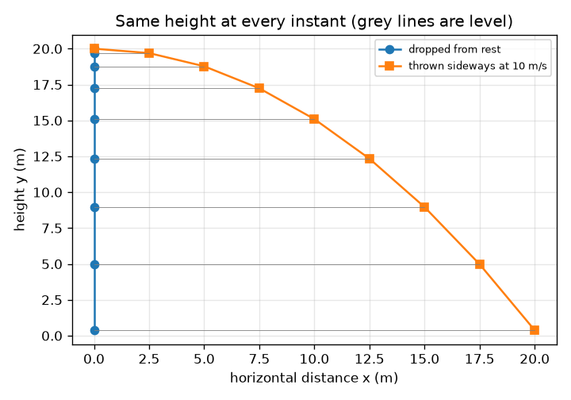
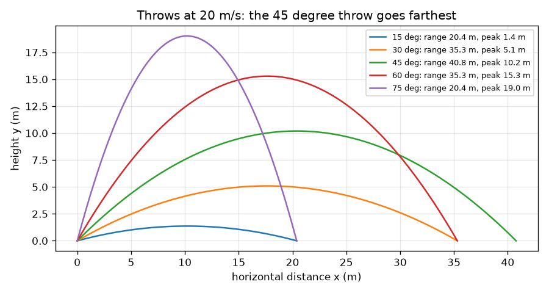

# Session 1: Throw a ball: two independent motions

[Session 1 — हिन्दी](README.hi.md) · [Session 1 — മലയാളം](README.ml.md) · [Session 1 — தமிழ்](README.ta.md) · [Session 1 — తెలుగు](README.te.md)

*Level 1 (conceptual interactive model) · about 60 minutes · openprojectile*

> This is a simplified educational model. It is not a validated design tool and must not be used for real structures, electrical installations, vehicles, industrial processes or medical decisions.

**Prerequisites**

- School trigonometry: sine and cosine.
- You have read PRIMER.md and run `python start.py 1` once.

**Learning objectives.** After this session you can:

- Split a launch velocity into a horizontal and a vertical part.
- Explain why the horizontal and vertical motions do not affect each other.
- Find the time of flight, peak height and range of a throw on level ground.
- Read x(t) and y(t) graphs and describe which one is a straight line and which a parabola.

## A. Real-world problem
A fielder throws the ball to the wicket keeper; a batter lofts it towards the boundary. How far does it go, how high does it get and how long does it hang in the air? The surprise that makes this easy: the sideways motion and the up-and-down motion do not disturb each other, so we can handle them one at a time and then put them together.

## B. Concept and theory
A ball leaves the hand with speed v at an angle a above the horizontal. Its velocity splits into a sideways part vx = v cos(a) and an upward part vy = v sin(a). Sideways nothing pushes the ball (we ignore air), so vx never changes and x = vx t. Up and down gravity pulls with acceleration g, so vy falls steadily and y = vy t - g t^2 / 2. The ball stops rising when vy - g t = 0, which happens at t = vy / g. It takes as long to come down, so the time in the air is T = 2 vy / g, the peak height is H = vy^2 / (2 g) and the range is R = vx T.

| Symbol | Meaning | Unit |
|---|---|---|
| v | launch speed | m/s |
| a | launch angle above the horizontal | degrees |
| vx, vy | horizontal and vertical parts of the launch velocity | m/s |
| g | acceleration of gravity (9.81) | m/s^2 |
| T, H, R | time of flight, peak height, range | s, m, m |
| t | time since launch | s |

**Assumptions**

- No air: nothing acts on the ball except gravity.
- The ground is flat and the ball is launched from ground level.
- The ball is a point; spin and swing are ignored.

$$ v_x=v\cos a,\qquad v_y=v\sin a $$

$$ x=v_x\,t,\qquad y=v_y\,t-\tfrac12 g t^2 $$

$$ T=\frac{2v_y}{g},\qquad H=\frac{v_y^2}{2g},\qquad R=v_x\,T $$

## C. Visual explanation
The first figure shows five throws at the same speed (20 m/s): 15 and 75 degrees land at the same place, as do 30 and 60 degrees, and 45 degrees goes farthest. The second figure drops one ball and throws another sideways from the same height at the same moment: at every instant they are at the same height (the grey lines are level), which is the independence of the two motions.

*A dropped ball and a ball thrown sideways stay level with each other at every instant.*

*Five throws at 20 m/s: 45 degrees goes farthest, and angles that add up to 90 degrees land together.*

## D. Interactive simulation
Run the lesson (`python start.py 1`), then open the live app: [Session 1: throw a ball](https://krunalpanchal1995.github.io/pan-iit-oss/openprojectile/session-01/) (or `app.html` in this folder). Change speed and angle, drag the time slider and watch the green sideways arrow stay the same while the blue vertical arrow shrinks, flips and grows. Switch to the graph view and see x(t) as a straight line and y(t) as a parabola.

**Challenge.** Make the ball land at least 60 m away while its peak stays at or below 15 m.

## E. Worked example and experiment
**Problem.** A ball leaves the ground at 20 m/s at 30 degrees. Find its two velocity parts, the time of flight, the peak height and the range.

1. vx = 20 cos 30 = 20 * 0.8660 = 17.32 m/s and vy = 20 sin 30 = 20 * 0.5 = 10.00 m/s.
2. Time of flight T = 2 vy / g = 2 * 10.00 / 9.81 = 2.04 s.
3. Peak height H = vy^2 / (2 g) = 100 / 19.62 = 5.10 m.
4. Range R = vx T = 17.32 * 2.039 = 35.3 m (keeping more digits gives 35.31 m).
5. Check: at t = T, y = 10.00 * 2.039 - 4.905 * 2.039^2 = 20.39 - 20.39 = 0, so the ball is back on the ground.

**Answer.** vx = 17.32 m/s, vy = 10.00 m/s, T = 2.04 s, H = 5.10 m and R = 35.3 m.

**Experiment.** Throw a tennis ball from the ground on a calm day at about 30 degrees and mark where it first lands, or film it side-on and read its height from the video. Expect it to land short of the prediction. The model has no air and a launch from ground level; a real hand releases the ball above the ground, which adds range, while air takes range away. Model versus reality: the model gets the shape (a parabola) and the independence right; the numbers need drag and launch height, which are the next two sessions.

## F. Assessment and design challenge
**Question type A: Conceptual.** One ball is dropped from rest and a second is thrown horizontally at 10 m/s from the same height at the same instant. Which hits the ground first? Explain.

Hint

Look at the formula for y: does it contain the sideways speed?

Step-by-step solution

They land at the same moment. The height formula y = y0 - g t^2 / 2 has no sideways speed in it: gravity acts only vertically and does not care how fast the ball moves sideways. The thrown ball simply covers more ground while it falls.

**Question type B: Numerical.** A ball is hit at 25 m/s at 36 degrees from the ground. Find vx, vy, the time of flight, the peak height and the range. Does the range look sensible?

Hint

sin 36 = 0.588 and cos 36 = 0.809. Then T = 2 vy / g.

Step-by-step solution

vx = 25 * 0.809 = 20.23 m/s and vy = 25 * 0.588 = 14.69 m/s. T = 2 * 14.69 / 9.81 = 3.00 s. H = 14.69^2 / 19.62 = 11.0 m. R = 20.23 * 3.00 = 60.6 m. Sanity check: a hit of 25 m/s (about 90 km/h) going 60 m is a plausible, if a little long, no-air figure; with air it will be shorter (Session 3). Units: m/s * s = m.

**Question type C: Graph and simulation interpretation.** In the app graph of x(t) and y(t) at 20 m/s and 30 degrees, what shape is each curve, and at what time does y return to zero? What does the slope of the x(t) line tell you?

Hint

One formula has t, the other has t^2.

Step-by-step solution

x(t) = vx t is a straight line; its slope is the constant sideways speed 17.32 m/s. y(t) = vy t - g t^2 / 2 is a parabola opening downwards; it returns to zero at T = 2.04 s, half way (1.02 s) it peaks at 5.10 m. The straight line against the curve is the independence of the two motions.

**Question type D: Design and optimisation challenge.** A keeper stands 35 m from a fielder who throws at 20 m/s. Using the app, find two different angles that both reach him. Compare the flights and say when you would choose each.

Hint

Try 30 degrees, then look for a second angle that gives the same range.

Step-by-step solution

30 and 60 degrees both give a range of 35.3 m at 20 m/s. At 30 degrees the flight takes 2.04 s and peaks at 5.1 m: quick and low, best when a runner is going (but the ball arrives fast and flat). At 60 degrees it takes 3.53 s and peaks at 15.3 m: slow, easy to catch as it drops steeply, but it gives a runner more time. Assumption: no air, equal heights.

Score yourself with [RUBRIC.md](../../RUBRIC.md). Print the [activity sheet](activity_sheet.md) to work on paper.

## Common misconceptions
| Common misconception | What is actually true |
|---|---|
| A thrown ball keeps being pushed forward by the throw. | Once it leaves the hand nothing pushes it sideways (without air). It keeps its sideways speed because nothing slows it. |
| At the peak the ball stops moving. | Only the vertical speed is zero at the peak; the sideways speed is unchanged, so the ball is still moving at v cos(a). |
| A faster sideways throw falls more slowly. | The fall depends only on gravity and time. A ball thrown sideways falls exactly like a dropped one. |
| The longest throw is the highest throw. | A very high throw goes up and comes down almost in the same place. On level ground the longest range is at 45 degrees. |

## Glossary
- **projectile**: an object moving only under gravity after it has been launched
- **component**: one of the parts a vector splits into, such as the sideways part vx
- **range**: horizontal distance from launch to landing
- **time of flight**: how long the ball stays in the air
- **trajectory**: the path of the ball through space

## Finish
1. Do the three coding tasks in [exercises.md](exercises.md).
2. Run `python start.py 1` again after your changes. It ends with the checkpoint; when it prints `PASS`, you are done. (Checkpoint only: `python start.py check 1`.)

Next: [Session 2](../session-02/README.md)
