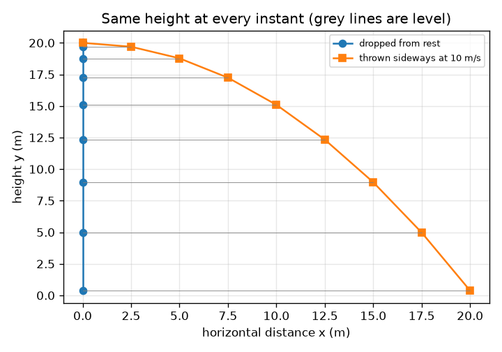
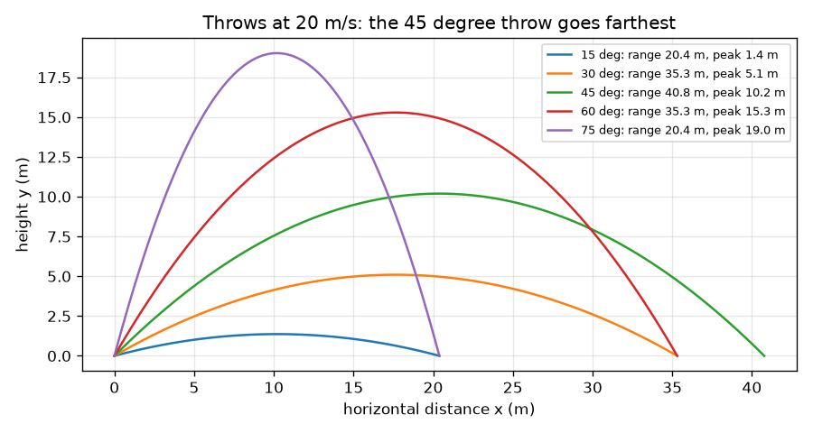

# സെഷൻ 1: ഒരു പന്ത് എറിയുക: സ്വതന്ത്രമായ രണ്ടു ചലനങ്ങൾ

[Session 1 — हिन्दी](README.hi.md)

*തലം 1 (ആശയപരമായ സംവേദനാത്മക മാതൃക) · ഏകദേശം 60 മിനിറ്റ് · openprojectile*

> ഇതൊരു ലളിതവൽക്കരിച്ച വിദ്യാഭ്യാസ മാതൃകയാണ്. ഇത് സാധൂകരിച്ച ഡിസൈൻ ഉപകരണമല്ല; യഥാർഥ നിർമിതികൾ, വൈദ്യുത ഇൻസ്റ്റലേഷനുകൾ, വാഹനങ്ങൾ, വ്യാവസായിക പ്രക്രിയകൾ, വൈദ്യശാസ്ത്ര തീരുമാനങ്ങൾ എന്നിവയ്ക്ക് ഇത് ഉപയോഗിക്കരുത്.

**മുൻവിജ്ഞാനം (Prerequisites)**

- സ്കൂൾ ത്രികോണമിതി: സൈനും കൊസൈനും.
- നിങ്ങൾ PRIMER.md വായിക്കുകയും `python start.py 1` ഒരു തവണ റൺ ചെയ്യുകയും ചെയ്തിരിക്കണം.

**പഠനലക്ഷ്യങ്ങൾ (Learning objectives).** ഈ സെഷനു ശേഷം നിങ്ങൾക്ക്:

- വിക്ഷേപണ പ്രവേഗത്തെ (launch velocity) തിരശ്ചീനവും ലംബവുമായ ഭാഗങ്ങളായി വിഭജിക്കാം.
- തിരശ്ചീന, ലംബ ചലനങ്ങൾ പരസ്പരം ബാധിക്കാത്തത് എന്തുകൊണ്ടെന്ന് വിശദീകരിക്കാം.
- നിരപ്പായ നിലത്തെ ഒരു ഏറിന്റെ പറക്കൽ സമയം, ഉയരം, ദൂരപരിധി എന്നിവ കണ്ടെത്താം.
- x(t), y(t) ഗ്രാഫുകൾ വായിച്ച് ഏതാണ് നേർരേഖ, ഏതാണ് പരാബോള എന്ന് വിവരിക്കാം.

## A. യഥാർഥ ജീവിത പ്രശ്നം
ഒരു ഫീൽഡർ പന്ത് വിക്കറ്റ് കീപ്പറിലേക്ക് എറിയുന്നു; ഒരു ബാറ്റർ അത് ബൗണ്ടറിയിലേക്ക് ഉയർത്തിയടിക്കുന്നു. അത് എത്ര ദൂരം പോകും, എത്ര ഉയരത്തിലെത്തും, എത്ര നേരം വായുവിൽ നിൽക്കും? ഇത് എളുപ്പമാക്കുന്ന അത്ഭുതം ഇതാണ്: വശങ്ങളിലേക്കുള്ള ചലനവും മുകളിലേക്കും താഴേക്കുമുള്ള ചലനവും പരസ്പരം ശല്യപ്പെടുത്തുന്നില്ല, അതിനാൽ നമുക്ക് അവയെ ഓരോന്നായി കൈകാര്യം ചെയ്ത് പിന്നീട് കൂട്ടിച്ചേർക്കാം.

## B. ആശയവും സിദ്ധാന്തവും
ഒരു പന്ത് v വേഗത്തിൽ, തിരശ്ചീനത്തിനു മുകളിൽ a കോണിൽ കൈയിൽ നിന്ന് വിടുന്നു. അതിന്റെ പ്രവേഗം വശത്തേക്കുള്ള ഭാഗം vx = v cos(a), മുകളിലേക്കുള്ള ഭാഗം vy = v sin(a) എന്നിങ്ങനെ വിഭജിക്കപ്പെടുന്നു. വശത്തേക്ക് പന്തിനെ ഒന്നും തള്ളുന്നില്ല (വായു അവഗണിക്കുന്നു), അതിനാൽ vx ഒരിക്കലും മാറുന്നില്ല, x = vx t. മുകളിലേക്കും താഴേക്കും ഗുരുത്വം ത്വരണം g-യോടെ വലിക്കുന്നു, അതിനാൽ vy ക്രമമായി കുറയുന്നു, y = vy t - g t^2 / 2. vy - g t = 0 ആകുമ്പോൾ പന്ത് ഉയരുന്നത് നിർത്തുന്നു, അത് t = vy / g-ൽ സംഭവിക്കുന്നു. താഴേക്കു വരാനും അത്രയും സമയം എടുക്കുന്നു, അതിനാൽ വായുവിലെ സമയം T = 2 vy / g, പരമാവധി ഉയരം H = vy^2 / (2 g), ദൂരപരിധി R = vx T.

| ചിഹ്നം | അർഥം | യൂണിറ്റ് |
|---|---|---|
| v | വിക്ഷേപണ വേഗം | m/s |
| a | തിരശ്ചീനത്തിനു മുകളിലുള്ള വിക്ഷേപണ കോൺ | ഡിഗ്രി |
| vx, vy | വിക്ഷേപണ പ്രവേഗത്തിന്റെ തിരശ്ചീന, ലംബ ഭാഗങ്ങൾ | m/s |
| g | ഗുരുത്വ ത്വരണം (9.81) | m/s^2 |
| T, H, R | പറക്കൽ സമയം, പരമാവധി ഉയരം, ദൂരപരിധി | s, m, m |
| t | വിക്ഷേപണം മുതലുള്ള സമയം | s |

**അനുമാനങ്ങൾ (Assumptions)**

- വായു ഇല്ല: പന്തിൽ ഗുരുത്വം അല്ലാതെ മറ്റൊന്നും പ്രവർത്തിക്കുന്നില്ല.
- തറ നിരപ്പാണ്, പന്ത് തറനിരപ്പിൽ നിന്നാണ് വിക്ഷേപിക്കുന്നത്.
- പന്ത് ഒരു ബിന്ദുവാണ്; സ്പിന്നും സ്വിങ്ങും അവഗണിക്കുന്നു.

$$ v_x=v\cos a,\qquad v_y=v\sin a $$

$$ x=v_x\,t,\qquad y=v_y\,t-\tfrac12 g t^2 $$

$$ T=\frac{2v_y}{g},\qquad H=\frac{v_y^2}{2g},\qquad R=v_x\,T $$

## C. ദൃശ്യ വിശദീകരണം
ആദ്യ ചിത്രം ഒരേ വേഗത്തിലുള്ള (20 m/s) അഞ്ച് ഏറുകൾ കാണിക്കുന്നു: 15, 75 ഡിഗ്രികൾ ഒരേ സ്ഥലത്ത് വീഴുന്നു, 30, 60 ഡിഗ്രികളും അങ്ങനെ തന്നെ, 45 ഡിഗ്രി ഏറ്റവും ദൂരം പോകുന്നു. രണ്ടാമത്തെ ചിത്രം ഒരേ ഉയരത്തിൽ നിന്ന് ഒരേ നിമിഷം ഒരു പന്ത് താഴെയിടുകയും മറ്റൊന്ന് വശത്തേക്ക് എറിയുകയും ചെയ്യുന്നു: ഓരോ നിമിഷത്തിലും അവ ഒരേ ഉയരത്തിലാണ് (ചാരനിറ വരകൾ നിരപ്പാണ്), ഇതാണ് രണ്ടു ചലനങ്ങളുടെയും സ്വാതന്ത്ര്യം.

*താഴെയിട്ട പന്തും വശത്തേക്ക് എറിഞ്ഞ പന്തും ഓരോ നിമിഷത്തിലും പരസ്പരം ഒരേ നിരപ്പിൽ തുടരുന്നു.*

*20 m/s-ൽ അഞ്ച് ഏറുകൾ: 45 ഡിഗ്രി ഏറ്റവും ദൂരം പോകുന്നു, 90 ഡിഗ്രിയിൽ കൂടിച്ചേരുന്ന കോണുകൾ ഒരേ സ്ഥലത്ത് വീഴുന്നു.*

## D. സംവേദനാത്മക സിമുലേഷൻ
പാഠം റൺ ചെയ്യുക (`python start.py 1`), എന്നിട്ട് ലൈവ് ആപ്പ് തുറക്കുക: [സെഷൻ 1: ഒരു പന്ത് എറിയുക](https://krunalpanchal1995.github.io/pan-iit-oss/openprojectile/session-01/) (അല്ലെങ്കിൽ ഈ ഫോൾഡറിലെ `app.html`). വേഗവും കോണും മാറ്റുക, സമയ സ്ലൈഡർ വലിച്ച് പച്ച തിരശ്ചീന അമ്പ് മാറാതെ നിൽക്കുന്നതും നീല ലംബ അമ്പ് ചുരുങ്ങി, തിരിഞ്ഞ്, വളരുന്നതും കാണുക. ഗ്രാഫ് കാഴ്ചയിലേക്കു മാറി x(t) നേർരേഖയായും y(t) പരാബോളയായും കാണുക.

**വെല്ലുവിളി.** പന്ത് കുറഞ്ഞത് 60 m അകലെ വീഴണം, അതേസമയം അതിന്റെ പരമാവധി ഉയരം 15 m-ൽ കൂടരുത്.

## E. ഉദാഹരണവും പരീക്ഷണവും
**പ്രശ്നം.** ഒരു പന്ത് തറയിൽ നിന്ന് 20 m/s വേഗത്തിൽ 30 ഡിഗ്രിയിൽ വിടുന്നു. അതിന്റെ രണ്ടു പ്രവേഗ ഭാഗങ്ങൾ, പറക്കൽ സമയം, പരമാവധി ഉയരം, ദൂരപരിധി എന്നിവ കണ്ടെത്തുക.

1. vx = 20 cos 30 = 20 * 0.8660 = 17.32 m/s, vy = 20 sin 30 = 20 * 0.5 = 10.00 m/s.
2. പറക്കൽ സമയം T = 2 vy / g = 2 * 10.00 / 9.81 = 2.04 s.
3. പരമാവധി ഉയരം H = vy^2 / (2 g) = 100 / 19.62 = 5.10 m.
4. ദൂരപരിധി R = vx T = 17.32 * 2.039 = 35.3 m (കൂടുതൽ അക്കങ്ങൾ നിലനിർത്തിയാൽ 35.31 m കിട്ടും).
5. പരിശോധന: t = T-ൽ, y = 10.00 * 2.039 - 4.905 * 2.039^2 = 20.39 - 20.39 = 0, അതായത് പന്ത് വീണ്ടും തറയിലാണ്.

**ഉത്തരം.** vx = 17.32 m/s, vy = 10.00 m/s, T = 2.04 s, H = 5.10 m, R = 35.3 m.

**പരീക്ഷണം.** കാറ്റില്ലാത്ത ദിവസം ഒരു ടെന്നീസ് പന്ത് തറയിൽ നിന്ന് ഏകദേശം 30 ഡിഗ്രിയിൽ എറിഞ്ഞ് അത് ആദ്യം വീഴുന്ന സ്ഥലം അടയാളപ്പെടുത്തുക, അല്ലെങ്കിൽ വശത്തുനിന്ന് ചിത്രീകരിച്ച് വീഡിയോയിൽ നിന്ന് അതിന്റെ ഉയരം വായിക്കുക. പ്രവചനത്തെക്കാൾ കുറഞ്ഞ ദൂരത്ത് വീഴുമെന്ന് പ്രതീക്ഷിക്കുക. മാതൃകയിൽ വായുവില്ല, തറനിരപ്പിൽ നിന്നാണ് വിക്ഷേപണം; യഥാർഥ കൈ പന്തിനെ തറയ്ക്കു മുകളിൽ നിന്ന് വിടുന്നു, അത് ദൂരം കൂട്ടുന്നു, വായു ദൂരം കുറയ്ക്കുന്നു. മാതൃകയും യാഥാർഥ്യവും: മാതൃക ആകൃതി (പരാബോള), സ്വാതന്ത്ര്യം എന്നിവ ശരിയായി നൽകുന്നു; സംഖ്യകൾക്ക് വായു പ്രതിരോധവും വിക്ഷേപണ ഉയരവും വേണം, അവ അടുത്ത രണ്ടു സെഷനുകളാണ്.

## F. മൂല്യനിർണയവും ഡിസൈൻ വെല്ലുവിളിയും
**ചോദ്യ തരം A: ആശയപരം.** ഒരു പന്ത് നിശ്ചലാവസ്ഥയിൽ നിന്ന് താഴെയിടുകയും രണ്ടാമത്തേത് അതേ ഉയരത്തിൽ നിന്ന് അതേ നിമിഷം 10 m/s വേഗത്തിൽ തിരശ്ചീനമായി എറിയുകയും ചെയ്യുന്നു. ഏതാണ് ആദ്യം നിലത്തു വീഴുക? വിശദീകരിക്കുക.

സൂചന

y-യുടെ സൂത്രവാക്യം നോക്കുക: അതിൽ വശത്തേക്കുള്ള വേഗമുണ്ടോ?

ഘട്ടം ഘട്ടമായ പരിഹാരം

അവ ഒരേ നിമിഷം വീഴുന്നു. ഉയരത്തിന്റെ സൂത്രവാക്യം y = y0 - g t^2 / 2-ൽ വശത്തേക്കുള്ള വേഗമില്ല: ഗുരുത്വം ലംബമായി മാത്രം പ്രവർത്തിക്കുന്നു, പന്ത് വശത്തേക്ക് എത്ര വേഗത്തിൽ നീങ്ങുന്നു എന്നത് അതിനു പ്രശ്നമല്ല. എറിഞ്ഞ പന്ത് വീഴുമ്പോൾ കൂടുതൽ ദൂരം സഞ്ചരിക്കുന്നു എന്നു മാത്രം.

**ചോദ്യ തരം B: സംഖ്യാപരം.** ഒരു പന്ത് തറയിൽ നിന്ന് 25 m/s വേഗത്തിൽ 36 ഡിഗ്രിയിൽ അടിക്കുന്നു. vx, vy, പറക്കൽ സമയം, പരമാവധി ഉയരം, ദൂരപരിധി എന്നിവ കണ്ടെത്തുക. ദൂരപരിധി യുക്തിസഹമായി തോന്നുന്നുണ്ടോ?

സൂചന

sin 36 = 0.588, cos 36 = 0.809. പിന്നെ T = 2 vy / g.

ഘട്ടം ഘട്ടമായ പരിഹാരം

vx = 25 * 0.809 = 20.23 m/s, vy = 25 * 0.588 = 14.69 m/s. T = 2 * 14.69 / 9.81 = 3.00 s. H = 14.69^2 / 19.62 = 11.0 m. R = 20.23 * 3.00 = 60.6 m. യുക്തിപരിശോധന: 25 m/s (ഏകദേശം 90 km/h) വേഗത്തിലുള്ള അടി 60 m പോകുന്നത് വായുവില്ലാത്ത കണക്കിൽ യുക്തിസഹമാണ്, അല്പം നീളമുണ്ടെങ്കിലും; വായുവുണ്ടെങ്കിൽ അത് കുറയും (സെഷൻ 3). യൂണിറ്റുകൾ: m/s * s = m.

**ചോദ്യ തരം C: ഗ്രാഫും സിമുലേഷനും വ്യാഖ്യാനിക്കൽ.** 20 m/s, 30 ഡിഗ്രിയിലെ x(t), y(t) ആപ്പ് ഗ്രാഫിൽ ഓരോ വക്രത്തിന്റെയും ആകൃതി എന്താണ്, y എത്ര സമയത്ത് വീണ്ടും പൂജ്യമാകുന്നു? x(t) രേഖയുടെ ചരിവ് നിങ്ങളോട് എന്തു പറയുന്നു?

സൂചന

ഒരു സൂത്രവാക്യത്തിൽ t ഉണ്ട്, മറ്റൊന്നിൽ t^2 ഉണ്ട്.

ഘട്ടം ഘട്ടമായ പരിഹാരം

x(t) = vx t ഒരു നേർരേഖയാണ്; അതിന്റെ ചരിവ് സ്ഥിരമായ വശത്തേക്കുള്ള വേഗം 17.32 m/s ആണ്. y(t) = vy t - g t^2 / 2 താഴേക്കു തുറക്കുന്ന പരാബോളയാണ്; അത് T = 2.04 s-ൽ വീണ്ടും പൂജ്യമാകുന്നു, പകുതിയിൽ (1.02 s) 5.10 m-ൽ ഉച്ചസ്ഥിതിയിലെത്തുന്നു. നേർരേഖയും വക്രവും ഒരുമിച്ചിരിക്കുന്നത് രണ്ടു ചലനങ്ങളുടെ സ്വാതന്ത്ര്യമാണ്.

**ചോദ്യ തരം D: ഡിസൈൻ, ഒപ്റ്റിമൈസേഷൻ വെല്ലുവിളി.** ഒരു കീപ്പർ ഫീൽഡറിൽ നിന്ന് 35 m അകലെ നിൽക്കുന്നു, ഫീൽഡർ 20 m/s വേഗത്തിൽ എറിയുന്നു. ആപ്പ് ഉപയോഗിച്ച്, രണ്ടും അവനിൽ എത്തുന്ന രണ്ടു വ്യത്യസ്ത കോണുകൾ കണ്ടെത്തുക. പറക്കലുകൾ താരതമ്യം ചെയ്ത് ഓരോന്നും എപ്പോൾ തിരഞ്ഞെടുക്കുമെന്ന് പറയുക.

സൂചന

30 ഡിഗ്രി പരീക്ഷിക്കുക, എന്നിട്ട് അതേ ദൂരപരിധി നൽകുന്ന രണ്ടാമത്തെ കോൺ തിരയുക.

ഘട്ടം ഘട്ടമായ പരിഹാരം

20 m/s-ൽ 30, 60 ഡിഗ്രികൾ രണ്ടും 35.3 m ദൂരപരിധി നൽകുന്നു. 30 ഡിഗ്രിയിൽ പറക്കലിന് 2.04 s എടുക്കുകയും 5.1 m-ൽ ഉച്ചസ്ഥിതിയിലെത്തുകയും ചെയ്യുന്നു: വേഗമേറിയതും താഴ്ന്നതും, ഒരു ഓട്ടക്കാരൻ ഓടുമ്പോൾ ഏറ്റവും നല്ലത് (പക്ഷേ പന്ത് വേഗത്തിലും പരന്നും വരുന്നു). 60 ഡിഗ്രിയിൽ 3.53 s എടുക്കുകയും 15.3 m-ൽ ഉച്ചസ്ഥിതിയിലെത്തുകയും ചെയ്യുന്നു: മന്ദഗതിയിൽ, കുത്തനെ വീഴുന്നതിനാൽ പിടിക്കാൻ എളുപ്പം, പക്ഷേ അത് ഓട്ടക്കാരന് കൂടുതൽ സമയം നൽകുന്നു. അനുമാനം: വായുവില്ല, തുല്യ ഉയരങ്ങൾ.

[RUBRIC.md](../../RUBRIC.md) ഉപയോഗിച്ച് സ്വയം മാർക്കിടുക. കടലാസിൽ ചെയ്യാൻ [പ്രവർത്തന ഷീറ്റ്](activity_sheet.md) പ്രിന്റ് ചെയ്യുക.

## സാധാരണ തെറ്റിദ്ധാരണകൾ
| സാധാരണ തെറ്റിദ്ധാരണ | യഥാർഥത്തിൽ ശരിയായത് |
|---|---|
| എറിഞ്ഞ പന്തിനെ ഏറ് തുടർന്നും മുന്നോട്ടു തള്ളിക്കൊണ്ടിരിക്കുന്നു. | കൈയിൽ നിന്ന് വിട്ടാൽ (വായുവില്ലെങ്കിൽ) ഒന്നും അതിനെ വശത്തേക്കു തള്ളുന്നില്ല. ഒന്നും വേഗത കുറയ്ക്കാത്തതിനാൽ അത് വശത്തേക്കുള്ള വേഗം നിലനിർത്തുന്നു. |
| ഉച്ചസ്ഥിതിയിൽ പന്ത് ചലിക്കുന്നത് നിർത്തുന്നു. | ഉച്ചസ്ഥിതിയിൽ ലംബ വേഗം മാത്രമാണ് പൂജ്യം; വശത്തേക്കുള്ള വേഗം മാറുന്നില്ല, അതിനാൽ പന്ത് ഇപ്പോഴും v cos(a) വേഗത്തിൽ ചലിക്കുന്നു. |
| വശത്തേക്ക് വേഗത്തിൽ എറിഞ്ഞ പന്ത് കൂടുതൽ പതുക്കെ വീഴുന്നു. | വീഴ്ച ഗുരുത്വത്തെയും സമയത്തെയും മാത്രം ആശ്രയിക്കുന്നു. വശത്തേക്ക് എറിഞ്ഞ പന്ത് താഴെയിട്ടതുപോലെ തന്നെ വീഴുന്നു. |
| ഏറ്റവും ഉയരത്തിലുള്ള ഏറാണ് ഏറ്റവും ദൂരത്തേത്. | വളരെ ഉയർന്ന ഏറ് മുകളിലേക്കു പോയി ഏകദേശം അതേ സ്ഥലത്തു തിരിച്ചുവരുന്നു. നിരപ്പായ നിലത്ത് ഏറ്റവും കൂടിയ ദൂരപരിധി 45 ഡിഗ്രിയിലാണ്. |

## പദാവലി (Glossary)
- **പ്രക്ഷേപ്യം (projectile)**: വിക്ഷേപിച്ചതിനു ശേഷം ഗുരുത്വത്തിന്റെ സ്വാധീനത്തിൽ മാത്രം ചലിക്കുന്ന വസ്തു
- **ഘടകം (component)**: ഒരു സദിശം വിഭജിക്കപ്പെടുന്ന ഭാഗങ്ങളിൽ ഒന്ന്, ഉദാഹരണത്തിന് വശത്തേക്കുള്ള ഭാഗം vx
- **ദൂരപരിധി (range)**: വിക്ഷേപണ സ്ഥാനം മുതൽ വീഴുന്ന സ്ഥാനം വരെയുള്ള തിരശ്ചീന ദൂരം
- **പറക്കൽ സമയം (time of flight)**: പന്ത് വായുവിൽ നിൽക്കുന്ന സമയം
- **സഞ്ചാരപഥം (trajectory)**: ശൂന്യാകാശത്തിലൂടെ പന്ത് സഞ്ചരിക്കുന്ന പാത

## പൂർത്തിയാക്കൽ
1. [exercises.md](exercises.md)-ലെ മൂന്ന് കോഡിങ് ജോലികൾ ചെയ്യുക.
2. മാറ്റങ്ങൾക്കു ശേഷം `python start.py 1` വീണ്ടും റൺ ചെയ്യുക. അത് ചെക്ക്പോയിന്റോടെ അവസാനിക്കുന്നു; `PASS` എന്ന് പ്രിന്റ് ചെയ്താൽ നിങ്ങൾ പൂർത്തിയാക്കി. (ചെക്ക്പോയിന്റ് മാത്രം: `python start.py check 1`.)

അടുത്തത്: [സെഷൻ 2](../session-02/README.md)
