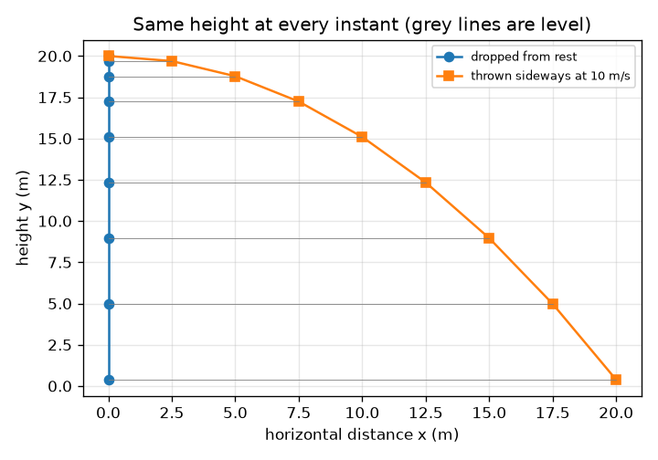
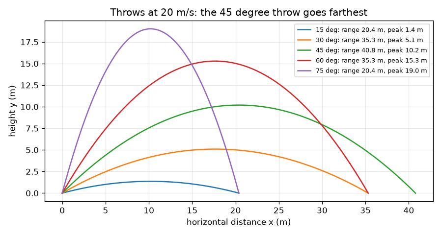

# அமர்வு 1: ஒரு பந்தை எறிதல்: இரு தனித்த இயக்கங்கள்

[Session 1 — हिन्दी](README.hi.md)

*நிலை 1 (கருத்தியல் ஊடாடும் மாதிரி) · சுமார் 60 நிமிடங்கள் · openprojectile*

> இது எளிமைப்படுத்தப்பட்ட கல்வி மாதிரி. இது சரிபார்க்கப்பட்ட வடிவமைப்புக் கருவி அல்ல; உண்மையான கட்டமைப்புகள், மின் நிறுவல்கள், வாகனங்கள், தொழில்துறை செயல்முறைகள் அல்லது மருத்துவ முடிவுகளுக்கு இதைப் பயன்படுத்தக் கூடாது.

**முன்தேவைகள் (Prerequisites)**

- பள்ளி முக்கோணவியல்: சைன் மற்றும் கொசைன்.
- நீங்கள் PRIMER.md ஐப் படித்து, `python start.py 1` ஐ ஒருமுறை இயக்கியிருக்க வேண்டும்.

**கற்றல் நோக்கங்கள் (Learning objectives).** இந்த அமர்வுக்குப் பிறகு உங்களால்:

- ஏவு வேகத்தை (launch velocity) கிடைமட்ட, செங்குத்துப் பகுதிகளாகப் பிரிக்க முடியும்.
- கிடைமட்ட, செங்குத்து இயக்கங்கள் ஒன்றையொன்று பாதிக்காதது ஏன் என்பதை விளக்க முடியும்.
- சமமான தரையில் ஓர் எறிதலின் பறக்கும் நேரம், உச்ச உயரம், வீச்சு ஆகியவற்றைக் காண முடியும்.
- x(t), y(t) வரைபடங்களைப் படித்து எது நேர்க்கோடு, எது பரவளையம் என்று விவரிக்க முடியும்.

## A. நிஜ வாழ்க்கைப் பிரச்சினை
ஒரு பீல்டர் பந்தை விக்கெட் கீப்பருக்கு எறிகிறார்; ஒரு பேட்டர் அதை எல்லைக்கோட்டை நோக்கி உயர்த்தி அடிக்கிறார். அது எவ்வளவு தூரம் செல்லும், எவ்வளவு உயரம் போகும், எவ்வளவு நேரம் காற்றில் இருக்கும்? இதை எளிதாக்கும் ஆச்சரியம் இது: பக்கவாட்டு இயக்கமும் மேலும் கீழுமான இயக்கமும் ஒன்றையொன்று தொந்தரவு செய்வதில்லை, எனவே அவற்றை ஒவ்வொன்றாகக் கையாண்டு பின் இணைக்கலாம்.

## B. கருத்தும் கோட்பாடும்
ஒரு பந்து v வேகத்தில், கிடைமட்டத்துக்கு மேல் a கோணத்தில் கையை விட்டுப் புறப்படுகிறது. அதன் திசைவேகம் பக்கவாட்டுப் பகுதி vx = v cos(a), மேல்நோக்கிய பகுதி vy = v sin(a) எனப் பிரிகிறது. பக்கவாட்டில் பந்தை எதுவும் தள்ளுவதில்லை (காற்றைப் புறக்கணிக்கிறோம்), எனவே vx ஒருபோதும் மாறாது, x = vx t. மேலும் கீழும் புவியீர்ப்பு முடுக்கம் g உடன் இழுக்கிறது, எனவே vy சீராகக் குறைகிறது, y = vy t - g t^2 / 2. vy - g t = 0 ஆகும்போது பந்து உயர்வதை நிறுத்துகிறது, அது t = vy / g இல் நிகழ்கிறது. கீழே வர அதே நேரம் ஆகிறது, எனவே காற்றில் இருக்கும் நேரம் T = 2 vy / g, உச்ச உயரம் H = vy^2 / (2 g), வீச்சு R = vx T.

| குறியீடு | பொருள் | அலகு |
|---|---|---|
| v | ஏவு வேகம் | m/s |
| a | கிடைமட்டத்துக்கு மேலான ஏவுகோணம் | டிகிரி |
| vx, vy | ஏவு திசைவேகத்தின் கிடைமட்ட, செங்குத்துப் பகுதிகள் | m/s |
| g | புவியீர்ப்பு முடுக்கம் (9.81) | m/s^2 |
| T, H, R | பறக்கும் நேரம், உச்ச உயரம், வீச்சு | s, m, m |
| t | ஏவியதிலிருந்து நேரம் | s |

**அனுமானங்கள் (Assumptions)**

- காற்று இல்லை: புவியீர்ப்பைத் தவிர பந்தின் மீது வேறெதுவும் செயல்படாது.
- தரை சமமானது, பந்து தரை மட்டத்திலிருந்து ஏவப்படுகிறது.
- பந்து ஒரு புள்ளி; சுழற்சியும் ஸ்விங்கும் புறக்கணிக்கப்படுகின்றன.

$$ v_x=v\cos a,\qquad v_y=v\sin a $$

$$ x=v_x\,t,\qquad y=v_y\,t-\tfrac12 g t^2 $$

$$ T=\frac{2v_y}{g},\qquad H=\frac{v_y^2}{2g},\qquad R=v_x\,T $$

## C. காட்சி விளக்கம்
முதல் படம் ஒரே வேகத்தில் (20 m/s) ஐந்து எறிதல்களைக் காட்டுகிறது: 15, 75 டிகிரிகள் ஒரே இடத்தில் விழுகின்றன, 30, 60 டிகிரிகளும் அவ்வாறே, 45 டிகிரி மிகத் தொலைவு செல்கிறது. இரண்டாவது படம் ஒரே உயரத்திலிருந்து ஒரே கணத்தில் ஒரு பந்தை விடுகிறது, மற்றொன்றைப் பக்கவாட்டில் எறிகிறது: ஒவ்வொரு கணத்திலும் அவை ஒரே உயரத்தில் உள்ளன (சாம்பல் கோடுகள் சமமாக உள்ளன), இதுவே இரு இயக்கங்களின் தனித்தன்மை.

*கீழே விட்ட பந்தும் பக்கவாட்டில் எறிந்த பந்தும் ஒவ்வொரு கணத்திலும் ஒன்றோடொன்று சம மட்டத்தில் இருக்கின்றன.*

*20 m/s இல் ஐந்து எறிதல்கள்: 45 டிகிரி மிகத் தொலைவு செல்கிறது, கூட்டுத்தொகை 90 டிகிரி ஆகும் கோணங்கள் ஒன்றாக விழுகின்றன.*

## D. ஊடாடும் உருவகப்படுத்தல்
பாடத்தை இயக்குங்கள் (`python start.py 1`), பின் நேரடி பயன்பாட்டைத் திறக்கவும்: [அமர்வு 1: ஒரு பந்தை எறிதல்](https://krunalpanchal1995.github.io/pan-iit-oss/openprojectile/session-01/) (அல்லது இந்தக் கோப்புறையில் உள்ள `app.html`). வேகத்தையும் கோணத்தையும் மாற்றுங்கள், நேர ஸ்லைடரை இழுத்து பச்சைப் பக்கவாட்டு அம்பு மாறாமல் இருப்பதையும், நீல செங்குத்து அம்பு சுருங்கி, திரும்பி, வளர்வதையும் பாருங்கள். வரைபடக் காட்சிக்கு மாறி x(t) ஐ நேர்க்கோடாகவும் y(t) ஐ பரவளையமாகவும் காணுங்கள்.

**சவால்.** பந்து குறைந்தது 60 m தொலைவில் விழ வேண்டும், அதே நேரம் அதன் உச்சம் 15 m அல்லது அதற்குக் கீழ் இருக்க வேண்டும்.

## E. தீர்க்கப்பட்ட எடுத்துக்காட்டும் சோதனையும்
**சிக்கல்.** ஒரு பந்து தரையிலிருந்து 20 m/s வேகத்தில் 30 டிகிரியில் புறப்படுகிறது. அதன் இரு திசைவேகப் பகுதிகள், பறக்கும் நேரம், உச்ச உயரம், வீச்சு ஆகியவற்றைக் காண்க.

1. vx = 20 cos 30 = 20 * 0.8660 = 17.32 m/s, vy = 20 sin 30 = 20 * 0.5 = 10.00 m/s.
2. பறக்கும் நேரம் T = 2 vy / g = 2 * 10.00 / 9.81 = 2.04 s.
3. உச்ச உயரம் H = vy^2 / (2 g) = 100 / 19.62 = 5.10 m.
4. வீச்சு R = vx T = 17.32 * 2.039 = 35.3 m (அதிக இலக்கங்களை வைத்தால் 35.31 m கிடைக்கும்).
5. சரிபார்ப்பு: t = T இல், y = 10.00 * 2.039 - 4.905 * 2.039^2 = 20.39 - 20.39 = 0, அதாவது பந்து மீண்டும் தரையில் உள்ளது.

**விடை.** vx = 17.32 m/s, vy = 10.00 m/s, T = 2.04 s, H = 5.10 m, R = 35.3 m.

**சோதனை.** காற்றில்லாத நாளில் ஒரு டென்னிஸ் பந்தை தரையிலிருந்து சுமார் 30 டிகிரியில் எறிந்து அது முதலில் விழும் இடத்தைக் குறியுங்கள், அல்லது பக்கவாட்டிலிருந்து படம்பிடித்து வீடியோவிலிருந்து அதன் உயரத்தைப் படியுங்கள். கணிப்பை விடக் குறைந்த தூரத்தில் விழும் என எதிர்பாருங்கள். மாதிரியில் காற்று இல்லை, தரை மட்டத்திலிருந்து ஏவல்; உண்மையான கை பந்தைத் தரைக்கு மேலிருந்து விடுகிறது, அது வீச்சைக் கூட்டுகிறது, காற்று வீச்சைக் குறைக்கிறது. மாதிரியும் நிஜமும்: மாதிரி வடிவத்தை (பரவளையம்) மற்றும் தனித்தன்மையைச் சரியாகத் தருகிறது; எண்களுக்கு இழுவையும் ஏவு உயரமும் தேவை, அவை அடுத்த இரு அமர்வுகள்.

## F. மதிப்பீடும் வடிவமைப்புச் சவாலும்
**கேள்வி வகை A: கருத்தியல்.** ஒரு பந்து ஓய்விலிருந்து கீழே விடப்படுகிறது, இரண்டாவது அதே உயரத்திலிருந்து அதே கணத்தில் 10 m/s வேகத்தில் கிடைமட்டமாக எறியப்படுகிறது. எது முதலில் தரையைத் தொடும்? விளக்குக.

குறிப்பு

y இன் சூத்திரத்தைப் பாருங்கள்: அதில் பக்கவாட்டு வேகம் உள்ளதா?

படிப்படியான தீர்வு

அவை ஒரே கணத்தில் விழுகின்றன. உயரச் சூத்திரம் y = y0 - g t^2 / 2 இல் பக்கவாட்டு வேகம் இல்லை: புவியீர்ப்பு செங்குத்தாக மட்டுமே செயல்படுகிறது, பந்து பக்கவாட்டில் எவ்வளவு வேகமாகச் செல்கிறது என்பதைப் பற்றி அதற்குக் கவலையில்லை. எறியப்பட்ட பந்து விழும்போது அதிக தூரத்தைக் கடக்கிறது, அவ்வளவே.

**கேள்வி வகை B: எண்சார்ந்த.** ஒரு பந்து தரையிலிருந்து 25 m/s வேகத்தில் 36 டிகிரியில் அடிக்கப்படுகிறது. vx, vy, பறக்கும் நேரம், உச்ச உயரம், வீச்சு ஆகியவற்றைக் காண்க. வீச்சு நியாயமாகத் தெரிகிறதா?

குறிப்பு

sin 36 = 0.588, cos 36 = 0.809. பின் T = 2 vy / g.

படிப்படியான தீர்வு

vx = 25 * 0.809 = 20.23 m/s, vy = 25 * 0.588 = 14.69 m/s. T = 2 * 14.69 / 9.81 = 3.00 s. H = 14.69^2 / 19.62 = 11.0 m. R = 20.23 * 3.00 = 60.6 m. நியாயச் சரிபார்ப்பு: 25 m/s (சுமார் 90 km/h) அடி 60 m செல்வது காற்றில்லாக் கணக்கில் நியாயமானது, சற்று நீளமாக இருந்தாலும்; காற்று இருந்தால் குறையும் (அமர்வு 3). அலகுகள்: m/s * s = m.

**கேள்வி வகை C: வரைபடம் மற்றும் உருவகப்படுத்தல் விளக்கம்.** 20 m/s, 30 டிகிரியில் x(t), y(t) பயன்பாட்டு வரைபடத்தில் ஒவ்வொரு வளைவின் வடிவம் என்ன, y எந்த நேரத்தில் மீண்டும் பூஜ்ஜியமாகிறது? x(t) கோட்டின் சாய்வு உங்களுக்கு என்ன சொல்கிறது?

குறிப்பு

ஒரு சூத்திரத்தில் t உள்ளது, மற்றதில் t^2 உள்ளது.

படிப்படியான தீர்வு

x(t) = vx t ஒரு நேர்க்கோடு; அதன் சாய்வு மாறாத பக்கவாட்டு வேகம் 17.32 m/s. y(t) = vy t - g t^2 / 2 கீழ்நோக்கித் திறக்கும் பரவளையம்; அது T = 2.04 s இல் மீண்டும் பூஜ்ஜியமாகிறது, பாதியில் (1.02 s) 5.10 m இல் உச்சத்தை அடைகிறது. நேர்க்கோடும் வளைவும் சேர்ந்திருப்பதே இரு இயக்கங்களின் தனித்தன்மை.

**கேள்வி வகை D: வடிவமைப்பு மற்றும் மேம்படுத்தல் சவால்.** ஒரு கீப்பர் பீல்டரிடமிருந்து 35 m தொலைவில் நிற்கிறார், பீல்டர் 20 m/s வேகத்தில் எறிகிறார். பயன்பாட்டைப் பயன்படுத்தி, இரண்டும் அவரை அடையும் இரு வெவ்வேறு கோணங்களைக் காண்க. பறத்தல்களை ஒப்பிட்டு ஒவ்வொன்றையும் எப்போது தேர்ந்தெடுப்பீர்கள் என்று கூறுக.

குறிப்பு

30 டிகிரியை முயற்சியுங்கள், பின் அதே வீச்சைத் தரும் இரண்டாவது கோணத்தைத் தேடுங்கள்.

படிப்படியான தீர்வு

20 m/s இல் 30, 60 டிகிரிகள் இரண்டும் 35.3 m வீச்சைத் தருகின்றன. 30 டிகிரியில் பறத்தலுக்கு 2.04 s ஆகிறது, 5.1 m இல் உச்சம்: விரைவானது, தாழ்வானது, ஓட்டக்காரர் ஓடும்போது சிறந்தது (ஆனால் பந்து வேகமாகவும் தட்டையாகவும் வருகிறது). 60 டிகிரியில் 3.53 s ஆகிறது, 15.3 m இல் உச்சம்: மெதுவானது, செங்குத்தாக விழுவதால் பிடிக்க எளிது, ஆனால் ஓட்டக்காரருக்கு அதிக நேரம் தருகிறது. அனுமானம்: காற்று இல்லை, சம உயரங்கள்.

[RUBRIC.md](../../RUBRIC.md) மூலம் உங்களை நீங்களே மதிப்பிடுங்கள். தாளில் வேலை செய்ய [செயல்பாட்டுத் தாளை](activity_sheet.md) அச்சிடுங்கள்.

## பொதுவான தவறான புரிதல்கள்
| பொதுவான தவறான புரிதல் | உண்மையில் சரியானது |
|---|---|
| எறியப்பட்ட பந்தை எறிதல் தொடர்ந்து முன்னோக்கித் தள்ளிக்கொண்டிருக்கிறது. | கையை விட்டுப் புறப்பட்டவுடன் (காற்றில்லாமல்) எதுவும் அதைப் பக்கவாட்டில் தள்ளுவதில்லை. எதுவும் மெதுவாக்காததால் அது பக்கவாட்டு வேகத்தைத் தக்கவைக்கிறது. |
| உச்சத்தில் பந்து இயங்குவதை நிறுத்துகிறது. | உச்சத்தில் செங்குத்து வேகம் மட்டுமே பூஜ்ஜியம்; பக்கவாட்டு வேகம் மாறாது, எனவே பந்து இன்னும் v cos(a) வேகத்தில் இயங்குகிறது. |
| பக்கவாட்டில் வேகமாக எறிந்த பந்து மெதுவாக விழுகிறது. | வீழ்ச்சி புவியீர்ப்பையும் நேரத்தையும் மட்டுமே சார்ந்தது. பக்கவாட்டில் எறிந்த பந்து கீழே விட்டதைப் போலவே விழுகிறது. |
| மிக உயரமான எறிதலே மிக நீளமான எறிதல். | மிக உயர எறிதல் மேலே சென்று கிட்டத்தட்ட அதே இடத்தில் திரும்பி வருகிறது. சமமான தரையில் அதிகபட்ச வீச்சு 45 டிகிரியில். |

## சொற்களஞ்சியம் (Glossary)
- **எறிபொருள் (projectile)**: ஏவப்பட்ட பிறகு புவியீர்ப்பின் கீழ் மட்டும் இயங்கும் பொருள்
- **கூறு (component)**: ஒரு திசையன் பிரியும் பகுதிகளில் ஒன்று, எ.கா. பக்கவாட்டுப் பகுதி vx
- **வீச்சு (range)**: ஏவிய இடத்திலிருந்து விழும் இடம் வரையிலான கிடைமட்டத் தூரம்
- **பறக்கும் நேரம் (time of flight)**: பந்து காற்றில் இருக்கும் நேரம்
- **பாதை (trajectory)**: பந்து வெளியில் செல்லும் பாதை

## முடிவு
1. [exercises.md](exercises.md) இல் உள்ள மூன்று நிரலாக்கப் பணிகளைச் செய்யுங்கள்.
2. உங்கள் மாற்றங்களுக்குப் பிறகு `python start.py 1` ஐ மீண்டும் இயக்குங்கள். அது சோதனைச்சாவடியுடன் முடிகிறது; அது `PASS` என அச்சிட்டால், நீங்கள் முடித்துவிட்டீர்கள். (சோதனைச்சாவடி மட்டும்: `python start.py check 1`.)

அடுத்தது: [அமர்வு 2](../session-02/README.md)
