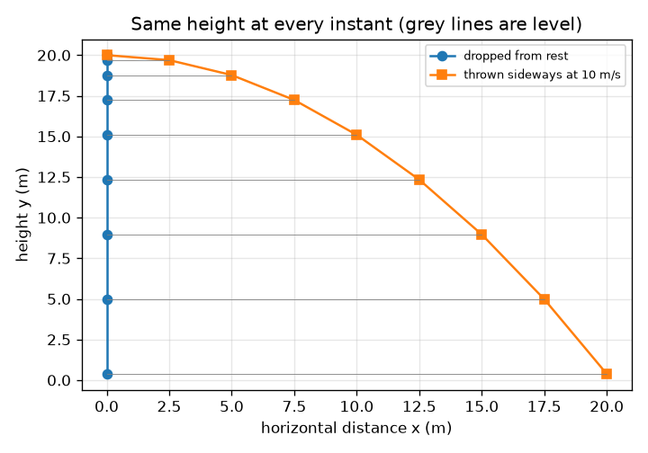
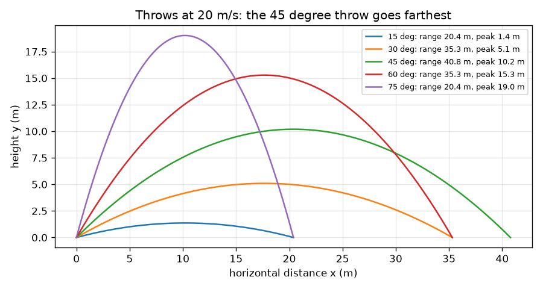

# సెషన్ 1: బంతిని విసరడం: రెండు స్వతంత్ర చలనాలు

[Session 1 — हिन्दी](README.hi.md)

*స్థాయి 1 (భావనాత్మక ఇంటరాక్టివ్ మోడల్) · సుమారు 60 నిమిషాలు · openprojectile*

> ఇది సరళీకరించిన విద్యా మోడల్. ఇది ధృవీకరించబడిన డిజైన్ సాధనం కాదు; నిజమైన నిర్మాణాలు, విద్యుత్ ఇన్‌స్టాలేషన్‌లు, వాహనాలు, పారిశ్రామిక ప్రక్రియలు లేదా వైద్య నిర్ణయాల కోసం దీనిని ఉపయోగించకూడదు.

**ముందస్తు అవసరాలు (Prerequisites)**

- పాఠశాల త్రికోణమితి: సైన్ మరియు కొసైన్.
- మీరు PRIMER.md చదివి, `python start.py 1` ను ఒకసారి రన్ చేసి ఉండాలి.

**అభ్యాస లక్ష్యాలు (Learning objectives).** ఈ సెషన్ తర్వాత మీరు:

- ప్రయోగ వేగాన్ని (launch velocity) క్షితిజ సమాంతర, లంబ భాగాలుగా విభజించగలరు.
- క్షితిజ సమాంతర, లంబ చలనాలు ఒకదానినొకటి ఎందుకు ప్రభావితం చేయవో వివరించగలరు.
- సమతల నేలపై ఒక విసురు యొక్క ప్రయాణ కాలం, గరిష్ఠ ఎత్తు, వ్యాప్తిని కనుగొనగలరు.
- x(t), y(t) గ్రాఫ్‌లను చదివి ఏది సరళరేఖ, ఏది పరావలయమో వివరించగలరు.

## A. నిజ జీవిత సమస్య
ఒక ఫీల్డర్ బంతిని వికెట్ కీపర్‌కు విసురుతాడు; ఒక బ్యాటర్ దానిని సరిహద్దు వైపు పైకి కొడతాడు. అది ఎంత దూరం వెళ్తుంది, ఎంత ఎత్తుకు చేరుతుంది, ఎంతసేపు గాలిలో ఉంటుంది? దీనిని సులభం చేసే ఆశ్చర్యం ఇది: పక్కకు చలనం, పైకి కిందికి చలనం ఒకదానికొకటి ఆటంకం కలిగించవు, కాబట్టి వాటిని ఒక్కొక్కటిగా చూసి తర్వాత కలపవచ్చు.

## B. భావన మరియు సిద్ధాంతం
ఒక బంతి చేతి నుండి v వేగంతో, క్షితిజ సమాంతరానికి పైన a కోణంలో బయలుదేరుతుంది. దాని వేగం పక్కకు భాగం vx = v cos(a), పైకి భాగం vy = v sin(a) గా విడిపోతుంది. పక్కకు బంతిని ఏదీ నెట్టదు (గాలిని విస్మరిస్తాము), కాబట్టి vx ఎప్పుడూ మారదు, x = vx t. పైకి కిందికి గురుత్వం త్వరణం g తో లాగుతుంది, కాబట్టి vy క్రమంగా తగ్గుతుంది, y = vy t - g t^2 / 2. vy - g t = 0 అయినప్పుడు బంతి పైకి వెళ్ళడం ఆపుతుంది, అది t = vy / g వద్ద జరుగుతుంది. కిందికి రావడానికి కూడా అంతే సమయం పడుతుంది, కాబట్టి గాలిలో సమయం T = 2 vy / g, గరిష్ఠ ఎత్తు H = vy^2 / (2 g), వ్యాప్తి R = vx T.

| చిహ్నం | అర్థం | యూనిట్ |
|---|---|---|
| v | ప్రయోగ వేగం | m/s |
| a | క్షితిజ సమాంతరానికి పైన ప్రయోగ కోణం | డిగ్రీలు |
| vx, vy | ప్రయోగ వేగం యొక్క క్షితిజ సమాంతర, లంబ భాగాలు | m/s |
| g | గురుత్వ త్వరణం (9.81) | m/s^2 |
| T, H, R | ప్రయాణ కాలం, గరిష్ఠ ఎత్తు, వ్యాప్తి | s, m, m |
| t | ప్రయోగం నుండి సమయం | s |

**ఊహలు (Assumptions)**

- గాలి లేదు: బంతిపై గురుత్వం తప్ప మరేదీ పనిచేయదు.
- నేల సమతలం, బంతి నేల మట్టం నుండి ప్రయోగించబడుతుంది.
- బంతి ఒక బిందువు; స్పిన్, స్వింగ్ విస్మరించబడతాయి.

$$ v_x=v\cos a,\qquad v_y=v\sin a $$

$$ x=v_x\,t,\qquad y=v_y\,t-\tfrac12 g t^2 $$

$$ T=\frac{2v_y}{g},\qquad H=\frac{v_y^2}{2g},\qquad R=v_x\,T $$

## C. దృశ్య వివరణ
మొదటి చిత్రం ఒకే వేగంతో (20 m/s) ఐదు విసురులను చూపుతుంది: 15, 75 డిగ్రీలు ఒకే చోట పడతాయి, 30, 60 డిగ్రీలు కూడా అంతే, 45 డిగ్రీలు అత్యంత దూరం వెళ్తుంది. రెండవ చిత్రం ఒకే ఎత్తు నుండి ఒకే క్షణంలో ఒక బంతిని వదిలి, మరొకదాన్ని పక్కకు విసురుతుంది: ప్రతి క్షణంలో అవి ఒకే ఎత్తులో ఉంటాయి (బూడిద గీతలు సమంగా ఉన్నాయి), ఇదే రెండు చలనాల స్వాతంత్ర్యం.

*వదిలిన బంతి, పక్కకు విసిరిన బంతి ప్రతి క్షణంలో ఒకదానితో ఒకటి సమ మట్టంలో ఉంటాయి.*

*20 m/s వద్ద ఐదు విసురులు: 45 డిగ్రీలు అత్యంత దూరం వెళ్తుంది, మొత్తం 90 డిగ్రీలయ్యే కోణాలు ఒకే చోట పడతాయి.*

## D. ఇంటరాక్టివ్ సిమ్యులేషన్
పాఠాన్ని రన్ చేయండి (`python start.py 1`), తర్వాత లైవ్ యాప్‌ను తెరవండి: [సెషన్ 1: బంతిని విసరడం](https://krunalpanchal1995.github.io/pan-iit-oss/openprojectile/session-01/) (లేదా ఈ ఫోల్డర్‌లోని `app.html`). వేగం, కోణం మార్చండి, సమయ స్లైడర్‌ను లాగి ఆకుపచ్చ పక్క బాణం మారకుండా ఉండటం, నీలి లంబ బాణం కుంచించుకుని, తిరిగి, పెరగడం చూడండి. గ్రాఫ్ వీక్షణకు మారి x(t) ను సరళరేఖగా, y(t) ను పరావలయంగా చూడండి.

**సవాలు.** బంతి కనీసం 60 m దూరంలో పడాలి, అదే సమయంలో దాని గరిష్ఠ ఎత్తు 15 m లేదా అంతకంటే తక్కువ ఉండాలి.

## E. సాధించిన ఉదాహరణ మరియు ప్రయోగం
**సమస్య.** ఒక బంతి నేల నుండి 20 m/s వేగంతో 30 డిగ్రీల వద్ద బయలుదేరుతుంది. దాని రెండు వేగ భాగాలు, ప్రయాణ కాలం, గరిష్ఠ ఎత్తు, వ్యాప్తిని కనుగొనండి.

1. vx = 20 cos 30 = 20 * 0.8660 = 17.32 m/s, vy = 20 sin 30 = 20 * 0.5 = 10.00 m/s.
2. ప్రయాణ కాలం T = 2 vy / g = 2 * 10.00 / 9.81 = 2.04 s.
3. గరిష్ఠ ఎత్తు H = vy^2 / (2 g) = 100 / 19.62 = 5.10 m.
4. వ్యాప్తి R = vx T = 17.32 * 2.039 = 35.3 m (ఎక్కువ అంకెలు ఉంచితే 35.31 m వస్తుంది).
5. సరిచూపు: t = T వద్ద, y = 10.00 * 2.039 - 4.905 * 2.039^2 = 20.39 - 20.39 = 0, అంటే బంతి తిరిగి నేలపై ఉంది.

**సమాధానం.** vx = 17.32 m/s, vy = 10.00 m/s, T = 2.04 s, H = 5.10 m, R = 35.3 m.

**ప్రయోగం.** గాలి లేని రోజున ఒక టెన్నిస్ బంతిని నేల నుండి సుమారు 30 డిగ్రీల వద్ద విసిరి అది మొదట పడిన చోటును గుర్తించండి, లేదా పక్క నుండి చిత్రీకరించి వీడియో నుండి దాని ఎత్తును చదవండి. అంచనా కంటే తక్కువ దూరంలో పడుతుందని ఆశించండి. మోడల్‌లో గాలి లేదు, నేల మట్టం నుండి ప్రయోగం; నిజమైన చేయి బంతిని నేల పైనుండి వదులుతుంది, అది వ్యాప్తిని పెంచుతుంది, గాలి వ్యాప్తిని తగ్గిస్తుంది. మోడల్ మరియు వాస్తవం: మోడల్ ఆకారాన్ని (పరావలయం), స్వాతంత్ర్యాన్ని సరిగ్గా ఇస్తుంది; సంఖ్యలకు గాలి నిరోధం, ప్రయోగ ఎత్తు కావాలి, అవి తదుపరి రెండు సెషన్లు.

## F. మూల్యాంకనం మరియు డిజైన్ సవాలు
**ప్రశ్న రకం A: భావనాత్మక.** ఒక బంతిని నిశ్చల స్థితి నుండి వదులుతారు, రెండవదాన్ని అదే ఎత్తు నుండి అదే క్షణంలో 10 m/s వేగంతో క్షితిజ సమాంతరంగా విసురుతారు. ఏది ముందు నేలను తాకుతుంది? వివరించండి.

సూచన

y సూత్రాన్ని చూడండి: దానిలో పక్క వేగం ఉందా?

దశలవారీ పరిష్కారం

అవి ఒకే క్షణంలో పడతాయి. ఎత్తు సూత్రం y = y0 - g t^2 / 2 లో పక్క వేగం లేదు: గురుత్వం లంబంగా మాత్రమే పనిచేస్తుంది, బంతి పక్కకు ఎంత వేగంగా కదులుతుందో దానికి పట్టదు. విసిరిన బంతి పడుతున్నప్పుడు ఎక్కువ నేలను కవర్ చేస్తుంది, అంతే.

**ప్రశ్న రకం B: సంఖ్యాత్మక.** ఒక బంతిని నేల నుండి 25 m/s వేగంతో 36 డిగ్రీల వద్ద కొడతారు. vx, vy, ప్రయాణ కాలం, గరిష్ఠ ఎత్తు, వ్యాప్తిని కనుగొనండి. వ్యాప్తి సహేతుకంగా అనిపిస్తుందా?

సూచన

sin 36 = 0.588, cos 36 = 0.809. తర్వాత T = 2 vy / g.

దశలవారీ పరిష్కారం

vx = 25 * 0.809 = 20.23 m/s, vy = 25 * 0.588 = 14.69 m/s. T = 2 * 14.69 / 9.81 = 3.00 s. H = 14.69^2 / 19.62 = 11.0 m. R = 20.23 * 3.00 = 60.6 m. సహేతుక పరీక్ష: 25 m/s (సుమారు 90 km/h) కొట్టు 60 m వెళ్ళడం గాలి లేని లెక్కలో సహేతుకమే, కొంచెం పొడవైనా; గాలితో తక్కువ అవుతుంది (సెషన్ 3). యూనిట్లు: m/s * s = m.

**ప్రశ్న రకం C: గ్రాఫ్ మరియు సిమ్యులేషన్ వ్యాఖ్యానం.** 20 m/s, 30 డిగ్రీల వద్ద x(t), y(t) యాప్ గ్రాఫ్‌లో ప్రతి వక్రం ఆకారం ఏమిటి, y ఏ సమయంలో మళ్ళీ సున్నా అవుతుంది? x(t) రేఖ వాలు మీకు ఏమి చెబుతుంది?

సూచన

ఒక సూత్రంలో t ఉంది, మరొకదానిలో t^2 ఉంది.

దశలవారీ పరిష్కారం

x(t) = vx t సరళరేఖ; దాని వాలు స్థిర పక్క వేగం 17.32 m/s. y(t) = vy t - g t^2 / 2 కిందికి తెరుచుకునే పరావలయం; అది T = 2.04 s వద్ద మళ్ళీ సున్నా అవుతుంది, సగం (1.02 s) వద్ద 5.10 m శిఖరం చేరుతుంది. సరళరేఖ, వక్రం కలిసి ఉండటమే రెండు చలనాల స్వాతంత్ర్యం.

**ప్రశ్న రకం D: డిజైన్ మరియు ఆప్టిమైజేషన్ సవాలు.** ఒక కీపర్ ఫీల్డర్ నుండి 35 m దూరంలో నిలబడతాడు, ఫీల్డర్ 20 m/s వేగంతో విసురుతాడు. యాప్ ఉపయోగించి, రెండూ అతన్ని చేరే రెండు వేర్వేరు కోణాలను కనుగొనండి. ప్రయాణాలను పోల్చి ఒక్కొక్కటిని ఎప్పుడు ఎంచుకుంటారో చెప్పండి.

సూచన

30 డిగ్రీలు ప్రయత్నించండి, తర్వాత అదే వ్యాప్తిని ఇచ్చే రెండవ కోణాన్ని వెతకండి.

దశలవారీ పరిష్కారం

20 m/s వద్ద 30, 60 డిగ్రీలు రెండూ 35.3 m వ్యాప్తిని ఇస్తాయి. 30 డిగ్రీల వద్ద ప్రయాణానికి 2.04 s పడుతుంది, 5.1 m వద్ద శిఖరం: వేగంగా, తక్కువగా, రన్నర్ పరుగెత్తుతున్నప్పుడు ఉత్తమం (కానీ బంతి వేగంగా, చదునుగా వస్తుంది). 60 డిగ్రీల వద్ద 3.53 s పడుతుంది, 15.3 m వద్ద శిఖరం: నెమ్మదిగా, నిటారుగా పడటం వల్ల పట్టుకోవడం సులభం, కానీ రన్నర్‌కు ఎక్కువ సమయం ఇస్తుంది. ఊహ: గాలి లేదు, సమాన ఎత్తులు.

[RUBRIC.md](../../RUBRIC.md) తో మిమ్మల్ని మీరు స్కోర్ చేసుకోండి. కాగితంపై పని చేయడానికి [కార్యాచరణ షీట్](activity_sheet.md) ప్రింట్ చేయండి.

## సాధారణ అపోహలు
| సాధారణ అపోహ | వాస్తవంగా నిజమైనది |
|---|---|
| విసిరిన బంతిని విసురు ఇంకా ముందుకు నెడుతూనే ఉంటుంది. | చేతి నుండి బయలుదేరిన తర్వాత (గాలి లేకపోతే) ఏదీ దానిని పక్కకు నెట్టదు. ఏదీ నెమ్మది చేయనందున అది పక్క వేగాన్ని నిలుపుకుంటుంది. |
| శిఖరం వద్ద బంతి కదలడం ఆగిపోతుంది. | శిఖరం వద్ద లంబ వేగం మాత్రమే సున్నా; పక్క వేగం మారదు, కాబట్టి బంతి ఇంకా v cos(a) వేగంతో కదులుతూనే ఉంటుంది. |
| పక్కకు వేగంగా విసిరిన బంతి నెమ్మదిగా పడుతుంది. | పతనం గురుత్వం, సమయంపై మాత్రమే ఆధారపడుతుంది. పక్కకు విసిరిన బంతి వదిలిన దానిలాగే పడుతుంది. |
| అత్యంత ఎత్తైన విసురే అత్యంత దూరపు విసురు. | చాలా ఎత్తైన విసురు పైకి వెళ్ళి దాదాపు అదే చోట తిరిగి వస్తుంది. సమతల నేలపై గరిష్ఠ వ్యాప్తి 45 డిగ్రీల వద్ద. |

## పదకోశం (Glossary)
- **ప్రక్షేపకం (projectile)**: ప్రయోగించిన తర్వాత గురుత్వం కింద మాత్రమే కదిలే వస్తువు
- **భాగం (component)**: ఒక సదిశ విడిపోయే భాగాల్లో ఒకటి, ఉదా. పక్క భాగం vx
- **వ్యాప్తి (range)**: ప్రయోగ స్థానం నుండి పడే స్థానం వరకు క్షితిజ సమాంతర దూరం
- **ప్రయాణ కాలం (time of flight)**: బంతి గాలిలో ఉండే సమయం
- **పథం (trajectory)**: బంతి అంతరిక్షంలో ప్రయాణించే మార్గం

## ముగింపు
1. [exercises.md](exercises.md) లోని మూడు కోడింగ్ పనులు చేయండి.
2. మీ మార్పుల తర్వాత `python start.py 1` ను మళ్ళీ రన్ చేయండి. అది చెక్‌పాయింట్‌తో ముగుస్తుంది; అది `PASS` అని ప్రింట్ చేసినప్పుడు, మీరు పూర్తి చేసినట్లు. (చెక్‌పాయింట్ మాత్రమే: `python start.py check 1`.)

తదుపరి: [సెషన్ 2](../session-02/README.md)
