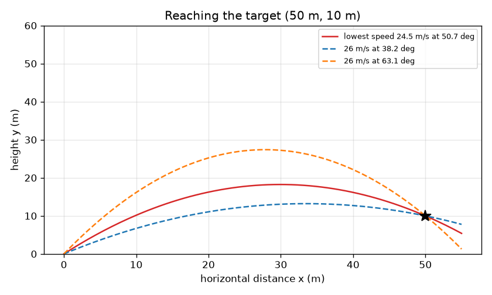
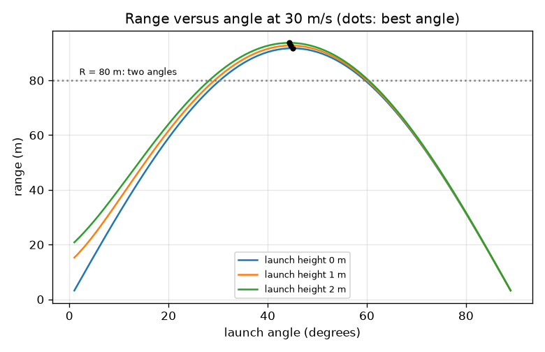

# Session 2: The equations: range, best angle and a design problem

*Level 2 (mathematical engineering model) · about 75 minutes · openprojectile*

> This is a simplified educational model. It is not a validated design tool and must not be used for real structures, electrical installations, vehicles, industrial processes or medical decisions.

**Prerequisites**

- Session 1: components, time of flight, range.
- Solving a quadratic equation (explained in Section B where it is needed).

**Learning objectives.** After this session you can:

- Write position and velocity as functions of time and the path as y(x).
- Derive and use R = v^2 sin(2a) / g and show that 45 degrees is best on level ground.
- Explain why most ranges can be reached by two different angles.
- Find the lowest speed that hits a target at a given distance and height, and the effect of launch height.

## A. Real-world problem
A batter wants the ball to clear a boundary 70 m away. A fielder wants to hit the stumps from 50 m while the ball rises past a 10 m high gap. Guessing is slow. The equations of motion tell us exactly which speed and angle work, how many different ways there are, and which way needs the least effort.

## B. Concept and theory
Launch from height h0 at speed v and angle a. Then x = v cos(a) t and y = h0 + v sin(a) t - g t^2 / 2, with velocity vx = v cos(a) and vy = v sin(a) - g t. Removing t gives the path y = h0 + x tan(a) - g x^2 / (2 v^2 cos^2(a)), a parabola. Landing is y = 0, a quadratic in t whose positive root is T = (v sin(a) + sqrt(v^2 sin^2(a) + 2 g h0)) / g. The range is R = v cos(a) T. On level ground (h0 = 0) this becomes R = v^2 sin(2a) / g, using sin(2a) = 2 sin(a) cos(a). Since sin(2a) is at most 1, the best angle is 45 degrees and the longest range is v^2 / g. For a given range sin(2a) = g R / v^2 has two solutions, a and 90 - a. Launching from height h0 makes the best angle smaller: tan(a) = v / sqrt(v^2 + 2 g h0). To hit a target d metres away and h metres above the launch point, put x = d, y = h in the path equation with u = tan(a); a real u exists only if the speed is at least v_min, where v_min^2 = g (h + sqrt(d^2 + h^2)).

| Symbol | Meaning | Unit |
|---|---|---|
| v | launch speed | m/s |
| a | launch angle | degrees |
| h0 | launch height above the ground | m |
| g | acceleration of gravity (9.81) | m/s^2 |
| R, T, H | range, time of flight, peak height | m, s, m |
| d, h | target distance and height above the launch point | m |
| v_min | lowest speed that can reach the target | m/s |

**Assumptions**

- No air resistance (Session 3 adds it).
- Constant g and a flat ground.
- The ball is a point and its launch angle and speed are exact.

$$ x=v\cos a\,t,\qquad y=h_0+v\sin a\,t-\tfrac12 g t^2 $$

$$ y=h_0+x\tan a-\frac{g\,x^2}{2v^2\cos^2 a} $$

$$ T=\frac{v\sin a+\sqrt{v^2\sin^2 a+2gh_0}}{g},\qquad R=v\cos a\,T $$

$$ R=\frac{v^2\sin 2a}{g}\quad(h_0=0),\qquad \sin 2a=\frac{gR}{v^2}\ \Rightarrow\ a\ \text{and}\ 90^\circ-a $$

$$ \tan a_{\rm best}=\frac{v}{\sqrt{v^2+2gh_0}},\qquad v_{\min}^2=g\left(h+\sqrt{d^2+h^2}\right),\quad \tan a=\frac{h+\sqrt{d^2+h^2}}{d} $$

## C. Visual explanation
The first figure plots range against launch angle at 30 m/s for launch heights of 0, 1 and 2 m. Each curve rises, peaks and falls; the peak of the ground curve is at 45 degrees with R = v^2 / g = 91.7 m, and raising the launch height lifts the whole curve (92.7 m and 93.7 m) while moving the peak slightly left (44.7 and 44.4 degrees). A dotted line at 80 m cuts the ground curve twice, at 30.3 and 59.7 degrees. The second figure shows the lowest-speed path to a target 50 m away and 10 m up (24.46 m/s at 50.65 degrees) and the two paths available at 26 m/s.

*The lowest-speed path and the two 26 m/s paths that pass through the target (50 m, 10 m).*

*Range versus launch angle at 30 m/s for three launch heights; dots mark the best angle.*

## D. Interactive simulation
Run the lesson (`python start.py 2`), then open the live app: [Session 2: the projectile equations](https://krunalpanchal1995.github.io/pan-iit-oss/openprojectile/session-02/) (or `app.html` in this folder). Use the launch picture to see the components, the path view to aim at the red target (50 m, 10 m), and the range graph to see the best angle move as you change the launch height.

**Challenge.** Hit the target (50 m, 10 m) within 1.5 m using a launch speed of at most 26 m/s.

## E. Worked example and experiment
**Problem.** A ball is launched at 25 m/s at 35 degrees from the ground. Find the time of flight, peak height and range. How much farther does it go if it is launched from a height of 1.5 m?

1. vx = 25 cos 35 = 20.48 m/s and vy = 25 sin 35 = 14.34 m/s.
2. T = 2 vy / g = 2 * 14.34 / 9.81 = 2.92 s.
3. H = vy^2 / (2 g) = 205.6 / 19.62 = 10.48 m.
4. R = vx T = 20.48 * 2.923 = 59.87 m. Check with the formula: v^2 sin 70 / g = 625 * 0.9397 / 9.81 = 59.87 m.
5. From 1.5 m: T = (14.34 + sqrt(14.34^2 + 2 * 9.81 * 1.5)) / 9.81 = (14.34 + 15.33) / 9.81 = 3.02 s, so R = 20.48 * 3.025 = 61.94 m, which is 2.07 m farther.

**Answer.** T = 2.92 s, H = 10.48 m, R = 59.87 m from the ground; from 1.5 m the range is 61.94 m, an extra 2.07 m.

**Experiment.** Use a garden hose or a slow-motion phone video of a ball thrown at a known angle (use a protractor or a phone tilt app) and measure where it lands, from the same height as the launch. Expect agreement to within a few percent for a slow, dense ball and a bigger gap for a fast or light one. The gap is air resistance and the error in estimating the launch speed and angle; the formula assumes exact inputs and no air.

## F. Assessment and design challenge
**Question type A: Conceptual.** Why is 45 degrees the best angle on level ground, and why do two different angles reach the same range?

Hint

R = v^2 sin(2a) / g. What are the largest value of sin(2a) and the symmetry of the sine curve?

Step-by-step solution

R is proportional to sin(2a), which is largest (1) when 2a = 90 degrees, so a = 45. The sine curve is symmetric about 90 degrees, so 2a and 180 - 2a give the same sin value, i.e. a and 90 - a give the same range. A low flat shot and a high lofted shot land together. At exactly 45 the two merge into one.

**Question type B: Numerical.** At 25 m/s, which launch angles give a range of 50 m on level ground? What is the maximum range at this speed?

Hint

sin(2a) = g R / v^2 = 9.81 * 50 / 625.

Step-by-step solution

sin(2a) = 490.5 / 625 = 0.7848, so 2a = 51.7 degrees (or 128.3), giving a = 25.85 and 64.15 degrees. Check: they add up to 90. Maximum range is v^2 / g = 625 / 9.81 = 63.7 m at 45 degrees; 50 m is below it, so two angles exist.

**Question type C: Graph and simulation interpretation.** In the range-versus-angle graph at 30 m/s, what do the grey and blue curves show, and where would you read two angles for R = 80 m?

Hint

Draw a horizontal line at 80 m and see where it cuts the curve.

Step-by-step solution

The grey curve is a launch from the ground (peak 91.7 m at 45 degrees), the blue curve is a launch from the chosen height (higher everywhere, peak slightly left of 45). A horizontal line at 80 m cuts the ground curve at 30.3 and 59.7 degrees: two angles that add up to 90. Units: range in metres, angle in degrees.

**Question type D: Design and optimisation challenge.** Design: you must hit a target 50 m away and 10 m above the launch point. What is the lowest possible speed, and at what angle? If you may use 26 m/s, which of the two available angles would you choose and why?

Hint

Use v_min^2 = g (h + sqrt(d^2 + h^2)). At 26 m/s solve the quadratic in tan(a) (lesson function `angles_to_hit`).

Step-by-step solution

v_min^2 = 9.81 * (10 + sqrt(2500 + 100)) = 9.81 * 60.99 = 598.3, so v_min = 24.46 m/s at tan(a) = 60.99 / 50, a = 50.65 degrees; below this speed no angle works. At 26 m/s there are two: 38.24 degrees (flight 2.45 s, peak 13.2 m) and 63.07 degrees (flight 4.25 s, peak 27.4 m). The flat shot is faster to arrive and gives the fielder less time to react but it needs a clear low path; the high shot is slower, but arrives steeply and needs more height clearance. At exactly v_min there is one angle and no margin for error, so the extra speed is a safety margin. Assumption: no air.

Score yourself with [RUBRIC.md](../../RUBRIC.md). Print the [activity sheet](activity_sheet.md) to work on paper.

## Common misconceptions
| Common misconception | What is actually true |
|---|---|
| The 45 degree rule works for any launch. | It holds only when the ball lands at the height it was launched from. Launching from above the ground lowers the best angle (44.7 degrees at 1 m for 30 m/s). |
| Doubling the speed doubles the range. | R grows with v^2: doubling the speed multiplies the range by four. |
| There is only one angle for a given range. | There are two (a and 90 - a), except at the maximum range. |
| The lowest speed that hits a target is found by aiming straight at it. | Aiming straight is not best: the lowest-speed angle is higher (50.65 degrees for the target at 50 m and 10 m up) because the ball must also fight gravity along the way. |

## Glossary
- **quadratic equation**: an equation with a squared unknown; it has up to two solutions
- **discriminant**: the part under the square root that tells whether real solutions exist
- **launch height**: the height above the ground at which the ball leaves the hand or bat
- **maximum range**: the longest distance reachable at a given speed
- **design constraint**: a condition the answer must satisfy, such as a target position

## Finish
1. Do the three coding tasks in [exercises.md](exercises.md).
2. Run `python start.py 2` again after your changes. It ends with the checkpoint; when it prints `PASS`, you are done. (Checkpoint only: `python start.py check 2`.)

Next: [Session 3](../session-03/README.md)
