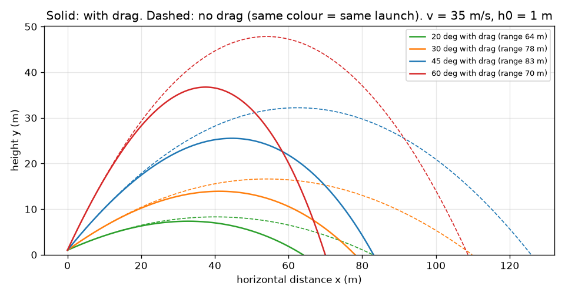
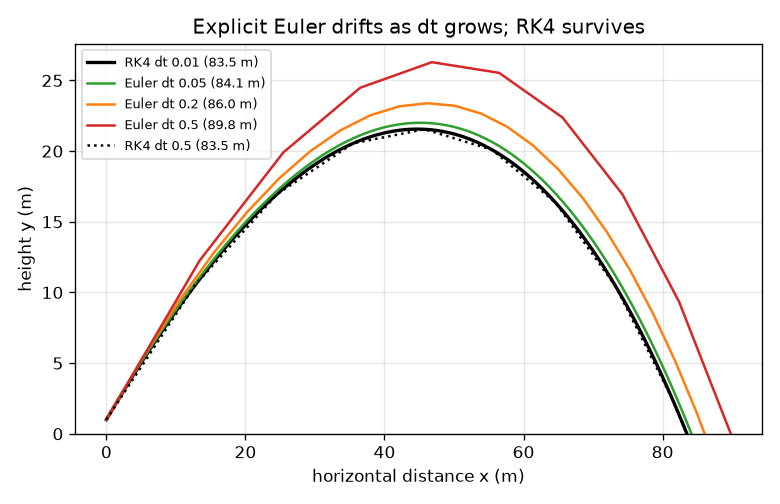
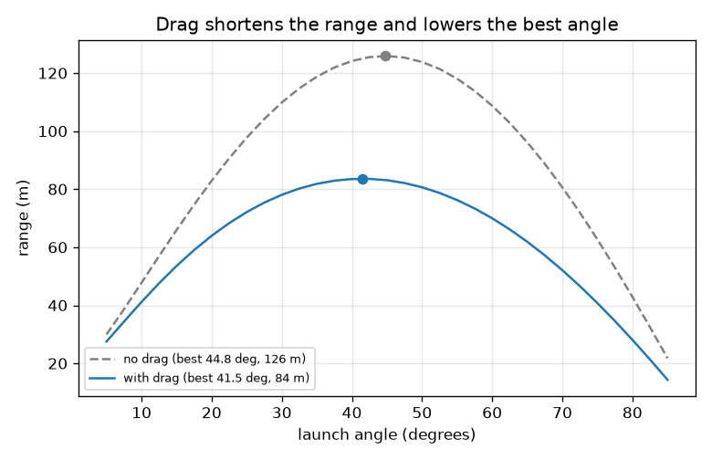

# Session 3: Air drag: an RK4 simulation, validated

*Level 3 (simulation and validation) · about 90 minutes · openprojectile*

> This is a simplified educational model. It is not a validated design tool and must not be used for real structures, electrical installations, vehicles, industrial processes or medical decisions.

**Prerequisites**

- Session 1: components.
- Session 2: the range formula and the 45 degree rule.
- Vectors and the idea of a rate of change (acceleration); RK4 is explained from scratch.

**Learning objectives.** After this session you can:

- Write the equations of motion with quadratic air drag and say what each term means.
- Solve them with a Runge-Kutta (RK4) step and validate the solver against the exact no-drag results and an energy balance.
- Find numerically the launch angle for the longest range and explain why drag lowers it below 45 degrees.
- Use terminal speed, the drag coefficient and wind to judge how sensitive a shot is, and recognise a failure of a large step with explicit Euler.

## A. Real-world problem
In Sessions 1 and 2 the ball flew in a perfect parabola. A real cricket ball is slowed by the air: a hit that the formula says will travel 125 m may fall near 84 m. There is no neat formula any more, so we solve the motion step by step on the computer. But how do we know the answer is right? We test the solver on cases we can solve by hand: with drag switched off it must give Session 2's numbers exactly, and with drag on the energy books must balance. Only then do we use it to plan a shot.

## B. Concept and theory
Air pushes against the ball's velocity relative to the air, v_rel, with a force that grows with its square: F = -k |v_rel| v_rel, where k = (1/2) rho Cd A, rho is the air density, Cd the drag coefficient and A = pi d^2 / 4 the cross-section. Dividing by the mass gives the acceleration a = -(k/m) |v_rel| v_rel + (0, -g). With a wind of speed w along +x, v_rel = (vx - w, vy). We solve this by RK4: from the state (x, y, vx, vy) it takes one step of size dt by sampling the rate of change four times (start, two midpoints, end) and blending them with weights 1, 2, 2, 1 over 6; its error shrinks like dt^4 while explicit Euler (one sample) shrinks like dt. The landing moment is found by bisection inside the last step. Validation 1: with Cd = 0 the result must equal the exact formulas of Session 2. Validation 2: mechanical energy E = m g y + m v^2 / 2 changes only through drag, so E plus the work done against the ball by drag must stay constant; the solver integrates that work as an extra variable. Terminal speed is where drag balances weight: v_t = sqrt(2 m g / (rho Cd A)).

| Symbol | Meaning | Unit |
|---|---|---|
| m | mass of the ball (0.16, approximate) | kg |
| d | diameter of the ball (0.07, approximate) | m |
| Cd | drag coefficient (0.4, approximate, typical value) | no unit |
| rho | air density (1.2 at sea level, approximate) | kg/m^3 |
| A | cross-section area, pi d^2 / 4 = 0.003848 | m^2 |
| k | drag constant, (1/2) rho Cd A | kg/m |
| w | wind speed along the pitch (+ = tailwind) | m/s |
| v_t | terminal speed | m/s |
| dt | time step of the solver | s |

**Assumptions**

- Quadratic drag with a constant Cd: real cricket balls vary with speed, seam and surface (values here are approximate).
- A point ball: no spin, swing, Magnus force or bounce.
- Air density 1.2 kg/m^3 and a steady, uniform wind.
- The ball is hit from a height of 1 m in the examples; the model is a simplified educational model, not a coaching or safety tool.

$$ \mathbf F_{\rm drag}=-k\,|\mathbf v_{\rm rel}|\,\mathbf v_{\rm rel},\qquad k=\tfrac12\rho C_d A,\quad A=\frac{\pi d^2}{4} $$

$$ \ddot{\mathbf r}=-\frac{k}{m}\,|\mathbf v_{\rm rel}|\,\mathbf v_{\rm rel}+(0,-g),\qquad \mathbf v_{\rm rel}=(v_x-w,\ v_y) $$

$$ \mathbf s_{n+1}=\mathbf s_n+\frac{\Delta t}{6}\left(\mathbf k_1+2\mathbf k_2+2\mathbf k_3+\mathbf k_4\right)\quad\text{(RK4)} $$

$$ E(t)+W_{\rm drag}(t)=E(0),\qquad E=mgy+\tfrac12 mv^2 $$

$$ v_t=\sqrt{\frac{2mg}{\rho C_d A}} $$

## C. Visual explanation
The first figure plots four launch angles at 35 m/s from 1 m, solid with drag and dashed without (same colour = same launch): drag cuts every shot short and makes it steeper on the way down. The second plots range against angle: without drag the peak is at 44.77 degrees (125.9 m, slightly under 45 because of the 1 m launch height); with drag it moves to 41.47 degrees and falls to 83.6 m. The third compares explicit Euler at three step sizes with RK4: Euler drifts upwards and overshoots (89.8 m at dt = 0.5 against 83.5 m) while RK4 at the same dt stays within 0.001 m.

*Four launch angles at 35 m/s with drag (solid) and without (dashed).*

*Failure case: explicit Euler drifts as dt grows, RK4 at the same dt does not.*

*Range versus angle: drag lowers the peak and shifts it from 44.8 to 41.5 degrees.*

## D. Interactive simulation
Run the lesson (`python start.py 3`), then open the live app: [Session 3: a cricket ball with air drag](https://krunalpanchal1995.github.io/pan-iit-oss/openprojectile/session-03/) (or `app.html` in this folder). Start with the flight view and change the drag coefficient to zero and back; then open the angle view and see the peak shift left; finally add a headwind and a tailwind and read the change in range.

**Challenge.** At 35 m/s, drag coefficient 0.4 and no wind, set the launch angle within 1 degree of the angle that gives the longest range.

## E. Worked example and experiment
**Problem.** A cricket ball (m = 0.16 kg, d = 0.07 m, Cd = 0.4, approximate) is hit from 1 m at 35 m/s and 40 degrees. Find k, the terminal speed, the drag deceleration at launch, and then the range from the RK4 solver.

1. A = pi * 0.07^2 / 4 = 0.003848 m^2.
2. k = 0.5 * 1.2 * 0.4 * 0.003848 = 9.24e-4 kg/m, so k/m = 9.24e-4 / 0.16 = 0.00577 per metre.
3. Terminal speed v_t = sqrt(2 * 0.16 * 9.81 / (1.2 * 0.4 * 0.003848)) = sqrt(1699.5) = 41.2 m/s.
4. Drag deceleration at launch = (k/m) v^2 = 0.00577 * 35^2 = 7.07 m/s^2, which is 0.72 g: air matters a lot at this speed.
5. RK4 (dt = 0.01 s) gives a range of 83.5 m, a flight of 4.14 s and a peak of 21.6 m. With drag off the same hit gives 124.2 m, 4.63 s and 26.8 m (the exact formulas agree to better than a micrometre), so drag costs 40.7 m, about a third of the range.
6. Energy check: E + W_drag differs from E(0) by a relative 2e-12 along the whole flight, as it should for a correct solver.

**Answer.** k = 9.24e-4 kg/m, v_t = 41.2 m/s, launch drag deceleration 7.07 m/s^2, and with drag the range is 83.5 m (124.2 m without drag).

**Experiment.** Record a real shot or throw (a cricket or tennis ball) with a phone camera side-on, mark the start and the landing, and compare with the simulator after matching the ball's mass and diameter. Expect the real ball to differ by several metres: the true Cd changes with speed, the seam, the age of the ball and spin, the wind varies with height, and the launch speed and angle can only be estimated. The model captures the main effect (drag shortens the shot and flattens the best angle); it does not predict swing or dip.

## Real-world application and mini-project: Clear the boundary rope for a six
Illustrative numbers: the boundary rope is 70 m from the batter and the ball is struck from a height of 1.0 m. The ball counts as a six if it reaches the rope before it touches the ground. Use the cricket ball of Session 3 (mass 0.16 kg, diameter 0.07 m, Cd 0.4, approximate). Find the lowest launch speed (rounded up to 0.1 m/s) that can make a six, and the angle it needs. Compare it with the no-drag answer of Session 2. Then repeat for a 5 m/s headwind and a 5 m/s tailwind, and list the whole-degree angles that clear the rope at 32 m/s.

**Deliverable:** A script that prints a small table (no drag, still air, 5 m/s headwind, 5 m/s tailwind) with the lowest speed and best angle for each case, prints the angle window at 32 m/s, and saves a picture of three trajectories: the lowest-speed shot, a 32 m/s shot at the best angle, and the no-drag speed shot with drag switched on (it falls short).

**Success looks like:** Still air: lowest speed 30.9 m/s at about 42.0 degrees, against 26.0 m/s with no drag. With a 5 m/s headwind 33.5 m/s, with a 5 m/s tailwind 29.1 m/s. At 32 m/s the whole-degree angles 32 to 52 clear the rope.

## F. Assessment and design challenge
**Question type A: Conceptual.** Why does air drag lower the best launch angle below 45 degrees? Think about what a high, long flight costs.

Hint

Drag removes speed all the time the ball is in the air. Which shot spends longer in the air?

Step-by-step solution

Drag keeps slowing the ball for as long as it is flying, and it acts most when the ball is fast. A lofted shot stays in the air longer, so it loses more speed (and more sideways speed in particular) than in a vacuum. Lowering the angle trades a little height for a shorter flight and less time under drag, so the longest range moves to a smaller angle. The effect grows with speed: 44.3 degrees at 15 m/s, 41.8 at 35 m/s and 38.6 at 60 m/s (from level ground).

**Question type B: Numerical.** For a slightly rougher ball with Cd = 0.5 (same mass and diameter), find k, the terminal speed, and the drag deceleration at 30 m/s as a multiple of g.

Hint

k = 0.5 rho Cd A with A = 0.003848 m^2; deceleration = (k/m) v^2.

Step-by-step solution

k = 0.5 * 1.2 * 0.5 * 0.003848 = 1.155e-3 kg/m. v_t = sqrt(2 * 0.16 * 9.81 / (1.2 * 0.5 * 0.003848)) = sqrt(1359.6) = 36.9 m/s. Deceleration = (1.155e-3 / 0.16) * 900 = 6.49 m/s^2 = 0.66 g. Sanity check: higher Cd gives a lower terminal speed (36.9 against 41.2 m/s for Cd = 0.4) and a larger drag, as expected.

**Question type C: Graph and simulation interpretation.** In the range-versus-angle graph at 35 m/s from 1 m, the dashed (no drag) curve peaks at 44.8 degrees and 125.9 m, the solid curve at 41.5 degrees and 83.6 m. What percentage of the range does drag remove and what happens to the shape of the peak?

Hint

Percentage lost = (125.9 - 83.6) / 125.9.

Step-by-step solution

Loss = 42.3 / 125.9 = 33.6 percent. The solid peak is lower and moves left (about 3.3 degrees); drag hurts high shots more than flat ones. Units: metres and degrees.

**Question type D: Design and optimisation challenge.** Design: the rope is 70 m from the batter and the ball is struck from 1.0 m. Find the lowest speed that makes a six in still air, and say what speed and angle you would plan for a 5 m/s headwind. Comment on the margin.

Hint

Use `min_speed_for_range(70, 1.0)` and `angle_window` from the lesson; repeat with wind = -5.

Step-by-step solution

In still air the lowest speed is 30.9 m/s (rounded up) at about 42.0 degrees; ignoring drag you would wrongly plan 26.0 m/s, which falls about 16 m short (54 m). With a 5 m/s headwind it is 33.5 m/s (best angle about 39.4 degrees); a 5 m/s tailwind needs 29.1 m/s. At the exact lowest speed there is no margin: at 31 m/s the clearing angles are only 39 to 45 degrees, at 32 m/s they widen to 32 to 52 degrees. So plan for a few m/s above the minimum and a launch angle near 40 degrees,. Assumptions: illustrative numbers, a point ball, steady wind, approximate Cd.

Score yourself with [RUBRIC.md](../../RUBRIC.md). Print the [activity sheet](activity_sheet.md) to work on paper.

## Common misconceptions
| Common misconception | What is actually true |
|---|---|
| Drag takes the same percentage off every shot. | It grows with the square of the speed: about 9 percent of the range at 15 m/s, 34 percent at 35 m/s and 57 percent at 60 m/s (level ground). |
| A smooth-looking curve means the numerical answer is right. | A big step with explicit Euler also draws a smooth curve, but it is wrong (8 percent too long at dt = 0.5). Validate against a known case and an energy check. |
| Terminal speed is the speed of a ball thrown upwards. | It is the speed at which drag equals weight for a ball falling for a long time (41.2 m/s for this ball). A ball hit faster than v_t is slowed down by drag towards it. |
| A tailwind and a headwind of the same size cancel out. | Not exactly: with 5 m/s the tailwind adds 8.5 m and the headwind removes 9.1 m, because drag depends on the square of the relative speed. |

## Glossary
- **drag**: the force of air that opposes the motion of a body through it
- **drag coefficient**: a number describing how much drag a shape produces (about 0.4 for a ball, approximate)
- **terminal speed**: the steady speed at which drag balances weight
- **RK4**: fourth-order Runge-Kutta, a step-by-step method for solving differential equations accurately
- **time step**: the small time interval used in each step of a simulation
- **explicit Euler**: the simplest stepping method; it uses only the starting slope and is not accurate for large steps
- **validation**: checking a program against answers known from theory or from a different method

## Finish
1. Do the three coding tasks in [exercises.md](exercises.md).
2. Run `python start.py 3` again after your changes. It ends with the checkpoint; when it prints `PASS`, you are done. (Checkpoint only: `python start.py check 3`.)

Next: the [roadmap](../../promo/roadmap.md). Session 4 is yours to build.
