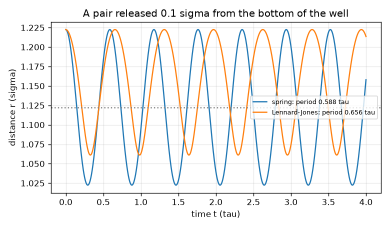
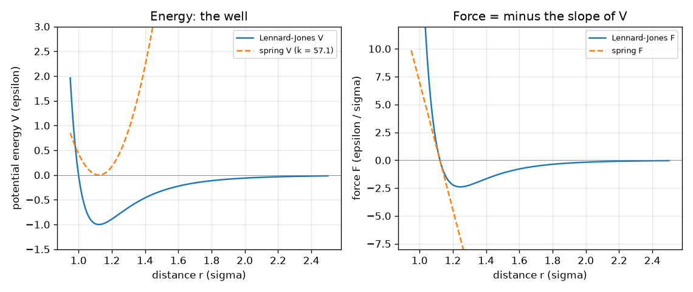

# सत्र 1: स्प्रिंगों पर गेंदों के रूप में परमाणु: गति बल का अनुसरण करती है

*स्तर 1 (वैचारिक इंटरैक्टिव मॉडल) · लगभग 60 मिनट · openproteinmd*

> यह एक सरलीकृत शैक्षिक मॉडल (simplified educational model) है। यह कोई सत्यापित डिज़ाइन टूल नहीं है और इसका उपयोग वास्तविक संरचनाओं, बिजली की स्थापनाओं, वाहनों, औद्योगिक प्रक्रियाओं या चिकित्सा निर्णयों के लिए नहीं किया जाना चाहिए।

**पूर्व-आवश्यकताएँ (Prerequisites)**

- बीजगणित और यह विचार कि बल = द्रव्यमान गुणा त्वरण।
- आपने PRIMER.md पढ़ लिया है और `python start.py 1` एक बार चला लिया है।

**सीखने के उद्देश्य (Learning objectives).** इस सत्र के बाद आप:

- समझा सकेंगे कि किसी परमाणु पर बल उसकी स्थितिज ऊर्जा (potential energy) के ढलान का ऋणात्मक है।
- एक स्प्रिंग और एक लेनार्ड-जोन्स (Lennard-Jones) युग्म की ऊर्जा और बल हाथ से और Python में निकाल सकेंगे।
- लेनार्ड-जोन्स युग्म की संतुलन बंध लंबाई (equilibrium bond length) निकाल सकेंगे और बता सकेंगे कि यह 2^(1/6) sigma क्यों है।
- दूरी के सापेक्ष स्थितिज ऊर्जा और बल का ग्राफ़ पढ़ सकेंगे, और अनुमान लगा सकेंगे कि छोड़ा गया युग्म कैसे चलता है।

## A. वास्तविक दुनिया की समस्या
प्रोटीन परमाणुओं की एक लंबी श्रृंखला है, जो देखने के लिए बहुत छोटी है। इसलिए वैज्ञानिक इसका सिमुलेशन करते हैं: वे हर परमाणु पर बल लिखते हैं और न्यूटन के नियम से परमाणुओं को एक बार में एक छोटा कदम आगे बढ़ाते हैं। पूरी श्रृंखला से पहले, सबसे छोटी संभव स्थिति लीजिए, दो परमाणु। उन्हें क्या पास खींचता है, क्या दूर धकेलता है, और वे कहाँ टिकते हैं? ईमानदारी से जुड़ी महत्वपूर्ण टिप्पणी: इस रिपॉज़िटरी में सब कुछ काल्पनिक घटित इकाइयों (reduced units) में एक खिलौना मॉडल है। यह सिखाता है कि आणविक गतिकी (molecular dynamics) कैसे काम करती है; यह वास्तविक प्रोटीन नहीं है और किसी चिकित्सा या दवा निर्णय का उपकरण नहीं है। केवल सामान्य शिक्षा।

## B. अवधारणा और सिद्धांत
हम लंबाई को sigma में, ऊर्जा को epsilon में और द्रव्यमान को m में मापते हैं, इसलिए तीनों 1 के बराबर हैं; तब समय tau = sigma sqrt(m / epsilon) में आता है। दूरी r पर दो परमाणु स्थितिज ऊर्जा V(r) के माध्यम से परस्पर क्रिया करते हैं। बल ढलान का ऋणात्मक है: F = -dV/dr, जो परमाणुओं को दूर धकेलने पर धनात्मक और पास खींचने पर ऋणात्मक है। एक रासायनिक बंध को स्प्रिंग के रूप में चित्रित किया जाता है, V = (1/2) k (r - r0)^2, जिसका बल F = -k (r - r0) है। जो दो परमाणु बंधित नहीं हैं, वे लेनार्ड-जोन्स नियम से परस्पर क्रिया करते हैं, V = 4 [(1/r)^12 - (1/r)^6]: कम दूरी पर तीव्र प्रतिकर्षण (परमाणु एक-दूसरे में घुस नहीं सकते) और अधिक दूरी पर कमज़ोर आकर्षण। इसका तल r = 2^(1/6) sigma = 1.1225 sigma पर है जिसकी गहराई -1 epsilon है, और तल के पास यह 36 * 2^(2/3) = 57.15 स्थिरांक वाले स्प्रिंग जैसा दिखता है। तल से दूर छोड़ी गई गेंद बल से त्वरित होती है और दोलन करती है। दो समान परमाणु घटित द्रव्यमान (reduced mass) mu = m/2 वाली एक गेंद की तरह व्यवहार करते हैं, इसलिए स्प्रिंग युग्म का आवर्तकाल (period) 2 pi sqrt(mu / k) है। हमारा अद्यतन नियम सबसे सरल है: v_new = v + (F / mu) dt, फिर r_new = r + v_new dt।

| प्रतीक | अर्थ | इकाई |
|---|---|---|
| r | दोनों परमाणुओं के बीच दूरी | sigma |
| V | स्थितिज ऊर्जा | epsilon |
| F | परमाणुओं को जोड़ने वाली रेखा के अनुदिश बल | epsilon / sigma |
| k | स्प्रिंग स्थिरांक | epsilon / sigma^2 |
| r0 | स्प्रिंग की विश्राम लंबाई | sigma |
| mu | युग्म का घटित द्रव्यमान (m/2) | m |
| dt | समय कदम (time step) | tau |

**मान्यताएँ (Assumptions)**

- घटित इकाइयाँ: sigma = epsilon = m = 1।
- दो समान परमाणु, गति केवल उन्हें जोड़ने वाली रेखा के अनुदिश (एक निर्देशांक r)।
- अभी कोई ऊष्मा-स्नान (heat bath) नहीं: ऊर्जा किसी के साथ बदली नहीं जाती।
- एक खिलौना मॉडल: न वास्तविक रासायनिक बंध, न वास्तविक प्रोटीन।

$$ F(r)=-\frac{dV}{dr} $$

$$ V_{\mathrm{spring}}=\tfrac12 k\,(r-r_0)^2,\qquad F_{\mathrm{spring}}=-k\,(r-r_0) $$

$$ V_{\mathrm{LJ}}=4\left[\left(\frac1r\right)^{12}-\left(\frac1r\right)^{6}\right],\qquad F_{\mathrm{LJ}}=\frac{24}{r}\left[2\left(\frac1r\right)^{12}-\left(\frac1r\right)^{6}\right] $$

$$ r_{\min}=2^{1/6}\sigma,\qquad V(r_{\min})=-\varepsilon,\qquad V''(r_{\min})=36\cdot 2^{2/3}\,\varepsilon/\sigma^2\approx 57.15 $$

$$ T_{\mathrm{spring}}=2\pi\sqrt{\mu/k},\qquad \mu=m/2 $$

## C. दृश्य व्याख्या
पहला चित्र दूरी के सापेक्ष दो ऊर्जा वक्र और दो बल वक्र बनाता है। लेनार्ड-जोन्स वक्र (नीला) में एक कूप (well) है जिसका तल 1.123 sigma पर और गहराई -1 है; स्प्रिंग (धराशायी) को k = 57.15 दिया गया ताकि तल पर उसका आकार ठीक वैसा ही हो। वे वहाँ मेल खाते हैं पर आगे जाकर अलग हो जाते हैं: स्प्रिंग और ज़ोर से खींचता रहता है जबकि लेनार्ड-जोन्स बल घटकर शून्य हो जाता है। बल वक्र कूप के तल पर शून्य को पार करता है, जहाँ ऊर्जा का ढलान शून्य है। दूसरा चित्र तल से 0.1 sigma दूर छोड़ा गया युग्म दिखाता है: दोनों दोलन करते हैं, स्प्रिंग 0.588 tau आवर्तकाल से, लेनार्ड-जोन्स युग्म थोड़ा धीमा (0.656 tau) क्योंकि उसका कूप बाहर की ओर चौड़ा है।

*कूप के तल से 0.1 sigma दूर छोड़ा गया युग्म: स्प्रिंग का आवर्तकाल 0.588 tau है, लेनार्ड-जोन्स का आवर्तकाल लंबा है।*

*लेनार्ड-जोन्स युग्म और मिलाए गए स्प्रिंग की ऊर्जा (बाएँ) और बल (दाएँ): वे कूप के तल पर मेल खाते हैं और आगे जाकर अलग हो जाते हैं।*

## D. इंटरैक्टिव सिमुलेशन
पाठ चलाइए (`python start.py 1`), फिर लाइव ऐप खोलिए: [सत्र 1: एक स्प्रिंग और एक लेनार्ड-जोन्स युग्म](https://krunalpanchal1995.github.io/pan-iit-oss/openproteinmd/session-01/) (या इस फ़ोल्डर में `app.html`)। युग्म चित्र में दूरी r को खिसकाइए और देखिए कि कूप के तल पर दोनों बल तीर दिशा बदलते हैं। स्प्रिंग स्थिरांक बदलिए और देखिए कि लाल वक्र और स्प्रिंग का आवर्तकाल कैसे बदलते हैं। फिर ऊर्जा और बल ग्राफ़ों पर जाइए।

**चुनौती (Challenge).** परमाणुओं को लेनार्ड-जोन्स बंध लंबाई पर रखिए, जहाँ बल शून्य है (0.02 sigma के भीतर)।

## E. हल किया गया उदाहरण और प्रयोग
**समस्या.** r = 1.5 sigma पर लेनार्ड-जोन्स ऊर्जा और बल निकालिए। क्या युग्म पास खींचा जाता है या दूर धकेला जाता है?

1. (1/r)^6 = (1/1.5)^6 = 0.08779 और (1/r)^12 = 0.00771 निकालिए।
2. V = 4 (0.00771 - 0.08779) = 4 (-0.08008) = -0.3203 epsilon।
3. F = (24 / 1.5) [2 (0.00771) - 0.08779] = 16 (-0.07237) = -1.158 epsilon / sigma।
4. बल ऋणात्मक है, इसलिए परमाणु पास खींचे जाते हैं: r = 1.5 कूप के तल (1.1225) के बाहर है, और बल वापस उसकी ओर इंगित करता है।
5. ऊर्जा ढलान से जाँच: 1.49 और 1.51 पर V में 0.02 sigma में लगभग 0.0232 का अंतर है, यानी +1.16 का ढलान, और F = उस ढलान का ऋणात्मक = -1.16। दोनों तरीके मेल खाते हैं।

**उत्तर.** V = -0.3203 epsilon और F = -1.158 epsilon / sigma (आकर्षी): युग्म पास खींचा जाता है।

**प्रयोग (Experiment).** दो परमाणुओं पर वास्तविक प्रयोग घर पर करना असंभव है, पर आप विचार को महसूस कर सकते हैं: दो छोटे चुंबकों को ऐसे पकड़िए कि वे आकर्षित करें, और उन्हें धीरे-धीरे पास धकेलिए जब तक वे प्रतिकर्षित न करने लगें। बीच में एक दूरी है जहाँ वे आराम से टिकते हैं। वास्तविक परमाणु इसी तरह के हैं पर कहीं अधिक जटिल; किसी गैस (आर्गन पाठ्यपुस्तक का उदाहरण है) के लिए लेनार्ड-जोन्स कूप की मापी गई गहराई और आकार फ़िट किए गए मान हैं, इसलिए यह मॉडल कार्टून का वर्णन करता है, वास्तविक आर्गन का ठीक-ठीक नहीं। लेनार्ड-जोन्स नियम एक सुविधाजनक सन्निकटन (approximation) है, प्रकृति का नियम नहीं।

## F. मूल्यांकन और डिज़ाइन चुनौती
**प्रश्न प्रकार A: वैचारिक (Conceptual).** एक स्प्रिंग युग्म और एक लेनार्ड-जोन्स युग्म दोनों एक ही तल के आसपास दोलन करते हैं। स्प्रिंग का आवर्तकाल स्थिर क्यों है पर लेनार्ड-जोन्स युग्म का आवर्तकाल इस पर निर्भर क्यों करता है कि आप उसे कितना खींचते हैं?

संकेत

तल से दूर दोनों ऊर्जा वक्रों के आकार की तुलना कीजिए।

चरण-दर-चरण हल

स्प्रिंग की कठोरता हर जगह समान है (एक परवलय / parabola), इसलिए उसका आवर्तकाल 2 pi sqrt(mu/k) दोलन के आकार पर निर्भर नहीं करता। लेनार्ड-जोन्स कूप परवलय नहीं है: यह अंदर की ओर तीव्र और बाहर की ओर सपाट होता जाता है, इसलिए आप युग्म को जितना अधिक खींचते हैं, वापस खींचने वाला बल उतना कमज़ोर और गति उतनी धीमी होती है। पाठ में 0.1 sigma का दोलन 0.656 tau का आवर्तकाल देता है और 0.5 sigma का दोलन 1.609 tau। केवल बहुत छोटे दोलनों के लिए ही लेनार्ड-जोन्स युग्म स्प्रिंग की तरह व्यवहार करता है।

**प्रश्न प्रकार B: संख्यात्मक (Numerical).** एक बंध को k = 10 और r0 = 1 वाले स्प्रिंग से मॉडल किया गया है। r = 1.3 पर उसकी ऊर्जा और बल (सभी घटित इकाइयों में), और r = 2 पर लेनार्ड-जोन्स ऊर्जा और बल निकालिए।

संकेत

V = (1/2) k (r - r0)^2 और F = -k (r - r0) का उपयोग कीजिए; लेनार्ड-जोन्स के लिए पहले (1/r)^6 निकालिए।

चरण-दर-चरण हल

स्प्रिंग: V = 0.5 * 10 * 0.3^2 = 0.45 epsilon और F = -10 * 0.3 = -3.0 epsilon / sigma (वापस खींचता है)। r = 2 पर लेनार्ड-जोन्स: (1/2)^6 = 0.015625 और (1/2)^12 = 0.000244, इसलिए V = 4 (0.000244 - 0.015625) = -0.0615 epsilon और F = (24 / 2) (2 * 0.000244 - 0.015625) = 12 (-0.015137) = -0.1816 epsilon / sigma। तर्कसंगतता जाँच (sanity check): 2 sigma पर आकर्षण 1 की कूप गहराई की तुलना में पहले से ही कमज़ोर है।

**प्रश्न प्रकार C: ग्राफ़ और सिमुलेशन की व्याख्या.** ऊर्जा ग्राफ़ पर बल कहाँ शून्य है, और r = 1.6 sigma पर छोड़े गए युग्म का क्या होता है? इसे ढलान से पढ़िए।

संकेत

बल V के ढलान का ऋणात्मक है।

चरण-दर-चरण हल

V का ढलान कूप के तल r = 1.123 sigma पर शून्य है, इसलिए वहाँ बल शून्य है। r = 1.6 पर वक्र ऊपर की ओर झुका है (V, r के साथ बढ़ता है), इसलिए बल ऋणात्मक है: परमाणु पास खींचे जाते हैं, तल की ओर तेज़ होते हैं, उसे पार कर जाते हैं जहाँ बल का चिह्न उलट जाता है, और दोलन करते हैं। बिना किसी घर्षण के वे कभी नहीं टिकते (सत्र 3 ऊष्मा-स्नान जोड़ता है)।

**प्रश्न प्रकार D: डिज़ाइन और अनुकूलन (optimisation) चुनौती.** डिज़ाइन: ऐसा स्प्रिंग स्थिरांक चुनिए कि बंध युग्म 0.5 tau के आवर्तकाल से दोलन करे, और बताइए कि प्रति आवर्तकाल लगभग 20 कदमों से गति का अनुसरण करने के लिए आपको कितना बड़ा समय कदम चाहिए।

संकेत

mu = 0.5 के साथ T = 2 pi sqrt(mu / k) को k के लिए हल कीजिए। फिर आवर्तकाल को 20 से भाग दीजिए।

चरण-दर-चरण हल

k = mu (2 pi / T)^2 = 0.5 * (2 pi / 0.5)^2 = 0.5 * 157.9 = 79.0, जाँच: 2 pi sqrt(0.5 / 79) = 0.4999 tau। प्रति आवर्तकाल 20 कदमों के साथ dt = 0.5 / 20 = 0.025 tau। समझौता (trade-off): कठोर बंध का अर्थ तेज़ दोलन है, इसलिए उतने ही सिमुलेट किए गए समय के लिए छोटा समय कदम और लंबा रन ज़रूरी हो जाता है। इसीलिए सत्र 2 समय कदम का ध्यान से अध्ययन करता है।

[RUBRIC.md](../../RUBRIC.md) से स्वयं को अंक दीजिए। कागज़ पर काम करने के लिए [गतिविधि पत्रक](activity_sheet.md) प्रिंट कीजिए।

## सामान्य भ्रांतियाँ
| सामान्य भ्रांति (misconception) | वास्तव में क्या सच है |
|---|---|
| परमाणु हर दूरी पर एक-दूसरे को आकर्षित करते हैं और बस पास और पास आते जाते हैं। | लेनार्ड-जोन्स परमाणु केवल मध्यम दूरी पर आकर्षित करते हैं और दबाए जाने पर तीव्रता से प्रतिकर्षित करते हैं; बल 1.1225 sigma पर शून्य है, और वही बंध लंबाई है। |
| बल और ऊर्जा एक ही चीज़ हैं। | ऊर्जा V वक्र की ऊँचाई है; बल F उसके ढलान का ऋणात्मक है। शून्य बल का अर्थ शून्य ढलान है, शून्य ऊर्जा नहीं: तल पर ऊर्जा -1 है। |
| स्प्रिंग और लेनार्ड-जोन्स युग्म हमेशा एक ही आवर्तकाल से दोलन करते हैं। | वे केवल कूप के तल के पास बहुत छोटे दोलनों के लिए मेल खाते हैं; बड़े दोलनों के लिए लेनार्ड-जोन्स आवर्तकाल लंबा है। |
| सिमुलेशन दिखाता है कि वास्तविक परमाणु क्या करते हैं। | यह दिखाता है कि मॉडल क्या करता है। स्प्रिंग, लेनार्ड-जोन्स नियम और घटित इकाइयाँ सरल, फ़िट किए गए कार्टून हैं। |

## शब्दावली
- **स्थितिज ऊर्जा (potential energy)**: संचित ऊर्जा जो इस पर निर्भर करती है कि परमाणु कहाँ हैं; बल उसके ढलान का ऋणात्मक है
- **लेनार्ड-जोन्स विभव (Lennard-Jones potential)**: एक सरल युग्म नियम जो कम दूरी पर प्रतिकर्षित करता है और आगे कमज़ोर रूप से आकर्षित करता है
- **घटित इकाइयाँ (reduced units)**: ऐसी इकाइयाँ जिनमें sigma, epsilon और परमाणु द्रव्यमान सभी 1 के बराबर हैं, ताकि संख्याएँ शुद्ध हों और मॉडल व्यापक हो
- **घटित द्रव्यमान (reduced mass)**: एक-दूसरे की ओर या दूर जाते दो पिंडों का प्रभावी द्रव्यमान; दो समान परमाणुओं के लिए m/2
- **अप्रसंवादी (anharmonic)**: शुद्ध स्प्रिंग नहीं: वापस खींचने वाला बल खिंचाव के समानुपाती नहीं है

## समापन
1. [exercises.md](exercises.md) में दिए तीन कोडिंग कार्य कीजिए।
2. अपने बदलावों के बाद `python start.py 1` फिर से चलाइए। यह चेकपॉइंट (checkpoint) के साथ समाप्त होता है; जब यह `PASS` छापे, तो आपका काम पूरा है। (केवल चेकपॉइंट: `python start.py check 1`।)

आगे: [सत्र 2](../session-02/README.md)
