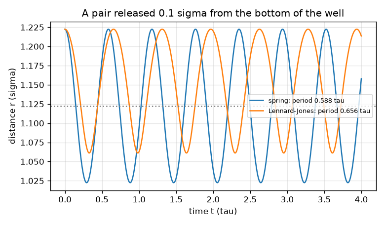
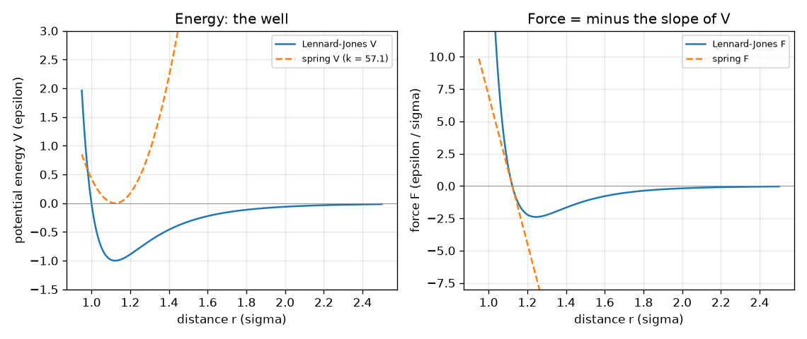

# സെഷൻ 1: ആറ്റങ്ങൾ സ്പ്രിംഗുകളിലെ പന്തുകൾ പോലെ: ചലനം ബലത്തെ പിന്തുടരുന്നു

[Session 1 — हिन्दी](README.hi.md) · [Session 1 — മലയാളം](README.ml.md)

*ലെവൽ 1 (ആശയപരമായ ഇന്ററാക്ടീവ് മോഡൽ) · ഏകദേശം 60 മിനിറ്റ് · openproteinmd*

> ഇത് ലളിതമാക്കിയ ഒരു വിദ്യാഭ്യാസ മോഡലാണ്. ഇത് സാധൂകരിക്കപ്പെട്ട (validated) ഒരു ഡിസൈൻ ഉപകരണമല്ല; യഥാർത്ഥ നിർമ്മിതികൾ, ഇലക്ട്രിക്കൽ ഇൻസ്റ്റലേഷനുകൾ, വാഹനങ്ങൾ, വ്യാവസായിക പ്രക്രിയകൾ അല്ലെങ്കിൽ മെഡിക്കൽ തീരുമാനങ്ങൾ എന്നിവയ്ക്ക് ഇത് ഉപയോഗിക്കരുത്.

**മുൻ‌വ്യവസ്ഥകൾ (Prerequisites)**

- ബീജഗണിതവും ബലം = പിണ്ഡം ഗുണം ത്വരണം എന്ന ആശയവും.
- നിങ്ങൾ PRIMER.md വായിക്കുകയും `python start.py 1` ഒരിക്കൽ റൺ ചെയ്യുകയും ചെയ്തിട്ടുണ്ട്.

**പഠന ലക്ഷ്യങ്ങൾ (Learning objectives).** ഈ സെഷനു ശേഷം നിങ്ങൾക്ക് കഴിയും:

- ഒരു ആറ്റത്തിന്മേലുള്ള ബലം അതിന്റെ സ്ഥിതികോർജ്ജത്തിന്റെ (potential energy) ചരിവിന്റെ നെഗറ്റീവ് ആണെന്ന് വിശദീകരിക്കാൻ.
- ഒരു സ്പ്രിംഗിന്റെയും ഒരു ലെനാർഡ്-ജോൺസ് (Lennard-Jones) ജോടിയുടെയും ഊർജ്ജവും ബലവും കൈകൊണ്ടും Python-ലും കണക്കാക്കാൻ.
- ഒരു ലെനാർഡ്-ജോൺസ് ജോടിയുടെ സന്തുലിത ബന്ധന ദൈർഘ്യം കണ്ടെത്താനും അത് 2^(1/6) sigma ആകുന്നത് എന്തുകൊണ്ടെന്ന് പറയാനും.
- ദൂരത്തിനെതിരായ സ്ഥിതികോർജ്ജ, ബല ഗ്രാഫ് വായിക്കാനും വിട്ടുകൊടുത്ത ഒരു ജോടി എങ്ങനെ ചലിക്കുമെന്ന് പ്രവചിക്കാനും.

## A. യഥാർത്ഥ ലോക പ്രശ്നം
ഒരു പ്രോട്ടീൻ ആറ്റങ്ങളുടെ നീണ്ട ശൃംഖലയാണ്, നിരീക്ഷിക്കാനാവാത്തത്ര ചെറുത്. അതുകൊണ്ട് ശാസ്ത്രജ്ഞർ അത് സിമുലേറ്റ് ചെയ്യുന്നു: ഓരോ ആറ്റത്തിന്മേലുമുള്ള ബലം എഴുതിവച്ച്, ന്യൂട്ടന്റെ നിയമം ആറ്റങ്ങളെ ഓരോ ചെറിയ ചുവടായി നീക്കാൻ അനുവദിക്കുന്നു. മുഴുവൻ ശൃംഖലയ്ക്കും മുമ്പ്, സാധ്യമായ ഏറ്റവും ചെറിയ കേസ്, രണ്ട് ആറ്റങ്ങൾ, എടുക്കുക. എന്താണ് അവയെ അടുപ്പിക്കുന്നത്, എന്താണ് അകറ്റുന്നത്, അവ എവിടെ നിലയുറപ്പിക്കുന്നു? സത്യസന്ധതയെക്കുറിച്ചുള്ള പ്രധാന കുറിപ്പ്: ഈ റിപ്പോസിറ്ററിയിലെ എല്ലാം സങ്കൽപ്പിച്ചെടുത്ത ചുരുക്കിയ യൂണിറ്റുകളിലെ (reduced units) ഒരു കളിപ്പാട്ട മോഡലാണ്. ഇത് മോളിക്യുലാർ ഡൈനാമിക്സ് എങ്ങനെ പ്രവർത്തിക്കുന്നുവെന്ന് പഠിപ്പിക്കുന്നു; ഇത് യഥാർത്ഥ പ്രോട്ടീനല്ല, മെഡിക്കൽ അല്ലെങ്കിൽ മരുന്ന് സംബന്ധമായ ഒരു തീരുമാനത്തിനുള്ള ഉപകരണവുമല്ല. പൊതുവായ വിദ്യാഭ്യാസത്തിനു മാത്രം.

## B. ആശയവും സിദ്ധാന്തവും
നീളം sigma-യിലും ഊർജ്ജം epsilon-ലും പിണ്ഡം m-ലും അളക്കുന്നു, അതിനാൽ മൂന്നും 1 ആണ്; സമയം tau = sigma sqrt(m / epsilon) ആയി ലഭിക്കുന്നു. r ദൂരത്തിലുള്ള രണ്ട് ആറ്റങ്ങൾ ഒരു സ്ഥിതികോർജ്ജം V(r) വഴി പ്രതിപ്രവർത്തിക്കുന്നു. ബലം ചരിവിന്റെ നെഗറ്റീവ് ആണ്: F = -dV/dr, ആറ്റങ്ങളെ അകറ്റുമ്പോൾ പോസിറ്റീവും അടുപ്പിക്കുമ്പോൾ നെഗറ്റീവും. ഒരു രാസബന്ധനത്തെ സ്പ്രിംഗായി സങ്കൽപ്പിക്കുന്നു, V = (1/2) k (r - r0)^2, ബലം F = -k (r - r0). ബന്ധിക്കപ്പെടാത്ത രണ്ട് ആറ്റങ്ങൾ ലെനാർഡ്-ജോൺസ് നിയമം വഴി പ്രതിപ്രവർത്തിക്കുന്നു, V = 4 [(1/r)^12 - (1/r)^6]: ചെറിയ ദൂരത്തിൽ കുത്തനെയുള്ള വികർഷണം (ആറ്റങ്ങൾക്ക് ഒന്നിനുമേൽ ഒന്ന് വരാൻ കഴിയില്ല), കൂടുതൽ ദൂരത്തിൽ ദുർബലമായ ആകർഷണം. അതിന്റെ അടിഭാഗം r = 2^(1/6) sigma = 1.1225 sigma-ൽ, ആഴം -1 epsilon; അടിഭാഗത്തിനടുത്ത് അത് 36 * 2^(2/3) = 57.15 സ്ഥിരാങ്കമുള്ള സ്പ്രിംഗ് പോലെ കാണപ്പെടുന്നു. അടിഭാഗത്തു നിന്ന് മാറി വിട്ടുകൊടുത്ത പന്ത് ബലത്താൽ ത്വരിതപ്പെടുകയും ദോലനം ചെയ്യുകയും ചെയ്യുന്നു. രണ്ട് തുല്യ ആറ്റങ്ങൾ ഒരു ലഘൂകൃത പിണ്ഡം (reduced mass) mu = m/2 ഉള്ള ഒരു പന്തുപോലെ പെരുമാറുന്നു, അതിനാൽ സ്പ്രിംഗ് ജോടിയുടെ ആവർത്തന കാലം 2 pi sqrt(mu / k) ആണ്. നമ്മുടെ അപ്ഡേറ്റ് നിയമം ഏറ്റവും ലളിതമാണ്: v_new = v + (F / mu) dt, പിന്നെ r_new = r + v_new dt.

| ചിഹ്നം | അർത്ഥം | യൂണിറ്റ് |
|---|---|---|
| r | രണ്ട് ആറ്റങ്ങൾ തമ്മിലുള്ള ദൂരം | sigma |
| V | സ്ഥിതികോർജ്ജം | epsilon |
| F | ആറ്റങ്ങളെ ബന്ധിപ്പിക്കുന്ന രേഖയിലൂടെയുള്ള ബലം | epsilon / sigma |
| k | സ്പ്രിംഗ് സ്ഥിരാങ്കം | epsilon / sigma^2 |
| r0 | സ്പ്രിംഗിന്റെ വിശ്രമ ദൈർഘ്യം | sigma |
| mu | ജോടിയുടെ ലഘൂകൃത പിണ്ഡം (m/2) | m |
| dt | സമയ ചുവട് | tau |

**അനുമാനങ്ങൾ (Assumptions)**

- ചുരുക്കിയ യൂണിറ്റുകൾ: sigma = epsilon = m = 1.
- രണ്ട് തുല്യ ആറ്റങ്ങൾ, അവയെ ബന്ധിപ്പിക്കുന്ന രേഖയിലൂടെ മാത്രം ചലനം (ഒരു നിർദ്ദേശാങ്കം r).
- ഇതുവരെ താപ ബാത്ത് (heat bath) ഇല്ല: ഊർജ്ജം മറ്റൊന്നുമായും കൈമാറുന്നില്ല.
- ഒരു കളിപ്പാട്ട മോഡൽ: യഥാർത്ഥ രാസബന്ധനമോ യഥാർത്ഥ പ്രോട്ടീനോ അല്ല.

$$ F(r)=-\frac{dV}{dr} $$

$$ V_{\mathrm{spring}}=\tfrac12 k\,(r-r_0)^2,\qquad F_{\mathrm{spring}}=-k\,(r-r_0) $$

$$ V_{\mathrm{LJ}}=4\left[\left(\frac1r\right)^{12}-\left(\frac1r\right)^{6}\right],\qquad F_{\mathrm{LJ}}=\frac{24}{r}\left[2\left(\frac1r\right)^{12}-\left(\frac1r\right)^{6}\right] $$

$$ r_{\min}=2^{1/6}\sigma,\qquad V(r_{\min})=-\varepsilon,\qquad V''(r_{\min})=36\cdot 2^{2/3}\,\varepsilon/\sigma^2\approx 57.15 $$

$$ T_{\mathrm{spring}}=2\pi\sqrt{\mu/k},\qquad \mu=m/2 $$

## C. ദൃശ്യ വിശദീകരണം
ആദ്യ ചിത്രം രണ്ട് ഊർജ്ജ വക്രങ്ങളും രണ്ട് ബല വക്രങ്ങളും ദൂരത്തിനെതിരെ വരയ്ക്കുന്നു. ലെനാർഡ്-ജോൺസ് വക്രത്തിന് (നീല) 1.123 sigma-യിൽ അടിഭാഗവും -1 ആഴവുമുള്ള ഒരു കിണർ ഉണ്ട്; സ്പ്രിംഗിന് (മുറിച്ച വര) k = 57.15 നൽകിയതിനാൽ അടിഭാഗത്ത് അതിന് കൃത്യമായി ഒരേ ആകൃതിയാണ്. അവിടെ അവ യോജിക്കുന്നു, എന്നാൽ കൂടുതൽ പുറത്തേക്ക് വേർപിരിയുന്നു: സ്പ്രിംഗ് കൂടുതൽ കൂടുതൽ ശക്തമായി വലിച്ചുകൊണ്ടിരിക്കുമ്പോൾ ലെനാർഡ്-ജോൺസ് ബലം ഒന്നുമില്ലാതാകും വരെ മങ്ങുന്നു. ഊർജ്ജത്തിന് ചരിവ് പൂജ്യമായ കിണറിന്റെ അടിഭാഗത്ത് ബല വക്രം പൂജ്യം കടക്കുന്നു. രണ്ടാമത്തെ ചിത്രം അടിഭാഗത്തു നിന്ന് 0.1 sigma അകലെ വിട്ടുകൊടുത്ത ഒരു ജോടിയെ കാണിക്കുന്നു: രണ്ടും ദോലനം ചെയ്യുന്നു, സ്പ്രിംഗ് 0.588 tau ആവർത്തന കാലത്തോടെ, ലെനാർഡ്-ജോൺസ് ജോടി അല്പം പതുക്കെ (0.656 tau), കാരണം അതിന്റെ കിണർ പുറത്ത് കൂടുതൽ വീതിയുള്ളതാണ്.

*കിണറിന്റെ അടിഭാഗത്തു നിന്ന് 0.1 sigma അകലെ വിട്ടുകൊടുത്ത ഒരു ജോടി: സ്പ്രിംഗ് ആവർത്തന കാലം 0.588 tau, ലെനാർഡ്-ജോൺസ് ആവർത്തന കാലം കൂടുതൽ.*

*ഒരു ലെനാർഡ്-ജോൺസ് ജോടിയുടെയും ഒത്ത സ്പ്രിംഗിന്റെയും ഊർജ്ജം (ഇടത്), ബലം (വലത്): കിണറിന്റെ അടിഭാഗത്ത് അവ യോജിക്കുന്നു, കൂടുതൽ പുറത്തേക്ക് വേർപിരിയുന്നു.*

## D. ഇന്ററാക്ടീവ് സിമുലേഷൻ
പാഠം റൺ ചെയ്യുക (`python start.py 1`), തുടർന്ന് ലൈവ് ആപ്പ് തുറക്കുക: [സെഷൻ 1: ഒരു സ്പ്രിംഗും ഒരു ലെനാർഡ്-ജോൺസ് ജോടിയും](https://krunalpanchal1995.github.io/pan-iit-oss/openproteinmd/session-01/) (അല്ലെങ്കിൽ ഈ ഫോൾഡറിലെ `app.html`). ജോടിയുടെ ചിത്രത്തിൽ ദൂരം r സ്ലൈഡ് ചെയ്ത്, കിണറിന്റെ അടിഭാഗത്ത് രണ്ട് ബല അമ്പുകളും ദിശ മാറുന്നത് നിരീക്ഷിക്കുക. സ്പ്രിംഗ് സ്ഥിരാങ്കം മാറ്റി ചുവന്ന വക്രവും സ്പ്രിംഗ് ആവർത്തന കാലവും എങ്ങനെ മാറുന്നുവെന്ന് കാണുക. പിന്നെ ഊർജ്ജ, ബല ഗ്രാഫുകളിലേക്ക് മാറുക.

**വെല്ലുവിളി (Challenge).** ബലം പൂജ്യമാകുന്ന ലെനാർഡ്-ജോൺസ് ബന്ധന ദൈർഘ്യത്തിൽ (0.02 sigma-യ്ക്കുള്ളിൽ) ആറ്റങ്ങളെ സ്ഥാപിക്കുക.

## E. പരിഹരിച്ച ഉദാഹരണവും പരീക്ഷണവും
**പ്രശ്നം.** r = 1.5 sigma-യിൽ ലെനാർഡ്-ജോൺസ് ഊർജ്ജവും ബലവും കണ്ടെത്തുക. ജോടി അടുപ്പിക്കപ്പെടുകയാണോ അകറ്റപ്പെടുകയാണോ?

1. കണക്കാക്കുക (1/r)^6 = (1/1.5)^6 = 0.08779, (1/r)^12 = 0.00771.
2. V = 4 (0.00771 - 0.08779) = 4 (-0.08008) = -0.3203 epsilon.
3. F = (24 / 1.5) [2 (0.00771) - 0.08779] = 16 (-0.07237) = -1.158 epsilon / sigma.
4. ബലം നെഗറ്റീവ് ആണ്, അതിനാൽ ആറ്റങ്ങൾ അടുപ്പിക്കപ്പെടുന്നു: r = 1.5 കിണറിന്റെ അടിഭാഗത്തിന് (1.1225) പുറത്താണ്, ബലം അങ്ങോട്ട് തിരികെ നയിക്കുന്നു.
5. ഊർജ്ജ ചരിവ് കൊണ്ട് പരിശോധിക്കുക: 1.49-ലും 1.51-ലും V ഏകദേശം 0.0232 വ്യത്യാസപ്പെടുന്നു, 0.02 sigma-യിൽ, ചരിവ് +1.16, F = അതിന്റെ നെഗറ്റീവ് = -1.16. രണ്ട് രീതികളും യോജിക്കുന്നു.

**ഉത്തരം.** V = -0.3203 epsilon, F = -1.158 epsilon / sigma (ആകർഷണം): ജോടി അടുപ്പിക്കപ്പെടുന്നു.

**പരീക്ഷണം.** രണ്ട് ആറ്റങ്ങളിലുള്ള യഥാർത്ഥ പരീക്ഷണം വീട്ടിൽ ചെയ്യാനാവില്ല, പക്ഷേ ആശയം അനുഭവിക്കാം: രണ്ട് ചെറിയ കാന്തങ്ങൾ ആകർഷിക്കുന്ന രീതിയിൽ പിടിക്കുക, അവ വികർഷിക്കുന്നതുവരെ പതുക്കെ അടുപ്പിക്കുക. ഇതിനിടയിൽ അവ സുഖമായി ഇരിക്കുന്ന ഒരു ദൂരമുണ്ട്. യഥാർത്ഥ ആറ്റങ്ങൾ സമാനമാണ്, പക്ഷേ വളരെ സങ്കീർണ്ണമാണ്; ഒരു വാതകത്തിനുള്ള (ആർഗൺ പാഠപുസ്തക ഉദാഹരണം) ലെനാർഡ്-ജോൺസ് കിണറിന്റെ അളന്ന ആഴവും വലുപ്പവും ഫിറ്റ് ചെയ്ത മൂല്യങ്ങളാണ്, അതിനാൽ ഈ മോഡൽ വിവരിക്കുന്നത് കാർട്ടൂൺ ആണ്, യഥാർത്ഥ ആർഗണിനെ കൃത്യമായിട്ടല്ല. ലെനാർഡ്-ജോൺസ് നിയമം സൗകര്യപ്രദമായ ഒരു ഏകദേശമാണ്, പ്രകൃതി നിയമമല്ല.

## F. വിലയിരുത്തലും ഡിസൈൻ വെല്ലുവിളിയും
**ചോദ്യ തരം A: ആശയപരം.** ഒരു സ്പ്രിംഗ് ജോടിയും ഒരു ലെനാർഡ്-ജോൺസ് ജോടിയും ഒരേ അടിഭാഗത്തിന് ചുറ്റും ദോലനം ചെയ്യുന്നു. സ്പ്രിംഗിന് ഉറച്ച ആവർത്തന കാലമുള്ളപ്പോൾ ലെനാർഡ്-ജോൺസ് ജോടിയുടെ ആവർത്തന കാലം അതിനെ എത്ര വലിച്ചു എന്നതിനെ ആശ്രയിക്കുന്നത് എന്തുകൊണ്ട്?

സൂചന

അടിഭാഗത്തു നിന്ന് അകലെ രണ്ട് ഊർജ്ജ വക്രങ്ങളുടെ ആകൃതി താരതമ്യം ചെയ്യുക.

ഘട്ടം ഘട്ടമായുള്ള പരിഹാരം

ഒരു സ്പ്രിംഗിന് എല്ലായിടത്തും ഒരേ കട്ടിയുണ്ട് (ഒരു പരാബോള), അതിനാൽ അതിന്റെ ആവർത്തന കാലം 2 pi sqrt(mu/k) ദോലനത്തിന്റെ വലുപ്പത്തെ ആശ്രയിക്കുന്നില്ല. ലെനാർഡ്-ജോൺസ് കിണർ ഒരു പരാബോളയല്ല: അകത്ത് കുത്തനെയുള്ളതും പുറത്ത് പരന്നുപോകുന്നതുമാണ്, അതിനാൽ ജോടിയെ കൂടുതൽ വലിക്കുന്തോറും തിരികെ വലിക്കൽ ദുർബലമാവുകയും ചലനം മന്ദഗതിയിലാവുകയും ചെയ്യുന്നു. പാഠത്തിൽ 0.1 sigma ദോലനം 0.656 tau ആവർത്തന കാലം നൽകുന്നു, 0.5 sigma ദോലനം 1.609 tau. വളരെ ചെറിയ ദോലനങ്ങളിൽ മാത്രമേ ലെനാർഡ്-ജോൺസ് ജോടി ഒരു സ്പ്രിംഗ് പോലെ പെരുമാറൂ.

**ചോദ്യ തരം B: സംഖ്യാപരം.** ഒരു ബന്ധനത്തെ k = 10, r0 = 1 ഉള്ള സ്പ്രിംഗായി മോഡൽ ചെയ്യുന്നു. r = 1.3-ൽ അതിന്റെ ഊർജ്ജവും ബലവും (എല്ലാം ചുരുക്കിയ യൂണിറ്റുകളിൽ), r = 2-ൽ ലെനാർഡ്-ജോൺസ് ഊർജ്ജവും ബലവും കണ്ടെത്തുക.

സൂചന

V = (1/2) k (r - r0)^2, F = -k (r - r0) ഉപയോഗിക്കുക; ലെനാർഡ്-ജോൺസിന് ആദ്യം (1/r)^6 കണക്കാക്കുക.

ഘട്ടം ഘട്ടമായുള്ള പരിഹാരം

സ്പ്രിംഗ്: V = 0.5 * 10 * 0.3^2 = 0.45 epsilon, F = -10 * 0.3 = -3.0 epsilon / sigma (തിരികെ വലിക്കുന്നു). r = 2-ൽ ലെനാർഡ്-ജോൺസ്: (1/2)^6 = 0.015625, (1/2)^12 = 0.000244, അതിനാൽ V = 4 (0.000244 - 0.015625) = -0.0615 epsilon, F = (24 / 2) (2 * 0.000244 - 0.015625) = 12 (-0.015137) = -0.1816 epsilon / sigma. യുക്തിപരിശോധന (sanity check): 2 sigma-യിൽ ആകർഷണം കിണറിന്റെ ആഴമായ 1-നോട് താരതമ്യം ചെയ്യുമ്പോൾ ഇതിനകം ദുർബലമാണ്.

**ചോദ്യ തരം C: ഗ്രാഫ്, സിമുലേഷൻ വ്യാഖ്യാനം.** ഊർജ്ജ ഗ്രാഫിൽ ബലം പൂജ്യമാകുന്നത് എവിടെ, r = 1.6 sigma-യിൽ വിട്ടുകൊടുത്ത ഒരു ജോടിക്ക് എന്ത് സംഭവിക്കും? ചരിവിൽ നിന്ന് വായിക്കുക.

സൂചന

ബലം V-യുടെ ചരിവിന്റെ നെഗറ്റീവ് ആണ്.

ഘട്ടം ഘട്ടമായുള്ള പരിഹാരം

V-യുടെ ചരിവ് കിണറിന്റെ അടിഭാഗമായ r = 1.123 sigma-യിൽ പൂജ്യമാണ്, അതിനാൽ അവിടെ ബലം പൂജ്യം. r = 1.6-ൽ വക്രം മുകളിലേക്ക് ചരിയുന്നു (r കൂടുമ്പോൾ V ഉയരുന്നു), അതിനാൽ ബലം നെഗറ്റീവ്: ആറ്റങ്ങൾ അടുപ്പിക്കപ്പെടുന്നു, അടിഭാഗത്തേക്ക് വേഗം കൂട്ടുന്നു, ബലം ചിഹ്നം മാറ്റുന്ന അവിടം കടന്നുപോകുന്നു, ദോലനം ചെയ്യുന്നു. ഘർഷണം ഇല്ലാത്തതിനാൽ അവ ഒരിക്കലും നിലയുറപ്പിക്കുന്നില്ല (സെഷൻ 3 താപ ബാത്ത് ചേർക്കുന്നു).

**ചോദ്യ തരം D: ഡിസൈൻ, ഒപ്റ്റിമൈസേഷൻ വെല്ലുവിളി.** ഡിസൈൻ: ഒരു ബന്ധന ജോടി 0.5 tau ആവർത്തന കാലത്തോടെ ദോലനം ചെയ്യാൻ ഒരു സ്പ്രിംഗ് സ്ഥിരാങ്കം തിരഞ്ഞെടുക്കുക, ഒരു ആവർത്തനത്തിൽ ഏകദേശം 20 ചുവടുകളോടെ ചലനം പിന്തുടരാൻ എത്ര വലിയ സമയ ചുവട് വേണമെന്ന് പറയുക.

സൂചന

mu = 0.5 ആയി T = 2 pi sqrt(mu / k) എന്നതിൽ k നിർധാരണം ചെയ്യുക. പിന്നെ ആവർത്തന കാലത്തെ 20 കൊണ്ട് ഹരിക്കുക.

ഘട്ടം ഘട്ടമായുള്ള പരിഹാരം

k = mu (2 pi / T)^2 = 0.5 * (2 pi / 0.5)^2 = 0.5 * 157.9 = 79.0, പരിശോധന: 2 pi sqrt(0.5 / 79) = 0.4999 tau. ഒരു ആവർത്തനത്തിൽ 20 ചുവടുകളോടെ dt = 0.5 / 20 = 0.025 tau. വിട്ടുവീഴ്ച (trade-off): കട്ടിയുള്ള ബന്ധനം വേഗമേറിയ ദോലനമാണ്, അതിനാൽ ചെറിയ സമയ ചുവടും ഒരേ സിമുലേറ്റഡ് സമയത്തിന് കൂടുതൽ നീണ്ട റണ്ണും ആവശ്യമാണ്. അതുകൊണ്ടാണ് സെഷൻ 2 സമയ ചുവട് ശ്രദ്ധയോടെ പഠിക്കുന്നത്.

[RUBRIC.md](../../RUBRIC.md) ഉപയോഗിച്ച് സ്വയം സ്കോർ ചെയ്യുക. കടലാസിൽ പ്രവർത്തിക്കാൻ [ആക്ടിവിറ്റി ഷീറ്റ്](activity_sheet.md) പ്രിന്റ് ചെയ്യുക.

## സാധാരണ തെറ്റിദ്ധാരണകൾ
| സാധാരണ തെറ്റിദ്ധാരണ | യഥാർത്ഥത്തിൽ സത്യം എന്താണ് |
|---|---|
| ആറ്റങ്ങൾ എല്ലാ ദൂരത്തിലും പരസ്പരം ആകർഷിക്കുകയും കൂടുതൽ കൂടുതൽ അടുത്തുവരികയും ചെയ്യുന്നു. | ലെനാർഡ്-ജോൺസ് ആറ്റങ്ങൾ ഇടത്തരം ദൂരത്തിൽ മാത്രമേ ആകർഷിക്കൂ, ഞെരുക്കിയാൽ ശക്തമായി വികർഷിക്കും; ബലം 1.1225 sigma-യിൽ പൂജ്യമാണ്, അതാണ് ബന്ധന ദൈർഘ്യം. |
| ബലവും ഊർജ്ജവും ഒന്നുതന്നെയാണ്. | ഊർജ്ജം V വക്രത്തിന്റെ ഉയരമാണ്; ബലം F അതിന്റെ ചരിവിന്റെ നെഗറ്റീവ് ആണ്. പൂജ്യം ബലം എന്നാൽ പൂജ്യം ചരിവ്, പൂജ്യം ഊർജ്ജമല്ല: അടിഭാഗത്ത് ഊർജ്ജം -1 ആണ്. |
| ഒരു സ്പ്രിംഗും ഒരു ലെനാർഡ്-ജോൺസ് ജോടിയും എപ്പോഴും ഒരേ ആവർത്തന കാലത്തിൽ ദോലനം ചെയ്യുന്നു. | കിണറിന്റെ അടിഭാഗത്തിനടുത്തെ ചെറു ദോലനങ്ങളിൽ മാത്രമേ അവ യോജിക്കൂ; വലിയ ദോലനങ്ങളിൽ ലെനാർഡ്-ജോൺസ് ആവർത്തന കാലം കൂടുതലാണ്. |
| സിമുലേഷൻ യഥാർത്ഥ ആറ്റങ്ങൾ ചെയ്യുന്നത് കാണിക്കുന്നു. | മോഡൽ ചെയ്യുന്നത് മാത്രമാണ് ഇത് കാണിക്കുന്നത്. സ്പ്രിംഗ്, ലെനാർഡ്-ജോൺസ് നിയമം, ചുരുക്കിയ യൂണിറ്റുകൾ എന്നിവ ലളിതവും ഫിറ്റ് ചെയ്തതുമായ കാർട്ടൂണുകളാണ്. |

## പദാവലി (Glossary)
- **സ്ഥിതികോർജ്ജം (potential energy)**: ആറ്റങ്ങൾ എവിടെയാണെന്നതിനെ ആശ്രയിക്കുന്ന സംഭരിത ഊർജ്ജം; ബലം അതിന്റെ ചരിവിന്റെ നെഗറ്റീവ് ആണ്
- **ലെനാർഡ്-ജോൺസ് പൊട്ടൻഷ്യൽ (Lennard-Jones potential)**: ചെറിയ ദൂരത്തിൽ വികർഷിക്കുകയും കൂടുതൽ ദൂരത്തിൽ ദുർബലമായി ആകർഷിക്കുകയും ചെയ്യുന്ന ലളിതമായ ജോടി നിയമം
- **ചുരുക്കിയ യൂണിറ്റുകൾ (reduced units)**: sigma, epsilon, ആറ്റം പിണ്ഡം എന്നിവ 1 ആകുന്ന യൂണിറ്റുകൾ, അതിനാൽ സംഖ്യകൾ ശുദ്ധവും മോഡൽ പൊതുവുമാണ്
- **ലഘൂകൃത പിണ്ഡം (reduced mass)**: പരസ്പരം അടുക്കുകയോ അകലുകയോ ചെയ്യുന്ന രണ്ട് വസ്തുക്കളുടെ ഫലപ്രദ പിണ്ഡം; രണ്ട് തുല്യ ആറ്റങ്ങൾക്ക് m/2
- **അനാഹാർമോണിക് (anharmonic)**: ശുദ്ധ സ്പ്രിംഗ് അല്ല: തിരികെ വലിക്കൽ നീട്ടലിന് ആനുപാതികമല്ല

## പൂർത്തിയാക്കുക
1. [exercises.md](exercises.md)-ലെ മൂന്ന് കോഡിംഗ് ടാസ്കുകൾ ചെയ്യുക.
2. നിങ്ങളുടെ മാറ്റങ്ങൾക്കു ശേഷം `python start.py 1` വീണ്ടും റൺ ചെയ്യുക. അത് ചെക്ക്‌പോയിന്റോടെ അവസാനിക്കുന്നു; അത് `PASS` പ്രിന്റ് ചെയ്യുമ്പോൾ, നിങ്ങൾ പൂർത്തിയാക്കി. (ചെക്ക്‌പോയിന്റ് മാത്രം: `python start.py check 1`.)

അടുത്തത്: [സെഷൻ 2](../session-02/README.md)
