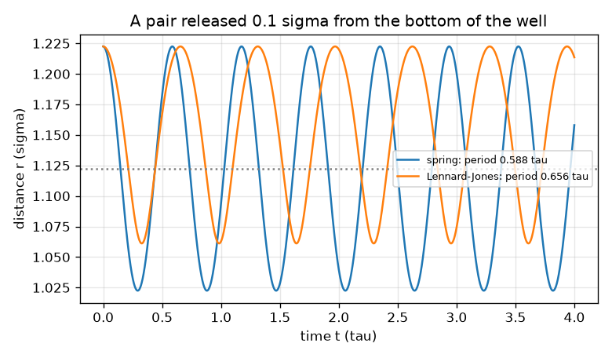
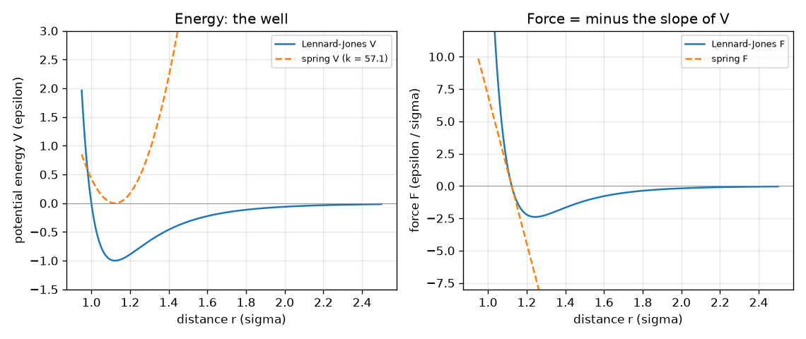

# அமர்வு 1: அணுக்கள் சுருள்வில்லில் உள்ள பந்துகள்: இயக்கம் விசையைப் பின்பற்றுகிறது

[Session 1 — हिन्दी](README.hi.md) · [Session 1 — മലയാളം](README.ml.md) · [Session 1 — தமிழ்](README.ta.md)

*நிலை 1 (கருத்துசார் ஊடாடும் மாதிரி) · சுமார் 60 நிமிடங்கள் · openproteinmd*

> இது எளிமைப்படுத்தப்பட்ட ஒரு கல்வி மாதிரி. இது சரிபார்க்கப்பட்ட (validated) வடிவமைப்புக் கருவி அல்ல; உண்மையான கட்டமைப்புகள், மின் நிறுவல்கள், வாகனங்கள், தொழில் செயல்முறைகள் அல்லது மருத்துவ முடிவுகளுக்கு இதைப் பயன்படுத்த வேண்டாம்.

**முன்தேவைகள் (Prerequisites)**

- இயற்கணிதமும் விசை = நிறை பெருக்கல் முடுக்கம் என்ற கருத்தும்.
- நீங்கள் PRIMER.md-ஐப் படித்து `python start.py 1` ஐ ஒருமுறை இயக்கியிருக்க வேண்டும்.

**கற்றல் நோக்கங்கள் (Learning objectives).** இந்த அமர்வுக்குப் பிறகு உங்களால் முடியும்:

- ஓர் அணுவின் மீதான விசை அதன் நிலை ஆற்றலின் (potential energy) சரிவின் எதிர்மறை என்று விளக்க.
- சுருள்வில்லின் ஆற்றலையும் விசையையும், லெனார்டு-ஜோன்ஸ் (Lennard-Jones) இணையின் ஆற்றலையும் விசையையும் கையாலும் Python-இலும் கணக்கிட.
- லெனார்டு-ஜோன்ஸ் இணையின் சமநிலைப் பிணைப்பு நீளத்தைக் கண்டறிந்து அது ஏன் 2^(1/6) sigma என்று சொல்ல.
- தூரத்துக்கு எதிரான நிலை ஆற்றல், விசை வரைபடத்தைப் படித்து, விடுவிக்கப்பட்ட இணை எப்படி நகரும் என்று முன்கணிக்க.

## A. நிஜ உலகப் பிரச்சினை
புரதம் என்பது அணுக்களின் நீண்ட சங்கிலி, பார்க்க முடியாத அளவு சிறியது. எனவே விஞ்ஞானிகள் அதை உருவகப்படுத்துகிறார்கள்: ஒவ்வொரு அணுவின் மீதான விசையையும் எழுதி, நியூட்டனின் விதி அணுக்களை சிறு சிறு படிகளாக நகர்த்த விடுகிறார்கள். முழுச் சங்கிலிக்கு முன், சாத்தியமான மிகச் சிறிய நிலை, இரண்டு அணுக்கள், எடுத்துக்கொள்ளுங்கள். அவற்றை எது இணைக்கிறது, எது விலக்குகிறது, அவை எங்கே நிலைபெறுகின்றன? நேர்மை பற்றிய முக்கியக் குறிப்பு: இந்தக் களஞ்சியத்தில் உள்ள அனைத்தும் கற்பனையான குறைக்கப்பட்ட அலகுகளில் (reduced units) ஒரு பொம்மை மாதிரி. இது மூலக்கூறு இயக்கவியல் எப்படி வேலை செய்கிறது என்று கற்பிக்கிறது; இது உண்மையான புரதம் அல்ல, எந்த மருத்துவ அல்லது மருந்து முடிவுக்கான கருவியும் அல்ல. பொதுக் கல்விக்கு மட்டும்.

## B. கருத்தும் கோட்பாடும்
நீளத்தை sigma-விலும், ஆற்றலை epsilon-இலும், நிறையை m-இலும் அளக்கிறோம், எனவே மூன்றும் 1; நேரம் tau = sigma sqrt(m / epsilon) ஆக வருகிறது. r தூரத்தில் உள்ள இரண்டு அணுக்கள் நிலை ஆற்றல் V(r) மூலம் ஊடாடுகின்றன. விசை சரிவின் எதிர்மறை: F = -dV/dr, அணுக்களை விலக்கும்போது நேர்மறை, இழுக்கும்போது எதிர்மறை. வேதிப் பிணைப்பு சுருள்வில்லாகக் கருதப்படுகிறது, V = (1/2) k (r - r0)^2, விசை F = -k (r - r0). பிணைக்கப்படாத இரண்டு அணுக்கள் லெனார்டு-ஜோன்ஸ் விதியால் ஊடாடுகின்றன, V = 4 [(1/r)^12 - (1/r)^6]: குறுகிய தூரத்தில் செங்குத்தான விலக்கல் (அணுக்கள் ஒன்றின் மேல் ஒன்று வர முடியாது), நீண்ட தூரத்தில் பலவீனமான கவர்ச்சி. அதன் அடிப்பகுதி r = 2^(1/6) sigma = 1.1225 sigma-வில், ஆழம் -1 epsilon; அடிப்பகுதிக்கு அருகில் அது 36 * 2^(2/3) = 57.15 மாறிலி கொண்ட சுருள்வில் போலத் தெரிகிறது. அடிப்பகுதியிலிருந்து விலகி விடுவிக்கப்பட்ட பந்து விசையால் முடுக்கப்பட்டு அலைவுறுகிறது. இரண்டு சம அணுக்கள் குறைக்கப்பட்ட நிறை (reduced mass) mu = m/2 கொண்ட ஒரு பந்து போல நடந்துகொள்கின்றன, எனவே சுருள்வில் இணையின் அலைவு காலம் 2 pi sqrt(mu / k). நம் புதுப்பிப்பு விதி எளிமையானது: v_new = v + (F / mu) dt, பின்னர் r_new = r + v_new dt.

| குறியீடு | பொருள் | அலகு |
|---|---|---|
| r | இரு அணுக்களுக்கு இடையிலான தூரம் | sigma |
| V | நிலை ஆற்றல் | epsilon |
| F | அணுக்களை இணைக்கும் கோடு வழியே விசை | epsilon / sigma |
| k | சுருள்வில் மாறிலி | epsilon / sigma^2 |
| r0 | சுருள்வில்லின் ஓய்வு நீளம் | sigma |
| mu | இணையின் குறைக்கப்பட்ட நிறை (m/2) | m |
| dt | நேரப் படி | tau |

**அனுமானங்கள் (Assumptions)**

- குறைக்கப்பட்ட அலகுகள்: sigma = epsilon = m = 1.
- இரண்டு சம அணுக்கள், அவற்றை இணைக்கும் கோடு வழியே மட்டும் இயக்கம் (ஒரு ஆயம் r).
- இன்னும் வெப்பக் குளியல் (heat bath) இல்லை: ஆற்றல் வேறு எதனுடனும் பரிமாறப்படுவதில்லை.
- ஒரு பொம்மை மாதிரி: உண்மையான வேதிப் பிணைப்பும் அல்ல, உண்மையான புரதமும் அல்ல.

$$ F(r)=-\frac{dV}{dr} $$

$$ V_{\mathrm{spring}}=\tfrac12 k\,(r-r_0)^2,\qquad F_{\mathrm{spring}}=-k\,(r-r_0) $$

$$ V_{\mathrm{LJ}}=4\left[\left(\frac1r\right)^{12}-\left(\frac1r\right)^{6}\right],\qquad F_{\mathrm{LJ}}=\frac{24}{r}\left[2\left(\frac1r\right)^{12}-\left(\frac1r\right)^{6}\right] $$

$$ r_{\min}=2^{1/6}\sigma,\qquad V(r_{\min})=-\varepsilon,\qquad V''(r_{\min})=36\cdot 2^{2/3}\,\varepsilon/\sigma^2\approx 57.15 $$

$$ T_{\mathrm{spring}}=2\pi\sqrt{\mu/k},\qquad \mu=m/2 $$

## C. காட்சி விளக்கம்
முதல் படம் இரு ஆற்றல் வளைவுகளையும் இரு விசை வளைவுகளையும் தூரத்துக்கு எதிராக வரைகிறது. லெனார்டு-ஜோன்ஸ் வளைவுக்கு (நீலம்) 1.123 sigma-வில் அடிப்பகுதியும் -1 ஆழமும் கொண்ட கிணறு உள்ளது; சுருள்வில்லுக்கு (கோடிட்டது) k = 57.15 கொடுக்கப்பட்டதால் அடிப்பகுதியில் அதற்குச் சரியாக அதே வடிவம். அங்கே அவை ஒத்துப்போகின்றன, ஆனால் வெளியே செல்லச் செல்ல பிரிகின்றன: சுருள்வில் மேலும் மேலும் வலுவாக இழுத்துக்கொண்டே இருக்க, லெனார்டு-ஜோன்ஸ் விசை ஒன்றுமில்லாமல் மங்குகிறது. ஆற்றலின் சரிவு பூஜ்யமாக இருக்கும் கிணற்றின் அடிப்பகுதியில் விசை வளைவு பூஜ்யத்தைக் கடக்கிறது. இரண்டாவது படம் அடிப்பகுதியிலிருந்து 0.1 sigma தொலைவில் விடுவிக்கப்பட்ட இணையைக் காட்டுகிறது: இரண்டும் அலைவுறுகின்றன, சுருள்வில் 0.588 tau காலத்துடன், லெனார்டு-ஜோன்ஸ் இணை சற்று மெதுவாக (0.656 tau), ஏனெனில் அதன் கிணறு வெளிப்புறத்தில் அகலமானது.

*கிணற்றின் அடிப்பகுதியிலிருந்து 0.1 sigma தொலைவில் விடுவிக்கப்பட்ட இணை: சுருள்வில் காலம் 0.588 tau, லெனார்டு-ஜோன்ஸ் காலம் அதிகம்.*

*லெனார்டு-ஜோன்ஸ் இணையினதும் பொருந்திய சுருள்வில்லினதும் ஆற்றல் (இடது), விசை (வலது): கிணற்றின் அடிப்பகுதியில் ஒத்துப்போகின்றன, வெளியே பிரிகின்றன.*

## D. ஊடாடும் உருவகப்படுத்துதல்
பாடத்தை இயக்கவும் (`python start.py 1`), பின்னர் நேரடி செயலியைத் திறக்கவும்: [அமர்வு 1: ஒரு சுருள்வில்லும் ஒரு லெனார்டு-ஜோன்ஸ் இணையும்](https://krunalpanchal1995.github.io/pan-iit-oss/openproteinmd/session-01/) (அல்லது இந்தக் கோப்புறையில் உள்ள `app.html`). இணைப் படத்தில் தூரம் r ஐ நகர்த்தி, கிணற்றின் அடிப்பகுதியில் இரு விசை அம்புகளும் திசை மாறுவதைப் பாருங்கள். சுருள்வில் மாறிலியை மாற்றி சிவப்பு வளைவும் சுருள்வில் காலமும் எப்படி மாறுகின்றன என்று பாருங்கள். பின்னர் ஆற்றல், விசை வரைபடங்களுக்கு மாறுங்கள்.

**சவால் (Challenge).** விசை பூஜ்யமாக இருக்கும் லெனார்டு-ஜோன்ஸ் பிணைப்பு நீளத்தில் (0.02 sigma-வுக்குள்) அணுக்களை வையுங்கள்.

## E. தீர்க்கப்பட்ட எடுத்துக்காட்டும் சோதனையும்
**சிக்கல்.** r = 1.5 sigma-வில் லெனார்டு-ஜோன்ஸ் ஆற்றலையும் விசையையும் கண்டறியுங்கள். இணை இழுக்கப்படுகிறதா அல்லது விலக்கப்படுகிறதா?

1. கணக்கிடுங்கள் (1/r)^6 = (1/1.5)^6 = 0.08779, (1/r)^12 = 0.00771.
2. V = 4 (0.00771 - 0.08779) = 4 (-0.08008) = -0.3203 epsilon.
3. F = (24 / 1.5) [2 (0.00771) - 0.08779] = 16 (-0.07237) = -1.158 epsilon / sigma.
4. விசை எதிர்மறை, எனவே அணுக்கள் இழுக்கப்படுகின்றன: r = 1.5 கிணற்றின் அடிப்பகுதிக்கு (1.1225) வெளியே உள்ளது, விசை அதை நோக்கித் திருப்புகிறது.
5. ஆற்றல் சரிவால் சரிபாருங்கள்: 1.49, 1.51 இல் V சுமார் 0.0232 வேறுபடுகிறது, 0.02 sigma-வில், சரிவு +1.16, F = அதன் எதிர்மறை = -1.16. இரு வழிகளும் ஒத்துப்போகின்றன.

**விடை.** V = -0.3203 epsilon, F = -1.158 epsilon / sigma (கவர்ச்சி): இணை இழுக்கப்படுகிறது.

**சோதனை.** இரண்டு அணுக்களில் உண்மையான சோதனையை வீட்டில் செய்ய முடியாது, ஆனால் கருத்தை உணரலாம்: இரண்டு சிறிய காந்தங்களை ஈர்க்கும்படி பிடித்து, அவை விலக்கும் வரை மெதுவாக நெருக்குங்கள். இடையில் அவை வசதியாக இருக்கும் ஒரு தூரம் உண்டு. உண்மையான அணுக்கள் இதே போன்றவை ஆனால் மிகவும் சிக்கலானவை; ஒரு வாயுவுக்கான (ஆர்கான் பாடப்புத்தக எடுத்துக்காட்டு) லெனார்டு-ஜோன்ஸ் கிணற்றின் அளக்கப்பட்ட ஆழமும் அளவும் பொருத்தப்பட்ட மதிப்புகள், எனவே இந்த மாதிரி விவரிப்பது கேலிச்சித்திரத்தை, உண்மையான ஆர்கானைத் துல்லியமாக அல்ல. லெனார்டு-ஜோன்ஸ் விதி வசதியான தோராயம், இயற்கை விதி அல்ல.

## F. மதிப்பீடும் வடிவமைப்புச் சவாலும்
**கேள்வி வகை A: கருத்துசார்.** ஒரு சுருள்வில் இணையும் ஒரு லெனார்டு-ஜோன்ஸ் இணையும் ஒரே அடிப்பகுதியைச் சுற்றி அலைவுறுகின்றன. சுருள்வில்லுக்கு நிலையான காலம் இருக்க, லெனார்டு-ஜோன்ஸ் இணையின் காலம் எவ்வளவு இழுத்தீர்கள் என்பதைச் சார்ந்திருப்பது ஏன்?

குறிப்பு

அடிப்பகுதியிலிருந்து தொலைவில் இரு ஆற்றல் வளைவுகளின் வடிவத்தை ஒப்பிடுங்கள்.

படிப்படியான தீர்வு

சுருள்வில்லுக்கு எல்லா இடத்திலும் ஒரே விறைப்பு (ஒரு பரவளையம்), எனவே அதன் காலம் 2 pi sqrt(mu/k) ஊசலின் அளவைச் சார்ந்ததல்ல. லெனார்டு-ஜோன்ஸ் கிணறு பரவளையம் அல்ல: உள்ளே செங்குத்தாகவும் வெளியே தட்டையாகவும் உள்ளது, எனவே இணையை எவ்வளவு அதிகமாக இழுக்கிறீர்களோ, திரும்ப இழுக்கும் விசை அவ்வளவு பலவீனமாகி இயக்கம் மெதுவாகிறது. பாடத்தில் 0.1 sigma ஊசல் 0.656 tau காலத்தையும், 0.5 sigma ஊசல் 1.609 tau காலத்தையும் தருகிறது. மிகச் சிறிய ஊசல்களில் மட்டுமே லெனார்டு-ஜோன்ஸ் இணை சுருள்வில் போல நடந்துகொள்கிறது.

**கேள்வி வகை B: எண்சார்.** ஒரு பிணைப்பு k = 10, r0 = 1 கொண்ட சுருள்வில்லாக மாதிரியாக்கப்படுகிறது. r = 1.3-இல் அதன் ஆற்றலையும் விசையையும் (அனைத்தும் குறைக்கப்பட்ட அலகுகளில்), r = 2-இல் லெனார்டு-ஜோன்ஸ் ஆற்றலையும் விசையையும் கண்டறியுங்கள்.

குறிப்பு

V = (1/2) k (r - r0)^2, F = -k (r - r0) பயன்படுத்துங்கள்; லெனார்டு-ஜோன்ஸுக்கு முதலில் (1/r)^6 ஐக் கணக்கிடுங்கள்.

படிப்படியான தீர்வு

சுருள்வில்: V = 0.5 * 10 * 0.3^2 = 0.45 epsilon, F = -10 * 0.3 = -3.0 epsilon / sigma (திரும்ப இழுக்கிறது). r = 2-இல் லெனார்டு-ஜோன்ஸ்: (1/2)^6 = 0.015625, (1/2)^12 = 0.000244, எனவே V = 4 (0.000244 - 0.015625) = -0.0615 epsilon, F = (24 / 2) (2 * 0.000244 - 0.015625) = 12 (-0.015137) = -0.1816 epsilon / sigma. நியாயச் சரிபார்ப்பு (sanity check): 2 sigma-வில் கவர்ச்சி, கிணற்றின் ஆழம் 1 உடன் ஒப்பிடும்போது ஏற்கெனவே பலவீனம்.

**கேள்வி வகை C: வரைபடம், உருவகப்படுத்துதல் விளக்கம்.** ஆற்றல் வரைபடத்தில் விசை பூஜ்யமாக இருப்பது எங்கே, r = 1.6 sigma-வில் விடுவிக்கப்பட்ட இணைக்கு என்ன நடக்கும்? சரிவிலிருந்து படியுங்கள்.

குறிப்பு

விசை V-யின் சரிவின் எதிர்மறை.

படிப்படியான தீர்வு

V-யின் சரிவு கிணற்றின் அடிப்பகுதியான r = 1.123 sigma-வில் பூஜ்யம், எனவே அங்கு விசை பூஜ்யம். r = 1.6-இல் வளைவு மேல்நோக்கிச் சரிகிறது (r உடன் V உயர்கிறது), எனவே விசை எதிர்மறை: அணுக்கள் இழுக்கப்படுகின்றன, அடிப்பகுதியை நோக்கி வேகமெடுக்கின்றன, விசை குறி மாறும் அந்த இடத்தைத் தாண்டிச் செல்கின்றன, அலைவுறுகின்றன. உராய்வு இல்லாததால் அவை ஒருபோதும் நிலைபெறுவதில்லை (அமர்வு 3 வெப்பக் குளியலைச் சேர்க்கிறது).

**கேள்வி வகை D: வடிவமைப்பு, உகப்பாக்கச் சவால்.** வடிவமைப்பு: ஒரு பிணைப்பு இணை 0.5 tau காலத்துடன் அலைவுற ஒரு சுருள்வில் மாறிலியைத் தேர்ந்தெடுங்கள், ஒரு காலத்துக்குச் சுமார் 20 படிகளுடன் இயக்கத்தைப் பின்தொடர எவ்வளவு பெரிய நேரப் படி தேவை என்று சொல்லுங்கள்.

குறிப்பு

mu = 0.5 உடன் T = 2 pi sqrt(mu / k) இல் k-ஐத் தீர்க்கவும். பின்னர் காலத்தை 20-ஆல் வகுக்கவும்.

படிப்படியான தீர்வு

k = mu (2 pi / T)^2 = 0.5 * (2 pi / 0.5)^2 = 0.5 * 157.9 = 79.0, சரிபார்ப்பு: 2 pi sqrt(0.5 / 79) = 0.4999 tau. ஒரு காலத்துக்கு 20 படிகளுடன் dt = 0.5 / 20 = 0.025 tau. சமரசம் (trade-off): விறைப்பான பிணைப்பு வேகமான அலைவு, எனவே சிறிய நேரப் படியும், அதே உருவகப்படுத்தப்பட்ட நேரத்துக்கு நீண்ட ஓட்டமும் தேவை. அதனால்தான் அமர்வு 2 நேரப் படியை கவனமாகப் படிக்கிறது.

[RUBRIC.md](../../RUBRIC.md) ஐப் பயன்படுத்தி நீங்களே மதிப்பெண் இடுங்கள். காகிதத்தில் வேலை செய்ய [செயல்பாட்டுத் தாள்](activity_sheet.md) ஐ அச்சிடுங்கள்.

## பொதுவான தவறான புரிதல்கள்
| பொதுவான தவறான புரிதல் | உண்மையில் என்ன |
|---|---|
| அணுக்கள் எல்லாத் தூரங்களிலும் ஒன்றையொன்று கவர்ந்து மேலும் மேலும் நெருங்குகின்றன. | லெனார்டு-ஜோன்ஸ் அணுக்கள் இடைநிலைத் தூரத்தில் மட்டுமே கவர்கின்றன, நெருக்கப்பட்டால் வலுவாக விலக்குகின்றன; விசை 1.1225 sigma-வில் பூஜ்யம், அதுவே பிணைப்பு நீளம். |
| விசையும் ஆற்றலும் ஒன்றே. | ஆற்றல் V என்பது வளைவின் உயரம்; விசை F என்பது அதன் சரிவின் எதிர்மறை. பூஜ்ய விசை என்றால் பூஜ்யச் சரிவு, பூஜ்ய ஆற்றல் அல்ல: அடிப்பகுதியில் ஆற்றல் -1. |
| சுருள்வில்லும் லெனார்டு-ஜோன்ஸ் இணையும் எப்போதும் ஒரே காலத்தில் அலைவுறும். | கிணற்றின் அடிப்பகுதிக்கு அருகில் சிறு ஊசல்களில் மட்டுமே ஒத்துப்போகின்றன; பெரிய ஊசல்களில் லெனார்டு-ஜோன்ஸ் காலம் நீளமானது. |
| உருவகப்படுத்துதல் உண்மையான அணுக்கள் செய்வதைக் காட்டுகிறது. | மாதிரி செய்வதை மட்டுமே காட்டுகிறது. சுருள்வில், லெனார்டு-ஜோன்ஸ் விதி, குறைக்கப்பட்ட அலகுகள் எளிமையான, பொருத்தப்பட்ட கேலிச்சித்திரங்கள். |

## சொற்பட்டியல் (Glossary)
- **நிலை ஆற்றல் (potential energy)**: அணுக்கள் எங்கே உள்ளன என்பதைப் பொறுத்த சேமிக்கப்பட்ட ஆற்றல்; விசை அதன் சரிவின் எதிர்மறை
- **லெனார்டு-ஜோன்ஸ் அழுத்தம் (Lennard-Jones potential)**: குறுகிய தூரத்தில் விலக்கி, நீண்ட தூரத்தில் பலவீனமாகக் கவரும் எளிய இணை விதி
- **குறைக்கப்பட்ட அலகுகள் (reduced units)**: sigma, epsilon, அணு நிறை ஆகியவை 1 ஆக இருக்கும் அலகுகள், எனவே எண்கள் தூய்மையாகவும் மாதிரி பொதுவாகவும் இருக்கும்
- **குறைக்கப்பட்ட நிறை (reduced mass)**: ஒன்றை நோக்கி அல்லது விலகி நகரும் இரு பொருள்களின் பயனுறு நிறை; இரு சம அணுக்களுக்கு m/2
- **நேரிலா அலைவு (anharmonic)**: தூய சுருள்வில் அல்ல: திரும்ப இழுக்கும் விசை நீட்சிக்கு விகிதமல்ல

## முடிக்கவும்
1. [exercises.md](exercises.md) இல் உள்ள மூன்று நிரலாக்கப் பணிகளைச் செய்யுங்கள்.
2. உங்கள் மாற்றங்களுக்குப் பிறகு `python start.py 1` ஐ மீண்டும் இயக்கவும். அது சோதனைச்சாவடியுடன் முடிகிறது; அது `PASS` என்று அச்சிடும்போது, நீங்கள் முடித்துவிட்டீர்கள். (சோதனைச்சாவடி மட்டும்: `python start.py check 1`.)

அடுத்தது: [அமர்வு 2](../session-02/README.md)
