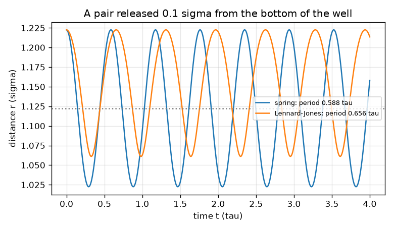
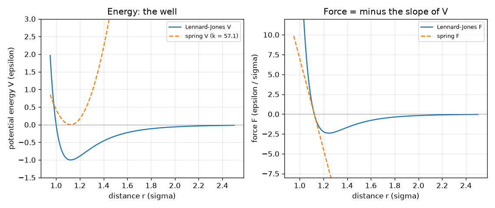

# సెషన్ 1: పరమాణువులు స్ప్రింగ్‌లపై బంతుల్లా: చలనం బలాన్ని అనుసరిస్తుంది

[Session 1 — हिन्दी](README.hi.md) · [Session 1 — മലയാളം](README.ml.md) · [Session 1 — தமிழ்](README.ta.md) · [Session 1 — తెలుగు](README.te.md)

*స్థాయి 1 (భావనాత్మక ఇంటరాక్టివ్ నమూనా) · సుమారు 60 నిమిషాలు · openproteinmd*

> ఇది సరళీకృత విద్యా నమూనా. ఇది ధ్రువీకరించిన (validated) డిజైన్ సాధనం కాదు; నిజమైన నిర్మాణాలు, విద్యుత్ ఏర్పాట్లు, వాహనాలు, పారిశ్రామిక ప్రక్రియలు లేదా వైద్య నిర్ణయాలకు దీనిని ఉపయోగించవద్దు.

**ముందస్తు అవసరాలు (Prerequisites)**

- బీజగణితం, బలం = ద్రవ్యరాశి రెట్లు త్వరణం అనే భావన.
- మీరు PRIMER.md చదివి `python start.py 1` ను ఒకసారి నడిపి ఉండాలి.

**అభ్యాస లక్ష్యాలు (Learning objectives).** ఈ సెషన్ తర్వాత మీరు చేయగలరు:

- ఒక పరమాణువుపై బలం దాని స్థితిజ శక్తి (potential energy) వాలుకు రుణాత్మకం అని వివరించడం.
- స్ప్రింగ్ శక్తి, బలం, లెనార్డ్-జోన్స్ (Lennard-Jones) జత శక్తి, బలాన్ని చేతితో, Python లో లెక్కించడం.
- లెనార్డ్-జోన్స్ జత సమతుల్య బంధ పొడవును కనుగొని, అది 2^(1/6) sigma ఎందుకో చెప్పడం.
- దూరానికి వ్యతిరేకంగా స్థితిజ శక్తి, బలం గ్రాఫ్‌ను చదివి, విడిచిపెట్టిన జత ఎలా కదులుతుందో ఊహించడం.

## A. వాస్తవ ప్రపంచ సమస్య
ప్రోటీన్ అనేది పరమాణువుల పొడవైన గొలుసు, చూడలేనంత చిన్నది. అందుకే శాస్త్రవేత్తలు దాన్ని అనుకరిస్తారు: ప్రతి పరమాణువుపై బలాన్ని రాసి, న్యూటన్ నియమం పరమాణువులను చిన్న చిన్న అడుగులుగా కదిలించేలా చేస్తారు. పూర్తి గొలుసుకు ముందు, సాధ్యమైన అతి చిన్న సందర్భం, రెండు పరమాణువులు, తీసుకోండి. వాటిని ఏది దగ్గరకు లాగుతుంది, ఏది దూరంగా నెడుతుంది, అవి ఎక్కడ స్థిరపడతాయి? నిజాయితీ గురించి ముఖ్య గమనిక: ఈ రిపాజిటరీలోని ప్రతిదీ కల్పిత తగ్గించిన ప్రమాణాల (reduced units) లో ఒక బొమ్మ నమూనా. ఇది అణు గతిశాస్త్రం (molecular dynamics) ఎలా పనిచేస్తుందో నేర్పుతుంది; ఇది నిజమైన ప్రోటీన్ కాదు, ఏ వైద్య లేదా ఔషధ నిర్ణయానికీ సాధనం కాదు. సాధారణ విద్య కోసం మాత్రమే.

## B. భావన మరియు సిద్ధాంతం
పొడవును sigma లో, శక్తిని epsilon లో, ద్రవ్యరాశిని m లో కొలుస్తాము, కాబట్టి మూడూ 1; సమయం tau = sigma sqrt(m / epsilon) గా వస్తుంది. r దూరంలోని రెండు పరమాణువులు స్థితిజ శక్తి V(r) ద్వారా పరస్పరం ప్రతిచర్య చెందుతాయి. బలం వాలుకు రుణాత్మకం: F = -dV/dr, పరమాణువులను దూరం చేసేటప్పుడు ధనాత్మకం, దగ్గరకు లాగేటప్పుడు రుణాత్మకం. రసాయన బంధాన్ని స్ప్రింగ్‌గా భావిస్తాం, V = (1/2) k (r - r0)^2, బలం F = -k (r - r0). బంధించని రెండు పరమాణువులు లెనార్డ్-జోన్స్ నియమం ద్వారా పరస్పరం ప్రతిచర్య చెందుతాయి, V = 4 [(1/r)^12 - (1/r)^6]: తక్కువ దూరంలో నిటారైన వికర్షణ (పరమాణువులు ఒకదానిపై ఒకటి రాలేవు), ఎక్కువ దూరంలో బలహీన ఆకర్షణ. దాని అడుగు భాగం r = 2^(1/6) sigma = 1.1225 sigma వద్ద, లోతు -1 epsilon; అడుగు దగ్గర అది 36 * 2^(2/3) = 57.15 స్థిరాంకం ఉన్న స్ప్రింగ్‌లా కనిపిస్తుంది. అడుగు నుండి దూరంగా విడిచిన బంతి బలం వల్ల త్వరణం పొంది డోలనం చేస్తుంది. రెండు సమాన పరమాణువులు తగ్గించిన ద్రవ్యరాశి (reduced mass) mu = m/2 ఉన్న ఒక బంతిలా ప్రవర్తిస్తాయి, కాబట్టి స్ప్రింగ్ జత ఆవర్తన కాలం 2 pi sqrt(mu / k). మన నవీకరణ నియమం అత్యంత సరళమైనది: v_new = v + (F / mu) dt, తర్వాత r_new = r + v_new dt.

| గుర్తు | అర్థం | ప్రమాణం |
|---|---|---|
| r | రెండు పరమాణువుల మధ్య దూరం | sigma |
| V | స్థితిజ శక్తి | epsilon |
| F | పరమాణువులను కలిపే రేఖ వెంబడి బలం | epsilon / sigma |
| k | స్ప్రింగ్ స్థిరాంకం | epsilon / sigma^2 |
| r0 | స్ప్రింగ్ విశ్రాంతి పొడవు | sigma |
| mu | జత తగ్గించిన ద్రవ్యరాశి (m/2) | m |
| dt | సమయ అడుగు | tau |

**ఊహలు (Assumptions)**

- తగ్గించిన ప్రమాణాలు: sigma = epsilon = m = 1.
- రెండు సమాన పరమాణువులు, వాటిని కలిపే రేఖ వెంబడి మాత్రమే చలనం (ఒక నిరూపకం r).
- ఇంకా ఉష్ణ స్నానం (heat bath) లేదు: శక్తి దేనితోనూ మార్పిడి కాదు.
- బొమ్మ నమూనా: నిజమైన రసాయన బంధం కాదు, నిజమైన ప్రోటీన్ కాదు.

$$ F(r)=-\frac{dV}{dr} $$

$$ V_{\mathrm{spring}}=\tfrac12 k\,(r-r_0)^2,\qquad F_{\mathrm{spring}}=-k\,(r-r_0) $$

$$ V_{\mathrm{LJ}}=4\left[\left(\frac1r\right)^{12}-\left(\frac1r\right)^{6}\right],\qquad F_{\mathrm{LJ}}=\frac{24}{r}\left[2\left(\frac1r\right)^{12}-\left(\frac1r\right)^{6}\right] $$

$$ r_{\min}=2^{1/6}\sigma,\qquad V(r_{\min})=-\varepsilon,\qquad V''(r_{\min})=36\cdot 2^{2/3}\,\varepsilon/\sigma^2\approx 57.15 $$

$$ T_{\mathrm{spring}}=2\pi\sqrt{\mu/k},\qquad \mu=m/2 $$

## C. దృశ్య వివరణ
మొదటి చిత్రం రెండు శక్తి వక్రాలను, రెండు బల వక్రాలను దూరానికి వ్యతిరేకంగా గీస్తుంది. లెనార్డ్-జోన్స్ వక్రానికి (నీలం) 1.123 sigma వద్ద అడుగు, -1 లోతు ఉన్న బావి ఉంది; స్ప్రింగ్‌కు (చుక్కల గీత) k = 57.15 ఇచ్చాం కాబట్టి అడుగు వద్ద దానికి సరిగ్గా అదే ఆకారం. అక్కడ అవి ఏకీభవిస్తాయి, కానీ దూరంగా వెళ్ళే కొద్దీ విడిపోతాయి: స్ప్రింగ్ మరింత బలంగా లాగుతూనే ఉంటుంది, లెనార్డ్-జోన్స్ బలం శూన్యంలోకి మసకబారుతుంది. శక్తికి వాలు శూన్యంగా ఉండే బావి అడుగు వద్ద బల వక్రం సున్నాను దాటుతుంది. రెండవ చిత్రం అడుగు నుండి 0.1 sigma దూరంలో విడిచిన జతను చూపుతుంది: రెండూ డోలనం చేస్తాయి, స్ప్రింగ్ 0.588 tau కాలంతో, లెనార్డ్-జోన్స్ జత కొంచెం నెమ్మదిగా (0.656 tau), ఎందుకంటే దాని బావి బయటివైపు వెడల్పుగా ఉంటుంది.

*బావి అడుగు నుండి 0.1 sigma దూరంలో విడిచిన జత: స్ప్రింగ్ కాలం 0.588 tau, లెనార్డ్-జోన్స్ కాలం ఎక్కువ.*

*లెనార్డ్-జోన్స్ జత, సరిపోలిన స్ప్రింగ్ యొక్క శక్తి (ఎడమ), బలం (కుడి): బావి అడుగు వద్ద ఏకీభవిస్తాయి, దూరంగా విడిపోతాయి.*

## D. ఇంటరాక్టివ్ అనుకరణ
పాఠాన్ని నడపండి (`python start.py 1`), ఆ తర్వాత లైవ్ యాప్‌ను తెరవండి: [సెషన్ 1: ఒక స్ప్రింగ్, ఒక లెనార్డ్-జోన్స్ జత](https://krunalpanchal1995.github.io/pan-iit-oss/openproteinmd/session-01/) (లేదా ఈ ఫోల్డర్‌లోని `app.html`). జత చిత్రంలో దూరం r ను జరిపి, బావి అడుగు వద్ద రెండు బల బాణాలు దిశ మారడాన్ని గమనించండి. స్ప్రింగ్ స్థిరాంకాన్ని మార్చి ఎరుపు వక్రం, స్ప్రింగ్ కాలం ఎలా మారతాయో చూడండి. ఆ తర్వాత శక్తి, బల గ్రాఫ్‌లకు మారండి.

**సవాలు (Challenge).** బలం సున్నా అయ్యే లెనార్డ్-జోన్స్ బంధ పొడవు వద్ద (0.02 sigma లోపు) పరమాణువులను ఉంచండి.

## E. సాధించిన ఉదాహరణ మరియు ప్రయోగం
**సమస్య.** r = 1.5 sigma వద్ద లెనార్డ్-జోన్స్ శక్తిని, బలాన్ని కనుగొనండి. జత దగ్గరకు లాగబడుతోందా లేక దూరంగా నెట్టబడుతోందా?

1. లెక్కించండి (1/r)^6 = (1/1.5)^6 = 0.08779, (1/r)^12 = 0.00771.
2. V = 4 (0.00771 - 0.08779) = 4 (-0.08008) = -0.3203 epsilon.
3. F = (24 / 1.5) [2 (0.00771) - 0.08779] = 16 (-0.07237) = -1.158 epsilon / sigma.
4. బలం రుణాత్మకం, కాబట్టి పరమాణువులు దగ్గరకు లాగబడతాయి: r = 1.5 బావి అడుగు (1.1225) వెలుపల ఉంది, బలం అటువైపు తిరిగి చూపుతుంది.
5. శక్తి వాలుతో సరిచూడండి: 1.49, 1.51 వద్ద V సుమారు 0.0232 తేడా, 0.02 sigma లో, వాలు +1.16, F = దాని రుణాత్మకం = -1.16. రెండు పద్ధతులూ ఏకీభవిస్తాయి.

**జవాబు.** V = -0.3203 epsilon, F = -1.158 epsilon / sigma (ఆకర్షణ): జత దగ్గరకు లాగబడుతుంది.

**ప్రయోగం.** రెండు పరమాణువులపై నిజమైన ప్రయోగం ఇంట్లో చేయలేము, కానీ భావనను అనుభవించవచ్చు: రెండు చిన్న అయస్కాంతాలను ఆకర్షించేలా పట్టుకుని, అవి వికర్షించే వరకు నెమ్మదిగా దగ్గరకు నెట్టండి. మధ్యలో అవి సౌకర్యంగా ఉండే ఒక దూరం ఉంది. నిజమైన పరమాణువులు ఇలాంటివే కానీ చాలా సంక్లిష్టమైనవి; ఒక వాయువుకు (ఆర్గాన్ పాఠ్యపుస్తక ఉదాహరణ) లెనార్డ్-జోన్స్ బావి కొలిచిన లోతు, పరిమాణం ఫిట్ చేసిన విలువలు, కాబట్టి ఈ నమూనా కార్టూన్‌ను వివరిస్తుంది, నిజమైన ఆర్గాన్‌ను ఖచ్చితంగా కాదు. లెనార్డ్-జోన్స్ నియమం సౌకర్యవంతమైన ఉజ్జాయింపు, ప్రకృతి నియమం కాదు.

## F. మూల్యాంకనం మరియు డిజైన్ సవాలు
**ప్రశ్న రకం A: భావనాత్మక.** స్ప్రింగ్ జత, లెనార్డ్-జోన్స్ జత రెండూ ఒకే అడుగు చుట్టూ డోలనం చేస్తాయి. స్ప్రింగ్‌కు స్థిర కాలం ఉండగా, లెనార్డ్-జోన్స్ జత కాలం దాన్ని ఎంత సాగదీశారనే దానిపై ఆధారపడటం ఎందుకు?

సూచన

అడుగు నుండి దూరంగా రెండు శక్తి వక్రాల ఆకారాన్ని పోల్చండి.

దశలవారీ పరిష్కారం

స్ప్రింగ్‌కు ప్రతిచోటా ఒకే దృఢత్వం (పరావలయం), కాబట్టి దాని కాలం 2 pi sqrt(mu/k) ఊపు పరిమాణంపై ఆధారపడదు. లెనార్డ్-జోన్స్ బావి పరావలయం కాదు: లోపల నిటారుగా, బయట చదునుగా ఉంటుంది, కాబట్టి జతను ఎంత ఎక్కువ సాగదీస్తే వెనక్కి లాగే బలం అంత బలహీనమై చలనం నెమ్మదిస్తుంది. పాఠంలో 0.1 sigma ఊపు 0.656 tau కాలాన్ని, 0.5 sigma ఊపు 1.609 tau కాలాన్ని ఇస్తుంది. చాలా చిన్న ఊపుల్లో మాత్రమే లెనార్డ్-జోన్స్ జత స్ప్రింగ్‌లా ప్రవర్తిస్తుంది.

**ప్రశ్న రకం B: సంఖ్యాత్మక.** ఒక బంధాన్ని k = 10, r0 = 1 ఉన్న స్ప్రింగ్‌గా నమూనా చేశారు. r = 1.3 వద్ద దాని శక్తి, బలం (అన్నీ తగ్గించిన ప్రమాణాల్లో), r = 2 వద్ద లెనార్డ్-జోన్స్ శక్తి, బలం కనుగొనండి.

సూచన

V = (1/2) k (r - r0)^2, F = -k (r - r0) ఉపయోగించండి; లెనార్డ్-జోన్స్‌కు ముందుగా (1/r)^6 లెక్కించండి.

దశలవారీ పరిష్కారం

స్ప్రింగ్: V = 0.5 * 10 * 0.3^2 = 0.45 epsilon, F = -10 * 0.3 = -3.0 epsilon / sigma (వెనక్కి లాగుతుంది). r = 2 వద్ద లెనార్డ్-జోన్స్: (1/2)^6 = 0.015625, (1/2)^12 = 0.000244, కాబట్టి V = 4 (0.000244 - 0.015625) = -0.0615 epsilon, F = (24 / 2) (2 * 0.000244 - 0.015625) = 12 (-0.015137) = -0.1816 epsilon / sigma. తార్కిక తనిఖీ (sanity check): 2 sigma వద్ద ఆకర్షణ బావి లోతు 1 తో పోలిస్తే ఇప్పటికే బలహీనం.

**ప్రశ్న రకం C: గ్రాఫ్, అనుకరణ వివరణ.** శక్తి గ్రాఫ్‌లో బలం సున్నా ఎక్కడ, r = 1.6 sigma వద్ద విడిచిన జతకు ఏమవుతుంది? వాలు నుండి చదవండి.

సూచన

బలం V వాలుకు రుణాత్మకం.

దశలవారీ పరిష్కారం

V వాలు బావి అడుగు r = 1.123 sigma వద్ద సున్నా, కాబట్టి అక్కడ బలం సున్నా. r = 1.6 వద్ద వక్రం పైకి వాలుతుంది (r తో V పెరుగుతుంది), కాబట్టి బలం రుణాత్మకం: పరమాణువులు దగ్గరకు లాగబడతాయి, అడుగు వైపు వేగం పెరుగుతుంది, బలం గుర్తు మారే చోటును దాటుతాయి, డోలనం చేస్తాయి. ఘర్షణ లేకపోతే అవి ఎన్నడూ స్థిరపడవు (సెషన్ 3 ఉష్ణ స్నానాన్ని జోడిస్తుంది).

**ప్రశ్న రకం D: డిజైన్, ఆప్టిమైజేషన్ సవాలు.** డిజైన్: ఒక బంధ జత 0.5 tau కాలంతో డోలనం చేయడానికి స్ప్రింగ్ స్థిరాంకాన్ని ఎంచుకోండి, ఒక కాలానికి సుమారు 20 అడుగులతో చలనాన్ని అనుసరించడానికి ఎంత పెద్ద సమయ అడుగు కావాలో చెప్పండి.

సూచన

mu = 0.5 తో T = 2 pi sqrt(mu / k) లో k ను సాధించండి. తర్వాత కాలాన్ని 20 తో భాగించండి.

దశలవారీ పరిష్కారం

k = mu (2 pi / T)^2 = 0.5 * (2 pi / 0.5)^2 = 0.5 * 157.9 = 79.0, తనిఖీ: 2 pi sqrt(0.5 / 79) = 0.4999 tau. ఒక కాలానికి 20 అడుగులతో dt = 0.5 / 20 = 0.025 tau. రాజీ (trade-off): దృఢమైన బంధం వేగవంతమైన డోలనం, కాబట్టి చిన్న సమయ అడుగు, అదే అనుకరణ సమయానికి ఎక్కువ నిడివి గల రన్ అవసరం. అందుకే సెషన్ 2 సమయ అడుగును జాగ్రత్తగా అధ్యయనం చేస్తుంది.

[RUBRIC.md](../../RUBRIC.md) ఉపయోగించి మీరే స్కోర్ చేసుకోండి. కాగితంపై పని చేయడానికి [కార్యకలాప పత్రం](activity_sheet.md) ను ప్రింట్ చేయండి.

## సాధారణ అపోహలు
| సాధారణ అపోహ | వాస్తవం ఏమిటి |
|---|---|
| పరమాణువులు అన్ని దూరాల్లో ఒకదానినొకటి ఆకర్షించుకుని మరింత దగ్గరవుతూనే ఉంటాయి. | లెనార్డ్-జోన్స్ పరమాణువులు మధ్యస్థ దూరంలో మాత్రమే ఆకర్షిస్తాయి, ఒత్తిడి చేస్తే బలంగా వికర్షిస్తాయి; బలం 1.1225 sigma వద్ద సున్నా, అదే బంధ పొడవు. |
| బలం, శక్తి ఒకటే. | శక్తి V అనేది వక్రం ఎత్తు; బలం F దాని వాలుకు రుణాత్మకం. సున్నా బలం అంటే సున్నా వాలు, సున్నా శక్తి కాదు: అడుగు వద్ద శక్తి -1. |
| స్ప్రింగ్, లెనార్డ్-జోన్స్ జత ఎల్లప్పుడూ ఒకే కాలంతో డోలనం చేస్తాయి. | బావి అడుగు దగ్గర చిన్న ఊపుల్లో మాత్రమే ఏకీభవిస్తాయి; పెద్ద ఊపుల్లో లెనార్డ్-జోన్స్ కాలం ఎక్కువ. |
| అనుకరణ నిజమైన పరమాణువులు ఏం చేస్తాయో చూపుతుంది. | నమూనా ఏం చేస్తుందో మాత్రమే చూపుతుంది. స్ప్రింగ్, లెనార్డ్-జోన్స్ నియమం, తగ్గించిన ప్రమాణాలు సరళమైన, ఫిట్ చేసిన కార్టూన్లు. |

## పదకోశం (Glossary)
- **స్థితిజ శక్తి (potential energy)**: పరమాణువులు ఎక్కడ ఉన్నాయనే దానిపై ఆధారపడే నిల్వ శక్తి; బలం దాని వాలుకు రుణాత్మకం
- **లెనార్డ్-జోన్స్ పొటెన్షియల్ (Lennard-Jones potential)**: తక్కువ దూరంలో వికర్షించి, ఎక్కువ దూరంలో బలహీనంగా ఆకర్షించే సరళమైన జత నియమం
- **తగ్గించిన ప్రమాణాలు (reduced units)**: sigma, epsilon, పరమాణు ద్రవ్యరాశి 1 అయ్యే ప్రమాణాలు, కాబట్టి సంఖ్యలు శుద్ధంగా, నమూనా సాధారణంగా ఉంటాయి
- **తగ్గించిన ద్రవ్యరాశి (reduced mass)**: ఒకదానివైపు లేదా దూరంగా కదిలే రెండు వస్తువుల ప్రభావవంతమైన ద్రవ్యరాశి; రెండు సమాన పరమాణువులకు m/2
- **అహార్మోనిక్ (anharmonic)**: స్వచ్ఛ స్ప్రింగ్ కాదు: వెనక్కి లాగే బలం సాగుదలకు అనులోమానుపాతంలో ఉండదు

## పూర్తి చేయండి
1. [exercises.md](exercises.md) లోని మూడు కోడింగ్ పనులు చేయండి.
2. మీ మార్పుల తర్వాత `python start.py 1` ను మళ్ళీ నడపండి. అది చెక్‌పాయింట్‌తో ముగుస్తుంది; అది `PASS` అని ప్రింట్ చేస్తే, మీరు పూర్తి చేసినట్లే. (చెక్‌పాయింట్ మాత్రమే: `python start.py check 1`.)

తదుపరిది: [సెషన్ 2](../session-02/README.md)
