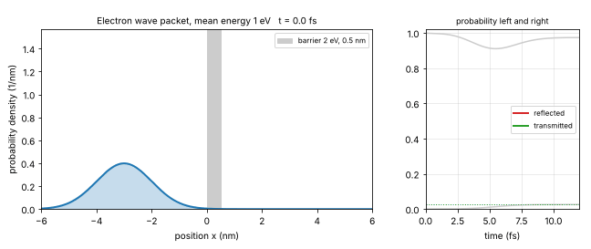
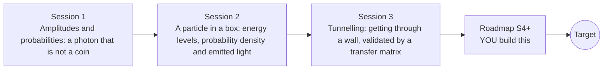

# openqmintro

[](https://github.com/KrunalPanchal1995/pan-iit-oss/actions/workflows/tests.yml)   [](https://colab.research.google.com/github/KrunalPanchal1995/pan-iit-oss/blob/main/openqmintro/sessions/session-01/lesson.ipynb) [](https://krunalpanchal1995.github.io/pan-iit-oss/openqmintro/)

**Learn the basic ideas of quantum mechanics: superposition, measurement and tunnelling, in three sessions.**

openqmintro teaches the core ideas of quantum mechanics with three small models: a photon in an interferometer (amplitudes, superposition and measurement), a particle in a box (energy levels and the light they emit) and tunnelling through a barrier, checked against an independent numerical method, using only Python and a browser.

- **Start from the question.** Session 1 asks why a photon is not a coin, using only two amplitudes and one beam splitter.
- **See it move.** Every session ships a slider app that runs in the browser, with labelled graphs and bar charts.
- **Know you got it right.** Each session ends with a checkpoint that prints PASS or FAIL against hand calculations, exact formulas and an independent numerical solution.
- **Build the missing half.** The repo stops at Session 3 on purpose; the roadmap shows the path to the Target.

[Target](#the-target) · [Who is this for](#who-is-this-for) · [Quick start](#quick-start) · [Sessions](#sessions) · [Roadmap](#roadmap) · [Contribute](#contribute) · [Explainer PDF](docs/explainer.pdf)

> **This repo is incomplete on purpose.** Sessions 1 to 3 are here and fully working. The finished Target below is a preview of what the community can build next. We show you the path, not the code. Sessions 4 and up are yours.

## The Target
An electron wave packet travels toward a barrier 0.5 nm wide. On the left, the probability density is drawn at every moment: the packet reaches the barrier, splits into a reflected part and a transmitted part, and the two parts move away from each other. On the right, the reflected and transmitted probabilities are plotted against time and approach their final values, which add up to 1. The Target solves the time-dependent Schrodinger equation numerically for a packet of many energies; the repo only treats waves of one energy at a time. Your goal over the coming sessions is to build it yourself.



*Target: an electron wave packet hits a barrier; part is reflected, part tunnels through, and the probabilities add up to 1*

How the Target was made is shown only as a path in [promo/roadmap.md](promo/roadmap.md).

## Who is this for
**secondary to diploma/undergrad (levels 3-5).** Topic area: Physics and the Science of Motion.

Prerequisites:

- Waves at school level (wavelength, interference) and energy in electronvolts.
- Powers, sine and cosine at school level; complex numbers are explained in Session 1 and only used for the phase.
- Python 3.10 or newer; if `python --version` works, you are ready. PRIMER.md explains the rest.
- No prior GitHub or quantum physics experience is needed.

New to Python? Read [PRIMER.md](PRIMER.md) first (10 minutes).

## Quick start

No installation knowledge needed. You need [Git](https://git-scm.com/downloads) and [Python 3.10+](https://www.python.org/downloads/) (Windows: tick "Add Python to PATH"). On Mac and Linux type `python3` wherever this page says `python`.

```bash
git clone https://github.com/KrunalPanchal1995/pan-iit-oss.git
cd pan-iit-oss/openqmintro
python start.py 1
```

`start.py` creates a private environment, installs what is needed and runs Session 1 with its checkpoint. Next: `python start.py 2`, `python start.py 3`, or `python start.py test` to check everything. Only a checkpoint: `python start.py check 1`.

<!-- friendly-help -->
<details>
<summary><b>Not working? Common fixes (no Git, "python not found", no internet)</b></summary>

- **No Git?** You do not need it. On the main page of this collection click the green **Code** button, then **Download ZIP**, unzip it, open a terminal inside the folder `pan-iit-oss-main/openqmintro` and run `python start.py 1`. The ZIP holds every project, so it is large; the live apps need no download at all.
- **"python is not recognized" or "command not found".** On Windows try `py start.py 1`. On Mac and Linux try `python3 start.py 1`. If neither works, install Python from [python.org](https://www.python.org/downloads/) and tick "Add Python to PATH".
- **Needs internet once.** The first run downloads NumPy and Matplotlib into a private folder (`.venv`); after that it works offline.
- **Rather not install anything?** Open the [live apps](https://krunalpanchal1995.github.io/pan-iit-oss/openqmintro/) in your browser, or use the Colab badge at the top of this page.
- **Still stuck?** [Open an issue](https://github.com/KrunalPanchal1995/pan-iit-oss/issues/new?title=%5Bopenqmintro%5D%20) with your operating system and the message you see. Questions from beginners are welcome.

</details>

Four lines turn the idea of Session 1 into a result (they work as they are). Save them as `try.py` and run it with `python start.py run try.py`:

```python
import numpy as np
a, b = 0.6, 0.8                               # amplitudes of a two-state system
print(round(a**2 + b**2, 2))                  # -> 1.0: the probabilities add up to 1
print(round(((a + b) / np.sqrt(2))**2, 2))    # -> 0.98: chance of exit 0 after one 50/50 beam splitter
```

Every session also opens in your browser with sliders (no install): [live apps](https://krunalpanchal1995.github.io/pan-iit-oss/openqmintro/). Or use the Colab badge above for the notebook.

## Sessions

| # | Session | Model level | Time | Live app |
|---|---|---|---|---|
| 1 | [Amplitudes and probabilities: a photon that is not a coin](sessions/session-01/README.md) | Level 1: conceptual interactive model | 60 min | [open](https://krunalpanchal1995.github.io/pan-iit-oss/openqmintro/session-01/) |
| 2 | [A particle in a box: energy levels, probability density and emitted light](sessions/session-02/README.md) | Level 2: mathematical engineering model | 75 min | [open](https://krunalpanchal1995.github.io/pan-iit-oss/openqmintro/session-02/) |
| 3 | [Tunnelling: getting through a wall, validated by a transfer matrix](sessions/session-03/README.md) | Level 3: simulation and validation | 90 min | [open](https://krunalpanchal1995.github.io/pan-iit-oss/openqmintro/session-03/) |

Each session follows the same six steps: A real-world problem, B concept and theory, C visual explanation, D interactive simulation, E worked example and experiment, F assessment and design challenge. Each ends with `checkpoint.py`, which prints `PASS` or `FAIL` against reference numbers. Session 3 also contains the real-world mini-project: **Estimate how sensitive a scanning tunnelling microscope is to the height of its tip**.

## Architecture



| Folder or file | What is inside |
|---|---|
| `sessions/` | three sessions: README (A-F), `lesson.py`, notebook, live app, exercises, activity sheet, checkpoint |
| `promo/` | the Target: media and the roadmap (path only) |
| `docs/` | `explainer.tex` and the built `explainer.pdf` |
| `tests/` | runs every lesson and checkpoint headless, and checks every live app |
| `start.py` | one command to set up and run anything |
| `QUALITY.md`, `RUBRIC.md` | the quality checklist and the scoring rubric |
| `.github/` | CI, PDF build, Pages deploy, issue and PR templates |

## Roadmap

| Milestone | What you will build | Difficulty |
|---|---|---|
| Session 4: From the infinite box to the finite well | Solve for the bound-state energies of a square well of finite depth by finding the roots of the matching conditions (or by a numerical eigenvalue solver). | intermediate |
| Session 5: A wave packet in time | A split-step or Crank-Nicolson solver that sends a Gaussian wave packet at a barrier and records the reflected and transmitted probabilities. | advanced |
| Session 6: The harmonic oscillator and molecular vibrations | Numerical energy levels for the potential V = 1/2 k x^2 and the wavelength of the photon emitted in a jump between neighbouring levels for a diatomic molecule. | intermediate |
| Session 7: The hydrogen atom | A numerical solution of the radial equation and the wavelengths of the Balmer lines. | advanced |
| Session 8: Spin measurements in different directions | Extend the two-state model of Session 1 to sequences of spin measurements along chosen angles, with the probabilities of each outcome. | intermediate |

Full detail with a checkpoint per milestone: [promo/roadmap.md](promo/roadmap.md).

## Contribute
New to GitHub? Read [CONTRIBUTING.md](CONTRIBUTING.md); it starts from zero. Pick an issue labelled `good first issue`. Translations into Hindi, Telugu, Tamil and Malayalam are welcome.

<details>
<summary>Development</summary>

```bash
python start.py test        # runs every lesson and checkpoint, and checks every live app
```
Lessons use `# %%` cell markers so they open as notebooks in VS Code. See [QUALITY.md](QUALITY.md) for the standard every session meets.
</details>

## License
MIT. See [LICENSE](LICENSE). Media in `promo/media` is (c) Krunal Panchal, CC BY 4.0.

## Acknowledgments
Part of the [PAN IIT OSS](https://hellofoss.tech-iitb.org/projects) open-source teaching collection, modelled on the structure of [openspline](https://github.com/openspline/openspline).
