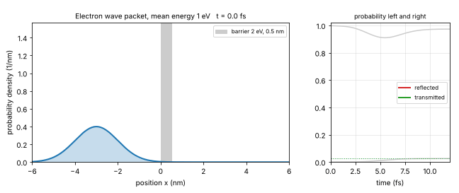

# What you are building toward

An electron wave packet travels toward a barrier 0.5 nm wide. On the left, the probability density is drawn at every moment: the packet reaches the barrier, splits into a reflected part and a transmitted part, and the two parts move away from each other. On the right, the reflected and transmitted probabilities are plotted against time and approach their final values, which add up to 1. The Target solves the time-dependent Schrodinger equation numerically for a packet of many energies; the repo only treats waves of one energy at a time. Your goal over the coming sessions is to build it yourself.

*Target: an electron wave packet hits a barrier; part is reflected, part tunnels through, and the probabilities add up to 1*

The code behind the Target is not published; the roadmap shows the path so you can build your own.
