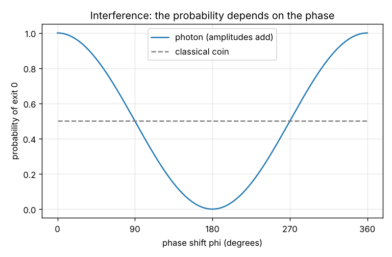
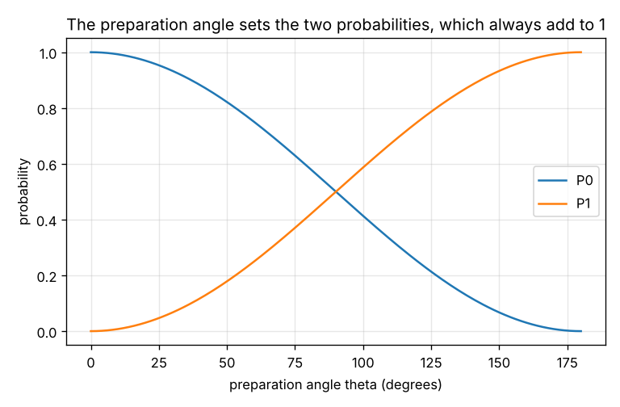

# Session 1: Amplitudes and probabilities: a photon that is not a coin

*Level 1 (conceptual interactive model) · about 60 minutes · openqmintro*

> This is a simplified educational model. It is not a validated design tool and must not be used for real structures, electrical installations, vehicles, industrial processes or medical decisions.

**Prerequisites**

- Probability at school level: the probabilities of all outcomes add up to 1.
- Angles and the sine and cosine functions at school level. Complex numbers are explained in Section B and are only used for a phase.

**Learning objectives.** After this session you can:

- Describe a two-state system by two amplitudes and compute the probabilities from them.
- Follow a photon through a beam splitter, a phase shift and a second beam splitter.
- Explain interference: why the probability of an exit depends on the phase, and why a classical coin cannot do this.
- Say what a measurement does to a superposition.

## A. Real-world problem
A single photon enters a beam splitter and can leave by one of two exits. If we put a second beam splitter after a small path-length difference, the photon leaves by the same exit every time for one setting and never for another. A coin that was flipped at the first splitter could never do that. What is the photon between the two splitters?

## B. Concept and theory
A two-state system has two possible results, called path 0 and path 1 (states |0> and |1>). Its state is a pair of numbers (a, b), the amplitudes. They can be complex numbers; for now think of them as real numbers that may be negative. The probabilities of finding the system in path 0 or 1 are P0 = |a|^2 and P1 = |b|^2, and they must add up to 1. A superposition is a state in which both a and b are not zero. A 50/50 beam splitter turns (a, b) into ((a + b), (a - b)) / sqrt(2). A phase shift multiplies the amplitude of path 1 by exp(i phi): its size is unchanged, but the amplitudes of the two paths now add or cancel differently at the next splitter. For a photon that enters path 0, the first splitter gives (1, 1) / sqrt(2), the phase gives (1, exp(i phi)) / sqrt(2), and the second splitter gives the exit 0 amplitude (1 + exp(i phi)) / 2, so P0 = cos^2(phi / 2) and P1 = sin^2(phi / 2). At phi = 0 the amplitudes add and the photon always leaves by exit 0; at phi = 180 degrees they cancel and it never does. A classical coin that is in path 0 or path 1 with probability 1/2 each would leave by either exit with probability 1/2 whatever the phase, because probabilities, unlike amplitudes, cannot cancel. The same 1/2 appears if a detector inside the interferometer finds out which path the photon took: the measurement turns the superposition into one definite path and the interference disappears.

| Symbol | Meaning | Unit |
|---|---|---|
| a, b | amplitudes of path 0 and path 1 (numbers, possibly complex) | no unit |
| P0, P1 | probabilities |a|^2 and |b|^2 | no unit |
| BS | 50/50 beam splitter, ((a + b), (a - b)) / sqrt(2) | no unit |
| phi | phase shift on path 1, phi = 360 degrees x (path difference / wavelength) | degrees |
| theta | preparation angle: the state (cos(theta/2), sin(theta/2)) | degrees |

**Assumptions**

- A lossless 50/50 beam splitter and exactly two paths.
- Photons arrive one at a time; each one is described by the same amplitudes.
- The phase shift is the only difference between the two paths.
- Each photon is detected once, at one exit, and the probabilities are found by repeating the experiment many times.

$$ P_0 = |a|^{2},\qquad P_1 = |b|^{2},\qquad |a|^{2} + |b|^{2} = 1 $$

$$ \mathrm{BS}\begin{pmatrix} a\\ b\end{pmatrix} = \frac{1}{\sqrt 2}\begin{pmatrix} a + b\\ a - b\end{pmatrix} $$

$$ P_0 = \cos^{2}\frac{\varphi}{2},\qquad P_1 = \sin^{2}\frac{\varphi}{2}\qquad\left(\text{photon entering path 0}\right) $$

## C. Visual explanation
The first figure plots the probability of exit 0 against the phase shift. The solid curve is the photon: it swings between 1 and 0 and is exactly 1/2 at phi = 90 and 270 degrees. The dashed line is the classical coin, which stays at 1/2 for every phase. The second figure shows how the preparation angle theta sets the two probabilities of a state: P0 = cos^2(theta / 2) and P1 = sin^2(theta / 2), which always add up to 1.

*Probability of exit 0 against the phase shift: photon (solid) and classical coin (dashed).*

*The two probabilities of a state against its preparation angle.*

## D. Interactive simulation
Run the lesson (`python start.py 1`), then open the live app: [Session 1: a photon that is not a coin](https://krunalpanchal1995.github.io/pan-iit-oss/openqmintro/session-01/) (or `app.html` in this folder). Slide the phase and watch the photon's probability swing while the coin stays at 1/2. Change the preparation angle and see how the swing gets smaller as the state gets closer to a pure path.

**Challenge.** Make exit 0 at least 90 percent likely with a real superposition (a preparation angle between 60 and 120 degrees).

## E. Worked example and experiment
**Problem.** A photon enters path 0 of an interferometer with a phase shift of phi = 60 degrees on path 1. Find the amplitudes and the probability of each exit. Then do the same for a classical coin.

1. First splitter: (1, 0) becomes (1, 1) / sqrt(2) = (0.707, 0.707): each path has probability 0.5.
2. Phase: path 1 is multiplied by exp(i 60 degrees) = 0.5 + 0.866i, giving (0.707, 0.354 + 0.612i).
3. Second splitter, exit 0: (0.707 + 0.354 + 0.612i) / sqrt(2) = 0.75 + 0.433i, so P0 = 0.75^2 + 0.433^2 = 0.75.
4. Exit 1: (0.707 - 0.354 - 0.612i) / sqrt(2) = 0.25 -0.433i, so P1 = 0.25. Check: 0.75 + 0.25 = 1.
5. Check with the formula: cos^2(30 degrees) = 0.75 and sin^2(30 degrees) = 0.25.
6. Coin: 0.5 and 0.5, whatever the phase.

**Answer.** The photon leaves by exit 0 with probability 0.75 and by exit 1 with probability 0.25; a classical coin gives 0.5 and 0.5.

**Experiment.** A polarisation version of the same mathematics can be done at home. Look at a bright window through one polarising filter (for example a lens from polarised sunglasses) and rotate a second one in front of it: at 90 degrees to the first almost no light gets through. Now slip a third filter between them at 45 degrees: light appears, about a quarter of the light that passed the first filter if the filters were ideal. For one photon the intensity ratio is the probability of passing, and the 45 degree filter changes the state so that the last filter no longer blocks it. This is a model of the idea 'a measurement changes the state', with a rotation in place of the beam splitter; the real filters absorb light and are not ideal.

## F. Assessment and design challenge
**Question type A: Conceptual.** Why can a classical coin that is in path 0 or path 1 with probability 1/2 not reproduce the interferometer, even though both give 1/2 at the first splitter?

Hint

Think about which quantities can cancel each other: probabilities or amplitudes.

Step-by-step solution

Probabilities are never negative, so adding two possibilities can only raise the total probability. Amplitudes can be positive, negative or complex, so two routes to the same exit can cancel (phi = 180 degrees) or reinforce (phi = 0). The coin passes through exactly one path and then the second splitter gives 1/2 for each exit; the photon is described by both amplitudes at once, and the second splitter combines them. The coin has no phase, so it cannot depend on one.

**Question type B: Numerical.** A two-state system has the amplitudes (0.6, 0.8). Find P0 and P1. Then send it through one beam splitter and find the new probabilities.

Hint

Use P = |amplitude|^2, and the beam splitter rule ((a + b), (a - b)) / sqrt(2).

Step-by-step solution

P0 = 0.6^2 = 0.36 and P1 = 0.8^2 = 0.64; they add up to 1. After the beam splitter the amplitudes are ((0.6 + 0.8), (0.6 - 0.8)) / sqrt(2) = (0.990, -0.141), so the probabilities are 0.98 and 0.02. Sanity check: they again add up to 1. The beam splitter turned a state that was 36 percent in path 0 into one that is 98 percent in path 0, which no random mixing could do.

**Question type C: Graph and simulation interpretation.** On the interference graph, read the phase shifts at which the photon leaves by exit 0 with certainty, never leaves by it, and leaves by it with probability 1/2. What does the coin do at these phases?

Hint

Read the curve at 0, 90, 180, 270 and 360 degrees and compare with cos^2(phi / 2).

Step-by-step solution

P0 = 1 at phi = 0 and 360 degrees, P0 = 0 at 180 degrees, and P0 = 1/2 at 90 and 270 degrees. This is cos^2(phi / 2): 1, 0.5, 0, 0.5, 1. The coin gives 1/2 at every one of them, so it agrees with the photon only at 90 and 270 degrees.

**Question type D: Design and optimisation challenge.** Design: a sensor needs the photon to leave by exit 0 with probability at least 0.9. Find the largest phase shift, and the largest path difference for light of wavelength 500 nm. What practical problem does this show?

Hint

Solve cos^2(phi / 2) = 0.9 for phi, then use phi = 360 degrees x (path difference / wavelength).

Step-by-step solution

cos(phi / 2) = sqrt(0.9) = 0.9487, so phi / 2 = 18.4 degrees and phi = 36.9 degrees. The path difference is (phi / 360) x 500 nm = 51 nm. So the two paths must be equal to within about 50 nm, a tenth of a wavelength, and even a vibration of that size ruins the result. Real interferometers therefore sit on heavy, isolated tables. Assumption: ideal splitters and a single wavelength.

Score yourself with [RUBRIC.md](../../RUBRIC.md). Print the [activity sheet](activity_sheet.md) to work on paper.

## Common misconceptions
| Common misconception | What is actually true |
|---|---|
| The photon goes through one path, we just do not know which. | If that were true the result would match the coin. The interference shows that both paths contribute until something finds out which path was taken. |
| An amplitude is a probability. | The probability is the square of the size of the amplitude. Amplitudes can be negative or complex and can cancel; probabilities cannot. |
| A superposition means 50 percent of the photon is in each path. | A single photon is never split into pieces: each is found once, in one place. The amplitudes give the chance of each result. |
| A measurement just reveals a value that was there already. | In the interferometer, finding out the path changes what happens at the second splitter. The measurement takes part in the experiment. |

## Glossary
- **amplitude**: a number whose squared size is a probability; it can be negative or complex
- **superposition**: a state in which more than one result has a non-zero amplitude
- **interference**: amplitudes adding or cancelling, which changes the probabilities
- **beam splitter**: a half-silvered mirror that sends a photon to either of two paths
- **phase**: an angle that says how far a wave is shifted along its cycle

## Finish
1. Do the three coding tasks in [exercises.md](exercises.md).
2. Run `python start.py 1` again after your changes. It ends with the checkpoint; when it prints `PASS`, you are done. (Checkpoint only: `python start.py check 1`.)

Next: [Session 2](../session-02/README.md)
