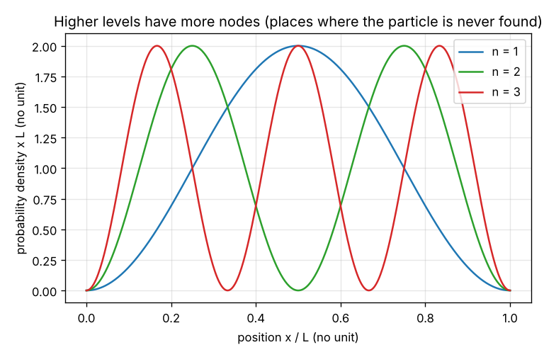
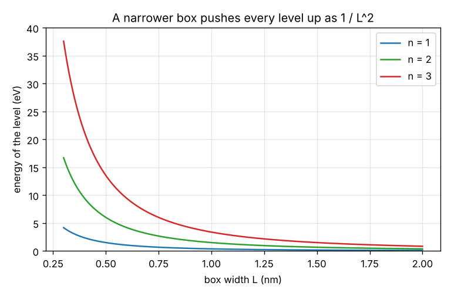

# Session 2: A particle in a box: energy levels, probability density and emitted light

*Level 2 (mathematical engineering model) · about 75 minutes · openqmintro*

> This is a simplified educational model. It is not a validated design tool and must not be used for real structures, electrical installations, vehicles, industrial processes or medical decisions.

**Prerequisites**

- Session 1: amplitudes and probabilities.
- Waves, the wavelength and the electronvolt are explained in Section B; the formula for the energy needs only powers and square roots.

**Learning objectives.** After this session you can:

- Derive the allowed energies E_n = n^2 h^2 / (8 m L^2) from the idea that a whole number of half-wavelengths fit in the box.
- Compute the probability of finding the particle in part of the box from the probability density.
- Compute the wavelength of the photon emitted in a jump between two levels, and the box width for a wanted colour.
- Explain why the lowest energy is not zero.

## A. Real-world problem
An electron is trapped in a very thin layer of semiconductor, about a nanometre wide. It can only take certain energies, and when it drops from one to a lower one it emits a photon of a definite colour. Which energies are allowed, where is the electron likely to be found, and what colour does it emit? This is the idea behind the quantum dots used in some displays.

## B. Concept and theory
A particle with momentum p behaves like a wave with wavelength lambda = h / p (de Broglie), where h = 6.626e-34 J s is the Planck constant. In a box of width L with impenetrable walls, the wave must be zero at both walls, so a whole number n of half-wavelengths must fit: lambda_n = 2 L / n. The energy is E = p^2 / (2 m) = h^2 / (2 m lambda^2), which gives E_n = n^2 h^2 / (8 m L^2) with n = 1, 2, 3 and so on. Only these energies are allowed; the lowest one, E_1, is not zero because a wave that must fit in the box always has a wavelength of at most 2 L, so the particle can never be at rest. The wave function is psi_n(x) = sqrt(2 / L) sin(n pi x / L) and the probability density is its square: the probability of finding the particle between x1 and x2 is the integral of the density, P = (x2 - x1) / L - [sin(2 n pi x2 / L) - sin(2 n pi x1 / L)] / (2 n pi). The density is zero at the nodes, so higher levels have more places where the particle is never found. When the particle drops from level k to level n, the energy difference leaves as a photon with wavelength lambda = h c / (E_k - E_n), about 1239.84 nm / (energy in eV).

| Symbol | Meaning | Unit |
|---|---|---|
| n | level number (a whole number from 1) | no unit |
| L | box width | nm |
| m | particle mass (electron: 9.109e-31 kg) | kg |
| h | Planck constant | J s (6.626e-34) |
| E_n | energy of level n | eV (1 eV = 1.602e-19 J) |
| psi_n, |psi_n|^2 | wave function and probability density | 1/sqrt(nm), 1/nm |
| u | relative position x / L | no unit |
| lambda | wavelength of the emitted photon | nm |

**Assumptions**

- One dimension and infinitely high walls: the particle can never leave the box.
- The box is empty (no potential inside) and the particle is an electron unless a mass is given.
- The emitted photon takes all the energy difference (no heat, no recoil).
- Only whole numbers n are allowed, and different levels are separate states.

$$ \lambda_n = \frac{2L}{n},\qquad E_n = \frac{n^{2} h^{2}}{8 m L^{2}} $$

$$ \psi_n(x) = \sqrt{\frac{2}{L}}\,\sin\frac{n\pi x}{L},\qquad P(x_1,x_2) = \frac{x_2 - x_1}{L} - \frac{\sin(2n\pi x_2/L) - \sin(2n\pi x_1/L)}{2n\pi} $$

$$ \lambda_{k\to n} = \frac{h c}{E_k - E_n}\approx \frac{1239.84\ \mathrm{nm\,eV}}{E_k - E_n} $$

## C. Visual explanation
The first figure plots the probability density times L for the levels n = 1, 2 and 3 against the relative position. Level 1 has one hump in the middle, level 2 has two humps and a node at the centre, level 3 has three humps. A classical particle would have a flat density (a value of 1 on this scale). The second figure plots the energy of the first three levels against the box width: every level rises as 1 / L^2 when the box is made narrower, and the gaps between them grow.

*Probability density (times L) of the first three levels against the relative position x / L.*

*Energy of the levels n = 1, 2 and 3 against the box width.*

## D. Interactive simulation
Run the lesson (`python start.py 2`), then open the live app: [Session 2: a particle in a box](https://krunalpanchal1995.github.io/pan-iit-oss/openqmintro/session-02/) (or `app.html` in this folder). Narrow the box and watch every level rise and the photon wavelength shrink. Raise n and count the humps and the nodes of the density, and read the probability for the middle third.

**Challenge.** Make the electron emit a green photon (500 to 560 nm) in a jump from level k down to level n.

## E. Worked example and experiment
**Problem.** An electron is in a box of width L = 1 nm. Find the energies of the first three levels, the wavelength of the photon emitted in the jump from level 2 to level 1, and the probability of finding the electron in the middle third of the box in levels 1 and 2.

1. The constant is h^2 / (8 m L^2) = (6.626e-34)^2 / (8 x 9.109e-31 x (1e-9)^2) = 6.025e-20 J = 0.376 eV.
2. E_1 = 0.376 eV, E_2 = 4 x 0.376 = 1.504 eV and E_3 = 9 x 0.376 = 3.384 eV.
3. The jump 2 to 1 releases 1.504 - 0.376 = 1.128 eV, so lambda = 1239.84 / 1.128 = 1099 nm. This is infrared, not visible.
4. Level 1, middle third (u from 1/3 to 2/3): P = 1/3 - [sin(4 pi / 3) - sin(2 pi / 3)] / (2 pi) = 0.609.
5. Level 2: P = 1/3 - [sin(8 pi / 3) - sin(4 pi / 3)] / (4 pi) = 0.196.
6. A classical particle would have 1/3 = 0.333: level 1 is more likely to be in the middle and level 2 much less likely.

**Answer.** E_1 = 0.376 eV, E_2 = 1.504 eV, E_3 = 3.384 eV; the 2 to 1 photon has 1099 nm (infrared); the middle third has probability 0.609 in level 1 and 0.196 in level 2.

**Experiment.** Find the emission spectrum of a quantum-dot sample or a quantum-dot display from a published figure and read the peak wavelength for two dot sizes. Larger dots emit redder light, smaller ones bluer, as the 1 / L^2 law predicts. The model is a one-dimensional box with infinite walls, so it fits only the trend: real dots are three-dimensional, have finite walls and an electron and a hole together, so do not expect agreement in the numbers.

## F. Assessment and design challenge
**Question type A: Conceptual.** Why can the lowest energy of a particle in a box not be zero?

Hint

What would zero energy mean for the momentum and for the wavelength, and could that wave fit in the box?

Step-by-step solution

Zero energy would mean zero momentum, that is an infinite wavelength, and such a wave cannot be zero at both walls. The longest wave that fits has lambda = 2 L, so p = h / (2 L) and E_1 = h^2 / (8 m L^2) is greater than 0. In other words, squeezing a particle into a box forces it to move: the smaller the box, the higher this lowest energy.

**Question type B: Numerical.** An electron is in a box of width 0.5 nm. Find E_1, E_2 and E_3, and the wavelength of the photon emitted in the jump from level 3 to level 2. Which part of the spectrum is it?

Hint

E_n is proportional to n^2 / L^2, so use the 1 nm values and multiply by 4 for the half-width box.

Step-by-step solution

E_n = n^2 x 0.376 / 0.5^2 = n^2 x 1.504 eV: E_1 = 1.504 eV, E_2 = 6.016 eV and E_3 = 13.537 eV. The jump 3 to 2 releases 7.521 eV, so lambda = 1239.84 / 7.521 = 165 nm, which is ultraviolet (below 380 nm). Sanity check: the narrower box gave energies four times higher than the 1 nm box.

**Question type C: Graph and simulation interpretation.** On the density graph, how many nodes inside the box does level 3 have, and where is the electron most likely to be found in level 2? Compare the middle third of the box in levels 1 and 2 with the classical value.

Hint

Nodes are the zeros of the curve between the walls. The probabilities are in the worked example.

Step-by-step solution

Level 3 has 2 nodes inside the box (at x / L = 1/3 and 2/3). Level 2 has its two maxima at x / L = 1/4 and 3/4 and a node at the centre, so the electron is never found exactly in the middle. The middle third has probability 0.609 in level 1, 0.196 in level 2, and 0.333 for a classical particle, which spends equal time everywhere.

**Question type D: Design and optimisation challenge.** Design: a quantum dot should emit green light of 530 nm in the jump from level 2 to level 1. Find the width of the box. If the width varies by plus or minus 0.05 nm in manufacturing, between which wavelengths does the colour vary?

Hint

lambda is proportional to L^2. Use the 1 nm value of 1099 nm: L = 1 nm x sqrt(530 / 1099).

Step-by-step solution

L = sqrt(530 / 1099) nm = 0.694 nm. For L = 0.644 nm the wavelength is 456 nm and for 0.744 nm it is 609 nm. A 0.05 nm change (a fifth of an atom's diameter) moves the colour from blue to orange. Trade-off: the colour is extremely sensitive to the size, so the dots must be made very uniform, and the real dots also differ from the model (finite walls, three dimensions). Assumption: one electron in a one-dimensional infinite box.

Score yourself with [RUBRIC.md](../../RUBRIC.md). Print the [activity sheet](activity_sheet.md) to work on paper.

## Common misconceptions
| Common misconception | What is actually true |
|---|---|
| The electron in the lowest level sits still in the middle of the box. | It has a non-zero energy, and its probability density is spread over the whole box with a maximum in the middle; it is not at rest. |
| Any energy is possible if you measure carefully enough. | Only the energies E_n exist for a trapped particle. Between them there are no states. |
| The particle is moving back and forth and the nodes are places it jumps over. | The nodes are places where the probability density is zero in that level, not places the particle skips over. The density does not change in time for a single level. |
| A wider box gives higher energies. | A wider box gives lower energies, as 1 / L^2. |

## Glossary
- **de Broglie wavelength**: the wavelength h / p of a particle with momentum p
- **energy level**: one of the allowed energies of a confined particle
- **probability density**: the probability per unit length of finding the particle at a place
- **node**: a place where the wave function and the density are zero
- **quantum dot**: a crystal a few nanometres across that traps electrons and emits light with a colour set by its size

## Finish
1. Do the three coding tasks in [exercises.md](exercises.md).
2. Run `python start.py 2` again after your changes. It ends with the checkpoint; when it prints `PASS`, you are done. (Checkpoint only: `python start.py check 2`.)

Next: [Session 3](../session-03/README.md)
