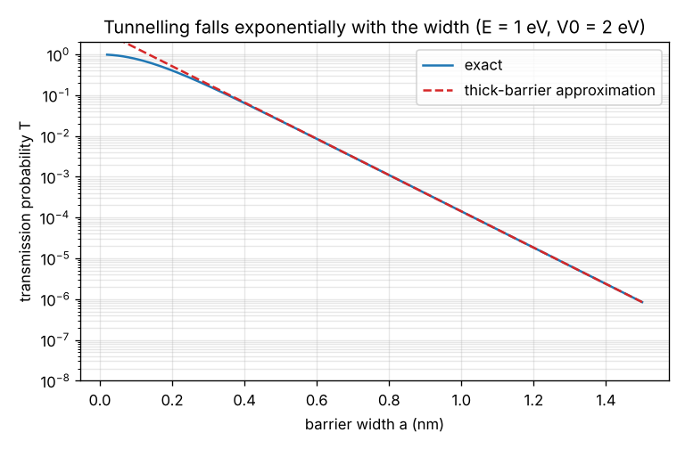
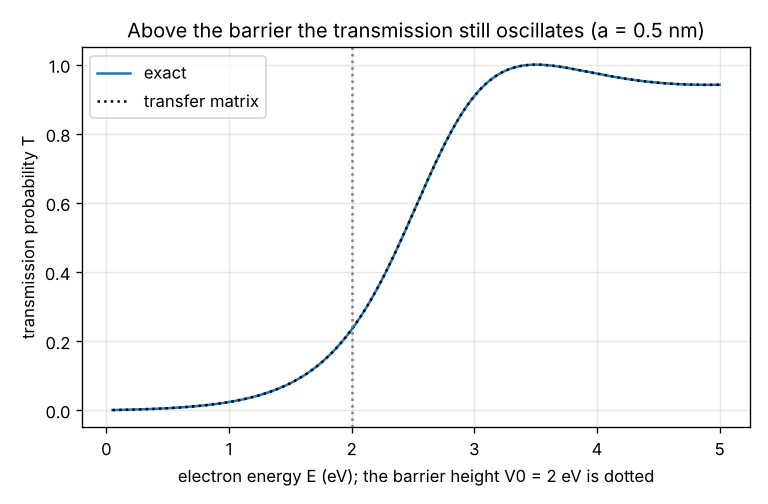

# Session 3: Tunnelling: getting through a wall, validated by a transfer matrix

*Level 3 (simulation and validation) · about 90 minutes · openqmintro*

> This is a simplified educational model. It is not a validated design tool and must not be used for real structures, electrical installations, vehicles, industrial processes or medical decisions.

**Prerequisites**

- Session 2: levels and the wave function.
- The hyperbolic sine and the idea of matching a wave and its slope at an interface are explained in Section B.

**Learning objectives.** After this session you can:

- Compute the exact transmission probability of a rectangular barrier, below, at and above its height.
- Explain why the probability falls exponentially with the width, and use the thick-barrier formula.
- Validate the formula against a transfer-matrix solution, and use the same method for a smooth barrier.
- Estimate how sensitive a scanning tunnelling microscope is to its tip height.

## A. Real-world problem
A scanning tunnelling microscope (STM) holds a sharp metal tip a fraction of a nanometre above a surface. Electrons cross the empty gap even though they do not have the energy to climb out of the metal, and the current changes enormously when the tip moves by less than one atom. How large is the probability of getting through, how does it depend on the width of the gap, and can we trust a formula by checking it against a numerical solution?

## B. Concept and theory
An electron with energy E meets a barrier of height V0 and width a. Inside a region with potential V, the wave function satisfies hbar^2 / (2m) psi'' = (V - E) psi. Where E is above V the solutions oscillate with wave number k = sqrt((E - V) / (hbar^2 / 2m)); where E is below V, as inside a barrier, they grow or decay as exp(+/- kappa x) with kappa = sqrt((V0 - E) / (hbar^2 / 2m)). The constant hbar^2 / (2m) is 0.0381 eV nm^2 for an electron. The electron does not 'have' negative kinetic energy inside the barrier: only the amplitude of the wave reaches into it, and a little of it comes out on the other side. Matching the wave and its slope at both edges gives the exact transmission probability T = 1 / (1 + V0^2 sinh^2(kappa a) / (4 E (V0 - E))). For a thick barrier (kappa a above about 1) this is close to T = 16 E (V0 - E) / V0^2 x exp(-2 kappa a): the probability falls exponentially with the width, which is why tunnelling is so sensitive to small distances. For E above V0 the sinh becomes a sine, and T = 1 whenever a whole number of half-wavelengths fit in the barrier. As an independent check we cut a barrier into thin flat slices, match the wave and its slope at every interface and multiply the 2 x 2 matrices; for a single slice this must reproduce the exact formula and for a smooth barrier it gives the answer the formula cannot. The WKB estimate exp(-2 times the integral of kappa dx) is a third, quick check that works for thick smooth barriers.

| Symbol | Meaning | Unit |
|---|---|---|
| E | energy of the electron | eV |
| V0 | height of the barrier | eV |
| a | width of the barrier | nm |
| kappa | decay constant inside the barrier, sqrt((V0 - E) / (hbar^2/2m)) | 1/nm |
| k | wave number where E is above the potential | 1/nm |
| T | transmission probability | no unit |
| hbar^2/2m | 0.03810 for an electron | eV nm^2 |
| phi | work function (barrier height seen from the top of the metal) | eV |

**Assumptions**

- One dimension, a steady stream of electrons of a single energy, no interaction between electrons.
- The barrier is rectangular for the exact formula; for the transfer matrix it is any shape cut into thin flat slices.
- The regions on both sides of the barrier have V = 0 and are free.
- For the STM: the barrier height is the work function of the metal and the gap is vacuum; the numbers are an estimate of the trend, not a model of a real tip.

$$ \kappa = \sqrt{\frac{V_0 - E}{\hbar^{2}/2m}},\qquad T = \frac{1}{1 + \dfrac{V_0^{2}\sinh^{2}(\kappa a)}{4E(V_0 - E)}} $$

$$ T \approx \frac{16E(V_0 - E)}{V_0^{2}}\,e^{-2\kappa a}\qquad(\kappa a \gtrsim 1) $$

$$ T_{\mathrm{WKB}} = \exp\!\left(-2\int_0^{a}\kappa(x)\,dx\right),\qquad \frac{I(d+\delta)}{I(d)} = e^{-2\kappa\delta} $$

## C. Visual explanation
The first figure plots the transmission against the width on a logarithmic scale for E = 1 eV and V0 = 2 eV: the exact curve is almost a straight line (an exponential), and the dashed thick-barrier approximation lies close to it once the barrier is wider than about 0.2 nm. The second figure plots the transmission against the electron energy for a 0.5 nm barrier of height 2 eV: the exact formula and the transfer matrix lie on top of each other, T rises steadily towards the barrier height and, above it, oscillates because waves reflected from the two edges interfere.

*Transmission against barrier width on a logarithmic scale: exact formula and thick-barrier approximation.*

*Transmission against electron energy for a 0.5 nm barrier of 2 eV: exact formula and transfer matrix.*

## D. Interactive simulation
Run the lesson (`python start.py 3`), then open the live app: [Session 3: tunnelling through a barrier](https://krunalpanchal1995.github.io/pan-iit-oss/openqmintro/session-03/) (or `app.html` in this folder). Widen the barrier in small steps and watch the logarithm of T fall in a straight line. Raise the energy through the barrier height and see the oscillating transmission above it.

**Challenge.** Reach a transmission of at least 10 percent with an electron energy of at most half the barrier height and a barrier at least 0.4 nm wide.

## E. Worked example and experiment
**Problem.** An electron with E = 1 eV meets a barrier of height V0 = 2 eV and width a = 0.5 nm. Find kappa, the exact transmission, the thick-barrier estimate, and the factor by which an STM current changes when the tip is pulled back by 0.1 nm (work function 4.5 eV).

1. kappa = sqrt((2 - 1) / 0.0381) = 5.123 per nm, so kappa a = 2.562.
2. sinh(2.562) = 6.440, so sinh^2 = 41.47.
3. T = 1 / (1 + 4 x 41.47 / (4 x 1 x 1)) = 1 / (1 + 41.47) = 0.0235: about 1 electron in 42 gets through.
4. Thick-barrier formula: 16 x 1 x 1 / 4 x exp(-2 x 2.562) = 4 x 0.00596 = 0.0238, within 1.2 percent of the exact value.
5. Check with the transfer matrix of one flat slice: it gives the same number (the checkpoint tests this for 75 cases).
6. STM: kappa = sqrt(4.5 / 0.0381) = 10.87 per nm, so pulling the tip back by 0.1 nm multiplies the current by exp(-2 x 10.87 x 0.1) = 0.114, that is the current falls to 1 in 8.8.

**Answer.** kappa = 5.12 per nm; T = 0.0235 exactly and 0.0238 from the thick-barrier formula; the STM current falls by a factor 8.8 when the tip retracts by 0.1 nm.

**Experiment.** Mini-project: estimate how sensitive a scanning tunnelling microscope is to the height of its tip. Use `stm_current_ratio` with a work function of 4.5 eV (a typical metal) to find the change of the current for a step of 0.01 nm, 0.05 nm and one atomic diameter (about 0.25 nm), and the largest vibration the tip may have for the current to vary by at most 10 percent. A published STM image of atoms on a surface shows heights of a few hundredths of a nanometre, so compare. Expect agreement only in order of magnitude: the real barrier is not rectangular, the tip is not flat and many electrons with different energies take part.

## F. Assessment and design challenge
**Question type A: Conceptual.** Why does the transmission probability fall exponentially with the width of the barrier, and why can an electron get through at all when its energy is below the barrier height?

Hint

Look at the sign of E - V inside the barrier, and at what the solution of the wave equation looks like then.

Step-by-step solution

Inside the barrier E is below V, so the wave equation has the solution exp(-kappa x), a smooth decay instead of an oscillation. Every extra distance multiplies the amplitude by the same factor exp(-kappa dx), so the probability, its square, falls by exp(-2 kappa dx) per step: an exponential. If the barrier is thin enough, the amplitude has not died out when the wave reaches the far edge, and the part that remains continues as an ordinary wave. A classical particle would be turned back; a wave is not.

**Question type B: Numerical.** An electron with E = 0.5 eV meets a barrier of V0 = 1.5 eV and width 0.8 nm. Find kappa, the exact T and the thick-barrier T.

Hint

kappa = sqrt((V0 - E) / 0.0381). Compute kappa a and then sinh(kappa a).

Step-by-step solution

kappa = sqrt(1.0 / 0.0381) = 5.123 per nm and kappa a = 4.099. sinh(4.099) = 30.12, so T = 1 / (1 + 1.5^2 x 907 / (4 x 0.5 x 1.0)) = 9.79e-04. The thick-barrier formula gives 16 x 0.5 x 1.0 / 2.25 x exp(-2 x 4.099) = 9.79e-04, which agrees to 0.1 percent. About 1 electron in 1021 gets through.

**Question type C: Graph and simulation interpretation.** On the logarithmic graph of T against the width for E = 1 eV and V0 = 2 eV, by what factor does T fall for every extra 0.1 nm of width? Confirm with the formula.

Hint

The curve is almost straight, so the factor is constant: exp(-2 kappa x 0.1) with kappa = 5.12 per nm.

Step-by-step solution

Reading the graph, T falls by about a factor 2.8 per 0.1 nm (log10 T falls by about 0.45). The formula gives exp(-2 x 5.12 x 0.1) = 0.359, which is a factor 2.8. The thick-barrier curve is exactly this exponential and the exact curve is only slightly different, so the straight line on the log graph is the exponential law.

**Question type D: Design and optimisation challenge.** Design: an electron of energy E = 0.5 eV meets a thin insulating layer that acts as a rectangular barrier of height V0 = 3 eV. The transmission must be at most 1e-9. Find the least thickness, and say why a designer would not make the layer much thicker than needed.

Hint

Use the thick-barrier formula to estimate the width, or `min_width_nm` for the exact answer. kappa = sqrt((3 - 0.5) / 0.0381) = 8.1 per nm.

Step-by-step solution

`min_width_nm(0.5, 3.0, 1e-9)` finds the width where the exact T reaches 1e-9: 1.33 nm. The thick-barrier formula gives the same within a few percent: T = 16 x 0.5 x 2.5 / 9 x exp(-2 x 8.1 x a), which falls to 1e-9 near 1.3 nm. A layer much thicker than that costs space and makes the device harder to build; in memory chips it also raises the voltage needed to write a bit. Assumption: a one-dimensional rectangular barrier; real insulators are not rectangular and have defects that let electrons through more easily.

Score yourself with [RUBRIC.md](../../RUBRIC.md). Print the [activity sheet](activity_sheet.md) to work on paper.

## Common misconceptions
| Common misconception | What is actually true |
|---|---|
| The electron digs a tunnel or borrows energy to climb over the barrier. | It does neither. Only the amplitude of the wave reaches into the barrier; no energy is borrowed, and the electron has the same energy on both sides. |
| The electron takes some time inside the barrier, travelling faster than light. | The model is a steady stream of waves and says nothing about a travel time, so no such claim follows from it. |
| A barrier that is twice as wide lets half as many electrons through. | It lets through the square of the amount for a thick barrier: T falls exponentially, not in proportion to the width. |
| Above the barrier height every electron passes. | The transmission oscillates and is below 1 except at special energies, because waves reflect from the two edges and interfere. |

## Glossary
- **tunnelling**: passing through a barrier that a classical particle could not climb
- **transmission probability**: the chance that an electron that meets the barrier gets through
- **kappa**: the decay constant of the wave inside the barrier
- **transfer matrix**: a 2 x 2 matrix that links the waves on the two sides of a slice; the matrices of slices are multiplied
- **WKB**: a quick estimate of tunnelling through a smooth barrier from the integral of kappa
- **work function**: the energy needed to remove an electron from a metal

## Finish
1. Do the three coding tasks in [exercises.md](exercises.md).
2. Run `python start.py 3` again after your changes. It ends with the checkpoint; when it prints `PASS`, you are done. (Checkpoint only: `python start.py check 3`.)

Next: the [roadmap](../../promo/roadmap.md): Sessions 4 and up are yours to build.
