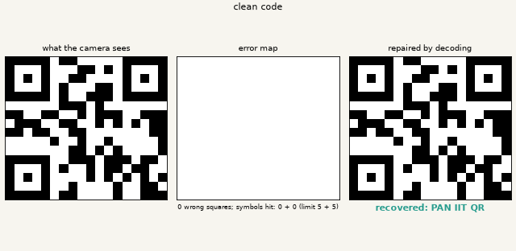
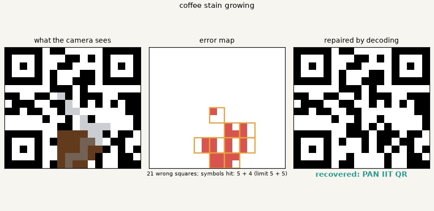
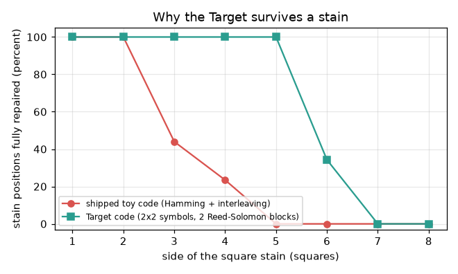

# openqrcode

[](https://github.com/KrunalPanchal1995/pan-iit-oss/actions/workflows/tests.yml)   [](https://colab.research.google.com/github/KrunalPanchal1995/pan-iit-oss/blob/main/openqrcode/sessions/session-01/lesson.ipynb) [](https://krunalpanchal1995.github.io/pan-iit-oss/openqrcode/)

**Read a damaged QR code: data as squares, check digits and error-correcting codes.**

openqrcode teaches how barcodes and QR codes survive scratches, using check digits, parity bits and a Hamming code you build yourself with numpy.

- **Start from zero.** Session 1 needs only school arithmetic: weights, sums and remainders.
- **See it break and heal.** Every session ships a slider app: flip bits, scratch the toy code, watch it repair itself.
- **Know you got it right.** Each session ends with a checkpoint that prints PASS or FAIL against hand calculations and a probability formula.
- **Build the missing half.** The repo stops at a toy code on purpose; the roadmap shows the path to stronger codes.

[Target](#the-target) · [Who is this for](#who-is-this-for) · [Quick start](#quick-start) · [Sessions](#sessions) · [Roadmap](#roadmap) · [Contribute](#contribute) · [Explainer PDF](docs/explainer.pdf)

> **This repo is incomplete on purpose.** Sessions 1 to 3 are here and fully working. The finished Target below is a preview of what the community can build next. We show you the path, not the code. Sessions 4 and up are yours.

## The Target

A small toy code is scratched twice and then stained by a growing coffee blob. On the left you see what the camera sees. In the middle, an error map marks every wrong square. On the right, the decoder has repaired the code and prints the recovered message, until the damage finally becomes too large. Your goal over the coming sessions: build the repair machinery yourself, then make it survive a blob.



*Target: a toy code is scratched, stained and repaired, with its error map*



*Target, one frame: damaged code, error map, recovered message*



*Why the Target survives more: success against damage for the shipped and the Target code*

Try it live:

- [Math Visual Studio (Studio home)](https://krunalpanchal1995.github.io/studio/)

How the Target was made is shown only as a path in [promo/roadmap.md](promo/roadmap.md).

## Who is this for
**middle school to higher secondary (levels 2-4).** Topic area: Everyday Life and Practical Knowledge.

Prerequisites:

- Arithmetic with remainders (what 17 mod 10 means is explained in Session 1) and reading simple graphs.
- Python 3.10 or newer; if `python --version` works, you are ready. PRIMER.md explains the rest.
- No prior GitHub, binary or matrix experience is needed; matrices are explained from scratch in Session 2.

New to Python? Read [PRIMER.md](PRIMER.md) first (10 minutes).

## Quick start

No installation knowledge needed. You need [Git](https://git-scm.com/downloads) and [Python 3.10+](https://www.python.org/downloads/) (Windows: tick "Add Python to PATH"). On Mac and Linux type `python3` wherever this page says `python`.

```bash
git clone https://github.com/KrunalPanchal1995/pan-iit-oss.git
cd pan-iit-oss/openqrcode
python start.py 1
```

`start.py` creates a private environment, installs what is needed and runs Session 1 with its checkpoint. Next: `python start.py 2`, `python start.py 3`, or `python start.py test` to check everything. Only a checkpoint: `python start.py check 1`.

<!-- friendly-help -->
<details>
<summary><b>Not working? Common fixes (no Git, "python not found", no internet)</b></summary>

- **No Git?** You do not need it. On the main page of this collection click the green **Code** button, then **Download ZIP**, unzip it, open a terminal inside the folder `pan-iit-oss-main/openqrcode` and run `python start.py 1`. The ZIP holds every project, so it is large; the live apps need no download at all.
- **"python is not recognized" or "command not found".** On Windows try `py start.py 1`. On Mac and Linux try `python3 start.py 1`. If neither works, install Python from [python.org](https://www.python.org/downloads/) and tick "Add Python to PATH".
- **Needs internet once.** The first run downloads NumPy and Matplotlib into a private folder (`.venv`); after that it works offline.
- **Rather not install anything?** Open the [live apps](https://krunalpanchal1995.github.io/pan-iit-oss/openqrcode/) in your browser, or use the Colab badge at the top of this page.
- **Still stuck?** [Open an issue](https://github.com/KrunalPanchal1995/pan-iit-oss/issues/new?title=%5Bopenqrcode%5D%20) with your operating system and the message you see. Questions from beginners are welcome.

</details>

Five lines turn the idea of Session 2 into a result (they work as they are): Save it as `try.py` and run it with `python start.py run try.py` (this uses the private environment, where NumPy is installed):

```python
import numpy as np
P = np.array([[1, 1, 0], [1, 0, 1], [0, 1, 1], [1, 1, 1]])
G = np.hstack([np.eye(4, dtype=int), P])                  # 4 data bits -> 7-bit codeword
word = (np.array([1, 0, 1, 1]) @ G) % 2; word[2] ^= 1     # send 1011, then flip bit 3
H = np.hstack([P.T, np.eye(3, dtype=int)]); print((H @ word) % 2)   # -> [0 1 1]: points at bit 3
```

Every session also opens in your browser with sliders (no install): [live apps](https://krunalpanchal1995.github.io/pan-iit-oss/openqrcode/). Or use the Colab badge above for the notebook.

## Sessions

| # | Session | Model level | Time | Live app |
|---|---|---|---|---|
| 1 | [Squares of data and the check digit](sessions/session-01/README.md) | Level 1: conceptual interactive model | 60 min | [open](https://krunalpanchal1995.github.io/pan-iit-oss/openqrcode/session-01/) |
| 2 | [Parity bits and the Hamming(7,4) code](sessions/session-02/README.md) | Level 2: mathematical engineering model | 75 min | [open](https://krunalpanchal1995.github.io/pan-iit-oss/openqrcode/session-02/) |
| 3 | [A toy matrix code, damaged and repaired](sessions/session-03/README.md) | Level 3: simulation and validation | 90 min | [open](https://krunalpanchal1995.github.io/pan-iit-oss/openqrcode/session-03/) |

Each session follows the same six steps: A real-world problem, B concept and theory, C visual explanation, D interactive simulation, E worked example and experiment, F assessment and design challenge. Each ends with `checkpoint.py`, which prints `PASS` or `FAIL` against reference numbers. Session 3 also contains the real-world mini-project: **Choose the interleaving for a scratched parcel label**.

## Architecture

```mermaid
flowchart LR
  S1[Session 1<br/>Squares of data and the check digit]
  S2[Session 2<br/>Parity bits and the Hamming(7,4) code]
  S3[Session 3<br/>A toy matrix code, damaged and repaired]
  R[Roadmap S4+<br/>YOU build this]
  T((Target))
  S1 --> S2 --> S3 --> R --> T
```

| Folder or file | What is inside |
|---|---|
| `sessions/` | three sessions: README (A-F), `lesson.py`, notebook, live app, exercises, activity sheet, checkpoint |
| `promo/` | the Target: media, live links, and the roadmap (path only) |
| `docs/` | `explainer.tex` and the built `explainer.pdf` |
| `tests/` | runs every lesson and checkpoint headless |
| `start.py` | one command to set up and run anything |
| `QUALITY.md`, `RUBRIC.md` | the quality checklist and the scoring rubric |
| `.github/` | CI, PDF build, Pages deploy, issue and PR templates |

## Roadmap

| Milestone | What you will build | Difficulty |
|---|---|---|
| Session 4: Survive a coffee-stain blob | A 2D interleaving layout for the toy code and a test harness for square blobs. | intermediate |
| Session 5: Know when it failed | A decoder that marks unreliable blocks instead of guessing, plus a stronger checksum. | intermediate |
| Session 6: Find the code in any orientation | A reader that finds the three finder patterns and rotates the grid to upright before decoding. | intermediate |
| Session 7: Symbols instead of bits: Reed-Solomon | A small Reed-Solomon encoder and decoder over GF(16) or GF(256). | advanced |
| Session 8: Read a photograph | A reader that takes a tilted greyscale picture of a code and recovers the message. | advanced |

Full detail with a checkpoint per milestone: [promo/roadmap.md](promo/roadmap.md).

## Contribute
New to GitHub? Read [CONTRIBUTING.md](CONTRIBUTING.md); it starts from zero. Pick an issue labelled `good first issue`. Translations into Hindi, Telugu, Tamil and Malayalam are welcome.

<details>
<summary>Development</summary>

```bash
python start.py test        # runs every lesson and checkpoint
```
Lessons use `# %%` cell markers so they open as notebooks in VS Code. See [QUALITY.md](QUALITY.md) for the standard every session meets.
</details>

## License
MIT. See [LICENSE](LICENSE). Media in `promo/media` is (c) Krunal Panchal, CC BY 4.0.

## Acknowledgments
Part of the [PAN IIT OSS](https://hellofoss.tech-iitb.org/projects) open-source teaching collection, modelled on the structure of [openspline](https://github.com/openspline/openspline). Built on ideas from the Math Visual Studio at https://krunalpanchal1995.github.io/studio/.
