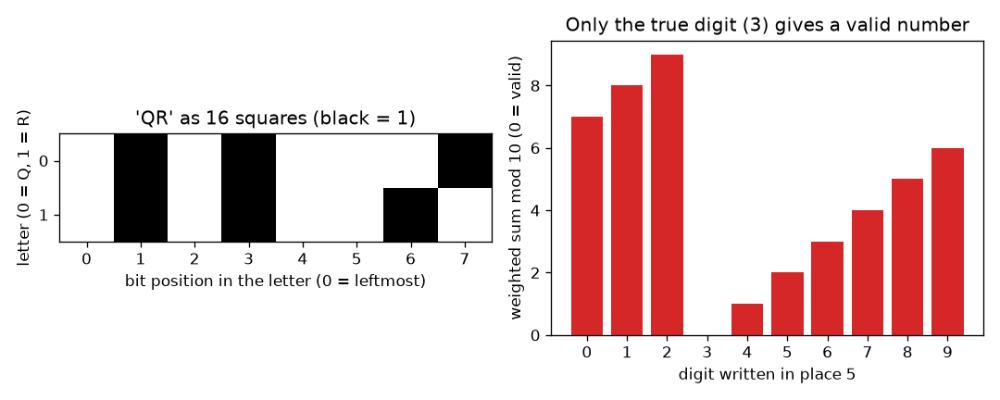
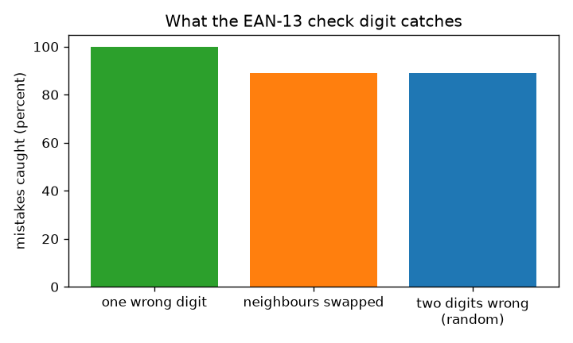

# सत्र 1: डेटा के वर्ग और जाँच अंक

*स्तर 1 (वैचारिक इंटरैक्टिव मॉडल) · लगभग 60 मिनट · openqrcode*

> यह एक सरलीकृत शैक्षिक मॉडल है। यह कोई प्रमाणित डिज़ाइन उपकरण नहीं है और इसका उपयोग वास्तविक संरचनाओं, विद्युत संस्थापनों, वाहनों, औद्योगिक प्रक्रियाओं या चिकित्सा निर्णयों के लिए नहीं किया जाना चाहिए।

**पूर्व-आवश्यकताएँ (Prerequisites)**

- अंकगणित: गुणा, जोड़ और शेषफल (remainders)।
- आपने PRIMER.md पढ़ लिया है और एक बार `python start.py 1` चला लिया है।

**सीखने के उद्देश्य (Learning objectives)।** इस सत्र के बाद आप:

- समझा सकेंगे कि पाठ (text) काले और सफ़ेद वर्गों के ग्रिड में कैसे बदलता है।
- 12 अंकों की संख्या का EAN-13 जाँच अंक (check digit) हाथ से और Python में निकाल सकेंगे।
- वास्तविक-प्रारूप संख्याओं को जाँच से सत्यापित कर सकेंगे।
- बता सकेंगे कि जाँच अंक क्या पकड़ता है (और क्या छोड़ देता है) और यह कुछ भी ठीक (repair) क्यों नहीं कर सकता।

## A. वास्तविक जीवन की समस्या
एक बिलिंग काउंटर दिन में हज़ारों बारकोड स्कैन करता है। एक धब्बा या ग़लत टाइप किया गया अंक बीन्स के डिब्बे को पेंट के डिब्बे में बदल सकता है। स्कैनर को केवल संख्या का ही उपयोग करके यह पहचानना होगा कि उसने जो संख्या पढ़ी वह शायद ग़लत है। 13 अंक अपना ही प्रूफ़-रीडर कैसे साथ रख सकते हैं? (केवल सामान्य शिक्षा: यह एक सरलीकृत मॉडल है, पूरा बारकोड मानक नहीं।)

## B. अवधारणा और सिद्धांत
कंप्यूटर जो कुछ भी संग्रहीत करता है वह एक संख्या है, और हर संख्या 0 और 1 से लिखी जा सकती है। 1 को काले वर्ग और 0 को सफ़ेद वर्ग के रूप में खींचें: अक्षर A (कोड 65 = 64 + 1) आठ वर्ग 01000001 है। एक 2D कोड बस ऐसे ही कई वर्गों का ग्रिड है। एक दुकान बारकोड (EAN-13) में 13 अंक होते हैं। पहले 12 उत्पाद की जानकारी रखते हैं; 13वाँ जाँच अंक है। अंकों को बाईं ओर से भार (weights) 1, 3, 1, 3, ... से गुणा करें, उन्हें जोड़ें (भारित योग (weighted sum) S), और अंतिम अंक ऐसे चुनें कि S का अंत 0 पर हो, यानी S mod 10 = 0 (10 से भाग देने के बाद शेषफल)। पढ़ने वाला S फिर से निकालता है: यदि शेषफल 0 नहीं है, तो वह संख्या को अस्वीकार कर देता है। एक अंक को x से बदलने पर S, w गुणा x से बदलता है (w, 1 या 3 है), और न 1 और न 3 का 10 के साथ कोई साझा गुणनखंड है, इसलिए शेषफल हमेशा बदलता है: हर अकेला ग़लत अंक पकड़ा जाता है। दो पड़ोसी अंकों a और b की अदला-बदली S को 2 गुणा (a घटा b) से बदलती है, जो 10 का गुणज केवल तब है जब a और b में ठीक 5 का अंतर हो, इसलिए वे अदला-बदली निकल जाती हैं। जाँच अंक आपको बताता है कि कुछ ग़लत है, यह नहीं कि कहाँ, इसलिए यह संख्या को ठीक नहीं कर सकता।

| प्रतीक | अर्थ | इकाई |
|---|---|---|
| d_i | संख्या का i-वाँ अंक, i = 1 से 13 | कोई इकाई नहीं |
| w_i | स्थान i का भार (विषम i के लिए 1, सम i के लिए 3) | कोई इकाई नहीं |
| S | अंकों का भारित योग | कोई इकाई नहीं |
| c | जाँच अंक (13वाँ अंक) | कोई इकाई नहीं |
| a, b | दो पड़ोसी अंक जिनकी अदला-बदली होती है | कोई इकाई नहीं |

**मान्यताएँ (Assumptions)**

- अंक, अंकों के रूप में सही पढ़े जाते हैं; हम इस बात की ग़लतियों का अध्ययन करते हैं कि कौन-सा अंक पढ़ा गया, बार की चौड़ाइयों का नहीं।
- ग़लतियाँ यादृच्छिक (random) हैं: कोई भी ग़लत अंक समान रूप से संभावित है।
- UPC-A संख्याएँ (12 अंक) आगे 0 लिखने पर उसी नियम का पालन करती हैं।

$$ S=\sum_{i=1}^{13} w_i d_i,\qquad w_i=\begin{cases}1 & i\ \text{odd}\\ 3 & i\ \text{even}\end{cases} $$

$$ \text{valid}\iff S\equiv 0 \pmod{10},\qquad c=\big(10-S_{12}\bmod 10\big)\bmod 10 $$

$$ \Delta S=2\,(a-b)\ \text{for swapped neighbours with weights 1 and 3;}\quad \text{missed only if } a-b=\pm 5 $$

## C. दृश्य व्याख्या
बायाँ चित्र शब्द QR को आठ-आठ की दो पंक्तियों में 16 वर्गों के रूप में दिखाता है; काले वर्ग 1 हैं। दायाँ चित्र वास्तविक-प्रारूप संख्या 4006381333931 लेता है, उसके पाँचवें अंक को 0 से 9 तक के हर अंक से बदलता है और भारित योग mod 10 आलेखित करता है: केवल सही अंक 3 ही 0 देता है (हरा), बाक़ी नौ अस्वीकार होते हैं (लाल)। दूसरा चित्र तीन प्रकार की ग़लतियों की तुलना करता है: सभी अकेले ग़लत अंक पकड़े जाते हैं, और पड़ोसी अदला-बदली तथा दोहरी त्रुटियाँ लगभग 89 प्रतिशत बार पकड़ी जाती हैं।

*बाएँ: 16 वर्गों के रूप में शब्द QR। दाएँ: केवल सही अंक ही जाँच पास करता है।*

*जाँच अंक हर अकेले ग़लत अंक को पकड़ता है, और लगभग 89 प्रतिशत अदला-बदली तथा दोहरी त्रुटियों को।*

## D. इंटरैक्टिव सिमुलेशन
पाठ चलाएँ (`python start.py 1`), फिर लाइव ऐप खोलें: [सत्र 1: एक वास्तविक-प्रारूप बारकोड संख्या तोड़ें](https://krunalpanchal1995.github.io/pan-iit-oss/openqrcode/session-01/) (या इसी फ़ोल्डर में `app.html`)। एक स्थान और एक अंक चुनें। भारित योग और शेषफल को बदलते देखें, फिर ग्राफ़ पर जाएँ और देखें कि कौन-सा अंक संख्या को पास कराता है।

**चुनौती।** स्थान 5 में वह अंक वापस रखें जो संख्या को जाँच पास कराता है।

## E. हल किया गया उदाहरण और प्रयोग
**समस्या।** 12 अंकों 400638133393 का जाँच अंक ज्ञात करें और बताएँ कि क्या 4006381333931 मान्य है।

1. अंकों को भार 1, 3, 1, 3, ... के साथ लिखें: 4x1, 0x3, 0x1, 6x3, 3x1, 8x3, 1x1, 3x3, 3x1, 3x3, 9x1, 3x3।
2. गुणनफल: 4, 0, 0, 18, 3, 24, 1, 9, 3, 9, 9, 9।
3. 12 गुणनफलों का योग: S = 4 + 0 + 0 + 18 + 3 + 24 + 1 + 9 + 3 + 9 + 9 + 9 = 89।
4. 89 के ऊपर 10 का अगला गुणज 90 है, इसलिए जाँच अंक 90 - 89 = 1 है।
5. पूरी संख्या 4006381333931 है। इसके 13 भारित पदों का योग 89 + 1x1 = 90 है, और 90 mod 10 = 0: मान्य।

**उत्तर।** जाँच अंक 1 है, इसलिए 4006381333931 मान्य है (भारित योग 90)।

**प्रयोग।** घर पर कोई पैकेट वाला उत्पाद लें, उसके बारकोड के नीचे के 13 अंक पढ़ें और पहले 12 पर नियम लागू करें; परिणाम 13वें के बराबर होना चाहिए। कुछ उत्पादों पर 8-अंकीय (EAN-8) या 12-अंकीय (UPC-A) कोड होते हैं: UPC-A के लिए पहले आगे 0 लिखें। यदि मेल नहीं खाता, तो शायद आपने कोई अंक ग़लत पढ़ा है, और यही जाँच अंक का काम है। मॉडल बनाम वास्तविकता: स्कैनर बार की चौड़ाइयाँ पढ़ता है, अंक नहीं, और स्वयं बार पर अतिरिक्त जाँचें करता है; यह मॉडल केवल अंक-शृंखला को कवर करता है।

## F. मूल्यांकन और डिज़ाइन चुनौती
**प्रश्न प्रकार A: वैचारिक।** जाँच अंक आपको क्यों बता सकता है कि संख्या ग़लत है, पर यह नहीं कि कौन-सा अंक ग़लत है? इसे ठीक करने के लिए आपको अतिरिक्त क्या चाहिए होगा?

संकेत

जाँच 0 और 9 के बीच एक संख्या देती है। कितनी अलग-अलग ग़लतियाँ एक ही शेषफल देती हैं?

चरण-दर-चरण हल

जाँच सभी 13 अंकों को एक शेषफल में संकुचित कर देती है। 0 न होने वाला शेषफल कहता है 'कोई स्थान बदला है', पर कई अलग-अलग स्थान और अंक एक ही शेषफल देते हैं, इसलिए यह किसी एक का नाम नहीं ले सकता। किसी ग़लती को ठीक करने के लिए आपको कई अतिव्यापी (overlapping) जाँचें चाहिए जिनके उत्तर मिलकर एक स्थान की ओर इशारा करें। सत्र 2 की समता जाँचें (parity checks) यही करती हैं।

**प्रश्न प्रकार B: संख्यात्मक।** 12 अंकों 590123412345 का जाँच अंक ज्ञात करें और भारित योग दिखाएँ।

संकेत

बाईं ओर से भार 1, 3, 1, 3, ... का उपयोग करें। जाँच अंक योग को 10 के अगले गुणज तक ले आता है।

चरण-दर-चरण हल

गुणनफल: 5x1=5, 9x3=27, 0x1=0, 1x3=3, 2x1=2, 3x3=9, 4x1=4, 1x3=3, 2x1=2, 3x3=9, 4x1=4, 5x3=15। योग: 83। 10 का अगला गुणज: 90, इसलिए जाँच अंक 7 है और संख्या 5901234123457 है। जाँच (sanity check): 83 + 7 = 90, जिसका अंत 0 पर है।

**प्रश्न प्रकार C: ग्राफ़ और सिमुलेशन की व्याख्या।** स्थान 6 (भार 3) में लिखे अंक के विरुद्ध भारित योग mod 10 के ग्राफ़ में, अंक 1 बढ़ने पर शेषफल कितना खिसकता है? ठीक एक अंक ही 0 क्यों देता है?

संकेत

अंक में 1 का हर कदम S को उस स्थान के भार से बदलता है। स्थान 5 का भार 1 है और उसका ग्राफ़ प्रति कदम 1 से बढ़ता है।

चरण-दर-चरण हल

भार 3 के साथ शेषफल हर कदम पर 3 (mod 10) से उछलता है: उदाहरण संख्या 4006381333931 के लिए स्थान 6 में अंकों 0 से 9 के शेषफल 6, 9, 2, 5, 8, 1, 4, 7, 0, 3 हैं। क्योंकि 3 और 10 का कोई साझा गुणनखंड नहीं है, दस अंक दस अलग शेषफल देते हैं, इसलिए उनमें से ठीक एक 0 देता है। भार 1 के लिए भी यही सत्य है।

**प्रश्न प्रकार D: डिज़ाइन और अनुकूलन (optimisation) चुनौती।** डिज़ाइन: एक पुस्तकालय 6-अंकीय सदस्य संख्याओं के लिए ऐसा जाँच अंक चाहता है जो दो पड़ोसी अंकों की हर अदला-बदली पकड़े, जो EAN-13 नियम नहीं करता (यह 5 के अंतर वाले अंकों को छोड़ देता है)। एक नियम प्रस्तावित करें और उसकी क़ीमत बताएँ।

संकेत

ऐसे भार आज़माएँ जिनका अंतर मापांक (modulus) के साथ कोई गुणनखंड साझा न करे, और सोचें कि कौन-सा मापांक काम करता है।

चरण-दर-चरण हल

भार 7, 6, 5, 4, 3, 2 के साथ मापांक 11 वाला भारित योग उपयोग करें और जाँच मान ऐसा चुनें कि कुल 11 का गुणज हो (ISBN-10 इसी तरह काम करता है)। पड़ोसी a, b की अदला-बदली योग को (भार अंतर = 1) गुणा (a घटा b) से बदलती है, और a - b, -9 और 9 के बीच और शून्येतर है, इसलिए यह कभी 11 का गुणज नहीं होता: हर अदला-बदली पकड़ी जाती है, और हर अकेला ग़लत अंक भी। क़ीमत: जाँच मान 10 हो सकता है, जिसके लिए एक अतिरिक्त प्रतीक चाहिए (ISBN-10 X लिखता है), इसलिए संख्याएँ अब शुद्ध अंक नहीं रहतीं। समझौता (trade-off): अदला-बदली के विरुद्ध मज़बूत सुरक्षा बनाम अधिक असुविधाजनक प्रारूप।

[RUBRIC.md](../../RUBRIC.md) से स्वयं को अंक दें। काग़ज़ पर काम करने के लिए [गतिविधि पत्रक (activity sheet)](activity_sheet.md) प्रिंट करें।

## सामान्य भ्रांतियाँ (Common misconceptions)
| सामान्य भ्रांति | वास्तव में क्या सच है |
|---|---|
| जाँच अंक ग़लतियाँ सुधारता है। | यह केवल उन्हें पहचानता है। यह कहता है 'कुछ ग़लत है', यह नहीं कि क्या या कहाँ। |
| यदि जाँच पास हो जाए, तो संख्या निश्चित रूप से सही है। | कुछ ग़लतियाँ निकल जाती हैं: 5 के अंतर वाले अंकों की पड़ोसी अदला-बदली, और नौ में से लगभग एक यादृच्छिक दोहरी त्रुटि। |
| काले और सफ़ेद वर्गों में कुछ दृश्य जानकारी होनी चाहिए। | वर्ग केवल बिट 1 और 0 को संग्रहीत करने का एक तरीक़ा हैं; विपरीत रंगों की कोई भी जोड़ी काम करती है। |
| बारकोड के नीचे के अंक ही स्कैनर पढ़ता है। | स्कैनर बार पढ़ता है; अंक मनुष्यों के पढ़ने योग्य एक प्रति हैं जो उसी नियम का पालन करते हैं। |

## शब्दावली (Glossary)
- **बिट (bit)**: एक 0 या 1; सफ़ेद या काले वर्ग के रूप में खींचा जाता है
- **जाँच अंक (check digit)**: दूसरों से निकाला गया एक अतिरिक्त अंक ताकि पढ़ने वाला संख्या की जाँच कर सके
- **भारित योग (weighted sum)**: भारों से गुणा करके जोड़े गए अंक
- **mod 10**: 10 से भाग देने के बाद शेषफल; 83 mod 10 = 3
- **EAN-13**: 13-अंकीय दुकान बारकोड मानक

## समापन
1. [exercises.md](exercises.md) में दिए गए तीन कोडिंग कार्य करें।
2. अपने बदलावों के बाद `python start.py 1` फिर से चलाएँ। यह चेकपॉइंट के साथ समाप्त होता है; जब यह `PASS` छापे, तो आपका काम पूरा हो गया। (केवल चेकपॉइंट: `python start.py check 1`।)

आगे: [सत्र 2](../session-02/README.md)
