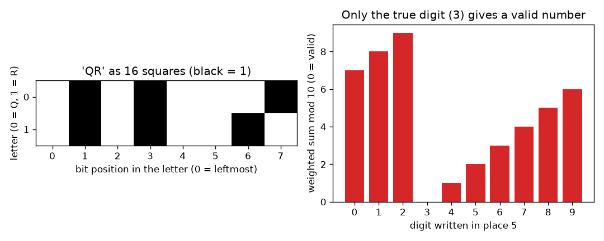
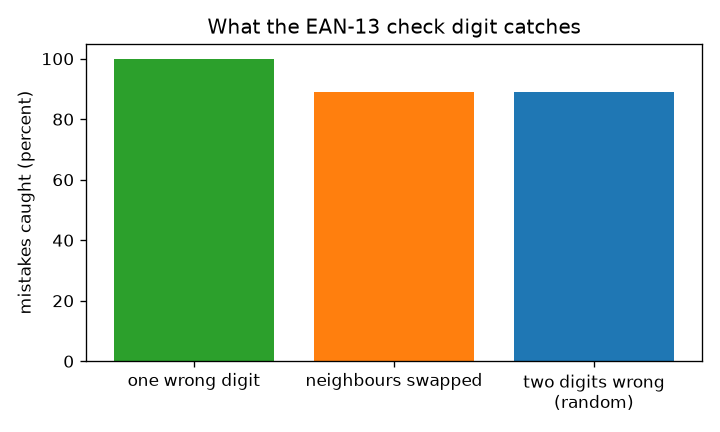

# സെഷൻ 1: ഡാറ്റയുടെ ചതുരങ്ങളും ചെക്ക് അക്കവും

[Session 1 — हिन्दी](README.hi.md) · [Session 1 — മലയാളം](README.ml.md)

*ലെവൽ 1 (ആശയപരമായ ഇന്ററാക്ടീവ് മോഡൽ) · ഏകദേശം 60 മിനിറ്റ് · openqrcode*

> ഇത് ലളിതമാക്കിയ ഒരു വിദ്യാഭ്യാസ മോഡലാണ്. ഇത് സാധൂകരിക്കപ്പെട്ട (validated) ഡിസൈൻ ഉപകരണമല്ല; യഥാർത്ഥ ഘടനകൾ, വൈദ്യുത സംവിധാനങ്ങൾ, വാഹനങ്ങൾ, വ്യാവസായിക പ്രക്രിയകൾ അല്ലെങ്കിൽ വൈദ്യശാസ്ത്ര തീരുമാനങ്ങൾ എന്നിവയ്ക്ക് ഇത് ഉപയോഗിക്കരുത്.

**മുൻ‌അറിവ് (Prerequisites)**

- അങ്കഗണിതം: ഗുണിക്കൽ, കൂട്ടൽ, ശിഷ്ടങ്ങൾ.
- നിങ്ങൾ PRIMER.md വായിക്കുകയും `python start.py 1` ഒരിക്കൽ പ്രവർത്തിപ്പിക്കുകയും ചെയ്തിട്ടുണ്ട്.

**പഠന ലക്ഷ്യങ്ങൾ (Learning objectives).** ഈ സെഷനു ശേഷം നിങ്ങൾക്ക് കഴിയും:

- ടെക്സ്റ്റ് എങ്ങനെ കറുപ്പും വെളുപ്പും ചതുരങ്ങളുടെ ഗ്രിഡ് ആകുന്നുവെന്ന് വിശദീകരിക്കാൻ.
- 12 അക്ക സംഖ്യയുടെ EAN-13 ചെക്ക് അക്കം കൈകൊണ്ടും Python-ലും കണക്കാക്കാൻ.
- യഥാർത്ഥ ഫോർമാറ്റിലുള്ള സംഖ്യകൾ ചെക്ക് ഉപയോഗിച്ച് സ്ഥിരീകരിക്കാൻ.
- ഒരു ചെക്ക് അക്കം എന്തു പിടികൂടുന്നു (എന്തു വിട്ടുപോകുന്നു) എന്നും അതിന് എന്തുകൊണ്ട് ഒന്നും നന്നാക്കാൻ കഴിയില്ലെന്നും പറയാൻ.

## A. യഥാർത്ഥ ലോക പ്രശ്നം
ഒരു കൗണ്ടർ ഒരു ദിവസം ആയിരക്കണക്കിന് ബാർകോഡുകൾ സ്കാൻ ചെയ്യുന്നു. ഒരു പാടോ തെറ്റായി ടൈപ്പ് ചെയ്ത അക്കമോ ഒരു ടിൻ ബീൻസിനെ ഒരു ടിൻ പെയിന്റ് ആക്കി മാറ്റിയേക്കാം. സംഖ്യ മാത്രം ഉപയോഗിച്ച്, താൻ വായിച്ച സംഖ്യ ഒരുപക്ഷേ തെറ്റാണെന്ന് സ്കാനർ തിരിച്ചറിയണം. 13 അക്കങ്ങൾക്ക് സ്വന്തം തെറ്റുതിരുത്തൽ വായനക്കാരനെ എങ്ങനെ വഹിക്കാൻ കഴിയും? (പൊതു വിദ്യാഭ്യാസം മാത്രം: ഇത് ലളിതമാക്കിയ മോഡലാണ്, പൂർണ്ണ ബാർകോഡ് മാനദണ്ഡമല്ല.)

## B. ആശയവും സിദ്ധാന്തവും
കമ്പ്യൂട്ടർ സൂക്ഷിക്കുന്നതെല്ലാം സംഖ്യകളാണ്, ഓരോ സംഖ്യയും 0-കളും 1-കളും കൊണ്ട് എഴുതാം. 1 നെ കറുത്ത ചതുരമായും 0 നെ വെളുത്ത ചതുരമായും വരയ്ക്കുക: അക്ഷരം A (കോഡ് 65 = 64 + 1) എന്നത് 01000001 എന്ന എട്ട് ചതുരങ്ങളാണ്. ഒരു 2D കോഡ് എന്നാൽ ഗ്രിഡിലെ ഇത്തരം ധാരാളം ചതുരങ്ങൾ മാത്രമാണ്. ഒരു കടയിലെ ബാർകോഡിൽ (EAN-13) 13 അക്കങ്ങളുണ്ട്. ആദ്യ 12 ഉൽപ്പന്നത്തെ സൂചിപ്പിക്കുന്നു; 13-ാമത്തേത് ചെക്ക് അക്കമാണ്. അക്കങ്ങളെ ഇടതുനിന്ന് 1, 3, 1, 3, ... എന്ന ഭാരങ്ങൾ (weights) കൊണ്ട് ഗുണിക്കുക, കൂട്ടുക (ഭാരിത തുക S), S പൂജ്യത്തിൽ അവസാനിക്കുന്ന വിധത്തിൽ, അതായത് S mod 10 = 0 (10 കൊണ്ട് ഹരിച്ചാലുള്ള ശിഷ്ടം) ആകുന്ന വിധത്തിൽ അവസാന അക്കം തിരഞ്ഞെടുക്കുക. വായനക്കാരൻ S വീണ്ടും കണക്കാക്കുന്നു: ശിഷ്ടം 0 അല്ലെങ്കിൽ അത് സംഖ്യ നിരസിക്കുന്നു. ഒരു അക്കം x കൊണ്ട് മാറിയാൽ S, w ഗുണിതം x കൊണ്ട് മാറുന്നു (w 1 അല്ലെങ്കിൽ 3), 1-നും 3-നും 10-മായി പൊതുഘടകമില്ല, അതിനാൽ ശിഷ്ടം എപ്പോഴും മാറും: ഒറ്റ തെറ്റായ അക്കം ഏതായാലും പിടിക്കപ്പെടും. അടുത്തടുത്തുള്ള രണ്ട് അക്കങ്ങൾ a, b പരസ്പരം മാറ്റിയാൽ S, 2 ഗുണിതം (a മൈനസ് b) കൊണ്ട് മാറുന്നു, ഇത് 10-ന്റെ ഗുണിതമാകുന്നത് a, b തമ്മിൽ കൃത്യം 5 വ്യത്യാസമുള്ളപ്പോൾ മാത്രമാണ്, അതിനാൽ ആ മാറ്റങ്ങൾ കണ്ടുപിടിക്കപ്പെടാതെ പോകുന്നു. ചെക്ക് അക്കം എന്തോ തെറ്റാണെന്ന് പറയുന്നു, എവിടെയാണെന്ന് പറയുന്നില്ല, അതിനാൽ സംഖ്യ നന്നാക്കാൻ അതിന് കഴിയില്ല.

| ചിഹ്നം | അർത്ഥം | യൂണിറ്റ് |
|---|---|---|
| d_i | സംഖ്യയുടെ i-ാമത്തെ അക്കം, i = 1 മുതൽ 13 വരെ | യൂണിറ്റില്ല |
| w_i | സ്ഥാനം i-യുടെ ഭാരം (i ഒറ്റസംഖ്യയെങ്കിൽ 1, ഇരട്ടസംഖ്യയെങ്കിൽ 3) | യൂണിറ്റില്ല |
| S | അക്കങ്ങളുടെ ഭാരിത തുക | യൂണിറ്റില്ല |
| c | ചെക്ക് അക്കം (13-ാമത്തെ അക്കം) | യൂണിറ്റില്ല |
| a, b | പരസ്പരം മാറ്റപ്പെടുന്ന അടുത്തടുത്ത രണ്ട് അക്കങ്ങൾ | യൂണിറ്റില്ല |

**അനുമാനങ്ങൾ (Assumptions)**

- അക്കങ്ങൾ അക്കങ്ങളായി ശരിയായി വായിക്കപ്പെടുന്നു; ബാർ വീതികളല്ല, ഏത് അക്കം വായിക്കപ്പെടുന്നു എന്നതിലെ തെറ്റുകളാണ് നാം പഠിക്കുന്നത്.
- തെറ്റുകൾ ക്രമരഹിതമാണ്: ഏത് തെറ്റായ അക്കവും ഒരുപോലെ സാധ്യമാണ്.
- UPC-A സംഖ്യകൾ (12 അക്കം) മുന്നിൽ ഒരു 0 എഴുതിയാൽ ഇതേ നിയമം പാലിക്കുന്നു.

$$ S=\sum_{i=1}^{13} w_i d_i,\qquad w_i=\begin{cases}1 & i\ \text{odd}\\ 3 & i\ \text{even}\end{cases} $$

$$ \text{valid}\iff S\equiv 0 \pmod{10},\qquad c=\big(10-S_{12}\bmod 10\big)\bmod 10 $$

$$ \Delta S=2\,(a-b)\ \text{for swapped neighbours with weights 1 and 3;}\quad \text{missed only if } a-b=\pm 5 $$

## C. ദൃശ്യ വിശദീകരണം
ഇടതുവശത്തെ ചിത്രം QR എന്ന വാക്കിനെ എട്ട് വീതമുള്ള രണ്ട് വരികളിലായി 16 ചതുരങ്ങളായി കാണിക്കുന്നു; കറുത്ത ചതുരങ്ങൾ 1-കളാണ്. വലതുവശത്തെ ചിത്രം യഥാർത്ഥ ഫോർമാറ്റിലുള്ള സംഖ്യ 4006381333931 എടുത്ത്, അതിന്റെ അഞ്ചാമത്തെ അക്കത്തെ 0 മുതൽ 9 വരെ ഓരോ അക്കം കൊണ്ടും മാറ്റി, ഭാരിത തുക mod 10 വരയ്ക്കുന്നു: ശരിയായ അക്കം 3 മാത്രം 0 നൽകുന്നു (പച്ച), മറ്റ് ഒമ്പതും നിരസിക്കപ്പെടുന്നു (ചുവപ്പ്). രണ്ടാമത്തെ ചിത്രം മൂന്ന് തരം തെറ്റുകളെ താരതമ്യം ചെയ്യുന്നു: ഒറ്റ തെറ്റായ അക്കങ്ങളെല്ലാം പിടിക്കപ്പെടുന്നു, അടുത്തടുത്ത അക്കങ്ങൾ പരസ്പരം മാറുന്നതും ഇരട്ട തെറ്റുകളും ഏകദേശം 89 ശതമാനം സമയം പിടിക്കപ്പെടുന്നു.

*ഇടത്: QR എന്ന വാക്ക് 16 ചതുരങ്ങളായി. വലത്: ശരിയായ അക്കം മാത്രം ചെക്ക് വിജയിക്കുന്നു.*

*ഒരു ചെക്ക് അക്കം ഒറ്റ തെറ്റായ അക്കങ്ങളെല്ലാം പിടിക്കുന്നു, സ്ഥാനമാറ്റങ്ങളും ഇരട്ട തെറ്റുകളും ഏകദേശം 89 ശതമാനവും.*

## D. ഇന്ററാക്ടീവ് സിമുലേഷൻ
പാഠം പ്രവർത്തിപ്പിക്കുക (`python start.py 1`), തുടർന്ന് ലൈവ് ആപ്പ് തുറക്കുക: [സെഷൻ 1: യഥാർത്ഥ ഫോർമാറ്റിലുള്ള ഒരു ബാർകോഡ് സംഖ്യ തകർക്കുക](https://krunalpanchal1995.github.io/pan-iit-oss/openqrcode/session-01/) (അല്ലെങ്കിൽ ഈ ഫോൾഡറിലെ `app.html`). ഒരു സ്ഥാനവും ഒരു അക്കവും തിരഞ്ഞെടുക്കുക. ഭാരിത തുകയും ശിഷ്ടവും മാറുന്നത് നിരീക്ഷിക്കുക, തുടർന്ന് ഗ്രാഫിലേക്ക് മാറി ഏത് അക്കമാണ് സംഖ്യയെ വിജയിപ്പിക്കുന്നതെന്ന് കാണുക.

**വെല്ലുവിളി.** സ്ഥാനം 5-ൽ സംഖ്യയെ ചെക്ക് വിജയിപ്പിക്കുന്ന അക്കം തിരികെ വയ്ക്കുക.

## E. ഉദാഹരണ പ്രശ്നവും പരീക്ഷണവും
**പ്രശ്നം.** 12 അക്കങ്ങൾ 400638133393-ന്റെ ചെക്ക് അക്കം കണ്ടെത്തുക, 4006381333931 സാധുവാണോ എന്ന് പറയുക.

1. അക്കങ്ങൾ 1, 3, 1, 3, ... എന്ന ഭാരങ്ങളോടെ എഴുതുക: 4x1, 0x3, 0x1, 6x3, 3x1, 8x3, 1x1, 3x3, 3x1, 3x3, 9x1, 3x3.
2. ഗുണനഫലങ്ങൾ: 4, 0, 0, 18, 3, 24, 1, 9, 3, 9, 9, 9.
3. 12 ഗുണനഫലങ്ങളുടെ തുക: S = 4 + 0 + 0 + 18 + 3 + 24 + 1 + 9 + 3 + 9 + 9 + 9 = 89.
4. 89-ന് മുകളിലെ അടുത്ത 10-ന്റെ ഗുണിതം 90 ആണ്, അതിനാൽ ചെക്ക് അക്കം 90 - 89 = 1.
5. പൂർണ്ണ സംഖ്യ 4006381333931 ആണ്. അതിന്റെ 13 ഭാരിത പദങ്ങൾ 89 + 1x1 = 90 ആയി കൂടുന്നു, 90 mod 10 = 0: സാധുവാണ്.

**ഉത്തരം.** ചെക്ക് അക്കം 1 ആണ്, അതിനാൽ 4006381333931 സാധുവാണ് (ഭാരിത തുക 90).

**പരീക്ഷണം.** വീട്ടിൽ ഒരു പാക്കറ്റ് ഉൽപ്പന്നം എടുക്കുക, അതിന്റെ ബാർകോഡിന് താഴെയുള്ള 13 അക്കങ്ങൾ വായിച്ച് ആദ്യ 12-ന് നിയമം പ്രയോഗിക്കുക; ഫലം 13-ാമത്തെ അക്കത്തിന് തുല്യമായിരിക്കണം. ചില ഉൽപ്പന്നങ്ങളിൽ 8 അക്ക (EAN-8) അല്ലെങ്കിൽ 12 അക്ക (UPC-A) കോഡുകളുണ്ട്: UPC-A ആണെങ്കിൽ ആദ്യം മുന്നിൽ ഒരു 0 എഴുതുക. പൊരുത്തപ്പെടുന്നില്ലെങ്കിൽ നിങ്ങൾ ഒരുപക്ഷേ ഒരു അക്കം തെറ്റായി വായിച്ചിരിക്കാം, അതാണ് ചെക്ക് അക്കം അതിന്റെ ജോലി ചെയ്യുന്നത്. മോഡലും യാഥാർത്ഥ്യവും: സ്കാനർ അക്കങ്ങളല്ല, ബാർ വീതികളാണ് വായിക്കുന്നത്, ബാറുകളിൽ തന്നെ കൂടുതൽ പരിശോധനകളും ഉപയോഗിക്കുന്നു; ഈ മോഡൽ അക്ക ശ്രേണിയെ മാത്രമേ ഉൾക്കൊള്ളുന്നുള്ളൂ.

## F. മൂല്യനിർണ്ണയവും ഡിസൈൻ വെല്ലുവിളിയും
**ചോദ്യ തരം A: ആശയപരം.** ഒരു സംഖ്യ തെറ്റാണെന്ന് ചെക്ക് അക്കത്തിന് പറയാൻ കഴിയുന്നു, പക്ഷേ ഏത് അക്കമാണ് തെറ്റെന്ന് പറയാൻ കഴിയാത്തത് എന്തുകൊണ്ട്? അത് നന്നാക്കാൻ നിങ്ങൾക്ക് എന്ത് അധികമായി വേണം?

സൂചന

ചെക്ക് 0-നും 9-നും ഇടയിലുള്ള ഒരു സംഖ്യയാണ് നൽകുന്നത്. എത്ര വ്യത്യസ്ത തെറ്റുകൾ ഒരേ ശിഷ്ടം നൽകുന്നു?

ഘട്ടം ഘട്ടമായുള്ള പരിഹാരം

ചെക്ക് 13 അക്കങ്ങളെയും ഒരൊറ്റ ശിഷ്ടത്തിലേക്ക് ചുരുക്കുന്നു. 0 അല്ലാത്ത ശിഷ്ടം 'ചില സ്ഥാനം മാറി' എന്ന് പറയുന്നു, പക്ഷേ പല വ്യത്യസ്ത സ്ഥാനങ്ങളും അക്കങ്ങളും ഒരേ ശിഷ്ടം നൽകുന്നു, അതിനാൽ ഒന്നിനെ പേരെടുത്ത് പറയാൻ കഴിയില്ല. ഒരു തെറ്റ് നന്നാക്കാൻ നിങ്ങൾക്ക് ഒന്നിനൊന്ന് ഓവർലാപ്പ് ചെയ്യുന്ന നിരവധി ചെക്കുകൾ വേണം, അവയുടെ ഉത്തരങ്ങൾ ഒരുമിച്ച് ഒരു സ്ഥാനത്തെ ചൂണ്ടിക്കാണിക്കണം. സെഷൻ 2-ലെ പാരിറ്റി ചെക്കുകൾ ചെയ്യുന്നത് അതാണ്.

**ചോദ്യ തരം B: സംഖ്യാപരം.** 12 അക്കങ്ങൾ 590123412345-ന്റെ ചെക്ക് അക്കം കണ്ടെത്തുകയും ഭാരിത തുക കാണിക്കുകയും ചെയ്യുക.

സൂചന

ഇടതുനിന്ന് 1, 3, 1, 3, ... ഭാരങ്ങൾ ഉപയോഗിക്കുക. ചെക്ക് അക്കം തുകയെ അടുത്ത 10-ന്റെ ഗുണിതത്തിലേക്ക് എത്തിക്കുന്നു.

ഘട്ടം ഘട്ടമായുള്ള പരിഹാരം

ഗുണനഫലങ്ങൾ: 5x1=5, 9x3=27, 0x1=0, 1x3=3, 2x1=2, 3x3=9, 4x1=4, 1x3=3, 2x1=2, 3x3=9, 4x1=4, 5x3=15. തുക: 83. അടുത്ത 10-ന്റെ ഗുണിതം: 90, അതിനാൽ ചെക്ക് അക്കം 7 ആണ്, സംഖ്യ 5901234123457. യുക്തിപരിശോധന (sanity check): 83 + 7 = 90, അത് 0-ൽ അവസാനിക്കുന്നു.

**ചോദ്യ തരം C: ഗ്രാഫ്, സിമുലേഷൻ വ്യാഖ്യാനം.** സ്ഥാനം 6-ൽ (ഭാരം 3) എഴുതിയ അക്കത്തിനെതിരെയുള്ള ഭാരിത തുക mod 10-ന്റെ ഗ്രാഫിൽ, അക്കം 1 കൂടുമ്പോൾ ശിഷ്ടം എത്ര നീങ്ങുന്നു? കൃത്യം ഒരു അക്കം മാത്രം 0 നൽകുന്നത് എന്തുകൊണ്ട്?

സൂചന

അക്കത്തിലെ ഓരോ 1 ചുവടും S-നെ ആ സ്ഥാനത്തിന്റെ ഭാരം കൊണ്ട് മാറ്റുന്നു. സ്ഥാനം 5-ന് ഭാരം 1 ആണ്, അതിന്റെ ഗ്രാഫ് ഓരോ ചുവടിലും 1 വീതം ഉയരുന്നു.

ഘട്ടം ഘട്ടമായുള്ള പരിഹാരം

ഭാരം 3 ആകുമ്പോൾ ശിഷ്ടം ഓരോ ചുവടിലും 3 (mod 10) കൊണ്ട് ചാടുന്നു: ഉദാഹരണ സംഖ്യ 4006381333931-ന് സ്ഥാനം 6-ലെ 0 മുതൽ 9 വരെയുള്ള അക്കങ്ങളുടെ ശിഷ്ടങ്ങൾ 6, 9, 2, 5, 8, 1, 4, 7, 0, 3 ആണ്. 3-നും 10-നും പൊതുഘടകമില്ലാത്തതിനാൽ പത്ത് അക്കങ്ങളും പത്ത് വ്യത്യസ്ത ശിഷ്ടങ്ങൾ നൽകുന്നു, അതിനാൽ അവയിൽ കൃത്യം ഒന്ന് 0 നൽകുന്നു. ഭാരം 1 ആണെങ്കിലും ഇതുതന്നെ ശരി.

**ചോദ്യ തരം D: ഡിസൈൻ, ഒപ്റ്റിമൈസേഷൻ വെല്ലുവിളി.** ഡിസൈൻ: ഒരു ലൈബ്രറിക്ക് 6 അക്ക അംഗത്വ നമ്പറുകൾക്കായി അടുത്തടുത്ത രണ്ട് അക്കങ്ങളുടെ ഓരോ സ്ഥാനമാറ്റവും പിടിക്കുന്ന ഒരു ചെക്ക് അക്കം വേണം, EAN-13 നിയമം ഇത് ചെയ്യുന്നില്ല (5 വ്യത്യാസമുള്ള അക്കങ്ങളെ അത് വിട്ടുകളയുന്നു). ഒരു നിയമം നിർദ്ദേശിക്കുകയും അതിന്റെ വില (cost) പറയുകയും ചെയ്യുക.

സൂചന

മോഡുലസുമായി പൊതുഘടകമില്ലാത്ത വ്യത്യാസമുള്ള ഭാരങ്ങൾ പരീക്ഷിക്കുക, ഏത് മോഡുലസ് പ്രവർത്തിക്കുമെന്ന് ചിന്തിക്കുക.

ഘട്ടം ഘട്ടമായുള്ള പരിഹാരം

7, 6, 5, 4, 3, 2 ഭാരങ്ങളോടെ മോഡുലോ 11 ഭാരിത തുക ഉപയോഗിക്കുക, ആകെ തുക 11-ന്റെ ഗുണിതമാകുന്ന വിധത്തിൽ ചെക്ക് മൂല്യം തിരഞ്ഞെടുക്കുക (ISBN-10 സമാനമായ രീതിയിൽ പ്രവർത്തിക്കുന്നു). അടുത്തടുത്ത a, b സ്ഥാനമാറ്റം തുകയെ (ഭാര വ്യത്യാസം = 1) ഗുണിതം (a മൈനസ് b) കൊണ്ട് മാറ്റുന്നു, a - b എന്നത് -9-നും 9-നും ഇടയിലുള്ള പൂജ്യമല്ലാത്ത സംഖ്യയാണ്, അതിനാൽ അത് ഒരിക്കലും 11-ന്റെ ഗുണിതമല്ല: ഓരോ സ്ഥാനമാറ്റവും ഓരോ ഒറ്റ തെറ്റായ അക്കവും പിടിക്കപ്പെടുന്നു. വില: ചെക്ക് മൂല്യം 10 ആകാം, അതിന് ഒരു അധിക ചിഹ്നം വേണം (ISBN-10 X എഴുതുന്നു), അതിനാൽ സംഖ്യകൾ ഇനി ശുദ്ധ അക്കങ്ങളല്ല. വിട്ടുവീഴ്ച (trade-off): സ്ഥാനമാറ്റങ്ങൾക്കെതിരെ ശക്തമായ സംരക്ഷണം, എന്നാൽ കൂടുതൽ അസൗകര്യമുള്ള ഫോർമാറ്റ്.

[RUBRIC.md](../../RUBRIC.md) ഉപയോഗിച്ച് സ്വയം സ്കോർ ചെയ്യുക. പേപ്പറിൽ ചെയ്യാൻ [പ്രവർത്തന ഷീറ്റ്](activity_sheet.md) പ്രിന്റ് ചെയ്യുക.

## സാധാരണ തെറ്റിദ്ധാരണകൾ
| സാധാരണ തെറ്റിദ്ധാരണ | യഥാർത്ഥത്തിൽ ശരിയായത് |
|---|---|
| ചെക്ക് അക്കം തെറ്റുകൾ തിരുത്തുന്നു. | അത് അവ കണ്ടെത്തുക മാത്രം ചെയ്യുന്നു. 'എന്തോ തെറ്റാണ്' എന്ന് പറയുന്നു, എന്താണെന്നോ എവിടെയാണെന്നോ പറയുന്നില്ല. |
| ചെക്ക് വിജയിച്ചാൽ സംഖ്യ തീർച്ചയായും ശരിയാണ്. | ചില തെറ്റുകൾ കടന്നുപോകുന്നു: 5 വ്യത്യാസമുള്ള അക്കങ്ങളുടെ അടുത്തടുത്ത സ്ഥാനമാറ്റങ്ങളും, ഒൻപതിൽ ഏകദേശം ഒരു ക്രമരഹിത ഇരട്ട തെറ്റും. |
| കറുപ്പും വെളുപ്പും ചതുരങ്ങൾ ദൃശ്യപരമായ എന്തെങ്കിലും വഹിക്കണം. | ചതുരങ്ങൾ 1, 0 എന്നീ ബിറ്റുകൾ സൂക്ഷിക്കാനുള്ള ഒരു മാർഗ്ഗം മാത്രമാണ്; വിപരീതമായ ഏത് ജോടി നിറങ്ങളും പ്രവർത്തിക്കും. |
| ബാർകോഡിന് താഴെയുള്ള അക്കങ്ങളാണ് സ്കാനർ വായിക്കുന്നത്. | സ്കാനർ ബാറുകളാണ് വായിക്കുന്നത്; അക്കങ്ങൾ അതേ നിയമം പിന്തുടരുന്ന, മനുഷ്യർക്ക് വായിക്കാവുന്ന ഒരു പകർപ്പാണ്. |

## പദാവലി (Glossary)
- **ബിറ്റ് (bit)**: ഒരു 0 അല്ലെങ്കിൽ 1; വെളുത്തതോ കറുത്തതോ ആയ ചതുരമായി വരയ്ക്കുന്നു
- **ചെക്ക് അക്കം (check digit)**: വായനക്കാരന് സംഖ്യ പരിശോധിക്കാൻ കഴിയുന്ന വിധത്തിൽ മറ്റ് അക്കങ്ങളിൽ നിന്ന് കണക്കാക്കുന്ന ഒരു അധിക അക്കം
- **ഭാരിത തുക (weighted sum)**: ഭാരങ്ങൾ കൊണ്ട് ഗുണിച്ച് കൂട്ടിയ അക്കങ്ങൾ
- **mod 10**: 10 കൊണ്ട് ഹരിച്ചാലുള്ള ശിഷ്ടം; 83 mod 10 = 3
- **EAN-13**: 13 അക്ക ഷോപ്പ് ബാർകോഡ് മാനദണ്ഡം

## പൂർത്തിയാക്കുക
1. [exercises.md](exercises.md)-ലെ മൂന്ന് കോഡിംഗ് ടാസ്കുകൾ ചെയ്യുക.
2. നിങ്ങളുടെ മാറ്റങ്ങൾക്ക് ശേഷം `python start.py 1` വീണ്ടും പ്രവർത്തിപ്പിക്കുക. അത് ചെക്ക്പോയിന്റോടെ അവസാനിക്കുന്നു; അത് `PASS` പ്രിന്റ് ചെയ്യുമ്പോൾ നിങ്ങൾ പൂർത്തിയാക്കി. (ചെക്ക്പോയിന്റ് മാത്രം: `python start.py check 1`.)

അടുത്തത്: [സെഷൻ 2](../session-02/README.md)
