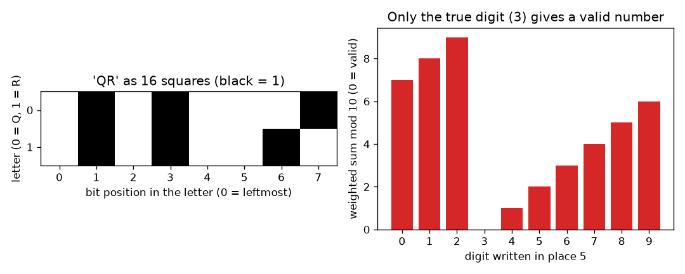
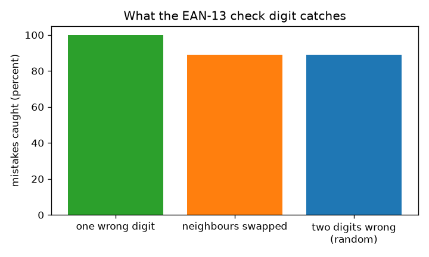

# அமர்வு 1: தரவின் சதுரங்களும் சரிபார்ப்பு இலக்கமும்

[Session 1 — हिन्दी](README.hi.md) · [Session 1 — മലയാളം](README.ml.md) · [Session 1 — தமிழ்](README.ta.md)

*நிலை 1 (கருத்தியல் ஊடாடும் மாதிரி) · சுமார் 60 நிமிடங்கள் · openqrcode*

> இது எளிமைப்படுத்தப்பட்ட ஒரு கல்வி மாதிரி. இது சரிபார்க்கப்பட்ட (validated) வடிவமைப்புக் கருவி அல்ல; உண்மையான கட்டமைப்புகள், மின் அமைப்புகள், வாகனங்கள், தொழில்துறை செயல்முறைகள் அல்லது மருத்துவ முடிவுகளுக்கு இதைப் பயன்படுத்த வேண்டாம்.

**முன்தேவைகள் (Prerequisites)**

- கணிதம்: பெருக்கல், கூட்டல், மீதிகள்.
- நீங்கள் PRIMER.md-ஐப் படித்து `python start.py 1` ஐ ஒருமுறை இயக்கியுள்ளீர்கள்.

**கற்றல் நோக்கங்கள் (Learning objectives).** இந்த அமர்வுக்குப் பிறகு உங்களால் முடியும்:

- உரை எப்படி கருப்பு வெள்ளைச் சதுரங்களின் கட்டமாக மாறுகிறது என்று விளக்க.
- 12 இலக்க எண்ணின் EAN-13 சரிபார்ப்பு இலக்கத்தை கையாலும் Python-இலும் கணக்கிட.
- உண்மை வடிவ எண்களை சரிபார்ப்பைக் கொண்டு சோதிக்க.
- சரிபார்ப்பு இலக்கம் எதைப் பிடிக்கிறது (எதைத் தவறவிடுகிறது) என்றும், அது ஏன் எதையும் சரிசெய்ய முடியாது என்றும் கூற.

## A. நிஜ உலகப் பிரச்சினை
ஒரு பில்லிங் கவுண்டர் ஒரு நாளில் ஆயிரக்கணக்கான பார்கோடுகளை ஸ்கேன் செய்கிறது. ஒரு கறையோ தவறாகத் தட்டச்சு செய்த இலக்கமோ ஒரு டின் பீன்ஸை ஒரு டின் பெயின்ட்டாக மாற்றிவிடலாம். எண்ணை மட்டுமே பயன்படுத்தி, தான் படித்த எண் தவறாக இருக்கக்கூடும் என்பதை ஸ்கேனர் கண்டறிய வேண்டும். 13 இலக்கங்கள் தங்களுக்கான சொந்தப் பிழைதிருத்துநரை எப்படிச் சுமக்க முடியும்? (பொதுக் கல்வி மட்டுமே: இது எளிமைப்படுத்தப்பட்ட மாதிரி, முழுமையான பார்கோடு தரநிலை அல்ல.)

## B. கருத்தும் கோட்பாடும்
கணினி சேமிக்கும் அனைத்தும் எண்கள், ஒவ்வொரு எண்ணையும் 0, 1 கொண்டு எழுதலாம். 1-ஐ கருப்புச் சதுரமாகவும் 0-ஐ வெள்ளைச் சதுரமாகவும் வரையுங்கள்: எழுத்து A (குறியீடு 65 = 64 + 1) என்பது 01000001 என்ற எட்டுச் சதுரங்கள். ஒரு 2D குறியீடு என்பது கட்டத்தில் உள்ள இத்தகைய பல சதுரங்களே. ஒரு கடை பார்கோடில் (EAN-13) 13 இலக்கங்கள் உள்ளன. முதல் 12 பொருளைக் குறிக்கின்றன; 13-வது சரிபார்ப்பு இலக்கம். இலக்கங்களை இடமிருந்து 1, 3, 1, 3, ... என்ற எடைகளால் (weights) பெருக்கி, கூட்டுங்கள் (எடையிட்ட கூட்டுத்தொகை S), S பூஜ்ஜியத்தில் முடியும்படி, அதாவது S mod 10 = 0 (10 ஆல் வகுத்த மீதி) ஆகும்படி கடைசி இலக்கத்தைத் தேர்ந்தெடுங்கள். வாசிப்பான் S-ஐ மீண்டும் கணக்கிடுகிறது: மீதி 0 அல்ல என்றால் எண்ணை நிராகரிக்கிறது. ஒரு இலக்கம் x ஆல் மாறினால் S, w மடங்கு x ஆல் மாறுகிறது (w 1 அல்லது 3), 1-க்கும் 3-க்கும் 10-உடன் பொதுக் காரணி இல்லை, எனவே மீதி எப்போதும் மாறும்: ஒற்றைத் தவறான இலக்கம் எதுவாக இருந்தாலும் பிடிபடும். அருகருகே உள்ள இரண்டு இலக்கங்கள் a, b இடம் மாறினால் S, 2 மடங்கு (a கழித்தல் b) ஆல் மாறுகிறது, இது 10-இன் மடங்காவது a, b சரியாக 5 வேறுபடும்போது மட்டுமே, எனவே அந்த இடமாற்றங்கள் தப்பிவிடுகின்றன. சரிபார்ப்பு இலக்கம் ஏதோ தவறு என்று சொல்கிறது, எங்கே என்று சொல்வதில்லை, எனவே எண்ணைச் சரிசெய்ய அதனால் முடியாது.

| குறியீடு | பொருள் | அலகு |
|---|---|---|
| d_i | எண்ணின் i-வது இலக்கம், i = 1 முதல் 13 வரை | அலகு இல்லை |
| w_i | இடம் i-இன் எடை (i ஒற்றைப்படை என்றால் 1, இரட்டைப்படை என்றால் 3) | அலகு இல்லை |
| S | இலக்கங்களின் எடையிட்ட கூட்டுத்தொகை | அலகு இல்லை |
| c | சரிபார்ப்பு இலக்கம் (13-வது இலக்கம்) | அலகு இல்லை |
| a, b | இடம் மாற்றப்படும் அருகருகே உள்ள இரண்டு இலக்கங்கள் | அலகு இல்லை |

**அனுமானங்கள் (Assumptions)**

- இலக்கங்கள் இலக்கங்களாகச் சரியாகப் படிக்கப்படுகின்றன; பட்டை அகலங்களை அல்ல, எந்த இலக்கம் படிக்கப்படுகிறது என்பதில் உள்ள தவறுகளையே நாம் ஆய்வு செய்கிறோம்.
- தவறுகள் சீரற்றவை: எந்தத் தவறான இலக்கமும் சம வாய்ப்புள்ளது.
- UPC-A எண்கள் (12 இலக்கம்) முன்னால் ஒரு 0 எழுதினால் இதே விதியைப் பின்பற்றுகின்றன.

$$ S=\sum_{i=1}^{13} w_i d_i,\qquad w_i=\begin{cases}1 & i\ \text{odd}\\ 3 & i\ \text{even}\end{cases} $$

$$ \text{valid}\iff S\equiv 0 \pmod{10},\qquad c=\big(10-S_{12}\bmod 10\big)\bmod 10 $$

$$ \Delta S=2\,(a-b)\ \text{for swapped neighbours with weights 1 and 3;}\quad \text{missed only if } a-b=\pm 5 $$

## C. காட்சி விளக்கம்
இடப்புறப் படம் QR என்ற சொல்லை எட்டு எட்டாக இரண்டு வரிசைகளில் 16 சதுரங்களாகக் காட்டுகிறது; கருப்புச் சதுரங்கள் 1-கள். வலப்புறப் படம் உண்மை வடிவ எண் 4006381333931-ஐ எடுத்து, அதன் ஐந்தாவது இலக்கத்தை 0 முதல் 9 வரை ஒவ்வொரு இலக்கத்தால் மாற்றி, எடையிட்ட கூட்டுத்தொகை mod 10-ஐ வரைகிறது: உண்மையான இலக்கம் 3 மட்டுமே 0 தருகிறது (பச்சை), மற்ற ஒன்பதும் நிராகரிக்கப்படுகின்றன (சிவப்பு). இரண்டாவது படம் மூன்று வகைத் தவறுகளை ஒப்பிடுகிறது: ஒற்றைத் தவறான இலக்கங்கள் அனைத்தும் பிடிபடுகின்றன, அருகருகே இடமாற்றங்களும் இரட்டைப் பிழைகளும் சுமார் 89 சதவீதம் பிடிபடுகின்றன.

*இடது: QR என்ற சொல் 16 சதுரங்களாக. வலது: உண்மையான இலக்கம் மட்டுமே சரிபார்ப்பில் தேறுகிறது.*

*சரிபார்ப்பு இலக்கம் ஒற்றைத் தவறான இலக்கங்கள் அனைத்தையும், இடமாற்றங்களிலும் இரட்டைப் பிழைகளிலும் சுமார் 89 சதவீதத்தையும் பிடிக்கிறது.*

## D. ஊடாடும் உருவகப்படுத்துதல்
பாடத்தை இயக்கவும் (`python start.py 1`), பிறகு நேரலை செயலியைத் திறக்கவும்: [அமர்வு 1: உண்மை வடிவ பார்கோடு எண்ணை உடைத்துப் பாருங்கள்](https://krunalpanchal1995.github.io/pan-iit-oss/openqrcode/session-01/) (அல்லது இந்தக் கோப்புறையில் உள்ள `app.html`). ஓர் இடத்தையும் ஓர் இலக்கத்தையும் தேர்ந்தெடுங்கள். எடையிட்ட கூட்டுத்தொகையும் மீதியும் மாறுவதைக் கவனியுங்கள், பிறகு வரைபடத்துக்கு மாறி எந்த இலக்கம் எண்ணைத் தேற வைக்கிறது என்று பாருங்கள்.

**சவால்.** இடம் 5-இல் எண்ணைச் சரிபார்ப்பில் தேற வைக்கும் இலக்கத்தை மீண்டும் வையுங்கள்.

## E. எடுத்துக்காட்டுக் கணக்கும் சோதனையும்
**கணக்கு.** 12 இலக்கங்கள் 400638133393-இன் சரிபார்ப்பு இலக்கத்தைக் காண்க, 4006381333931 செல்லுபடியாகுமா என்று கூறுக.

1. இலக்கங்களை 1, 3, 1, 3, ... எடைகளுடன் எழுதுங்கள்: 4x1, 0x3, 0x1, 6x3, 3x1, 8x3, 1x1, 3x3, 3x1, 3x3, 9x1, 3x3.
2. பெருக்கற்பலன்கள்: 4, 0, 0, 18, 3, 24, 1, 9, 3, 9, 9, 9.
3. 12 பெருக்கற்பலன்களின் கூட்டுத்தொகை: S = 4 + 0 + 0 + 18 + 3 + 24 + 1 + 9 + 3 + 9 + 9 + 9 = 89.
4. 89-க்கு மேல் அடுத்த 10-இன் மடங்கு 90, எனவே சரிபார்ப்பு இலக்கம் 90 - 89 = 1.
5. முழு எண் 4006381333931. அதன் 13 எடையிட்ட உறுப்புகள் 89 + 1x1 = 90 ஆகக் கூடுகின்றன, 90 mod 10 = 0: செல்லுபடியாகும்.

**விடை.** சரிபார்ப்பு இலக்கம் 1, எனவே 4006381333931 செல்லுபடியாகும் (எடையிட்ட கூட்டுத்தொகை 90).

**சோதனை.** வீட்டில் ஒரு பேக்கேஜ் பொருளை எடுத்து, அதன் பார்கோடுக்குக் கீழுள்ள 13 இலக்கங்களைப் படித்து, முதல் 12-க்கு விதியைப் பயன்படுத்துங்கள்; முடிவு 13-வது இலக்கத்துக்குச் சமமாக இருக்க வேண்டும். சில பொருட்களில் 8 இலக்க (EAN-8) அல்லது 12 இலக்க (UPC-A) குறியீடுகள் உள்ளன: UPC-A என்றால் முதலில் முன்னால் ஒரு 0 எழுதுங்கள். பொருந்தவில்லை என்றால் நீங்கள் ஒரு இலக்கத்தைத் தவறாகப் படித்திருக்கலாம், அதுவே சரிபார்ப்பு இலக்கம் தன் வேலையைச் செய்வது. மாதிரியும் நிஜமும்: ஸ்கேனர் இலக்கங்களை அல்ல, பட்டை அகலங்களைப் படிக்கிறது, பட்டைகளிலேயே கூடுதல் சோதனைகளையும் பயன்படுத்துகிறது; இந்த மாதிரி இலக்கத் தொடரை மட்டுமே உள்ளடக்குகிறது.

## F. மதிப்பீடும் வடிவமைப்புச் சவாலும்
**கேள்வி வகை A: கருத்தியல்.** ஓர் எண் தவறு என்று சரிபார்ப்பு இலக்கத்தால் சொல்ல முடிகிறது, ஆனால் எந்த இலக்கம் தவறு என்று சொல்ல முடியாதது ஏன்? அதைச் சரிசெய்ய உங்களுக்கு என்ன கூடுதலாகத் தேவை?

குறிப்பு

சரிபார்ப்பு 0 முதல் 9 வரையிலான ஒரு எண்ணைத் தருகிறது. எத்தனை வெவ்வேறு தவறுகள் அதே மீதியைத் தருகின்றன?

படிப்படியான தீர்வு

சரிபார்ப்பு 13 இலக்கங்களையும் ஒரே மீதியாகச் சுருக்குகிறது. 0 அல்லாத மீதி 'ஏதோ ஓர் இடம் மாறிவிட்டது' என்று சொல்கிறது, ஆனால் பல வெவ்வேறு இடங்களும் இலக்கங்களும் அதே மீதியைத் தருகின்றன, எனவே ஒன்றைப் பெயரிட்டுச் சொல்ல முடியாது. ஒரு தவறைச் சரிசெய்ய, ஒன்றோடொன்று பகுதி மேற்படியும் பல சரிபார்ப்புகள் தேவை, அவற்றின் விடைகள் சேர்ந்து ஓர் இடத்தைச் சுட்டிக்காட்ட வேண்டும். அமர்வு 2-இன் பாரிட்டி சரிபார்ப்புகள் செய்வது அதுவே.

**கேள்வி வகை B: எண்ணியல்.** 12 இலக்கங்கள் 590123412345-க்கான சரிபார்ப்பு இலக்கத்தைக் கண்டு, எடையிட்ட கூட்டுத்தொகையைக் காட்டுங்கள்.

குறிப்பு

இடமிருந்து 1, 3, 1, 3, ... எடைகளைப் பயன்படுத்துங்கள். சரிபார்ப்பு இலக்கம் கூட்டுத்தொகையை அடுத்த 10-இன் மடங்குக்குக் கொண்டு செல்கிறது.

படிப்படியான தீர்வு

பெருக்கற்பலன்கள்: 5x1=5, 9x3=27, 0x1=0, 1x3=3, 2x1=2, 3x3=9, 4x1=4, 1x3=3, 2x1=2, 3x3=9, 4x1=4, 5x3=15. கூட்டுத்தொகை: 83. அடுத்த 10-இன் மடங்கு: 90, எனவே சரிபார்ப்பு இலக்கம் 7, எண் 5901234123457. நியாயச் சோதனை (sanity check): 83 + 7 = 90, அது 0-இல் முடிகிறது.

**கேள்வி வகை C: வரைபடம், உருவகப்படுத்துதல் விளக்கம்.** இடம் 6-இல் (எடை 3) எழுதப்பட்ட இலக்கத்துக்கு எதிரான எடையிட்ட கூட்டுத்தொகை mod 10 வரைபடத்தில், இலக்கம் 1 உயரும்போது மீதி எவ்வளவு நகர்கிறது? சரியாக ஒரு இலக்கம் மட்டுமே 0 தருவது ஏன்?

குறிப்பு

இலக்கத்தில் ஒவ்வொரு 1 படியும் S-ஐ அந்த இடத்தின் எடையால் மாற்றுகிறது. இடம் 5-க்கு எடை 1, அதன் வரைபடம் ஒவ்வொரு படியிலும் 1 உயர்கிறது.

படிப்படியான தீர்வு

எடை 3 ஆக இருக்கும்போது மீதி ஒவ்வொரு படியிலும் 3 (mod 10) தாவுகிறது: எடுத்துக்காட்டு எண் 4006381333931-க்கு இடம் 6-இல் 0 முதல் 9 வரையிலான இலக்கங்களின் மீதிகள் 6, 9, 2, 5, 8, 1, 4, 7, 0, 3. 3-க்கும் 10-க்கும் பொதுக் காரணி இல்லாததால் பத்து இலக்கங்களும் பத்து வெவ்வேறு மீதிகளைத் தருகின்றன, எனவே அவற்றில் சரியாக ஒன்று 0 தருகிறது. எடை 1 ஆக இருந்தாலும் இதுவே உண்மை.

**கேள்வி வகை D: வடிவமைப்பு, உகப்பாக்கச் சவால்.** வடிவமைப்பு: ஒரு நூலகத்துக்கு 6 இலக்க உறுப்பினர் எண்களுக்கு, அருகருகே உள்ள இரண்டு இலக்கங்களின் ஒவ்வொரு இடமாற்றத்தையும் பிடிக்கும் சரிபார்ப்பு இலக்கம் தேவை; EAN-13 விதி இதைச் செய்வதில்லை (5 வேறுபடும் இலக்கங்களை அது தவறவிடுகிறது). ஒரு விதியை முன்மொழிந்து அதன் விலையைக் (cost) கூறுங்கள்.

குறிப்பு

மட்டுடன் (modulus) பொதுக் காரணி இல்லாத வேறுபாடு கொண்ட எடைகளை முயன்று, எந்த மட்டு பொருந்தும் என்று சிந்தியுங்கள்.

படிப்படியான தீர்வு

7, 6, 5, 4, 3, 2 எடைகளுடன் மட்டு 11-இல் எடையிட்ட கூட்டுத்தொகையைப் பயன்படுத்தி, மொத்தம் 11-இன் மடங்காகும்படி சரிபார்ப்பு மதிப்பைத் தேர்ந்தெடுங்கள் (ISBN-10 இதே போல் செயல்படுகிறது). அருகருகே a, b இடமாற்றம் கூட்டுத்தொகையை (எடை வேறுபாடு = 1) மடங்கு (a கழித்தல் b) ஆல் மாற்றுகிறது, a - b என்பது -9-க்கும் 9-க்கும் இடையிலான பூஜ்ஜியமற்ற எண், எனவே அது ஒருபோதும் 11-இன் மடங்கு அல்ல: ஒவ்வொரு இடமாற்றமும் ஒவ்வொரு ஒற்றைத் தவறான இலக்கமும் பிடிபடுகிறது. விலை: சரிபார்ப்பு மதிப்பு 10 ஆக இருக்கலாம், அதற்கு ஓர் கூடுதல் குறியீடு தேவை (ISBN-10 X என்று எழுதுகிறது), எனவே எண்கள் இனி தூய இலக்கங்கள் அல்ல. சமரசம் (trade-off): இடமாற்றங்களுக்கு எதிரான வலுவான பாதுகாப்பு, ஆனால் சிரமமான வடிவம்.

[RUBRIC.md](../../RUBRIC.md) கொண்டு சுய மதிப்பெண் இடுங்கள். காகிதத்தில் செய்ய [செயல்பாட்டுத் தாளை](activity_sheet.md) அச்சிடுங்கள்.

## பொதுவான தவறான புரிதல்கள்
| பொதுவான தவறான புரிதல் | உண்மையில் சரியானது |
|---|---|
| சரிபார்ப்பு இலக்கம் தவறுகளைத் திருத்துகிறது. | அது அவற்றைக் கண்டறிய மட்டுமே செய்கிறது. 'ஏதோ தவறு' என்று சொல்கிறது, என்ன என்றோ எங்கே என்றோ சொல்வதில்லை. |
| சரிபார்ப்பு தேறினால் எண் நிச்சயமாகச் சரியானது. | சில தவறுகள் தப்பிவிடுகின்றன: 5 வேறுபடும் இலக்கங்களின் அருகருகே இடமாற்றங்கள், மற்றும் ஒன்பதில் ஒரு சீரற்ற இரட்டைப் பிழை. |
| கருப்பு வெள்ளைச் சதுரங்கள் ஏதேனும் காட்சிப் பொருளைக் கொண்டிருக்க வேண்டும். | சதுரங்கள் 1, 0 பிட்களைச் சேமிக்கும் ஒரு வழி மட்டுமே; எதிரெதிரான எந்த நிழல் இணையும் வேலை செய்யும். |
| பார்கோடுக்குக் கீழுள்ள இலக்கங்களையே ஸ்கேனர் படிக்கிறது. | ஸ்கேனர் பட்டைகளைப் படிக்கிறது; இலக்கங்கள் அதே விதியைப் பின்பற்றும், மனிதர்கள் படிக்கக்கூடிய நகல். |

## சொற்களஞ்சியம் (Glossary)
- **பிட் (bit)**: ஒரு 0 அல்லது 1; வெள்ளை அல்லது கருப்புச் சதுரமாக வரையப்படுகிறது
- **சரிபார்ப்பு இலக்கம் (check digit)**: வாசிப்பான் எண்ணைச் சோதிக்க முடியும்படி மற்ற இலக்கங்களிலிருந்து கணக்கிடப்படும் கூடுதல் இலக்கம்
- **எடையிட்ட கூட்டுத்தொகை (weighted sum)**: எடைகளால் பெருக்கிக் கூட்டப்பட்ட இலக்கங்கள்
- **mod 10**: 10 ஆல் வகுத்த பின் மீதி; 83 mod 10 = 3
- **EAN-13**: 13 இலக்கக் கடை பார்கோடு தரநிலை

## முடித்தல்
1. [exercises.md](exercises.md)-இல் உள்ள மூன்று நிரலாக்கப் பணிகளைச் செய்யுங்கள்.
2. உங்கள் மாற்றங்களுக்குப் பிறகு `python start.py 1` ஐ மீண்டும் இயக்குங்கள். அது சோதனைச் சாவடியுடன் முடிகிறது; அது `PASS` அச்சிடும்போது நீங்கள் முடித்துவிட்டீர்கள். (சோதனைச் சாவடி மட்டும்: `python start.py check 1`.)

அடுத்தது: [அமர்வு 2](../session-02/README.md)
