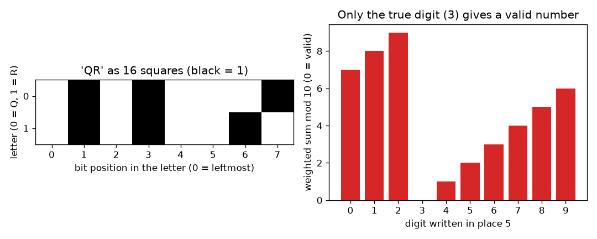
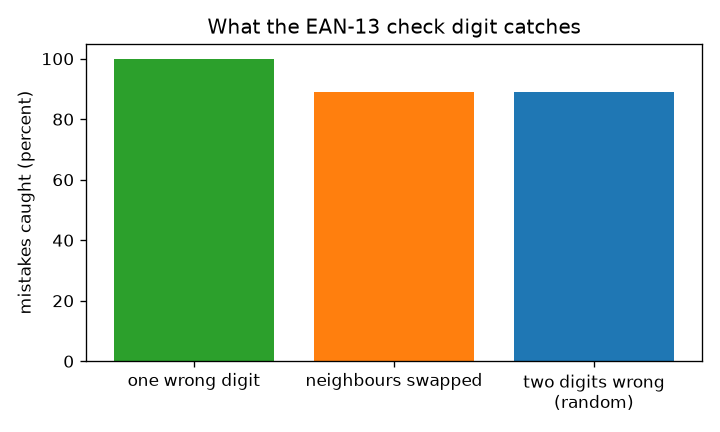

# సెషన్ 1: డేటా చతురస్రాలు మరియు చెక్ అంకె

[Session 1 — हिन्दी](README.hi.md) · [Session 1 — മലയാളം](README.ml.md) · [Session 1 — தமிழ்](README.ta.md) · [Session 1 — తెలుగు](README.te.md)

*స్థాయి 1 (భావనాత్మక ఇంటరాక్టివ్ మోడల్) · సుమారు 60 నిమిషాలు · openqrcode*

> ఇది సరళీకృత విద్యా నమూనా. ఇది ధృవీకరించబడిన (validated) డిజైన్ సాధనం కాదు; నిజమైన నిర్మాణాలు, విద్యుత్ వ్యవస్థలు, వాహనాలు, పారిశ్రామిక ప్రక్రియలు లేదా వైద్య నిర్ణయాల కోసం దీన్ని ఉపయోగించవద్దు.

**ముందస్తు అవసరాలు (Prerequisites)**

- అంకగణితం: గుణించడం, కూడటం, శేషాలు.
- మీరు PRIMER.md చదివి `python start.py 1` ను ఒకసారి నడిపారు.

**అభ్యాస లక్ష్యాలు (Learning objectives).** ఈ సెషన్ తర్వాత మీరు వీటిని చేయగలరు:

- టెక్స్ట్ నలుపు తెలుపు చతురస్రాల గ్రిడ్‌గా ఎలా మారుతుందో వివరించడం.
- 12 అంకెల సంఖ్య యొక్క EAN-13 చెక్ అంకెను చేతితో మరియు Python లో లెక్కించడం.
- నిజ ఫార్మాట్ సంఖ్యలను చెక్‌తో ధృవీకరించడం.
- చెక్ అంకె దేన్ని పట్టుకుంటుందో (దేన్ని వదిలేస్తుందో) మరియు అది ఏమీ ఎందుకు సరిచేయలేదో చెప్పడం.

## A. నిజ ప్రపంచ సమస్య
ఒక బిల్లింగ్ కౌంటర్ రోజుకు వేలాది బార్‌కోడ్‌లను స్కాన్ చేస్తుంది. ఒక మరక లేదా తప్పుగా టైప్ చేసిన అంకె ఒక టిన్ బీన్స్‌ను ఒక టిన్ పెయింట్‌గా మార్చేయవచ్చు. సంఖ్యను మాత్రమే ఉపయోగించి, తాను చదివిన సంఖ్య బహుశా తప్పని స్కానర్ గుర్తించాలి. 13 అంకెలు తమ సొంత ప్రూఫ్-రీడర్‌ను ఎలా మోయగలవు? (సాధారణ విద్య మాత్రమే: ఇది సరళీకృత నమూనా, పూర్తి బార్‌కోడ్ ప్రమాణం కాదు.)

## B. భావన మరియు సిద్ధాంతం
కంప్యూటర్ నిల్వ చేసే ప్రతిదీ సంఖ్యే, ప్రతి సంఖ్యను 0లు, 1లతో రాయవచ్చు. 1 ను నల్ల చతురస్రంగా, 0 ను తెల్ల చతురస్రంగా గీయండి: అక్షరం A (కోడ్ 65 = 64 + 1) అంటే 01000001 అనే ఎనిమిది చతురస్రాలు. 2D కోడ్ అంటే గ్రిడ్‌లో ఇలాంటి చాలా చతురస్రాలే. షాపు బార్‌కోడ్‌లో (EAN-13) 13 అంకెలు ఉంటాయి. మొదటి 12 ఉత్పత్తిని సూచిస్తాయి; 13వది చెక్ అంకె. అంకెలను ఎడమ నుండి 1, 3, 1, 3, ... భారాలతో (weights) గుణించి, కూడండి (భారిత మొత్తం S), S సున్నాతో ముగిసేలా, అంటే S mod 10 = 0 (10తో భాగించగా వచ్చే శేషం) అయ్యేలా చివరి అంకెను ఎంచుకోండి. రీడర్ S ను మళ్ళీ లెక్కిస్తుంది: శేషం 0 కాకపోతే సంఖ్యను తిరస్కరిస్తుంది. ఒక అంకె x ద్వారా మారితే S, w రెట్లు x ద్వారా మారుతుంది (w 1 లేదా 3), 1కి, 3కి 10తో ఉమ్మడి కారణాంకం లేదు, కాబట్టి శేషం ఎల్లప్పుడూ మారుతుంది: ప్రతి ఒక్క తప్పు అంకె పట్టుబడుతుంది. పక్కపక్కన ఉన్న రెండు అంకెలు a, b మార్చుకుంటే S, 2 రెట్లు (a మైనస్ b) ద్వారా మారుతుంది, ఇది 10 యొక్క గుణిజం అయ్యేది a, b సరిగ్గా 5 తేడా ఉన్నప్పుడు మాత్రమే, కాబట్టి ఆ మార్పిడులు తప్పించుకుంటాయి. చెక్ అంకె ఏదో తప్పని చెబుతుంది, ఎక్కడో చెప్పదు, కాబట్టి సంఖ్యను సరిచేయలేదు.

| గుర్తు | అర్థం | యూనిట్ |
|---|---|---|
| d_i | సంఖ్య యొక్క i-వ అంకె, i = 1 నుండి 13 వరకు | యూనిట్ లేదు |
| w_i | స్థానం i యొక్క భారం (i బేసి అయితే 1, సరి అయితే 3) | యూనిట్ లేదు |
| S | అంకెల భారిత మొత్తం | యూనిట్ లేదు |
| c | చెక్ అంకె (13వ అంకె) | యూనిట్ లేదు |
| a, b | మార్చుకునే పక్కపక్కన ఉన్న రెండు అంకెలు | యూనిట్ లేదు |

**ఊహలు (Assumptions)**

- అంకెలు అంకెలుగా సరిగ్గా చదవబడతాయి; బార్ వెడల్పులు కాదు, ఏ అంకె చదవబడుతుంది అనే తప్పులను మనం అధ్యయనం చేస్తాం.
- తప్పులు యాదృచ్ఛికం: ఏ తప్పు అంకె అయినా సమాన సంభావ్యత కలది.
- UPC-A సంఖ్యలు (12 అంకెలు) ముందు ఒక 0 రాస్తే ఇదే నియమాన్ని పాటిస్తాయి.

$$ S=\sum_{i=1}^{13} w_i d_i,\qquad w_i=\begin{cases}1 & i\ \text{odd}\\ 3 & i\ \text{even}\end{cases} $$

$$ \text{valid}\iff S\equiv 0 \pmod{10},\qquad c=\big(10-S_{12}\bmod 10\big)\bmod 10 $$

$$ \Delta S=2\,(a-b)\ \text{for swapped neighbours with weights 1 and 3;}\quad \text{missed only if } a-b=\pm 5 $$

## C. దృశ్య వివరణ
ఎడమ చిత్రం QR అనే పదాన్ని ఎనిమిది చొప్పున రెండు వరుసలలో 16 చతురస్రాలుగా చూపిస్తుంది; నల్ల చతురస్రాలు 1లు. కుడి చిత్రం నిజ ఫార్మాట్ సంఖ్య 4006381333931 తీసుకుని, దాని ఐదవ అంకెను 0 నుండి 9 వరకు ప్రతి అంకెతో మార్చి, భారిత మొత్తం mod 10 ను గీస్తుంది: నిజమైన అంకె 3 మాత్రమే 0 ఇస్తుంది (ఆకుపచ్చ), మిగతా తొమ్మిది తిరస్కరించబడతాయి (ఎరుపు). రెండవ చిత్రం మూడు రకాల తప్పులను పోలుస్తుంది: అన్ని ఒక్క తప్పు అంకెలు పట్టుబడతాయి, పక్కపక్కన మార్పిడులు మరియు రెండు తప్పులు సుమారు 89 శాతం సార్లు పట్టుబడతాయి.

*ఎడమ: QR అనే పదం 16 చతురస్రాలుగా. కుడి: నిజమైన అంకె మాత్రమే చెక్‌లో నెగ్గుతుంది.*

*చెక్ అంకె ప్రతి ఒక్క తప్పు అంకెను, మార్పిడులు మరియు రెండు తప్పులలో సుమారు 89 శాతాన్ని పట్టుకుంటుంది.*

## D. ఇంటరాక్టివ్ అనుకరణ
పాఠాన్ని నడపండి (`python start.py 1`), తర్వాత లైవ్ యాప్‌ను తెరవండి: [సెషన్ 1: నిజ ఫార్మాట్ బార్‌కోడ్ సంఖ్యను చెడగొట్టండి](https://krunalpanchal1995.github.io/pan-iit-oss/openqrcode/session-01/) (లేదా ఈ ఫోల్డర్‌లోని `app.html`). ఒక స్థానాన్ని, ఒక అంకెను ఎంచుకోండి. భారిత మొత్తం, శేషం మారడం గమనించండి, తర్వాత గ్రాఫ్‌కు మారి ఏ అంకె సంఖ్యను నెగ్గిస్తుందో చూడండి.

**సవాలు.** స్థానం 5 లో సంఖ్యను చెక్‌లో నెగ్గించే అంకెను తిరిగి ఉంచండి.

## E. ఉదాహరణ సమస్య మరియు ప్రయోగం
**సమస్య.** 12 అంకెలు 400638133393 యొక్క చెక్ అంకె కనుగొని, 4006381333931 చెల్లుతుందో చెప్పండి.

1. అంకెలను 1, 3, 1, 3, ... భారాలతో రాయండి: 4x1, 0x3, 0x1, 6x3, 3x1, 8x3, 1x1, 3x3, 3x1, 3x3, 9x1, 3x3.
2. లబ్ధాలు: 4, 0, 0, 18, 3, 24, 1, 9, 3, 9, 9, 9.
3. 12 లబ్ధాల మొత్తం: S = 4 + 0 + 0 + 18 + 3 + 24 + 1 + 9 + 3 + 9 + 9 + 9 = 89.
4. 89 పైన తదుపరి 10 యొక్క గుణిజం 90, కాబట్టి చెక్ అంకె 90 - 89 = 1.
5. పూర్తి సంఖ్య 4006381333931. దాని 13 భారిత పదాలు 89 + 1x1 = 90 గా కూడుతాయి, 90 mod 10 = 0: చెల్లుతుంది.

**జవాబు.** చెక్ అంకె 1, కాబట్టి 4006381333931 చెల్లుతుంది (భారిత మొత్తం 90).

**ప్రయోగం.** ఇంట్లో ఒక ప్యాకేజ్డ్ ఉత్పత్తిని తీసుకుని, దాని బార్‌కోడ్ కింద ఉన్న 13 అంకెలు చదివి, మొదటి 12 కు నియమాన్ని వర్తింపజేయండి; ఫలితం 13వ అంకెకు సమానంగా ఉండాలి. కొన్ని ఉత్పత్తులకు 8 అంకెల (EAN-8) లేదా 12 అంకెల (UPC-A) కోడ్‌లు ఉంటాయి: UPC-A అయితే ముందు ఒక 0 రాయండి. సరిపోకపోతే మీరు బహుశా ఒక అంకెను తప్పుగా చదివి ఉంటారు, చెక్ అంకె తన పని చేయడం అదే. నమూనా వర్సెస్ వాస్తవం: స్కానర్ అంకెలను కాదు, బార్ వెడల్పులను చదువుతుంది, బార్లపైనే మరిన్ని తనిఖీలను కూడా ఉపయోగిస్తుంది; ఈ నమూనా అంకెల స్ట్రింగ్‌ను మాత్రమే కవర్ చేస్తుంది.

## F. మూల్యాంకనం మరియు డిజైన్ సవాలు
**ప్రశ్న రకం A: భావనాత్మక.** ఒక సంఖ్య తప్పని చెక్ అంకె చెప్పగలదు కానీ ఏ అంకె తప్పో చెప్పలేకపోవడం ఎందుకు? దాన్ని సరిచేయడానికి మీకు అదనంగా ఏమి కావాలి?

సూచన

చెక్ 0 మరియు 9 మధ్య ఒక సంఖ్యను ఇస్తుంది. ఎన్ని వేర్వేరు తప్పులు అదే శేషాన్ని ఇస్తాయి?

దశలవారీ పరిష్కారం

చెక్ 13 అంకెలన్నింటినీ ఒకే శేషంగా కుదిస్తుంది. 0 కాని శేషం 'ఏదో స్థానం మారింది' అని చెబుతుంది, కానీ చాలా వేర్వేరు స్థానాలు, అంకెలు అదే శేషాన్ని ఇస్తాయి, కాబట్టి ఒకదాన్ని పేరు పెట్టి చెప్పలేదు. తప్పును సరిచేయాలంటే ఒకదానితో ఒకటి అతివ్యాప్తి చెందే అనేక చెక్‌లు కావాలి, వాటి జవాబులు కలిసి ఒక స్థానాన్ని చూపాలి. సెషన్ 2 లోని పారిటీ చెక్‌లు చేసేది అదే.

**ప్రశ్న రకం B: సంఖ్యాత్మక.** 12 అంకెలు 590123412345 కు చెక్ అంకె కనుగొని, భారిత మొత్తాన్ని చూపండి.

సూచన

ఎడమ నుండి 1, 3, 1, 3, ... భారాలు వాడండి. చెక్ అంకె మొత్తాన్ని తదుపరి 10 గుణిజానికి చేరుస్తుంది.

దశలవారీ పరిష్కారం

లబ్ధాలు: 5x1=5, 9x3=27, 0x1=0, 1x3=3, 2x1=2, 3x3=9, 4x1=4, 1x3=3, 2x1=2, 3x3=9, 4x1=4, 5x3=15. మొత్తం: 83. తదుపరి 10 గుణిజం: 90, కాబట్టి చెక్ అంకె 7, సంఖ్య 5901234123457. సహేతుకత తనిఖీ (sanity check): 83 + 7 = 90, అది 0 తో ముగుస్తుంది.

**ప్రశ్న రకం C: గ్రాఫ్, అనుకరణ వివరణ.** స్థానం 6 (భారం 3) లో రాసిన అంకెకు వ్యతిరేకంగా భారిత మొత్తం mod 10 గ్రాఫ్‌లో, అంకె 1 పెరిగినప్పుడు శేషం ఎంత కదులుతుంది? సరిగ్గా ఒక అంకె మాత్రమే 0 ఇవ్వడం ఎందుకు?

సూచన

అంకెలో ప్రతి 1 అడుగు S ను ఆ స్థానం భారంతో మారుస్తుంది. స్థానం 5 కి భారం 1, దాని గ్రాఫ్ ప్రతి అడుగుకు 1 పెరుగుతుంది.

దశలవారీ పరిష్కారం

భారం 3 అయినప్పుడు శేషం ప్రతి అడుగుకు 3 (mod 10) దూకుతుంది: ఉదాహరణ సంఖ్య 4006381333931 కోసం స్థానం 6 లో 0 నుండి 9 అంకెల శేషాలు 6, 9, 2, 5, 8, 1, 4, 7, 0, 3. 3కి, 10కి ఉమ్మడి కారణాంకం లేనందున పది అంకెలు పది వేర్వేరు శేషాలను ఇస్తాయి, కాబట్టి వాటిలో సరిగ్గా ఒకటి 0 ఇస్తుంది. భారం 1 కి కూడా ఇదే నిజం.

**ప్రశ్న రకం D: డిజైన్, ఆప్టిమైజేషన్ సవాలు.** డిజైన్: ఒక లైబ్రరీకి 6 అంకెల సభ్యత్వ సంఖ్యలకు పక్కపక్కన ఉన్న రెండు అంకెల ప్రతి మార్పిడినీ పట్టుకునే చెక్ అంకె కావాలి, EAN-13 నియమం దీన్ని చేయదు (5 తేడా ఉన్న అంకెలను అది వదిలేస్తుంది). ఒక నియమాన్ని ప్రతిపాదించి దాని ఖర్చు (cost) చెప్పండి.

సూచన

మాడ్యులస్‌తో ఉమ్మడి కారణాంకం లేని తేడా ఉన్న భారాలను ప్రయత్నించి, ఏ మాడ్యులస్ పనిచేస్తుందో ఆలోచించండి.

దశలవారీ పరిష్కారం

7, 6, 5, 4, 3, 2 భారాలతో మాడ్యులో 11 భారిత మొత్తాన్ని వాడి, మొత్తం 11 యొక్క గుణిజం అయ్యేలా చెక్ విలువను ఎంచుకోండి (ISBN-10 ఇదే విధంగా పనిచేస్తుంది). పక్కపక్కన a, b మార్పిడి మొత్తాన్ని (భారాల తేడా = 1) రెట్లు (a మైనస్ b) ద్వారా మారుస్తుంది, a - b అనేది -9 మరియు 9 మధ్య సున్నా కాని సంఖ్య, కాబట్టి అది ఎప్పుడూ 11 గుణిజం కాదు: ప్రతి మార్పిడి, ప్రతి ఒక్క తప్పు అంకె పట్టుబడతాయి. ఖర్చు: చెక్ విలువ 10 కావచ్చు, దానికి అదనపు గుర్తు అవసరం (ISBN-10 X అని రాస్తుంది), కాబట్టి సంఖ్యలు ఇకపై శుద్ధ అంకెలు కావు. రాజీ (trade-off): మార్పిడులకు వ్యతిరేకంగా బలమైన రక్షణ, కానీ ఇబ్బందికరమైన ఫార్మాట్.

[RUBRIC.md](../../RUBRIC.md) తో స్వయంగా స్కోర్ చేసుకోండి. కాగితంపై చేయడానికి [కార్యాచరణ షీట్](activity_sheet.md) ప్రింట్ చేయండి.

## సాధారణ అపోహలు
| సాధారణ అపోహ | వాస్తవంగా సరైనది |
|---|---|
| చెక్ అంకె తప్పులను సరిచేస్తుంది. | అది వాటిని కనుగొనడం మాత్రమే చేస్తుంది. 'ఏదో తప్పు' అని చెబుతుంది, ఏమిటో లేదా ఎక్కడో చెప్పదు. |
| చెక్ నెగ్గితే సంఖ్య ఖచ్చితంగా సరైనది. | కొన్ని తప్పులు తప్పించుకుంటాయి: 5 తేడా ఉన్న అంకెల పక్కపక్కన మార్పిడులు, మరియు తొమ్మిదింటిలో సుమారు ఒక యాదృచ్ఛిక రెండు తప్పులు. |
| నలుపు తెలుపు చతురస్రాలు ఏదైనా దృశ్యమానమైనది కలిగి ఉండాలి. | చతురస్రాలు 1, 0 బిట్లను నిల్వ చేసే ఒక మార్గం మాత్రమే; ఏ వ్యతిరేక రంగుల జత అయినా పనిచేస్తుంది. |
| బార్‌కోడ్ కింద ఉన్న అంకెలనే స్కానర్ చదువుతుంది. | స్కానర్ బార్లను చదువుతుంది; అంకెలు అదే నియమాన్ని అనుసరించే, మనుషులు చదవగల నకలు. |

## పదకోశం (Glossary)
- **బిట్ (bit)**: ఒక 0 లేదా 1; తెలుపు లేదా నలుపు చతురస్రంగా గీయబడుతుంది
- **చెక్ అంకె (check digit)**: రీడర్ సంఖ్యను పరీక్షించగలిగేలా ఇతర అంకెల నుండి లెక్కించే అదనపు అంకె
- **భారిత మొత్తం (weighted sum)**: భారాలతో గుణించి కూడిన అంకెలు
- **mod 10**: 10తో భాగించగా వచ్చే శేషం; 83 mod 10 = 3
- **EAN-13**: 13 అంకెల షాపు బార్‌కోడ్ ప్రమాణం

## ముగించండి
1. [exercises.md](exercises.md) లోని మూడు కోడింగ్ పనులు చేయండి.
2. మీ మార్పుల తర్వాత `python start.py 1` ను మళ్ళీ నడపండి. అది చెక్‌పాయింట్‌తో ముగుస్తుంది; అది `PASS` ముద్రించినప్పుడు మీరు పూర్తి చేశారు. (చెక్‌పాయింట్ మాత్రమే: `python start.py check 1`.)

తదుపరి: [సెషన్ 2](../session-02/README.md)
