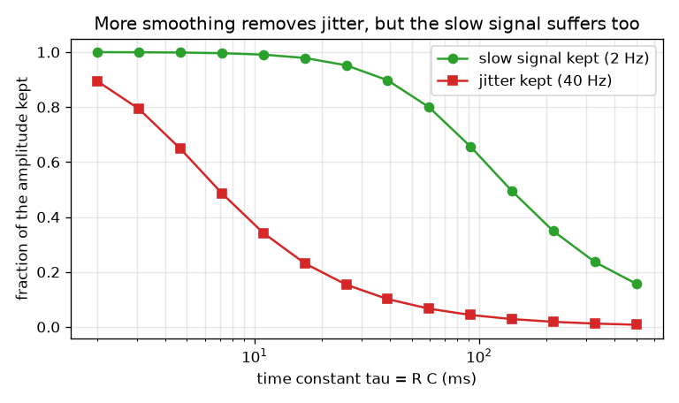
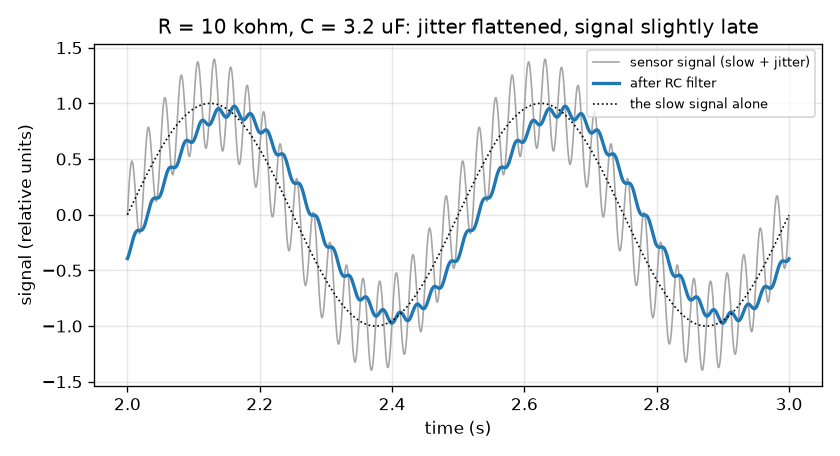

# सत्र 1: एक प्रतिरोधक और एक संधारित्र शोरयुक्त संकेत को चिकना करते हैं

*स्तर 1 (वैचारिक इंटरैक्टिव मॉडल) · लगभग 60 मिनट · openrcfilter*

> यह एक सरलीकृत शैक्षिक मॉडल है। यह कोई प्रमाणित डिज़ाइन उपकरण नहीं है और इसका उपयोग वास्तविक संरचनाओं, बिजली की स्थापनाओं, वाहनों, औद्योगिक प्रक्रियाओं या चिकित्सा निर्णयों के लिए नहीं किया जाना चाहिए।

**पूर्वापेक्षाएँ (Prerequisites)**

- ज्या तरंगें (sine waves) और आवृत्ति (frequency) (प्रति सेकंड चक्र): तेज़ लहरों की आवृत्ति अधिक होती है।
- आपने PRIMER.md पढ़ लिया है और `python start.py 1` एक बार चला लिया है।

**सीखने के उद्देश्य।** इस सत्र के बाद आप:

- किसी संवेदक (sensor) संकेत का वर्णन एक धीमे भाग के रूप में कर सकेंगे जो आप चाहते हैं, और एक तेज़ भाग के रूप में जो आप नहीं चाहते।
- समझा सकेंगे कि एक प्रतिरोधक (resistor) और एक संधारित्र (capacitor) मिलकर निम्न-पारक फ़िल्टर (low-pass filter) कैसे बनाते हैं, और समय स्थिरांक (time constant) tau = R C का क्या अर्थ है।
- माप सकेंगे कि फ़िल्टर के बाद धीमे संकेत और कंपन (jitter) का कितना भाग बचता है, और आउटपुट कितनी देर से पहुँचता है।
- समय स्थिरांक के सापेक्ष बचे अंश का ग्राफ़ पढ़ सकेंगे और समझौता (trade-off) देख सकेंगे।

## A. वास्तविक दुनिया की समस्या
एक तापमान संवेदक एक शोरभरे कमरे के पार एक नियंत्रक (controller) से तार द्वारा जुड़ा है। जिस पाठ्यांक की आपको परवाह है वह धीरे-धीरे बदलता है, अधिक से अधिक प्रति सेकंड कुछ बार, पर तार मोटरों और मेन्स केबलों से तेज़ कंपन भी पकड़ लेता है। दो सस्ते पुर्ज़े, एक प्रतिरोधक और एक संधारित्र, कंपन को कैसे सपाट कर सकते हैं और धीमे संकेत को अछूता छोड़ सकते हैं? और क्या परिणाम मुफ़्त है, या इसकी कोई क़ीमत है? (केवल सामान्य शिक्षा: यह एक सरलीकृत मॉडल है, वास्तविक उपकरणों के लिए डिज़ाइन उपकरण नहीं।)

## B. अवधारणा और सिद्धांत
संधारित्र आवेश (charge) संचित करता है, एक छोटी बाल्टी की तरह जो भरती और ख़ाली होती है। श्रेणी में लगा प्रतिरोधक सीमित करता है कि बाल्टी में धारा कितनी तेज़ी से बह सकती है। जब इनपुट वोल्टेज बदलता है, तो संधारित्र का वोल्टेज उसका अनुसरण करता है पर केवल धीरे-धीरे: हर छोटे समय-चरण में वह बचे हुए अंतर का एक निश्चित अंश इनपुट की ओर बढ़ता है। उस अनुसरण का समय-पैमाना समय स्थिरांक tau = R C है (ओम गुणा फ़ैराड से सेकंड मिलता है)। एक धीमा इनपुट एक tau के दौरान बहुत कम बदलता है, इसलिए आउटपुट उसका अनुसरण करता है। एक तेज़ लहर संधारित्र के ज़्यादा आगे बढ़ने से पहले ही उलट जाती है, इसलिए वह अधिकतर अनदेखी हो जाती है। यही निम्न-पारक फ़िल्टर है: धीमा पार होता है, तेज़ नहीं। वह आवृत्ति जहाँ फ़िल्टर तरंगों को अनदेखा करना शुरू करता है, कटऑफ़ (cutoff) f_c = 1 / (2 pi R C) है। आवृत्ति f वाली तरंग का जो अंश पार होता है, वह सत्र 2 के पूर्वावलोकन के रूप में, 1 / sqrt(1 + (f / f_c)^2) है। क़ीमत है विलंब (delay): क्योंकि संधारित्र इनपुट से पीछे रहता है, चिकनी की गई धीमी तरंग देर से पहुँचती है, f_c से बहुत धीमी तरंगों के लिए लगभग tau जितनी।

| प्रतीक | अर्थ | इकाई |
|---|---|---|
| R | श्रेणी प्रतिरोधक का प्रतिरोध | ओम (kohm = 1000 ohm) |
| C | संधारित्र की धारिता | फ़ैराड (uF = 0.000001 F) |
| tau | समय स्थिरांक R C | सेकंड |
| f_c | कटऑफ़ आवृत्ति | हर्ट्ज़ (Hz) |
| f | संकेत में किसी तरंग की आवृत्ति | हर्ट्ज़ (Hz) |
| gain | एक तरंग के लिए आउटपुट का आकार भाग इनपुट का आकार | कोई इकाई नहीं |

**मान्यताएँ (Assumptions)**

- संकेत आयाम 1 वाली 2 Hz धीमी तरंग और आयाम 0.4 वाली 40 Hz कंपन तरंग का योग है (सापेक्ष इकाइयाँ)।
- फ़िल्टर के आउटपुट से कुछ भी जुड़ा नहीं है (कोई लोड नहीं), और पुर्ज़े आदर्श हैं।
- हम स्थायी अवस्था (steady state) देखते हैं, जब शुरुआती डगमगाहट समाप्त हो चुकी हो।

$$ \tau = R\,C $$

$$ f_c = \frac{1}{2\pi R C} $$

$$ \text{gain}(f)=\frac{1}{\sqrt{1+(f/f_c)^2}}\qquad\text{(preview; derived in Session 2)} $$

$$ \text{delay of a slow wave}\approx \tau\quad (f\ll f_c) $$

## C. दृश्य व्याख्या
पहला चित्र धूसर रंग में कच्चा संकेत (ऊपर तेज़ कंपन वाली एक धीमी तरंग) और R = 10 kohm तथा C = 3.2 uF के लिए नीले रंग में फ़िल्टर किया गया आउटपुट दिखाता है: कंपन लगभग ग़ायब है, धीमी तरंग अपने आकार का 93 प्रतिशत रखती है, और लगभग 30 ms दाईं ओर खिसक गई है। दूसरा चित्र समय स्थिरांक को बदलता है: लाल वक्र (बचा कंपन) हरे वक्र (बचा धीमा संकेत) से बहुत पहले गिरता है, पर दोनों गिरते हैं, इसलिए कोई पूर्ण सेटिंग नहीं बल्कि एक उत्तम बिंदु (sweet spot) है।

*समय स्थिरांक के सापेक्ष धीमे संकेत और कंपन का बचा हुआ अंश।*

*R = 10 kohm, C = 3.2 uF वाले RC फ़िल्टर से पहले (धूसर) और बाद में (नीला) 40 Hz कंपन वाला एक धीमा 2 Hz संकेत।*

## D. इंटरैक्टिव सिमुलेशन
पाठ चलाइए (`python start.py 1`), फिर लाइव ऐप खोलिए: [सत्र 1: एक प्रतिरोधक और एक संधारित्र संकेत को चिकना करते हैं](https://krunalpanchal1995.github.io/pan-iit-oss/openrcfilter/session-01/) (या इसी फ़ोल्डर में `app.html`)। संकेत दृश्य में R और C स्लाइडर खिसकाइए और कंपन को सपाट होते तथा नीले वक्र को हरे से पीछे रहते देखिए; फिर परिपथ दृश्य खोलिए और दोनों बार देखिए।

**चुनौती।** धीमे 2 Hz संकेत का कम से कम 85 प्रतिशत रखिए जबकि 40 Hz कंपन का 20 प्रतिशत से कम पार होने दीजिए।

## E. हल किया गया उदाहरण और प्रयोग
**समस्या।** एक फ़िल्टर में R = 10 kohm और C = 3.2 uF है। tau और f_c ज्ञात कीजिए, 2 Hz संकेत और 40 Hz कंपन का कितना भाग पार होता है, और धीमी तरंग कितनी देर से आती है।

1. tau = R C = 10 000 ohm * 0.0000032 F = 0.032 s = 32 ms।
2. f_c = 1 / (2 pi * 0.032) = 4.97 Hz।
3. धीमी तरंग (2 Hz): f / f_c = 0.402, gain = 1 / sqrt(1 + 0.162) = 0.928, इसलिए 92.8 प्रतिशत बचता है।
4. कंपन (40 Hz): f / f_c = 8.04, gain = 1 / sqrt(1 + 64.7) = 0.123, इसलिए 12.3 प्रतिशत बचता है।
5. धीमी तरंग का विलंब = atan(2 / 4.97) / (2 pi * 2) = 0.3826 rad / 12.57 = 0.0304 s, लगभग 30 ms (tau = 32 ms से थोड़ा कम, जैसी अपेक्षा थी)।
6. lesson.py में सिमुलेशन 0.928, 0.123 और 30.3 ms मापता है: संख्याएँ मेल खाती हैं।

**उत्तर।** tau = 32 ms, f_c = 4.97 Hz; धीमी तरंग 92.8 प्रतिशत बचाती है, कंपन 12.3 प्रतिशत बचता है, और धीमी तरंग लगभग 30 ms देर से आती है।

**प्रयोग।** फ़िल्टर को ब्रेडबोर्ड पर बनाइए (10 kohm प्रतिरोधक, 3.3 uF संधारित्र), इसे सिग्नल जनरेटर या फ़ोन के टोन ऐप से साउंड-कार्ड इनपुट के ज़रिए चलाइए, और पहले और बाद में 2 Hz और 40 Hz तरंगों के आकारों की तुलना कीजिए। लगभग 10 प्रतिशत तक मेल की अपेक्षा कीजिए: वास्तविक प्रतिरोधकों और संधारित्रों की सहनशीलता (tolerance) 5 से 20 प्रतिशत होती है, संकेत स्रोत का अपना आउटपुट प्रतिरोध होता है, और मापक इनपुट फ़िल्टर पर लोड डालता है। मॉडल आदर्श पुर्ज़े और शून्य लोड मानता है।

## F. मूल्यांकन और डिज़ाइन चुनौती
**प्रश्न प्रकार A: वैचारिक।** RC फ़िल्टर तेज़ कंपन को धीमी तरंग से अधिक सपाट क्यों करता है? और वह धीमे संकेत को देर से पहुँचाए बिना कंपन को कभी क्यों नहीं हटा सकता?

संकेत

संधारित्र को एक बाल्टी के रूप में सोचिए जो एक पतली नली से भरती है, और पूछिए कि जब बाल्टी भरने से पहले ही इनपुट उलट जाए तो क्या होता है।

चरण-दर-चरण हल

संधारित्र हर समय-चरण में इनपुट की ओर रास्ते का केवल एक अंश बढ़ता है। एक धीमी तरंग एक ओर इतनी देर रहती है कि आउटपुट उसका अनुसरण कर सके; एक तेज़ तरंग आउटपुट के ज़्यादा बढ़ने से पहले ही उलट जाती है, इसलिए आउटपुट मुश्किल से हिलता है। वही सुस्ती जो तेज़ लहर को अनदेखा करती है, आउटपुट को धीमे बदलाव का अनुसरण देर से, लगभग tau जितना, करने पर भी मजबूर करती है। इसलिए जो फ़िल्टर तेज़ लहरों को अनदेखा करता है उसे अनुसरण में धीमा होना ही होगा, इसलिए चिकनाई और विलंब हमेशा साथ आते हैं।

**प्रश्न प्रकार B: संख्यात्मक।** R = 20 kohm और C = 1 uF। tau, f_c, 2 Hz संकेत और 40 Hz कंपन का बचा अंश, और धीमी तरंग का विलंब ज्ञात कीजिए।

संकेत

tau = R C; f_c = 1 / (2 pi tau); gain = 1 / sqrt(1 + (f / f_c)^2); delay = atan(f / f_c) / (2 pi f)।

चरण-दर-चरण हल

tau = 20 000 * 0.000001 = 0.020 s = 20 ms। f_c = 1 / (2 pi * 0.020) = 7.96 Hz। धीमा: f / f_c = 0.251, gain = 1 / sqrt(1.0631) = 0.970 (97.0 प्रतिशत)। कंपन: f / f_c = 5.03, gain = 1 / sqrt(26.3) = 0.195 (19.5 प्रतिशत)। विलंब = atan(0.251) / (2 pi * 2) = 0.2462 / 12.566 = 0.0196 s, लगभग 19.6 ms। समझदारी जाँच: 20 ms, tau के क़रीब है, जैसी धीमी तरंग के लिए अपेक्षा है।

**प्रश्न प्रकार C: ग्राफ़ और सिमुलेशन की व्याख्या।** समय स्थिरांक के सापेक्ष बचे अंश वाला चित्र देखिए। क्या कोई एक समय स्थिरांक धीमे संकेत का कम से कम 90 प्रतिशत बचा सकता है और साथ ही कंपन का 10 प्रतिशत से कम पार होने दे सकता है?

संकेत

gain सूत्र का उपयोग करके हर इच्छा के लिए आवश्यक f_c ज्ञात कीजिए, फिर देखिए कि क्या दोनों सीमाएँ एक-दूसरे पर चढ़ती हैं।

चरण-दर-चरण हल

2 Hz तरंग का कम से कम 90 प्रतिशत बचाने के लिए 1 / sqrt(1 + (2 / f_c)^2) >= 0.9 चाहिए, इसलिए f_c >= 4.13 Hz। 40 Hz कंपन का 10 प्रतिशत से कम पार करने के लिए f_c <= 4.02 Hz चाहिए। दोनों सीमाएँ बस चूक जाती हैं (4.13, 4.02 से ऊपर है), इसलिए कोई भी समय स्थिरांक दोनों इच्छाएँ पूरी नहीं करता। चित्र में दोनों वक्र वास्तव में 90 प्रतिशत और 10 प्रतिशत रेखाओं को थोड़ी अलग जगहों पर काटते हैं। जब वांछित और अवांछित आवृत्तियाँ केवल 20 के गुणक से अलग हों, तो एक अकेला RC खंड पर्याप्त तीखा नहीं है; सत्र 2 और 3 दिखाते हैं कि क्या करें।

**प्रश्न प्रकार D: डिज़ाइन और अनुकूलन (optimisation) चुनौती।** डिज़ाइन: C = 1 uF के साथ एक मानक (stock) प्रतिरोधक ऐसा चुनिए कि धीमे संकेत का कम से कम 90 प्रतिशत बचे और कंपन का 20 प्रतिशत से कम पार हो। आउटपुट कितनी देर से आता है?

संकेत

दोनों इच्छाओं से f_c की अनुमत सीमा ज्ञात कीजिए, उसे R = 1 / (2 pi f_c C) से R की सीमा में बदलिए, और एक सामान्य मान चुनिए।

चरण-दर-चरण हल

धीमा संकेत >= 90 प्रतिशत के लिए f_c >= 4.13 Hz चाहिए; कंपन < 20 प्रतिशत के लिए 40 / f_c > 4.90 चाहिए, इसलिए f_c < 8.16 Hz। C = 1 uF के साथ R = 1 / (2 pi f_c C) 19.5 kohm (8.16 Hz पर) से 38.5 kohm (4.13 Hz पर) तक जाता है। उस सीमा के भीतर एक मानक मान 27 kohm है: tau = 27 ms, f_c = 5.89 Hz, धीमा बचा 94.7 प्रतिशत, कंपन बचा 14.6 प्रतिशत, विलंब 26 ms। समझौता: बड़ा R अधिक कंपन हटाता है पर धीमे संकेत का अधिक भाग खोता है और देर से पहुँचता है।

[RUBRIC.md](../../RUBRIC.md) से स्वयं को अंक दीजिए। काग़ज़ पर काम करने के लिए [गतिविधि पत्रक](activity_sheet.md) प्रिंट कीजिए।

## सामान्य भ्रांतियाँ
| सामान्य भ्रांति | वास्तव में क्या सच है |
|---|---|
| फ़िल्टर कंपन को पूरी तरह हटा देता है। | यह कंपन को केवल कम करता है। लहर जितनी तेज़, उतनी अधिक घटती है, पर कुछ हमेशा बचता है। |
| फ़िल्टर संकेत को पढ़कर तय करता है कि शोर क्या है। | उसे पता नहीं कि शोर क्या है। वह सभी तरंगों से एक जैसा व्यवहार करता है: हर एक को उसकी आवृत्ति के अनुसार घटाता है। |
| बड़ा संधारित्र या प्रतिरोधक हमेशा बेहतर है। | बड़े R या C का अर्थ है बड़ा tau: अधिक चिकनाई पर अधिक विलंब और धीमे संकेत की अधिक हानि भी। |
| चिकनाई मुफ़्त है। | हर निम्न-पारक फ़िल्टर संकेत को विलंबित करता है। चिकनाई और विलंब साथ आते हैं। |

## शब्दावली
- **प्रतिरोधक (resistor)**: धारा को सीमित करने वाला पुर्ज़ा; उसका प्रतिरोध R ओम में मापा जाता है
- **संधारित्र (capacitor)**: आवेश संचित करने वाला पुर्ज़ा; उसकी धारिता C फ़ैराड में मापी जाती है
- **समय स्थिरांक (time constant)**: tau = R C, वह समय-पैमाना जिस पर फ़िल्टर अपने इनपुट का अनुसरण करता है
- **निम्न-पारक फ़िल्टर (low-pass filter)**: ऐसा फ़िल्टर जो धीमे बदलावों को पार होने देता है और तेज़ बदलावों को घटाता है
- **कटऑफ़ आवृत्ति (cutoff frequency)**: वह आवृत्ति f_c जहाँ फ़िल्टर तरंगों को घटाना शुरू करता है
- **कंपन (jitter)**: किसी संकेत पर तेज़ अवांछित लहरें

## समापन
1. [exercises.md](exercises.md) में दिए तीन कोडिंग कार्य कीजिए।
2. अपने बदलावों के बाद `python start.py 1` फिर से चलाइए। यह चेकपॉइंट (checkpoint) पर समाप्त होता है; जब यह `PASS` छापे, तो आपका काम पूरा है। (केवल चेकपॉइंट: `python start.py check 1`।)

अगला: [सत्र 2](../session-02/README.md)
