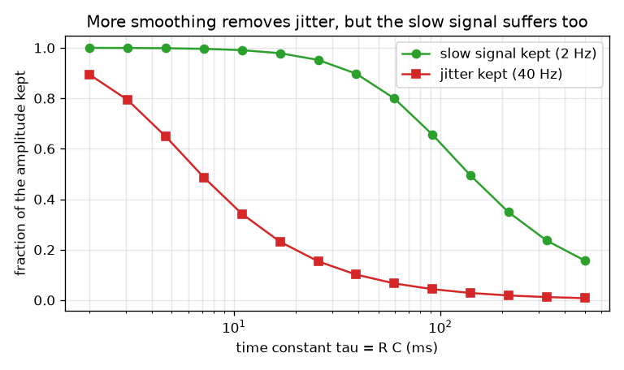
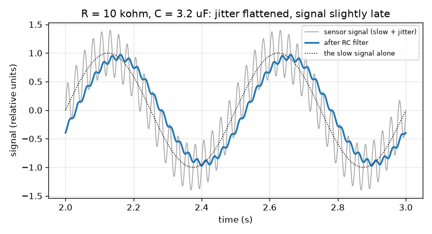

# സെഷൻ 1: ഒരു റെസിസ്റ്ററും ഒരു കപ്പാസിറ്ററും ശബ്ദമുള്ള സിഗ്നലിനെ മിനുസപ്പെടുത്തുന്നു

[Session 1 — हिन्दी](README.hi.md)

*ലെവൽ 1 (ആശയപരമായ ഇന്ററാക്ടീവ് മോഡൽ) · ഏകദേശം 60 മിനിറ്റ് · openrcfilter*

> ഇത് ലളിതമാക്കിയ ഒരു വിദ്യാഭ്യാസ മോഡൽ ആണ്. ഇത് സാധൂകരിച്ച (validated) ഡിസൈൻ ഉപകരണമല്ല; യഥാർത്ഥ നിർമിതികൾ, വൈദ്യുത ഇൻസ്റ്റലേഷനുകൾ, വാഹനങ്ങൾ, വ്യാവസായിക പ്രക്രിയകൾ അല്ലെങ്കിൽ വൈദ്യശാസ്ത്ര തീരുമാനങ്ങൾ എന്നിവയ്ക്ക് ഇത് ഉപയോഗിക്കരുത്.

**മുൻകൂട്ടി അറിയേണ്ടവ (Prerequisites)**

- സൈൻ തരംഗങ്ങളും ആവൃത്തിയും (frequency; സെക്കൻഡിലെ ചക്രങ്ങൾ): വേഗത്തിലുള്ള ആട്ടങ്ങൾക്ക് ഉയർന്ന ആവൃത്തിയാണ്.
- നിങ്ങൾ PRIMER.md വായിച്ചിട്ടുണ്ട്, `python start.py 1` ഒരിക്കൽ റൺ ചെയ്തിട്ടുണ്ട്.

**പഠന ലക്ഷ്യങ്ങൾ (Learning objectives).** ഈ സെഷനു ശേഷം നിങ്ങൾക്ക്:

- ഒരു സെൻസർ സിഗ്നലിനെ നിങ്ങൾക്ക് വേണ്ട സാവധാനത്തിലുള്ള ഭാഗവും വേണ്ടാത്ത വേഗത്തിലുള്ള ഭാഗവും ചേർന്നതായി വിവരിക്കാം.
- ഒരു റെസിസ്റ്ററും കപ്പാസിറ്ററും എങ്ങനെ ലോ-പാസ് ഫിൽട്ടർ (low-pass filter) ആകുന്നു എന്നും ടൈം കോൺസ്റ്റന്റ് (time constant) tau = R C എന്നതിന്റെ അർത്ഥവും വിശദീകരിക്കാം.
- ഒരു ഫിൽട്ടറിലൂടെ സാവധാന സിഗ്നലിന്റെയും ജിറ്ററിന്റെയും (jitter) എത്ര ഭാഗം അതിജീവിക്കുന്നുവെന്നും ഔട്ട്പുട്ട് എത്ര വൈകി എത്തുന്നുവെന്നും അളക്കാം.
- നിലനിർത്തിയ അംശവും ടൈം കോൺസ്റ്റന്റും തമ്മിലുള്ള ഗ്രാഫ് വായിച്ച് വിട്ടുവീഴ്ച (trade-off) മനസ്സിലാക്കാം.

## A. യഥാർത്ഥ ലോക പ്രശ്നം
ഒരു താപനില സെൻസർ ശബ്ദമുള്ള ഒരു മുറിയിലൂടെ കൺട്രോളറുമായി ബന്ധിപ്പിച്ചിരിക്കുന്നു. നിങ്ങൾക്ക് വേണ്ട റീഡിംഗ് സാവധാനം മാറുന്നു, പരമാവധി സെക്കൻഡിൽ രണ്ട് തവണ, പക്ഷേ വയർ മോട്ടോറുകളിൽ നിന്നും മെയിൻസ് കേബിളുകളിൽ നിന്നും വേഗത്തിലുള്ള ജിറ്ററും പിടിച്ചെടുക്കുന്നു. ഒരു റെസിസ്റ്ററും ഒരു കപ്പാസിറ്ററും എന്ന രണ്ട് വിലകുറഞ്ഞ ഭാഗങ്ങൾക്ക് എങ്ങനെ ജിറ്ററിനെ പരത്തി സാവധാന സിഗ്നലിനെ തൊടാതെ വിടാൻ കഴിയും? ഫലം സൗജന്യമാണോ, അതോ നമുക്ക് എന്തെങ്കിലും വില നൽകേണ്ടി വരുമോ? (പൊതു വിദ്യാഭ്യാസം മാത്രം: ഇത് ലളിതമാക്കിയ മോഡൽ ആണ്, യഥാർത്ഥ ഉപകരണങ്ങൾക്കുള്ള ഡിസൈൻ ഉപകരണമല്ല.)

## B. ആശയവും സിദ്ധാന്തവും
ഒരു കപ്പാസിറ്റർ ചാർജ് സംഭരിക്കുന്നു, നിറയുകയും ഒഴിയുകയും ചെയ്യുന്ന ഒരു ചെറിയ ബക്കറ്റ് പോലെ. ശ്രേണിയിലുള്ള (series) ഒരു റെസിസ്റ്റർ ബക്കറ്റിലേക്ക് കറന്റ് എത്ര വേഗത്തിൽ ഒഴുകാമെന്ന് പരിമിതപ്പെടുത്തുന്നു. ഇൻപുട്ട് വോൾട്ടേജ് മാറുമ്പോൾ കപ്പാസിറ്റർ വോൾട്ടേജ് അതിനെ പിന്തുടരുന്നു, പക്ഷേ ക്രമേണ മാത്രം: ഓരോ ചെറിയ സമയ ഘട്ടത്തിലും ബാക്കിയുള്ള വിടവിന്റെ ഒരു നിശ്ചിത അംശം ഇൻപുട്ടിലേക്ക് നീങ്ങുന്നു. ആ പിന്തുടരലിന്റെ സമയ സ്കെയിലാണ് ടൈം കോൺസ്റ്റന്റ് tau = R C (ഓം ഗുണം ഫാരഡ് സെക്കൻഡ് തരുന്നു). സാവധാനത്തിലുള്ള ഇൻപുട്ട് ഒരു tau-വിൽ കുറച്ച് മാത്രം മാറുന്നു, അതിനാൽ ഔട്ട്പുട്ട് അതിനെ പിന്തുടരുന്നു. വേഗത്തിലുള്ള ആട്ടം കപ്പാസിറ്റർ അധികം നീങ്ങുന്നതിന് മുമ്പ് തിരിയുന്നു, അതിനാൽ അത് മിക്കവാറും അവഗണിക്കപ്പെടുന്നു. അതാണ് ലോ-പാസ് ഫിൽട്ടർ: സാവധാനമുള്ളത് കടന്നുപോകുന്നു, വേഗത്തിലുള്ളത് കടന്നുപോകുന്നില്ല. ഫിൽട്ടർ തരംഗങ്ങളെ അവഗണിക്കാൻ തുടങ്ങുന്ന ആവൃത്തിയാണ് കട്ട്ഓഫ് (cutoff) f_c = 1 / (2 pi R C). ആവൃത്തി f ഉള്ള ഒരു തരംഗത്തിന്റെ കടന്നുപോകുന്ന അംശം, സെഷൻ 2-ന്റെ ഒരു പ്രിവ്യൂ എന്ന നിലയിൽ, 1 / sqrt(1 + (f / f_c)^2) ആണ്. വിലയാണ് വൈകൽ (delay): കപ്പാസിറ്റർ ഇൻപുട്ടിനേക്കാൾ പിന്നിലാകുന്നതിനാൽ, മിനുസപ്പെടുത്തിയ സാവധാന തരംഗം വൈകി എത്തുന്നു, f_c-യേക്കാൾ വളരെ സാവധാനമുള്ള തരംഗങ്ങൾക്ക് ഏകദേശം tau.

| ചിഹ്നം | അർത്ഥം | യൂണിറ്റ് |
|---|---|---|
| R | ശ്രേണിയിലുള്ള റെസിസ്റ്ററിന്റെ പ്രതിരോധം | ഓം (kohm = 1000 ഓം) |
| C | കപ്പാസിറ്ററിന്റെ കപ്പാസിറ്റൻസ് | ഫാരഡ് (uF = 0.000001 F) |
| tau | ടൈം കോൺസ്റ്റന്റ് R C | സെക്കൻഡ് |
| f_c | കട്ട്ഓഫ് ആവൃത്തി | ഹെർട്സ് (Hz) |
| f | സിഗ്നലിലെ ഒരു തരംഗത്തിന്റെ ആവൃത്തി | ഹെർട്സ് (Hz) |
| gain | ഒരു തരംഗത്തിന്റെ ഔട്ട്പുട്ട് വലിപ്പത്തെ ഇൻപുട്ട് വലിപ്പം കൊണ്ട് ഹരിച്ചത് | യൂണിറ്റില്ല |

**അനുമാനങ്ങൾ (Assumptions)**

- സിഗ്നൽ ആംപ്ലിറ്റ്യൂഡ് 1 ഉള്ള 2 Hz സാവധാന തരംഗവും ആംപ്ലിറ്റ്യൂഡ് 0.4 ഉള്ള 40 Hz ജിറ്റർ തരംഗവും ചേർന്നതാണ് (ആപേക്ഷിക യൂണിറ്റുകൾ).
- ഫിൽട്ടർ ഔട്ട്പുട്ടിൽ ഒന്നും ബന്ധിപ്പിച്ചിട്ടില്ല (ലോഡ് ഇല്ല), ഭാഗങ്ങൾ ആദർശപരമാണ് (ideal).
- തുടക്കത്തിലെ ആട്ടം ശമിച്ചതിന് ശേഷമുള്ള സ്ഥിരാവസ്ഥയാണ് (steady state) നാം നോക്കുന്നത്.

$$ \tau = R\,C $$

$$ f_c = \frac{1}{2\pi R C} $$

$$ \text{gain}(f)=\frac{1}{\sqrt{1+(f/f_c)^2}}\qquad\text{(preview; derived in Session 2)} $$

$$ \text{delay of a slow wave}\approx \tau\quad (f\ll f_c) $$

## C. ദൃശ്യ വിശദീകരണം
ആദ്യ ചിത്രം ചാരനിറത്തിൽ അസംസ്കൃത സിഗ്നലും (മുകളിൽ വേഗത്തിലുള്ള ജിറ്ററുള്ള സാവധാന തരംഗം) R = 10 kohm, C = 3.2 uF എന്നിവയ്ക്ക് നീല നിറത്തിൽ ഫിൽട്ടർ ചെയ്ത ഔട്ട്പുട്ടും കാണിക്കുന്നു: ജിറ്റർ ഏതാണ്ട് ഇല്ലാതായി, സാവധാന തരംഗം അതിന്റെ വലിപ്പത്തിന്റെ 93 ശതമാനം നിലനിർത്തുന്നു, അത് ഏകദേശം 30 ms വലത്തേക്ക് മാറിയിരിക്കുന്നു. രണ്ടാമത്തെ ചിത്രം ടൈം കോൺസ്റ്റന്റ് മാറ്റി നോക്കുന്നു: ചുവന്ന വക്രം (നിലനിർത്തിയ ജിറ്റർ) പച്ച വക്രത്തിന് (നിലനിർത്തിയ സാവധാന സിഗ്നൽ) വളരെ മുമ്പ് താഴുന്നു, പക്ഷേ രണ്ടും താഴുന്നു, അതിനാൽ തികഞ്ഞ ക്രമീകരണമല്ല, ഒരു ഉചിത ബിന്ദുവാണ് (sweet spot) ഉള്ളത്.

*ടൈം കോൺസ്റ്റന്റിനെതിരെ അതിജീവിക്കുന്ന സാവധാന സിഗ്നലിന്റെയും ജിറ്ററിന്റെയും അംശം.*

*40 Hz ജിറ്ററുള്ള സാവധാന 2 Hz സിഗ്നൽ R = 10 kohm, C = 3.2 uF ഉള്ള RC ഫിൽട്ടറിന് മുമ്പ് (ചാരനിറം) ഉം ശേഷം (നീല) ഉം.*

## D. ഇന്ററാക്ടീവ് സിമുലേഷൻ
പാഠം റൺ ചെയ്യുക (`python start.py 1`), തുടർന്ന് ലൈവ് ആപ്പ് തുറക്കുക: [സെഷൻ 1: ഒരു റെസിസ്റ്ററും ഒരു കപ്പാസിറ്ററും സിഗ്നലിനെ മിനുസപ്പെടുത്തുന്നു](https://krunalpanchal1995.github.io/pan-iit-oss/openrcfilter/session-01/) (അല്ലെങ്കിൽ ഈ ഫോൾഡറിലെ `app.html`). സിഗ്നൽ കാഴ്ചയിൽ R, C സ്ലൈഡറുകൾ നീക്കി ജിറ്റർ പരക്കുന്നതും നീല വക്രം പച്ച വക്രത്തിന് പിന്നിലാകുന്നതും നിരീക്ഷിക്കുക; തുടർന്ന് സർക്യൂട്ട് കാഴ്ച തുറന്ന് രണ്ട് ബാറുകൾ നോക്കുക.

**വെല്ലുവിളി.** 40 Hz ജിറ്ററിന്റെ 20 ശതമാനത്തിൽ താഴെ മാത്രം കടത്തിവിടുമ്പോൾ സാവധാന 2 Hz സിഗ്നലിന്റെ കുറഞ്ഞത് 85 ശതമാനം നിലനിർത്തുക.

## E. ഉദാഹരണവും പരീക്ഷണവും
**പ്രശ്നം.** ഒരു ഫിൽട്ടറിന് R = 10 kohm, C = 3.2 uF ആണ്. tau, f_c എന്നിവയും 2 Hz സിഗ്നലിന്റെയും 40 Hz ജിറ്ററിന്റെയും എത്ര ഭാഗം കടന്നുപോകുന്നു എന്നും സാവധാന തരംഗം എത്ര വൈകുന്നു എന്നും കണ്ടെത്തുക.

1. tau = R C = 10 000 ഓം * 0.0000032 F = 0.032 s = 32 ms.
2. f_c = 1 / (2 pi * 0.032) = 4.97 Hz.
3. സാവധാന തരംഗം (2 Hz): f / f_c = 0.402, gain = 1 / sqrt(1 + 0.162) = 0.928, അതിനാൽ 92.8 ശതമാനം നിലനിൽക്കുന്നു.
4. ജിറ്റർ (40 Hz): f / f_c = 8.04, gain = 1 / sqrt(1 + 64.7) = 0.123, അതിനാൽ 12.3 ശതമാനം നിലനിൽക്കുന്നു.
5. സാവധാന തരംഗത്തിന്റെ വൈകൽ = atan(2 / 4.97) / (2 pi * 2) = 0.3826 rad / 12.57 = 0.0304 s, ഏകദേശം 30 ms (പ്രതീക്ഷിച്ചതുപോലെ tau = 32 ms-നേക്കാൾ അല്പം കുറവ്).
6. lesson.py-ലെ സിമുലേഷൻ 0.928, 0.123, 30.3 ms എന്നിവ അളക്കുന്നു: സംഖ്യകൾ യോജിക്കുന്നു.

**ഉത്തരം.** tau = 32 ms, f_c = 4.97 Hz; സാവധാന തരംഗം 92.8 ശതമാനം, ജിറ്റർ 12.3 ശതമാനം നിലനിർത്തുന്നു, സാവധാന തരംഗം ഏകദേശം 30 ms വൈകുന്നു.

**പരീക്ഷണം.** ബ്രെഡ്ബോർഡിൽ ഫിൽട്ടർ നിർമ്മിക്കുക (10 kohm റെസിസ്റ്റർ, 3.3 uF കപ്പാസിറ്റർ), സിഗ്നൽ ജനറേറ്ററിൽ നിന്നോ സൗണ്ട്-കാർഡ് ഇൻപുട്ട് വഴി ഫോൺ ടോൺ ആപ്പിൽ നിന്നോ ഓടിക്കുക, 2 Hz, 40 Hz തരംഗങ്ങളുടെ വലിപ്പം മുമ്പും ശേഷവും താരതമ്യം ചെയ്യുക. ഏകദേശം 10 ശതമാനത്തിനുള്ളിൽ യോജിപ്പ് പ്രതീക്ഷിക്കുക: യഥാർത്ഥ റെസിസ്റ്ററുകൾക്കും കപ്പാസിറ്ററുകൾക്കും 5 മുതൽ 20 ശതമാനം വരെ ടോളറൻസ് ഉണ്ട്, സിഗ്നൽ സ്രോതസ്സിന് സ്വന്തം ഔട്ട്പുട്ട് പ്രതിരോധമുണ്ട്, അളക്കുന്ന ഇൻപുട്ട് ഫിൽട്ടറിനെ ലോഡ് ചെയ്യുന്നു. മോഡൽ ആദർശ ഭാഗങ്ങളും ലോഡ് ഇല്ലായ്മയും അനുമാനിക്കുന്നു.

## F. വിലയിരുത്തലും ഡിസൈൻ വെല്ലുവിളിയും
**ചോദ്യ തരം A: ആശയപരം.** ഒരു RC ഫിൽട്ടർ സാവധാന തരംഗത്തേക്കാൾ വേഗത്തിലുള്ള ജിറ്ററിനെ കൂടുതൽ പരത്തുന്നത് എന്തുകൊണ്ട്? സാവധാന സിഗ്നൽ വൈകാതെ ജിറ്ററിനെ പൂർണ്ണമായി നീക്കം ചെയ്യാൻ ഒരിക്കലും കഴിയാത്തത് എന്തുകൊണ്ട്?

സൂചന

കപ്പാസിറ്ററിനെ ഇടുങ്ങിയ പൈപ്പിലൂടെ നിറയുന്ന ഒരു ബക്കറ്റായി കരുതുക, ബക്കറ്റ് നിറയുന്നതിന് മുമ്പ് ഇൻപുട്ട് തിരിഞ്ഞാൽ എന്ത് സംഭവിക്കുമെന്ന് ചോദിക്കുക.

ഘട്ടം ഘട്ടമായുള്ള പരിഹാരം

കപ്പാസിറ്റർ ഓരോ സമയ ഘട്ടത്തിലും ഇൻപുട്ടിലേക്കുള്ള ദൂരത്തിന്റെ ഒരു അംശം മാത്രമേ നീങ്ങൂ. സാവധാന തരംഗം ഒരു വശത്ത് ദീർഘനേരം നിൽക്കുന്നതിനാൽ ഔട്ട്പുട്ടിന് അതിനെ പിന്തുടരാൻ കഴിയുന്നു; വേഗത്തിലുള്ള തരംഗം ഔട്ട്പുട്ട് അധികം നീങ്ങുന്നതിന് മുമ്പ് തിരിയുന്നു, അതിനാൽ ഔട്ട്പുട്ട് കഷ്ടിച്ച് മാത്രം ആടുന്നു. വേഗത്തിലുള്ള ആട്ടത്തെ അവഗണിക്കുന്ന അതേ മന്ദത തന്നെ സാവധാന മാറ്റത്തെ ഏകദേശം tau വൈകി പിന്തുടരാനും ഔട്ട്പുട്ടിനെ പ്രേരിപ്പിക്കുന്നു. വേഗത്തിലുള്ള ആട്ടങ്ങളെ അവഗണിക്കുന്ന ഒരു ഫിൽട്ടർ അതിനാൽ പിന്തുടരാൻ കൂടുതൽ മന്ദമായിരിക്കണം, അതിനാൽ മിനുസപ്പെടുത്തലും വൈകലും എപ്പോഴും ഒന്നിച്ചു വരുന്നു.

**ചോദ്യ തരം B: സംഖ്യാപരം.** R = 20 kohm, C = 1 uF. tau, f_c, നിലനിർത്തുന്ന 2 Hz സിഗ്നലിന്റെയും 40 Hz ജിറ്ററിന്റെയും അംശം, സാവധാന തരംഗത്തിന്റെ വൈകൽ എന്നിവ കണ്ടെത്തുക.

സൂചന

tau = R C; f_c = 1 / (2 pi tau); gain = 1 / sqrt(1 + (f / f_c)^2); delay = atan(f / f_c) / (2 pi f).

ഘട്ടം ഘട്ടമായുള്ള പരിഹാരം

tau = 20 000 * 0.000001 = 0.020 s = 20 ms. f_c = 1 / (2 pi * 0.020) = 7.96 Hz. സാവധാനം: f / f_c = 0.251, gain = 1 / sqrt(1.0631) = 0.970 (97.0 ശതമാനം). ജിറ്റർ: f / f_c = 5.03, gain = 1 / sqrt(26.3) = 0.195 (19.5 ശതമാനം). വൈകൽ = atan(0.251) / (2 pi * 2) = 0.2462 / 12.566 = 0.0196 s, ഏകദേശം 19.6 ms. പരിശോധന: 20 ms tau-വിനോട് അടുത്താണ്, സാവധാന തരംഗത്തിന് പ്രതീക്ഷിച്ചതുപോലെ.

**ചോദ്യ തരം C: ഗ്രാഫും സിമുലേഷനും വ്യാഖ്യാനിക്കൽ.** നിലനിർത്തിയ അംശവും ടൈം കോൺസ്റ്റന്റും തമ്മിലുള്ള ചിത്രം നോക്കുക. ഏതെങ്കിലും ഒരു ടൈം കോൺസ്റ്റന്റിന് സാവധാന സിഗ്നലിന്റെ കുറഞ്ഞത് 90 ശതമാനം നിലനിർത്തുകയും അതേ സമയം ജിറ്ററിന്റെ 10 ശതമാനത്തിൽ കുറവ് കടത്തിവിടുകയും ചെയ്യാൻ കഴിയുമോ?

സൂചന

gain ഫോർമുല ഉപയോഗിച്ച് ഓരോ ആഗ്രഹത്തിനും ആവശ്യമായ f_c കണ്ടെത്തുക, എന്നിട്ട് രണ്ട് പരിധികളും ഓവർലാപ്പ് ചെയ്യുന്നുണ്ടോ എന്ന് നോക്കുക.

ഘട്ടം ഘട്ടമായുള്ള പരിഹാരം

2 Hz തരംഗത്തിന്റെ കുറഞ്ഞത് 90 ശതമാനം നിലനിർത്താൻ 1 / sqrt(1 + (2 / f_c)^2) >= 0.9 വേണം, അതിനാൽ f_c >= 4.13 Hz. 40 Hz ജിറ്ററിന്റെ 10 ശതമാനത്തിൽ കുറവ് കടത്തിവിടാൻ f_c <= 4.02 Hz വേണം. രണ്ട് പരിധികളും തമ്മിൽ ഏതാണ്ട് കണ്ടുമുട്ടുന്നില്ല (4.13 എന്നത് 4.02-നേക്കാൾ കൂടുതലാണ്), അതിനാൽ ഒരു ടൈം കോൺസ്റ്റന്റും രണ്ട് ആഗ്രഹങ്ങളും നിറവേറ്റുന്നില്ല. ചിത്രത്തിലെ രണ്ട് വക്രങ്ങളും 90 ശതമാനം, 10 ശതമാനം വരകളെ അല്പം വ്യത്യസ്ത സ്ഥലങ്ങളിൽ മുറിച്ചുകടക്കുന്നു. വേണ്ടതും വേണ്ടാത്തതുമായ ആവൃത്തികൾ 20 മടങ്ങ് മാത്രം അകലത്തിലാകുമ്പോൾ ഒരൊറ്റ RC ഘട്ടം മതിയായ കുത്തനെയുള്ളതല്ല; എന്ത് ചെയ്യണമെന്ന് സെഷൻ 2, 3 കാണിക്കുന്നു.

**ചോദ്യ തരം D: ഡിസൈനും ഒപ്റ്റിമൈസേഷനും വെല്ലുവിളി.** ഡിസൈൻ: C = 1 uF ഉപയോഗിച്ച്, സാവധാന സിഗ്നലിന്റെ കുറഞ്ഞത് 90 ശതമാനം നിലനിർത്തുകയും ജിറ്ററിന്റെ 20 ശതമാനത്തിൽ കുറവ് കടത്തിവിടുകയും ചെയ്യുന്ന ഒരു സ്റ്റോക്ക് റെസിസ്റ്റർ തിരഞ്ഞെടുക്കുക. ഔട്ട്പുട്ട് എത്ര വൈകുന്നു?

സൂചന

രണ്ട് ആഗ്രഹങ്ങളിൽ നിന്ന് f_c-യുടെ അനുവദനീയമായ പരിധി കണ്ടെത്തുക, R = 1 / (2 pi f_c C) ഉപയോഗിച്ച് അതിനെ R-ന്റെ പരിധിയാക്കി മാറ്റുക, ഒരു പൊതു മൂല്യം തിരഞ്ഞെടുക്കുക.

ഘട്ടം ഘട്ടമായുള്ള പരിഹാരം

സാവധാന സിഗ്നൽ >= 90 ശതമാനത്തിന് f_c >= 4.13 Hz വേണം; ജിറ്റർ < 20 ശതമാനത്തിന് 40 / f_c > 4.90, അതായത് f_c < 8.16 Hz. C = 1 uF ആകുമ്പോൾ R = 1 / (2 pi f_c C) 19.5 kohm (8.16 Hz-ൽ) മുതൽ 38.5 kohm (4.13 Hz-ൽ) വരെയാണ്. ആ പരിധിക്കുള്ളിലെ ഒരു സ്റ്റോക്ക് മൂല്യം 27 kohm ആണ്: tau = 27 ms, f_c = 5.89 Hz, സാവധാനം 94.7 ശതമാനം നിലനിൽക്കുന്നു, ജിറ്റർ 14.6 ശതമാനം, വൈകൽ 26 ms. വിട്ടുവീഴ്ച (trade-off): വലിയ R കൂടുതൽ ജിറ്ററിനെ നീക്കുന്നു, എന്നാൽ സാവധാന സിഗ്നലിന്റെ കൂടുതൽ ഭാഗം നഷ്ടപ്പെടുകയും അത് കൂടുതൽ വൈകി എത്തുകയും ചെയ്യുന്നു.

[RUBRIC.md](../../RUBRIC.md) ഉപയോഗിച്ച് സ്വയം സ്കോർ ചെയ്യുക. പേപ്പറിൽ ചെയ്യാൻ [ആക്ടിവിറ്റി ഷീറ്റ്](activity_sheet.md) പ്രിന്റ് ചെയ്യുക.

## സാധാരണ തെറ്റിദ്ധാരണകൾ
| സാധാരണ തെറ്റിദ്ധാരണ | യഥാർത്ഥത്തിൽ ശരിയായത് |
|---|---|
| ഒരു ഫിൽട്ടർ ജിറ്ററിനെ പൂർണ്ണമായും നീക്കം ചെയ്യുന്നു. | അത് ജിറ്ററിനെ കുറയ്ക്കുക മാത്രമേ ചെയ്യുന്നുള്ളൂ. ആട്ടം എത്ര വേഗത്തിലാണോ അത്രയും കൂടുതൽ കുറയുന്നു, പക്ഷേ കുറച്ച് എപ്പോഴും ബാക്കിയുണ്ടാകും. |
| ഫിൽട്ടർ സിഗ്നൽ വായിച്ച് എന്താണ് ശബ്ദം എന്ന് തീരുമാനിക്കുന്നു. | എന്താണ് ശബ്ദം എന്ന് അതിന് അറിയില്ല. അത് എല്ലാ തരംഗങ്ങളോടും ഒരേ രീതിയിൽ പെരുമാറുന്നു: ഓരോന്നിനെയും അതിന്റെ ആവൃത്തിക്കനുസരിച്ച് കുറയ്ക്കുന്നു. |
| വലിയ കപ്പാസിറ്ററോ റെസിസ്റ്ററോ എപ്പോഴും മികച്ചതാണ്. | വലിയ R അല്ലെങ്കിൽ C എന്നാൽ വലിയ tau: കൂടുതൽ മിനുസപ്പെടുത്തൽ, പക്ഷേ കൂടുതൽ വൈകലും സാവധാന സിഗ്നലിന്റെ കൂടുതൽ നഷ്ടവും. |
| മിനുസപ്പെടുത്തൽ സൗജന്യമാണ്. | എല്ലാ ലോ-പാസ് ഫിൽട്ടറും സിഗ്നലിനെ വൈകിപ്പിക്കുന്നു. മിനുസപ്പെടുത്തലും വൈകലും ഒന്നിച്ചാണ് വരുന്നത്. |

## പദാവലി (Glossary)
- **റെസിസ്റ്റർ (resistor)**: കറന്റിനെ പരിമിതപ്പെടുത്തുന്ന ഭാഗം; അതിന്റെ പ്രതിരോധം R ഓമിൽ അളക്കുന്നു
- **കപ്പാസിറ്റർ (capacitor)**: ചാർജ് സംഭരിക്കുന്ന ഭാഗം; അതിന്റെ കപ്പാസിറ്റൻസ് C ഫാരഡിൽ അളക്കുന്നു
- **ടൈം കോൺസ്റ്റന്റ് (time constant)**: tau = R C, ഫിൽട്ടർ അതിന്റെ ഇൻപുട്ടിനെ പിന്തുടരുന്ന സമയ സ്കെയിൽ
- **ലോ-പാസ് ഫിൽട്ടർ (low-pass filter)**: സാവധാന മാറ്റങ്ങളെ കടത്തിവിടുകയും വേഗത്തിലുള്ളവയെ കുറയ്ക്കുകയും ചെയ്യുന്ന ഫിൽട്ടർ
- **കട്ട്ഓഫ് ആവൃത്തി (cutoff frequency)**: ഫിൽട്ടർ തരംഗങ്ങളെ കുറയ്ക്കാൻ തുടങ്ങുന്ന ആവൃത്തി f_c
- **ജിറ്റർ (jitter)**: ഒരു സിഗ്നലിലെ വേഗത്തിലുള്ള അനാവശ്യ ആട്ടങ്ങൾ

## പൂർത്തിയാക്കുക
1. [exercises.md](exercises.md)-ലെ മൂന്ന് കോഡിംഗ് ടാസ്കുകൾ ചെയ്യുക.
2. നിങ്ങളുടെ മാറ്റങ്ങൾക്ക് ശേഷം `python start.py 1` വീണ്ടും റൺ ചെയ്യുക. അത് ചെക്ക്‌പോയിന്റോടെ അവസാനിക്കുന്നു; അത് `PASS` പ്രിന്റ് ചെയ്യുമ്പോൾ നിങ്ങൾ പൂർത്തിയാക്കി. (ചെക്ക്‌പോയിന്റ് മാത്രം: `python start.py check 1`.)

അടുത്തത്: [സെഷൻ 2](../session-02/README.md)
