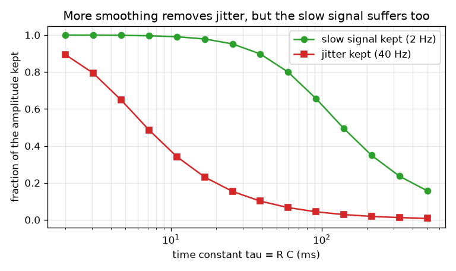
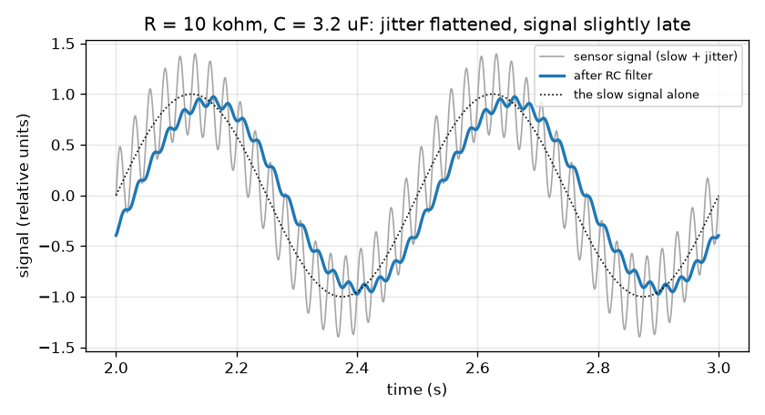

# அமர்வு 1: ஒரு மின்தடையும் ஒரு மின்தேக்கியும் இரைச்சலான சமிக்ஞையை மென்மையாக்குகின்றன

[Session 1 — हिन्दी](README.hi.md)

*நிலை 1 (கருத்தியல் ஊடாடும் மாதிரி) · சுமார் 60 நிமிடங்கள் · openrcfilter*

> இது எளிமைப்படுத்தப்பட்ட ஒரு கல்வி மாதிரி. இது சரிபார்க்கப்பட்ட (validated) வடிவமைப்புக் கருவி அல்ல; உண்மையான கட்டமைப்புகள், மின் நிறுவல்கள், வாகனங்கள், தொழிற்சாலை செயல்முறைகள் அல்லது மருத்துவ முடிவுகளுக்கு இதைப் பயன்படுத்தக் கூடாது.

**முன்தேவைகள் (Prerequisites)**

- சைன் அலைகளும் அதிர்வெண்ணும் (frequency; வினாடிக்கு சுழற்சிகள்): வேகமான அலைவுகளுக்கு உயர் அதிர்வெண் உண்டு.
- நீங்கள் PRIMER.md படித்து, `python start.py 1` ஒருமுறை இயக்கியுள்ளீர்கள்.

**கற்றல் நோக்கங்கள் (Learning objectives).** இந்த அமர்வுக்குப் பிறகு நீங்கள்:

- ஒரு உணரி சமிக்ஞையை நீங்கள் விரும்பும் மெதுவான பகுதியும் விரும்பாத வேகமான பகுதியும் சேர்ந்ததாக விவரிக்கலாம்.
- ஒரு மின்தடையும் மின்தேக்கியும் எப்படி ஒரு தாழ்-கடப்பு வடிகட்டியாக (low-pass filter) அமைகின்றன என்றும், நேர மாறிலி (time constant) tau = R C என்பதன் பொருளையும் விளக்கலாம்.
- ஒரு வடிகட்டிக்குப் பிறகு மெதுவான சமிக்ஞையின் மற்றும் அதிர்வின் (jitter) எவ்வளவு எஞ்சுகிறது என்றும் வெளியீடு எவ்வளவு தாமதமாக வருகிறது என்றும் அளக்கலாம்.
- தக்கவைக்கப்பட்ட பங்கு மற்றும் நேர மாறிலி வரைபடத்தைப் படித்து சமரசத்தை (trade-off) காணலாம்.

## A. நிஜ உலகப் பிரச்சினை
ஒரு வெப்பநிலை உணரி இரைச்சலான அறை வழியாகக் கட்டுப்படுத்தியுடன் இணைக்கப்பட்டுள்ளது. நீங்கள் கவனிக்கும் அளவீடு மெதுவாக மாறுகிறது, அதிகபட்சம் வினாடிக்கு இரண்டு முறை, ஆனால் கம்பி மோட்டார்களிலிருந்தும் மின்சார இணைப்புக் கேபிள்களிலிருந்தும் வேகமான அதிர்வையும் (jitter) பிடித்துக்கொள்கிறது. ஒரு மின்தடை, ஒரு மின்தேக்கி என்ற இரண்டு மலிவான பாகங்கள் எப்படி அதிர்வைத் தட்டையாக்கி மெதுவான சமிக்ஞையை அப்படியே விட முடியும்? அந்த விளைவு இலவசமா, அல்லது அதற்கு நாம் ஏதேனும் விலை கொடுக்க வேண்டுமா? (பொதுக் கல்வி மட்டும்: இது எளிமைப்படுத்தப்பட்ட மாதிரி, உண்மையான கருவிகளுக்கான வடிவமைப்புக் கருவி அல்ல.)

## B. கருத்தும் கோட்பாடும்
ஒரு மின்தேக்கி மின்னூட்டத்தைச் சேமிக்கிறது, நிரம்பி காலியாகும் ஒரு சிறிய வாளி போல. தொடரில் உள்ள மின்தடை வாளிக்குள் மின்னோட்டம் எவ்வளவு வேகமாகப் பாயலாம் என்பதைக் கட்டுப்படுத்துகிறது. உள்ளீட்டு மின்னழுத்தம் மாறும்போது மின்தேக்கி மின்னழுத்தம் அதைப் பின்தொடர்கிறது, ஆனால் படிப்படியாக மட்டுமே: ஒவ்வொரு சிறு நேர அடியிலும் மீதமுள்ள இடைவெளியின் ஒரு குறிப்பிட்ட பகுதி உள்ளீட்டை நோக்கி நகர்கிறது. அந்தப் பின்தொடர்தலின் நேர அளவே நேர மாறிலி tau = R C (ஓம் பெருக்கல் ஃபாரட் வினாடிகளைத் தரும்). மெதுவான உள்ளீடு ஒரு tau-வில் சிறிதே மாறுகிறது, எனவே வெளியீடு அதைப் பின்தொடர்கிறது. வேகமான அலைவு மின்தேக்கி வெகுதூரம் நகர்வதற்கு முன்பே திரும்பிவிடுகிறது, எனவே அது பெரும்பாலும் புறக்கணிக்கப்படுகிறது. அதுவே தாழ்-கடப்பு வடிகட்டி: மெதுவானது கடக்கிறது, வேகமானது கடக்காது. வடிகட்டி அலைகளைப் புறக்கணிக்கத் தொடங்கும் அதிர்வெண் வெட்டு (cutoff) f_c = 1 / (2 pi R C). அதிர்வெண் f கொண்ட அலையில் கடக்கும் பங்கு, அமர்வு 2-க்கான முன்னோட்டமாக, 1 / sqrt(1 + (f / f_c)^2). இதற்கான விலை தாமதம் (delay): மின்தேக்கி உள்ளீட்டை விடப் பின்தங்குவதால், மென்மையாக்கப்பட்ட மெதுவான அலை தாமதமாக வருகிறது, f_c-ஐ விட மிக மெதுவான அலைகளுக்கு ஏறத்தாழ tau.

| குறியீடு | பொருள் | அலகு |
|---|---|---|
| R | தொடர் மின்தடையின் தடை | ஓம் (kohm = 1000 ஓம்) |
| C | மின்தேக்கியின் கொள்ளளவு | ஃபாரட் (uF = 0.000001 F) |
| tau | நேர மாறிலி R C | வினாடிகள் |
| f_c | வெட்டு அதிர்வெண் | ஹெர்ட்ஸ் (Hz) |
| f | சமிக்ஞையில் உள்ள ஓர் அலையின் அதிர்வெண் | ஹெர்ட்ஸ் (Hz) |
| gain | ஓர் அலைக்கு வெளியீட்டு அளவை உள்ளீட்டு அளவால் வகுத்தது | அலகு இல்லை |

**அனுமானங்கள் (Assumptions)**

- சமிக்ஞை வீச்சு 1 கொண்ட 2 Hz மெதுவான அலையும் வீச்சு 0.4 கொண்ட 40 Hz அதிர்வு அலையும் சேர்ந்தது (ஒப்பீட்டு அலகுகள்).
- வடிகட்டி வெளியீட்டில் எதுவும் இணைக்கப்படவில்லை (சுமை இல்லை), பாகங்கள் சீரியல்புடையவை (ideal).
- தொடக்க அதிர்வு அடங்கிய பிறகான நிலையான நிலையை (steady state) நாம் பார்க்கிறோம்.

$$ \tau = R\,C $$

$$ f_c = \frac{1}{2\pi R C} $$

$$ \text{gain}(f)=\frac{1}{\sqrt{1+(f/f_c)^2}}\qquad\text{(preview; derived in Session 2)} $$

$$ \text{delay of a slow wave}\approx \tau\quad (f\ll f_c) $$

## C. காட்சி விளக்கம்
முதல் படம் சாம்பல் நிறத்தில் மூல சமிக்ஞையையும் (மேலே வேகமான அதிர்வுடன் மெதுவான அலை) R = 10 kohm, C = 3.2 uF க்கு நீல நிறத்தில் வடிகட்டிய வெளியீட்டையும் காட்டுகிறது: அதிர்வு கிட்டத்தட்ட போய்விட்டது, மெதுவான அலை அதன் அளவில் 93 சதவீதத்தைத் தக்கவைக்கிறது, அது ஏறத்தாழ 30 ms வலப்பக்கம் நகர்ந்துள்ளது. இரண்டாவது படம் நேர மாறிலியை மாற்றிப் பார்க்கிறது: சிவப்பு வளைவு (தக்கவைத்த அதிர்வு) பச்சை வளைவுக்கு (தக்கவைத்த மெதுவான சமிக்ஞை) வெகு முன்பே விழுகிறது, ஆனால் இரண்டும் விழுகின்றன, எனவே சரியான அமைப்பு இல்லை, ஒரு சிறந்த புள்ளி (sweet spot) மட்டுமே உள்ளது.

*நேர மாறிலிக்கு எதிராக எஞ்சும் மெதுவான சமிக்ஞையின் மற்றும் அதிர்வின் பங்கு.*

*40 Hz அதிர்வுடன் மெதுவான 2 Hz சமிக்ஞை R = 10 kohm, C = 3.2 uF கொண்ட RC வடிகட்டிக்கு முன் (சாம்பல்) மற்றும் பின் (நீலம்).*

## D. ஊடாடும் உருவகப்படுத்தல் (Interactive simulation)
பாடத்தை இயக்கவும் (`python start.py 1`), பின்னர் நேரடிச் செயலியைத் திறக்கவும்: [அமர்வு 1: ஒரு மின்தடையும் ஒரு மின்தேக்கியும் சமிக்ஞையை மென்மையாக்குகின்றன](https://krunalpanchal1995.github.io/pan-iit-oss/openrcfilter/session-01/) (அல்லது இந்தக் கோப்புறையிலுள்ள `app.html`). சமிக்ஞைக் காட்சியில் R மற்றும் C நழுவிகளை நகர்த்தி அதிர்வு தட்டையாவதையும் நீல வளைவு பச்சை வளைவுக்குப் பின்தங்குவதையும் பாருங்கள்; பின்னர் சுற்றுக் காட்சியைத் திறந்து இரண்டு பட்டைகளைப் பாருங்கள்.

**சவால்.** 40 Hz அதிர்வில் 20 சதவீதத்துக்கும் குறைவாக மட்டும் கடக்க விட்டு, மெதுவான 2 Hz சமிக்ஞையில் குறைந்தது 85 சதவீதத்தைத் தக்கவைக்கவும்.

## E. தீர்க்கப்பட்ட எடுத்துக்காட்டும் சோதனையும்
**பிரச்சினை.** ஒரு வடிகட்டியில் R = 10 kohm, C = 3.2 uF. tau, f_c ஆகியவற்றையும், 2 Hz சமிக்ஞையிலும் 40 Hz அதிர்விலும் எவ்வளவு கடக்கிறது என்பதையும், மெதுவான அலை எவ்வளவு தாமதம் என்பதையும் காண்க.

1. tau = R C = 10 000 ஓம் * 0.0000032 F = 0.032 s = 32 ms.
2. f_c = 1 / (2 pi * 0.032) = 4.97 Hz.
3. மெதுவான அலை (2 Hz): f / f_c = 0.402, gain = 1 / sqrt(1 + 0.162) = 0.928, எனவே 92.8 சதவீதம் தக்கவைக்கப்படுகிறது.
4. அதிர்வு (40 Hz): f / f_c = 8.04, gain = 1 / sqrt(1 + 64.7) = 0.123, எனவே 12.3 சதவீதம் தக்கவைக்கப்படுகிறது.
5. மெதுவான அலையின் தாமதம் = atan(2 / 4.97) / (2 pi * 2) = 0.3826 rad / 12.57 = 0.0304 s, ஏறத்தாழ 30 ms (எதிர்பார்த்தபடி tau = 32 ms ஐ விடச் சற்றுக் குறைவு).
6. lesson.py இல் உள்ள உருவகப்படுத்தல் 0.928, 0.123, 30.3 ms ஐ அளக்கிறது: எண்கள் ஒத்துப்போகின்றன.

**விடை.** tau = 32 ms, f_c = 4.97 Hz; மெதுவான அலை 92.8 சதவீதம், அதிர்வு 12.3 சதவீதம் தக்கவைக்கின்றன, மெதுவான அலை ஏறத்தாழ 30 ms தாமதமாகிறது.

**சோதனை.** ஒரு பிரெட்போர்டில் வடிகட்டியை அமையுங்கள் (10 kohm மின்தடை, 3.3 uF மின்தேக்கி), சமிக்ஞை உருவாக்கியிலிருந்து அல்லது ஒலி-அட்டை உள்ளீடு வழியாகத் தொலைபேசி ஒலி செயலியிலிருந்து இயக்கி, 2 Hz மற்றும் 40 Hz அலைகளின் அளவுகளை முன்னும் பின்னும் ஒப்பிடுங்கள். சுமார் 10 சதவீதத்துக்குள் ஒத்துப்போவதை எதிர்பாருங்கள்: உண்மையான மின்தடைகள் மற்றும் மின்தேக்கிகளுக்கு 5 முதல் 20 சதவீதம் சகிப்புத்தன்மை உண்டு, சமிக்ஞை மூலத்துக்குத் தனது வெளியீட்டுத் தடை உண்டு, அளக்கும் உள்ளீடு வடிகட்டியின் மீது சுமையாகிறது. மாதிரி சீரியல்பு பாகங்களையும் சுமை இல்லாததையும் கருதுகிறது.

## F. மதிப்பீடும் வடிவமைப்புச் சவாலும்
**கேள்வி வகை A: கருத்தியல்.** ஒரு RC வடிகட்டி மெதுவான அலையை விட வேகமான அதிர்வை ஏன் அதிகம் தட்டையாக்குகிறது? மெதுவான சமிக்ஞை தாமதமாக வராமல் அதிர்வை முழுவதும் நீக்க ஏன் ஒருபோதும் முடியாது?

குறிப்பு

மின்தேக்கியை ஒரு குறுகிய குழாய் வழியாக நிரம்பும் வாளியாக நினைத்து, வாளி நிரம்புவதற்கு முன் உள்ளீடு திரும்பினால் என்ன நடக்கும் என்று கேளுங்கள்.

படிப்படியான தீர்வு

மின்தேக்கி ஒவ்வொரு நேர அடியிலும் உள்ளீட்டை நோக்கிய தூரத்தின் ஒரு பகுதியை மட்டுமே நகர்கிறது. மெதுவான அலை ஒரு பக்கம் நீண்ட நேரம் இருப்பதால் வெளியீடு அதைப் பின்தொடர முடிகிறது; வேகமான அலை வெளியீடு வெகுதூரம் நகர்வதற்கு முன் திரும்பிவிடுகிறது, எனவே வெளியீடு அரிதாகவே அசைகிறது. வேகமான அலைவைப் புறக்கணிக்கும் அதே மந்தம்தான் வெளியீடு மெதுவான மாற்றத்தை ஏறத்தாழ tau தாமதமாகப் பின்தொடர வைக்கிறது. வேகமான அலைவுகளைப் புறக்கணிக்கும் வடிகட்டி எனவே பின்தொடர்வதில் மெதுவாகவே இருக்க வேண்டும், ஆகவே மென்மையாக்கலும் தாமதமும் எப்போதும் சேர்ந்தே வருகின்றன.

**கேள்வி வகை B: எண்ணியல்.** R = 20 kohm, C = 1 uF. tau, f_c, தக்கவைக்கப்படும் 2 Hz சமிக்ஞை மற்றும் 40 Hz அதிர்வின் பங்கு, மெதுவான அலையின் தாமதம் ஆகியவற்றைக் காண்க.

குறிப்பு

tau = R C; f_c = 1 / (2 pi tau); gain = 1 / sqrt(1 + (f / f_c)^2); delay = atan(f / f_c) / (2 pi f).

படிப்படியான தீர்வு

tau = 20 000 * 0.000001 = 0.020 s = 20 ms. f_c = 1 / (2 pi * 0.020) = 7.96 Hz. மெதுவானது: f / f_c = 0.251, gain = 1 / sqrt(1.0631) = 0.970 (97.0 சதவீதம்). அதிர்வு: f / f_c = 5.03, gain = 1 / sqrt(26.3) = 0.195 (19.5 சதவீதம்). தாமதம் = atan(0.251) / (2 pi * 2) = 0.2462 / 12.566 = 0.0196 s, ஏறத்தாழ 19.6 ms. சரிபார்ப்பு: 20 ms என்பது tau-வுக்கு அருகில் உள்ளது, மெதுவான அலைக்கு எதிர்பார்த்தபடி.

**கேள்வி வகை C: வரைபடம் மற்றும் உருவகப்படுத்தல் விளக்கம்.** தக்கவைக்கப்பட்ட பங்கு மற்றும் நேர மாறிலி படத்தைப் பாருங்கள். ஏதேனும் ஒரு நேர மாறிலி மெதுவான சமிக்ஞையில் குறைந்தது 90 சதவீதத்தைத் தக்கவைத்து அதே நேரத்தில் அதிர்வில் 10 சதவீதத்துக்கும் குறைவாகக் கடக்க விட முடியுமா?

குறிப்பு

gain சூத்திரத்தைப் பயன்படுத்தி ஒவ்வொரு விருப்பத்துக்கும் தேவையான f_c ஐக் கண்டு, இரண்டு வரம்புகளும் ஒன்றோடொன்று பொருந்துகின்றனவா என்று பாருங்கள்.

படிப்படியான தீர்வு

2 Hz அலையில் குறைந்தது 90 சதவீதத்தைத் தக்கவைக்க 1 / sqrt(1 + (2 / f_c)^2) >= 0.9 வேண்டும், எனவே f_c >= 4.13 Hz. 40 Hz அதிர்வில் 10 சதவீதத்துக்கும் குறைவாகக் கடக்க f_c <= 4.02 Hz வேண்டும். இரண்டு வரம்புகளும் சிறிதளவில் சந்திக்கத் தவறுகின்றன (4.13 என்பது 4.02 ஐ விட அதிகம்), எனவே எந்த நேர மாறிலியும் இரு விருப்பங்களையும் நிறைவேற்றாது. படத்திலுள்ள இரண்டு வளைவுகளும் 90 சதவீதம், 10 சதவீதம் கோடுகளைச் சற்று வேறுபட்ட இடங்களில் உண்மையில் கடக்கின்றன. தேவையான மற்றும் தேவையற்ற அதிர்வெண்கள் 20 மடங்கு மட்டுமே இடைவெளியில் இருக்கும்போது ஒரு RC நிலை போதுமான செங்குத்தானது அல்ல; என்ன செய்வது என்பதை அமர்வு 2, 3 காட்டுகின்றன.

**கேள்வி வகை D: வடிவமைப்பு மற்றும் உகப்பாக்கச் (optimisation) சவால்.** வடிவமைப்பு: C = 1 uF உடன், மெதுவான சமிக்ஞையில் குறைந்தது 90 சதவீதம் தக்கவைக்கப்படவும் அதிர்வில் 20 சதவீதத்துக்கும் குறைவாகக் கடக்கவும் ஒரு நிலையான மின்தடையைத் தேர்ந்தெடுங்கள். வெளியீடு எவ்வளவு தாமதம்?

குறிப்பு

இரு விருப்பங்களிலிருந்து f_c க்கு அனுமதிக்கப்படும் வரம்பைக் கண்டு, R = 1 / (2 pi f_c C) மூலம் அதை R இன் வரம்பாக மாற்றி, ஒரு பொது மதிப்பைத் தேர்ந்தெடுங்கள்.

படிப்படியான தீர்வு

மெதுவான சமிக்ஞை >= 90 சதவீதத்துக்கு f_c >= 4.13 Hz வேண்டும்; அதிர்வு < 20 சதவீதத்துக்கு 40 / f_c > 4.90, அதாவது f_c < 8.16 Hz. C = 1 uF உடன் R = 1 / (2 pi f_c C) 19.5 kohm (8.16 Hz இல்) முதல் 38.5 kohm (4.13 Hz இல்) வரை செல்கிறது. அந்த வரம்புக்குள் ஒரு நிலையான மதிப்பு 27 kohm: tau = 27 ms, f_c = 5.89 Hz, மெதுவானது 94.7 சதவீதம் தக்கவைக்கப்படுகிறது, அதிர்வு 14.6 சதவீதம், தாமதம் 26 ms. சமரசம் (trade-off): பெரிய R அதிக அதிர்வை நீக்குகிறது, ஆனால் மெதுவான சமிக்ஞையில் அதிகம் இழந்து தாமதமாக வருகிறது.

[RUBRIC.md](../../RUBRIC.md) மூலம் உங்களை நீங்களே மதிப்பிடுங்கள். தாளில் செய்ய [செயல்பாட்டுத் தாளை](activity_sheet.md) அச்சிடவும்.

## பொதுவான தவறான கருத்துகள்
| பொதுவான தவறான கருத்து | உண்மையில் சரியானது |
|---|---|
| ஒரு வடிகட்டி அதிர்வை முழுவதுமாக நீக்குகிறது. | அது அதிர்வைக் குறைக்க மட்டுமே செய்கிறது. அலைவு எவ்வளவு வேகமோ அவ்வளவு அதிகம் குறையும், ஆனால் சிறிது எப்போதும் மிஞ்சும். |
| வடிகட்டி சமிக்ஞையைப் படித்து எது இரைச்சல் என்று முடிவு செய்கிறது. | எது இரைச்சல் என்று அதற்குத் தெரியாது. அது எல்லா அலைகளையும் ஒரே விதமாக நடத்துகிறது: ஒவ்வொன்றையும் அதன் அதிர்வெண்ணுக்கேற்பக் குறைக்கிறது. |
| பெரிய மின்தேக்கி அல்லது மின்தடை எப்போதும் சிறந்தது. | பெரிய R அல்லது C என்றால் பெரிய tau: அதிக மென்மையாக்கல், ஆனால் அதிக தாமதமும் மெதுவான சமிக்ஞையின் அதிக இழப்பும். |
| மென்மையாக்கல் இலவசம். | ஒவ்வொரு தாழ்-கடப்பு வடிகட்டியும் சமிக்ஞையைத் தாமதப்படுத்துகிறது. மென்மையாக்கலும் தாமதமும் சேர்ந்தே வருகின்றன. |

## சொற்களஞ்சியம் (Glossary)
- **மின்தடை (resistor)**: மின்னோட்டத்தைக் கட்டுப்படுத்தும் பாகம்; அதன் தடை R ஓம்களில் அளக்கப்படுகிறது
- **மின்தேக்கி (capacitor)**: மின்னூட்டத்தைச் சேமிக்கும் பாகம்; அதன் கொள்ளளவு C ஃபாரட்களில் அளக்கப்படுகிறது
- **நேர மாறிலி (time constant)**: tau = R C, வடிகட்டி தன் உள்ளீட்டைப் பின்தொடரும் நேர அளவு
- **தாழ்-கடப்பு வடிகட்டி (low-pass filter)**: மெதுவான மாற்றங்களைக் கடக்க விட்டு வேகமானவற்றைக் குறைக்கும் வடிகட்டி
- **வெட்டு அதிர்வெண் (cutoff frequency)**: வடிகட்டி அலைகளைக் குறைக்கத் தொடங்கும் அதிர்வெண் f_c
- **அதிர்வு (jitter)**: ஒரு சமிக்ஞையில் உள்ள வேகமான தேவையற்ற அலைவுகள்

## நிறைவு
1. [exercises.md](exercises.md)-இல் உள்ள மூன்று நிரலாக்கப் பணிகளைச் செய்யவும்.
2. உங்கள் மாற்றங்களுக்குப் பிறகு `python start.py 1` மீண்டும் இயக்கவும். அது சோதனைச் சாவடியுடன் (checkpoint) முடிகிறது; அது `PASS` அச்சிடும்போது நீங்கள் முடித்துவிட்டீர்கள். (சோதனைச் சாவடி மட்டும்: `python start.py check 1`.)

அடுத்து: [அமர்வு 2](../session-02/README.md)
