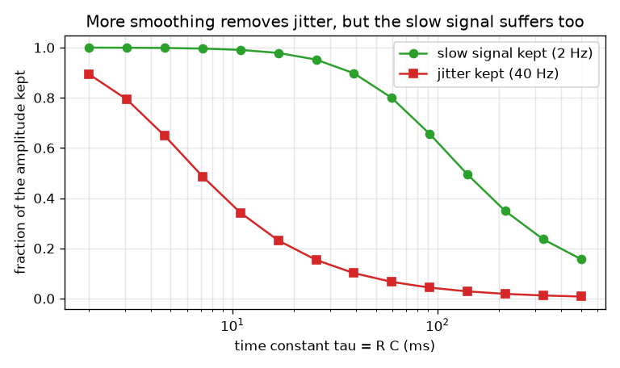
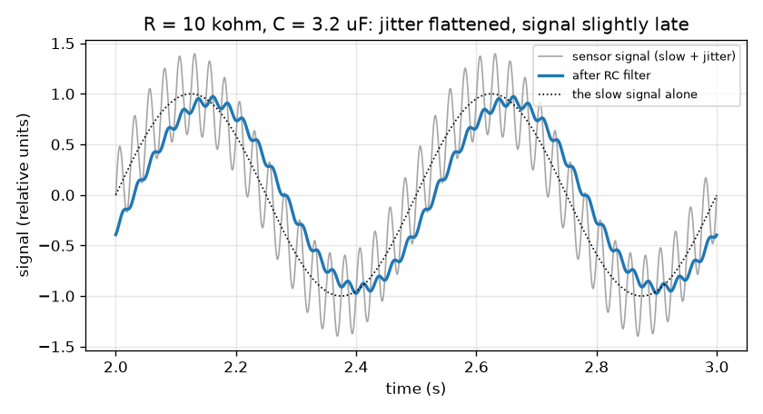

# సెషన్ 1: ఒక నిరోధకం మరియు ఒక కెపాసిటర్ శబ్దం గల సంకేతాన్ని మృదువుగా చేస్తాయి

[Session 1 — हिन्दी](README.hi.md)

*స్థాయి 1 (భావనాత్మక ఇంటరాక్టివ్ నమూనా) · సుమారు 60 నిమిషాలు · openrcfilter*

> ఇది సరళీకరించిన విద్యా నమూనా. ఇది ధృవీకరించబడిన (validated) డిజైన్ సాధనం కాదు; నిజమైన నిర్మాణాలు, విద్యుత్ ఇన్‌స్టలేషన్లు, వాహనాలు, పారిశ్రామిక ప్రక్రియలు లేదా వైద్య నిర్ణయాల కోసం దీనిని ఉపయోగించకూడదు.

**ముందస్తు అవసరాలు (Prerequisites)**

- సైన్ తరంగాలు మరియు పౌనఃపున్యం (frequency; సెకనుకు చక్రాలు): వేగవంతమైన కదలికలకు అధిక పౌనఃపున్యం ఉంటుంది.
- మీరు PRIMER.md చదివి, `python start.py 1` ఒకసారి రన్ చేశారు.

**అభ్యసన లక్ష్యాలు (Learning objectives).** ఈ సెషన్ తర్వాత మీరు:

- సెన్సార్ సంకేతాన్ని మీకు కావలసిన నెమ్మదైన భాగం మరియు వద్దనుకునే వేగవంతమైన భాగం కలిసినదిగా వర్ణించగలరు.
- నిరోధకం మరియు కెపాసిటర్ కలిసి లో-పాస్ ఫిల్టర్ (low-pass filter) ఎలా అవుతాయో, కాలస్థిరాంకం (time constant) tau = R C అంటే ఏమిటో వివరించగలరు.
- ఫిల్టర్ తర్వాత నెమ్మది సంకేతం మరియు జిట్టర్ (jitter) ఎంత మిగులుతుందో, అవుట్‌పుట్ ఎంత ఆలస్యంగా వస్తుందో కొలవగలరు.
- నిలిపిన భాగం మరియు కాలస్థిరాంకం గ్రాఫ్ చదివి రాజీని (trade-off) చూడగలరు.

## A. వాస్తవ ప్రపంచ సమస్య
ఒక ఉష్ణోగ్రత సెన్సార్ శబ్దం గల గది గుండా కంట్రోలర్‌కు కలపబడింది. మీకు అవసరమైన రీడింగ్ నెమ్మదిగా మారుతుంది, గరిష్టంగా సెకనుకు రెండు సార్లు, కానీ తీగ మోటార్ల నుండి మరియు మెయిన్స్ కేబుళ్ల నుండి వేగవంతమైన జిట్టర్‌ను కూడా అందుకుంటుంది. నిరోధకం, కెపాసిటర్ అనే రెండు చవకైన భాగాలు జిట్టర్‌ను ఎలా చదును చేసి నెమ్మది సంకేతాన్ని అలాగే వదలగలవు? ఫలితం ఉచితమేనా, లేక మనకు ఏదైనా ఖర్చవుతుందా? (సాధారణ విద్య మాత్రమే: ఇది సరళీకరించిన నమూనా, నిజమైన పరికరాల కోసం డిజైన్ సాధనం కాదు.)

## B. భావన మరియు సిద్ధాంతం
కెపాసిటర్ ఆవేశాన్ని నిల్వ చేస్తుంది, నిండి ఖాళీ అయ్యే చిన్న బకెట్ లాగా. శ్రేణిలోని నిరోధకం బకెట్‌లోకి విద్యుత్ప్రవాహం ఎంత వేగంగా ప్రవహించగలదో పరిమితం చేస్తుంది. ఇన్‌పుట్ వోల్టేజ్ మారినప్పుడు కెపాసిటర్ వోల్టేజ్ దాన్ని అనుసరిస్తుంది, కానీ క్రమంగా మాత్రమే: ప్రతి చిన్న కాల అడుగులో మిగిలిన అంతరంలో నిర్దిష్ట భాగం ఇన్‌పుట్ వైపు కదులుతుంది. ఆ అనుసరణ కాల పరిమాణమే కాలస్థిరాంకం tau = R C (ఓమ్‌లు గుణించి ఫారడ్‌లు సెకన్లను ఇస్తాయి). నెమ్మది ఇన్‌పుట్ ఒక tau లో కొద్దిగా మాత్రమే మారుతుంది, కాబట్టి అవుట్‌పుట్ దాన్ని అనుసరిస్తుంది. వేగవంతమైన కదలిక కెపాసిటర్ ఎక్కువ దూరం కదలక ముందే తిరుగుతుంది, కాబట్టి అది ఎక్కువగా పట్టించుకోబడదు. అదే లో-పాస్ ఫిల్టర్: నెమ్మది గుండా వెళ్తుంది, వేగవంతమైనది వెళ్ళదు. ఫిల్టర్ తరంగాలను పట్టించుకోవడం మానేసే పౌనఃపున్యం కటాఫ్ (cutoff) f_c = 1 / (2 pi R C). పౌనఃపున్యం f గల తరంగంలో గుండా వెళ్ళే భాగం, సెషన్ 2 కు ముందస్తు సూచనగా, 1 / sqrt(1 + (f / f_c)^2). దీని మూల్యం ఆలస్యం (delay): కెపాసిటర్ ఇన్‌పుట్ కంటే వెనుకబడటం వల్ల, మృదువుగా చేసిన నెమ్మది తరంగం ఆలస్యంగా వస్తుంది, f_c కంటే చాలా నెమ్మది తరంగాలకు సుమారు tau.

| గుర్తు | అర్థం | ప్రమాణం |
|---|---|---|
| R | శ్రేణి నిరోధకం యొక్క నిరోధం | ఓమ్ (kohm = 1000 ఓమ్) |
| C | కెపాసిటర్ యొక్క కెపాసిటెన్స్ | ఫారడ్ (uF = 0.000001 F) |
| tau | కాలస్థిరాంకం R C | సెకన్లు |
| f_c | కటాఫ్ పౌనఃపున్యం | హెర్ట్జ్ (Hz) |
| f | సంకేతంలోని ఒక తరంగం యొక్క పౌనఃపున్యం | హెర్ట్జ్ (Hz) |
| gain | ఒక తరంగానికి అవుట్‌పుట్ పరిమాణాన్ని ఇన్‌పుట్ పరిమాణంతో భాగించగా | ప్రమాణం లేదు |

**ఊహలు (Assumptions)**

- సంకేతం కంపనపరిమాణం 1 గల 2 Hz నెమ్మది తరంగం మరియు కంపనపరిమాణం 0.4 గల 40 Hz జిట్టర్ తరంగం కలిసినది (సాపేక్ష ప్రమాణాలు).
- ఫిల్టర్ అవుట్‌పుట్‌కు ఏదీ కలపబడలేదు (లోడ్ లేదు), భాగాలు ఆదర్శవంతమైనవి (ideal).
- ప్రారంభ కంపనం ఆగిన తర్వాత స్థిరస్థితిని (steady state) మనం చూస్తున్నాం.

$$ \tau = R\,C $$

$$ f_c = \frac{1}{2\pi R C} $$

$$ \text{gain}(f)=\frac{1}{\sqrt{1+(f/f_c)^2}}\qquad\text{(preview; derived in Session 2)} $$

$$ \text{delay of a slow wave}\approx \tau\quad (f\ll f_c) $$

## C. దృశ్య వివరణ
మొదటి చిత్రం బూడిద రంగులో ముడి సంకేతాన్ని (పైన వేగవంతమైన జిట్టర్‌తో నెమ్మది తరంగం) మరియు R = 10 kohm, C = 3.2 uF కు నీలం రంగులో ఫిల్టర్ చేసిన అవుట్‌పుట్‌ను చూపిస్తుంది: జిట్టర్ దాదాపు పోయింది, నెమ్మది తరంగం దాని పరిమాణంలో 93 శాతం నిలుపుకుంది, అది సుమారు 30 ms కుడివైపుకు జరిగింది. రెండవ చిత్రం కాలస్థిరాంకాన్ని మార్చి చూస్తుంది: ఎరుపు వక్రం (నిలిపిన జిట్టర్) ఆకుపచ్చ వక్రం (నిలిపిన నెమ్మది సంకేతం) కంటే చాలా ముందే పడుతుంది, కానీ రెండూ పడతాయి, కాబట్టి పరిపూర్ణమైన అమరిక లేదు, ఒక ఉత్తమ బిందువు (sweet spot) మాత్రమే ఉంది.

*కాలస్థిరాంకానికి వ్యతిరేకంగా మిగిలే నెమ్మది సంకేతం మరియు జిట్టర్ భాగం.*

*40 Hz జిట్టర్‌తో నెమ్మది 2 Hz సంకేతం R = 10 kohm, C = 3.2 uF గల RC ఫిల్టర్‌కు ముందు (బూడిద) మరియు తర్వాత (నీలం).*

## D. ఇంటరాక్టివ్ సిమ్యులేషన్
పాఠాన్ని రన్ చేయండి (`python start.py 1`), తర్వాత లైవ్ యాప్‌ను తెరవండి: [సెషన్ 1: ఒక నిరోధకం మరియు ఒక కెపాసిటర్ సంకేతాన్ని మృదువుగా చేస్తాయి](https://krunalpanchal1995.github.io/pan-iit-oss/openrcfilter/session-01/) (లేదా ఈ ఫోల్డర్‌లోని `app.html`). సంకేత వీక్షణలో R మరియు C స్లైడర్లను కదిలించి జిట్టర్ చదునవడం, నీలం వక్రం ఆకుపచ్చ వక్రం వెనుక పడటం గమనించండి; తర్వాత సర్క్యూట్ వీక్షణను తెరిచి రెండు బార్లను చూడండి.

**సవాలు.** 40 Hz జిట్టర్‌లో 20 శాతం కంటే తక్కువ మాత్రమే గుండా పోనిస్తూ నెమ్మది 2 Hz సంకేతంలో కనీసం 85 శాతం నిలుపుకోండి.

## E. సాధించిన ఉదాహరణ మరియు ప్రయోగం
**సమస్య.** ఒక ఫిల్టర్‌కు R = 10 kohm, C = 3.2 uF. tau, f_c లను, 2 Hz సంకేతంలో మరియు 40 Hz జిట్టర్‌లో ఎంత గుండా వెళ్తుందో, నెమ్మది తరంగం ఎంత ఆలస్యమో కనుగొనండి.

1. tau = R C = 10 000 ఓమ్ * 0.0000032 F = 0.032 s = 32 ms.
2. f_c = 1 / (2 pi * 0.032) = 4.97 Hz.
3. నెమ్మది తరంగం (2 Hz): f / f_c = 0.402, gain = 1 / sqrt(1 + 0.162) = 0.928, కాబట్టి 92.8 శాతం నిలుస్తుంది.
4. జిట్టర్ (40 Hz): f / f_c = 8.04, gain = 1 / sqrt(1 + 64.7) = 0.123, కాబట్టి 12.3 శాతం నిలుస్తుంది.
5. నెమ్మది తరంగం ఆలస్యం = atan(2 / 4.97) / (2 pi * 2) = 0.3826 rad / 12.57 = 0.0304 s, సుమారు 30 ms (ఊహించినట్లే tau = 32 ms కంటే కొంచెం తక్కువ).
6. lesson.py లోని సిమ్యులేషన్ 0.928, 0.123 మరియు 30.3 ms కొలుస్తుంది: సంఖ్యలు ఏకీభవిస్తాయి.

**సమాధానం.** tau = 32 ms, f_c = 4.97 Hz; నెమ్మది తరంగం 92.8 శాతం, జిట్టర్ 12.3 శాతం నిలుపుకుంటాయి, నెమ్మది తరంగం సుమారు 30 ms ఆలస్యం.

**ప్రయోగం.** బ్రెడ్‌బోర్డ్‌పై ఫిల్టర్‌ను నిర్మించండి (10 kohm నిరోధకం, 3.3 uF కెపాసిటర్), సిగ్నల్ జనరేటర్ నుండి లేదా సౌండ్-కార్డ్ ఇన్‌పుట్ ద్వారా ఫోన్ టోన్ యాప్ నుండి నడపండి, 2 Hz మరియు 40 Hz తరంగాల పరిమాణాలను ముందు మరియు తర్వాత పోల్చండి. సుమారు 10 శాతం లోపల ఏకీభావాన్ని ఆశించండి: నిజమైన నిరోధకాలు మరియు కెపాసిటర్లకు 5 నుండి 20 శాతం సహనం ఉంటుంది, సంకేత మూలానికి దాని స్వంత అవుట్‌పుట్ నిరోధం ఉంటుంది, కొలిచే ఇన్‌పుట్ ఫిల్టర్‌పై లోడ్ అవుతుంది. నమూనా ఆదర్శ భాగాలను మరియు లోడ్ లేకపోవడాన్ని ఊహిస్తుంది.

## F. మూల్యాంకనం మరియు డిజైన్ సవాలు
**ప్రశ్న రకం A: భావనాత్మక.** RC ఫిల్టర్ నెమ్మది తరంగం కంటే వేగవంతమైన జిట్టర్‌ను ఎక్కువగా ఎందుకు చదును చేస్తుంది? నెమ్మది సంకేతం ఆలస్యంగా రాకుండా జిట్టర్‌ను పూర్తిగా తొలగించడం ఎందుకు ఎప్పటికీ సాధ్యం కాదు?

సూచన

కెపాసిటర్‌ను ఇరుకైన పైపు ద్వారా నిండే బకెట్‌గా ఊహించి, బకెట్ నిండక ముందే ఇన్‌పుట్ తిరిగితే ఏమవుతుందో అడగండి.

దశలవారీ పరిష్కారం

కెపాసిటర్ ప్రతి కాల అడుగులో ఇన్‌పుట్ వైపు కొంత భాగం మాత్రమే కదులుతుంది. నెమ్మది తరంగం ఒక వైపు ఎక్కువసేపు ఉంటుంది కాబట్టి అవుట్‌పుట్ దాన్ని అనుసరించగలదు; వేగవంతమైన తరంగం అవుట్‌పుట్ ఎక్కువ దూరం కదలక ముందే తిరుగుతుంది, కాబట్టి అవుట్‌పుట్ అరుదుగా మాత్రమే కదులుతుంది. వేగవంతమైన కదలికను పట్టించుకోని అదే మందగమనం, నెమ్మది మార్పును సుమారు tau ఆలస్యంగా అనుసరించేలా కూడా అవుట్‌పుట్‌ను చేస్తుంది. వేగవంతమైన కదలికలను పట్టించుకోని ఫిల్టర్ కాబట్టి అనుసరించడంలో నెమ్మదిగా ఉండాలి, అందువల్ల మృదువు చేయడం మరియు ఆలస్యం ఎల్లప్పుడూ కలిసే వస్తాయి.

**ప్రశ్న రకం B: సంఖ్యాత్మక.** R = 20 kohm మరియు C = 1 uF. tau, f_c, నిలుపుకునే 2 Hz సంకేతం మరియు 40 Hz జిట్టర్ భాగం, నెమ్మది తరంగం ఆలస్యం కనుగొనండి.

సూచన

tau = R C; f_c = 1 / (2 pi tau); gain = 1 / sqrt(1 + (f / f_c)^2); delay = atan(f / f_c) / (2 pi f).

దశలవారీ పరిష్కారం

tau = 20 000 * 0.000001 = 0.020 s = 20 ms. f_c = 1 / (2 pi * 0.020) = 7.96 Hz. నెమ్మది: f / f_c = 0.251, gain = 1 / sqrt(1.0631) = 0.970 (97.0 శాతం). జిట్టర్: f / f_c = 5.03, gain = 1 / sqrt(26.3) = 0.195 (19.5 శాతం). ఆలస్యం = atan(0.251) / (2 pi * 2) = 0.2462 / 12.566 = 0.0196 s, సుమారు 19.6 ms. తనిఖీ: 20 ms అనేది tau కు దగ్గరగా ఉంది, నెమ్మది తరంగానికి ఊహించినట్లే.

**ప్రశ్న రకం C: గ్రాఫ్ మరియు సిమ్యులేషన్ వ్యాఖ్యానం.** నిలిపిన భాగం మరియు కాలస్థిరాంకం చిత్రాన్ని చూడండి. ఏదైనా ఒక కాలస్థిరాంకం నెమ్మది సంకేతంలో కనీసం 90 శాతం నిలుపుకుంటూ అదే సమయంలో జిట్టర్‌లో 10 శాతం కంటే తక్కువ గుండా పోనివ్వగలదా?

సూచన

gain సూత్రం ఉపయోగించి ప్రతి కోరికకు అవసరమైన f_c ను కనుగొని, రెండు పరిధులు కలుస్తున్నాయో లేదో చూడండి.

దశలవారీ పరిష్కారం

2 Hz తరంగంలో కనీసం 90 శాతం నిలుపుకోవడానికి 1 / sqrt(1 + (2 / f_c)^2) >= 0.9 కావాలి, కాబట్టి f_c >= 4.13 Hz. 40 Hz జిట్టర్‌లో 10 శాతం కంటే తక్కువ గుండా పోనివ్వడానికి f_c <= 4.02 Hz కావాలి. రెండు పరిధులు తృటిలో కలవవు (4.13 అనేది 4.02 కంటే ఎక్కువ), కాబట్టి ఏ కాలస్థిరాంకమూ రెండు కోరికలను తీర్చదు. చిత్రంలోని రెండు వక్రాలు 90 శాతం మరియు 10 శాతం గీతలను కొంచెం వేరు వేరు చోట్ల దాటుతాయి. కావలసిన మరియు వద్దనుకునే పౌనఃపున్యాలు కేవలం 20 రెట్లు దూరంలో ఉన్నప్పుడు ఒకే RC దశ తగినంత నిటారుగా ఉండదు; ఏమి చేయాలో సెషన్ 2 మరియు 3 చూపిస్తాయి.

**ప్రశ్న రకం D: డిజైన్ మరియు ఆప్టిమైజేషన్ (optimisation) సవాలు.** డిజైన్: C = 1 uF తో, నెమ్మది సంకేతంలో కనీసం 90 శాతం నిలిచేలా మరియు జిట్టర్‌లో 20 శాతం కంటే తక్కువ గుండా పోయేలా ఒక ప్రామాణిక నిరోధకాన్ని ఎంచుకోండి. అవుట్‌పుట్ ఎంత ఆలస్యం?

సూచన

రెండు కోరికల నుండి f_c అనుమతించిన పరిధిని కనుగొని, R = 1 / (2 pi f_c C) తో దాన్ని R పరిధిగా మార్చి, ఉమ్మడి విలువను ఎంచుకోండి.

దశలవారీ పరిష్కారం

నెమ్మది సంకేతం >= 90 శాతానికి f_c >= 4.13 Hz కావాలి; జిట్టర్ < 20 శాతానికి 40 / f_c > 4.90, అంటే f_c < 8.16 Hz. C = 1 uF తో R = 1 / (2 pi f_c C) 19.5 kohm (8.16 Hz వద్ద) నుండి 38.5 kohm (4.13 Hz వద్ద) వరకు ఉంటుంది. ఆ పరిధిలోని ఒక ప్రామాణిక విలువ 27 kohm: tau = 27 ms, f_c = 5.89 Hz, నెమ్మది 94.7 శాతం నిలుస్తుంది, జిట్టర్ 14.6 శాతం, ఆలస్యం 26 ms. రాజీ (trade-off): పెద్ద R ఎక్కువ జిట్టర్‌ను తొలగిస్తుంది, కానీ నెమ్మది సంకేతంలో ఎక్కువ కోల్పోయి ఆలస్యంగా వస్తుంది.

[RUBRIC.md](../../RUBRIC.md) తో మిమ్మల్ని మీరు స్కోర్ చేసుకోండి. కాగితంపై చేయడానికి [కార్యాచరణ పత్రాన్ని](activity_sheet.md) ప్రింట్ చేయండి.

## సాధారణ అపోహలు
| సాధారణ అపోహ | వాస్తవంగా నిజమైనది |
|---|---|
| ఫిల్టర్ జిట్టర్‌ను పూర్తిగా తొలగిస్తుంది. | అది జిట్టర్‌ను తగ్గిస్తుంది మాత్రమే. కదలిక ఎంత వేగమైతే అంత ఎక్కువ తగ్గుతుంది, కానీ కొంత ఎల్లప్పుడూ మిగులుతుంది. |
| ఫిల్టర్ సంకేతాన్ని చదివి ఏది శబ్దమో నిర్ణయిస్తుంది. | ఏది శబ్దమో దానికి తెలియదు. అది అన్ని తరంగాలను ఒకే విధంగా చూస్తుంది: ప్రతిదాన్ని దాని పౌనఃపున్యం ప్రకారం తగ్గిస్తుంది. |
| పెద్ద కెపాసిటర్ లేదా నిరోధకం ఎల్లప్పుడూ మెరుగు. | పెద్ద R లేదా C అంటే పెద్ద tau: ఎక్కువ మృదువు చేయడం, కానీ ఎక్కువ ఆలస్యం మరియు నెమ్మది సంకేతంలో ఎక్కువ నష్టం. |
| మృదువు చేయడం ఉచితం. | ప్రతి లో-పాస్ ఫిల్టర్ సంకేతాన్ని ఆలస్యం చేస్తుంది. మృదువు చేయడం మరియు ఆలస్యం కలిసే వస్తాయి. |

## పదకోశం (Glossary)
- **నిరోధకం (resistor)**: విద్యుత్ప్రవాహాన్ని పరిమితం చేసే భాగం; దాని నిరోధం R ఓమ్‌లలో కొలుస్తారు
- **కెపాసిటర్ (capacitor)**: ఆవేశాన్ని నిల్వ చేసే భాగం; దాని కెపాసిటెన్స్ C ఫారడ్‌లలో కొలుస్తారు
- **కాలస్థిరాంకం (time constant)**: tau = R C, ఫిల్టర్ తన ఇన్‌పుట్‌ను అనుసరించే కాల పరిమాణం
- **లో-పాస్ ఫిల్టర్ (low-pass filter)**: నెమ్మది మార్పులను గుండా పోనిచ్చి వేగవంతమైన వాటిని తగ్గించే ఫిల్టర్
- **కటాఫ్ పౌనఃపున్యం (cutoff frequency)**: ఫిల్టర్ తరంగాలను తగ్గించడం మొదలుపెట్టే పౌనఃపున్యం f_c
- **జిట్టర్ (jitter)**: సంకేతంపై వేగవంతమైన అవాంఛిత కదలికలు

## ముగింపు
1. [exercises.md](exercises.md) లోని మూడు కోడింగ్ పనులను చేయండి.
2. మీ మార్పుల తర్వాత `python start.py 1` మళ్ళీ రన్ చేయండి. అది చెక్‌పాయింట్‌తో ముగుస్తుంది; అది `PASS` ప్రింట్ చేసినప్పుడు మీరు పూర్తి చేశారు. (చెక్‌పాయింట్ మాత్రమే: `python start.py check 1`.)

తర్వాత: [సెషన్ 2](../session-02/README.md)
