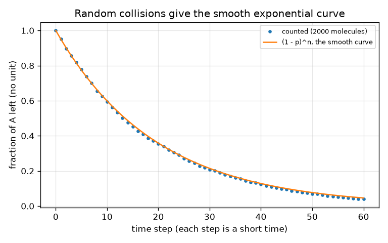

# सत्र 1: अभिक्रियाओं में समय लगता है: समय के सापेक्ष सांद्रता

*स्तर 1 (अवधारणात्मक इंटरैक्टिव मॉडल) · लगभग 60 मिनट · openreactionrate*

> यह एक सरलीकृत शैक्षिक मॉडल है। यह कोई प्रमाणित डिज़ाइन उपकरण नहीं है और इसका उपयोग वास्तविक संरचनाओं, विद्युत संस्थापनों, वाहनों, औद्योगिक प्रक्रियाओं या चिकित्सा निर्णयों के लिए नहीं किया जाना चाहिए।

**पूर्वापेक्षाएँ (Prerequisites)**

- स्कूल स्तर का बीजगणित और ग्राफ़ पढ़ना।
- आपने PRIMER.md पढ़ लिया है और `python start.py 1` एक बार चला लिया है।

**सीखने के उद्देश्य (Learning objectives)।** इस सत्र के बाद आप:

- बता सकेंगे कि अभिक्रिया दर (reaction rate) क्या है और उसे बदलने वाली चार चीज़ों के नाम बता सकेंगे: सांद्रता, तापमान, टक्करें और उत्प्रेरक।
- A -> B के लिए सांद्रता-बनाम-समय वक्र पढ़ सकेंगे और उससे अर्ध-आयु (half-life) ज्ञात कर सकेंगे।
- सही इकाइयों के साथ [A] = A0 exp(-k t) और अर्ध-आयु = ln 2 / k का उपयोग कर सकेंगे।
- यादृच्छिक टक्करों के विचार से समझा सकेंगे कि वक्र मुड़ता क्यों है।

## A. वास्तविक दुनिया की समस्या
रसोई की मेज़ पर दूध एक दिन में खट्टा हो जाता है और फ़्रिज में एक सप्ताह में। हाइड्रोजन पेरॉक्साइड की बोतल महीनों चलती है, पर एक चुटकी मैंगनीज़ डाइऑक्साइड से वह तुरंत झाग देने लगती है। रासायनिक अभिक्रियाओं में समय लगता है, और कुछ चीज़ें (गर्मी, उसी जगह में अधिक अणु, एक उत्प्रेरक) बदलती हैं कि कितना समय लगेगा। हम यह कैसे चित्रित करें, और फिर अनुमान लगाएँ, कि एक पदार्थ A कितनी तेज़ी से पदार्थ B में बदलता है?

## B. अवधारणा और सिद्धांत
A के एक अणु को B में बदलने के लिए आमतौर पर उसे किसी चीज़ से टकराना पड़ता है, और टक्कर पर्याप्त ऊर्जावान होनी चाहिए। यदि उसी आयतन में A के अधिक अणु हों (अधिक सांद्रता (concentration)) तो प्रति सेकंड अधिक टक्करें होती हैं, इसलिए दर बड़ी होती है। सबसे सरल अभिक्रिया A -> B में दर (प्रति सेकंड A के कितने mol/L ग़ायब होते हैं) A की सांद्रता के समानुपाती है: rate = k [A]। स्थिरांक k दर स्थिरांक (rate constant) है; बड़े k का अर्थ है तेज़ अभिक्रिया। मिश्रण को गर्म करने से टक्करें अधिक बार होती हैं और, कहीं अधिक महत्वपूर्ण रूप से, अधिक ऊर्जावान होती हैं, इसलिए k बढ़ता है। एक उत्प्रेरक (catalyst) अभिक्रिया को एक आसान रास्ता देता है, जिससे k भी बढ़ता है, और वह ख़र्च नहीं होता। rate = k [A] को हल करने से एक घातांकीय क्षय मिलता है: [A] शुरू में, जब A बहुत होता है, तेज़ी से घटता है, और फिर धीरे-धीरे। अर्ध-आयु वह समय है जिसमें [A] आधा हो जाता है; इस अभिक्रिया के लिए यह वही रहता है चाहे आप कहीं से भी शुरू करें। B बस वह है जो A ने खोया है, [B] = A0 - [A]। यहाँ उत्प्रेरक को सबसे सरल तरीक़े से, एक गुणक f के रूप में मॉडल किया गया है जो k को गुणा करता है।

| प्रतीक | अर्थ | इकाई |
|---|---|---|
| [A] | समय t पर A की सांद्रता | mol/L |
| A0 | A की प्रारंभिक सांद्रता | mol/L |
| k | दर स्थिरांक (A -> B के लिए) | 1/s |
| t | समय | s |
| t_half | अर्ध-आयु: [A] के आधा होने का समय | s |
| f | उत्प्रेरक का गति-वर्धक गुणक (k को f से गुणा किया जाता है) | कोई इकाई नहीं |

**मान्यताएँ (Assumptions)**

- केवल एक चरण A -> B, और यह उलटा नहीं चल सकता।
- अभिक्रिया चलते समय तापमान स्थिर रहता है।
- मिश्रण हिलाया जाता है, इसलिए सांद्रता हर जगह समान है।
- उत्प्रेरक केवल k को गुणा करता है; वास्तविक उत्प्रेरक विषाक्त (poisoned) भी हो सकते हैं या धीरे-धीरे ख़र्च भी हो सकते हैं।

$$ \text{rate}=-\frac{d[A]}{dt}=k\,[A] $$

$$ [A]_t=A_0\,e^{-kt},\qquad [B]_t=A_0-[A]_t $$

$$ t_{1/2}=\frac{\ln 2}{k},\qquad t_{x}=\frac{1}{k}\ln\frac{1}{1-x}\ \ (\text{time to convert a fraction }x) $$

## C. दृश्य व्याख्या
पहला चित्र k = 0.10 1/s (ठोस रेखा) के लिए और k को पाँच गुना बड़ा करने वाले उत्प्रेरक (डैश रेखा) के लिए समय के सापेक्ष [A] और [B] दिखाता है। दोनों A वक्रों का आकार एक जैसा है; डैश वाला बस समय के पाँचवें भाग में सिकुड़ा हुआ है, और अर्ध-आयु 6.9 s से घटकर 1.4 s हो जाती है। A और B अर्ध-आयु पर काटते हैं, जहाँ हर एक प्रारंभ का आधा है। दूसरा चित्र 2000 अणुओं को गिनता है, जिनमें से हर एक की हर समय-चरण में अभिक्रिया करने की 5 प्रतिशत संभावना है: बिंदु चिकने वक्र (1 - p)^n पर पड़ते हैं, इसलिए वक्र के मुड़ने के लिए किसी विशेष नियम की ज़रूरत नहीं, बस अभिक्रिया के लिए कम A अणु बचे होते हैं।

![A -> B के लिए [A] और [B]; 5 गुना उत्प्रेरक (डैश) उसी वक्र को समय के पाँचवें भाग में सिकोड़ देता है।](../../docs/figures/s01_a_to_b.png)

*A -> B के लिए [A] और [B]; 5 गुना उत्प्रेरक (डैश) उसी वक्र को समय के पाँचवें भाग में सिकोड़ देता है।*

*यादृच्छिक रूप से अभिक्रिया करने वाले 2000 अणुओं को गिनने से चिकना घातांकीय वक्र दोबारा मिलता है।*

## D. इंटरैक्टिव सिमुलेशन
पाठ चलाएँ (`python start.py 1`), फिर लाइव ऐप खोलें: [सत्र 1: उत्प्रेरक के साथ A -> B](https://krunalpanchal1995.github.io/pan-iit-oss/openreactionrate/session-01/) (या इस फ़ोल्डर में `app.html`)। समय स्लाइडर खिसकाएँ और टंकियाँ देखें: A ख़ाली होता है जबकि B भरता है, और योग वही रहता है। फिर उत्प्रेरक गुणक बढ़ाएँ और देखें कि वही वक्र तेज़ी से चलता है। ग्राफ़ दृश्य पर जाएँ और पता लगाएँ कि नीला और हरा वक्र कहाँ काटते हैं।

**चुनौती।** A का आधा भाग 5 सेकंड के भीतर अभिक्रिया करा दें (अर्ध-आयु 5 s से कम)।

## E. हल किया गया उदाहरण और प्रयोग
**समस्या।** k = 0.10 1/s और A0 = 1.0 mol/L वाली A -> B के लिए, 10 s बाद [A] और [B], अर्ध-आयु, और 90 प्रतिशत रूपांतरण का समय ज्ञात कीजिए। फिर देखिए कि k को पाँच गुना बड़ा करने वाला उत्प्रेरक अंतिम संख्या पर क्या प्रभाव डालता है।

1. 10 s बाद [A]: k t = 0.10 * 10 = 1.0, इसलिए [A] = 1.0 * exp(-1.0) = 0.368 mol/L।
2. [B] = A0 - [A] = 1.0 - 0.368 = 0.632 mol/L। (जाँच: A + B = 1.000 mol/L।)
3. अर्ध-आयु = ln 2 / k = 0.693 / 0.10 = 6.93 s।
4. 90 प्रतिशत रूपांतरण का अर्थ है [A] = 0.10: t = ln(10) / k = 2.303 / 0.10 = 23.0 s।
5. उत्प्रेरक के साथ k = 0.50 1/s, इसलिए समय 2.303 / 0.50 = 4.6 s है: पाँच गुना जल्दी।

**उत्तर।** 10 s बाद [A] = 0.368 mol/L और [B] = 0.632 mol/L; अर्ध-आयु 6.93 s; 90 प्रतिशत 23.0 s बाद, या 5 गुना उत्प्रेरक के साथ 4.6 s बाद।

**प्रयोग।** एक घुलनशील बुदबुदाने वाली गोली (effervescent tablet) को 200 mL ठंडे नल के पानी (लगभग 10 डिग्री C) में और 200 mL गुनगुने पानी (लगभग 40 डिग्री C) में डालें और बुदबुदाहट रुकने का समय नापें; आधी गोली के साथ भी आज़माएँ। गुनगुने पानी में स्पष्ट रूप से पहले ख़त्म होना चाहिए। मॉडल बनाम वास्तविकता: गोली का घुलना एक साफ़ प्रथम-कोटि (first-order) अभिक्रिया नहीं है (सतह क्षेत्रफल घटता है, हिलाना मायने रखता है), और तापमान k को 'थोड़ा' नहीं बल्कि एक निश्चित गुणक से बदलता है। प्रयोग को प्रवृत्ति के चित्र के रूप में लें, संख्या की जाँच के रूप में नहीं। घोल न पिएँ और लेबल के निर्देशों का पालन करें।

## F. मूल्यांकन और डिज़ाइन चुनौती
**प्रश्न प्रकार A: अवधारणात्मक।** A की सांद्रता शुरू में तेज़ी से और बाद में धीरे क्यों घटती है, जबकि अभिक्रिया के बारे में कुछ नहीं बदलता?

संकेत

दर किस पर निर्भर करती है, और समय के साथ उस राशि का क्या होता है?

चरण-दर-चरण हल

दर k [A] है। शुरू में A बहुत होता है, इसलिए प्रति सेकंड बहुत सारी अभिक्रियाएँ होती हैं। जैसे-जैसे A ख़र्च होता है, A अणु कम होते हैं और टक्करें कम होती हैं, इसलिए दर घटती है और वक्र सपाट होता जाता है। दर स्थिरांक k स्वयं नहीं बदलता; दर केवल इसलिए घटती है क्योंकि [A] घटता है।

**प्रश्न प्रकार B: संख्यात्मक।** एक अभिक्रिया A -> B का k = 0.05 1/s और A0 = 2.0 mol/L है। 20 s बाद [A] और अर्ध-आयु ज्ञात कीजिए, और अपने उत्तर की तर्कसंगतता जाँचिए।

संकेत

20 s बाद k t = 1। [A] = A0 exp(-k t) और t_half = ln 2 / k का उपयोग करें।

चरण-दर-चरण हल

[A] = 2.0 * exp(-1) = 0.736 mol/L। अर्ध-आयु = 0.693 / 0.05 = 13.9 s। तर्कसंगतता जाँच: 20 s लगभग 1.44 अर्ध-आयु है, इसलिए [A] = 2.0 * 0.5^1.44 = 0.736 होना चाहिए। दोनों मेल खाते हैं। इकाइयाँ: सांद्रता mol/L में, k 1/s में।

**प्रश्न प्रकार C: ग्राफ़ और सिमुलेशन की व्याख्या।** स्लाइडर ऐप के A-B ग्राफ़ पर (A0 = 1, k = 0.10), वक्र कहाँ काटते हैं और वहाँ उनका मान क्या है? यदि A0 = 2 होता तो क्या बदलता?

संकेत

वे तब काटते हैं जब [A] = [B], यानी जब A का ठीक आधा भाग अभिक्रिया कर चुका हो।

चरण-दर-चरण हल

वे अर्ध-आयु, 6.9 s पर, 0.5 mol/L (A0 का आधा) मान पर काटते हैं। A0 = 2 के साथ वे उसी समय, 6.9 s पर, पर 1.0 mol/L पर काटते, क्योंकि इस अभिक्रिया की अर्ध-आयु प्रारंभिक सांद्रता पर निर्भर नहीं करती।

**प्रश्न प्रकार D: डिज़ाइन और इष्टतमीकरण (optimisation) चुनौती।** डिज़ाइन: k = 0.10 1/s वाली अभिक्रिया को 10 s के भीतर 90 प्रतिशत पूरी होना है। उत्प्रेरक को k किस गुणक से बढ़ाना होगा? आप कौन-सा पूर्णांक गुणक चुनेंगे, और गति के अलावा और क्या मायने रखता है?

संकेत

k_new के लिए ln(10) / k_new = 10 s हल करें, फिर 0.10 से भाग दें।

चरण-दर-चरण हल

k_new = ln(10) / 10 = 0.230 1/s, यानी 2.3 का गुणक। अगला पूर्णांक 3 है, जो k = 0.30 1/s और कुछ मार्जिन के साथ 7.7 s का समय देता है। मायने रखने वाली अन्य चीज़ें: उत्प्रेरक की लागत, क्या उसे उत्पाद से अलग किया जा सकता है, क्या वह विषाक्त या ख़र्च हो जाता है, क्या उत्पाद सुरक्षित है, और क्या अभिक्रिया ऐसी ऊष्मा छोड़ती है जिसे हटाना पड़े।

[RUBRIC.md](../../RUBRIC.md) से स्वयं को अंक दें। काग़ज़ पर काम करने के लिए [गतिविधि पत्रक](activity_sheet.md) प्रिंट करें।

## आम भ्रांतियाँ (Common misconceptions)
| आम भ्रांति | वास्तव में क्या सही है |
|---|---|
| उत्प्रेरक ख़र्च हो जाता है और उत्पाद का भाग बन जाता है। | कुल मिलाकर उत्प्रेरक ख़र्च नहीं होता: वह चरणों में भाग लेता है पर फिर से बन जाता है, इसलिए उसकी थोड़ी मात्रा बहुत सारी अभिक्रिया को तेज़ करती है। |
| दोगुने दर स्थिरांक वाली अभिक्रिया उसी समय में दोगुना रूपांतरण करती है। | दोगुने k का अर्थ है कि वही अंश आधे समय में प्राप्त होता है, पर निश्चित समय के बाद रूपांतरित मात्रा घातांकीय रूप से चलती है, सीधी रेखा में नहीं। |
| सांद्रता सीमित समय में शून्य तक पहुँचने पर अभिक्रिया रुक जाती है। | rate k [A] वाली A -> B के लिए सांद्रता केवल शून्य की ओर बढ़ती है; हर अर्ध-आयु बचे हुए को आधा करती है। |
| उत्प्रेरक बदलता है कि अंत में आपको कितना उत्पाद मिलता है। | उत्प्रेरक गति बदलता है, यह नहीं कि अभिक्रिया कहाँ समाप्त होती है (पूर्ण होने वाली अभिक्रिया के लिए, B की उतनी ही मात्रा)। |

## शब्दावली (Glossary)
- **दर स्थिरांक (rate constant) (k)**: एक संख्या जो तय करती है कि कोई अभिक्रिया कितनी तेज़ चलती है; बड़ा मतलब तेज़
- **सांद्रता (concentration)**: प्रति लीटर पदार्थ की मात्रा, mol/L में
- **अर्ध-आयु (half-life)**: किसी सांद्रता के आधा होने का समय
- **उत्प्रेरक (catalyst)**: ऐसा पदार्थ जो अभिक्रिया को तेज़ करता है और फिर से बन जाता है
- **टक्कर (collision)**: दो अणुओं का मिलना; अभिक्रिया तभी हो सकती है जब वे मिलें

## समापन
1. [exercises.md](exercises.md) में दिए तीन कोडिंग कार्य करें।
2. अपने बदलावों के बाद `python start.py 1` फिर से चलाएँ। यह चेकपॉइंट के साथ समाप्त होता है; जब यह `PASS` छापे, तो आपका काम पूरा है। (केवल चेकपॉइंट: `python start.py check 1`।)

आगे: [सत्र 2](../session-02/README.md)
