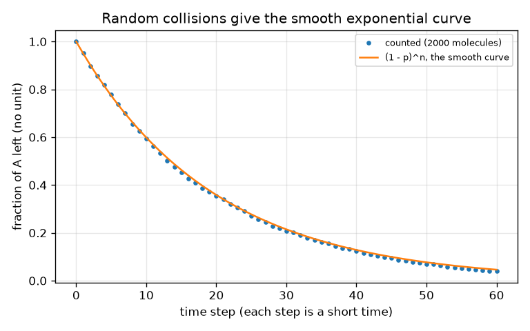

# സെഷൻ 1: രാസപ്രവർത്തനങ്ങൾക്ക് സമയമെടുക്കും: സാന്ദ്രത, സമയത്തിനെതിരെ

[Session 1 — हिन्दी](README.hi.md)

*ലെവൽ 1 (ആശയപരമായ ഇന്ററാക്ടീവ് മോഡൽ) · ഏകദേശം 60 മിനിറ്റ് · openreactionrate*

> ഇത് ഒരു ലളിതമാക്കിയ വിദ്യാഭ്യാസ മോഡൽ ആണ്. ഇത് സാധൂകരിക്കപ്പെട്ട ഒരു ഡിസൈൻ ഉപകരണമല്ല; യഥാർത്ഥ നിർമ്മിതികൾ, വൈദ്യുത ഇൻസ്റ്റലേഷനുകൾ, വാഹനങ്ങൾ, വ്യാവസായിക പ്രക്രിയകൾ അല്ലെങ്കിൽ വൈദ്യപരമായ തീരുമാനങ്ങൾ എന്നിവയ്ക്ക് ഇത് ഉപയോഗിക്കരുത്.

**മുൻ അറിവ് (Prerequisites)**

- സ്കൂൾ ബീജഗണിതവും ഗ്രാഫ് വായിക്കലും.
- നിങ്ങൾ PRIMER.md വായിക്കുകയും `python start.py 1` ഒരു തവണ റൺ ചെയ്യുകയും ചെയ്തിട്ടുണ്ട്.

**പഠന ലക്ഷ്യങ്ങൾ (Learning objectives).** ഈ സെഷനു ശേഷം നിങ്ങൾക്ക് കഴിയും:

- പ്രവർത്തന നിരക്ക് (reaction rate) എന്താണെന്ന് പറയാനും അതിനെ മാറ്റുന്ന നാല് കാര്യങ്ങൾ പേരെടുത്തു പറയാനും: സാന്ദ്രത, താപനില, കൂട്ടിമുട്ടലുകൾ, ഒരു ഉൽപ്രേരകം (catalyst).
- A -> B എന്ന പ്രവർത്തനത്തിന്റെ സാന്ദ്രത-സമയ വക്രം വായിച്ച് അതിൽ നിന്ന് അർദ്ധായുസ്സ് (half-life) കണ്ടെത്താൻ.
- [A] = A0 exp(-k t), half-life = ln 2 / k എന്നിവ ശരിയായ യൂണിറ്റുകളോടെ ഉപയോഗിക്കാൻ.
- ക്രമരഹിതമായ കൂട്ടിമുട്ടലുകൾ എന്ന ആശയം ഉപയോഗിച്ച് വക്രം വളയുന്നത് എന്തുകൊണ്ടെന്ന് വിശദീകരിക്കാൻ.

## A. യഥാർത്ഥ ലോക പ്രശ്നം
അടുക്കളയിലെ മേശപ്പുറത്ത് പാൽ ഒരു ദിവസം കൊണ്ട് പുളിക്കുന്നു, ഫ്രിഡ്ജിൽ ഒരാഴ്ച കൊണ്ടും. ഒരു കുപ്പി ഹൈഡ്രജൻ പെറോക്സൈഡ് മാസങ്ങളോളം കേടാകാതെ ഇരിക്കും, പക്ഷേ ഒരു നുള്ള് മാംഗനീസ് ഡൈ ഓക്സൈഡ് ഇട്ടാൽ അത് ഉടൻ നുരയുന്നു. രാസപ്രവർത്തനങ്ങൾക്ക് സമയമെടുക്കും, ചില കാര്യങ്ങൾ (ചൂട്, അതേ സ്ഥലത്ത് കൂടുതൽ തന്മാത്രകൾ, ഒരു ഉൽപ്രേരകം) എത്ര സമയം വേണമെന്നത് മാറ്റുന്നു. ഒരു പദാർത്ഥം A എത്ര വേഗത്തിൽ പദാർത്ഥം B ആയി മാറുന്നു എന്ന് നമുക്ക് എങ്ങനെ വരയ്ക്കാനും പിന്നീട് പ്രവചിക്കാനും കഴിയും?

## B. ആശയവും സിദ്ധാന്തവും
A യുടെ ഒരു തന്മാത്ര B ആയി മാറണമെങ്കിൽ സാധാരണയായി അത് മറ്റെന്തിനോടെങ്കിലും കൂട്ടിമുട്ടണം, ആ കൂട്ടിമുട്ടൽ മതിയായ ഊർജ്ജമുള്ളതുമായിരിക്കണം. അതേ വ്യാപ്തത്തിൽ കൂടുതൽ A തന്മാത്രകൾ ഉണ്ടെങ്കിൽ (ഉയർന്ന സാന്ദ്രത) സെക്കൻഡിൽ കൂടുതൽ കൂട്ടിമുട്ടലുകൾ ഉണ്ടാകുന്നു, അതിനാൽ നിരക്ക് കൂടുതലാണ്. ഏറ്റവും ലളിതമായ പ്രവർത്തനമായ A -> B ൽ നിരക്ക് (സെക്കൻഡിൽ A യുടെ എത്ര mol/L അപ്രത്യക്ഷമാകുന്നു) A യുടെ സാന്ദ്രതയ്ക്ക് ആനുപാതികമാണ്: rate = k [A]. സ്ഥിരാങ്കം k ആണ് നിരക്ക് സ്ഥിരാങ്കം (rate constant); വലിയ k എന്നാൽ വേഗതയേറിയ പ്രവർത്തനം. മിശ്രിതം ചൂടാക്കുന്നത് കൂട്ടിമുട്ടലുകൾ കൂടുതൽ ഇടയ്ക്കിടെയാക്കുന്നു, അതിനെക്കാൾ പ്രധാനമായി കൂടുതൽ ഊർജ്ജമുള്ളതുമാക്കുന്നു, അതിനാൽ k വർദ്ധിക്കുന്നു. ഉൽപ്രേരകം പ്രവർത്തനത്തിന് എളുപ്പമുള്ള ഒരു വഴി നൽകുന്നു, അത് k യും ഉയർത്തുന്നു, അത് ഉപയോഗിച്ചു തീരുന്നുമില്ല. rate = k [A] നിർധാരണം ചെയ്താൽ ഒരു ചരഘാതാങ്ക ക്ഷയം (exponential decay) ലഭിക്കുന്നു: ധാരാളം A ഉള്ളപ്പോൾ [A] ആദ്യം വേഗത്തിൽ കുറയുന്നു, പിന്നീട് പതുക്കെ. [A] പകുതിയാകാൻ വേണ്ട സമയമാണ് അർദ്ധായുസ്സ്; ഈ പ്രവർത്തനത്തിന് നിങ്ങൾ എവിടെ തുടങ്ങിയാലും അത് ഒന്നുതന്നെയാണ്. B എന്നത് A നഷ്ടപ്പെട്ടതാണ്, [B] = A0 - [A]. ഇവിടെ ഉൽപ്രേരകത്തെ ഏറ്റവും ലളിതമായി, k യെ ഗുണിക്കുന്ന ഒരു ഘടകം f ആയി മോഡൽ ചെയ്തിരിക്കുന്നു.

| ചിഹ്നം | അർത്ഥം | യൂണിറ്റ് |
|---|---|---|
| [A] | t സമയത്തെ A യുടെ സാന്ദ്രത | mol/L |
| A0 | A യുടെ ആരംഭ സാന്ദ്രത | mol/L |
| k | നിരക്ക് സ്ഥിരാങ്കം (A -> B ന്) | 1/s |
| t | സമയം | s |
| t_half | അർദ്ധായുസ്സ്: [A] പകുതിയാകാൻ വേണ്ട സമയം | s |
| f | ഉൽപ്രേരക വേഗതാ ഘടകം (k യെ f കൊണ്ട് ഗുണിക്കുന്നു) | യൂണിറ്റില്ല |

**അനുമാനങ്ങൾ (Assumptions)**

- A -> B എന്ന ഒരു ഘട്ടം മാത്രം, അത് പിന്നോട്ട് പോകാൻ കഴിയില്ല.
- പ്രവർത്തനം നടക്കുമ്പോൾ താപനില സ്ഥിരമായി നിൽക്കുന്നു.
- മിശ്രിതം ഇളക്കപ്പെടുന്നു, അതിനാൽ സാന്ദ്രത എല്ലായിടത്തും ഒരുപോലെയാണ്.
- ഉൽപ്രേരകം k യെ ഗുണിക്കുക മാത്രം ചെയ്യുന്നു; യഥാർത്ഥ ഉൽപ്രേരകങ്ങൾ വിഷലിപ്തമാകുകയോ പതുക്കെ ഉപയോഗിച്ച് തീരുകയോ ചെയ്യാം.

$$ \text{rate}=-\frac{d[A]}{dt}=k\,[A] $$

$$ [A]_t=A_0\,e^{-kt},\qquad [B]_t=A_0-[A]_t $$

$$ t_{1/2}=\frac{\ln 2}{k},\qquad t_{x}=\frac{1}{k}\ln\frac{1}{1-x}\ \ (\text{time to convert a fraction }x) $$

## C. ദൃശ്യ വിശദീകരണം
ആദ്യ ചിത്രം k = 0.10 1/s ന് (തുടർച്ചയായ വര) ഉം k അഞ്ചിരട്ടി വലുതാക്കുന്ന ഉൽപ്രേരകത്തിന് (മുറിഞ്ഞ വര) ഉം [A], [B] എന്നിവയെ സമയത്തിനെതിരെ വരയ്ക്കുന്നു. രണ്ട് A വക്രങ്ങൾക്കും ഒരേ ആകൃതിയാണ്; മുറിഞ്ഞ വര സമയത്തിന്റെ അഞ്ചിലൊന്നിലേക്ക് ഞെരുക്കപ്പെട്ടതാണ്, അർദ്ധായുസ്സ് 6.9 s ൽ നിന്ന് 1.4 s ആയി കുറയുന്നു. A യും B യും അർദ്ധായുസ്സിൽ ഖണ്ഡിക്കുന്നു, അവിടെ ഓരോന്നും ആരംഭ മൂല്യത്തിന്റെ പകുതിയാണ്. രണ്ടാമത്തെ ചിത്രം 2000 തന്മാത്രകളെ എണ്ണുന്നു, ഓരോ സമയ ഘട്ടത്തിലും പ്രവർത്തിക്കാൻ 5 ശതമാനം സാധ്യതയുണ്ട്: ബിന്ദുക്കൾ മിനുസമാർന്ന വക്രം (1 - p)^n ന് മേൽ കിടക്കുന്നു, അതിനാൽ വക്രം വളയുന്നതിന് പ്രത്യേക നിയമം ആവശ്യമില്ല, പ്രവർത്തിക്കാൻ ബാക്കിയുള്ള A തന്മാത്രകൾ കുറവാണ് എന്നതേ ഉള്ളൂ.

![A -> B ക്കുള്ള [A], [B]; 5 മടങ്ങ് ഉൽപ്രേരകം (മുറിഞ്ഞ വര) അതേ വക്രത്തെ സമയത്തിന്റെ അഞ്ചിലൊന്നിലേക്ക് ഞെരുക്കുന്നു.](../../docs/figures/s01_a_to_b.png)

*A -> B ക്കുള്ള [A], [B]; 5 മടങ്ങ് ഉൽപ്രേരകം (മുറിഞ്ഞ വര) അതേ വക്രത്തെ സമയത്തിന്റെ അഞ്ചിലൊന്നിലേക്ക് ഞെരുക്കുന്നു.*

*ക്രമരഹിതമായി പ്രവർത്തിക്കുന്ന 2000 തന്മാത്രകളെ എണ്ണുന്നത് മിനുസമാർന്ന ചരഘാതാങ്ക വക്രത്തെ പുനഃസൃഷ്ടിക്കുന്നു.*

## D. ഇന്ററാക്ടീവ് സിമുലേഷൻ
പാഠം റൺ ചെയ്യുക (`python start.py 1`), തുടർന്ന് ലൈവ് ആപ്പ് തുറക്കുക: [സെഷൻ 1: ഉൽപ്രേരകത്തോടെ A -> B](https://krunalpanchal1995.github.io/pan-iit-oss/openreactionrate/session-01/) (അല്ലെങ്കിൽ ഈ ഫോൾഡറിലെ `app.html`). സമയ സ്ലൈഡർ വലിച്ച് ടാങ്കുകൾ നോക്കുക: A ഒഴിയുന്നു, B നിറയുന്നു, തുക അതേപടി നിൽക്കുന്നു. തുടർന്ന് ഉൽപ്രേരക ഘടകം ഉയർത്തി അതേ വക്രം കൂടുതൽ വേഗത്തിൽ നടക്കുന്നത് കാണുക. ഗ്രാഫ് കാഴ്ചയിലേക്ക് മാറി നീലയും പച്ചയും വക്രങ്ങൾ ഖണ്ഡിക്കുന്ന സ്ഥാനം കണ്ടെത്തുക.

**വെല്ലുവിളി (Challenge).** A യുടെ പകുതി 5 സെക്കൻഡിനുള്ളിൽ പ്രവർത്തിക്കുന്നതാക്കുക (അർദ്ധായുസ്സ് 5 s ൽ താഴെ).

## E. ഉദാഹരണ പ്രശ്നവും പരീക്ഷണവും
**പ്രശ്നം.** k = 0.10 1/s, A0 = 1.0 mol/L ഉള്ള A -> B ക്ക് 10 s ന് ശേഷമുള്ള [A], [B], അർദ്ധായുസ്സ്, 90 ശതമാനം പരിവർത്തനത്തിനുള്ള സമയം എന്നിവ കണ്ടെത്തുക. തുടർന്ന് k അഞ്ചിരട്ടിയാക്കുന്ന ഉൽപ്രേരകം അവസാന സംഖ്യയെ എങ്ങനെ മാറ്റുന്നു എന്ന് നോക്കുക.

1. 10 s ന് ശേഷമുള്ള [A]: k t = 0.10 * 10 = 1.0, അതിനാൽ [A] = 1.0 * exp(-1.0) = 0.368 mol/L.
2. [B] = A0 - [A] = 1.0 - 0.368 = 0.632 mol/L. (പരിശോധന: A + B = 1.000 mol/L.)
3. അർദ്ധായുസ്സ് = ln 2 / k = 0.693 / 0.10 = 6.93 s.
4. 90 ശതമാനം പരിവർത്തനം എന്നാൽ [A] = 0.10: t = ln(10) / k = 2.303 / 0.10 = 23.0 s.
5. ഉൽപ്രേരകത്തോടെ k = 0.50 1/s, അതിനാൽ സമയം 2.303 / 0.50 = 4.6 s: അഞ്ചിരട്ടി നേരത്തെ.

**ഉത്തരം.** 10 s ന് ശേഷം [A] = 0.368 mol/L, [B] = 0.632 mol/L; അർദ്ധായുസ്സ് 6.93 s; 90 ശതമാനം 23.0 s ന് ശേഷം, അല്ലെങ്കിൽ 5 മടങ്ങ് ഉൽപ്രേരകത്തോടെ 4.6 s.

**പരീക്ഷണം.** ഒരു എഫർവെസെന്റ് ഗുളിക 200 mL തണുത്ത പൈപ്പ് വെള്ളത്തിലും (ഏകദേശം 10 ഡിഗ്രി C) 200 mL ചൂടുവെള്ളത്തിലും (ഏകദേശം 40 ഡിഗ്രി C) ഇടുക, നുരയൽ നിൽക്കാൻ എത്ര സമയമെടുക്കുന്നു എന്ന് അളക്കുക; അര ഗുളികയും പരീക്ഷിക്കുക. ചൂടുവെള്ളത്തിൽ വ്യക്തമായി നേരത്തെ തീരണം. മോഡലും യാഥാർത്ഥ്യവും: ഒരു ഗുളിക അലിയുന്നത് ശുദ്ധമായ ഒന്നാം ക്രമ പ്രവർത്തനമല്ല (പ്രതല വിസ്തീർണ്ണം ചുരുങ്ങുന്നു, ഇളക്കൽ പ്രധാനമാണ്), താപനില k യെ "അല്പം" അല്ല, ഒരു നിശ്ചിത ഘടകത്താലാണ് മാറ്റുന്നത്. പരീക്ഷണത്തെ പ്രവണതയുടെ ഒരു ചിത്രമായി കാണുക, സംഖ്യയുടെ പരിശോധനയായല്ല. ലായനികൾ കുടിക്കരുത്, ലേബലിലെ നിർദ്ദേശങ്ങൾ പാലിക്കുക.

## F. വിലയിരുത്തലും ഡിസൈൻ വെല്ലുവിളിയും
**ചോദ്യ തരം A: ആശയപരം.** പ്രവർത്തനത്തിൽ ഒന്നും മാറുന്നില്ലെങ്കിലും A യുടെ സാന്ദ്രത ആദ്യം വേഗത്തിലും പിന്നീട് പതുക്കെയും കുറയുന്നത് എന്തുകൊണ്ട്?

സൂചന

നിരക്ക് എന്തിനെ ആശ്രയിക്കുന്നു, സമയം പോകുമ്പോൾ ആ അളവിന് എന്ത് സംഭവിക്കുന്നു?

ഘട്ടം ഘട്ടമായുള്ള പരിഹാരം

നിരക്ക് k [A] ആണ്. തുടക്കത്തിൽ ധാരാളം A ഉണ്ട്, അതിനാൽ സെക്കൻഡിൽ ധാരാളം പ്രവർത്തനങ്ങൾ നടക്കുന്നു. A ഉപയോഗിക്കപ്പെടുമ്പോൾ A തന്മാത്രകളും കൂട്ടിമുട്ടലുകളും കുറയുന്നു, അതിനാൽ നിരക്ക് കുറയുകയും വക്രം പരന്നതാകുകയും ചെയ്യുന്നു. നിരക്ക് സ്ഥിരാങ്കം k മാറുന്നില്ല; [A] കുറയുന്നതുകൊണ്ട് മാത്രമാണ് നിരക്ക് കുറയുന്നത്.

**ചോദ്യ തരം B: സംഖ്യാപരം.** ഒരു പ്രവർത്തനം A -> B ക്ക് k = 0.05 1/s, A0 = 2.0 mol/L. 20 s ന് ശേഷമുള്ള [A] ഉം അർദ്ധായുസ്സും കണ്ടെത്തുക, ഉത്തരം യുക്തിസഹമാണോ എന്ന് പരിശോധിക്കുക.

സൂചന

20 s ന് ശേഷം k t = 1. [A] = A0 exp(-k t), t_half = ln 2 / k എന്നിവ ഉപയോഗിക്കുക.

ഘട്ടം ഘട്ടമായുള്ള പരിഹാരം

[A] = 2.0 * exp(-1) = 0.736 mol/L. അർദ്ധായുസ്സ് = 0.693 / 0.05 = 13.9 s. യുക്തി പരിശോധന: 20 s എന്നത് ഏകദേശം 1.44 അർദ്ധായുസ്സുകളാണ്, അതിനാൽ [A] = 2.0 * 0.5^1.44 = 0.736 ആയിരിക്കണം. അവ യോജിക്കുന്നു. യൂണിറ്റുകൾ: സാന്ദ്രത mol/L ൽ, k 1/s ൽ.

**ചോദ്യ തരം C: ഗ്രാഫ്, സിമുലേഷൻ വ്യാഖ്യാനം.** സ്ലൈഡർ ആപ്പിലെ A-B ഗ്രാഫിൽ (A0 = 1, k = 0.10) വക്രങ്ങൾ എവിടെ ഖണ്ഡിക്കുന്നു, അവിടെ അവയുടെ മൂല്യം എന്താണ്? A0 = 2 ആയിരുന്നെങ്കിൽ എന്ത് മാറും?

സൂചന

[A] = [B] ആകുമ്പോൾ, അതായത് A യുടെ കൃത്യം പകുതി പ്രവർത്തിച്ചുകഴിയുമ്പോൾ അവ ഖണ്ഡിക്കുന്നു.

ഘട്ടം ഘട്ടമായുള്ള പരിഹാരം

അവ അർദ്ധായുസ്സിൽ, 6.9 s ൽ, 0.5 mol/L (A0 യുടെ പകുതി) മൂല്യത്തിൽ ഖണ്ഡിക്കുന്നു. A0 = 2 ആണെങ്കിൽ അവ അതേ സമയത്ത്, 6.9 s ൽ, പക്ഷേ 1.0 mol/L ൽ ഖണ്ഡിക്കും, കാരണം ഈ പ്രവർത്തനത്തിന്റെ അർദ്ധായുസ്സ് ആരംഭ സാന്ദ്രതയെ ആശ്രയിക്കുന്നില്ല.

**ചോദ്യ തരം D: ഡിസൈൻ, ഒപ്റ്റിമൈസേഷൻ വെല്ലുവിളി.** ഡിസൈൻ: k = 0.10 1/s ഉള്ള ഒരു പ്രവർത്തനം 10 s നുള്ളിൽ 90 ശതമാനം പൂർത്തിയാകണം. ഉൽപ്രേരകം k യെ ഏത് ഘടകം കൊണ്ട് ഉയർത്തണം? ഏത് പൂർണ്ണസംഖ്യാ ഘടകം നിങ്ങൾ തിരഞ്ഞെടുക്കും, വേഗതയ്ക്ക് പുറമെ മറ്റെന്തെല്ലാം പ്രധാനമാണ്?

സൂചന

ln(10) / k_new = 10 s എന്നത് k_new നായി നിർധാരണം ചെയ്യുക, തുടർന്ന് 0.10 കൊണ്ട് ഹരിക്കുക.

ഘട്ടം ഘട്ടമായുള്ള പരിഹാരം

k_new = ln(10) / 10 = 0.230 1/s, 2.3 എന്ന ഘടകം. അടുത്ത പൂർണ്ണസംഖ്യ 3 ആണ്, ഇത് k = 0.30 1/s ഉം, കുറച്ച് മാർജിനോടെ 7.7 s സമയവും നൽകുന്നു. പ്രധാനപ്പെട്ട മറ്റ് കാര്യങ്ങൾ: ഉൽപ്രേരകത്തിന്റെ ചെലവ്, ഉൽപ്പന്നത്തിൽ നിന്ന് അതിനെ വേർതിരിക്കാൻ കഴിയുമോ, അത് വിഷലിപ്തമാകുകയോ ഉപയോഗിച്ച് തീരുകയോ ചെയ്യുമോ, ഉൽപ്പന്നം സുരക്ഷിതമാണോ, പ്രവർത്തനം ചൂട് പുറത്തുവിടുന്നുണ്ടോ, അത് നീക്കം ചെയ്യേണ്ടതുണ്ടോ.

[RUBRIC.md](../../RUBRIC.md) ഉപയോഗിച്ച് സ്വയം സ്കോർ ചെയ്യുക. പേപ്പറിൽ ചെയ്യാൻ [ആക്ടിവിറ്റി ഷീറ്റ്](activity_sheet.md) പ്രിന്റ് ചെയ്യുക.

## സാധാരണ തെറ്റിദ്ധാരണകൾ
| സാധാരണ തെറ്റിദ്ധാരണ | യഥാർത്ഥത്തിൽ ശരിയായത് |
|---|---|
| ഉൽപ്രേരകം ഉപയോഗിച്ച് തീരുകയും ഉൽപ്പന്നത്തിന്റെ ഭാഗമാകുകയും ചെയ്യുന്നു. | മൊത്തത്തിൽ ഉൽപ്രേരകം ഉപയോഗിച്ച് തീരുന്നില്ല: അത് ഘട്ടങ്ങളിൽ പങ്കെടുക്കുകയും പുനഃസൃഷ്ടിക്കപ്പെടുകയും ചെയ്യുന്നു, അതിനാൽ ചെറിയ അളവ് ധാരാളം പ്രവർത്തനത്തെ വേഗത്തിലാക്കുന്നു. |
| നിരക്ക് സ്ഥിരാങ്കം ഇരട്ടിയായ പ്രവർത്തനം അതേ സമയത്ത് ഇരട്ടി പരിവർത്തനം ചെയ്യുന്നു. | ഇരട്ടി k എന്നാൽ അതേ അംശം പകുതി സമയത്തിൽ എത്തുന്നു, പക്ഷേ നിശ്ചിത സമയത്തിന് ശേഷം പരിവർത്തനം ചെയ്യപ്പെടുന്ന അളവ് നേർരേഖയല്ല, ചരഘാതാങ്ക വക്രത്തെയാണ് പിന്തുടരുന്നത്. |
| സാന്ദ്രത പരിമിത സമയത്തിൽ പൂജ്യത്തിലെത്തുമ്പോൾ പ്രവർത്തനം നിൽക്കുന്നു. | rate k [A] ഉള്ള A -> B ൽ സാന്ദ്രത പൂജ്യത്തോട് അടുക്കുക മാത്രം ചെയ്യുന്നു; ഓരോ അർദ്ധായുസ്സും ബാക്കിയുള്ളതിനെ പകുതിയാക്കുന്നു. |
| ഉൽപ്രേരകം അവസാനം ലഭിക്കുന്ന ഉൽപ്പന്നത്തിന്റെ അളവ് മാറ്റുന്നു. | ഉൽപ്രേരകം വേഗതയെയാണ് മാറ്റുന്നത്, പ്രവർത്തനം എവിടെ അവസാനിക്കുന്നു എന്നതിനെയല്ല (പൂർണ്ണമായി നടക്കുന്ന പ്രവർത്തനത്തിന് B യുടെ അളവ് അതുതന്നെ). |

## പദാവലി (Glossary)
- **നിരക്ക് സ്ഥിരാങ്കം (rate constant, k)**: ഒരു പ്രവർത്തനം എത്ര വേഗത്തിൽ നടക്കുന്നു എന്ന് നിശ്ചയിക്കുന്ന സംഖ്യ; വലുതെങ്കിൽ വേഗത കൂടുതൽ
- **സാന്ദ്രത (concentration)**: ഒരു ലിറ്ററിലെ പദാർത്ഥത്തിന്റെ അളവ്, mol/L ൽ
- **അർദ്ധായുസ്സ് (half-life)**: ഒരു സാന്ദ്രത പകുതിയാകാൻ വേണ്ട സമയം
- **ഉൽപ്രേരകം (catalyst)**: പ്രവർത്തനത്തെ വേഗത്തിലാക്കുകയും പുനഃസൃഷ്ടിക്കപ്പെടുകയും ചെയ്യുന്ന പദാർത്ഥം
- **കൂട്ടിമുട്ടൽ (collision)**: രണ്ട് തന്മാത്രകൾ കണ്ടുമുട്ടുന്നത്; അവ കണ്ടുമുട്ടിയാൽ മാത്രമേ പ്രവർത്തനം നടക്കൂ

## പൂർത്തിയാക്കുക
1. [exercises.md](exercises.md) ലെ മൂന്ന് കോഡിംഗ് ടാസ്കുകൾ ചെയ്യുക.
2. നിങ്ങളുടെ മാറ്റങ്ങൾക്കു ശേഷം `python start.py 1` വീണ്ടും റൺ ചെയ്യുക. ഇത് ചെക്ക്‌പോയിന്റോടെ അവസാനിക്കുന്നു; അത് `PASS` എന്ന് പ്രിന്റ് ചെയ്യുമ്പോൾ നിങ്ങൾ പൂർത്തിയാക്കി. (ചെക്ക്‌പോയിന്റ് മാത്രം: `python start.py check 1`.)

അടുത്തത്: [സെഷൻ 2](../session-02/README.md)
