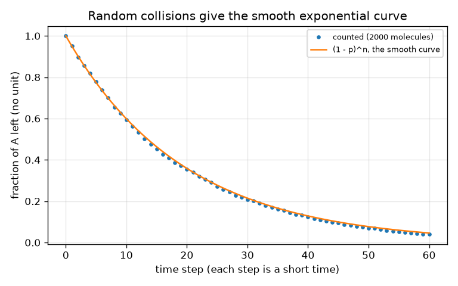

# அமர்வு 1: வினைகளுக்கு நேரம் ஆகும்: செறிவு, நேரத்துக்கு எதிராக

[Session 1 — हिन्दी](README.hi.md) · [Session 1 — മലയാളം](README.ml.md)

*நிலை 1 (கருத்தியல் ஊடாடும் மாதிரி) · சுமார் 60 நிமிடங்கள் · openreactionrate*

> இது ஒரு எளிமைப்படுத்தப்பட்ட கல்வி மாதிரி. இது சரிபார்க்கப்பட்ட வடிவமைப்புக் கருவி அல்ல; உண்மையான கட்டமைப்புகள், மின் நிறுவல்கள், வாகனங்கள், தொழில்துறை செயல்முறைகள் அல்லது மருத்துவ முடிவுகளுக்கு இதைப் பயன்படுத்தக் கூடாது.

**முன்தேவைகள் (Prerequisites)**

- பள்ளி இயற்கணிதமும் வரைபடம் படிப்பதும்.
- நீங்கள் PRIMER.md ஐப் படித்து, `python start.py 1` ஐ ஒரு முறை இயக்கியிருக்கிறீர்கள்.

**கற்றல் நோக்கங்கள் (Learning objectives).** இந்த அமர்வுக்குப் பிறகு உங்களால் முடியும்:

- வினை வேகம் (reaction rate) என்றால் என்ன என்று கூறி, அதை மாற்றும் நான்கு காரணிகளைப் பெயரிட: செறிவு, வெப்பநிலை, மோதல்கள், ஊக்கி (catalyst).
- A -> B க்கான செறிவு-நேர வளைவைப் படித்து அதிலிருந்து அரை-வாழ்வுக்காலத்தை (half-life) கண்டறிய.
- [A] = A0 exp(-k t) மற்றும் half-life = ln 2 / k ஐச் சரியான அலகுகளுடன் பயன்படுத்த.
- சீரற்ற மோதல்கள் என்ற கருத்தைப் பயன்படுத்தி வளைவு ஏன் வளைகிறது என்று விளக்க.

## A. நிஜ உலகப் பிரச்சினை
சமையலறை மேசையில் பால் ஒரு நாளில் புளிக்கிறது, குளிர்சாதனப் பெட்டியில் ஒரு வாரத்தில். ஒரு புட்டி ஹைட்ரஜன் பெராக்சைடு மாதக்கணக்கில் கெடாமல் இருக்கும், ஆனால் ஒரு சிட்டிகை மாங்கனீசு டைஆக்சைடு போட்டால் உடனே நுரைக்கிறது. வேதிவினைகளுக்கு நேரம் ஆகும், சில விஷயங்கள் (வெப்பம், அதே இடத்தில் அதிக மூலக்கூறுகள், ஊக்கி) எவ்வளவு நேரம் ஆகும் என்பதை மாற்றுகின்றன. ஒரு பொருள் A எவ்வளவு வேகமாகப் பொருள் B ஆக மாறுகிறது என்பதை நாம் எப்படி வரையவும் பின்னர் முன்னறிவிக்கவும் முடியும்?

## B. கருத்தும் கோட்பாடும்
A இன் ஒரு மூலக்கூறு B ஆக மாற, பொதுவாக அது வேறொன்றுடன் மோத வேண்டும், அந்த மோதல் போதுமான ஆற்றலுடனும் இருக்க வேண்டும். அதே கன அளவில் அதிக A மூலக்கூறுகள் இருந்தால் (அதிக செறிவு) வினாடிக்கு அதிக மோதல்கள் நடக்கின்றன, எனவே வேகம் அதிகம். எளிமையான வினை A -> B இல் வேகம் (வினாடிக்கு A இன் எத்தனை mol/L மறைகிறது) A இன் செறிவுக்கு விகிதசமம்: rate = k [A]. மாறிலி k வேக மாறிலி (rate constant); பெரிய k என்றால் வேகமான வினை. கலவையைச் சூடாக்குவது மோதல்களை அடிக்கடி நிகழச் செய்கிறது, அதைவிட முக்கியமாக அதிக ஆற்றலுடையதாக்குகிறது, எனவே k அதிகரிக்கிறது. ஊக்கி வினைக்கு எளிதான வழியைத் தருகிறது, அது k ஐயும் உயர்த்துகிறது, அது தீர்ந்துபோவதுமில்லை. rate = k [A] ஐத் தீர்த்தால் அடுக்குக்குறிச் சிதைவு (exponential decay) கிடைக்கிறது: நிறைய A இருக்கும்போது [A] முதலில் வேகமாகக் குறைகிறது, பின்னர் மெதுவாக. [A] பாதியாக ஆகும் நேரமே அரை-வாழ்வுக்காலம்; இந்த வினைக்கு நீங்கள் எங்கிருந்து தொடங்கினாலும் அது ஒன்றே. B என்பது A இழந்தது மட்டுமே, [B] = A0 - [A]. இங்கே ஊக்கி மிக எளிமையாக, k ஐப் பெருக்கும் காரணி f ஆக மாதிரியாக்கப்பட்டுள்ளது.

| குறியீடு | பொருள் | அலகு |
|---|---|---|
| [A] | t நேரத்தில் A இன் செறிவு | mol/L |
| A0 | A இன் தொடக்கச் செறிவு | mol/L |
| k | வேக மாறிலி (A -> B க்கு) | 1/s |
| t | நேரம் | s |
| t_half | அரை-வாழ்வுக்காலம்: [A] பாதியாக ஆகும் நேரம் | s |
| f | ஊக்கி வேகக் காரணி (k ஐ f ஆல் பெருக்குகிறது) | அலகு இல்லை |

**அனுமானங்கள் (Assumptions)**

- A -> B என்ற ஒரே ஒரு படிநிலை மட்டும், அது பின்னோக்கிச் செல்ல முடியாது.
- வினை நடக்கும்போது வெப்பநிலை மாறாமல் இருக்கும்.
- கலவை கலக்கப்படுகிறது, எனவே செறிவு எல்லா இடங்களிலும் ஒன்றே.
- ஊக்கி k ஐ மட்டுமே பெருக்குகிறது; உண்மையான ஊக்கிகள் நச்சுப்படலாம் அல்லது மெதுவாகத் தீர்ந்துபோகலாம்.

$$ \text{rate}=-\frac{d[A]}{dt}=k\,[A] $$

$$ [A]_t=A_0\,e^{-kt},\qquad [B]_t=A_0-[A]_t $$

$$ t_{1/2}=\frac{\ln 2}{k},\qquad t_{x}=\frac{1}{k}\ln\frac{1}{1-x}\ \ (\text{time to convert a fraction }x) $$

## C. காட்சி விளக்கம்
முதல் படம் k = 0.10 1/s க்கு (தொடர் கோடு) மற்றும் k ஐ ஐந்து மடங்கு பெரிதாக்கும் ஊக்கிக்கு (புள்ளிக் கோடு) [A] மற்றும் [B] ஐ நேரத்துக்கு எதிராக வரைகிறது. இரண்டு A வளைவுகளுக்கும் ஒரே வடிவம்; புள்ளிக் கோடு நேரத்தின் ஐந்தில் ஒரு பங்காக நெருக்கப்பட்டது, அரை-வாழ்வுக்காலம் 6.9 s இலிருந்து 1.4 s ஆகக் குறைகிறது. A யும் B யும் அரை-வாழ்வுக்காலத்தில் சந்திக்கின்றன, அங்கே ஒவ்வொன்றும் தொடக்க மதிப்பின் பாதி. இரண்டாவது படம் 2000 மூலக்கூறுகளை எண்ணுகிறது, ஒவ்வொரு நேரப் படியிலும் வினைபுரிய 5 சதவீத வாய்ப்பு: புள்ளிகள் மென்மையான வளைவு (1 - p)^n மீது அமைகின்றன, எனவே வளைவு வளைவதற்குச் சிறப்பு விதி தேவையில்லை, வினைபுரிய மீதமுள்ள A மூலக்கூறுகள் குறைவு என்பதே போதும்.

![A -> B க்கான [A] மற்றும் [B]; 5 மடங்கு ஊக்கி (புள்ளிக் கோடு) அதே வளைவை நேரத்தின் ஐந்தில் ஒரு பங்காக நெருக்குகிறது.](../../docs/figures/s01_a_to_b.png)

*A -> B க்கான [A] மற்றும் [B]; 5 மடங்கு ஊக்கி (புள்ளிக் கோடு) அதே வளைவை நேரத்தின் ஐந்தில் ஒரு பங்காக நெருக்குகிறது.*

*சீரற்ற முறையில் வினைபுரியும் 2000 மூலக்கூறுகளை எண்ணுவது மென்மையான அடுக்குக்குறி வளைவை மீளுருவாக்குகிறது.*

## D. ஊடாடும் உருவகப்படுத்துதல்
பாடத்தை இயக்கவும் (`python start.py 1`), பின்னர் நேரடிச் செயலியைத் திறக்கவும்: [அமர்வு 1: ஊக்கியுடன் A -> B](https://krunalpanchal1995.github.io/pan-iit-oss/openreactionrate/session-01/) (அல்லது இந்தக் கோப்புறையில் உள்ள `app.html`). நேர ஸ்லைடரை இழுத்துத் தொட்டிகளைப் பாருங்கள்: A காலியாகிறது, B நிரம்புகிறது, கூட்டுத்தொகை மாறாமல் இருக்கிறது. பிறகு ஊக்கிக் காரணியை உயர்த்தி அதே வளைவு வேகமாக நடப்பதைப் பாருங்கள். வரைபடக் காட்சிக்கு மாறி நீல மற்றும் பச்சை வளைவுகள் சந்திக்கும் இடத்தைக் கண்டறியுங்கள்.

**சவால் (Challenge).** A இன் பாதி 5 வினாடிகளுக்குள் வினைபுரியச் செய்யுங்கள் (அரை-வாழ்வுக்காலம் 5 s க்குக் கீழ்).

## E. தீர்க்கப்பட்ட எடுத்துக்காட்டும் சோதனையும்
**பிரச்சினை.** k = 0.10 1/s மற்றும் A0 = 1.0 mol/L கொண்ட A -> B க்கு 10 s க்குப் பிறகு [A] மற்றும் [B], அரை-வாழ்வுக்காலம், 90 சதவீதம் மாற ஆகும் நேரம் ஆகியவற்றைக் கண்டறியுங்கள். பிறகு k ஐ ஐந்து மடங்காக்கும் ஊக்கி கடைசி எண்ணை என்ன செய்கிறது என்று பாருங்கள்.

1. 10 s க்குப் பிறகு [A]: k t = 0.10 * 10 = 1.0, எனவே [A] = 1.0 * exp(-1.0) = 0.368 mol/L.
2. [B] = A0 - [A] = 1.0 - 0.368 = 0.632 mol/L. (சரிபார்ப்பு: A + B = 1.000 mol/L.)
3. அரை-வாழ்வுக்காலம் = ln 2 / k = 0.693 / 0.10 = 6.93 s.
4. 90 சதவீதம் மாறியது என்றால் [A] = 0.10: t = ln(10) / k = 2.303 / 0.10 = 23.0 s.
5. ஊக்கியுடன் k = 0.50 1/s, எனவே நேரம் 2.303 / 0.50 = 4.6 s: ஐந்து மடங்கு விரைவாக.

**விடை.** 10 s க்குப் பிறகு [A] = 0.368 mol/L மற்றும் [B] = 0.632 mol/L; அரை-வாழ்வுக்காலம் 6.93 s; 90 சதவீதம் 23.0 s க்குப் பிறகு, அல்லது 5 மடங்கு ஊக்கியுடன் 4.6 s.

**சோதனை.** ஒரு நுரைக்கும் மாத்திரையை 200 mL குளிர்ந்த குழாய் நீரிலும் (சுமார் 10 டிகிரி C) 200 mL வெதுவெதுப்பான நீரிலும் (சுமார் 40 டிகிரி C) போட்டு, நுரைப்பு நிற்க எவ்வளவு நேரம் ஆகிறது என்று கணக்கிடுங்கள்; அரை மாத்திரையையும் முயற்சியுங்கள். வெதுவெதுப்பான நீரில் தெளிவாக விரைவில் முடிய வேண்டும். மாதிரியும் நிஜமும்: மாத்திரை கரைவது தூய முதல்-வரிசை வினை அல்ல (பரப்பு சுருங்குகிறது, கலக்குதல் முக்கியம்), வெப்பநிலை k ஐ "கொஞ்சம்" அல்ல, ஒரு குறிப்பிட்ட காரணியால் மாற்றுகிறது. சோதனையைப் போக்கின் ஒரு படமாகக் கருதுங்கள், எண்ணின் சரிபார்ப்பாக அல்ல. கரைசல்களைக் குடிக்காதீர்கள், லேபிளில் உள்ளவற்றைப் பின்பற்றுங்கள்.

## F. மதிப்பீடும் வடிவமைப்புச் சவாலும்
**கேள்வி வகை A: கருத்தியல்.** வினையில் எதுவும் மாறாவிட்டாலும் A இன் செறிவு ஏன் முதலில் வேகமாகவும் பின்னர் மெதுவாகவும் குறைகிறது?

குறிப்பு

வேகம் எதைச் சார்ந்தது, நேரம் செல்லச் செல்ல அந்த அளவுக்கு என்ன ஆகிறது?

படிப்படியான தீர்வு

வேகம் k [A]. தொடக்கத்தில் நிறைய A இருக்கிறது, எனவே வினாடிக்கு பல வினைகள் நடக்கின்றன. A பயன்படுத்தப்படும்போது A மூலக்கூறுகளும் மோதல்களும் குறைகின்றன, எனவே வேகம் குறைந்து வளைவு தட்டையாகிறது. வேக மாறிலி k மாறவில்லை; [A] குறைவதால் மட்டுமே வேகம் குறைகிறது.

**கேள்வி வகை B: எண்ணியல்.** ஒரு வினை A -> B க்கு k = 0.05 1/s மற்றும் A0 = 2.0 mol/L. 20 s க்குப் பிறகு [A] மற்றும் அரை-வாழ்வுக்காலத்தைக் கண்டறிந்து, உங்கள் விடை பொருத்தமானதா என்று சரிபாருங்கள்.

குறிப்பு

20 s க்குப் பிறகு k t = 1. [A] = A0 exp(-k t) மற்றும் t_half = ln 2 / k ஐப் பயன்படுத்துங்கள்.

படிப்படியான தீர்வு

[A] = 2.0 * exp(-1) = 0.736 mol/L. அரை-வாழ்வுக்காலம் = 0.693 / 0.05 = 13.9 s. பொருத்தச் சோதனை: 20 s என்பது சுமார் 1.44 அரை-வாழ்வுக்காலங்கள், எனவே [A] = 2.0 * 0.5^1.44 = 0.736 ஆக இருக்க வேண்டும். அவை ஒத்துப்போகின்றன. அலகுகள்: செறிவு mol/L இல், k 1/s இல்.

**கேள்வி வகை C: வரைபடம் மற்றும் உருவகப்படுத்துதல் விளக்கம்.** ஸ்லைடர் செயலியின் A-B வரைபடத்தில் (A0 = 1, k = 0.10) வளைவுகள் எங்கே சந்திக்கின்றன, அங்கே அவற்றின் மதிப்பு என்ன? A0 = 2 ஆக இருந்தால் என்ன மாறும்?

குறிப்பு

[A] = [B] ஆகும்போது, அதாவது A இன் சரியாகப் பாதி வினைபுரிந்தபோது அவை சந்திக்கின்றன.

படிப்படியான தீர்வு

அவை அரை-வாழ்வுக்காலத்தில், 6.9 s இல், 0.5 mol/L (A0 இன் பாதி) மதிப்பில் சந்திக்கின்றன. A0 = 2 என்றால் அவை அதே நேரத்தில், 6.9 s இல், ஆனால் 1.0 mol/L இல் சந்திக்கும், ஏனெனில் இந்த வினையின் அரை-வாழ்வுக்காலம் தொடக்கச் செறிவைச் சார்ந்ததல்ல.

**கேள்வி வகை D: வடிவமைப்பு மற்றும் உகப்பாக்கச் சவால்.** வடிவமைப்பு: k = 0.10 1/s கொண்ட ஒரு வினை 10 s க்குள் 90 சதவீதம் முடிய வேண்டும். ஊக்கி k ஐ எந்தக் காரணியால் உயர்த்த வேண்டும்? எந்த முழு எண் காரணியைத் தேர்ந்தெடுப்பீர்கள், வேகத்தைத் தவிர வேறு என்னென்ன முக்கியம்?

குறிப்பு

ln(10) / k_new = 10 s ஐ k_new க்குத் தீர்த்து, பின்னர் 0.10 ஆல் வகுக்கவும்.

படிப்படியான தீர்வு

k_new = ln(10) / 10 = 0.230 1/s, 2.3 என்ற காரணி. அடுத்த முழு எண் 3, இது k = 0.30 1/s ஐயும், சற்று இடைவெளியுடன் 7.7 s நேரத்தையும் தருகிறது. முக்கியமான பிற விஷயங்கள்: ஊக்கியின் செலவு, அதைப் பொருளிலிருந்து பிரிக்க முடியுமா, அது நச்சுப்படுமா அல்லது தீர்ந்துபோகுமா, பொருள் பாதுகாப்பானதா, வினை வெப்பத்தை வெளியிடுகிறதா, அதை அகற்ற வேண்டுமா.

[RUBRIC.md](../../RUBRIC.md) மூலம் உங்களை நீங்களே மதிப்பிடுங்கள். காகிதத்தில் செய்ய [செயல்பாட்டுத் தாளை](activity_sheet.md) அச்சிடுங்கள்.

## பொதுவான தவறான கருத்துகள்
| பொதுவான தவறான கருத்து | உண்மையில் சரியானது |
|---|---|
| ஊக்கி தீர்ந்துபோய்ப் பொருளின் பகுதியாகிறது. | ஊக்கி மொத்தத்தில் நுகரப்படுவதில்லை: அது படிநிலைகளில் பங்கேற்று மீளுருவாகிறது, எனவே சிறிதளவு நிறைய வினையை விரைவுபடுத்துகிறது. |
| வேக மாறிலி இருமடங்கான வினை அதே நேரத்தில் இருமடங்கு மாற்றுகிறது. | இருமடங்கு k என்றால் அதே பின்னம் பாதி நேரத்தில் எட்டப்படுகிறது, ஆனால் குறிப்பிட்ட நேரத்துக்குப் பின் மாறிய அளவு நேர்கோட்டை அல்ல, அடுக்குக்குறியைப் பின்பற்றுகிறது. |
| செறிவு குறிப்பிட்ட நேரத்தில் பூஜ்ஜியத்தை அடையும்போது வினை நின்றுவிடுகிறது. | rate k [A] கொண்ட A -> B இல் செறிவு பூஜ்ஜியத்தை நெருங்க மட்டுமே செய்கிறது; ஒவ்வொரு அரை-வாழ்வுக்காலமும் மீதமுள்ளதைப் பாதியாக்குகிறது. |
| ஊக்கி இறுதியில் கிடைக்கும் பொருளின் அளவை மாற்றுகிறது. | ஊக்கி வேகத்தை மாற்றுகிறது, வினை எங்கு முடிகிறது என்பதை அல்ல (முழுமையாக நடக்கும் வினைக்கு B இன் அளவு அதுவே). |

## சொற்களஞ்சியம் (Glossary)
- **வேக மாறிலி (rate constant, k)**: ஒரு வினை எவ்வளவு வேகமாக நடக்கிறது என்பதை நிர்ணயிக்கும் எண்; பெரியது என்றால் வேகம் அதிகம்
- **செறிவு (concentration)**: ஒரு லிட்டரில் உள்ள பொருளின் அளவு, mol/L இல்
- **அரை-வாழ்வுக்காலம் (half-life)**: ஒரு செறிவு பாதியாகக் குறைய ஆகும் நேரம்
- **ஊக்கி (catalyst)**: வினையை விரைவுபடுத்தி மீளுருவாகும் பொருள்
- **மோதல் (collision)**: இரண்டு மூலக்கூறுகள் சந்திப்பது; அவை சந்தித்தால் மட்டுமே வினை நடக்க முடியும்

## முடிக்கவும்
1. [exercises.md](exercises.md) இல் உள்ள மூன்று நிரலாக்கப் பணிகளைச் செய்யுங்கள்.
2. உங்கள் மாற்றங்களுக்குப் பிறகு `python start.py 1` ஐ மீண்டும் இயக்குங்கள். இது சோதனைச்சாவடியுடன் (checkpoint) முடிகிறது; அது `PASS` என்று அச்சிடும்போது நீங்கள் முடித்துவிட்டீர்கள். (சோதனைச்சாவடி மட்டும்: `python start.py check 1`.)

அடுத்து: [அமர்வு 2](../session-02/README.md)
