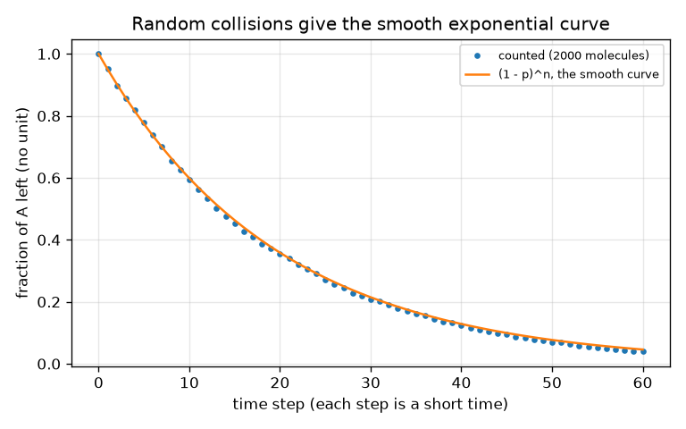

# సెషన్ 1: ప్రతిచర్యలకు సమయం పడుతుంది: గాఢత, సమయానికి వ్యతిరేకంగా

[Session 1 — हिन्दी](README.hi.md) · [Session 1 — മലയാളം](README.ml.md) · [Session 1 — தமிழ்](README.ta.md)

*స్థాయి 1 (భావనాత్మక ఇంటరాక్టివ్ నమూనా) · సుమారు 60 నిమిషాలు · openreactionrate*

> ఇది ఒక సరళీకృత విద్యా నమూనా. ఇది ధృవీకరించబడిన డిజైన్ సాధనం కాదు; నిజమైన నిర్మాణాలు, విద్యుత్ ఇన్‌స్టలేషన్లు, వాహనాలు, పారిశ్రామిక ప్రక్రియలు లేదా వైద్య నిర్ణయాల కోసం దీనిని ఉపయోగించకూడదు.

**ముందస్తు అవసరాలు (Prerequisites)**

- పాఠశాల బీజగణితం మరియు గ్రాఫ్ చదవడం.
- మీరు PRIMER.md చదివి, `python start.py 1` ను ఒకసారి రన్ చేశారు.

**అభ్యసన లక్ష్యాలు (Learning objectives).** ఈ సెషన్ తర్వాత మీరు చేయగలరు:

- ప్రతిచర్య రేటు (reaction rate) అంటే ఏమిటో చెప్పి, దానిని మార్చే నాలుగు అంశాలను పేర్కొనడం: గాఢత, ఉష్ణోగ్రత, ఢీకొనడాలు, ఉత్ప్రేరకం (catalyst).
- A -> B కోసం గాఢత-సమయ వక్రాన్ని చదివి దాని నుండి అర్ధ జీవిత కాలాన్ని (half-life) కనుగొనడం.
- [A] = A0 exp(-k t) మరియు half-life = ln 2 / k ను సరైన యూనిట్లతో ఉపయోగించడం.
- యాదృచ్ఛిక ఢీకొనడాల భావనతో వక్రం ఎందుకు వంగుతుందో వివరించడం.

## A. వాస్తవ ప్రపంచ సమస్య
వంటగది బల్లపై పాలు ఒక రోజులో విరిగిపోతాయి, ఫ్రిజ్‌లో ఒక వారంలో. ఒక సీసా హైడ్రోజన్ పెరాక్సైడ్ నెలల తరబడి నిల్వ ఉంటుంది, కానీ చిటికెడు మాంగనీస్ డయాక్సైడ్ వేస్తే వెంటనే నురుగు వస్తుంది. రసాయన ప్రతిచర్యలకు సమయం పడుతుంది, కొన్ని విషయాలు (వేడి, అదే స్థలంలో ఎక్కువ అణువులు, ఉత్ప్రేరకం) ఎంత సమయం పడుతుందో మారుస్తాయి. ఒక పదార్థం A ఎంత వేగంగా పదార్థం B గా మారుతుందో మనం ఎలా గీయగలం, ఆపై ఎలా అంచనా వేయగలం?

## B. భావన మరియు సిద్ధాంతం
A యొక్క ఒక అణువు B గా మారాలంటే సాధారణంగా అది దేనితోనైనా ఢీకొనాలి, ఆ ఢీకొనడం తగినంత శక్తివంతంగా ఉండాలి. అదే ఘనపరిమాణంలో ఎక్కువ A అణువులు ఉంటే (అధిక గాఢత) సెకనుకు ఎక్కువ ఢీకొనడాలు జరుగుతాయి, కాబట్టి రేటు ఎక్కువ. సరళమైన ప్రతిచర్య A -> B లో రేటు (సెకనుకు A యొక్క ఎన్ని mol/L అదృశ్యమవుతాయి) A గాఢతకు అనులోమానుపాతంలో ఉంటుంది: rate = k [A]. స్థిరాంకం k రేటు స్థిరాంకం (rate constant); పెద్ద k అంటే వేగవంతమైన ప్రతిచర్య. మిశ్రమాన్ని వేడి చేస్తే ఢీకొనడాలు తరచుగా జరుగుతాయి, అంతకంటే ముఖ్యంగా మరింత శక్తివంతంగా ఉంటాయి, కాబట్టి k పెరుగుతుంది. ఉత్ప్రేరకం ప్రతిచర్యకు సులభమైన మార్గం ఇస్తుంది, అది k ను కూడా పెంచుతుంది, మరియు అది అయిపోదు. rate = k [A] ను సాధిస్తే ఘాతాంక క్షయం (exponential decay) వస్తుంది: చాలా A ఉన్నప్పుడు [A] మొదట వేగంగా తగ్గుతుంది, తర్వాత నెమ్మదిగా. [A] సగం కావడానికి పట్టే సమయమే అర్ధ జీవిత కాలం; ఈ ప్రతిచర్యకు మీరు ఎక్కడ మొదలుపెట్టినా అది ఒకటే. B అనేది A కోల్పోయినదే, [B] = A0 - [A]. ఇక్కడ ఉత్ప్రేరకాన్ని అత్యంత సరళంగా, k ను గుణించే కారకం f గా నమూనా చేశారు.

| గుర్తు | అర్థం | యూనిట్ |
|---|---|---|
| [A] | t సమయంలో A గాఢత | mol/L |
| A0 | A యొక్క ప్రారంభ గాఢత | mol/L |
| k | రేటు స్థిరాంకం (A -> B కు) | 1/s |
| t | సమయం | s |
| t_half | అర్ధ జీవిత కాలం: [A] సగం కావడానికి పట్టే సమయం | s |
| f | ఉత్ప్రేరక వేగ కారకం (k ను f తో గుణిస్తుంది) | యూనిట్ లేదు |

**ఊహలు (Assumptions)**

- A -> B అనే ఒకే ఒక దశ మాత్రమే, అది వెనక్కి వెళ్ళలేదు.
- ప్రతిచర్య జరుగుతున్నప్పుడు ఉష్ణోగ్రత స్థిరంగా ఉంటుంది.
- మిశ్రమం కలపబడుతుంది, కాబట్టి గాఢత అంతటా ఒకటే.
- ఉత్ప్రేరకం k ను గుణిస్తుంది మాత్రమే; నిజమైన ఉత్ప్రేరకాలు విషపూరితం కావచ్చు లేదా నెమ్మదిగా అయిపోవచ్చు.

$$ \text{rate}=-\frac{d[A]}{dt}=k\,[A] $$

$$ [A]_t=A_0\,e^{-kt},\qquad [B]_t=A_0-[A]_t $$

$$ t_{1/2}=\frac{\ln 2}{k},\qquad t_{x}=\frac{1}{k}\ln\frac{1}{1-x}\ \ (\text{time to convert a fraction }x) $$

## C. దృశ్య వివరణ
మొదటి చిత్రం k = 0.10 1/s కు (ఘన రేఖ) మరియు k ను ఐదు రెట్లు పెద్దది చేసే ఉత్ప్రేరకానికి (చుక్కల రేఖ) [A] మరియు [B] ను సమయానికి వ్యతిరేకంగా గీస్తుంది. రెండు A వక్రాలకు ఒకే ఆకారం; చుక్కల రేఖ సమయంలో ఐదో వంతుకు ఒత్తబడింది, అర్ధ జీవిత కాలం 6.9 s నుండి 1.4 s కు తగ్గుతుంది. A మరియు B అర్ధ జీవిత కాలం వద్ద ఖండించుకుంటాయి, అక్కడ ప్రతిదీ ప్రారంభ విలువలో సగం. రెండవ చిత్రం 2000 అణువులను లెక్కిస్తుంది, ప్రతి సమయ అడుగులో చర్య జరపడానికి 5 శాతం అవకాశం ఉంది: చుక్కలు సాఫీ వక్రం (1 - p)^n పై ఉంటాయి, కాబట్టి వక్రం వంగడానికి ప్రత్యేక నియమం అవసరం లేదు, చర్య జరపడానికి మిగిలిన A అణువులు తక్కువ అవ్వడమే కారణం.

![A -> B కోసం [A] మరియు [B]; 5 రెట్ల ఉత్ప్రేరకం (చుక్కల రేఖ) అదే వక్రాన్ని సమయంలో ఐదో వంతుకు ఒత్తుతుంది.](../../docs/figures/s01_a_to_b.png)

*A -> B కోసం [A] మరియు [B]; 5 రెట్ల ఉత్ప్రేరకం (చుక్కల రేఖ) అదే వక్రాన్ని సమయంలో ఐదో వంతుకు ఒత్తుతుంది.*

*యాదృచ్ఛికంగా చర్య జరిపే 2000 అణువులను లెక్కించడం సాఫీ ఘాతాంక వక్రాన్ని పునఃసృష్టిస్తుంది.*

## D. ఇంటరాక్టివ్ సిమ్యులేషన్
పాఠాన్ని రన్ చేయండి (`python start.py 1`), తర్వాత లైవ్ యాప్‌ను తెరవండి: [సెషన్ 1: ఉత్ప్రేరకంతో A -> B](https://krunalpanchal1995.github.io/pan-iit-oss/openreactionrate/session-01/) (లేదా ఈ ఫోల్డర్‌లోని `app.html`). సమయ స్లైడర్‌ను లాగి ట్యాంకులను చూడండి: A ఖాళీ అవుతుంది, B నిండుతుంది, మొత్తం అలాగే ఉంటుంది. తర్వాత ఉత్ప్రేరక కారకాన్ని పెంచి అదే వక్రం వేగంగా సాగడం చూడండి. గ్రాఫ్ వీక్షణకు మారి నీలం మరియు ఆకుపచ్చ వక్రాలు ఖండించుకునే చోటును కనుగొనండి.

**సవాలు (Challenge).** A లో సగం 5 సెకన్లలోపు చర్య జరిపేలా చేయండి (అర్ధ జీవిత కాలం 5 s కంటే తక్కువ).

## E. సాధించిన ఉదాహరణ మరియు ప్రయోగం
**సమస్య.** k = 0.10 1/s మరియు A0 = 1.0 mol/L ఉన్న A -> B కు 10 s తర్వాత [A] మరియు [B], అర్ధ జీవిత కాలం, 90 శాతం మార్పిడికి పట్టే సమయం కనుగొనండి. తర్వాత k ను ఐదు రెట్లు చేసే ఉత్ప్రేరకం చివరి సంఖ్యను ఏమి చేస్తుందో చూడండి.

1. 10 s తర్వాత [A]: k t = 0.10 * 10 = 1.0, కాబట్టి [A] = 1.0 * exp(-1.0) = 0.368 mol/L.
2. [B] = A0 - [A] = 1.0 - 0.368 = 0.632 mol/L. (సరిచూపు: A + B = 1.000 mol/L.)
3. అర్ధ జీవిత కాలం = ln 2 / k = 0.693 / 0.10 = 6.93 s.
4. 90 శాతం మారింది అంటే [A] = 0.10: t = ln(10) / k = 2.303 / 0.10 = 23.0 s.
5. ఉత్ప్రేరకంతో k = 0.50 1/s, కాబట్టి సమయం 2.303 / 0.50 = 4.6 s: ఐదు రెట్లు త్వరగా.

**సమాధానం.** 10 s తర్వాత [A] = 0.368 mol/L మరియు [B] = 0.632 mol/L; అర్ధ జీవిత కాలం 6.93 s; 90 శాతం 23.0 s తర్వాత, లేదా 5 రెట్ల ఉత్ప్రేరకంతో 4.6 s.

**ప్రయోగం.** ఒక నురగ వచ్చే మాత్రను 200 mL చల్లని కుళాయి నీటిలో (సుమారు 10 డిగ్రీల C) మరియు 200 mL గోరువెచ్చని నీటిలో (సుమారు 40 డిగ్రీల C) వేసి, నురగ ఆగడానికి ఎంత సమయం పడుతుందో కొలవండి; సగం మాత్రను కూడా ప్రయత్నించండి. గోరువెచ్చని నీటిలో స్పష్టంగా త్వరగా ముగియాలి. నమూనా మరియు వాస్తవం: మాత్ర కరగడం స్వచ్ఛమైన ప్రథమ-క్రమ ప్రతిచర్య కాదు (ఉపరితల వైశాల్యం తగ్గుతుంది, కలపడం ముఖ్యం), ఉష్ణోగ్రత k ను "కొంచెం" కాదు, ఒక నిర్దిష్ట కారకం ద్వారా మారుస్తుంది. ప్రయోగాన్ని ధోరణి చిత్రంగా చూడండి, సంఖ్య తనిఖీగా కాదు. ద్రావణాలను తాగవద్దు మరియు లేబుల్‌ను అనుసరించండి.

## F. మూల్యాంకనం మరియు డిజైన్ సవాలు
**ప్రశ్న రకం A: భావనాత్మక.** ప్రతిచర్యలో ఏదీ మారకపోయినా A గాఢత మొదట వేగంగా, తర్వాత నెమ్మదిగా ఎందుకు తగ్గుతుంది?

సూచన

రేటు దేనిపై ఆధారపడుతుంది, సమయం గడిచేకొద్దీ ఆ రాశికి ఏమవుతుంది?

దశలవారీ పరిష్కారం

రేటు k [A]. ప్రారంభంలో చాలా A ఉంది, కాబట్టి సెకనుకు చాలా ప్రతిచర్యలు జరుగుతాయి. A వాడబడేకొద్దీ A అణువులు మరియు ఢీకొనడాలు తగ్గుతాయి, కాబట్టి రేటు తగ్గి వక్రం చదునవుతుంది. రేటు స్థిరాంకం k మారలేదు; [A] తగ్గడం వల్లే రేటు తగ్గుతుంది.

**ప్రశ్న రకం B: సంఖ్యాత్మక.** ఒక ప్రతిచర్య A -> B కు k = 0.05 1/s మరియు A0 = 2.0 mol/L. 20 s తర్వాత [A] మరియు అర్ధ జీవిత కాలం కనుగొని, మీ సమాధానం సహేతుకమేనా అని పరీక్షించండి.

సూచన

20 s తర్వాత k t = 1. [A] = A0 exp(-k t) మరియు t_half = ln 2 / k ఉపయోగించండి.

దశలవారీ పరిష్కారం

[A] = 2.0 * exp(-1) = 0.736 mol/L. అర్ధ జీవిత కాలం = 0.693 / 0.05 = 13.9 s. సహేతుకత పరీక్ష: 20 s అంటే సుమారు 1.44 అర్ధ జీవిత కాలాలు, కాబట్టి [A] = 2.0 * 0.5^1.44 = 0.736 అయి ఉండాలి. అవి సరిపోతాయి. యూనిట్లు: గాఢత mol/L లో, k 1/s లో.

**ప్రశ్న రకం C: గ్రాఫ్ మరియు సిమ్యులేషన్ వ్యాఖ్యానం.** స్లైడర్ యాప్‌లోని A-B గ్రాఫ్‌లో (A0 = 1, k = 0.10) వక్రాలు ఎక్కడ ఖండించుకుంటాయి, అక్కడ వాటి విలువ ఎంత? A0 = 2 అయితే ఏమి మారుతుంది?

సూచన

[A] = [B] అయినప్పుడు, అంటే A లో సరిగ్గా సగం చర్య జరిపినప్పుడు అవి ఖండించుకుంటాయి.

దశలవారీ పరిష్కారం

అవి అర్ధ జీవిత కాలం వద్ద, 6.9 s వద్ద, 0.5 mol/L (A0 లో సగం) విలువ వద్ద ఖండించుకుంటాయి. A0 = 2 అయితే అవి అదే సమయంలో, 6.9 s వద్ద, కానీ 1.0 mol/L వద్ద ఖండించుకుంటాయి, ఎందుకంటే ఈ ప్రతిచర్య అర్ధ జీవిత కాలం ప్రారంభ గాఢతపై ఆధారపడదు.

**ప్రశ్న రకం D: డిజైన్ మరియు ఆప్టిమైజేషన్ సవాలు.** డిజైన్: k = 0.10 1/s ఉన్న ప్రతిచర్య 10 s లోపు 90 శాతం పూర్తి కావాలి. ఉత్ప్రేరకం k ను ఏ కారకంతో పెంచాలి? ఏ పూర్ణాంక కారకాన్ని ఎంచుకుంటారు, వేగం కాకుండా ఇంకా ఏవి ముఖ్యం?

సూచన

ln(10) / k_new = 10 s ను k_new కోసం సాధించి, తర్వాత 0.10 తో భాగించండి.

దశలవారీ పరిష్కారం

k_new = ln(10) / 10 = 0.230 1/s, 2.3 కారకం. తర్వాతి పూర్ణాంకం 3, ఇది k = 0.30 1/s మరియు కొంత మార్జిన్‌తో 7.7 s సమయం ఇస్తుంది. ముఖ్యమైన ఇతర విషయాలు: ఉత్ప్రేరకం ఖర్చు, దానిని ఉత్పత్తి నుండి వేరు చేయగలమా, అది విషపూరితం అవుతుందా లేదా అయిపోతుందా, ఉత్పత్తి సురక్షితమా, ప్రతిచర్య వేడిని విడుదల చేస్తుందా మరియు దానిని తొలగించాలా.

[RUBRIC.md](../../RUBRIC.md) తో మిమ్మల్ని మీరు స్కోర్ చేసుకోండి. కాగితంపై పని చేయడానికి [కార్యాచరణ పత్రాన్ని](activity_sheet.md) ప్రింట్ చేయండి.

## సాధారణ అపోహలు
| సాధారణ అపోహ | నిజానికి సరైనది |
|---|---|
| ఉత్ప్రేరకం అయిపోయి ఉత్పత్తిలో భాగమవుతుంది. | ఉత్ప్రేరకం మొత్తంగా వినియోగించబడదు: అది దశల్లో పాల్గొని పునరుత్పత్తి అవుతుంది, కాబట్టి కొద్దిగా ఎక్కువ ప్రతిచర్యను వేగవంతం చేస్తుంది. |
| రేటు స్థిరాంకం రెట్టింపైన ప్రతిచర్య అదే సమయంలో రెట్టింపు మార్చుతుంది. | రెట్టింపు k అంటే అదే భాగం సగం సమయంలో చేరుతుంది, కానీ నిర్దిష్ట సమయం తర్వాత మారిన పరిమాణం సరళ రేఖను కాదు, ఘాతాంకాన్ని అనుసరిస్తుంది. |
| గాఢత పరిమిత సమయంలో సున్నా చేరినప్పుడు ప్రతిచర్య ఆగిపోతుంది. | rate k [A] ఉన్న A -> B లో గాఢత సున్నాను సమీపిస్తుంది మాత్రమే; ప్రతి అర్ధ జీవిత కాలం మిగిలినదాన్ని సగం చేస్తుంది. |
| ఉత్ప్రేరకం చివరికి వచ్చే ఉత్పత్తి పరిమాణాన్ని మారుస్తుంది. | ఉత్ప్రేరకం వేగాన్ని మారుస్తుంది, ప్రతిచర్య ఎక్కడ ముగుస్తుందో కాదు (పూర్తిగా జరిగే ప్రతిచర్యకు B పరిమాణం అదే). |

## పదకోశం (Glossary)
- **రేటు స్థిరాంకం (rate constant, k)**: ఒక ప్రతిచర్య ఎంత వేగంగా సాగుతుందో నిర్ణయించే సంఖ్య; పెద్దది అంటే వేగం ఎక్కువ
- **గాఢత (concentration)**: ఒక లీటరులో పదార్థ పరిమాణం, mol/L లో
- **అర్ధ జీవిత కాలం (half-life)**: ఒక గాఢత సగానికి తగ్గడానికి పట్టే సమయం
- **ఉత్ప్రేరకం (catalyst)**: ప్రతిచర్యను వేగవంతం చేసి పునరుత్పత్తి అయ్యే పదార్థం
- **ఢీకొనడం (collision)**: రెండు అణువులు కలవడం; అవి కలిస్తేనే ప్రతిచర్య జరగగలదు

## ముగించండి
1. [exercises.md](exercises.md) లోని మూడు కోడింగ్ పనులను చేయండి.
2. మీ మార్పుల తర్వాత `python start.py 1` ను మళ్ళీ రన్ చేయండి. ఇది చెక్‌పాయింట్‌తో ముగుస్తుంది; అది `PASS` అని ప్రింట్ చేసినప్పుడు మీరు పూర్తి చేశారు. (చెక్‌పాయింట్ మాత్రమే: `python start.py check 1`.)

తదుపరి: [సెషన్ 2](../session-02/README.md)
