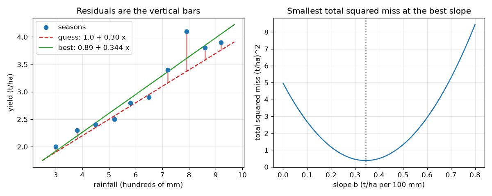

# सत्र 1: वह रेखा जो सबसे कम चूकती है

*स्तर 1 (वैचारिक इंटरैक्टिव मॉडल) · लगभग 60 मिनट · openregression*

> यह एक सरलीकृत शैक्षिक मॉडल है। यह कोई प्रमाणित डिज़ाइन उपकरण नहीं है और इसका उपयोग वास्तविक संरचनाओं, विद्युत स्थापनाओं, वाहनों, औद्योगिक प्रक्रियाओं या चिकित्सा संबंधी निर्णयों के लिए नहीं किया जाना चाहिए।

**पूर्वापेक्षाएँ (Prerequisites)**

- स्कूली बीजगणित: सीधी रेखा का समीकरण y = a + b x।
- आपने PRIMER.md पढ़ लिया है और `python start.py 1` एक बार चला लिया है।

**सीखने के उद्देश्य (Learning objectives)।** इस सत्र के बाद आप:

- वर्षा और उपज के बिंदुओं से होकर एक रेखा खींच सकेंगे और उससे पूर्वानुमान पढ़ सकेंगे।
- एक अवशेष (residual) (एक बिंदु की ऊर्ध्वाधर चूक) और कुल वर्ग चूक की गणना कर सकेंगे।
- समझा सकेंगे कि सबसे अच्छी रेखा वह क्यों है जिसकी कुल वर्ग चूक सबसे कम हो।
- सूत्र से सबसे अच्छी रेखा खोज सकेंगे और कई अन्य रेखाएँ आज़माकर उसकी जाँच कर सकेंगे।

## A. वास्तविक दुनिया की समस्या
एक किसान के पास दस मौसमों के अभिलेख हैं: कितनी वर्षा हुई और खेत ने कितना अनाज दिया। अगले मौसम की वर्षा का पूर्वानुमान ज्ञात है। किसान को कितनी उपज की अपेक्षा करनी चाहिए? बिंदुओं से होकर एक रेखा खींचना और उत्तर पढ़ लेना ही समाश्रयण (regression) का विचार है। पर उन्हीं बिंदुओं से होकर सौ अलग रेखाएँ खींची जा सकती हैं। किसे उचित रूप से सबसे अच्छी कहा जाए? (यहाँ सभी आँकड़े शिक्षण के लिए बनाए गए हैं; यह वास्तविक खेती के बारे में सलाह नहीं है।)

## B. अवधारणा और सिद्धांत
एक सीधी रेखा वर्षा से उपज का पूर्वानुमान लगाती है: पूर्वानुमान = a + b x। अंतःखंड (intercept) a शून्य वर्षा के लिए अनुमानित उपज है; ढाल (slope) b हर अतिरिक्त 100 mm के लिए अतिरिक्त उपज है। एक अवशेष प्रेक्षित उपज ऋण पूर्वानुमान है, इसलिए यह बिंदु से रेखा तक की ऊर्ध्वाधर दूरी है (यदि बिंदु ऊपर है तो धनात्मक)। अवशेषों को जोड़ने से ऊपर और नीचे की चूकें एक-दूसरे को काट देंगी, इसलिए हम पहले उनका वर्ग करते हैं। वर्गों का कुल योग वर्ग अवशेषों का योग (sum of squared residuals), SSE है। सबसे अच्छी रेखा, जिसे न्यूनतम-वर्ग रेखा (least-squares line) कहते हैं, का SSE सबसे कम होता है। दस खेत मौसमों के लिए यह उपज = 0.887 + 0.344 x है, SSE 0.378 (t/ha)^2 के साथ।

| प्रतीक | अर्थ | इकाई |
|---|---|---|
| x | एक मौसम में वर्षा (सैकड़ों mm में, इसलिए 3.0 का अर्थ 300 mm) | 100 mm |
| y | अनाज की उपज | t/ha |
| a | रेखा का अंतःखंड | t/ha |
| b | रेखा की ढाल | t/ha प्रति 100 mm |
| e | अवशेष = y - (a + b x) | t/ha |
| SSE | वर्ग अवशेषों का योग | (t/ha)^2 |

**मान्यताएँ (Assumptions)**

- सीधी रेखा आँकड़ों का एक उचित वर्णन है।
- केवल उपज का पूर्वानुमान लगाया जाता है; वर्षा को दिया हुआ और ठीक-ठीक मापा हुआ माना जाता है।
- आँकड़े बनाए गए हैं; संख्याएँ विधि सिखाती हैं, खेती नहीं।

$$ \hat y = a + b\,x,\qquad e_i = y_i-(a+b\,x_i) $$

$$ \mathrm{SSE}(a,b)=\sum_{i=1}^{n} e_i^{2} $$

$$ b=\frac{\sum (x_i-\bar x)(y_i-\bar y)}{\sum (x_i-\bar x)^2},\qquad a=\bar y-b\,\bar x $$

## C. दृश्य व्याख्या
बायाँ चित्र दस बिंदु, एक अनुमान रेखा (उपज = 1.0 + 0.30 x) और लाल ऊर्ध्वाधर दंडों के रूप में उसके अवशेष दिखाता है, साथ में हरे रंग में सबसे अच्छी रेखा। सबसे अच्छी रेखा छोटे दंड छोड़ती है: उसकी कुल वर्ग चूक 0.378 है जबकि अनुमान की 0.706। दायाँ चित्र ढाल के सापेक्ष SSE आलेखित करता है: एक कटोरा जिसका सबसे निचला बिंदु ढाल 0.344 पर है, सबसे अच्छी ढाल।

*दस मौसम, अवशेष दंडों के साथ एक अनुमान रेखा, सबसे अच्छी रेखा, और ढाल के सापेक्ष कुल वर्ग चूक का कटोरा।*

## D. इंटरैक्टिव सिमुलेशन
पाठ चलाइए (`python start.py 1`), फिर लाइव ऐप खोलिए: [सत्र 1: वह रेखा खींचिए जो सबसे कम चूकती है](https://krunalpanchal1995.github.io/pan-iit-oss/openregression/session-01/) (या इसी फ़ोल्डर में `app.html`)। अंतःखंड और ढाल के स्लाइडर खिसकाइए और लाल दंडों तथा कुल वर्ग चूक को देखिए। हर चूक को एक वर्ग के रूप में देखने के लिए वर्ग दृश्य खोलिए, और ढाल के सापेक्ष कुल देखने के लिए कटोरा दृश्य।

**चुनौती।** रेखा को हाथ से समायोजित करके कुल वर्ग चूक को 0.45 (t/ha)^2 से नीचे लाइए।

## E. हल किया गया उदाहरण और प्रयोग
**समस्या।** तीन बिंदु (वर्षा, उपज) (1, 2), (2, 2) और (3, 5) हैं। हाथ से न्यूनतम-वर्ग रेखा और उसकी कुल वर्ग चूक ज्ञात कीजिए।

1. माध्य: x-bar = (1 + 2 + 3) / 3 = 2 और y-bar = (2 + 2 + 5) / 3 = 3।
2. (x - 2)(y - 3) का योग = (-1)(-1) + (0)(-1) + (1)(2) = 1 + 0 + 2 = 3। (x - 2)^2 का योग = 1 + 0 + 1 = 2।
3. ढाल b = 3 / 2 = 1.5। अंतःखंड a = 3 - 1.5 * 2 = 0।
4. पूर्वानुमान: 1.5, 3.0, 4.5। अवशेष: 2 - 1.5 = 0.5, 2 - 3 = -1, 5 - 4.5 = 0.5।
5. SSE = 0.25 + 1 + 0.25 = 1.5। जाँच: अवशेषों का योग 0.5 - 1 + 0.5 = 0 है।

**उत्तर।** रेखा y = 0 + 1.5 x है, अवशेष 0.5, -1 और 0.5 और कुल वर्ग चूक 1.5।

**प्रयोग।** दस वास्तविक (या सहपाठियों के) युग्म, जैसे हाथ का फैलाव बनाम ऊँचाई, वर्गांकित कागज़ पर आलेखित कीजिए, रूलर से वह रेखा खींचिए जो आपको सबसे अच्छी लगे, फिर उसका SSE निकालिए और सूत्र की रेखा से तुलना कीजिए। आपकी आँख आमतौर पर न्यूनतम के कुछ प्रतिशत के भीतर पहुँचती है, पर ठीक उस पर नहीं। मॉडल (एक सीधी रेखा) वास्तविकता से सरल है: वास्तविक बिंदु ऐसे कारणों से बिखरते हैं जिन्हें रेखा नहीं जानती, और वही बिखराव अवशेष मापते हैं।

## F. मूल्यांकन और डिज़ाइन चुनौती
**प्रश्न प्रकार A: वैचारिक।** हम अवशेषों को बस जोड़ने के बजाय उनका वर्ग क्यों करते हैं? 'अवशेषों का योग = 0' परीक्षण का क्या होगा?

संकेत

एक बिंदु रेखा से बहुत ऊपर और एक बहुत नीचे सोचिए।

चरण-दर-चरण हल

रेखा के ऊपर और नीचे के अवशेषों के चिह्न विपरीत होते हैं और वे कट जाते हैं, इसलिए एक बहुत खराब रेखा के लिए भी सादा योग शून्य हो सकता है: बिंदु (x-bar, y-bar) से गुज़रने वाली किसी भी रेखा के अवशेषों का योग शून्य होता है, उसकी ढाल चाहे जो हो। वर्ग करने से हर चूक धनात्मक हो जाती है और एक बड़ी चूक कई छोटी चूकों से अधिक गिनी जाती है, इसलिए केवल वही रेखा जो सभी बिंदुओं के पास हो, छोटा कुल पाती है।

**प्रश्न प्रकार B: संख्यात्मक।** बिंदुओं (0, 2), (1, 1) और (2, 6) के लिए न्यूनतम-वर्ग रेखा और उसकी कुल वर्ग चूक ज्ञात कीजिए।

संकेत

x-bar = 1, y-bar = 3। b = sum((x - x-bar)(y - y-bar)) / sum((x - x-bar)^2) का उपयोग कीजिए।

चरण-दर-चरण हल

(x - 1)(y - 3) का योग = (-1)(-1) + 0 + (1)(3) = 4 और (x - 1)^2 का योग = 2, इसलिए b = 2 और a = 3 - 2 = 1। पूर्वानुमान 1, 3, 5 से अवशेष 1, -2, 1 और SSE = 1 + 4 + 1 = 6 मिलते हैं (यदि संख्याएँ उपज हैं तो इकाई t/ha का वर्ग)।

**प्रश्न प्रकार C: ग्राफ़ और सिमुलेशन की व्याख्या।** कटोरा दृश्य में, हरा वक्र किस ढाल पर सबसे नीचे है, और वहाँ उसका मान क्या है? नीला वक्र कभी हरे से नीचे क्यों नहीं जाता?

संकेत

हरा वक्र हर ढाल के लिए सबसे अच्छे अंतःखंड का उपयोग करता है।

चरण-दर-चरण हल

हरा वक्र ढाल 0.344 t/ha प्रति 100 mm पर सबसे नीचे है, जहाँ यह 0.378 (t/ha)^2 के बराबर है, सबसे अच्छा संभव कुल। नीला वक्र आपके अपने अंतःखंड का उपयोग करता है, जो अधिकांश ढालों के लिए सबसे अच्छा नहीं है, इसलिए वह हरे वक्र को छू सकता है पर कभी उससे नीचे नहीं जा सकता।

**प्रश्न प्रकार D: डिज़ाइन और अनुकूलन चुनौती।** डिज़ाइन: खेत के आँकड़ों की सबसे अच्छी रेखा का उपयोग करते हुए, कितनी वर्षा 3.5 t/ha की अपेक्षित उपज देती है? क्या उत्तर आँकड़ों की परास के भीतर है? आपको किस बात की चिंता करनी चाहिए?

संकेत

3.5 = 0.887 + 0.344 x को x के लिए हल कीजिए।

चरण-दर-चरण हल

x = (3.5 - 0.887) / 0.344 = 7.59 सैकड़ा mm, अर्थात लगभग 759 mm। आँकड़े 300 से 920 mm तक हैं, इसलिए यह अंतर्वेशन (interpolation) है, जो बहिर्वेशन (extrapolation) से अधिक सुरक्षित है। पर यह केवल अपेक्षित उपज है: एकल मौसम रेखा के चारों ओर बिखरते हैं (सत्र 2 उस पर एक संख्या रखता है), इसलिए उतनी वर्षा वाला मौसम आसानी से 3.5 t/ha से कम दे सकता है।

[RUBRIC.md](../../RUBRIC.md) से स्वयं को अंक दीजिए। कागज़ पर काम करने के लिए [गतिविधि पत्रक](activity_sheet.md) प्रिंट कीजिए।

## आम भ्रांतियाँ
| आम भ्रांति | वास्तव में क्या सच है |
|---|---|
| सबसे अच्छी रेखा अधिक से अधिक बिंदुओं से होकर गुज़रती है। | सबसे अच्छी रेखा कुल वर्ग चूक को न्यूनतम करती है; हो सकता है वह किसी भी बिंदु से न गुज़रे। |
| रेखा के ऊपर और नीचे के अवशेष कट जाते हैं, इसलिए अवशेषों का योग दिखाता है कि फ़िट अच्छा है। | न्यूनतम-वर्ग रेखा के लिए अवशेषों का योग हमेशा शून्य होता है, पर कई खराब रेखाओं के लिए भी; केवल वर्गों का योग गुणवत्ता मापता है। |
| बिंदुओं पर फ़िट होने वाली रेखा दिखाती है कि वर्षा उपज का कारण है। | रेखा बताती है कि दोनों साथ-साथ कैसे बदलते हैं। कार्य-कारण (causation) के लिए और चाहिए (सत्र 3 एक जाल दिखाता है)। |
| अंतःखंड हमेशा एक सार्थक पूर्वानुमान है। | अंतःखंड शून्य वर्षा पर पूर्वानुमान है, जो आँकड़ों से बहुत बाहर है; इसे एक फ़िटिंग नियतांक मानिए। |

## शब्दावली
- **समाश्रयण (regression)**: आँकड़ों पर एक वक्र फ़िट करके अन्य संख्याओं से एक संख्या का पूर्वानुमान लगाना
- **अवशेष (residual)**: प्रेक्षित मान ऋण अनुमानित मान; किसी बिंदु की ऊर्ध्वाधर चूक
- **न्यूनतम वर्ग (least squares)**: वर्ग अवशेषों के सबसे छोटे योग वाली रेखा चुनना
- **अंतःखंड (intercept)**: x = 0 पर रेखा का मान
- **ढाल (slope)**: x के एक इकाई बढ़ने पर पूर्वानुमान में परिवर्तन

## समापन
1. [exercises.md](exercises.md) में दिए तीन कोडिंग कार्य कीजिए।
2. अपने बदलावों के बाद `python start.py 1` फिर से चलाइए। यह चेकपॉइंट (checkpoint) पर समाप्त होता है; जब यह `PASS` छापे, तो आपका काम पूरा है। (केवल चेकपॉइंट: `python start.py check 1`।)

अगला: [सत्र 2](../session-02/README.md)
