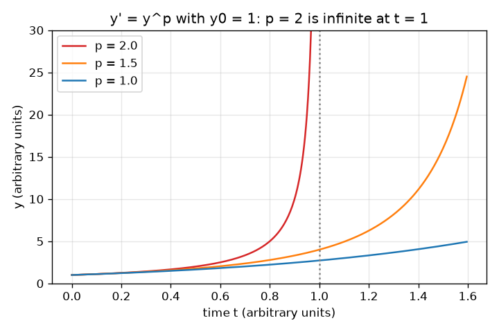
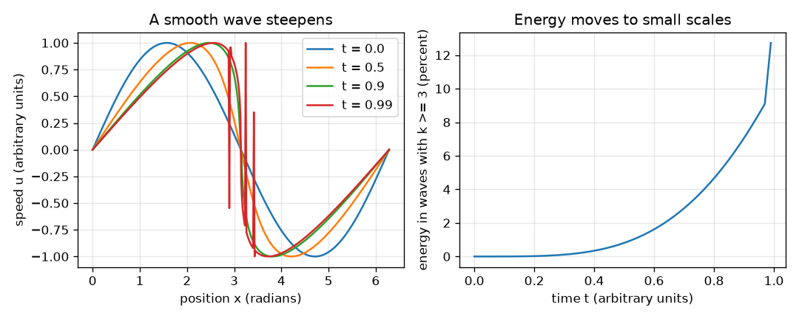

# सत्र 1: चिकना (smooth) या विस्फोट (blow-up)? प्रश्न और एक खिलौना मॉडल

*स्तर 1 (वैचारिक इंटरैक्टिव मॉडल) · लगभग 60 मिनट · openregularity*

> यह एक सरलीकृत शैक्षिक मॉडल है। यह कोई प्रमाणित डिज़ाइन उपकरण नहीं है और इसका उपयोग वास्तविक संरचनाओं, विद्युत संस्थापनों, वाहनों, औद्योगिक प्रक्रियाओं या चिकित्सा निर्णयों के लिए नहीं किया जाना चाहिए।

**पूर्वापेक्षाएँ (Prerequisites)**

- अवकलज (derivatives); यह विचार कि dy/dt = f(y) बताता है कि y समय में कैसे बदलता है।
- आपने PRIMER.md पढ़ लिया है और एक बार `python start.py 1` चला लिया है।

**सीखने के उद्देश्य (Learning objectives)।** इस सत्र के बाद आप:

- सरल शब्दों में समझा सकेंगे कि नेवियर-स्टोक्स (Navier-Stokes) चिकनापन (smoothness) समस्या क्या पूछती है, और स्पष्ट रूप से कह सकेंगे कि यह अभी खुली (open) है।
- एक सूत्र और कंप्यूटर से दिखा सकेंगे कि dy/dt = y^2, t = 1/y0 पर अनंत हो जाता है, जबकि dy/dt = y कभी नहीं होता।
- बता सकेंगे कि एक चिकनी तरंग जो तीखी (steepen) होती है, अपनी ऊर्जा को छोटे पैमानों (small scales) पर क्यों ले जाती है।
- किसी सीमित समय पर अनंत की ओर बढ़ती राशि का ग्राफ़ पढ़ सकेंगे।

## A. वास्तविक दुनिया की समस्या
कमरे की हवा, पाइप का पानी और मोमबत्ती का धुआँ, सभी का वर्णन नेवियर-स्टोक्स समीकरणों से होता है। इंजीनियर हर दिन इन्हें कंप्यूटरों पर हल करते हैं। फिर भी सात क्ले मिलेनियम पुरस्कार (Clay Millennium Prize) समस्याओं में से एक, जिसे फ़ेफ़रमैन (Fefferman) ने प्रस्तुत किया, कुछ बहुत मूलभूत पूछती है: यदि एक साधारण तरल का 3-D प्रवाह चिकना शुरू होता है, तो क्या वह हमेशा चिकना रहता है, या क्या उसका वेग प्रवणता (velocity gradient) सीमित समय के बाद अनंत हो सकता है? यह खुली है: कोई उत्तर नहीं जानता, और यह रिपॉज़िटरी कोई उत्तर देने का दावा या प्रयास नहीं करती। हम जो कर सकते हैं वह है प्रश्न का अर्थ समझना और खिलौना मॉडलों का अध्ययन करना। जो संख्या अभी सीमित है, वह बाद में एक निश्चित समय पर अनंत कैसे हो सकती है?

## B. अवधारणा और सिद्धांत
सरल शब्दों में नेवियर-स्टोक्स: तरल का वेग स्वयं के द्वारा आगे ले जाया जाता है (एक अरैखिक (nonlinear) पद) और घर्षण (श्यानता, viscosity) द्वारा चिकना किया जाता है। प्रश्न यह है कि क्या अरैखिक तीखापन कभी चिकनाई पर भारी पड़ सकता है और सीमित समय में अनंत प्रवणताएँ उत्पन्न कर सकता है। 'स्वयं को खिलाने वाली वृद्धि' का एक खिलौना मॉडल dy/dt = y^p है। p = 2 के लिए, चरों को अलग करने (separating variables) से y(t) = y0 / (1 - y0 t) मिलता है, जो t* = 1/y0 पर अनंत है; सामान्य रूप से p > 1 के लिए t* = 1/((p-1) y0^(p-1))। p = 1 के लिए हल y0 e^t हर समय सीमित है। दूसरा खिलौना मॉडल बिना घर्षण वाला बर्गर्स समीकरण (Burgers equation) है, जिसमें एक ज्या तरंग (sine wave) तीखी होती है और उसकी ऊर्जा एक लंबी तरंग से कई छोटी तरंगों में जाती है। साहित्य से ज्ञात परिणाम, रूपरेखा में: लेरे (Leray) ने 1930 के दशक में दिखाया कि 3-D नेवियर-स्टोक्स के दुर्बल (weak) (खुरदुरे) हल सभी समय के लिए मौजूद हैं, लेकिन यह प्रमाण नहीं कि वे अद्वितीय या चिकने हैं; समय में स्थानीय (local-in-time) चिकने हल ज्ञात हैं (लेडीज़ेन्स्काया (Ladyzhenskaya), काटो (Kato) और अन्य का कार्य); 2-D में चिकने हल सभी समय के लिए मौजूद हैं; बील-काटो-मज्दा (Beale-Kato-Majda) मानदंड कहता है कि एक चिकना हल तब तक आगे बढ़ाया जा सकता है जब तक अधिकतम भ्रमिलता (vorticity) का समय समाकल (integral) सीमित रहे। जो ज्ञात नहीं है वह है 3-D में वैश्विक (global) चिकनापन।

| प्रतीक | अर्थ | इकाई |
|---|---|---|
| y | एक धनात्मक राशि जो बढ़ती है (खिलौना) | मनमानी इकाइयाँ |
| y0 | y का प्रारंभिक मान | मनमानी इकाइयाँ |
| p | dy/dt = y^p में घातांक | कोई इकाई नहीं |
| t* | विस्फोट समय (blow-up time) | मनमानी इकाइयाँ |
| u | तरंग खिलौने में चाल | मनमानी इकाइयाँ |
| k | तरंग संख्या (wavenumber): 2 pi लंबे डिब्बे में तरंगों की संख्या | कोई इकाई नहीं |

**मान्यताएँ (Assumptions)**

- समीकरण खिलौने हैं: वे एक तंत्र (mechanism) दिखाते हैं, वे तरल यांत्रिकी (fluid mechanics) नहीं हैं।
- y0 > 0।
- तरंग खिलौने में कोई घर्षण नहीं है और यह केवल आघात समय (shock time) t = 1 तक मान्य है।

$$ \frac{dy}{dt}=y^{p} $$

$$ y(t)=\frac{y_0}{1-y_0 t}\quad(p=2),\qquad t^{*}=\frac{1}{y_0} $$

$$ t^{*}=\frac{1}{(p-1)\,y_0^{\,p-1}}\quad(p>1) $$

$$ u(x,t)=\sin X,\qquad x=X+t\sin X $$

## C. दृश्य व्याख्या
पहला चित्र y0 = 1 से शुरू करके p = 2, 1.5 और 1 के लिए y(t) दिखाता है। p = 2 वक्र t = 1 पर लंबवत ऊपर उठता है; p = 1.5 वक्र t = 2 पर यही करता है; p = 1 वक्र सीमित रहता है। दूसरा चित्र समय 0, 0.5, 0.9 और 0.99 पर तरंग u = sin x दिखाता है: यह x = pi पर तीखी होती है। उसके बगल में, तरंग संख्या 3 या अधिक वाली तरंगों द्वारा ले जाई गई ऊर्जा का हिस्सा 0 से बढ़कर t = 0.9 पर लगभग 7 प्रतिशत हो जाता है और बढ़ता रहता है।

*y0 = 1 से y' = y^p: p = 2 और p = 1.5 सीमित समय में विस्फोटित होते हैं, p = 1 नहीं।*

*एक चिकनी तरंग तीखी होती है (बाएँ) और उसकी ऊर्जा छोटी तरंगों में जाती है (दाएँ)।*

## D. इंटरैक्टिव सिमुलेशन
पाठ चलाएँ (`python start.py 1`), फिर लाइव ऐप खोलें: [सत्र 1: विस्फोट खिलौना और तीखी होती तरंग](https://krunalpanchal1995.github.io/pan-iit-oss/openregularity/session-01/) (या इस फ़ोल्डर में `app.html`)। वृद्धि दृश्य पर y0 और p स्लाइडरों को खिसकाएँ और विस्फोट समय को खिसकते देखें; p = 1 करें और देखें कि कोई विस्फोट नहीं है। फिर तरंग दृश्य खोलें और तरंग समय को 1 की ओर खींचें।

**चुनौती।** अधिकतम 2 के घातांक p का उपयोग करके y को t = 0.4 से पहले विस्फोटित करें।

## E. हल किया गया उदाहरण और प्रयोग
**समस्या।** y0 = 2 के साथ dy/dt = y^2 के लिए, विस्फोट समय और t = 0.4 पर y का मान ज्ञात करें। कंप्यूटर से विस्फोट समय की जाँच करें।

1. चरों को अलग करें: dy / y^2 = dt, इसलिए -1/y = t - 1/y0 + ..., जिससे y(t) = y0 / (1 - y0 t) मिलता है।
2. y तब अनंत है जब हर (denominator) शून्य हो: t* = 1/y0 = 1/2 = 0.5।
3. t = 0.4 पर: y = 2 / (1 - 2 * 0.4) = 2 / 0.2 = 10।
4. कंप्यूटर (RK4, ऐसे चरणों के साथ जो y बढ़ने पर छोटे होते जाते हैं) t = 0.499999 पर y = 1,000,000 तक पहुँचता है, जो 1e-5 के भीतर 0.5 - 1/y के बराबर है। संख्याएँ मेल खाती हैं।

**उत्तर।** t* = 0.5 पर विस्फोट; y(0.4) = 10।

**प्रयोग।** प्रयोगशाला में कोई भी तरल अनंत नहीं होता: वास्तविक राशियाँ संतृप्त (saturate) हो जाती हैं क्योंकि मॉडल मान्य नहीं रहता (उदाहरण के लिए अणु, संपीड्यता (compressibility) या अन्य भौतिकी आ जाती है)। तुलना करें: एक अफ़वाह या एक शृंखला अभिक्रिया (chain reaction) तेज़ी से बढ़ती है लेकिन सीमित जनसंख्या या ईंधन से सीमित होती है। इसलिए नेवियर-स्टोक्स का प्रश्न गणित के रूप में समीकरणों के बारे में एक प्रश्न है, यह पूर्वानुमान नहीं कि एक वास्तविक तरल अनंतता बनाता है। मॉडल और वास्तविकता में अंतर है क्योंकि मॉडल में कोई कट-ऑफ़ (cut-off) नहीं है।

## F. मूल्यांकन और डिज़ाइन चुनौती
**प्रश्न प्रकार A: वैचारिक।** एक या दो वाक्यों में, नेवियर-स्टोक्स चिकनापन समस्या क्या पूछती है, और इसकी स्थिति क्या है?

संकेत

चिकने प्रारंभिक आँकड़ों, समय, और एक प्रवणता के अनंत होने के बारे में सोचें। क्या यह हल हो चुकी है?

चरण-दर-चरण हल

यह पूछती है कि क्या, चिकने प्रारंभिक आँकड़ों के लिए, एक 3-D असंपीड्य (incompressible) श्यान प्रवाह का बाद के सभी समयों के लिए हमेशा एक चिकना हल होता है, या क्या वेग प्रवणता जैसी कोई राशि सीमित समय में अनंत हो सकती है। यह एक खुली क्ले मिलेनियम पुरस्कार समस्या है: किसी भी उत्तर को सिद्ध नहीं किया गया है।

**प्रश्न प्रकार B: संख्यात्मक।** dy/dt = y^2 के लिए, y0 = 4 और y0 = 0.5 के लिए विस्फोट समय ज्ञात करें। y0 दोगुना होने पर समय का क्या होता है?

संकेत

t* = 1/y0 का उपयोग करें।

चरण-दर-चरण हल

y0 = 4 के लिए t* = 1/4 = 0.25 और y0 = 0.5 के लिए t* = 1/0.5 = 2। y0 को दोगुना करने से विस्फोट समय आधा हो जाता है। इकाइयाँ: t की ही समय इकाई।

**प्रश्न प्रकार C: ग्राफ़ और सिमुलेशन की व्याख्या।** वृद्धि दृश्य पर, y0 = 1 के लिए कौन-सा वक्र पहले प्लॉट के शीर्ष पर पहुँचता है: p = 2 या p = 1.5? p = 1 क्या करता है?

संकेत

t* = 1 की तुलना t* = 2 से करें।

चरण-दर-चरण हल

p = 2, t = 1 पर विस्फोटित होता है और p = 1.5, t = 2 पर, इसलिए p = 2 पहले है। p = 1 के लिए वक्र घातांकी (exponential) e^t है, जो बढ़ता रहता है लेकिन हर t पर सीमित है: तेज़ वृद्धि विस्फोट के समान नहीं है।

**प्रश्न प्रकार D: डिज़ाइन और अनुकूलन (optimisation) चुनौती।** डिज़ाइन: आपको बताया गया है कि y, dy/dt = y^2 का पालन करता है और मॉडल पर केवल t = 1.5 तक भरोसा किया जाता है। वह सबसे बड़ा प्रारंभिक मान y0 ज्ञात करें जिसके लिए t = 1.5 से पहले कोई विस्फोट नहीं होता, और एक कारण बताएँ कि उत्तर केवल एक मॉडल परिणाम क्यों है।

संकेत

आपको t* = 1/y0 कम-से-कम 1.5 चाहिए।

चरण-दर-चरण हल

1/y0 >= 1.5 से y0 <= 0.667 (2/3) मिलता है। यह केवल मॉडल क्यों है: वास्तविक तंत्रों में ऐसी भौतिकी है जो छोड़ दी गई है और जो वृद्धि को पहले रोक देगी या बदल देगी, और y0 केवल कुछ सटीकता तक ज्ञात होगा, इसलिए एक सुरक्षा मार्जिन चाहिए।

[RUBRIC.md](../../RUBRIC.md) से स्वयं को अंक दें। काग़ज़ पर काम करने के लिए [गतिविधि पत्रक](activity_sheet.md) प्रिंट करें।

## सामान्य भ्रांतियाँ (Common misconceptions)
| सामान्य भ्रांति | वास्तव में क्या सही है |
|---|---|
| तेज़ वृद्धि का अर्थ विस्फोट है। | घातांकी वृद्धि y0 e^t तेज़ है लेकिन हर समय सीमित है। विस्फोट के लिए ऐसी वृद्धि चाहिए जो घातांकी से भी तेज़ गति पकड़े, जैसे dy/dt = y^2। |
| गणितज्ञ जानते हैं कि नेवियर-स्टोक्स के हल विस्फोटित होते हैं (या नहीं होते)। | 3-D के लिए दोनों में से कुछ भी ज्ञात नहीं है। यह एक खुली समस्या है; किसी भी सरल दावे पर संदेह करें कि यह हल हो चुकी है। |
| इंजीनियर हर दिन नेवियर-स्टोक्स हल करते हैं, इसलिए समस्या हल हो चुकी होगी। | कंप्यूटर विशेष प्रवाहों के सीमित समयों पर अनुमानित (approximate) हल देते हैं। खुला प्रश्न सभी चिकने प्रारंभिक आँकड़ों और सभी समयों के बारे में एक गणितीय कथन है। |
| एक चिकनी तरंग चिकनी रहती है क्योंकि समीकरण में चिकने पद हैं। | एक चिकनी तरंग तीखी होकर लगभग-छलाँग (almost-jump) बन सकती है: चिकने समीकरण छोटे पैमाने बना सकते हैं। |

## शब्दावली (Glossary)
- **नेवियर-स्टोक्स समीकरण (Navier-Stokes equations)**: पानी या हवा जैसे श्यान तरल की गति के समीकरण
- **विस्फोट (blow-up)**: किसी राशि का सीमित समय पर अनंत हो जाना
- **श्यानता (viscosity)**: तरल का आंतरिक घर्षण; यह वेग के अंतरों को चिकना करती है
- **चिकना हल (smooth solution)**: ऐसा हल जिसका वेग और उसके सभी अवकलज सभी बिंदुओं और समयों पर सीमित हैं
- **तरंग संख्या (wavenumber)**: डिब्बे में समाने वाली तरंगों की संख्या; बड़े k का अर्थ है छोटी तरंगें

## समापन
1. [exercises.md](exercises.md) में दिए तीन कोडिंग कार्य करें।
2. अपने बदलावों के बाद `python start.py 1` फिर से चलाएँ। यह चेकपॉइंट (checkpoint) के साथ समाप्त होता है; जब यह `PASS` प्रिंट करे, तो आपका काम पूरा है। (केवल चेकपॉइंट: `python start.py check 1`।)

आगे: [सत्र 2](../session-02/README.md)
