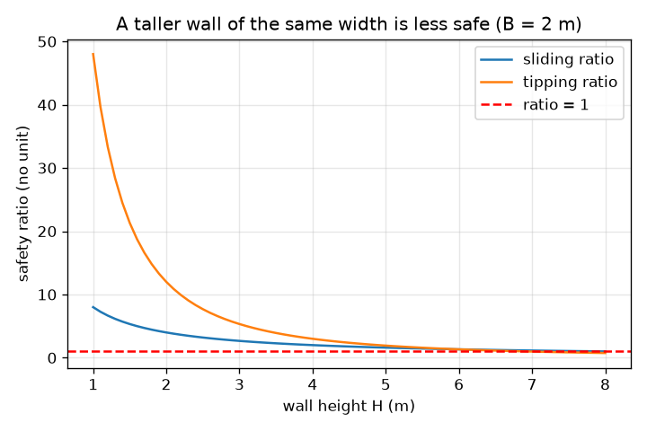
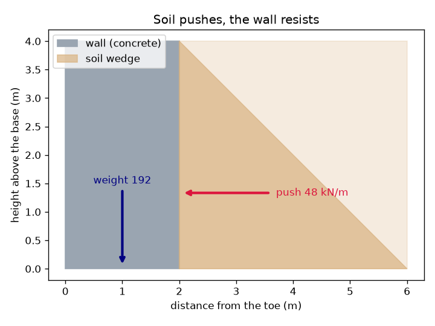

# सत्र 1: मिट्टी धकेलती है, दीवार को न फिसलना है न पलटना

*स्तर 1 (संकल्पनात्मक इंटरैक्टिव मॉडल) · लगभग 60 मिनट · openretainingwall*

> यह एक सरलीकृत शैक्षिक मॉडल है। यह कोई प्रमाणित डिज़ाइन टूल नहीं है और इसका उपयोग वास्तविक संरचनाओं, विद्युत स्थापनाओं, वाहनों, औद्योगिक प्रक्रियाओं या चिकित्सा निर्णयों के लिए नहीं किया जाना चाहिए।

**पूर्व-आवश्यकताएँ (Prerequisites)**

- स्कूल अंकगणित और त्रिभुज का क्षेत्रफल।
- आपने PRIMER.md पढ़ लिया है और `python start.py 1` एक बार चला लिया है।

**सीखने के उद्देश्य (Learning objectives)।** इस सत्र के बाद आप:

- समझा सकेंगे कि मिट्टी दीवार पर बगल की ओर क्यों धकेलती है और यह धक्का गहराई के साथ क्यों बढ़ता है।
- एक सरल आयताकार दीवार के लिए प्रति मीटर दीवार धक्का (push) और दीवार का भार (weight) निकाल सकेंगे।
- यह आँकने के लिए कि दीवार सुरक्षित है या नहीं, एक फिसलन अनुपात (sliding ratio) और एक पलटन अनुपात (tipping ratio) का उपयोग कर सकेंगे।
- दीवार की ऊँचाई के विरुद्ध दोनों अनुपातों का ग्राफ़ पढ़ सकेंगे।

## A. वास्तविक दुनिया की समस्या
एक नीची दीवार के पीछे बगीचे की क्यारी शांत दिखती है, पर मिट्टी एक बाड़ पर झुकी भारी भीड़ जैसी है: वह बगल की ओर फैलना चाहती है। मिट्टी जितनी गहरी होगी, उतनी ज़ोर से धकेलेगी, इसलिए एक ऊँची दीवार को छोटी दीवार से कहीं अधिक सहना पड़ता है। दीवार दो सरल तरीकों से विफल हो सकती है: पूरी दीवार ज़मीन पर फिसल सकती है, या वह अपने सामने वाले निचले किनारे, पंजे (toe), पर पलट सकती है। किसी दी गई चौड़ाई की दीवार को कितना मज़बूत होना चाहिए?

## B. संकल्पना और सिद्धांत
मिट्टी का पार्श्व दाब सतह पर शून्य होता है और गहराई के साथ सीधी रेखा में बढ़ता है, इसलिए दीवार के पिछले भाग पर दाब एक त्रिभुज है। बल उस त्रिभुज का क्षेत्रफल है। इस सत्र में हम एक धक्का गुणांक (push factor) Ka = 1/3 (सत्र 2 बताता है कि यह कहाँ से आता है), 18 kN/m^3 का मिट्टी इकाई भार (unit weight) और एक दीवार ऊँचाई H उपयोग करते हैं, जो प्रति मीटर दीवार 0.5 x (1/3) x 18 x H^2 का धक्का देता है, जो ऊँचाई के एक-तिहाई पर कार्य करता है। दीवार चौड़ाई B का एक कंक्रीट आयत है और प्रति मीटर 24 x B x H भार रखती है; आधार के नीचे घर्षण 0.5 के गुणांक से फिसलन का प्रतिरोध करता है। फिसलन अनुपात = घर्षण / धक्का। पलटन अनुपात = (भार x B/2) / (धक्का x H/3): दीवार को नीचे रखने वाला घूर्णन प्रभाव बटा उसे पलटने वाला घूर्णन प्रभाव, दोनों पंजे के सापेक्ष। 1 से कम अनुपात का अर्थ है विफलता; इंजीनियर फिसलन के लिए कम से कम लगभग 1.5 और पलटन के लिए 2 का मार्जिन चाहते हैं (आमतौर पर उपयोग किया जाने वाला मार्गदर्शन, कोई संहिता (code) नहीं)।

| प्रतीक | अर्थ | इकाई |
|---|---|---|
| H | दीवार की ऊँचाई (रोकी गई मिट्टी की ऊँचाई) | m |
| B | आधार पर दीवार की चौड़ाई | m |
| P | प्रति मीटर लंबाई दीवार पर मिट्टी का कुल पार्श्व धक्का | kN/m |
| W | प्रति मीटर लंबाई दीवार का भार | kN/m |
| gamma | मिट्टी का इकाई भार (18) | kN/m^3 |
| Ka | धक्का गुणांक (यहाँ 1/3) | कोई इकाई नहीं |
| mu | आधार के नीचे घर्षण गुणांक (0.5) | कोई इकाई नहीं |

**मान्यताएँ (Assumptions)**

- दीवार 24 kN/m^3 इकाई भार वाले कंक्रीट का एक ठोस आयत है।
- मिट्टी सूखी है, दीवार के शीर्ष पर समतल है और धक्का गुणांक 1/3 देती है।
- केवल आधार का घर्षण फिसलन का प्रतिरोध करता है; पंजे के सामने की मिट्टी को अनदेखा किया गया है।
- यह एक सरलीकृत शिक्षण मॉडल है, किसी वास्तविक दीवार के लिए डिज़ाइन विधि कभी नहीं।

$$ P=\tfrac12 K_a\gamma H^2,\qquad \text{acts at } H/3 \text{ above the base} $$

$$ W=\gamma_c B H $$

$$ \text{sliding ratio}=\frac{\mu W}{P},\qquad \text{tipping ratio}=\frac{W\,B/2}{P\,H/3} $$

## C. दृश्य व्याख्या
पहला चित्र धूसर-नीली दीवार, उसके पीछे की मिट्टी, ऊँचाई के एक-तिहाई पर धक्का तीर और आधार के बीच से होकर भार तीर दिखाता है। दूसरा 2 m चौड़ी दीवार के लिए दीवार की ऊँचाई के विरुद्ध दोनों अनुपात आलेखित करता है: दीवार ऊँची होने पर वे गिरते हैं क्योंकि धक्का H के वर्ग के साथ बढ़ता है जबकि भार केवल H के साथ बढ़ता है। पलटन अनुपात लगभग 6.9 m पर और फिसलन अनुपात 8 m पर 1 को पार करता है।

*2 m चौड़ी दीवार के लिए दीवार की ऊँचाई के विरुद्ध फिसलन और पलटन अनुपात: दीवार ऊँची होने पर दोनों गिरते हैं।*

*एक 4 m की दीवार: मिट्टी ऊँचाई के एक-तिहाई पर 48 kN/m से धकेलती है; भार 192 kN/m है।*

## D. इंटरैक्टिव सिमुलेशन
पाठ चलाइए (`python start.py 1`), फिर लाइव ऐप खोलिए: [सत्र 1: क्या दीवार फिसलेगी या पलटेगी?](https://krunalpanchal1995.github.io/pan-iit-oss/openretainingwall/session-01/) (या इसी फ़ोल्डर में `app.html`)। दीवार की ऊँचाई ऊपर-नीचे खिसकाइए और धक्का तीर को दीवार से तेज़ी से बढ़ते देखिए। फिर दीवार चौड़ी कीजिए और दोनों अनुपातों को बढ़ते देखिए।

**चुनौती।** कम से कम 5 m ऊँची ऐसी दीवार बनाइए जिसका फिसलन अनुपात कम से कम 1.5 और पलटन अनुपात कम से कम 2 हो।

## E. हल किया गया उदाहरण और प्रयोग
**समस्या।** 4 m ऊँची और 2 m चौड़ी एक दीवार सूखी मिट्टी रोकती है। धक्का, भार, फिसलन अनुपात और पलटन अनुपात ज्ञात कीजिए।

1. धक्का P = 0.5 x (1/3) x 18 x 4^2 = 0.5 x 0.3333 x 18 x 16 = 48 kN/m, आधार से 4/3 = 1.33 m ऊपर कार्य करता है।
2. भार W = 24 x 2 x 4 = 192 kN/m, पंजे से 1 m पर कार्य करता है।
3. फिसलन: घर्षण = 0.5 x 192 = 96 kN/m, इसलिए अनुपात 96 / 48 = 2.00 है।
4. पलटन: प्रतिरोधी घूर्णन प्रभाव = 192 x 1 = 192 kN m/m; पलटाने वाला घूर्णन प्रभाव = 48 x 1.333 = 64 kN m/m; अनुपात 192 / 64 = 3.00 है।

**उत्तर।** धक्का 48 kN/m, भार 192 kN/m, फिसलन अनुपात 2.00, पलटन अनुपात 3.00। दोनों मार्गदर्शन मानों 1.5 और 2 से ऊपर हैं।

**प्रयोग।** एक जूते के डिब्बे को 10 cm की गहराई तक सूखी रेत से भरिए, एक पतले लकड़ी के बोर्ड को रेत से भरी ओर टिकाइए और डिब्बे को धीरे-धीरे झुकाइए। अलग-अलग भार के बोर्ड आज़माइए: एक भारी या चौड़ा खंड अधिक देर तक प्रतिरोध करता है। मॉडल अनुमान लगाता है कि रेत की गहराई दोगुनी करने से धक्का चार गुना हो जाता है (होता है: 8 m की दीवार के लिए 48 kN/m, 192 kN/m हो जाता है)। असली रेत ठीक-ठीक मॉडल का सरल त्रिभुज नहीं है, बोर्ड कठोर नहीं है और मेज़ पर घर्षण बदलता रहता है, इसलिए प्रवृत्ति में केवल मोटी सहमति की अपेक्षा कीजिए।

## F. मूल्यांकन और डिज़ाइन चुनौती
**प्रश्न प्रकार A: संकल्पनात्मक।** मिट्टी की ऊँचाई दोगुनी करने से दीवार पर धक्का चार गुना क्यों हो जाता है, पर उसी चौड़ाई की दीवार का भार केवल दोगुना होता है?

संकेत

धक्का एक ऐसे त्रिभुज का क्षेत्रफल है जिसका आधार और ऊँचाई दोनों H के साथ बढ़ते हैं। भार चौड़ाई गुणा ऊँचाई है।

चरण-दर-चरण हल

तल पर दाब दोगुना हो जाता है (यह गहराई के समानुपाती है) और भारित ऊँचाई दोगुनी हो जाती है, इसलिए त्रिभुज का क्षेत्रफल चार गुना बड़ा हो जाता है: 48 kN/m, 192 kN/m हो जाता है। दीवार के भार W = 24 x B x H में H का केवल एक गुणक है, इसलिए यह दोगुना होता है। इसीलिए उसी चौड़ाई की ऊँची दीवार बहुत कम सुरक्षित होती है।

**प्रश्न प्रकार B: संख्यात्मक।** 3 m ऊँची और 1.2 m चौड़ी एक दीवार सूखी मिट्टी रोकती है (पाठ जैसे ही मान)। फिसलन अनुपात और पलटन अनुपात ज्ञात कीजिए। क्या यह 1.5 और 2 के मार्गदर्शन को पूरा करती है?

संकेत

P = 0.5 x (1/3) x 18 x 9 = 27 kN/m, 1 m पर कार्य करता है; W = 24 x 1.2 x 3।

चरण-दर-चरण हल

W = 86.4 kN/m। फिसलन अनुपात = 0.5 x 86.4 / 27 = 1.60। पलटन अनुपात = 86.4 x 0.6 / (27 x 1) = 51.84 / 27 = 1.92। फिसलन 1.5 को पूरा करता है, पर पलटन अनुपात 1.92, 2 से ठीक नीचे है, इसलिए दीवार थोड़ी अधिक संकरी है।

**प्रश्न प्रकार C: ग्राफ़ और सिमुलेशन की व्याख्या।** 2 m चौड़ी दीवार के ग्राफ़ में, किन ऊँचाइयों पर दोनों अनुपात 1 तक पहुँचते हैं? दीवार के ऊँची होने पर कौन-सी विफलता पहले आती है?

संकेत

पढ़िए कि हर वक्र लाल रेखा को कहाँ छूता है। बंद रूप: फिसलन अनुपात = 4B/H, पलटन अनुपात = 12 B^2 / H^2।

चरण-दर-चरण हल

पलटन अनुपात H = sqrt(48) = 6.93 m पर और फिसलन अनुपात H = 8 m पर 1 तक पहुँचता है। दीवार के ऊँची होने पर, पलटन पहले विफल होती है, लगभग 6.9 m पर। व्यवहार में मार्गदर्शन मान 1.5 और 2 उससे बहुत पहले पार हो जाते हैं: इस चौड़ाई की दीवार कहीं कम ऊँचाइयों पर उन्हें पूरा करना बंद कर देती है।

**प्रश्न प्रकार D: डिज़ाइन और इष्टतमीकरण (optimisation) चुनौती।** डिज़ाइन: 3 m ऊँची दीवार के लिए 0.05 m के चरणों में सबसे छोटी चौड़ाई चुनिए जो कम से कम 1.5 का फिसलन अनुपात और कम से कम 2 का पलटन अनुपात दे। कौन-सा अनुपात निर्णय करता है?

संकेत

फिसलन के लिए 4B/H >= 1.5 चाहिए और पलटन के लिए 12 B^2 / H^2 >= 2। हर एक को B के लिए हल कीजिए।

चरण-दर-चरण हल

फिसलन: B >= 1.5 x 3 / 4 = 1.125 m। पलटन: B >= 3 x sqrt(2/12) = 1.225 m। दोनों लागू होने चाहिए, इसलिए चौड़ाई 1.25 m है (1.20 m से पलटन अनुपात 1.92 मिलता है, बहुत कम)। पलटन निर्णय करती है। समझौता (trade-off): चौड़ी दीवार में अधिक कंक्रीट लगता है; 1.20 m के बजाय 1.25 m लगभग 4 प्रतिशत अधिक है।

[RUBRIC.md](../../RUBRIC.md) से स्वयं को अंक दीजिए। कागज़ पर काम करने के लिए [गतिविधि पत्रक](activity_sheet.md) प्रिंट कीजिए।

## सामान्य भ्रांतियाँ (Common misconceptions)
| सामान्य भ्रांति | वास्तव में क्या सच है |
|---|---|
| मिट्टी केवल ज़मीन पर नीचे दबाती है, बगल की ओर नहीं। | मिट्टी एक दानेदार पदार्थ है: यह छोटे धक्का गुणांक वाले भारी तरल की तरह बगल की ओर धकेलती है, और दाब गहराई के साथ बढ़ता है। |
| ऊँची दीवार को केवल आनुपातिक रूप से अधिक चौड़ाई चाहिए। | धक्का ऊँचाई के वर्ग के साथ बढ़ता है, इसलिए आवश्यक चौड़ाई मोटे तौर पर ऊँचाई के अनुपात में बढ़ती है, केवल भार के नहीं। |
| यदि दीवार नहीं फिसलती तो वह विफल नहीं हो सकती। | यह अपने पंजे के चारों ओर पलट भी सकती है; फिसलन और पलटन अलग-अलग जाँचें हैं। |
| ठीक 1 का अनुपात सुरक्षित है। | 1 के अनुपात का अर्थ है कि दीवार विफल होने के कगार पर है; वास्तविक आँकड़े अनिश्चित होते हैं, इसलिए इंजीनियर एक मार्जिन चाहते हैं। |

## शब्दावली (Glossary)
- **प्रतिधारक दीवार (retaining wall)**: मिट्टी को रोकने के लिए बनाई गई दीवार
- **पंजा (toe)**: दीवार का सामने वाला निचला किनारा, वह धुरी जिसके चारों ओर वह पलटती है
- **पृष्ठ भराव (backfill)**: दीवार के पीछे रखी गई मिट्टी
- **धक्का गुणांक Ka (push factor)**: मिट्टी के भार दाब का वह अंश जो पार्श्व दाब के रूप में प्रकट होता है; यहाँ 1/3
- **kN प्रति मीटर**: प्रति मीटर लंबाई दीवार पर बल, लंबी दीवार के लिए सामान्य इकाई

## समापन
1. [exercises.md](exercises.md) में दिए गए तीन कोडिंग कार्य कीजिए।
2. अपने बदलावों के बाद `python start.py 1` फिर से चलाइए। यह checkpoint के साथ समाप्त होता है; जब यह `PASS` छापे, तो आपका काम पूरा है। (केवल checkpoint: `python start.py check 1`।)

अगला: [सत्र 2](../session-02/README.md)
