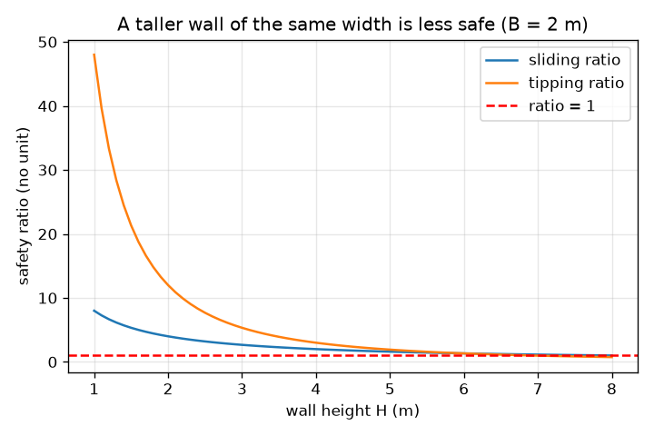
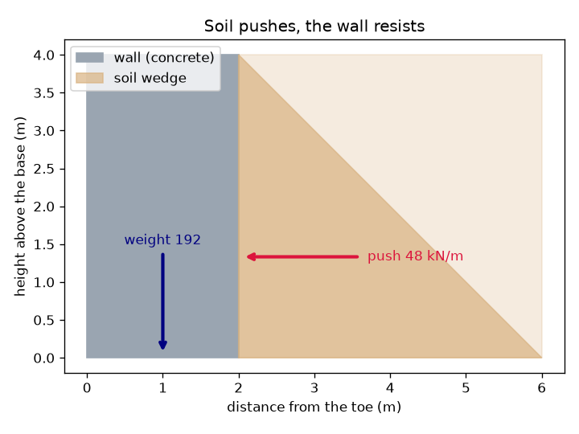

# സെഷൻ 1: മണ്ണ് തള്ളുന്നു, മതിൽ തെന്നുകയോ മറിയുകയോ ചെയ്യരുത്

[Session 1 — हिन्दी](README.hi.md)

*തലം 1 (ആശയപരമായ സംവേദനാത്മക മാതൃക) · ഏകദേശം 60 മിനിറ്റ് · openretainingwall*

> ഇതൊരു ലളിതവൽക്കരിച്ച വിദ്യാഭ്യാസ മാതൃകയാണ്. ഇത് സാധൂകരിച്ച ഡിസൈൻ ഉപകരണമല്ല; യഥാർഥ നിർമിതികൾ, വൈദ്യുത ഇൻസ്റ്റലേഷനുകൾ, വാഹനങ്ങൾ, വ്യാവസായിക പ്രക്രിയകൾ, വൈദ്യശാസ്ത്ര തീരുമാനങ്ങൾ എന്നിവയ്ക്ക് ഇത് ഉപയോഗിക്കരുത്.

**മുൻവിജ്ഞാനം (Prerequisites)**

- സ്കൂൾ അങ്കഗണിതവും ത്രികോണത്തിന്റെ വിസ്തീർണവും.
- നിങ്ങൾ PRIMER.md വായിക്കുകയും `python start.py 1` ഒരു തവണ റൺ ചെയ്യുകയും ചെയ്തിരിക്കണം.

**പഠനലക്ഷ്യങ്ങൾ (Learning objectives).** ഈ സെഷനു ശേഷം നിങ്ങൾക്ക്:

- മണ്ണ് മതിലിനെ വശങ്ങളിലേക്കു തള്ളുന്നത് എന്തുകൊണ്ടെന്നും ആഴത്തിനനുസരിച്ച് തള്ളൽ കൂടുന്നത് എന്തുകൊണ്ടെന്നും വിശദീകരിക്കാം.
- ലളിതമായ ചതുരാകൃതിയിലുള്ള മതിലിന് ഒരു മീറ്റർ മതിലിൽ തള്ളലും മതിലിന്റെ ഭാരവും കണക്കാക്കാം.
- മതിൽ സുരക്ഷിതമാണോ എന്നു വിലയിരുത്താൻ തെന്നൽ അനുപാതവും (sliding ratio) മറിയൽ അനുപാതവും (tipping ratio) ഉപയോഗിക്കാം.
- മതിലിന്റെ ഉയരത്തിനെതിരെ രണ്ട് അനുപാതങ്ങളുടെയും ഗ്രാഫ് വായിക്കാം.

## A. യഥാർഥ ജീവിത പ്രശ്നം
താഴ്ന്ന ഒരു മതിലിനു പിന്നിലെ പൂന്തോട്ടത്തടം ശാന്തമായി തോന്നുമെങ്കിലും മണ്ണ് ഒരു വേലിയിൽ ചാരിനിൽക്കുന്ന ഭാരമുള്ള ജനക്കൂട്ടത്തെപ്പോലെയാണ്: അത് വശങ്ങളിലേക്കു പരക്കാൻ ആഗ്രഹിക്കുന്നു. മണ്ണിന്റെ ആഴം കൂടുന്തോറും തള്ളൽ കൂടുന്നു, അതിനാൽ ഉയരമുള്ള മതിൽ ഉയരം കുറഞ്ഞതിനെക്കാൾ വളരെ കൂടുതൽ നേരിടുന്നു. മതിൽ രണ്ടു ലളിതമായ വിധത്തിൽ പരാജയപ്പെടാം: മതിൽ മുഴുവനായി നിലത്തുകൂടി തെന്നിപ്പോകാം, അല്ലെങ്കിൽ അതിന്റെ മുൻഭാഗത്തെ അടിവക്കായ പാദത്തിനു (toe) മുകളിലൂടെ മറിയാം. ഒരു നിശ്ചിത വീതിയുള്ള മതിലിന് എത്ര ബലം വേണം?

## B. ആശയവും സിദ്ധാന്തവും
മണ്ണിന്റെ പാർശ്വ മർദം ഉപരിതലത്തിൽ പൂജ്യമാണ്, ആഴത്തിനനുസരിച്ച് നേർരേഖയിൽ വർധിക്കുന്നു, അതിനാൽ മതിലിന്റെ പിൻഭാഗത്തെ മർദം ഒരു ത്രികോണമാണ്. ആ ത്രികോണത്തിന്റെ വിസ്തീർണമാണ് ബലം. ഈ സെഷനിൽ നാം തള്ളൽ ഘടകം Ka = 1/3 (ഇത് എവിടെ നിന്നു വരുന്നു എന്ന് സെഷൻ 2 വിശദീകരിക്കും), മണ്ണിന്റെ യൂണിറ്റ് ഭാരം 18 kN/m^3, മതിലിന്റെ ഉയരം H എന്നിവ ഉപയോഗിക്കുന്നു, ഇത് ഒരു മീറ്റർ മതിലിന് 0.5 x (1/3) x 18 x H^2 തള്ളൽ നൽകുന്നു, അത് മുകളിലേക്ക് മൂന്നിലൊന്ന് ഉയരത്തിൽ പ്രവർത്തിക്കുന്നു. മതിൽ B വീതിയുള്ള ഒരു കോൺക്രീറ്റ് ചതുരമാണ്, ഒരു മീറ്ററിന് 24 x B x H ഭാരമുണ്ട്; അടിത്തറയിലെ ഘർഷണം 0.5 ഗുണാങ്കത്തോടെ തെന്നലിനെ പ്രതിരോധിക്കുന്നു. തെന്നൽ അനുപാതം = ഘർഷണം / തള്ളൽ. മറിയൽ അനുപാതം = (ഭാരം x B/2) / (തള്ളൽ x H/3): മതിലിനെ താഴെ നിർത്തുന്ന ഭ്രമണ ഫലത്തെ മറിക്കുന്ന ഭ്രമണ ഫലം കൊണ്ടു ഹരിച്ചത്, രണ്ടും പാദത്തെ അടിസ്ഥാനമാക്കി. 1-ൽ താഴെയുള്ള അനുപാതം പരാജയം എന്നാണ് അർഥം; എൻജിനീയർമാർക്ക് തെന്നലിന് ഏകദേശം 1.5-ഉം മറിയലിന് 2-ഉം എങ്കിലും മാർജിൻ വേണം (സാധാരണ ഉപയോഗിക്കുന്ന മാർഗനിർദേശം, ചട്ടമല്ല).

| ചിഹ്നം | അർഥം | യൂണിറ്റ് |
|---|---|---|
| H | മതിലിന്റെ ഉയരം (താങ്ങുന്ന മണ്ണിന്റെ ഉയരം) | m |
| B | അടിത്തറയിലെ മതിലിന്റെ വീതി | m |
| P | ഒരു മീറ്റർ നീളമുള്ള മതിലിൽ മണ്ണിന്റെ ആകെ പാർശ്വ തള്ളൽ | kN/m |
| W | ഒരു മീറ്റർ നീളത്തിന് മതിലിന്റെ ഭാരം | kN/m |
| gamma | മണ്ണിന്റെ യൂണിറ്റ് ഭാരം (18) | kN/m^3 |
| Ka | തള്ളൽ ഘടകം (ഇവിടെ 1/3) | യൂണിറ്റില്ല |
| mu | അടിത്തറയിലെ ഘർഷണ ഗുണാങ്കം (0.5) | യൂണിറ്റില്ല |

**അനുമാനങ്ങൾ (Assumptions)**

- മതിൽ 24 kN/m^3 യൂണിറ്റ് ഭാരമുള്ള കോൺക്രീറ്റിന്റെ ഖര ചതുരമാണ്.
- മണ്ണ് ഉണങ്ങിയതാണ്, മതിലിന്റെ മുകളിൽ നിരപ്പാണ്, തള്ളൽ ഘടകം 1/3 നൽകുന്നു.
- അടിത്തറയിലെ ഘർഷണം മാത്രമാണ് തെന്നലിനെ പ്രതിരോധിക്കുന്നത്; പാദത്തിനു മുന്നിലെ മണ്ണ് അവഗണിക്കുന്നു.
- ഇതൊരു ലളിതവൽക്കരിച്ച അധ്യാപന മാതൃകയാണ്, യഥാർഥ മതിലിനുള്ള ഡിസൈൻ രീതിയല്ല.

$$ P=\tfrac12 K_a\gamma H^2,\qquad \text{acts at } H/3 \text{ above the base} $$

$$ W=\gamma_c B H $$

$$ \text{sliding ratio}=\frac{\mu W}{P},\qquad \text{tipping ratio}=\frac{W\,B/2}{P\,H/3} $$

## C. ദൃശ്യ വിശദീകരണം
ആദ്യ ചിത്രം ചാര-നീല നിറത്തിലുള്ള മതിൽ, അതിനു പിന്നിലെ മണ്ണ്, ഉയരത്തിന്റെ മൂന്നിലൊന്നിലെ തള്ളൽ അമ്പ്, അടിത്തറയുടെ മധ്യത്തിലൂടെയുള്ള ഭാര അമ്പ് എന്നിവ കാണിക്കുന്നു. രണ്ടാമത്തേത് 2 m വീതിയുള്ള മതിലിന് രണ്ട് അനുപാതങ്ങളെയും മതിലിന്റെ ഉയരത്തിനെതിരെ വരയ്ക്കുന്നു: മതിൽ ഉയരുമ്പോൾ അവ കുറയുന്നു, കാരണം തള്ളൽ H-ന്റെ വർഗത്തിനൊപ്പം വർധിക്കുമ്പോൾ ഭാരം H-നൊപ്പം മാത്രം വർധിക്കുന്നു. മറിയൽ അനുപാതം ഏകദേശം 6.9 m-ലും തെന്നൽ അനുപാതം 8 m-ലും 1 കടക്കുന്നു.

*2 m വീതിയുള്ള മതിലിന് മതിലിന്റെ ഉയരത്തിനെതിരെ തെന്നൽ, മറിയൽ അനുപാതങ്ങൾ: മതിൽ ഉയരുമ്പോൾ രണ്ടും കുറയുന്നു.*

*4 m മതിൽ: മണ്ണ് ഉയരത്തിന്റെ മൂന്നിലൊന്നിൽ 48 kN/m ബലത്തോടെ തള്ളുന്നു; ഭാരം 192 kN/m.*

## D. സംവേദനാത്മക സിമുലേഷൻ
പാഠം റൺ ചെയ്യുക (`python start.py 1`), എന്നിട്ട് ലൈവ് ആപ്പ് തുറക്കുക: [സെഷൻ 1: മതിൽ തെന്നുമോ മറിയുമോ?](https://krunalpanchal1995.github.io/pan-iit-oss/openretainingwall/session-01/) (അല്ലെങ്കിൽ ഈ ഫോൾഡറിലെ `app.html`). മതിലിന്റെ ഉയരം മുകളിലേക്കും താഴേക്കും നീക്കി തള്ളൽ അമ്പ് മതിലിനെക്കാൾ വേഗത്തിൽ വളരുന്നത് കാണുക. പിന്നെ മതിലിന്റെ വീതി കൂട്ടി രണ്ട് അനുപാതങ്ങളും ഉയരുന്നത് കാണുക.

**വെല്ലുവിളി.** കുറഞ്ഞത് 5 m ഉയരവും, തെന്നൽ അനുപാതം കുറഞ്ഞത് 1.5-ഉം മറിയൽ അനുപാതം കുറഞ്ഞത് 2-ഉം ഉള്ള ഒരു മതിൽ നിർമിക്കുക.

## E. ഉദാഹരണവും പരീക്ഷണവും
**പ്രശ്നം.** 4 m ഉയരവും 2 m വീതിയുമുള്ള ഒരു മതിൽ ഉണങ്ങിയ മണ്ണിനെ താങ്ങുന്നു. തള്ളൽ, ഭാരം, തെന്നൽ അനുപാതം, മറിയൽ അനുപാതം എന്നിവ കണ്ടെത്തുക.

1. തള്ളൽ P = 0.5 x (1/3) x 18 x 4^2 = 0.5 x 0.3333 x 18 x 16 = 48 kN/m, അടിത്തറയ്ക്കു മുകളിൽ 4/3 = 1.33 m ഉയരത്തിൽ പ്രവർത്തിക്കുന്നു.
2. ഭാരം W = 24 x 2 x 4 = 192 kN/m, പാദത്തിൽ നിന്ന് 1 m അകലെ പ്രവർത്തിക്കുന്നു.
3. തെന്നൽ: ഘർഷണം = 0.5 x 192 = 96 kN/m, അതിനാൽ അനുപാതം 96 / 48 = 2.00.
4. മറിയൽ: പ്രതിരോധിക്കുന്ന ഭ്രമണ ഫലം = 192 x 1 = 192 kN m/m; മറിക്കുന്ന ഭ്രമണ ഫലം = 48 x 1.333 = 64 kN m/m; അനുപാതം 192 / 64 = 3.00.

**ഉത്തരം.** തള്ളൽ 48 kN/m, ഭാരം 192 kN/m, തെന്നൽ അനുപാതം 2.00, മറിയൽ അനുപാതം 3.00. രണ്ടും 1.5, 2 എന്ന മാർഗനിർദേശ മൂല്യങ്ങൾക്കു മുകളിലാണ്.

**പരീക്ഷണം.** ഒരു ഷൂ പെട്ടിയിൽ 10 cm ആഴത്തിൽ ഉണങ്ങിയ മണൽ നിറയ്ക്കുക, മണൽ നിറച്ച വശത്തോട് ചേർത്ത് ഒരു നേർത്ത മരപ്പലക ചാരിവയ്ക്കുക, പെട്ടി പതുക്കെ ചരിക്കുക. വ്യത്യസ്ത ഭാരമുള്ള പലകകൾ പരീക്ഷിക്കുക: ഭാരമുള്ളതോ വീതിയുള്ളതോ ആയ കട്ട കൂടുതൽ നേരം പ്രതിരോധിക്കുന്നു. മണലിന്റെ ആഴം ഇരട്ടിയാക്കിയാൽ തള്ളൽ നാലിരട്ടിയാകുമെന്ന് മാതൃക പ്രവചിക്കുന്നു (അങ്ങനെ തന്നെ: 8 m മതിലിന് 48 kN/m 192 kN/m ആകുന്നു). യഥാർഥ മണൽ മാതൃകയിലെ ലളിതമായ ത്രികോണം പോലെ കൃത്യമല്ല, പലക ദൃഢമല്ല, മേശയിലെ ഘർഷണം മാറുന്നു, അതിനാൽ പ്രവണതയിൽ ഏകദേശ യോജിപ്പേ പ്രതീക്ഷിക്കാവൂ.

## F. മൂല്യനിർണയവും ഡിസൈൻ വെല്ലുവിളിയും
**ചോദ്യ തരം A: ആശയപരം.** മണ്ണിന്റെ ഉയരം ഇരട്ടിയാക്കുമ്പോൾ മതിലിലെ തള്ളൽ നാലിരട്ടിയാകുന്നു, എന്നാൽ അതേ വീതിയുള്ള മതിലിന്റെ ഭാരം ഇരട്ടി മാത്രമാകുന്നത് എന്തുകൊണ്ട്?

സൂചന

അടിത്തറയും ഉയരവും രണ്ടും H-നൊപ്പം വളരുന്ന ഒരു ത്രികോണത്തിന്റെ വിസ്തീർണമാണ് തള്ളൽ. ഭാരം വീതി ഗുണം ഉയരമാണ്.

ഘട്ടം ഘട്ടമായ പരിഹാരം

അടിയിലെ മർദം ഇരട്ടിയാകുന്നു (അത് ആഴത്തിന് ആനുപാതികമാണ്), ഭാരം വഹിക്കുന്ന ഉയരവും ഇരട്ടിയാകുന്നു, അതിനാൽ ത്രികോണത്തിന്റെ വിസ്തീർണം നാലിരട്ടി വലുതാകുന്നു: 48 kN/m 192 kN/m ആകുന്നു. മതിലിന്റെ ഭാരം W = 24 x B x H-ൽ H-ന്റെ ഒരു ഘടകം മാത്രമേയുള്ളൂ, അതിനാൽ അത് ഇരട്ടിയാകുന്നു. അതുകൊണ്ടാണ് അതേ വീതിയുള്ള ഉയരം കൂടിയ മതിൽ വളരെ കുറഞ്ഞ സുരക്ഷിതത്വമുള്ളത്.

**ചോദ്യ തരം B: സംഖ്യാപരം.** 3 m ഉയരവും 1.2 m വീതിയുമുള്ള ഒരു മതിൽ ഉണങ്ങിയ മണ്ണിനെ താങ്ങുന്നു (പാഠത്തിലെ അതേ മൂല്യങ്ങൾ). തെന്നൽ അനുപാതവും മറിയൽ അനുപാതവും കണ്ടെത്തുക. ഇത് 1.5, 2 എന്ന മാർഗനിർദേശം പാലിക്കുന്നുണ്ടോ?

സൂചന

P = 0.5 x (1/3) x 18 x 9 = 27 kN/m, 1 m ഉയരത്തിൽ പ്രവർത്തിക്കുന്നു; W = 24 x 1.2 x 3.

ഘട്ടം ഘട്ടമായ പരിഹാരം

W = 86.4 kN/m. തെന്നൽ അനുപാതം = 0.5 x 86.4 / 27 = 1.60. മറിയൽ അനുപാതം = 86.4 x 0.6 / (27 x 1) = 51.84 / 27 = 1.92. തെന്നൽ 1.5 പാലിക്കുന്നു, എന്നാൽ മറിയൽ അനുപാതം 1.92, 2-ന് അല്പം താഴെയാണ്, അതിനാൽ മതിൽ അല്പം വീതി കുറഞ്ഞതാണ്.

**ചോദ്യ തരം C: ഗ്രാഫും സിമുലേഷനും വ്യാഖ്യാനിക്കൽ.** 2 m വീതിയുള്ള മതിലിന്റെ ഗ്രാഫിൽ രണ്ട് അനുപാതങ്ങളും ഏത് ഉയരങ്ങളിൽ 1-ൽ എത്തുന്നു? മതിൽ ഉയരുമ്പോൾ ഏത് പരാജയം ആദ്യം സംഭവിക്കുന്നു?

സൂചന

ഓരോ വക്രവും ചുവപ്പ് വരയെ തൊടുന്നിടം വായിക്കുക. സൂത്രവാക്യങ്ങൾ: തെന്നൽ അനുപാതം = 4B/H, മറിയൽ അനുപാതം = 12 B^2 / H^2.

ഘട്ടം ഘട്ടമായ പരിഹാരം

മറിയൽ അനുപാതം H = sqrt(48) = 6.93 m-ലും തെന്നൽ അനുപാതം H = 8 m-ലും 1-ൽ എത്തുന്നു. മതിൽ ഉയരുമ്പോൾ മറിയലാണ് ആദ്യം പരാജയപ്പെടുന്നത്, ഏകദേശം 6.9 m-ൽ. പ്രായോഗികമായി 1.5, 2 എന്ന മാർഗനിർദേശ മൂല്യങ്ങൾ അതിനും വളരെ മുമ്പേ ലംഘിക്കപ്പെടുന്നു: ഈ വീതിയുള്ള മതിൽ അവ പാലിക്കുന്നത് വളരെ കുറഞ്ഞ ഉയരങ്ങളിൽ അവസാനിപ്പിക്കുന്നു.

**ചോദ്യ തരം D: ഡിസൈൻ, ഒപ്റ്റിമൈസേഷൻ വെല്ലുവിളി.** ഡിസൈൻ: 3 m ഉയരമുള്ള മതിലിന്, 0.05 m ഘട്ടങ്ങളിൽ, തെന്നൽ അനുപാതം കുറഞ്ഞത് 1.5-ഉം മറിയൽ അനുപാതം കുറഞ്ഞത് 2-ഉം നൽകുന്ന ഏറ്റവും ചെറിയ വീതി തിരഞ്ഞെടുക്കുക. ഏത് അനുപാതമാണ് തീരുമാനിക്കുന്നത്?

സൂചന

തെന്നലിന് 4B/H >= 1.5-ഉം മറിയലിന് 12 B^2 / H^2 >= 2-ഉം വേണം. ഓരോന്നും B-ക്കായി നിർധാരണം ചെയ്യുക.

ഘട്ടം ഘട്ടമായ പരിഹാരം

തെന്നൽ: B >= 1.5 x 3 / 4 = 1.125 m. മറിയൽ: B >= 3 x sqrt(2/12) = 1.225 m. രണ്ടും പാലിക്കണം, അതിനാൽ വീതി 1.25 m ആണ് (1.20 m മറിയൽ അനുപാതം 1.92 നൽകുന്നു, വളരെ കുറവ്). മറിയൽ തീരുമാനിക്കുന്നു. വിട്ടുവീഴ്ച (trade-off): വീതി കൂടിയ മതിലിന് കൂടുതൽ കോൺക്രീറ്റ് വേണം; 1.20 m-ന് പകരം 1.25 m ഏകദേശം 4 ശതമാനം കൂടുതലാണ്.

[RUBRIC.md](../../RUBRIC.md) ഉപയോഗിച്ച് സ്വയം മാർക്കിടുക. കടലാസിൽ ചെയ്യാൻ [പ്രവർത്തന ഷീറ്റ്](activity_sheet.md) പ്രിന്റ് ചെയ്യുക.

## സാധാരണ തെറ്റിദ്ധാരണകൾ
| സാധാരണ തെറ്റിദ്ധാരണ | യഥാർഥത്തിൽ ശരിയായത് |
|---|---|
| മണ്ണ് നിലത്തെ താഴേക്ക് മാത്രമേ അമർത്തുന്നുള്ളൂ, വശങ്ങളിലേക്കല്ല. | മണ്ണ് തരികളുള്ള പദാർഥമാണ്: ചെറിയ തള്ളൽ ഘടകമുള്ള ഭാരമുള്ള ദ്രാവകം പോലെ അത് വശങ്ങളിലേക്കു തള്ളുന്നു, മർദം ആഴത്തിനനുസരിച്ച് വർധിക്കുന്നു. |
| ഉയരം കൂടിയ മതിലിന് ആനുപാതികമായി കൂടുതൽ വീതി മാത്രം മതി. | തള്ളൽ ഉയരത്തിന്റെ വർഗത്തിനൊപ്പം വളരുന്നു, അതിനാൽ ആവശ്യമായ വീതി ഭാരത്തിനൊപ്പം മാത്രമല്ല, ഏകദേശം ഉയരത്തിന് ആനുപാതികമായി വളരുന്നു. |
| മതിൽ തെന്നുന്നില്ലെങ്കിൽ അത് പരാജയപ്പെടില്ല. | അതിന് പാദത്തിൽ മറിയാനും കഴിയും; തെന്നലും മറിയലും വെവ്വേറെ പരിശോധനകളാണ്. |
| കൃത്യം 1 എന്ന അനുപാതം സുരക്ഷിതമാണ്. | 1 എന്ന അനുപാതം മതിൽ പരാജയത്തിന്റെ വക്കിലാണെന്നാണ് അർഥം; യഥാർഥ വിവരങ്ങൾ അനിശ്ചിതമാണ്, അതിനാൽ എൻജിനീയർമാർക്ക് മാർജിൻ വേണം. |

## പദാവലി (Glossary)
- **താങ്ങുഭിത്തി (retaining wall)**: മണ്ണിനെ തടഞ്ഞുനിർത്താൻ നിർമിച്ച മതിൽ
- **പാദം (toe)**: മതിലിന്റെ മുൻഭാഗത്തെ അടിവക്ക്, അത് മറിയുന്ന ഭ്രമണബിന്ദു
- **പിൻനിറവ് (backfill)**: മതിലിനു പിന്നിൽ നിറച്ച മണ്ണ്
- **തള്ളൽ ഘടകം Ka (push factor)**: മണ്ണിന്റെ ഭാര മർദത്തിൽ പാർശ്വ മർദമായി പ്രത്യക്ഷപ്പെടുന്ന ഭാഗം; ഇവിടെ 1/3
- **kN പ്രതി മീറ്റർ (kN per metre)**: മതിലിന്റെ ഒരു മീറ്റർ നീളത്തിനുള്ള ബലം, നീളമുള്ള മതിലിന്റെ സാധാരണ യൂണിറ്റ്

## പൂർത്തിയാക്കൽ
1. [exercises.md](exercises.md)-ലെ മൂന്ന് കോഡിങ് ജോലികൾ ചെയ്യുക.
2. മാറ്റങ്ങൾക്കു ശേഷം `python start.py 1` വീണ്ടും റൺ ചെയ്യുക. അത് ചെക്ക്പോയിന്റോടെ അവസാനിക്കുന്നു; `PASS` എന്ന് പ്രിന്റ് ചെയ്താൽ നിങ്ങൾ പൂർത്തിയാക്കി. (ചെക്ക്പോയിന്റ് മാത്രം: `python start.py check 1`.)

അടുത്തത്: [സെഷൻ 2](../session-02/README.md)
