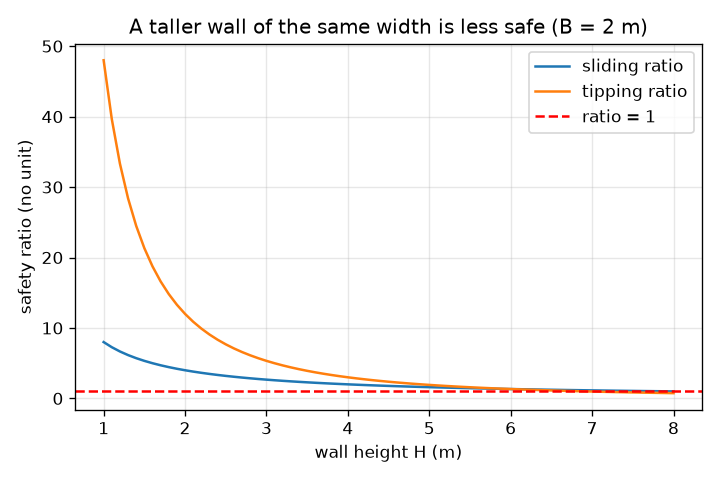
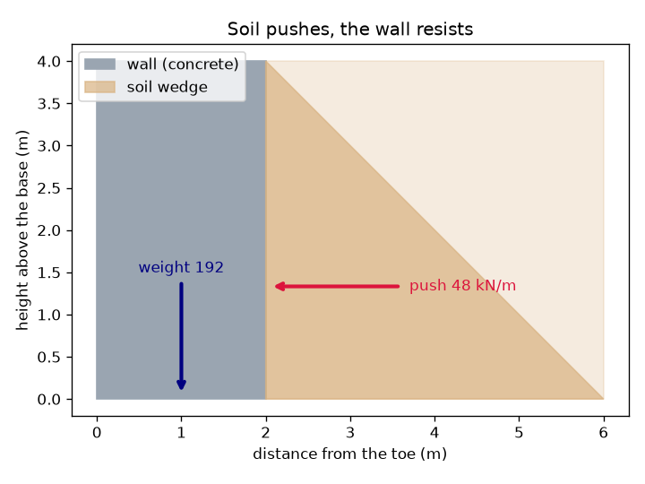

# அமர்வு 1: மண் தள்ளுகிறது, சுவர் சறுக்கவோ சாயவோ கூடாது

[Session 1 — हिन्दी](README.hi.md)

*நிலை 1 (கருத்தியல் ஊடாடும் மாதிரி) · சுமார் 60 நிமிடங்கள் · openretainingwall*

> இது எளிமைப்படுத்தப்பட்ட கல்வி மாதிரி. இது சரிபார்க்கப்பட்ட வடிவமைப்புக் கருவி அல்ல; உண்மையான கட்டமைப்புகள், மின் நிறுவல்கள், வாகனங்கள், தொழில்துறை செயல்முறைகள் அல்லது மருத்துவ முடிவுகளுக்கு இதைப் பயன்படுத்தக் கூடாது.

**முன்தேவைகள் (Prerequisites)**

- பள்ளி எண்கணிதமும் முக்கோணத்தின் பரப்பளவும்.
- நீங்கள் PRIMER.md ஐப் படித்து, `python start.py 1` ஐ ஒருமுறை இயக்கியிருக்க வேண்டும்.

**கற்றல் நோக்கங்கள் (Learning objectives).** இந்த அமர்வுக்குப் பிறகு உங்களால்:

- மண் சுவரைப் பக்கவாட்டில் தள்ளுவது ஏன், ஆழத்துடன் தள்ளுதல் கூடுவது ஏன் என்பதை விளக்க முடியும்.
- எளிய செவ்வகச் சுவருக்கு ஒரு மீட்டர் சுவருக்கான தள்ளுதலையும் சுவரின் எடையையும் கணக்கிட முடியும்.
- சுவர் பாதுகாப்பானதா என்று தீர்மானிக்க சறுக்கல் விகிதத்தையும் (sliding ratio) சாய்வு விகிதத்தையும் (tipping ratio) பயன்படுத்த முடியும்.
- சுவரின் உயரத்துக்கு எதிரான இரு விகிதங்களின் வரைபடத்தைப் படிக்க முடியும்.

## A. நிஜ வாழ்க்கைப் பிரச்சினை
தாழ்வான சுவருக்குப் பின்னால் உள்ள தோட்டப் பாத்தி அமைதியாகத் தோன்றினாலும், மண் வேலியில் சாய்ந்து நிற்கும் கனமான கூட்டத்தைப் போன்றது: அது பக்கவாட்டில் பரவ விரும்புகிறது. மண் ஆழமாக இருந்தால் தள்ளுதல் அதிகம், எனவே உயரமான சுவர் குட்டையானதை விட மிக அதிகமாகச் சுமக்கிறது. சுவர் இரு எளிய வழிகளில் தோற்கலாம்: முழுச் சுவரும் தரையில் சறுக்கிவிடலாம், அல்லது அதன் முன் அடிமுனையான பாதத்தின் (toe) மேல் சாயலாம். குறிப்பிட்ட அகலமுள்ள சுவர் எவ்வளவு வலிமையாக இருக்க வேண்டும்?

## B. கருத்தும் கோட்பாடும்
மண்ணின் பக்கவாட்டு அழுத்தம் மேற்பரப்பில் பூஜ்ஜியம், ஆழத்துடன் நேர்கோட்டில் கூடுகிறது, எனவே சுவரின் பின்புற அழுத்தம் ஒரு முக்கோணம். அந்த முக்கோணத்தின் பரப்பளவே விசை. இந்த அமர்வில் தள்ளுதல் காரணி Ka = 1/3 (இது எங்கிருந்து வருகிறது என்பதை அமர்வு 2 விளக்கும்), மண்ணின் அலகு எடை 18 kN/m^3, சுவர் உயரம் H ஆகியவற்றைப் பயன்படுத்துகிறோம்; இது ஒரு மீட்டர் சுவருக்கு 0.5 x (1/3) x 18 x H^2 தள்ளுதலைத் தருகிறது, அது மூன்றில் ஒரு பங்கு உயரத்தில் செயல்படுகிறது. சுவர் B அகலமுள்ள கான்கிரீட் செவ்வகம், ஒரு மீட்டருக்கு 24 x B x H எடை; அடிப்பகுதியின் உராய்வு 0.5 குணகத்துடன் சறுக்கலை எதிர்க்கிறது. சறுக்கல் விகிதம் = உராய்வு / தள்ளுதல். சாய்வு விகிதம் = (எடை x B/2) / (தள்ளுதல் x H/3): சுவரைக் கீழே நிறுத்தும் திருப்புவிளைவை சாய்க்கும் திருப்புவிளைவால் வகுத்தது, இரண்டும் பாதத்தைப் பொறுத்து. 1 க்குக் கீழான விகிதம் தோல்வி என்று பொருள்; பொறியாளர்கள் சறுக்கலுக்கு குறைந்தது சுமார் 1.5 உம், சாய்வுக்கு 2 உம் பாதுகாப்பு விளிம்பை (margin) விரும்புகிறார்கள் (பொதுவாகப் பயன்படுத்தப்படும் வழிகாட்டுதல், விதிமுறை அல்ல).

| குறியீடு | பொருள் | அலகு |
|---|---|---|
| H | சுவரின் உயரம் (தாங்கும் மண்ணின் உயரம்) | m |
| B | அடிப்பகுதியில் சுவரின் அகலம் | m |
| P | ஒரு மீட்டர் நீளச் சுவருக்கு மண்ணின் மொத்தப் பக்கவாட்டுத் தள்ளுதல் | kN/m |
| W | ஒரு மீட்டர் நீளத்துக்குச் சுவரின் எடை | kN/m |
| gamma | மண்ணின் அலகு எடை (18) | kN/m^3 |
| Ka | தள்ளுதல் காரணி (இங்கு 1/3) | அலகு இல்லை |
| mu | அடிப்பகுதி உராய்வு குணகம் (0.5) | அலகு இல்லை |

**அனுமானங்கள் (Assumptions)**

- சுவர் 24 kN/m^3 அலகு எடையுள்ள கான்கிரீட்டின் திடமான செவ்வகம்.
- மண் உலர்ந்தது, சுவரின் மேல் மட்டமாக உள்ளது, தள்ளுதல் காரணி 1/3 தருகிறது.
- அடிப்பகுதி உராய்வு மட்டுமே சறுக்கலை எதிர்க்கிறது; பாதத்துக்கு முன்னால் உள்ள மண் புறக்கணிக்கப்படுகிறது.
- இது எளிமைப்படுத்தப்பட்ட கற்பித்தல் மாதிரி, உண்மையான சுவருக்கான வடிவமைப்பு முறை அல்ல.

$$ P=\tfrac12 K_a\gamma H^2,\qquad \text{acts at } H/3 \text{ above the base} $$

$$ W=\gamma_c B H $$

$$ \text{sliding ratio}=\frac{\mu W}{P},\qquad \text{tipping ratio}=\frac{W\,B/2}{P\,H/3} $$

## C. காட்சி விளக்கம்
முதல் படம் சாம்பல்-நீல நிறச் சுவர், அதன் பின்னால் உள்ள மண், உயரத்தின் மூன்றில் ஒரு பங்கில் உள்ள தள்ளுதல் அம்பு, அடிப்பகுதியின் நடுவே செல்லும் எடை அம்பு ஆகியவற்றைக் காட்டுகிறது. இரண்டாவது 2 m அகலச் சுவருக்கு இரு விகிதங்களையும் சுவரின் உயரத்துக்கு எதிராக வரைகிறது: சுவர் உயரமாகும்போது அவை குறைகின்றன, ஏனெனில் தள்ளுதல் H இன் வர்க்கத்துடன் கூடுகிறது, எடை H உடன் மட்டுமே கூடுகிறது. சாய்வு விகிதம் சுமார் 6.9 m இலும் சறுக்கல் விகிதம் 8 m இலும் 1 ஐக் கடக்கின்றன.

*2 m அகலச் சுவருக்கு சுவர் உயரத்துக்கு எதிரான சறுக்கல், சாய்வு விகிதங்கள்: சுவர் உயரமாகும்போது இரண்டும் குறைகின்றன.*

*4 m சுவர்: மண் உயரத்தின் மூன்றில் ஒரு பங்கில் 48 kN/m விசையுடன் தள்ளுகிறது; எடை 192 kN/m.*

## D. ஊடாடும் உருவகப்படுத்தல்
பாடத்தை இயக்குங்கள் (`python start.py 1`), பின் நேரடி பயன்பாட்டைத் திறக்கவும்: [அமர்வு 1: சுவர் சறுக்குமா அல்லது சாயுமா?](https://krunalpanchal1995.github.io/pan-iit-oss/openretainingwall/session-01/) (அல்லது இந்தக் கோப்புறையில் உள்ள `app.html`). சுவர் உயரத்தை மேலும் கீழும் நகர்த்தி தள்ளுதல் அம்பு சுவரை விட வேகமாக வளர்வதைப் பாருங்கள். பின் சுவரை அகலமாக்கி இரு விகிதங்களும் உயர்வதைப் பாருங்கள்.

**சவால்.** குறைந்தது 5 m உயரமும், சறுக்கல் விகிதம் குறைந்தது 1.5 உம் சாய்வு விகிதம் குறைந்தது 2 உம் கொண்ட சுவரைக் கட்டுங்கள்.

## E. தீர்க்கப்பட்ட எடுத்துக்காட்டும் சோதனையும்
**சிக்கல்.** 4 m உயரமும் 2 m அகலமும் உள்ள சுவர் உலர்ந்த மண்ணைத் தாங்குகிறது. தள்ளுதல், எடை, சறுக்கல் விகிதம், சாய்வு விகிதம் ஆகியவற்றைக் காண்க.

1. தள்ளுதல் P = 0.5 x (1/3) x 18 x 4^2 = 0.5 x 0.3333 x 18 x 16 = 48 kN/m, அடிப்பகுதிக்கு மேல் 4/3 = 1.33 m உயரத்தில் செயல்படுகிறது.
2. எடை W = 24 x 2 x 4 = 192 kN/m, பாதத்திலிருந்து 1 m தொலைவில் செயல்படுகிறது.
3. சறுக்கல்: உராய்வு = 0.5 x 192 = 96 kN/m, எனவே விகிதம் 96 / 48 = 2.00.
4. சாய்வு: எதிர்க்கும் திருப்புவிளைவு = 192 x 1 = 192 kN m/m; சாய்க்கும் திருப்புவிளைவு = 48 x 1.333 = 64 kN m/m; விகிதம் 192 / 64 = 3.00.

**விடை.** தள்ளுதல் 48 kN/m, எடை 192 kN/m, சறுக்கல் விகிதம் 2.00, சாய்வு விகிதம் 3.00. இரண்டும் வழிகாட்டும் மதிப்புகளான 1.5, 2 ஐ விட அதிகம்.

**சோதனை.** ஒரு ஷூ பெட்டியில் 10 cm ஆழத்துக்கு உலர்ந்த மணலை நிரப்புங்கள், மணல் நிரம்பிய பக்கத்தில் ஒரு மெல்லிய மரப்பலகையைச் சாய்த்து வைத்து, பெட்டியை மெதுவாகச் சாயுங்கள். வெவ்வேறு எடையுள்ள பலகைகளை முயலுங்கள்: கனமான அல்லது அகலமான கட்டை நீண்ட நேரம் எதிர்க்கிறது. மணலின் ஆழத்தை இரட்டிப்பாக்கினால் தள்ளுதல் நான்கு மடங்காகும் என்று மாதிரி கணிக்கிறது (அப்படித்தான்: 8 m சுவருக்கு 48 kN/m 192 kN/m ஆகிறது). உண்மையான மணல் மாதிரியின் எளிய முக்கோணத்தைப் போல் துல்லியமாக இல்லை, பலகை உறுதியானதல்ல, மேசையின் உராய்வு மாறுபடுகிறது, எனவே போக்கில் தோராயமான ஒத்திசைவை மட்டுமே எதிர்பாருங்கள்.

## F. மதிப்பீடும் வடிவமைப்புச் சவாலும்
**கேள்வி வகை A: கருத்தியல்.** மண்ணின் உயரத்தை இரட்டிப்பாக்கினால் சுவரின் மீதான தள்ளுதல் நான்கு மடங்காவது ஏன், ஆனால் அதே அகலமுள்ள சுவரின் எடை இரு மடங்கு மட்டுமே ஆவது ஏன்?

குறிப்பு

தள்ளுதல் என்பது அடிப்பகுதியும் உயரமும் இரண்டும் H உடன் வளரும் ஒரு முக்கோணத்தின் பரப்பளவு. எடை என்பது அகலம் x உயரம்.

படிப்படியான தீர்வு

அடியிலுள்ள அழுத்தம் இரட்டிப்பாகிறது (அது ஆழத்துக்கு விகிதாசாரம்), சுமை தாங்கும் உயரமும் இரட்டிப்பாகிறது, எனவே முக்கோணத்தின் பரப்பளவு நான்கு மடங்கு பெரிதாகிறது: 48 kN/m 192 kN/m ஆகிறது. சுவரின் எடை W = 24 x B x H இல் H இன் ஒரு காரணி மட்டுமே உள்ளது, எனவே அது இரட்டிப்பாகிறது. அதனால்தான் அதே அகலமுள்ள உயரமான சுவர் மிகவும் குறைவாகப் பாதுகாப்பானது.

**கேள்வி வகை B: எண்சார்ந்த.** 3 m உயரமும் 1.2 m அகலமும் உள்ள சுவர் உலர்ந்த மண்ணைத் தாங்குகிறது (பாடத்தில் உள்ள அதே மதிப்புகள்). சறுக்கல் விகிதத்தையும் சாய்வு விகிதத்தையும் காண்க. இது 1.5, 2 வழிகாட்டுதலைப் பூர்த்தி செய்கிறதா?

குறிப்பு

P = 0.5 x (1/3) x 18 x 9 = 27 kN/m, 1 m உயரத்தில் செயல்படுகிறது; W = 24 x 1.2 x 3.

படிப்படியான தீர்வு

W = 86.4 kN/m. சறுக்கல் விகிதம் = 0.5 x 86.4 / 27 = 1.60. சாய்வு விகிதம் = 86.4 x 0.6 / (27 x 1) = 51.84 / 27 = 1.92. சறுக்கல் 1.5 ஐப் பூர்த்தி செய்கிறது, ஆனால் சாய்வு விகிதம் 1.92, 2 க்குச் சற்றுக் கீழே, எனவே சுவர் சற்று குறுகலாக உள்ளது.

**கேள்வி வகை C: வரைபடம் மற்றும் உருவகப்படுத்தல் விளக்கம்.** 2 m அகலச் சுவரின் வரைபடத்தில் இரு விகிதங்களும் எந்த உயரங்களில் 1 ஐ அடைகின்றன? சுவர் உயரமாகும்போது எந்தத் தோல்வி முதலில் வருகிறது?

குறிப்பு

ஒவ்வொரு வளைவும் சிவப்புக் கோட்டைத் தொடும் இடத்தைப் படியுங்கள். சூத்திரங்கள்: சறுக்கல் விகிதம் = 4B/H, சாய்வு விகிதம் = 12 B^2 / H^2.

படிப்படியான தீர்வு

சாய்வு விகிதம் H = sqrt(48) = 6.93 m இலும் சறுக்கல் விகிதம் H = 8 m இலும் 1 ஐ அடைகின்றன. சுவர் உயரமாகும்போது சாய்வே முதலில் தோற்கிறது, சுமார் 6.9 m இல். நடைமுறையில் வழிகாட்டும் மதிப்புகளான 1.5, 2 அதற்கு மிக முன்பே மீறப்படுகின்றன: இந்த அகலச் சுவர் அவற்றைப் பூர்த்தி செய்வது மிகக் குறைந்த உயரங்களிலேயே நின்றுவிடுகிறது.

**கேள்வி வகை D: வடிவமைப்பு மற்றும் மேம்படுத்தல் சவால்.** வடிவமைப்பு: 3 m உயரச் சுவருக்கு, 0.05 m படிகளில், சறுக்கல் விகிதம் குறைந்தது 1.5 உம் சாய்வு விகிதம் குறைந்தது 2 உம் தரும் மிகச் சிறிய அகலத்தைத் தேர்ந்தெடுங்கள். எந்த விகிதம் தீர்மானிக்கிறது?

குறிப்பு

சறுக்கலுக்கு 4B/H >= 1.5 உம், சாய்வுக்கு 12 B^2 / H^2 >= 2 உம் தேவை. ஒவ்வொன்றையும் B க்குத் தீர்க்கவும்.

படிப்படியான தீர்வு

சறுக்கல்: B >= 1.5 x 3 / 4 = 1.125 m. சாய்வு: B >= 3 x sqrt(2/12) = 1.225 m. இரண்டும் நிறைவேற வேண்டும், எனவே அகலம் 1.25 m (1.20 m சாய்வு விகிதம் 1.92 தருகிறது, மிகக் குறைவு). சாய்வே தீர்மானிக்கிறது. சமரசம் (trade-off): அகலமான சுவருக்கு அதிக கான்கிரீட் தேவை; 1.20 m க்குப் பதில் 1.25 m சுமார் 4 சதவீதம் அதிகம்.

[RUBRIC.md](../../RUBRIC.md) மூலம் உங்களை நீங்களே மதிப்பிடுங்கள். தாளில் வேலை செய்ய [செயல்பாட்டுத் தாளை](activity_sheet.md) அச்சிடுங்கள்.

## பொதுவான தவறான புரிதல்கள்
| பொதுவான தவறான புரிதல் | உண்மையில் சரியானது |
|---|---|
| மண் தரையைக் கீழ்நோக்கி மட்டுமே அழுத்துகிறது, பக்கவாட்டில் அல்ல. | மண் துகள் பொருள்: சிறிய தள்ளுதல் காரணியுடன் கனமான திரவம் போல் பக்கவாட்டில் தள்ளுகிறது, அழுத்தம் ஆழத்துடன் கூடுகிறது. |
| உயரமான சுவருக்கு விகிதாசாரமாகக் கூடுதல் அகலம் மட்டுமே போதும். | தள்ளுதல் உயரத்தின் வர்க்கத்துடன் வளர்கிறது, எனவே தேவையான அகலம் எடையுடன் மட்டுமல்லாமல் தோராயமாக உயரத்துக்கு விகிதமாக வளர்கிறது. |
| சுவர் சறுக்கவில்லை என்றால் அது தோற்க முடியாது. | அது பாதத்தின் மேல் சாயவும் முடியும்; சறுக்கலும் சாய்வும் தனித்தனிச் சோதனைகள். |
| சரியாக 1 என்ற விகிதம் பாதுகாப்பானது. | 1 என்ற விகிதம் சுவர் தோல்வியின் விளிம்பில் உள்ளது என்று பொருள்; உண்மையான தரவு நிச்சயமற்றது, எனவே பொறியாளர்களுக்கு விளிம்பு தேவை. |

## சொற்களஞ்சியம் (Glossary)
- **தடுப்புச் சுவர் (retaining wall)**: மண்ணைத் தடுத்து நிறுத்தக் கட்டப்பட்ட சுவர்
- **பாதம் (toe)**: சுவரின் முன் அடிமுனை, அது சாயும் சுழற்சிப் புள்ளி
- **பின்நிரப்பு (backfill)**: சுவரின் பின்னால் இடப்பட்ட மண்
- **தள்ளுதல் காரணி Ka (push factor)**: மண்ணின் எடை அழுத்தத்தில் பக்கவாட்டு அழுத்தமாகத் தோன்றும் பகுதி; இங்கு 1/3
- **kN ஒரு மீட்டருக்கு (kN per metre)**: சுவரின் ஒரு மீட்டர் நீளத்துக்கான விசை, நீண்ட சுவருக்கான வழக்கமான அலகு

## முடிவு
1. [exercises.md](exercises.md) இல் உள்ள மூன்று நிரலாக்கப் பணிகளைச் செய்யுங்கள்.
2. உங்கள் மாற்றங்களுக்குப் பிறகு `python start.py 1` ஐ மீண்டும் இயக்குங்கள். அது சோதனைச்சாவடியுடன் முடிகிறது; அது `PASS` என அச்சிட்டால், நீங்கள் முடித்துவிட்டீர்கள். (சோதனைச்சாவடி மட்டும்: `python start.py check 1`.)

அடுத்தது: [அமர்வு 2](../session-02/README.md)
