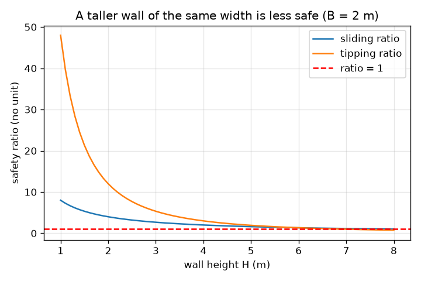
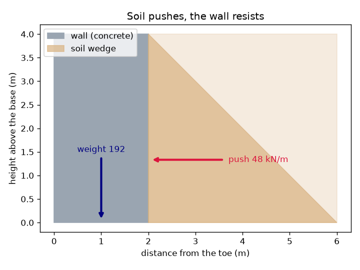

# సెషన్ 1: మట్టి నెడుతుంది, గోడ జారకూడదు, ఒరగకూడదు

[Session 1 — हिन्दी](README.hi.md)

*స్థాయి 1 (భావనాత్మక ఇంటరాక్టివ్ మోడల్) · సుమారు 60 నిమిషాలు · openretainingwall*

> ఇది సరళీకరించిన విద్యా మోడల్. ఇది ధృవీకరించబడిన డిజైన్ సాధనం కాదు; నిజమైన నిర్మాణాలు, విద్యుత్ ఇన్‌స్టాలేషన్‌లు, వాహనాలు, పారిశ్రామిక ప్రక్రియలు లేదా వైద్య నిర్ణయాల కోసం దీనిని ఉపయోగించకూడదు.

**ముందస్తు అవసరాలు (Prerequisites)**

- పాఠశాల అంకగణితం మరియు త్రిభుజం వైశాల్యం.
- మీరు PRIMER.md చదివి, `python start.py 1` ను ఒకసారి రన్ చేసి ఉండాలి.

**అభ్యాస లక్ష్యాలు (Learning objectives).** ఈ సెషన్ తర్వాత మీరు:

- మట్టి గోడను పక్కకు ఎందుకు నెడుతుందో, లోతుతో నెట్టు ఎందుకు పెరుగుతుందో వివరించగలరు.
- సరళమైన దీర్ఘచతురస్ర గోడకు ఒక మీటర్ గోడకు నెట్టును, గోడ బరువును లెక్కించగలరు.
- గోడ సురక్షితమా అని నిర్ణయించడానికి జారుడు నిష్పత్తి (sliding ratio), ఒరిగే నిష్పత్తి (tipping ratio) ఉపయోగించగలరు.
- గోడ ఎత్తుకు వ్యతిరేకంగా రెండు నిష్పత్తుల గ్రాఫ్‌ను చదవగలరు.

## A. నిజ జీవిత సమస్య
తక్కువ ఎత్తు గోడ వెనుక ఉన్న తోట మడి ప్రశాంతంగా కనిపిస్తుంది, కానీ మట్టి కంచెపై ఆనుకున్న బరువైన జనసమూహం లాంటిది: అది పక్కకు విస్తరించాలనుకుంటుంది. మట్టి ఎంత లోతైతే నెట్టు అంత ఎక్కువ, కాబట్టి ఎత్తైన గోడ పొట్టి గోడ కంటే చాలా ఎక్కువ ఎదుర్కొంటుంది. గోడ రెండు సులభ విధాలుగా విఫలం కావచ్చు: మొత్తం గోడ నేలపై జారిపోవచ్చు, లేదా దాని ముందు అడుగు అంచు అయిన పాదం (toe) మీదుగా ఒరగవచ్చు. ఇచ్చిన వెడల్పు గోడ ఎంత బలంగా ఉండాలి?

## B. భావన మరియు సిద్ధాంతం
మట్టి పక్క పీడనం ఉపరితలం వద్ద సున్నా, లోతుతో సరళరేఖలో పెరుగుతుంది, కాబట్టి గోడ వెనుక పీడనం ఒక త్రిభుజం. ఆ త్రిభుజం వైశాల్యమే బలం. ఈ సెషన్‌లో మనం నెట్టు కారకం Ka = 1/3 (ఇది ఎక్కడ నుండి వస్తుందో సెషన్ 2 వివరిస్తుంది), మట్టి యూనిట్ బరువు 18 kN/m^3, గోడ ఎత్తు H ఉపయోగిస్తాము; ఇది ఒక మీటర్ గోడకు 0.5 x (1/3) x 18 x H^2 నెట్టును ఇస్తుంది, అది మూడో వంతు ఎత్తులో పనిచేస్తుంది. గోడ B వెడల్పు గల కాంక్రీట్ దీర్ఘచతురస్రం, మీటరుకు 24 x B x H బరువు; అడుగు కింద రాపిడి 0.5 గుణకంతో జారడాన్ని నిరోధిస్తుంది. జారుడు నిష్పత్తి = రాపిడి / నెట్టు. ఒరిగే నిష్పత్తి = (బరువు x B/2) / (నెట్టు x H/3): గోడను కిందే ఉంచే తిరుగుడు ప్రభావాన్ని ఒరిగించే తిరుగుడు ప్రభావంతో భాగించింది, రెండూ పాదం గురించి. 1 కంటే తక్కువ నిష్పత్తి వైఫల్యం అని అర్థం; ఇంజనీర్లు జారడానికి కనీసం సుమారు 1.5, ఒరగడానికి 2 మార్జిన్ కోరుకుంటారు (సాధారణంగా వాడే మార్గదర్శకం, కోడ్ కాదు).

| చిహ్నం | అర్థం | యూనిట్ |
|---|---|---|
| H | గోడ ఎత్తు (నిలబెట్టిన మట్టి ఎత్తు) | m |
| B | అడుగు వద్ద గోడ వెడల్పు | m |
| P | ఒక మీటర్ పొడవు గోడకు మట్టి మొత్తం పక్క నెట్టు | kN/m |
| W | ఒక మీటర్ పొడవుకు గోడ బరువు | kN/m |
| gamma | మట్టి యూనిట్ బరువు (18) | kN/m^3 |
| Ka | నెట్టు కారకం (ఇక్కడ 1/3) | యూనిట్ లేదు |
| mu | అడుగు కింద రాపిడి గుణకం (0.5) | యూనిట్ లేదు |

**ఊహలు (Assumptions)**

- గోడ 24 kN/m^3 యూనిట్ బరువు గల కాంక్రీట్ ఘన దీర్ఘచతురస్రం.
- మట్టి పొడిగా ఉంది, గోడ పైభాగంలో సమంగా ఉంది, నెట్టు కారకం 1/3 ఇస్తుంది.
- అడుగు రాపిడి మాత్రమే జారడాన్ని నిరోధిస్తుంది; పాదం ముందున్న మట్టి విస్మరించబడుతుంది.
- ఇది సరళీకరించిన బోధన మోడల్, నిజమైన గోడకు డిజైన్ పద్ధతి కాదు.

$$ P=\tfrac12 K_a\gamma H^2,\qquad \text{acts at } H/3 \text{ above the base} $$

$$ W=\gamma_c B H $$

$$ \text{sliding ratio}=\frac{\mu W}{P},\qquad \text{tipping ratio}=\frac{W\,B/2}{P\,H/3} $$

## C. దృశ్య వివరణ
మొదటి చిత్రం బూడిద-నీలి గోడ, దాని వెనుక మట్టి, ఎత్తులో మూడో వంతు వద్ద నెట్టు బాణం, అడుగు మధ్యలో గుండా బరువు బాణాన్ని చూపుతుంది. రెండవది 2 m వెడల్పు గోడకు రెండు నిష్పత్తులను గోడ ఎత్తుకు వ్యతిరేకంగా గీస్తుంది: గోడ ఎత్తయ్యే కొద్దీ అవి తగ్గుతాయి, ఎందుకంటే నెట్టు H వర్గంతో పెరుగుతుంది, బరువు H తో మాత్రమే పెరుగుతుంది. ఒరిగే నిష్పత్తి సుమారు 6.9 m వద్ద, జారుడు నిష్పత్తి 8 m వద్ద 1 ను దాటతాయి.

*2 m వెడల్పు గోడకు గోడ ఎత్తుకు వ్యతిరేకంగా జారుడు, ఒరిగే నిష్పత్తులు: గోడ ఎత్తయ్యే కొద్దీ రెండూ తగ్గుతాయి.*

*4 m గోడ: మట్టి ఎత్తులో మూడో వంతు వద్ద 48 kN/m తో నెడుతుంది; బరువు 192 kN/m.*

## D. ఇంటరాక్టివ్ సిమ్యులేషన్
పాఠాన్ని రన్ చేయండి (`python start.py 1`), తర్వాత లైవ్ యాప్‌ను తెరవండి: [సెషన్ 1: గోడ జారుతుందా లేదా ఒరుగుతుందా?](https://krunalpanchal1995.github.io/pan-iit-oss/openretainingwall/session-01/) (లేదా ఈ ఫోల్డర్‌లోని `app.html`). గోడ ఎత్తును పైకి కిందికి జరిపి నెట్టు బాణం గోడ కంటే వేగంగా పెరగడం చూడండి. తర్వాత గోడను వెడల్పు చేసి రెండు నిష్పత్తులు పెరగడం చూడండి.

**సవాలు.** కనీసం 5 m ఎత్తు, జారుడు నిష్పత్తి కనీసం 1.5, ఒరిగే నిష్పత్తి కనీసం 2 ఉన్న గోడను నిర్మించండి.

## E. సాధించిన ఉదాహరణ మరియు ప్రయోగం
**సమస్య.** 4 m ఎత్తు, 2 m వెడల్పు గల గోడ పొడి మట్టిని నిలబెడుతుంది. నెట్టు, బరువు, జారుడు నిష్పత్తి, ఒరిగే నిష్పత్తిని కనుగొనండి.

1. నెట్టు P = 0.5 x (1/3) x 18 x 4^2 = 0.5 x 0.3333 x 18 x 16 = 48 kN/m, అడుగు పైన 4/3 = 1.33 m ఎత్తులో పనిచేస్తుంది.
2. బరువు W = 24 x 2 x 4 = 192 kN/m, పాదం నుండి 1 m వద్ద పనిచేస్తుంది.
3. జారుడు: రాపిడి = 0.5 x 192 = 96 kN/m, కాబట్టి నిష్పత్తి 96 / 48 = 2.00.
4. ఒరగడం: నిరోధించే తిరుగుడు ప్రభావం = 192 x 1 = 192 kN m/m; ఒరిగించే తిరుగుడు ప్రభావం = 48 x 1.333 = 64 kN m/m; నిష్పత్తి 192 / 64 = 3.00.

**సమాధానం.** నెట్టు 48 kN/m, బరువు 192 kN/m, జారుడు నిష్పత్తి 2.00, ఒరిగే నిష్పత్తి 3.00. రెండూ మార్గదర్శక విలువలైన 1.5, 2 కంటే పైన ఉన్నాయి.

**ప్రయోగం.** ఒక షూ బాక్స్‌ను 10 cm లోతు పొడి ఇసుకతో నింపండి, ఇసుక నింపిన వైపుకు ఒక సన్నని చెక్క పలకను ఆనించి, బాక్స్‌ను నెమ్మదిగా వంచండి. వేర్వేరు బరువుల పలకలను ప్రయత్నించండి: బరువైన లేదా వెడల్పైన దిమ్మ ఎక్కువసేపు నిరోధిస్తుంది. ఇసుక లోతును రెట్టింపు చేస్తే నెట్టు నాలుగింతలు అవుతుందని మోడల్ అంచనా వేస్తుంది (అవును: 8 m గోడకు 48 kN/m 192 kN/m అవుతుంది). నిజమైన ఇసుక మోడల్‌లోని సరళ త్రిభుజంలా ఖచ్చితంగా ఉండదు, పలక దృఢమైనది కాదు, బల్లపై రాపిడి మారుతుంది, కాబట్టి ధోరణిలో సుమారు సరిపోలికనే ఆశించండి.

## F. మూల్యాంకనం మరియు డిజైన్ సవాలు
**ప్రశ్న రకం A: భావనాత్మక.** మట్టి ఎత్తును రెట్టింపు చేస్తే గోడపై నెట్టు నాలుగింతలు అవుతుంది, కానీ అదే వెడల్పు గోడ బరువు రెట్టింపు మాత్రమే అవుతుంది, ఎందుకు?

సూచన

నెట్టు అంటే ఆధారం, ఎత్తు రెండూ H తో పెరిగే త్రిభుజం వైశాల్యం. బరువు వెడల్పు x ఎత్తు.

దశలవారీ పరిష్కారం

అడుగున పీడనం రెట్టింపు అవుతుంది (అది లోతుకు అనులోమానుపాతం), భారం పడే ఎత్తు కూడా రెట్టింపు అవుతుంది, కాబట్టి త్రిభుజం వైశాల్యం నాలుగు రెట్లు పెద్దది అవుతుంది: 48 kN/m 192 kN/m అవుతుంది. గోడ బరువు W = 24 x B x H లో H యొక్క ఒక కారకం మాత్రమే ఉంది, కాబట్టి అది రెట్టింపు అవుతుంది. అందుకే అదే వెడల్పు గల ఎత్తైన గోడ చాలా తక్కువ సురక్షితం.

**ప్రశ్న రకం B: సంఖ్యాత్మక.** 3 m ఎత్తు, 1.2 m వెడల్పు గల గోడ పొడి మట్టిని నిలబెడుతుంది (పాఠంలోని అవే విలువలు). జారుడు నిష్పత్తి, ఒరిగే నిష్పత్తిని కనుగొనండి. ఇది 1.5, 2 మార్గదర్శకాన్ని తీరుస్తుందా?

సూచన

P = 0.5 x (1/3) x 18 x 9 = 27 kN/m, 1 m వద్ద పనిచేస్తుంది; W = 24 x 1.2 x 3.

దశలవారీ పరిష్కారం

W = 86.4 kN/m. జారుడు నిష్పత్తి = 0.5 x 86.4 / 27 = 1.60. ఒరిగే నిష్పత్తి = 86.4 x 0.6 / (27 x 1) = 51.84 / 27 = 1.92. జారుడు 1.5 ను తీరుస్తుంది, కానీ ఒరిగే నిష్పత్తి 1.92, 2 కంటే కొంచెం తక్కువ, కాబట్టి గోడ కొద్దిగా ఇరుకుగా ఉంది.

**ప్రశ్న రకం C: గ్రాఫ్ మరియు సిమ్యులేషన్ వ్యాఖ్యానం.** 2 m వెడల్పు గోడ గ్రాఫ్‌లో రెండు నిష్పత్తులు ఏ ఎత్తుల వద్ద 1 కు చేరతాయి? గోడ ఎత్తయ్యే కొద్దీ ఏ వైఫల్యం ముందు వస్తుంది?

సూచన

ప్రతి వక్రం ఎరుపు గీతను తాకే చోటు చదవండి. సూత్రాలు: జారుడు నిష్పత్తి = 4B/H, ఒరిగే నిష్పత్తి = 12 B^2 / H^2.

దశలవారీ పరిష్కారం

ఒరిగే నిష్పత్తి H = sqrt(48) = 6.93 m వద్ద, జారుడు నిష్పత్తి H = 8 m వద్ద 1 కు చేరతాయి. గోడ ఎత్తయ్యే కొద్దీ ఒరగడమే ముందు విఫలమవుతుంది, సుమారు 6.9 m వద్ద. ఆచరణలో మార్గదర్శక విలువలు 1.5, 2 అంతకు చాలా ముందే మీరబడతాయి: ఈ వెడల్పు గోడ వాటిని తీర్చడం చాలా తక్కువ ఎత్తుల వద్దే ఆగిపోతుంది.

**ప్రశ్న రకం D: డిజైన్ మరియు ఆప్టిమైజేషన్ సవాలు.** డిజైన్: 3 m ఎత్తు గోడకు, 0.05 m అడుగుల్లో, జారుడు నిష్పత్తి కనీసం 1.5, ఒరిగే నిష్పత్తి కనీసం 2 ఇచ్చే అతి చిన్న వెడల్పును ఎంచుకోండి. ఏ నిష్పత్తి నిర్ణయిస్తుంది?

సూచన

జారడానికి 4B/H >= 1.5, ఒరగడానికి 12 B^2 / H^2 >= 2 కావాలి. ప్రతిదానిని B కోసం సాధించండి.

దశలవారీ పరిష్కారం

జారుడు: B >= 1.5 x 3 / 4 = 1.125 m. ఒరగడం: B >= 3 x sqrt(2/12) = 1.225 m. రెండూ నెరవేరాలి, కాబట్టి వెడల్పు 1.25 m (1.20 m ఒరిగే నిష్పత్తి 1.92 ఇస్తుంది, చాలా తక్కువ). ఒరగడమే నిర్ణయిస్తుంది. రాజీ (trade-off): వెడల్పైన గోడకు ఎక్కువ కాంక్రీట్ కావాలి; 1.20 m కు బదులు 1.25 m సుమారు 4 శాతం ఎక్కువ.

[RUBRIC.md](../../RUBRIC.md) తో మిమ్మల్ని మీరు స్కోర్ చేసుకోండి. కాగితంపై పని చేయడానికి [కార్యాచరణ షీట్](activity_sheet.md) ప్రింట్ చేయండి.

## సాధారణ అపోహలు
| సాధారణ అపోహ | వాస్తవంగా నిజమైనది |
|---|---|
| మట్టి నేలను కిందికి మాత్రమే నొక్కుతుంది, పక్కకు కాదు. | మట్టి రేణు పదార్థం: చిన్న నెట్టు కారకంతో బరువైన ద్రవంలా పక్కకు నెడుతుంది, పీడనం లోతుతో పెరుగుతుంది. |
| ఎత్తైన గోడకు అనులోమానుపాతంలో ఎక్కువ వెడల్పు మాత్రమే చాలు. | నెట్టు ఎత్తు వర్గంతో పెరుగుతుంది, కాబట్టి అవసరమైన వెడల్పు బరువుతో మాత్రమే కాకుండా సుమారుగా ఎత్తుకు అనులోమానుపాతంలో పెరుగుతుంది. |
| గోడ జారకపోతే అది విఫలం కాలేదు. | అది పాదం మీదుగా ఒరగవచ్చు కూడా; జారడం, ఒరగడం వేర్వేరు పరీక్షలు. |
| సరిగ్గా 1 నిష్పత్తి సురక్షితం. | 1 నిష్పత్తి అంటే గోడ విఫలమయ్యే అంచున ఉంది; నిజమైన డేటా అనిశ్చితం, కాబట్టి ఇంజనీర్లకు మార్జిన్ కావాలి. |

## పదకోశం (Glossary)
- **రిటైనింగ్ గోడ (retaining wall)**: మట్టిని ఆపి ఉంచడానికి నిర్మించిన గోడ
- **పాదం (toe)**: గోడ ముందు అడుగు అంచు, అది ఒరిగే తిరుగుడు బిందువు
- **బ్యాక్‌ఫిల్ (backfill)**: గోడ వెనుక నింపిన మట్టి
- **నెట్టు కారకం Ka (push factor)**: మట్టి బరువు పీడనంలో పక్క పీడనంగా కనిపించే భాగం; ఇక్కడ 1/3
- **kN ప్రతి మీటరుకు (kN per metre)**: గోడ ఒక మీటర్ పొడవుకు బలం, పొడవైన గోడకు సాధారణ యూనిట్

## ముగింపు
1. [exercises.md](exercises.md) లోని మూడు కోడింగ్ పనులు చేయండి.
2. మీ మార్పుల తర్వాత `python start.py 1` ను మళ్ళీ రన్ చేయండి. అది చెక్‌పాయింట్‌తో ముగుస్తుంది; అది `PASS` అని ప్రింట్ చేసినప్పుడు, మీరు పూర్తి చేసినట్లు. (చెక్‌పాయింట్ మాత్రమే: `python start.py check 1`.)

తదుపరి: [సెషన్ 2](../session-02/README.md)
