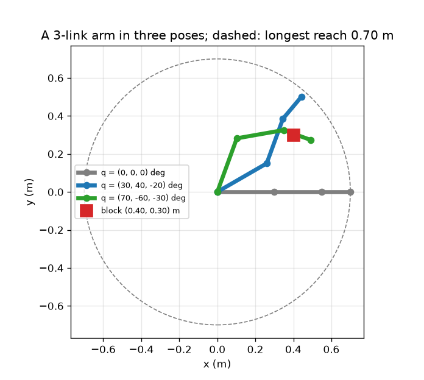
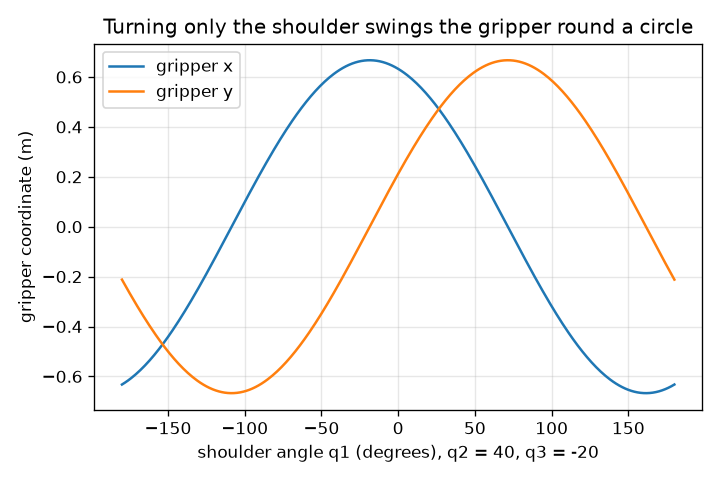

# सत्र 1: रोबोट भुजा कड़ियों और जोड़ों की एक श्रृंखला है

*स्तर 1 (वैचारिक इंटरैक्टिव मॉडल) · लगभग 60 मिनट · openrobotarm*

> यह एक सरलीकृत शैक्षिक मॉडल (simplified educational model) है। यह कोई सत्यापित डिज़ाइन टूल नहीं है और इसका उपयोग वास्तविक संरचनाओं, बिजली की स्थापनाओं, वाहनों, औद्योगिक प्रक्रियाओं या चिकित्सा निर्णयों के लिए नहीं किया जाना चाहिए।

**पूर्व-आवश्यकताएँ (Prerequisites)**

- स्कूल त्रिकोणमिति: साइन और कोसाइन।
- आपने PRIMER.md पढ़ लिया है और `python start.py 1` एक बार चला लिया है।

**सीखने के उद्देश्य (Learning objectives).** इस सत्र के बाद आप:

- किसी समतलीय भुजा (planar arm) का वर्णन उसकी कड़ियों (links) की लंबाइयों और जोड़ (joint) कोणों से कर सकेंगे।
- समझा सकेंगे कि जोड़ कोण श्रृंखला में नीचे की ओर क्यों जुड़ते जाते हैं (संचयी कोण / cumulative angles)।
- तीन जोड़ कोणों से ग्रिपर (gripper) की स्थिति और औज़ार कोण (tool angle) हाथ से और Python में निकाल सकेंगे।
- सबसे लंबी पहुँच (reach) बता सकेंगे और तय कर सकेंगे कि किसी ब्लॉक को छुआ जा सकता है या नहीं।

## A. वास्तविक दुनिया की समस्या
एक पिक-एंड-प्लेस (pick-and-place) रोबोट एक जगह से ब्लॉक उठाता है और दूसरी जगह रखता है, घंटे में सैकड़ों बार। उसकी मोटरें केवल जोड़ घुमाती हैं। कोई भी मोटर से नहीं कह सकता 'x = 0.40, y = 0.30 पर जाओ'; हमें पता लगाना होगा कि कौन-से जोड़ कोण ग्रिपर को वहाँ पहुँचाते हैं। समस्या को उल्टा हल करने से पहले, हमें उसे सीधा हल करना आना चाहिए: तीन जोड़ कोण दिए हों, तो ग्रिपर कहाँ पहुँचता है? क्या 0.30 m, 0.25 m और 0.15 m की कड़ियों वाली 3-कड़ी भुजा 0.40 m आगे और 0.30 m ऊपर रखे ब्लॉक को छू सकती है?

## B. अवधारणा और सिद्धांत
भुजा एक श्रृंखला है: कड़ी 1 जोड़ 1 द्वारा मूल बिंदु पर आधार से जुड़ी है, कड़ी 2 जोड़ 2 द्वारा कड़ी 1 के सिरे से जुड़ी है, और इसी तरह आगे। हर जोड़ कोण पिछली कड़ी के सापेक्ष मापा जाता है, इसलिए कमरे में किसी कड़ी की दिशा उस तक के जोड़ कोणों का चलता योग (उसका संचयी कोण) है। श्रृंखला के साथ चलते हुए, हर कड़ी अपनी लंबाई गुणा अपने संचयी कोण का (cos, sin) जोड़ती है, और अंतिम बिंदु ग्रिपर है। औज़ार कोण, यानी जिस दिशा में ग्रिपर इंगित करता है, सभी जोड़ कोणों का योग है। ग्रिपर आधार से कभी भी कड़ियों की लंबाइयों के योग से अधिक दूर नहीं हो सकता।

| प्रतीक | अर्थ | इकाई |
|---|---|---|
| q1, q2, q3 | जोड़ कोण, हर एक पिछली कड़ी के सापेक्ष, वामावर्त (counter-clockwise) धनात्मक | डिग्री या रेडियन |
| L1, L2, L3 | कड़ियों की लंबाइयाँ (0.30, 0.25, 0.15) | m |
| c1, c2, c3 | संचयी कोण: x अक्ष से हर कड़ी की दिशा | डिग्री या रेडियन |
| (x, y) | ग्रिपर की स्थिति | m |
| tool angle | ग्रिपर जिस दिशा में इंगित करता है, q1 + q2 + q3 | डिग्री |

**मान्यताएँ (Assumptions)**

- भुजा एक सपाट तल में चलती है (ऊपर से देखी गई)।
- कड़ियाँ दृढ़ (rigid) हैं और जोड़ों का आकार शून्य है।
- आधार मूल बिंदु (0, 0) पर स्थिर है और जोड़ स्वतंत्र रूप से घूमते हैं (सीमाएँ सत्र 2 में आती हैं)।
- कोण x अक्ष से वामावर्त मापे जाते हैं।

$$ c_k=q_1+q_2+\cdots+q_k $$

$$ x=\sum_{k=1}^{3}L_k\cos c_k,\qquad y=\sum_{k=1}^{3}L_k\sin c_k $$

$$ \text{tool angle}=c_3=q_1+q_2+q_3 $$

$$ \sqrt{x^2+y^2}\le L_1+L_2+L_3=0.70\ \text{m} $$

## C. दृश्य व्याख्या
पहला चित्र मीटर में भुजा को तीन मुद्राओं (poses) में दिखाता है: x के अनुदिश फैली हुई (ग्रिपर (0.70, 0) पर), मुद्रा (30, 40, -20) डिग्री जिसमें ग्रिपर (0.442, 0.500) पर है, और मुद्रा (70, -60, -30) डिग्री जिसमें ग्रिपर (0.490, 0.274) पर है। लाल वर्ग ब्लॉक है और धराशायी वृत्त सबसे लंबी पहुँच है। दूसरा चित्र बाकी दो जोड़ों को 40 और -20 डिग्री पर स्थिर रखकर केवल कंधे (shoulder) को घुमाता है: ग्रिपर 0.667 m त्रिज्या के वृत्त पर घूमता है, इसलिए x और y कंधे के कोण के कोसाइन और साइन हैं, और x सबसे बड़ा, 0.667 m, -18.5 डिग्री के कंधे कोण पर है।

*मीटर में 3-कड़ी भुजा की तीन मुद्राएँ, ब्लॉक और सबसे लंबी पहुँच।*

*जब केवल कंधा घूमता है तब ग्रिपर का x और y: 0.667 m त्रिज्या का एक कोसाइन और एक साइन।*

## D. इंटरैक्टिव सिमुलेशन
पाठ चलाइए (`python start.py 1`), फिर लाइव ऐप खोलिए: [सत्र 1: एक 3-कड़ी भुजा](https://krunalpanchal1995.github.io/pan-iit-oss/openrobotarm/session-01/) (या इस फ़ोल्डर में `app.html`)। तीनों स्लाइडर खिसकाइए और श्रृंखला देखिए: ग्रिपर उन सभी का अनुसरण करता है। ग्राफ़ पर जाइए और देखिए कि केवल कंधा चलने पर x और y क्या होते हैं। ध्यान दीजिए कि रीडआउट ब्लॉक से दूरी कैसे दिखाता है।

**चुनौती (Challenge).** ग्रिपर को (0.40, 0.30) m पर ब्लॉक पर, 2 cm के भीतर, रखिए।

## E. हल किया गया उदाहरण और प्रयोग
**समस्या.** L = (0.30, 0.25, 0.15) m के साथ q = (30, 40, -20) डिग्री के लिए ग्रिपर की स्थिति, औज़ार कोण और आधार से दूरी निकालिए।

1. संचयी कोण: c1 = 30, c2 = 30 + 40 = 70, c3 = 70 - 20 = 50 डिग्री।
2. कड़ी 1: 0.30 * (cos 30, sin 30) = 0.30 * (0.866, 0.500) = (0.2598, 0.1500) m।
3. कड़ी 2: 0.25 * (cos 70, sin 70) = 0.25 * (0.3420, 0.9397) = (0.0855, 0.2349) m।
4. कड़ी 3: 0.15 * (cos 50, sin 50) = 0.15 * (0.6428, 0.7660) = (0.0964, 0.1149) m।
5. तीनों जोड़िए: x = 0.2598 + 0.0855 + 0.0964 = 0.4417 m और y = 0.1500 + 0.2349 + 0.1149 = 0.4998 m। औज़ार कोण c3 = 50 डिग्री है।
6. आधार से दूरी: sqrt(0.4417^2 + 0.4998^2) = 0.667 m, जो सबसे लंबी पहुँच 0.70 m से कम है, जैसा होना चाहिए।

**उत्तर.** ग्रिपर (0.442, 0.500) m पर है, x अक्ष से 50 डिग्री की दिशा में इंगित करता है, और आधार से 0.667 m दूर है।

**प्रयोग (Experiment).** 30, 25 और 15 cm की गत्ते की तीन पट्टियाँ काटिए और उन्हें वर्गाकित कागज़ की एक शीट के एक सिरे पर पिनों से जोड़िए। चाँदे (protractor) से कोण सेट कीजिए (याद रखिए कि हर कोण पिछली पट्टी के सापेक्ष है) और कागज़ से ग्रिपर की स्थिति पढ़िए; लगभग 5 mm तक मेल की अपेक्षा कीजिए। अंतर पिन की मोटाई और चाँदे को पढ़ने से आते हैं: मॉडल में जोड़ों का आकार शून्य है और कड़ियाँ पूर्णतः दृढ़ हैं, गत्ता ऐसा नहीं है।

## F. मूल्यांकन और डिज़ाइन चुनौती
**प्रश्न प्रकार A: वैचारिक (Conceptual).** औज़ार कोण q1 + q2 + q3 क्यों है, केवल q3 क्यों नहीं? अगर केवल जोड़ 1 को 10 डिग्री घुमाया जाए तो ग्रिपर क्या करेगा?

संकेत

हर जोड़ कोण अपने से पहले वाली कड़ी के सापेक्ष मापा जाता है।

चरण-दर-चरण हल

जोड़ 3 कड़ी 2 के सापेक्ष मापा जाता है, जो स्वयं q1 + q2 दिशा में इंगित करती है। इसलिए कड़ी 3, q1 + q2 + q3 पर इंगित करती है। अगर केवल जोड़ 1 को 10 डिग्री घुमाया जाए, तो उसके बाद की हर कड़ी साथ चलती है: पूरी भुजा आधार के चारों ओर दृढ़ता से 10 डिग्री घूमती है, औज़ार कोण 10 डिग्री बढ़ता है और ग्रिपर आधार पर केंद्रित वृत्त पर चलता है।

**प्रश्न प्रकार B: संख्यात्मक (Numerical).** q = (90, -90, 0) डिग्री के लिए ग्रिपर की स्थिति निकालिए। क्या यह (0.40, 0.30) m पर ब्लॉक पर है?

संकेत

संचयी कोण 90, 0 और 0 डिग्री हैं।

चरण-दर-चरण हल

कड़ी 1 ऊपर की ओर इंगित करती है: (0, 0.30)। कड़ी 2 (संचयी कोण 0) x के अनुदिश इंगित करती है: (0.25, 0)। कड़ी 3 (संचयी कोण 0): (0.15, 0)। योग: (0.40, 0.30) m, ठीक ब्लॉक। जाँच: आधार से दूरी sqrt(0.40^2 + 0.30^2) = 0.50 m है, जो 0.70 m से कम है, इसलिए यह पहुँच में है।

**प्रश्न प्रकार C: ग्राफ़ और सिमुलेशन की व्याख्या.** दूसरे चित्र में, ग्रिपर जिस वृत्त पर घूमता है उसकी त्रिज्या कितनी है, और किस कंधे कोण पर ग्रिपर का x सबसे बड़ा है?

संकेत

आधार से ग्रिपर की दूरी जानने के लिए q1 = 0 रखिए, फिर पूछिए कि वह बिंदु वृत्त पर कहाँ है।

चरण-दर-चरण हल

q1 = 0 के साथ ग्रिपर (0.632, 0.212) m पर है, इसलिए आधार से उसकी दूरी 0.667 m है और यही हर q1 के लिए त्रिज्या है। बिंदु x अक्ष से atan2(0.212, 0.632) = 18.5 डिग्री के कोण पर है, इसलिए x तब सबसे बड़ा है जब q1 = -18.5 डिग्री, जो उसे x अक्ष पर ले आता है, जहाँ x = 0.667 m।

**प्रश्न प्रकार D: डिज़ाइन और अनुकूलन (optimisation) चुनौती.** डिज़ाइन: एक आपूर्तिकर्ता 0.45, 0.60, 0.70 और 0.85 m की कुल कड़ी लंबाई वाली 3-कड़ी भुजाएँ बेचता है। ब्लॉक आधार से 0.50 m दूर है और आप कम से कम 0.10 m अतिरिक्त पहुँच चाहते हैं। आप कौन-सी भुजा चुनेंगे, और लंबी भुजा से आप क्या छोड़ देते हैं?

संकेत

पहुँच कुल लंबाई से सीमित है; ब्लॉक की दूरी में अतिरिक्त पहुँच जोड़िए।

चरण-दर-चरण हल

भुजा को कम से कम 0.50 + 0.10 = 0.60 m तक पहुँचना चाहिए, जिससे 0.45 m बाहर हो जाती है। योग्य सबसे छोटी भुजा 0.60 m है (0.70 और 0.85 भी योग्य हैं)। लंबी भुजा अधिक दूर पहुँचती है पर भारी होती है, बड़ी मोटरों की ज़रूरत होती है और, क्योंकि जोड़ की छोटी त्रुटि दूरी से गुणा हो जाती है, ग्रिपर को कम सटीकता से रखती है। मान्यता: भुजा को स्वतंत्र रूप से किसी भी मुद्रा में रखा जा सकता है (अभी जोड़ सीमाएँ नहीं)।

[RUBRIC.md](../../RUBRIC.md) से स्वयं को अंक दीजिए। कागज़ पर काम करने के लिए [गतिविधि पत्रक](activity_sheet.md) प्रिंट कीजिए।

## सामान्य भ्रांतियाँ
| सामान्य भ्रांति (misconception) | वास्तव में क्या सच है |
|---|---|
| जोड़ 3, x अक्ष से मापा जाता है। | हर जोड़ कोण अपने से पहले वाली कड़ी के सापेक्ष है; कमरे में किसी कड़ी की दिशा एक चलता योग है। |
| ग्रिपर केवल एक कोण चुनकर 0.70 m त्रिज्या वाले वृत्त के अंदर कहीं भी जा सकता है। | सामान्यतः तीन कोण चाहिए; एक कोण ग्रिपर को केवल एक वृत्त पर घुमाता है। |
| कंधा घुमाने से भुजा का आकार बदलता है। | केवल जोड़ 1 घुमाने से पूरी भुजा आधार के चारों ओर दृढ़ता से घूमती है; आकार q2 और q3 से तय होता है। |

## शब्दावली
- **कड़ी (link)**: दो जोड़ों के बीच भुजा की एक दृढ़ छड़
- **जोड़ (joint)**: एक धुरी जहाँ एक कड़ी दूसरी के सापेक्ष घूमती है, जिसे मोटर चलाती है
- **ग्रिपर (gripper / end effector)**: श्रृंखला के अंत में लगा औज़ार जो पुर्ज़े को पकड़ता है
- **संचयी कोण (cumulative angle)**: जोड़ कोणों का चलता योग; कमरे में किसी कड़ी की दिशा
- **अग्र शुद्धगतिकी (forward kinematics)**: जोड़ कोणों से ग्रिपर की स्थिति निकालना
- **पहुँच (reach)**: आधार से ग्रिपर तक की दूरी

## समापन
1. [exercises.md](exercises.md) में दिए तीन कोडिंग कार्य कीजिए।
2. अपने बदलावों के बाद `python start.py 1` फिर से चलाइए। यह चेकपॉइंट (checkpoint) के साथ समाप्त होता है; जब यह `PASS` छापे, तो आपका काम पूरा है। (केवल चेकपॉइंट: `python start.py check 1`।)

आगे: [सत्र 2](../session-02/README.md)
