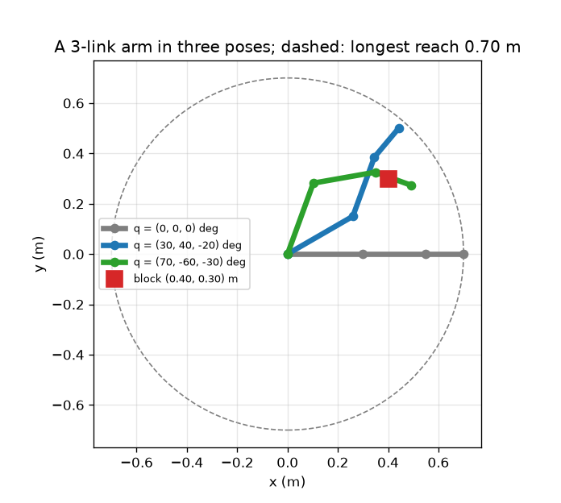
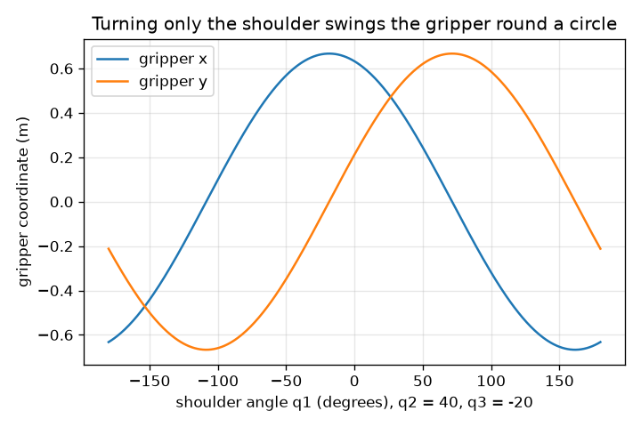

# സെഷൻ 1: ഒരു റോബോട്ട് ആം ലിങ്കുകളുടെയും ജോയിന്റുകളുടെയും ശൃംഖലയാണ്

[Session 1 — हिन्दी](README.hi.md) · [Session 1 — മലയാളം](README.ml.md)

*ലെവൽ 1 (ആശയപരമായ ഇന്ററാക്ടീവ് മോഡൽ) · ഏകദേശം 60 മിനിറ്റ് · openrobotarm*

> ഇത് ലളിതമാക്കിയ ഒരു വിദ്യാഭ്യാസ മോഡലാണ്. ഇത് സാധൂകരിക്കപ്പെട്ട (validated) ഒരു ഡിസൈൻ ഉപകരണമല്ല; യഥാർത്ഥ നിർമ്മിതികൾ, ഇലക്ട്രിക്കൽ ഇൻസ്റ്റലേഷനുകൾ, വാഹനങ്ങൾ, വ്യാവസായിക പ്രക്രിയകൾ അല്ലെങ്കിൽ മെഡിക്കൽ തീരുമാനങ്ങൾ എന്നിവയ്ക്ക് ഇത് ഉപയോഗിക്കരുത്.

**മുൻ‌വ്യവസ്ഥകൾ (Prerequisites)**

- സ്കൂൾ ത്രികോണമിതി: സൈനും കോസൈനും.
- നിങ്ങൾ PRIMER.md വായിക്കുകയും `python start.py 1` ഒരിക്കൽ റൺ ചെയ്യുകയും ചെയ്തിട്ടുണ്ട്.

**പഠന ലക്ഷ്യങ്ങൾ (Learning objectives).** ഈ സെഷനു ശേഷം നിങ്ങൾക്ക് കഴിയും:

- ഒരു പ്ലാനർ ആമിനെ അതിന്റെ ലിങ്ക് നീളങ്ങളും ജോയിന്റ് കോണുകളും കൊണ്ട് വിവരിക്കാൻ.
- ശൃംഖലയിലൂടെ ജോയിന്റ് കോണുകൾ കൂടിച്ചേരുന്നത് (സഞ്ചിത കോണുകൾ) എന്തുകൊണ്ടെന്ന് വിശദീകരിക്കാൻ.
- മൂന്ന് ജോയിന്റ് കോണുകളിൽ നിന്ന് ഗ്രിപ്പർ സ്ഥാനവും ടൂൾ കോണും കൈകൊണ്ടും Python-ലും കണക്കാക്കാൻ.
- ഏറ്റവും നീണ്ട എത്തൽ (reach) പറയാനും ഒരു ബ്ലോക്കിൽ തൊടാനാകുമോ എന്ന് തീരുമാനിക്കാനും.

## A. യഥാർത്ഥ ലോക പ്രശ്നം
ഒരു പിക്ക്-ആൻഡ്-പ്ലേസ് റോബോട്ട് ഒരിടത്തു നിന്ന് ബ്ലോക്ക് ഉയർത്തി മറ്റൊരിടത്ത് വയ്ക്കുന്നു, മണിക്കൂറിൽ നൂറുകണക്കിന് തവണ. അതിന്റെ മോട്ടോറുകൾ ജോയിന്റുകളെ തിരിക്കുക മാത്രമേ ചെയ്യുന്നുള്ളൂ. ഒരു മോട്ടോറോട് 'x = 0.40, y = 0.30 ലേക്ക് പോകൂ' എന്ന് ആർക്കും പറയാൻ കഴിയില്ല; ഗ്രിപ്പറിനെ അവിടെ എത്തിക്കുന്ന ജോയിന്റ് കോണുകൾ നമ്മൾ കണ്ടെത്തണം. പ്രശ്നം പിന്നോട്ട് ഓടിക്കുന്നതിനു മുമ്പ്, നമുക്ക് അത് മുന്നോട്ട് ഓടിക്കാൻ കഴിയണം: മൂന്ന് ജോയിന്റ് കോണുകൾ തന്നാൽ ഗ്രിപ്പർ എവിടെ എത്തുന്നു? 0.30 m, 0.25 m, 0.15 m ലിങ്കുകളുള്ള 3-ലിങ്ക് ആമിന് 0.40 m കുറുകെയും 0.30 m മുകളിലുമുള്ള ഒരു ബ്ലോക്കിൽ തൊടാൻ കഴിയുമോ?

## B. ആശയവും സിദ്ധാന്തവും
ആം ഒരു ശൃംഖലയാണ്: ലിങ്ക് 1 ജോയിന്റ് 1 വഴി ഉത്ഭവത്തിലെ ബേസിൽ ഉറപ്പിച്ചിരിക്കുന്നു, ലിങ്ക് 2 ജോയിന്റ് 2 വഴി ലിങ്ക് 1-ന്റെ അറ്റത്ത് ഉറപ്പിച്ചിരിക്കുന്നു, അങ്ങനെ തുടരുന്നു. ഓരോ ജോയിന്റ് കോണും മുൻ ലിങ്കിനോട് ആപേക്ഷികമായി അളക്കുന്നു, അതിനാൽ മുറിയിൽ ഒരു ലിങ്കിന്റെ ദിശ അതുവരെയുള്ള ജോയിന്റ് കോണുകളുടെ തുടർച്ചയായ ആകെത്തുകയാണ് (അതിന്റെ സഞ്ചിത കോൺ). ശൃംഖലയിലൂടെ നടക്കുമ്പോൾ, ഓരോ ലിങ്കും അതിന്റെ നീളം ഗുണം അതിന്റെ സഞ്ചിത കോണിന്റെ (cos, sin) ചേർക്കുന്നു, അവസാന ബിന്ദു ഗ്രിപ്പറാണ്. ടൂൾ കോൺ, ഗ്രിപ്പർ ചൂണ്ടുന്ന ദിശ, എല്ലാ ജോയിന്റ് കോണുകളുടെയും തുകയാണ്. ഗ്രിപ്പറിന് ബേസിൽ നിന്ന് ലിങ്ക് നീളങ്ങളുടെ തുകയേക്കാൾ അകലെ ഒരിക്കലും പോകാൻ കഴിയില്ല.

| ചിഹ്നം | അർത്ഥം | യൂണിറ്റ് |
|---|---|---|
| q1, q2, q3 | ജോയിന്റ് കോണുകൾ, ഓരോന്നും മുൻ ലിങ്കിനോട് ആപേക്ഷികം, എതിർ ഘടികാര ദിശ പോസിറ്റീവ് | ഡിഗ്രി അല്ലെങ്കിൽ റേഡിയൻ |
| L1, L2, L3 | ലിങ്ക് നീളങ്ങൾ (0.30, 0.25, 0.15) | m |
| c1, c2, c3 | സഞ്ചിത കോണുകൾ: x അക്ഷത്തിൽ നിന്ന് ഓരോ ലിങ്കിന്റെയും ദിശ | ഡിഗ്രി അല്ലെങ്കിൽ റേഡിയൻ |
| (x, y) | ഗ്രിപ്പർ സ്ഥാനം | m |
| ടൂൾ കോൺ | ഗ്രിപ്പർ ചൂണ്ടുന്ന ദിശ, q1 + q2 + q3 | ഡിഗ്രി |

**അനുമാനങ്ങൾ (Assumptions)**

- ആം ഒരു പരന്ന തലത്തിൽ ചലിക്കുന്നു (മുകളിൽ നിന്ന് നോക്കിയത്).
- ലിങ്കുകൾ ദൃഢമാണ്, ജോയിന്റുകൾക്ക് വലുപ്പമില്ല.
- ബേസ് ഉത്ഭവത്തിൽ (0, 0) ഉറപ്പിച്ചിരിക്കുന്നു, ജോയിന്റുകൾ സ്വതന്ത്രമായി തിരിയുന്നു (പരിധികൾ സെഷൻ 2-ൽ വരുന്നു).
- കോണുകൾ x അക്ഷത്തിൽ നിന്ന് എതിർ ഘടികാര ദിശയിൽ അളക്കുന്നു.

$$ c_k=q_1+q_2+\cdots+q_k $$

$$ x=\sum_{k=1}^{3}L_k\cos c_k,\qquad y=\sum_{k=1}^{3}L_k\sin c_k $$

$$ \text{tool angle}=c_3=q_1+q_2+q_3 $$

$$ \sqrt{x^2+y^2}\le L_1+L_2+L_3=0.70\ \text{m} $$

## C. ദൃശ്യ വിശദീകരണം
ആദ്യ ചിത്രം ആമിനെ മീറ്ററിൽ മൂന്ന് പോസുകളിൽ കാണിക്കുന്നു: x-ലൂടെ നീട്ടിയത് (ഗ്രിപ്പർ (0.70, 0)-ൽ), ഗ്രിപ്പർ (0.442, 0.500)-ൽ ഉള്ള (30, 40, -20) ഡിഗ്രി പോസ്, ഗ്രിപ്പർ (0.490, 0.274)-ൽ ഉള്ള (70, -60, -30) ഡിഗ്രി പോസ്. ചുവന്ന ചതുരം ബ്ലോക്കാണ്, മുറിച്ച വൃത്തം ഏറ്റവും നീണ്ട എത്തലാണ്. രണ്ടാമത്തെ ചിത്രം മറ്റ് രണ്ട് ജോയിന്റുകൾ 40, -20 ഡിഗ്രിയിൽ ഉറപ്പിച്ച് തോൾ മാത്രം തിരിക്കുന്നു: ഗ്രിപ്പർ 0.667 m ആരമുള്ള വൃത്തത്തിൽ ചുറ്റുന്നു, അതിനാൽ x, y എന്നിവ തോൾ കോണിന്റെ കോസൈനും സൈനുമാണ്, തോൾ കോൺ -18.5 ഡിഗ്രിയിൽ x ഏറ്റവും വലുത്, 0.667 m.

*3-ലിങ്ക് ആമിന്റെ മീറ്ററിലുള്ള മൂന്ന് പോസുകൾ, ബ്ലോക്ക്, ഏറ്റവും നീണ്ട എത്തൽ.*

*തോൾ മാത്രം തിരിയുമ്പോൾ ഗ്രിപ്പർ x, y: 0.667 m ആരമുള്ള ഒരു കോസൈനും സൈനും.*

## D. ഇന്ററാക്ടീവ് സിമുലേഷൻ
പാഠം റൺ ചെയ്യുക (`python start.py 1`), തുടർന്ന് ലൈവ് ആപ്പ് തുറക്കുക: [സെഷൻ 1: ഒരു 3-ലിങ്ക് ആം](https://krunalpanchal1995.github.io/pan-iit-oss/openrobotarm/session-01/) (അല്ലെങ്കിൽ ഈ ഫോൾഡറിലെ `app.html`). മൂന്ന് സ്ലൈഡറുകൾ നീക്കി ശൃംഖല നിരീക്ഷിക്കുക: ഗ്രിപ്പർ മൂന്നിനെയും പിന്തുടരുന്നു. ഗ്രാഫിലേക്ക് മാറി തോൾ മാത്രം ചലിക്കുമ്പോൾ x, y കാണുക. റീഡൗട്ട് ബ്ലോക്കിലേക്കുള്ള ദൂരം എങ്ങനെ കാണിക്കുന്നുവെന്ന് ശ്രദ്ധിക്കുക.

**വെല്ലുവിളി (Challenge).** ഗ്രിപ്പറിനെ (0.40, 0.30) m-ലെ ബ്ലോക്കിൽ, 2 cm-നുള്ളിൽ, വയ്ക്കുക.

## E. പരിഹരിച്ച ഉദാഹരണവും പരീക്ഷണവും
**പ്രശ്നം.** L = (0.30, 0.25, 0.15) m ഉള്ള q = (30, 40, -20) ഡിഗ്രിക്ക് ഗ്രിപ്പർ സ്ഥാനം, ടൂൾ കോൺ, ബേസിൽ നിന്നുള്ള ദൂരം എന്നിവ കണ്ടെത്തുക.

1. സഞ്ചിത കോണുകൾ: c1 = 30, c2 = 30 + 40 = 70, c3 = 70 - 20 = 50 ഡിഗ്രി.
2. ലിങ്ക് 1: 0.30 * (cos 30, sin 30) = 0.30 * (0.866, 0.500) = (0.2598, 0.1500) m.
3. ലിങ്ക് 2: 0.25 * (cos 70, sin 70) = 0.25 * (0.3420, 0.9397) = (0.0855, 0.2349) m.
4. ലിങ്ക് 3: 0.15 * (cos 50, sin 50) = 0.15 * (0.6428, 0.7660) = (0.0964, 0.1149) m.
5. മൂന്നും കൂട്ടുക: x = 0.2598 + 0.0855 + 0.0964 = 0.4417 m, y = 0.1500 + 0.2349 + 0.1149 = 0.4998 m. ടൂൾ കോൺ c3 = 50 ഡിഗ്രി.
6. ബേസിൽ നിന്നുള്ള ദൂരം: sqrt(0.4417^2 + 0.4998^2) = 0.667 m, ഏറ്റവും നീണ്ട എത്തലായ 0.70 m-ന് താഴെ, അങ്ങനെതന്നെ ആയിരിക്കണം.

**ഉത്തരം.** ഗ്രിപ്പർ (0.442, 0.500) m-ൽ, x അക്ഷത്തിൽ നിന്ന് 50 ഡിഗ്രിയിൽ ചൂണ്ടി, ബേസിൽ നിന്ന് 0.667 m അകലെ.

**പരീക്ഷണം.** 30, 25, 15 cm നീളമുള്ള മൂന്ന് കാർഡ്ബോർഡ് സ്ട്രിപ്പുകൾ മുറിച്ച്, ചതുരക്കള്ളി പേപ്പറിന്റെ ഒരറ്റത്ത് പിന്നുകൾ കൊണ്ട് ബന്ധിപ്പിക്കുക. പ്രൊട്രാക്ടർ ഉപയോഗിച്ച് കോണുകൾ സെറ്റ് ചെയ്യുക (ഓരോ കോണും മുൻ സ്ട്രിപ്പിനോട് ആപേക്ഷികമാണെന്ന് ഓർക്കുക), ഗ്രിപ്പർ സ്ഥാനം പേപ്പറിൽ നിന്ന് വായിക്കുക; ഏകദേശം 5 mm വരെ യോജിപ്പ് പ്രതീക്ഷിക്കുക. വ്യത്യാസങ്ങൾ പിന്നിന്റെ കനത്തിൽ നിന്നും പ്രൊട്രാക്ടർ വായനയിൽ നിന്നും വരുന്നു: മോഡലിന് വലുപ്പമില്ലാത്ത ജോയിന്റുകളും പൂർണ്ണമായി ദൃഢമായ ലിങ്കുകളുമുണ്ട്, കാർഡ്ബോർഡിനില്ല.

## F. വിലയിരുത്തലും ഡിസൈൻ വെല്ലുവിളിയും
**ചോദ്യ തരം A: ആശയപരം.** ടൂൾ കോൺ q3 മാത്രമല്ല, q1 + q2 + q3 ആകുന്നത് എന്തുകൊണ്ട്? ജോയിന്റ് 1 മാത്രം 10 ഡിഗ്രി തിരിഞ്ഞാൽ ഗ്രിപ്പർ എന്ത് ചെയ്യും?

സൂചന

ഓരോ ജോയിന്റ് കോണും അതിന് മുമ്പുള്ള ലിങ്കിനോട് ആപേക്ഷികമായി അളക്കുന്നു.

ഘട്ടം ഘട്ടമായുള്ള പരിഹാരം

ജോയിന്റ് 3 ലിങ്ക് 2-നോട് ആപേക്ഷികമായി അളക്കുന്നു, അത് തന്നെ q1 + q2 ദിശയിൽ ചൂണ്ടുന്നു. അതിനാൽ ലിങ്ക് 3 q1 + q2 + q3 ദിശയിൽ ചൂണ്ടുന്നു. ജോയിന്റ് 1 മാത്രം 10 ഡിഗ്രി തിരിഞ്ഞാൽ, അതിനു ശേഷമുള്ള ഓരോ ലിങ്കും കൂടെ കൊണ്ടുപോകപ്പെടുന്നു: മുഴുവൻ ആമും ബേസിനു ചുറ്റും ദൃഢമായി 10 ഡിഗ്രി തിരിയുന്നു, ടൂൾ കോൺ 10 ഡിഗ്രി കൂടുന്നു, ഗ്രിപ്പർ ബേസ് കേന്ദ്രമായ വൃത്തത്തിൽ നീങ്ങുന്നു.

**ചോദ്യ തരം B: സംഖ്യാപരം.** q = (90, -90, 0) ഡിഗ്രിക്ക് ഗ്രിപ്പർ സ്ഥാനം കണ്ടെത്തുക. അത് (0.40, 0.30) m-ലെ ബ്ലോക്കിലാണോ?

സൂചന

സഞ്ചിത കോണുകൾ 90, 0, 0 ഡിഗ്രിയാണ്.

ഘട്ടം ഘട്ടമായുള്ള പരിഹാരം

ലിങ്ക് 1 മുകളിലേക്ക് ചൂണ്ടുന്നു: (0, 0.30). ലിങ്ക് 2 (സഞ്ചിത കോൺ 0) x-ലൂടെ ചൂണ്ടുന്നു: (0.25, 0). ലിങ്ക് 3 (സഞ്ചിത കോൺ 0): (0.15, 0). തുക: (0.40, 0.30) m, കൃത്യമായി ബ്ലോക്ക്. പരിശോധന: ബേസിൽ നിന്നുള്ള ദൂരം sqrt(0.40^2 + 0.30^2) = 0.50 m, 0.70 m-ന് താഴെ, അതിനാൽ എത്താവുന്നതാണ്.

**ചോദ്യ തരം C: ഗ്രാഫ്, സിമുലേഷൻ വ്യാഖ്യാനം.** രണ്ടാമത്തെ ചിത്രത്തിൽ, ഗ്രിപ്പർ ചുറ്റുന്ന വൃത്തത്തിന്റെ ആരം എത്ര, ഏത് തോൾ കോണിലാണ് ഗ്രിപ്പറിന്റെ x ഏറ്റവും വലുത്?

സൂചന

ബേസിൽ നിന്ന് ഗ്രിപ്പറിലേക്കുള്ള ദൂരം കണ്ടെത്താൻ q1 = 0 വയ്ക്കുക, പിന്നെ ആ ബിന്ദു വൃത്തത്തിൽ എവിടെയെന്ന് ചോദിക്കുക.

ഘട്ടം ഘട്ടമായുള്ള പരിഹാരം

q1 = 0-ൽ ഗ്രിപ്പർ (0.632, 0.212) m-ൽ, അതിനാൽ ബേസിൽ നിന്നുള്ള ദൂരം 0.667 m, അതാണ് എല്ലാ q1-നുമുള്ള ആരം. ബിന്ദു x അക്ഷത്തിൽ നിന്ന് atan2(0.212, 0.632) = 18.5 ഡിഗ്രിയിലാണ്, അതിനാൽ q1 = -18.5 ഡിഗ്രിയിൽ x ഏറ്റവും വലുതാണ്, അത് x അക്ഷത്തിലേക്ക് കൊണ്ടുവരുന്നു, അവിടെ x = 0.667 m.

**ചോദ്യ തരം D: ഡിസൈൻ, ഒപ്റ്റിമൈസേഷൻ വെല്ലുവിളി.** ഡിസൈൻ: ഒരു വിതരണക്കാരൻ ആകെ ലിങ്ക് നീളം 0.45, 0.60, 0.70, 0.85 m ഉള്ള 3-ലിങ്ക് ആമുകൾ വിൽക്കുന്നു. ബ്ലോക്ക് ബേസിൽ നിന്ന് 0.50 m അകലെയാണ്, നിങ്ങൾക്ക് കുറഞ്ഞത് 0.10 m അധിക എത്തൽ വേണം. ഏത് ആം തിരഞ്ഞെടുക്കും, നീളമുള്ളത് എടുത്താൽ എന്താണ് വിട്ടുകൊടുക്കുന്നത്?

സൂചന

എത്തൽ ആകെ നീളത്താൽ പരിമിതമാണ്; അധിക എത്തൽ ബ്ലോക്ക് ദൂരത്തോട് ചേർക്കുക.

ഘട്ടം ഘട്ടമായുള്ള പരിഹാരം

ആമിന് കുറഞ്ഞത് 0.50 + 0.10 = 0.60 m എത്തണം, ഇത് 0.45 m-നെ ഒഴിവാക്കുന്നു. യോഗ്യത നേടുന്ന ഏറ്റവും ചെറുത് 0.60 m ആണ് (0.70, 0.85 എന്നിവയും യോഗ്യം). നീളമുള്ള ആം കൂടുതൽ എത്തുന്നു, പക്ഷേ ഭാരമേറിയതാണ്, വലിയ മോട്ടോറുകൾ വേണം, ഒരു ചെറിയ ജോയിന്റ് പിശക് ദൂരം കൊണ്ട് ഗുണിക്കപ്പെടുന്നതിനാൽ ഗ്രിപ്പറിനെ കുറഞ്ഞ കൃത്യതയോടെ സ്ഥാപിക്കുന്നു. അനുമാനം: ആം സ്വതന്ത്രമായി പോസ് ചെയ്യാം (ഇതുവരെ ജോയിന്റ് പരിധികൾ ഇല്ല).

[RUBRIC.md](../../RUBRIC.md) ഉപയോഗിച്ച് സ്വയം സ്കോർ ചെയ്യുക. കടലാസിൽ പ്രവർത്തിക്കാൻ [ആക്ടിവിറ്റി ഷീറ്റ്](activity_sheet.md) പ്രിന്റ് ചെയ്യുക.

## സാധാരണ തെറ്റിദ്ധാരണകൾ
| സാധാരണ തെറ്റിദ്ധാരണ | യഥാർത്ഥത്തിൽ സത്യം എന്താണ് |
|---|---|
| ജോയിന്റ് 3 x അക്ഷത്തിൽ നിന്നാണ് അളക്കുന്നത്. | ഓരോ ജോയിന്റ് കോണും അതിന് മുമ്പുള്ള ലിങ്കിനോട് ആപേക്ഷികമാണ്; മുറിയിൽ ഒരു ലിങ്കിന്റെ ദിശ തുടർച്ചയായ ആകെത്തുകയാണ്. |
| ഒരു കോൺ തിരഞ്ഞെടുത്താൽ തന്നെ 0.70 m ആരമുള്ള വൃത്തത്തിനകത്ത് ഗ്രിപ്പറിന് എവിടെയും പോകാം. | പൊതുവേ മൂന്ന് കോണുകൾ വേണം; ഒരു കോൺ ഗ്രിപ്പറിനെ ഒരു വൃത്തത്തിൽ മാത്രം ചുറ്റിക്കുന്നു. |
| തോൾ തിരിക്കുന്നത് ആമിന്റെ ആകൃതി മാറ്റുന്നു. | ജോയിന്റ് 1 മാത്രം തിരിക്കുന്നത് മുഴുവൻ ആമിനെയും ബേസിനു ചുറ്റും ദൃഢമായി തിരിക്കുന്നു; ആകൃതി q2, q3 ആണ് നിശ്ചയിക്കുന്നത്. |

## പദാവലി (Glossary)
- **ലിങ്ക് (link)**: രണ്ട് ജോയിന്റുകൾക്കിടയിലെ ആമിന്റെ ദൃഢമായ ദണ്ഡ്
- **ജോയിന്റ് (joint)**: ഒരു ലിങ്ക് മറ്റൊന്നിനോട് ആപേക്ഷികമായി തിരിയുന്ന, മോട്ടോർ ഓടിക്കുന്ന പിവറ്റ്
- **ഗ്രിപ്പർ (gripper, end effector)**: ഭാഗം പിടിക്കുന്ന ശൃംഖലയുടെ അറ്റത്തെ ഉപകരണം
- **സഞ്ചിത കോൺ (cumulative angle)**: ജോയിന്റ് കോണുകളുടെ തുടർച്ചയായ ആകെത്തുക; മുറിയിൽ ഒരു ലിങ്കിന്റെ ദിശ
- **ഫോർവേഡ് കൈനമാറ്റിക്സ് (forward kinematics)**: ജോയിന്റ് കോണുകളിൽ നിന്ന് ഗ്രിപ്പർ സ്ഥാനം കണ്ടെത്തൽ
- **എത്തൽ (reach)**: ബേസിൽ നിന്ന് ഗ്രിപ്പറിലേക്കുള്ള ദൂരം

## പൂർത്തിയാക്കുക
1. [exercises.md](exercises.md)-ലെ മൂന്ന് കോഡിംഗ് ടാസ്കുകൾ ചെയ്യുക.
2. നിങ്ങളുടെ മാറ്റങ്ങൾക്കു ശേഷം `python start.py 1` വീണ്ടും റൺ ചെയ്യുക. അത് ചെക്ക്‌പോയിന്റോടെ അവസാനിക്കുന്നു; അത് `PASS` പ്രിന്റ് ചെയ്യുമ്പോൾ, നിങ്ങൾ പൂർത്തിയാക്കി. (ചെക്ക്‌പോയിന്റ് മാത്രം: `python start.py check 1`.)

അടുത്തത്: [സെഷൻ 2](../session-02/README.md)
