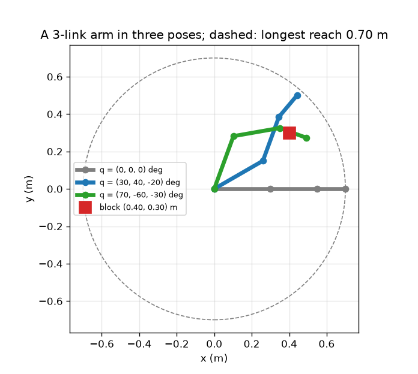
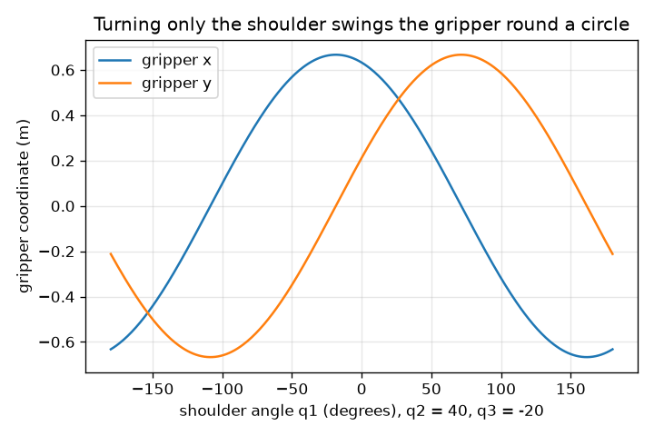

# அமர்வு 1: ரோபோ கை என்பது இணைப்புகளும் மூட்டுகளும் கொண்ட சங்கிலி

[Session 1 — हिन्दी](README.hi.md) · [Session 1 — മലയാളം](README.ml.md) · [Session 1 — தமிழ்](README.ta.md)

*நிலை 1 (கருத்துசார் ஊடாடும் மாதிரி) · சுமார் 60 நிமிடங்கள் · openrobotarm*

> இது எளிமைப்படுத்தப்பட்ட ஒரு கல்வி மாதிரி. இது சரிபார்க்கப்பட்ட (validated) வடிவமைப்புக் கருவி அல்ல; உண்மையான கட்டமைப்புகள், மின் நிறுவல்கள், வாகனங்கள், தொழில் செயல்முறைகள் அல்லது மருத்துவ முடிவுகளுக்கு இதைப் பயன்படுத்த வேண்டாம்.

**முன்தேவைகள் (Prerequisites)**

- பள்ளி முக்கோணவியல்: சைன், கொசைன்.
- நீங்கள் PRIMER.md-ஐப் படித்து `python start.py 1` ஐ ஒருமுறை இயக்கியிருக்க வேண்டும்.

**கற்றல் நோக்கங்கள் (Learning objectives).** இந்த அமர்வுக்குப் பிறகு உங்களால் முடியும்:

- ஒரு தள கையை அதன் இணைப்பு நீளங்களாலும் மூட்டுக் கோணங்களாலும் விவரிக்க.
- சங்கிலி வழியே மூட்டுக் கோணங்கள் ஏன் கூடுகின்றன (திரள் கோணங்கள்) என்று விளக்க.
- மூன்று மூட்டுக் கோணங்களிலிருந்து பிடிப்பான் நிலையையும் கருவிக் கோணத்தையும் கையாலும் Python-இலும் கணக்கிட.
- நீண்ட எட்டலைச் (reach) சொல்லி, ஒரு கட்டையைத் தொட முடியுமா என்று தீர்மானிக்க.

## A. நிஜ உலகப் பிரச்சினை
பிக்-அண்ட்-பிளேஸ் ரோபோ ஓரிடத்திலிருந்து கட்டையைத் தூக்கி இன்னொரு இடத்தில் வைக்கிறது, மணிக்கு நூற்றுக்கணக்கான முறை. அதன் மோட்டார்கள் மூட்டுகளை மட்டுமே திருப்புகின்றன. மோட்டாரிடம் 'x = 0.40, y = 0.30 க்குப் போ' என்று யாரும் சொல்ல முடியாது; பிடிப்பானை அங்கே வைக்கும் மூட்டுக் கோணங்களை நாம் கண்டறிய வேண்டும். சிக்கலைப் பின்னோக்கி ஓட்டுவதற்கு முன், அதை முன்னோக்கி ஓட்ட முடிய வேண்டும்: மூன்று மூட்டுக் கோணங்கள் தரப்பட்டால் பிடிப்பான் எங்கே முடிகிறது? 0.30 m, 0.25 m, 0.15 m இணைப்புகள் கொண்ட 3-இணைப்புக் கையால் குறுக்கே 0.40 m, மேலே 0.30 m உள்ள கட்டையைத் தொட முடியுமா?

## B. கருத்தும் கோட்பாடும்
கை ஒரு சங்கிலி: இணைப்பு 1 மூட்டு 1 மூலம் தொடக்கப்புள்ளியில் உள்ள அடித்தளத்தில் பொருத்தப்பட்டுள்ளது, இணைப்பு 2 மூட்டு 2 மூலம் இணைப்பு 1-இன் முனையில் பொருத்தப்பட்டுள்ளது, இப்படியே தொடர்கிறது. ஒவ்வொரு மூட்டுக் கோணமும் முந்தைய இணைப்பைப் பொறுத்து அளக்கப்படுகிறது, எனவே அறையில் ஓர் இணைப்பின் திசை அதுவரையிலான மூட்டுக் கோணங்களின் தொடர்ச்சியான கூட்டுத்தொகை (அதன் திரள் கோணம்). சங்கிலி வழியே நடக்கும்போது, ஒவ்வொரு இணைப்பும் தன் நீளம் பெருக்கல் தன் திரள் கோணத்தின் (cos, sin) ஐச் சேர்க்கிறது, கடைசிப் புள்ளி பிடிப்பான். கருவிக் கோணம், பிடிப்பான் சுட்டும் திசை, அனைத்து மூட்டுக் கோணங்களின் கூட்டுத்தொகை. பிடிப்பான் அடித்தளத்திலிருந்து இணைப்பு நீளங்களின் கூட்டுத்தொகையை விடத் தொலைவில் ஒருபோதும் போக முடியாது.

| குறியீடு | பொருள் | அலகு |
|---|---|---|
| q1, q2, q3 | மூட்டுக் கோணங்கள், ஒவ்வொன்றும் முந்தைய இணைப்பைப் பொறுத்தது, எதிர்ச்சுற்று நேர்மறை | பாகை அல்லது ரேடியன் |
| L1, L2, L3 | இணைப்பு நீளங்கள் (0.30, 0.25, 0.15) | m |
| c1, c2, c3 | திரள் கோணங்கள்: x அச்சிலிருந்து ஒவ்வொரு இணைப்பின் திசை | பாகை அல்லது ரேடியன் |
| (x, y) | பிடிப்பான் நிலை | m |
| கருவிக் கோணம் | பிடிப்பான் சுட்டும் திசை, q1 + q2 + q3 | பாகை |

**அனுமானங்கள் (Assumptions)**

- கை ஒரு தட்டையான தளத்தில் இயங்குகிறது (மேலிருந்து பார்த்தது).
- இணைப்புகள் இறுக்கமானவை, மூட்டுகளுக்கு அளவில்லை.
- அடித்தளம் தொடக்கப்புள்ளி (0, 0) இல் நிலையாக உள்ளது, மூட்டுகள் சுதந்திரமாகத் திரும்புகின்றன (வரம்புகள் அமர்வு 2-இல் வரும்).
- கோணங்கள் x அச்சிலிருந்து எதிர்ச்சுற்றாக அளக்கப்படுகின்றன.

$$ c_k=q_1+q_2+\cdots+q_k $$

$$ x=\sum_{k=1}^{3}L_k\cos c_k,\qquad y=\sum_{k=1}^{3}L_k\sin c_k $$

$$ \text{tool angle}=c_3=q_1+q_2+q_3 $$

$$ \sqrt{x^2+y^2}\le L_1+L_2+L_3=0.70\ \text{m} $$

## C. காட்சி விளக்கம்
முதல் படம் கையை மீட்டரில் மூன்று தோற்றங்களில் காட்டுகிறது: x வழியே நீட்டியது (பிடிப்பான் (0.70, 0)-இல்), பிடிப்பான் (0.442, 0.500)-இல் உள்ள (30, 40, -20) பாகைத் தோற்றம், பிடிப்பான் (0.490, 0.274)-இல் உள்ள (70, -60, -30) பாகைத் தோற்றம். சிவப்புச் சதுரம் கட்டை, கோடிட்ட வட்டம் நீண்ட எட்டல். இரண்டாவது படம் மற்ற இரு மூட்டுகளையும் 40, -20 பாகையில் நிறுத்தி தோளை மட்டும் திருப்புகிறது: பிடிப்பான் 0.667 m ஆரம் கொண்ட வட்டத்தில் சுற்றுகிறது, எனவே x, y தோள் கோணத்தின் கொசைனும் சைனும், தோள் கோணம் -18.5 பாகையில் x மிகப் பெரியது, 0.667 m.

*3-இணைப்புக் கையின் மீட்டரில் மூன்று தோற்றங்கள், கட்டை, நீண்ட எட்டல்.*

*தோள் மட்டும் திரும்பும்போது பிடிப்பான் x, y: 0.667 m ஆரம் கொண்ட கொசைனும் சைனும்.*

## D. ஊடாடும் உருவகப்படுத்துதல்
பாடத்தை இயக்கவும் (`python start.py 1`), பின்னர் நேரடி செயலியைத் திறக்கவும்: [அமர்வு 1: ஒரு 3-இணைப்புக் கை](https://krunalpanchal1995.github.io/pan-iit-oss/openrobotarm/session-01/) (அல்லது இந்தக் கோப்புறையில் உள்ள `app.html`). மூன்று ஸ்லைடர்களை நகர்த்தி சங்கிலியைக் கவனியுங்கள்: பிடிப்பான் மூன்றையும் பின்பற்றுகிறது. வரைபடத்துக்கு மாறி தோள் மட்டும் நகரும்போது x, y ஐப் பாருங்கள். கட்டையிலிருந்து தூரத்தை வாசிப்புக் காட்டி எப்படிக் காட்டுகிறது என்று கவனியுங்கள்.

**சவால் (Challenge).** பிடிப்பானை (0.40, 0.30) m இல் உள்ள கட்டையின் மீது, 2 cm-க்குள், வையுங்கள்.

## E. தீர்க்கப்பட்ட எடுத்துக்காட்டும் சோதனையும்
**சிக்கல்.** L = (0.30, 0.25, 0.15) m உடன் q = (30, 40, -20) பாகைக்குப் பிடிப்பான் நிலை, கருவிக் கோணம், அடித்தளத்திலிருந்து தூரம் ஆகியவற்றைக் கண்டறியுங்கள்.

1. திரள் கோணங்கள்: c1 = 30, c2 = 30 + 40 = 70, c3 = 70 - 20 = 50 பாகை.
2. இணைப்பு 1: 0.30 * (cos 30, sin 30) = 0.30 * (0.866, 0.500) = (0.2598, 0.1500) m.
3. இணைப்பு 2: 0.25 * (cos 70, sin 70) = 0.25 * (0.3420, 0.9397) = (0.0855, 0.2349) m.
4. இணைப்பு 3: 0.15 * (cos 50, sin 50) = 0.15 * (0.6428, 0.7660) = (0.0964, 0.1149) m.
5. மூன்றையும் கூட்டுங்கள்: x = 0.2598 + 0.0855 + 0.0964 = 0.4417 m, y = 0.1500 + 0.2349 + 0.1149 = 0.4998 m. கருவிக் கோணம் c3 = 50 பாகை.
6. அடித்தளத்திலிருந்து தூரம்: sqrt(0.4417^2 + 0.4998^2) = 0.667 m, நீண்ட எட்டலான 0.70 m-க்குக் கீழே, அப்படித்தான் இருக்க வேண்டும்.

**விடை.** பிடிப்பான் (0.442, 0.500) m-இல், x அச்சிலிருந்து 50 பாகையில் சுட்டி, அடித்தளத்திலிருந்து 0.667 m தொலைவில்.

**சோதனை.** 30, 25, 15 cm நீளமுள்ள மூன்று அட்டைப் பட்டைகளை வெட்டி, கட்டக் காகிதத்தின் ஒரு முனையில் ஊசிகளால் இணையுங்கள். கோணமானியால் கோணங்களை அமையுங்கள் (ஒவ்வொரு கோணமும் முந்தைய பட்டையைப் பொறுத்தது என்பதை நினைவில் கொள்ளுங்கள்), பிடிப்பான் நிலையைக் காகிதத்திலிருந்து வாசியுங்கள்; சுமார் 5 mm வரை ஒத்திசைவை எதிர்பாருங்கள். வேறுபாடுகள் ஊசியின் தடிமனிலிருந்தும் கோணமானி வாசிப்பிலிருந்தும் வருகின்றன: மாதிரியில் அளவற்ற மூட்டுகளும் முழுமையாக இறுக்கமான இணைப்புகளும் உள்ளன, அட்டைக்கு இல்லை.

## F. மதிப்பீடும் வடிவமைப்புச் சவாலும்
**கேள்வி வகை A: கருத்துசார்.** கருவிக் கோணம் q3 மட்டுமின்றி q1 + q2 + q3 ஆக இருப்பது ஏன்? மூட்டு 1 மட்டும் 10 பாகை திரும்பினால் பிடிப்பான் என்ன செய்யும்?

குறிப்பு

ஒவ்வொரு மூட்டுக் கோணமும் அதற்கு முந்தைய இணைப்பைப் பொறுத்து அளக்கப்படுகிறது.

படிப்படியான தீர்வு

மூட்டு 3 இணைப்பு 2-ஐப் பொறுத்து அளக்கப்படுகிறது, அது தானே q1 + q2 திசையில் சுட்டுகிறது. எனவே இணைப்பு 3 q1 + q2 + q3 திசையில் சுட்டுகிறது. மூட்டு 1 மட்டும் 10 பாகை திரும்பினால், அதன் பின் உள்ள ஒவ்வொரு இணைப்பும் உடன் கொண்டு செல்லப்படுகிறது: முழுக் கையும் அடித்தளத்தைச் சுற்றி இறுக்கமாக 10 பாகை சுழல்கிறது, கருவிக் கோணம் 10 பாகை கூடுகிறது, பிடிப்பான் அடித்தளத்தை மையமாகக் கொண்ட வட்டத்தில் நகர்கிறது.

**கேள்வி வகை B: எண்சார்.** q = (90, -90, 0) பாகைக்குப் பிடிப்பான் நிலையைக் கண்டறியுங்கள். அது (0.40, 0.30) m இல் உள்ள கட்டையின் மீது உள்ளதா?

குறிப்பு

திரள் கோணங்கள் 90, 0, 0 பாகை.

படிப்படியான தீர்வு

இணைப்பு 1 மேலே சுட்டுகிறது: (0, 0.30). இணைப்பு 2 (திரள் கோணம் 0) x வழியே சுட்டுகிறது: (0.25, 0). இணைப்பு 3 (திரள் கோணம் 0): (0.15, 0). கூட்டுத்தொகை: (0.40, 0.30) m, சரியாகக் கட்டை. சரிபார்ப்பு: அடித்தளத்திலிருந்து தூரம் sqrt(0.40^2 + 0.30^2) = 0.50 m, 0.70 m-க்குக் கீழே, எனவே எட்டக்கூடியது.

**கேள்வி வகை C: வரைபடம், உருவகப்படுத்துதல் விளக்கம்.** இரண்டாவது படத்தில் பிடிப்பான் சுற்றும் வட்டத்தின் ஆரம் எவ்வளவு, எந்தத் தோள் கோணத்தில் பிடிப்பானின் x மிகப் பெரியது?

குறிப்பு

அடித்தளத்திலிருந்து பிடிப்பானுக்கு உள்ள தூரத்தைக் காண q1 = 0 வையுங்கள், பின்னர் அந்தப் புள்ளி வட்டத்தில் எங்கே என்று கேளுங்கள்.

படிப்படியான தீர்வு

q1 = 0 இல் பிடிப்பான் (0.632, 0.212) m-இல், எனவே அடித்தளத்திலிருந்து தூரம் 0.667 m, அதுவே எல்லா q1-க்கும் ஆரம். அந்தப் புள்ளி x அச்சிலிருந்து atan2(0.212, 0.632) = 18.5 பாகையில் உள்ளது, எனவே q1 = -18.5 பாகையில் x மிகப் பெரியது, அது x அச்சுக்குக் கொண்டுவருகிறது, அங்கே x = 0.667 m.

**கேள்வி வகை D: வடிவமைப்பு, உகப்பாக்கச் சவால்.** வடிவமைப்பு: ஒரு விநியோகஸ்தர் மொத்த இணைப்பு நீளம் 0.45, 0.60, 0.70, 0.85 m கொண்ட 3-இணைப்புக் கைகளை விற்கிறார். கட்டை அடித்தளத்திலிருந்து 0.50 m தொலைவில் உள்ளது, உங்களுக்குக் குறைந்தது 0.10 m கூடுதல் எட்டல் வேண்டும். எந்தக் கையைத் தேர்வீர்கள், நீளமானதை எடுத்தால் எதை விட்டுக்கொடுக்கிறீர்கள்?

குறிப்பு

எட்டல் மொத்த நீளத்தால் வரையறுக்கப்படுகிறது; கூடுதல் எட்டலைக் கட்டைத் தூரத்தோடு கூட்டுங்கள்.

படிப்படியான தீர்வு

கை குறைந்தது 0.50 + 0.10 = 0.60 m எட்ட வேண்டும், இது 0.45 m-ஐ விலக்குகிறது. தகுதி பெறும் சிறியது 0.60 m (0.70, 0.85 உம் தகுதி). நீளமான கை அதிகம் எட்டுகிறது, ஆனால் கனமானது, பெரிய மோட்டார்கள் தேவை, சிறு மூட்டுப் பிழை தூரத்தால் பெருக்கப்படுவதால் பிடிப்பானைக் குறைந்த துல்லியத்துடன் வைக்கிறது. அனுமானம்: கையைச் சுதந்திரமாக நிலைநிறுத்தலாம் (இன்னும் மூட்டு வரம்புகள் இல்லை).

[RUBRIC.md](../../RUBRIC.md) ஐப் பயன்படுத்தி நீங்களே மதிப்பெண் இடுங்கள். காகிதத்தில் வேலை செய்ய [செயல்பாட்டுத் தாள்](activity_sheet.md) ஐ அச்சிடுங்கள்.

## பொதுவான தவறான புரிதல்கள்
| பொதுவான தவறான புரிதல் | உண்மையில் என்ன |
|---|---|
| மூட்டு 3 x அச்சிலிருந்து அளக்கப்படுகிறது. | ஒவ்வொரு மூட்டுக் கோணமும் அதற்கு முந்தைய இணைப்பைப் பொறுத்தது; அறையில் ஓர் இணைப்பின் திசை தொடர்ச்சியான கூட்டுத்தொகை. |
| ஒரு கோணத்தைத் தேர்ந்தெடுத்தாலே 0.70 m ஆரம் கொண்ட வட்டத்துக்குள் பிடிப்பான் எங்கும் போகலாம். | பொதுவாக மூன்று கோணங்கள் தேவை; ஒரு கோணம் பிடிப்பானை ஒரு வட்டத்தில் மட்டுமே சுற்ற வைக்கிறது. |
| தோளைத் திருப்புவது கையின் வடிவத்தை மாற்றுகிறது. | மூட்டு 1 மட்டும் திருப்புவது முழுக் கையையும் அடித்தளத்தைச் சுற்றி இறுக்கமாகத் திருப்புகிறது; வடிவத்தை q2, q3 தீர்மானிக்கின்றன. |

## சொற்பட்டியல் (Glossary)
- **இணைப்பு (link)**: இரு மூட்டுகளுக்கு இடையிலான கையின் இறுக்கமான கம்பி
- **மூட்டு (joint)**: ஓர் இணைப்பு மற்றொன்றைப் பொறுத்துத் திரும்பும், மோட்டாரால் இயக்கப்படும் சுழல் புள்ளி
- **பிடிப்பான் (gripper, end effector)**: பாகத்தைப் பிடிக்கும், சங்கிலியின் முனையில் உள்ள கருவி
- **திரள் கோணம் (cumulative angle)**: மூட்டுக் கோணங்களின் தொடர்ச்சியான கூட்டுத்தொகை; அறையில் ஓர் இணைப்பின் திசை
- **முன்னோக்கு இயக்கவியல் (forward kinematics)**: மூட்டுக் கோணங்களிலிருந்து பிடிப்பான் நிலையைக் கண்டறிதல்
- **எட்டல் (reach)**: அடித்தளத்திலிருந்து பிடிப்பானுக்கு உள்ள தூரம்

## முடிக்கவும்
1. [exercises.md](exercises.md) இல் உள்ள மூன்று நிரலாக்கப் பணிகளைச் செய்யுங்கள்.
2. உங்கள் மாற்றங்களுக்குப் பிறகு `python start.py 1` ஐ மீண்டும் இயக்கவும். அது சோதனைச்சாவடியுடன் முடிகிறது; அது `PASS` என்று அச்சிடும்போது, நீங்கள் முடித்துவிட்டீர்கள். (சோதனைச்சாவடி மட்டும்: `python start.py check 1`.)

அடுத்தது: [அமர்வு 2](../session-02/README.md)
