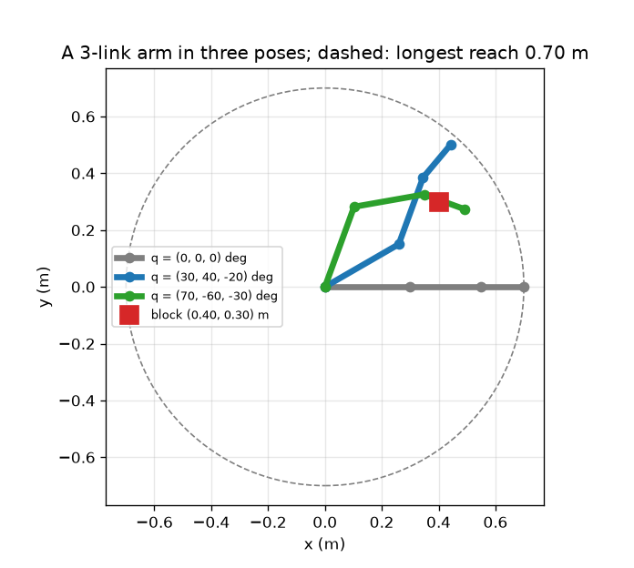
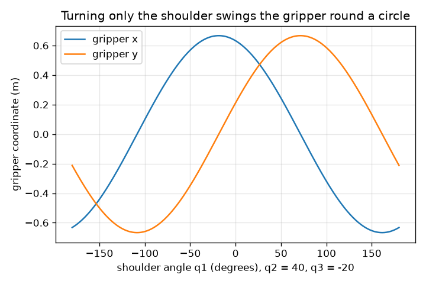

# సెషన్ 1: రోబోట్ ఆర్మ్ అంటే లింక్‌లు, జాయింట్‌ల గొలుసు

[Session 1 — हिन्दी](README.hi.md) · [Session 1 — മലയാളം](README.ml.md) · [Session 1 — தமிழ்](README.ta.md) · [Session 1 — తెలుగు](README.te.md)

*స్థాయి 1 (భావనాత్మక ఇంటరాక్టివ్ నమూనా) · సుమారు 60 నిమిషాలు · openrobotarm*

> ఇది సరళీకృత విద్యా నమూనా. ఇది ధ్రువీకరించిన (validated) డిజైన్ సాధనం కాదు; నిజమైన నిర్మాణాలు, విద్యుత్ ఏర్పాట్లు, వాహనాలు, పారిశ్రామిక ప్రక్రియలు లేదా వైద్య నిర్ణయాలకు దీనిని ఉపయోగించవద్దు.

**ముందస్తు అవసరాలు (Prerequisites)**

- పాఠశాల త్రికోణమితి: సైన్, కొసైన్.
- మీరు PRIMER.md చదివి `python start.py 1` ను ఒకసారి నడిపి ఉండాలి.

**అభ్యాస లక్ష్యాలు (Learning objectives).** ఈ సెషన్ తర్వాత మీరు చేయగలరు:

- ఒక సమతల ఆర్మ్‌ను దాని లింక్ పొడవులు, జాయింట్ కోణాలతో వివరించడం.
- గొలుసు వెంబడి జాయింట్ కోణాలు ఎందుకు కూడుకుంటాయో (సంచిత కోణాలు) వివరించడం.
- మూడు జాయింట్ కోణాల నుండి గ్రిప్పర్ స్థానం, టూల్ కోణాన్ని చేతితో, Python లో లెక్కించడం.
- అత్యధిక చేరువను (reach) చెప్పి, ఒక బ్లాక్‌ను తాకగలమా అని నిర్ణయించడం.

## A. వాస్తవ ప్రపంచ సమస్య
పిక్-అండ్-ప్లేస్ రోబోట్ ఒక చోట నుండి బ్లాక్‌ను ఎత్తి మరొక చోట ఉంచుతుంది, గంటకు వందల సార్లు. దాని మోటార్లు జాయింట్లను మాత్రమే తిప్పుతాయి. మోటార్‌కు 'x = 0.40, y = 0.30 కి వెళ్ళు' అని ఎవరూ చెప్పలేరు; గ్రిప్పర్‌ను అక్కడ ఉంచే జాయింట్ కోణాలను మనమే కనుగొనాలి. సమస్యను వెనక్కి నడపడానికి ముందు, ముందుకు నడపగలగాలి: మూడు జాయింట్ కోణాలు ఇస్తే, గ్రిప్పర్ ఎక్కడ చేరుతుంది? 0.30 m, 0.25 m, 0.15 m లింక్‌లున్న 3-లింక్ ఆర్మ్ అడ్డంగా 0.40 m, పైకి 0.30 m ఉన్న బ్లాక్‌ను తాకగలదా?

## B. భావన మరియు సిద్ధాంతం
ఆర్మ్ ఒక గొలుసు: లింక్ 1 జాయింట్ 1 ద్వారా మూలబిందువు వద్ద ఉన్న బేస్‌కు అమర్చబడింది, లింక్ 2 జాయింట్ 2 ద్వారా లింక్ 1 చివరకు అమర్చబడింది, ఇలా కొనసాగుతుంది. ప్రతి జాయింట్ కోణం ముందరి లింక్‌కు సాపేక్షంగా కొలుస్తారు, కాబట్టి గదిలో ఒక లింక్ దిశ అప్పటివరకు ఉన్న జాయింట్ కోణాల వరుస మొత్తం (దాని సంచిత కోణం). గొలుసు వెంబడి నడిస్తే, ప్రతి లింక్ తన పొడవు రెట్లు తన సంచిత కోణం (cos, sin) ను కలుపుతుంది, చివరి బిందువే గ్రిప్పర్. టూల్ కోణం, గ్రిప్పర్ చూపే దిశ, అన్ని జాయింట్ కోణాల మొత్తం. గ్రిప్పర్ బేస్ నుండి లింక్ పొడవుల మొత్తం కంటే ఎక్కువ దూరం ఎప్పటికీ వెళ్ళలేదు.

| గుర్తు | అర్థం | ప్రమాణం |
|---|---|---|
| q1, q2, q3 | జాయింట్ కోణాలు, ప్రతి ఒక్కటి ముందరి లింక్‌కు సాపేక్షం, అపసవ్య దిశ ధనాత్మకం | డిగ్రీలు లేదా రేడియన్లు |
| L1, L2, L3 | లింక్ పొడవులు (0.30, 0.25, 0.15) | m |
| c1, c2, c3 | సంచిత కోణాలు: x అక్షం నుండి ప్రతి లింక్ దిశ | డిగ్రీలు లేదా రేడియన్లు |
| (x, y) | గ్రిప్పర్ స్థానం | m |
| టూల్ కోణం | గ్రిప్పర్ చూపే దిశ, q1 + q2 + q3 | డిగ్రీలు |

**ఊహలు (Assumptions)**

- ఆర్మ్ ఒక సమతల తలంలో కదులుతుంది (పై నుండి చూసినది).
- లింక్‌లు దృఢమైనవి, జాయింట్లకు పరిమాణం లేదు.
- బేస్ మూలబిందువు (0, 0) వద్ద స్థిరంగా ఉంది, జాయింట్లు స్వేచ్ఛగా తిరుగుతాయి (పరిమితులు సెషన్ 2 లో వస్తాయి).
- కోణాలు x అక్షం నుండి అపసవ్య దిశలో కొలుస్తారు.

$$ c_k=q_1+q_2+\cdots+q_k $$

$$ x=\sum_{k=1}^{3}L_k\cos c_k,\qquad y=\sum_{k=1}^{3}L_k\sin c_k $$

$$ \text{tool angle}=c_3=q_1+q_2+q_3 $$

$$ \sqrt{x^2+y^2}\le L_1+L_2+L_3=0.70\ \text{m} $$

## C. దృశ్య వివరణ
మొదటి చిత్రం ఆర్మ్‌ను మీటర్లలో మూడు భంగిమల్లో చూపుతుంది: x వెంట చాచినది (గ్రిప్పర్ (0.70, 0) వద్ద), గ్రిప్పర్ (0.442, 0.500) వద్ద ఉన్న (30, 40, -20) డిగ్రీల భంగిమ, గ్రిప్పర్ (0.490, 0.274) వద్ద ఉన్న (70, -60, -30) డిగ్రీల భంగిమ. ఎరుపు చతురస్రం బ్లాక్, చుక్కల వృత్తం అత్యధిక చేరువ. రెండవ చిత్రం మిగతా రెండు జాయింట్లను 40, -20 డిగ్రీల వద్ద ఉంచి భుజాన్ని మాత్రమే తిప్పుతుంది: గ్రిప్పర్ 0.667 m వ్యాసార్ధం ఉన్న వృత్తంలో తిరుగుతుంది, కాబట్టి x, y భుజం కోణం యొక్క కొసైన్, సైన్, భుజం కోణం -18.5 డిగ్రీల వద్ద x గరిష్ఠం, 0.667 m.

*3-లింక్ ఆర్మ్ యొక్క మీటర్లలో మూడు భంగిమలు, బ్లాక్, అత్యధిక చేరువ.*

*భుజం మాత్రమే తిరిగినప్పుడు గ్రిప్పర్ x, y: 0.667 m వ్యాసార్ధం ఉన్న కొసైన్, సైన్.*

## D. ఇంటరాక్టివ్ అనుకరణ
పాఠాన్ని నడపండి (`python start.py 1`), ఆ తర్వాత లైవ్ యాప్‌ను తెరవండి: [సెషన్ 1: ఒక 3-లింక్ ఆర్మ్](https://krunalpanchal1995.github.io/pan-iit-oss/openrobotarm/session-01/) (లేదా ఈ ఫోల్డర్‌లోని `app.html`). మూడు స్లైడర్లను కదిపి గొలుసును గమనించండి: గ్రిప్పర్ మూడింటినీ అనుసరిస్తుంది. గ్రాఫ్‌కు మారి భుజం మాత్రమే కదిలినప్పుడు x, y చూడండి. రీడౌట్ బ్లాక్ నుండి దూరాన్ని ఎలా చూపుతుందో గమనించండి.

**సవాలు (Challenge).** గ్రిప్పర్‌ను (0.40, 0.30) m వద్ద ఉన్న బ్లాక్‌పై, 2 cm లోపు, ఉంచండి.

## E. సాధించిన ఉదాహరణ మరియు ప్రయోగం
**సమస్య.** L = (0.30, 0.25, 0.15) m తో q = (30, 40, -20) డిగ్రీలకు గ్రిప్పర్ స్థానం, టూల్ కోణం, బేస్ నుండి దూరం కనుగొనండి.

1. సంచిత కోణాలు: c1 = 30, c2 = 30 + 40 = 70, c3 = 70 - 20 = 50 డిగ్రీలు.
2. లింక్ 1: 0.30 * (cos 30, sin 30) = 0.30 * (0.866, 0.500) = (0.2598, 0.1500) m.
3. లింక్ 2: 0.25 * (cos 70, sin 70) = 0.25 * (0.3420, 0.9397) = (0.0855, 0.2349) m.
4. లింక్ 3: 0.15 * (cos 50, sin 50) = 0.15 * (0.6428, 0.7660) = (0.0964, 0.1149) m.
5. మూడింటినీ కలపండి: x = 0.2598 + 0.0855 + 0.0964 = 0.4417 m, y = 0.1500 + 0.2349 + 0.1149 = 0.4998 m. టూల్ కోణం c3 = 50 డిగ్రీలు.
6. బేస్ నుండి దూరం: sqrt(0.4417^2 + 0.4998^2) = 0.667 m, అత్యధిక చేరువ 0.70 m కంటే తక్కువ, అలాగే ఉండాలి.

**జవాబు.** గ్రిప్పర్ (0.442, 0.500) m వద్ద, x అక్షం నుండి 50 డిగ్రీలు చూపుతూ, బేస్ నుండి 0.667 m దూరంలో.

**ప్రయోగం.** 30, 25, 15 cm పొడవు గల మూడు కార్డ్‌బోర్డ్ పట్టీలను కత్తిరించి, చతురస్ర కాగితం ఒక అంచు వద్ద పిన్నులతో కలపండి. ప్రొట్రాక్టర్‌తో కోణాలను అమర్చండి (ప్రతి కోణం ముందరి పట్టీకి సాపేక్షమని గుర్తుంచుకోండి), గ్రిప్పర్ స్థానాన్ని కాగితం నుండి చదవండి; సుమారు 5 mm వరకు ఏకీభావాన్ని ఆశించండి. తేడాలు పిన్ మందం, ప్రొట్రాక్టర్ రీడింగ్ నుండి వస్తాయి: నమూనాలో పరిమాణం లేని జాయింట్లు, పూర్తిగా దృఢమైన లింక్‌లు ఉన్నాయి, కార్డ్‌బోర్డ్‌కు లేవు.

## F. మూల్యాంకనం మరియు డిజైన్ సవాలు
**ప్రశ్న రకం A: భావనాత్మక.** టూల్ కోణం q3 మాత్రమే కాకుండా q1 + q2 + q3 ఎందుకు? జాయింట్ 1 మాత్రమే 10 డిగ్రీలు తిరిగితే గ్రిప్పర్ ఏం చేస్తుంది?

సూచన

ప్రతి జాయింట్ కోణం దానికి ముందున్న లింక్‌కు సాపేక్షంగా కొలుస్తారు.

దశలవారీ పరిష్కారం

జాయింట్ 3 లింక్ 2 కు సాపేక్షంగా కొలుస్తారు, అది స్వయంగా q1 + q2 దిశలో చూపుతుంది. కాబట్టి లింక్ 3 q1 + q2 + q3 దిశలో చూపుతుంది. జాయింట్ 1 మాత్రమే 10 డిగ్రీలు తిరిగితే, దాని తర్వాతి ప్రతి లింక్ కూడా వెంట కొనిపోబడుతుంది: మొత్తం ఆర్మ్ బేస్ చుట్టూ దృఢంగా 10 డిగ్రీలు తిరుగుతుంది, టూల్ కోణం 10 డిగ్రీలు పెరుగుతుంది, గ్రిప్పర్ బేస్ కేంద్రంగా ఉన్న వృత్తంలో కదులుతుంది.

**ప్రశ్న రకం B: సంఖ్యాత్మక.** q = (90, -90, 0) డిగ్రీలకు గ్రిప్పర్ స్థానం కనుగొనండి. అది (0.40, 0.30) m వద్ద ఉన్న బ్లాక్‌పై ఉందా?

సూచన

సంచిత కోణాలు 90, 0, 0 డిగ్రీలు.

దశలవారీ పరిష్కారం

లింక్ 1 పైకి చూపుతుంది: (0, 0.30). లింక్ 2 (సంచిత కోణం 0) x వెంట చూపుతుంది: (0.25, 0). లింక్ 3 (సంచిత కోణం 0): (0.15, 0). మొత్తం: (0.40, 0.30) m, సరిగ్గా బ్లాక్. తనిఖీ: బేస్ నుండి దూరం sqrt(0.40^2 + 0.30^2) = 0.50 m, 0.70 m కంటే తక్కువ, కాబట్టి చేరుకోగలం.

**ప్రశ్న రకం C: గ్రాఫ్, అనుకరణ వివరణ.** రెండవ చిత్రంలో గ్రిప్పర్ తిరిగే వృత్తం వ్యాసార్ధం ఎంత, ఏ భుజం కోణం వద్ద గ్రిప్పర్ x గరిష్ఠం?

సూచన

బేస్ నుండి గ్రిప్పర్ దూరం కనుగొనడానికి q1 = 0 పెట్టండి, తర్వాత ఆ బిందువు వృత్తంపై ఎక్కడ ఉందో అడగండి.

దశలవారీ పరిష్కారం

q1 = 0 వద్ద గ్రిప్పర్ (0.632, 0.212) m వద్ద ఉంది, కాబట్టి బేస్ నుండి దూరం 0.667 m, అదే అన్ని q1 లకు వ్యాసార్ధం. ఆ బిందువు x అక్షం నుండి atan2(0.212, 0.632) = 18.5 డిగ్రీల వద్ద ఉంది, కాబట్టి q1 = -18.5 డిగ్రీల వద్ద x గరిష్ఠం, అది x అక్షంపైకి తెస్తుంది, అక్కడ x = 0.667 m.

**ప్రశ్న రకం D: డిజైన్, ఆప్టిమైజేషన్ సవాలు.** డిజైన్: ఒక సరఫరాదారు మొత్తం లింక్ పొడవు 0.45, 0.60, 0.70, 0.85 m ఉన్న 3-లింక్ ఆర్మ్‌లు అమ్ముతారు. బ్లాక్ బేస్ నుండి 0.50 m దూరంలో ఉంది, మీకు కనీసం 0.10 m అదనపు చేరువ కావాలి. ఏ ఆర్మ్ ఎంచుకుంటారు, పొడవైనది తీసుకుంటే దేన్ని వదులుకుంటారు?

సూచన

చేరువ మొత్తం పొడవుతో పరిమితం; అదనపు చేరువను బ్లాక్ దూరానికి కలపండి.

దశలవారీ పరిష్కారం

ఆర్మ్ కనీసం 0.50 + 0.10 = 0.60 m చేరాలి, ఇది 0.45 m ను మినహాయిస్తుంది. అర్హత పొందే అతి చిన్నది 0.60 m (0.70, 0.85 కూడా అర్హమే). పొడవైన ఆర్మ్ ఎక్కువ చేరుతుంది, కానీ బరువైనది, పెద్ద మోటార్లు కావాలి, చిన్న జాయింట్ లోపం దూరంతో గుణించబడుతుంది కాబట్టి గ్రిప్పర్‌ను తక్కువ కచ్చితత్వంతో ఉంచుతుంది. ఊహ: ఆర్మ్‌ను స్వేచ్ఛగా భంగిమలో ఉంచవచ్చు (ఇంకా జాయింట్ పరిమితులు లేవు).

[RUBRIC.md](../../RUBRIC.md) ఉపయోగించి మీరే స్కోర్ చేసుకోండి. కాగితంపై పని చేయడానికి [కార్యకలాప పత్రం](activity_sheet.md) ను ప్రింట్ చేయండి.

## సాధారణ అపోహలు
| సాధారణ అపోహ | వాస్తవం ఏమిటి |
|---|---|
| జాయింట్ 3 x అక్షం నుండి కొలుస్తారు. | ప్రతి జాయింట్ కోణం దానికి ముందున్న లింక్‌కు సాపేక్షం; గదిలో ఒక లింక్ దిశ వరుస మొత్తం. |
| ఒక కోణాన్ని ఎంచుకుంటేనే 0.70 m వ్యాసార్ధం వృత్తం లోపల గ్రిప్పర్ ఎక్కడికైనా వెళ్ళగలదు. | సాధారణంగా మూడు కోణాలు కావాలి; ఒక కోణం గ్రిప్పర్‌ను ఒక వృత్తంలో మాత్రమే తిప్పుతుంది. |
| భుజాన్ని తిప్పడం ఆర్మ్ ఆకారాన్ని మారుస్తుంది. | జాయింట్ 1 మాత్రమే తిప్పడం మొత్తం ఆర్మ్‌ను బేస్ చుట్టూ దృఢంగా తిప్పుతుంది; ఆకారాన్ని q2, q3 నిర్ణయిస్తాయి. |

## పదకోశం (Glossary)
- **లింక్ (link)**: రెండు జాయింట్ల మధ్య ఆర్మ్ యొక్క దృఢమైన కడ్డీ
- **జాయింట్ (joint)**: ఒక లింక్ మరొకదానికి సాపేక్షంగా తిరిగే, మోటార్ నడిపే పివట్
- **గ్రిప్పర్ (gripper, end effector)**: భాగాన్ని పట్టుకునే గొలుసు చివరి సాధనం
- **సంచిత కోణం (cumulative angle)**: జాయింట్ కోణాల వరుస మొత్తం; గదిలో ఒక లింక్ దిశ
- **ఫార్వర్డ్ కైనమాటిక్స్ (forward kinematics)**: జాయింట్ కోణాల నుండి గ్రిప్పర్ స్థానం కనుగొనడం
- **చేరువ (reach)**: బేస్ నుండి గ్రిప్పర్ వరకు దూరం

## పూర్తి చేయండి
1. [exercises.md](exercises.md) లోని మూడు కోడింగ్ పనులు చేయండి.
2. మీ మార్పుల తర్వాత `python start.py 1` ను మళ్ళీ నడపండి. అది చెక్‌పాయింట్‌తో ముగుస్తుంది; అది `PASS` అని ప్రింట్ చేస్తే, మీరు పూర్తి చేసినట్లే. (చెక్‌పాయింట్ మాత్రమే: `python start.py check 1`.)

తదుపరిది: [సెషన్ 2](../session-02/README.md)
