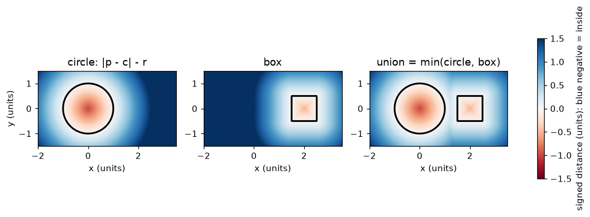
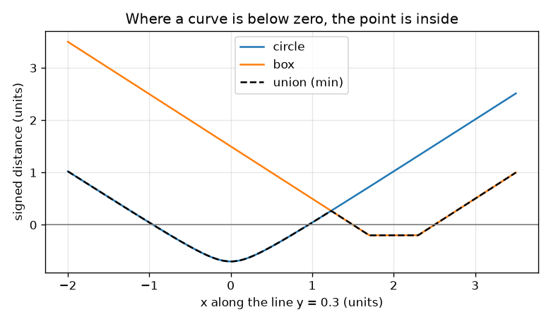

# सत्र 1: एक आकृति एक फलन है: चिह्नित दूरी

*स्तर 1 (वैचारिक इंटरैक्टिव मॉडल) · लगभग 60 मिनट · opensculpt*

> यह एक सरलीकृत शैक्षिक मॉडल है। यह कोई प्रमाणित डिज़ाइन उपकरण नहीं है और इसका उपयोग वास्तविक संरचनाओं, विद्युत संस्थापनों, वाहनों, औद्योगिक प्रक्रियाओं या चिकित्सा निर्णयों के लिए नहीं किया जाना चाहिए।

**पूर्व-आवश्यकताएँ (Prerequisites)**

- दो बिंदुओं के बीच की दूरी; वृत्त का विचार (एक केंद्र से एक ही दूरी पर स्थित सभी बिंदु)।
- आपने PRIMER.md पढ़ लिया है और एक बार `python start.py 1` चला लिया है।

**सीखने के उद्देश्य (Learning objectives)।** इस सत्र के बाद आप:

- समझा सकेंगे कि चिह्नित दूरी (signed distance) क्या है और ऋणात्मक का अर्थ अंदर क्यों है।
- किसी बिंदु से एक वृत्त और एक बॉक्स (box) तक की चिह्नित दूरी निकाल सकेंगे।
- min से दो आकृतियों को जोड़ सकेंगे और परिणाम को चित्र तथा ग्राफ़ से पढ़ सकेंगे।
- अंदर स्थित ग्रिड कोशिकाओं (grid cells) को गिनकर क्षेत्रफल का अनुमान लगा सकेंगे।

## A. वास्तविक जीवन की समस्या
एक CAD प्रोग्राम में एक मग है और उसे प्रति सेकंड लाखों बार एक प्रश्न का उत्तर देना है: क्या यह बिंदु मग के अंदर है? सतहों (faces) की सूची संग्रहीत करने के बजाय, हम एक फलन (function) संग्रहीत कर सकते हैं: उसे कोई भी बिंदु दीजिए और वह एक संख्या लौटाता है, निकटतम सतह की दूरी, और यदि बिंदु अंदर है तो ऋण चिह्न के साथ। क्या आप एक वृत्त और एक बॉक्स का इस तरह वर्णन कर सकते हैं, उन्हें चित्रों के रूप में खींच सकते हैं, और आकृतियों को जोड़ने के लिए संख्याओं का उपयोग कर सकते हैं?

## B. अवधारणा और सिद्धांत
एक बिंदु p = (x, y) लें। केंद्र c और त्रिज्या r वाले वृत्त के लिए, चिह्नित दूरी |p - c| - r है: बाहर धनात्मक, किनारे पर शून्य, अंदर ऋणात्मक, और केंद्र पर -r। केंद्र c और अर्ध-आकारों (half-sizes) (a, b) वाले बॉक्स के लिए, पहले x और y के लिए अलग-अलग q = |p - c| - (a, b) निकालें। यदि q के दोनों भाग ऋणात्मक हैं तो बिंदु अंदर है और निकटतम भुजा की दूरी q का बड़ा भाग है (जो शून्य के सबसे निकट है)। अन्यथा दूरी q के धनात्मक भागों से बने सदिश (vector) की लंबाई है। आकृति स्वयं उन बिंदुओं का समुच्चय है जहाँ मान ऋणात्मक है; उसकी सतह वहाँ है जहाँ मान शून्य है। दो आकृतियों के संघ (union) का कोई बिंदु उनमें से कम से कम एक के अंदर होता है, इसलिए संघ का मान min(d1, d2) है। एक सच्ची चिह्नित दूरी आपके चलने से तेज़ नहीं बदल सकती: लंबाई s का एक कदम इसे अधिक से अधिक s से बदलता है।

| प्रतीक | अर्थ | इकाई |
|---|---|---|
| p = (x, y) | समतल में एक बिंदु | इकाइयाँ (कोई भी लंबाई इकाई) |
| c | वृत्त या बॉक्स का केंद्र | इकाइयाँ |
| r | वृत्त की त्रिज्या | इकाइयाँ |
| (a, b) | बॉक्स की आधी चौड़ाई और आधी ऊँचाई | इकाइयाँ |
| d | चिह्नित दूरी (अंदर ऋणात्मक) | इकाइयाँ |

**मान्यताएँ (Assumptions)**

- इस सत्र में सब कुछ सपाट (2D) है।
- आकृतियाँ ठोस हैं: अंदर का भाग आकृति का हिस्सा है।
- ग्रिड कोशिकाओं का निर्णय उनके केंद्र पर मान से किया जाता है।

$$ d_{\text{circle}}(\mathbf p)=|\mathbf p-\mathbf c|-r $$

$$ \mathbf q=\big(|x-c_x|-a,\ |y-c_y|-b\big),\qquad d_{\text{box}}(\mathbf p)=\big|\max(\mathbf q,\mathbf 0)\big|+\min\big(\max(q_x,q_y),0\big) $$

$$ d_{\text{union}}=\min(d_1,\ d_2) $$

## C. दृश्य व्याख्या
पहला चित्र तीन क्षेत्रों (fields) को रंग में खींचता है: वृत्त, बॉक्स और उनका संघ। नीले का अर्थ है ऋणात्मक (अंदर), लाल का अर्थ है धनात्मक (बाहर), और काली रेखा वह सतह है जहाँ मान शून्य है। दूसरा चित्र दोनों आकृतियों से होकर क्षैतिज रेखा y = 0.3 का अनुसरण करता है: वृत्त का वक्र x के -0.954 और 0.954 के बीच शून्य से नीचे जाता है, बॉक्स का वक्र x के 1.5 और 2.5 के बीच, और काला संघ वक्र दोनों में से निचला है, इसलिए संघ दोनों हिस्सों पर अंदर है।

*रंग क्षेत्रों के रूप में वृत्त, बॉक्स और संघ; काली रेखा सतह है (मान 0)।*

*रेखा y = 0.3 के साथ मान; संघ निचला वक्र है और जहाँ यह शून्य से नीचे है वहाँ अंदर है।*

## D. इंटरैक्टिव सिमुलेशन
पाठ चलाएँ (`python start.py 1`), फिर लाइव ऐप खोलें: [सत्र 1: एक आकृति एक फलन है](https://krunalpanchal1995.github.io/pan-iit-oss/opensculpt/session-01/) (या इसी फ़ोल्डर में `app.html`)। प्रश्न बिंदु (query point) और त्रिज्या हिलाएँ। चित्र में लाल बिंदु पर रंग और वह डैश वृत्त देखें जिसकी त्रिज्या निरपेक्ष मान के बराबर है; ग्राफ़ दृश्य में देखें कि काला संघ वक्र वृत्त और बॉक्स वक्रों में से निचले का अनुसरण करता है।

**चुनौती।** प्रश्न बिंदु को संघ के अंदर रखें, ताकि रीडआउट INSIDE कहे।

## E. हल किया गया उदाहरण और प्रयोग
**समस्या।** एक वृत्त की त्रिज्या 1 और केंद्र (0, 0) है। एक बॉक्स का केंद्र (2, 0) और अर्ध-आकार (0.5, 0.5) हैं। बिंदु (1.2, 0.3) की हर आकृति और उनके संघ से चिह्नित दूरी ज्ञात करें।

1. वृत्त: |p - c| = sqrt(1.2^2 + 0.3^2) = sqrt(1.53) = 1.237, इसलिए d = 1.237 - 1 = 0.237।
2. बॉक्स: q = (|1.2 - 2| - 0.5, |0.3 - 0| - 0.5) = (0.3, -0.2)।
3. q के धनात्मक भाग (0.3, 0) हैं, जिनकी लंबाई 0.3 है, और max(qx, qy) = 0.3 ऋणात्मक नहीं है, इसलिए अंदर वाला पद 0 है और d = 0.3।
4. संघ = min(0.237, 0.300) = 0.237। मान धनात्मक है, इसलिए बिंदु दोनों आकृतियों के बाहर है, वृत्त के सबसे निकट।

**उत्तर।** वृत्त 0.237, बॉक्स 0.300, संघ 0.237 (सभी निर्देशांकों वाली इकाई में): बिंदु बाहर है।

**प्रयोग।** वर्गाकार काग़ज़ पर वृत्त और बॉक्स खींचें, बिंदु (1.2, 0.3) चिह्नित करें और रूलर से वृत्त के किनारे (लगभग 0.24) और बॉक्स के किनारे (लगभग 0.3) तक उसकी सबसे छोटी दूरी मापें। checkpoint.py से तुलना करें। छोटे अंतर रूलर और पेंसिल की चौड़ाई के कारण हैं: सूत्र सटीक है, चित्र नहीं।

## F. मूल्यांकन और डिज़ाइन चुनौती
**प्रश्न प्रकार A: वैचारिक।** हम किसी आकृति के अंदर के बिंदुओं के लिए केवल सतह की दूरी के बजाय ऋणात्मक मान का उपयोग क्यों करते हैं?

संकेत

यदि हम केवल दूरी का आकार उपयोग करें तो वृत्त के केंद्र का एक बिंदु और बहुत दूर का एक बिंदु दोनों कैसे दिखेंगे?

चरण-दर-चरण हल

बिना चिह्न वाली दूरी अंदर और बाहर में भेद नहीं कर सकती: 1 इकाई अंदर का बिंदु और 1 इकाई बाहर का बिंदु दोनों 1 पढ़ेंगे। चिह्न सतह को ठीक उन जगहों के रूप में बनाता है जहाँ मान शून्य है, और हमें चिह्न देखकर अंदर या बाहर तय करने देता है। यह संघ को भी सरल बनाता है: छोटी संख्या लें।

**प्रश्न प्रकार B: संख्यात्मक।** त्रिज्या 2 का एक वृत्त मूलबिंदु (origin) पर केंद्रित है। बिंदु (3, 4) की चिह्नित दूरी क्या है? क्या यह अंदर है?

संकेत

पहले मूलबिंदु से (3, 4) तक की दूरी, फिर त्रिज्या घटाएँ।

चरण-दर-चरण हल

|p - c| = sqrt(3^2 + 4^2) = 5, इसलिए d = 5 - 2 = 3 इकाइयाँ। धनात्मक, इसलिए बिंदु बाहर है। जाँच (sanity check): वृत्त का निकटतम बिंदु उसी रेखा के साथ केंद्र से 2 इकाई पर है, जिससे 3 इकाइयाँ बचती हैं।

**प्रश्न प्रकार C: ग्राफ़ और सिमुलेशन की व्याख्या।** रेखा y = 0.3 के साथ प्रोफ़ाइल ग्राफ़ में, x के किन मानों के बीच संघ अंदर है? दो अलग-अलग हिस्से क्यों हैं?

संकेत

पता लगाएँ कि काला वक्र शून्य रेखा से नीचे कहाँ है।

चरण-दर-चरण हल

संघ x के -0.954 और 0.954 (वृत्त) के बीच और x के 1.5 और 2.5 (बॉक्स) के बीच अंदर है। 0.954 और 1.5 के बीच दोनों आकृति वक्र शून्य से ऊपर हैं, इसलिए रेखा दोनों आकृतियों के बीच ख़ाली जगह से होकर गुज़रती है।

**प्रश्न प्रकार D: डिज़ाइन और अनुकूलन (optimisation) चुनौती।** डिज़ाइन: बॉक्स का केंद्र (2, 0) और अर्ध-आकार (0.5, 0.5) हैं। मूलबिंदु पर केंद्रित वृत्त की त्रिज्या ऐसे चुनें कि दोनों आकृतियाँ बस छूएँ, फिर ऐसे कि वे अतिव्याप्त (overlap) हों। वास्तविक पुर्ज़े के लिए कौन-सा बेहतर है और क्यों?

संकेत

बॉक्स की बाईं भुजा रेखा x = 1.5 है। x अक्ष के साथ वृत्त कहाँ तक पहुँचता है?

चरण-दर-चरण हल

वृत्त x अक्ष पर x = r तक पहुँचता है, इसलिए r = 1.5 दोनों को (1.5, 0) पर बस छुआता है: वहाँ दोनों मान 0 हैं। r = 1.6 के साथ बिंदु (1.5, 0) का वृत्त में मान -0.1 है, इसलिए आकृतियाँ 0.1 इकाई अतिव्याप्त होती हैं। वास्तविक पुर्ज़े को अतिव्याप्त होना चाहिए: केवल एक स्पर्श बिंदु के साथ जोड़ की मोटाई शून्य है और वह भार नहीं उठा सकता, और पूर्णांकन (round-off) आकृतियों को अलग कर सकता है। समझौता (trade-off) थोड़ा बड़ा पुर्ज़ा है।

[RUBRIC.md](../../RUBRIC.md) से स्वयं को अंक दें। काग़ज़ पर काम करने के लिए [गतिविधि पत्रक (activity sheet)](activity_sheet.md) प्रिंट करें।

## सामान्य भ्रांतियाँ (Common misconceptions)
| सामान्य भ्रांति | वास्तव में क्या सच है |
|---|---|
| क्षेत्र का मान केंद्र की दूरी के समान है। | यह सतह के निकटतम बिंदु की दूरी है (वृत्त का सूत्र ठीक इसी कारण त्रिज्या घटाता है)। |
| आकृति वे जगहें हैं जहाँ मान 0 है। | मान केवल सतह पर 0 है; आकृति वहाँ है जहाँ मान ऋणात्मक है (और सतह उसकी सीमा है)। |
| दो आकृतियों का संघ उनकी संख्याओं का योग है। | संघ दोनों संख्याओं में से छोटी है: किसी भी आकृति के अंदर होना संघ के अंदर होना है। |
| ग्रिड में अधिक कोशिकाएँ हमेशा ठीक सही क्षेत्रफल देती हैं। | गिनती एक अनुमान है; कोशिकाओं के छोटे होने पर यह बेहतर होती है, और बहुत पतली विशेषताएँ फिर भी छूट सकती हैं। |

## शब्दावली (Glossary)
- **चिह्नित दूरी (signed distance)**: निकटतम सतह की दूरी, अंदर ऋणात्मक, सतह पर शून्य, बाहर धनात्मक
- **सतह (surface)**: वे जगहें जहाँ मान शून्य है
- **ग्रिड कोशिका (grid cell)**: समतल का एक छोटा वर्ग; उसके केंद्र के मान से अंदर या बाहर तय किया जाता है
- **संघ (union)**: वह आकृति जो दो आकृतियों में से कम से कम एक के अंदर है; इसका मान न्यूनतम है

## समापन
1. [exercises.md](exercises.md) में दिए गए तीन कोडिंग कार्य करें।
2. अपने बदलावों के बाद `python start.py 1` फिर से चलाएँ। यह चेकपॉइंट के साथ समाप्त होता है; जब यह `PASS` छापे, तो आपका काम पूरा हो गया। (केवल चेकपॉइंट: `python start.py check 1`।)

आगे: [सत्र 2](../session-02/README.md)
