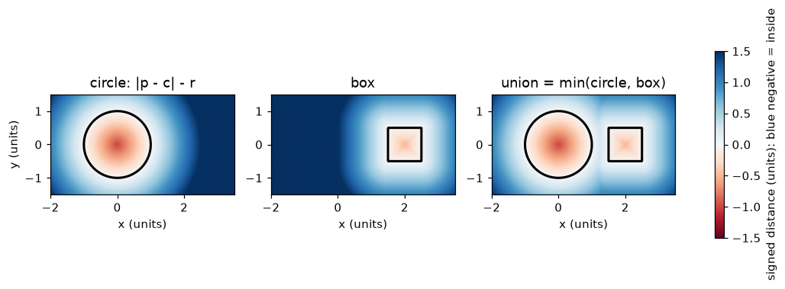
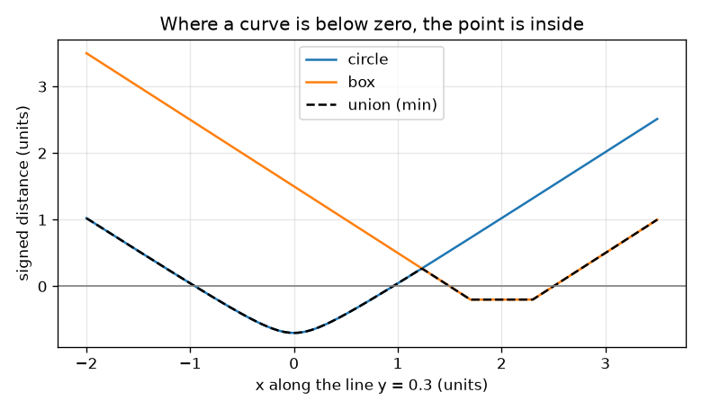

# സെഷൻ 1: ഒരു രൂപം ഒരു ഫങ്ഷനാണ്: സൈൻഡ് ഡിസ്റ്റൻസ്

[Session 1 — हिन्दी](README.hi.md) · [Session 1 — മലയാളം](README.ml.md)

*ലെവൽ 1 (ആശയപരമായ ഇന്ററാക്ടീവ് മോഡൽ) · ഏകദേശം 60 മിനിറ്റ് · opensculpt*

> ഇത് ലളിതമാക്കിയ ഒരു വിദ്യാഭ്യാസ മോഡലാണ്. ഇത് സാധൂകരിക്കപ്പെട്ട (validated) ഡിസൈൻ ഉപകരണമല്ല; യഥാർത്ഥ ഘടനകൾ, വൈദ്യുത സംവിധാനങ്ങൾ, വാഹനങ്ങൾ, വ്യാവസായിക പ്രക്രിയകൾ അല്ലെങ്കിൽ വൈദ്യശാസ്ത്ര തീരുമാനങ്ങൾ എന്നിവയ്ക്ക് ഇത് ഉപയോഗിക്കരുത്.

**മുൻ‌അറിവ് (Prerequisites)**

- രണ്ട് ബിന്ദുക്കൾ തമ്മിലുള്ള ദൂരം; വൃത്തത്തിന്റെ ആശയം (ഒരു കേന്ദ്രത്തിൽ നിന്ന് ഒരേ ദൂരത്തിലുള്ള എല്ലാ ബിന്ദുക്കളും).
- നിങ്ങൾ PRIMER.md വായിക്കുകയും `python start.py 1` ഒരിക്കൽ പ്രവർത്തിപ്പിക്കുകയും ചെയ്തിട്ടുണ്ട്.

**പഠന ലക്ഷ്യങ്ങൾ (Learning objectives).** ഈ സെഷനു ശേഷം നിങ്ങൾക്ക് കഴിയും:

- സൈൻഡ് ഡിസ്റ്റൻസ് എന്താണെന്നും നെഗറ്റീവ് എന്നാൽ അകത്ത് എന്ന് എന്തുകൊണ്ടാണെന്നും വിശദീകരിക്കാൻ.
- ഒരു ബിന്ദുവിൽ നിന്ന് വൃത്തത്തിലേക്കും പെട്ടിയിലേക്കുമുള്ള (box) സൈൻഡ് ഡിസ്റ്റൻസ് കണക്കാക്കാൻ.
- രണ്ട് രൂപങ്ങളെ min ഉപയോഗിച്ച് യോജിപ്പിച്ച്, ഫലം ചിത്രത്തിൽ നിന്നും ഗ്രാഫിൽ നിന്നും വായിക്കാൻ.
- അകത്തുള്ള ഗ്രിഡ് സെല്ലുകൾ എണ്ണി വിസ്തീർണ്ണം കണക്കാക്കാൻ.

## A. യഥാർത്ഥ ലോക പ്രശ്നം
ഒരു CAD പ്രോഗ്രാമിൽ ഒരു മഗ് ഉണ്ട്, സെക്കൻഡിൽ ദശലക്ഷക്കണക്കിന് തവണ ഒരു ചോദ്യത്തിന് അത് ഉത്തരം നൽകണം: ഈ ബിന്ദു മഗ്ഗിനകത്താണോ? മുഖങ്ങളുടെ പട്ടിക സൂക്ഷിക്കുന്നതിനു പകരം നമുക്ക് ഒരു ഫങ്ഷൻ സൂക്ഷിക്കാം: ഏത് ബിന്ദു നൽകിയാലും അത് ഒരു സംഖ്യ തിരികെ തരുന്നു, അടുത്തുള്ള ഉപരിതലത്തിലേക്കുള്ള ദൂരം, ബിന്ദു അകത്താണെങ്കിൽ മൈനസ് ചിഹ്നത്തോടെ. ഒരു വൃത്തത്തെയും പെട്ടിയെയും ആ രീതിയിൽ വിവരിക്കാനും ചിത്രങ്ങളായി വരയ്ക്കാനും ആ സംഖ്യകൾ ഉപയോഗിച്ച് രൂപങ്ങളെ യോജിപ്പിക്കാനും നിങ്ങൾക്ക് കഴിയുമോ?

## B. ആശയവും സിദ്ധാന്തവും
ഒരു ബിന്ദു p = (x, y) എടുക്കുക. കേന്ദ്രം c, ആരം r ഉള്ള വൃത്തത്തിന് സൈൻഡ് ഡിസ്റ്റൻസ് |p - c| - r ആണ്: പുറത്ത് പോസിറ്റീവ്, അരികിൽ പൂജ്യം, അകത്ത് നെഗറ്റീവ്, കേന്ദ്രത്തിൽ -r. കേന്ദ്രം c, അർദ്ധ വലുപ്പങ്ങൾ (a, b) ഉള്ള പെട്ടിക്ക്, ആദ്യം x, y എന്നിവയ്ക്ക് വെവ്വേറെ q = |p - c| - (a, b) കണക്കാക്കുക. q-ന്റെ രണ്ട് ഭാഗങ്ങളും നെഗറ്റീവ് ആണെങ്കിൽ ബിന്ദു അകത്താണ്, അടുത്ത വശത്തേക്കുള്ള ദൂരം q-ന്റെ വലിയ ഭാഗമാണ് (പൂജ്യത്തോട് ഏറ്റവും അടുത്തത്). അല്ലെങ്കിൽ ദൂരം q-ന്റെ പോസിറ്റീവ് ഭാഗങ്ങൾ കൊണ്ടുണ്ടാക്കിയ വെക്ടറിന്റെ നീളമാണ്. മൂല്യം നെഗറ്റീവ് ആയ ബിന്ദുക്കളുടെ ഗണമാണ് രൂപം; മൂല്യം പൂജ്യമാകുന്നിടമാണ് അതിന്റെ ഉപരിതലം. രണ്ട് രൂപങ്ങളുടെ യൂണിയനിലെ ഒരു ബിന്ദു അവയിൽ ഒന്നിലെങ്കിലും അകത്താണ്, അതിനാൽ യൂണിയന്റെ മൂല്യം min(d1, d2) ആണ്. ഒരു യഥാർത്ഥ സൈൻഡ് ഡിസ്റ്റൻസ് നിങ്ങൾ നീങ്ങുന്നതിനേക്കാൾ വേഗത്തിൽ മാറാൻ കഴിയില്ല: s നീളമുള്ള ഒരു ചുവട് അതിനെ പരമാവധി s കൊണ്ട് മാറ്റുന്നു.

| ചിഹ്നം | അർത്ഥം | യൂണിറ്റ് |
|---|---|---|
| p = (x, y) | തലത്തിലെ ഒരു ബിന്ദു | units (ഏതെങ്കിലും നീളത്തിന്റെ യൂണിറ്റ്) |
| c | വൃത്തത്തിന്റെയോ പെട്ടിയുടെയോ കേന്ദ്രം | units |
| r | വൃത്തത്തിന്റെ ആരം | units |
| (a, b) | പെട്ടിയുടെ അർദ്ധ വീതിയും അർദ്ധ ഉയരവും | units |
| d | സൈൻഡ് ഡിസ്റ്റൻസ് (അകത്ത് നെഗറ്റീവ്) | units |

**അനുമാനങ്ങൾ (Assumptions)**

- ഈ സെഷനിൽ എല്ലാം പരന്നതാണ് (2D).
- രൂപങ്ങൾ ഖരമാണ്: അകത്തുള്ളത് രൂപത്തിന്റെ ഭാഗമാണ്.
- ഗ്രിഡ് സെല്ലുകൾ അവയുടെ കേന്ദ്രത്തിലെ മൂല്യം കൊണ്ട് വിലയിരുത്തപ്പെടുന്നു.

$$ d_{\text{circle}}(\mathbf p)=|\mathbf p-\mathbf c|-r $$

$$ \mathbf q=\big(|x-c_x|-a,\ |y-c_y|-b\big),\qquad d_{\text{box}}(\mathbf p)=\big|\max(\mathbf q,\mathbf 0)\big|+\min\big(\max(q_x,q_y),0\big) $$

$$ d_{\text{union}}=\min(d_1,\ d_2) $$

## C. ദൃശ്യ വിശദീകരണം
ആദ്യ ചിത്രം മൂന്ന് ഫീൽഡുകൾ നിറത്തിൽ വരയ്ക്കുന്നു: വൃത്തം, പെട്ടി, അവയുടെ യൂണിയൻ. നീല എന്നാൽ നെഗറ്റീവ് (അകത്ത്), ചുവപ്പ് എന്നാൽ പോസിറ്റീവ് (പുറത്ത്), കറുത്ത വര മൂല്യം പൂജ്യമാകുന്ന ഉപരിതലമാണ്. രണ്ടാമത്തെ ചിത്രം രണ്ട് രൂപങ്ങളിലൂടെയും കടന്നുപോകുന്ന തിരശ്ചീന രേഖ y = 0.3 പിന്തുടരുന്നു: വൃത്ത വക്രം x -0.954-നും 0.954-നും ഇടയിൽ പൂജ്യത്തിന് താഴെയാകുന്നു, പെട്ടി വക്രം x 1.5-നും 2.5-നും ഇടയിൽ, കറുത്ത യൂണിയൻ വക്രം രണ്ടിൽ താഴ്ന്നതാണ്, അതിനാൽ രണ്ട് ഭാഗങ്ങളിലും യൂണിയൻ അകത്താണ്.

*വൃത്തം, പെട്ടി, യൂണിയൻ എന്നിവ വർണ്ണ ഫീൽഡുകളായി; കറുത്ത വര ഉപരിതലമാണ് (മൂല്യം 0).*

*രേഖ y = 0.3 ന് സമീപമുള്ള മൂല്യങ്ങൾ; യൂണിയൻ താഴ്ന്ന വക്രമാണ്, അത് പൂജ്യത്തിന് താഴെയാകുന്നിടത്ത് അകത്താണ്.*

## D. ഇന്ററാക്ടീവ് സിമുലേഷൻ
പാഠം പ്രവർത്തിപ്പിക്കുക (`python start.py 1`), തുടർന്ന് ലൈവ് ആപ്പ് തുറക്കുക: [സെഷൻ 1: ഒരു രൂപം ഒരു ഫങ്ഷനാണ്](https://krunalpanchal1995.github.io/pan-iit-oss/opensculpt/session-01/) (അല്ലെങ്കിൽ ഈ ഫോൾഡറിലെ `app.html`). ക്വറി ബിന്ദുവും ആരവും നീക്കുക. ചിത്രത്തിൽ ചുവന്ന ബിന്ദുവിലെ നിറവും, ആരം കേവല മൂല്യത്തിന് തുല്യമായ ഡാഷ് ഇട്ട വൃത്തവും നിരീക്ഷിക്കുക; ഗ്രാഫ് കാഴ്ചയിൽ കറുത്ത യൂണിയൻ വക്രം വൃത്ത, പെട്ടി വക്രങ്ങളിൽ താഴ്ന്നതിനെ പിന്തുടരുന്നത് കാണുക.

**വെല്ലുവിളി.** ക്വറി ബിന്ദു യൂണിയനകത്ത് വയ്ക്കുക, അങ്ങനെ റീഡൗട്ട് INSIDE എന്ന് പറയണം.

## E. ഉദാഹരണ പ്രശ്നവും പരീക്ഷണവും
**പ്രശ്നം.** ഒരു വൃത്തത്തിന് ആരം 1, കേന്ദ്രം (0, 0). ഒരു പെട്ടിക്ക് കേന്ദ്രം (2, 0), അർദ്ധ വലുപ്പങ്ങൾ (0.5, 0.5). ബിന്ദു (1.2, 0.3)-ന്റെ സൈൻഡ് ഡിസ്റ്റൻസ് ഓരോ രൂപത്തിനും അവയുടെ യൂണിയനും കണ്ടെത്തുക.

1. വൃത്തം: |p - c| = sqrt(1.2^2 + 0.3^2) = sqrt(1.53) = 1.237, അതിനാൽ d = 1.237 - 1 = 0.237.
2. പെട്ടി: q = (|1.2 - 2| - 0.5, |0.3 - 0| - 0.5) = (0.3, -0.2).
3. q-ന്റെ പോസിറ്റീവ് ഭാഗങ്ങൾ (0.3, 0) ആണ്, നീളം 0.3, max(qx, qy) = 0.3 നെഗറ്റീവ് അല്ല, അതിനാൽ അകത്തെ പദം 0 ആണ്, d = 0.3.
4. യൂണിയൻ = min(0.237, 0.300) = 0.237. മൂല്യം പോസിറ്റീവ് ആണ്, അതിനാൽ ബിന്ദു രണ്ട് രൂപങ്ങൾക്കും പുറത്താണ്, വൃത്തത്തോട് ഏറ്റവും അടുത്ത്.

**ഉത്തരം.** വൃത്തം 0.237, പെട്ടി 0.300, യൂണിയൻ 0.237 (എല്ലാം നിർദ്ദേശാങ്കങ്ങളുടെ അതേ യൂണിറ്റിൽ): ബിന്ദു പുറത്താണ്.

**പരീക്ഷണം.** കള്ളി കടലാസിൽ വൃത്തവും പെട്ടിയും വരയ്ക്കുക, ബിന്ദു (1.2, 0.3) അടയാളപ്പെടുത്തുക, സ്കെയിൽ ഉപയോഗിച്ച് വൃത്തത്തിന്റെ അരികിലേക്കുള്ള (ഏകദേശം 0.24) ഏറ്റവും ചെറിയ ദൂരവും പെട്ടിയുടെ അരികിലേക്കുള്ള (ഏകദേശം 0.3) ദൂരവും അളക്കുക. checkpoint.py-യുമായി താരതമ്യം ചെയ്യുക. ചെറിയ വ്യത്യാസങ്ങൾ സ്കെയിലും പെൻസിലിന്റെ വീതിയും മൂലമാണ്: സൂത്രവാക്യം കൃത്യമാണ്, വര കൃത്യമല്ല.

## F. മൂല്യനിർണ്ണയവും ഡിസൈൻ വെല്ലുവിളിയും
**ചോദ്യ തരം A: ആശയപരം.** ഉപരിതലത്തിലേക്കുള്ള ദൂരം മാത്രം ഉപയോഗിക്കുന്നതിനു പകരം, ഒരു രൂപത്തിനകത്തുള്ള ബിന്ദുക്കൾക്ക് നാം നെഗറ്റീവ് മൂല്യം ഉപയോഗിക്കുന്നത് എന്തുകൊണ്ട്?

സൂചന

ദൂരത്തിന്റെ വലുപ്പം മാത്രം ഉപയോഗിച്ചാൽ, ഒരു വൃത്തത്തിന്റെ കേന്ദ്രത്തിലുള്ള ബിന്ദുവും അകലെയുള്ള ഒരു ബിന്ദുവും എങ്ങനെ കാണപ്പെടും?

ഘട്ടം ഘട്ടമായുള്ള പരിഹാരം

ചിഹ്നമില്ലാത്ത ദൂരത്തിന് അകത്തും പുറത്തും വേർതിരിക്കാൻ കഴിയില്ല: 1 യൂണിറ്റ് അകത്തുള്ള ബിന്ദുവും 1 യൂണിറ്റ് പുറത്തുള്ള ബിന്ദുവും രണ്ടും 1 എന്ന് വായിക്കും. ചിഹ്നം ഉപരിതലത്തെ മൂല്യം പൂജ്യമാകുന്ന സ്ഥലങ്ങളായി നിർവചിക്കുന്നു, ചിഹ്നം പരിശോധിച്ച് അകത്തോ പുറത്തോ എന്ന് തീരുമാനിക്കാൻ നമ്മെ അനുവദിക്കുന്നു. ഇത് യൂണിയനെ ലളിതമാക്കുകയും ചെയ്യുന്നു: ചെറിയ സംഖ്യ എടുക്കുക.

**ചോദ്യ തരം B: സംഖ്യാപരം.** ആരം 2 ഉള്ള ഒരു വൃത്തത്തിന്റെ കേന്ദ്രം ഉത്ഭവത്തിലാണ്. ബിന്ദു (3, 4)-ന്റെ സൈൻഡ് ഡിസ്റ്റൻസ് എത്ര? അത് അകത്താണോ?

സൂചന

ആദ്യം ഉത്ഭവത്തിൽ നിന്ന് (3, 4) വരെയുള്ള ദൂരം, പിന്നെ ആരം കുറയ്ക്കുക.

ഘട്ടം ഘട്ടമായുള്ള പരിഹാരം

|p - c| = sqrt(3^2 + 4^2) = 5, അതിനാൽ d = 5 - 2 = 3 യൂണിറ്റ്. പോസിറ്റീവ് ആണ്, അതിനാൽ ബിന്ദു പുറത്താണ്. യുക്തിപരിശോധന (sanity check): വൃത്തത്തിലെ ഏറ്റവും അടുത്ത ബിന്ദു അതേ രേഖയിലൂടെ കേന്ദ്രത്തിൽ നിന്ന് 2 യൂണിറ്റ് അകലെയാണ്, ബാക്കി 3 യൂണിറ്റ്.

**ചോദ്യ തരം C: ഗ്രാഫ്, സിമുലേഷൻ വ്യാഖ്യാനം.** y = 0.3 രേഖയിലൂടെയുള്ള പ്രൊഫൈൽ ഗ്രാഫിൽ, ഏത് x മൂല്യങ്ങൾക്കിടയിലാണ് യൂണിയൻ അകത്തുള്ളത്? രണ്ട് വെവ്വേറെ ഭാഗങ്ങൾ ഉള്ളത് എന്തുകൊണ്ട്?

സൂചന

കറുത്ത വക്രം പൂജ്യ രേഖയ്ക്ക് താഴെയാകുന്നത് എവിടെയാണെന്ന് കണ്ടെത്തുക.

ഘട്ടം ഘട്ടമായുള്ള പരിഹാരം

യൂണിയൻ x -0.954-നും 0.954-നും ഇടയിൽ (വൃത്തം), x 1.5-നും 2.5-നും ഇടയിൽ (പെട്ടി) അകത്താണ്. 0.954-നും 1.5-നും ഇടയിൽ രണ്ട് രൂപ വക്രങ്ങളും പൂജ്യത്തിന് മുകളിലാണ്, അതിനാൽ രേഖ രണ്ട് രൂപങ്ങൾക്കിടയിലെ ശൂന്യമായ സ്ഥലത്തിലൂടെ കടന്നുപോകുന്നു.

**ചോദ്യ തരം D: ഡിസൈൻ, ഒപ്റ്റിമൈസേഷൻ വെല്ലുവിളി.** ഡിസൈൻ: പെട്ടിക്ക് കേന്ദ്രം (2, 0), അർദ്ധ വലുപ്പങ്ങൾ (0.5, 0.5). ഉത്ഭവത്തിൽ കേന്ദ്രമുള്ള ഒരു വൃത്തത്തിന്റെ ആരം, രണ്ട് രൂപങ്ങളും കഷ്ടിച്ച് സ്പർശിക്കുന്ന വിധത്തിലും, പിന്നെ ഓവർലാപ്പ് ചെയ്യുന്ന വിധത്തിലും തിരഞ്ഞെടുക്കുക. ഒരു യഥാർത്ഥ ഭാഗത്തിന് ഏതാണ് നല്ലത്, എന്തുകൊണ്ട്?

സൂചന

പെട്ടിയുടെ ഇടത് വശം x = 1.5 എന്ന രേഖയാണ്. x അക്ഷത്തിൽ വൃത്തം എവിടെ വരെ എത്തുന്നു?

ഘട്ടം ഘട്ടമായുള്ള പരിഹാരം

വൃത്തം x അക്ഷത്തിൽ x = r വരെ എത്തുന്നു, അതിനാൽ r = 1.5 ആകുമ്പോൾ രണ്ടും (1.5, 0)-ൽ കഷ്ടിച്ച് സ്പർശിക്കുന്നു: അവിടെ രണ്ട് മൂല്യങ്ങളും 0 ആണ്. r = 1.6 ആകുമ്പോൾ ബിന്ദു (1.5, 0)-ന് വൃത്തത്തിൽ മൂല്യം -0.1 ആണ്, അതിനാൽ രൂപങ്ങൾ 0.1 യൂണിറ്റ് ഓവർലാപ്പ് ചെയ്യുന്നു. ഒരു യഥാർത്ഥ ഭാഗം ഓവർലാപ്പ് ചെയ്യണം: ഒരു സ്പർശന ബിന്ദു മാത്രമുണ്ടെങ്കിൽ ജോയിന്റിന് കനം പൂജ്യമാണ്, ഭാരം താങ്ങാൻ കഴിയില്ല, റൗണ്ട്-ഓഫ് പിശകുകൾ രൂപങ്ങളെ വേർപെടുത്തിയേക്കാം. വിട്ടുവീഴ്ച (trade-off): ഭാഗം അല്പം വലുതാകുന്നു.

[RUBRIC.md](../../RUBRIC.md) ഉപയോഗിച്ച് സ്വയം സ്കോർ ചെയ്യുക. പേപ്പറിൽ ചെയ്യാൻ [പ്രവർത്തന ഷീറ്റ്](activity_sheet.md) പ്രിന്റ് ചെയ്യുക.

## സാധാരണ തെറ്റിദ്ധാരണകൾ
| സാധാരണ തെറ്റിദ്ധാരണ | യഥാർത്ഥത്തിൽ ശരിയായത് |
|---|---|
| ഫീൽഡിന്റെ മൂല്യം കേന്ദ്രത്തിലേക്കുള്ള ദൂരത്തിന് തുല്യമാണ്. | അത് ഉപരിതലത്തിലെ ഏറ്റവും അടുത്ത ബിന്ദുവിലേക്കുള്ള ദൂരമാണ് (വൃത്ത സൂത്രവാക്യം ആരം കുറയ്ക്കുന്നത് കൃത്യമായി അതുകൊണ്ടാണ്). |
| മൂല്യം 0 ആകുന്ന സ്ഥലങ്ങളാണ് രൂപം. | മൂല്യം 0 ആകുന്നത് ഉപരിതലത്തിൽ മാത്രമാണ്; മൂല്യം നെഗറ്റീവ് ആകുന്നിടമാണ് രൂപം (ഉപരിതലം അതിന്റെ അതിർത്തിയാണ്). |
| രണ്ട് രൂപങ്ങളുടെ യൂണിയൻ അവയുടെ സംഖ്യകളുടെ തുകയാണ്. | യൂണിയൻ രണ്ട് സംഖ്യകളിൽ ചെറുതാണ്: ഏതെങ്കിലും ഒരു രൂപത്തിനകത്തുള്ളത് യൂണിയനകത്താണ്. |
| ഗ്രിഡിൽ കൂടുതൽ സെല്ലുകൾ എപ്പോഴും കൃത്യമായ യഥാർത്ഥ വിസ്തീർണ്ണം നൽകുന്നു. | എണ്ണൽ ഒരു ഏകദേശ കണക്കാണ്; സെല്ലുകൾ ചെറുതാകുമ്പോൾ അത് മെച്ചപ്പെടുന്നു, പക്ഷേ വളരെ നേർത്ത ഭാഗങ്ങൾ ഇപ്പോഴും വിട്ടുപോയേക്കാം. |

## പദാവലി (Glossary)
- **സൈൻഡ് ഡിസ്റ്റൻസ് (signed distance)**: അടുത്തുള്ള ഉപരിതലത്തിലേക്കുള്ള ദൂരം, അകത്ത് നെഗറ്റീവ്, ഉപരിതലത്തിൽ പൂജ്യം, പുറത്ത് പോസിറ്റീവ്
- **ഉപരിതലം (surface)**: മൂല്യം പൂജ്യമാകുന്ന സ്ഥലങ്ങൾ
- **ഗ്രിഡ് സെൽ (grid cell)**: തലത്തിലെ ഒരു ചെറിയ ചതുരം; അതിന്റെ കേന്ദ്രത്തിലെ മൂല്യം കൊണ്ട് അകത്തോ പുറത്തോ എന്ന് വിലയിരുത്തുന്നു
- **യൂണിയൻ (union)**: രണ്ട് രൂപങ്ങളിൽ ഒന്നിലെങ്കിലും അകത്തുള്ള രൂപം; അതിന്റെ മൂല്യം മിനിമം ആണ്

## പൂർത്തിയാക്കുക
1. [exercises.md](exercises.md)-ലെ മൂന്ന് കോഡിംഗ് ടാസ്കുകൾ ചെയ്യുക.
2. നിങ്ങളുടെ മാറ്റങ്ങൾക്ക് ശേഷം `python start.py 1` വീണ്ടും പ്രവർത്തിപ്പിക്കുക. അത് ചെക്ക്പോയിന്റോടെ അവസാനിക്കുന്നു; അത് `PASS` പ്രിന്റ് ചെയ്യുമ്പോൾ നിങ്ങൾ പൂർത്തിയാക്കി. (ചെക്ക്പോയിന്റ് മാത്രം: `python start.py check 1`.)

അടുത്തത്: [സെഷൻ 2](../session-02/README.md)
