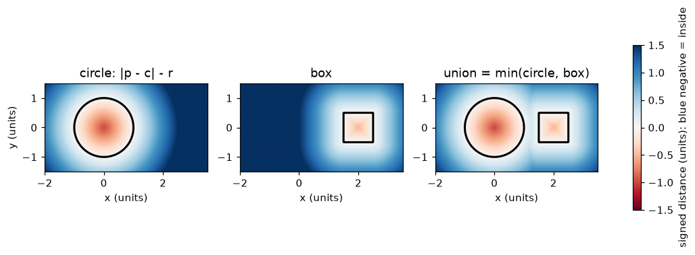
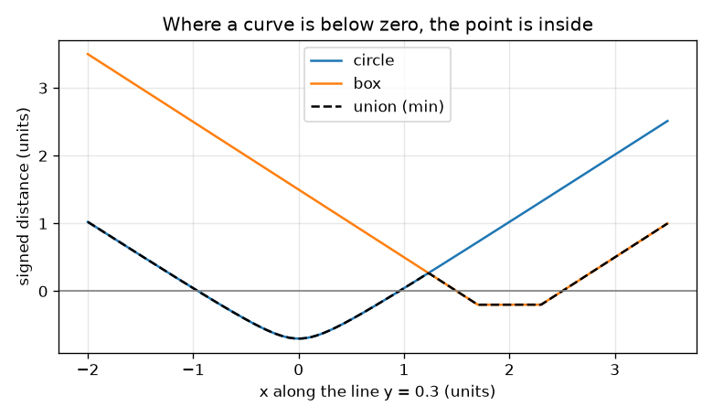

# அமர்வு 1: ஒரு வடிவம் ஒரு சார்பு: குறியிடப்பட்ட தூரம் (signed distance)

[Session 1 — हिन्दी](README.hi.md) · [Session 1 — മലയാളം](README.ml.md) · [Session 1 — தமிழ்](README.ta.md)

*நிலை 1 (கருத்தியல் ஊடாடும் மாதிரி) · சுமார் 60 நிமிடங்கள் · opensculpt*

> இது எளிமைப்படுத்தப்பட்ட ஒரு கல்வி மாதிரி. இது சரிபார்க்கப்பட்ட (validated) வடிவமைப்புக் கருவி அல்ல; உண்மையான கட்டமைப்புகள், மின் அமைப்புகள், வாகனங்கள், தொழில்துறை செயல்முறைகள் அல்லது மருத்துவ முடிவுகளுக்கு இதைப் பயன்படுத்த வேண்டாம்.

**முன்தேவைகள் (Prerequisites)**

- இரு புள்ளிகளுக்கு இடையிலான தூரம்; வட்டத்தின் கருத்து (ஒரு மையத்திலிருந்து ஒரே தூரத்தில் உள்ள அனைத்துப் புள்ளிகளும்).
- நீங்கள் PRIMER.md-ஐப் படித்து `python start.py 1` ஐ ஒருமுறை இயக்கியுள்ளீர்கள்.

**கற்றல் நோக்கங்கள் (Learning objectives).** இந்த அமர்வுக்குப் பிறகு உங்களால் முடியும்:

- குறியிடப்பட்ட தூரம் என்றால் என்ன, எதிர்மறை ஏன் உள்ளே என்பதைக் குறிக்கிறது என்று விளக்க.
- ஒரு புள்ளியிலிருந்து வட்டத்துக்கும் பெட்டிக்கும் (box) உள்ள குறியிடப்பட்ட தூரத்தைக் கணக்கிட.
- இரு வடிவங்களை min கொண்டு இணைத்து, முடிவைப் படத்திலிருந்தும் வரைபடத்திலிருந்தும் வாசிக்க.
- உள்ளே இருக்கும் கட்டக் கலங்களை எண்ணி ஒரு பரப்பளவை மதிப்பிட.

## A. நிஜ உலகப் பிரச்சினை
ஒரு CAD நிரல் ஒரு குவளையை வைத்திருக்கிறது, ஒரு வினாடிக்கு மில்லியன் கணக்கான முறை ஒரு கேள்விக்குப் பதில் சொல்ல வேண்டும்: இந்தப் புள்ளி குவளைக்குள் இருக்கிறதா? முகங்களின் பட்டியலைச் சேமிப்பதற்குப் பதிலாக, ஒரு சார்பைச் சேமிக்கலாம்: எந்தப் புள்ளியைக் கொடுத்தாலும் அது ஒரு எண்ணைத் தருகிறது, அருகிலுள்ள மேற்பரப்புக்கான தூரம், புள்ளி உள்ளே இருந்தால் கழித்தல் குறியுடன். ஒரு வட்டத்தையும் ஒரு பெட்டியையும் அவ்வாறு விவரிக்கவும், படங்களாக வரையவும், அந்த எண்களைக் கொண்டு வடிவங்களை இணைக்கவும் உங்களால் முடியுமா?

## B. கருத்தும் கோட்பாடும்
ஒரு புள்ளி p = (x, y) எடுங்கள். மையம் c, ஆரம் r கொண்ட வட்டத்துக்கு, குறியிடப்பட்ட தூரம் |p - c| - r: வெளியே நேர்மறை, விளிம்பில் பூஜ்ஜியம், உள்ளே எதிர்மறை, மையத்தில் -r. மையம் c, அரை அளவுகள் (a, b) கொண்ட பெட்டிக்கு, முதலில் x, y ஆகியவற்றுக்குத் தனித்தனியாக q = |p - c| - (a, b) கணக்கிடுங்கள். q-இன் இரு பகுதிகளும் எதிர்மறை என்றால் புள்ளி உள்ளே உள்ளது, அருகிலுள்ள பக்கத்துக்கான தூரம் q-இன் பெரிய பகுதி (பூஜ்ஜியத்துக்கு மிக நெருக்கமானது). இல்லையெனில் தூரம் q-இன் நேர்மறைப் பகுதிகளால் ஆன வெக்டரின் நீளம். மதிப்பு எதிர்மறையாக உள்ள புள்ளிகளின் தொகுப்பே வடிவம்; மதிப்பு பூஜ்ஜியமாக உள்ள இடமே அதன் மேற்பரப்பு. இரு வடிவங்களின் சேர்ப்பில் (union) உள்ள ஒரு புள்ளி அவற்றில் குறைந்தது ஒன்றின் உள்ளே உள்ளது, எனவே சேர்ப்பின் மதிப்பு min(d1, d2). உண்மையான குறியிடப்பட்ட தூரம் நீங்கள் நகரும் வேகத்தை விட வேகமாக மாற முடியாது: s நீளமுள்ள ஒரு அடி அதை அதிகபட்சம் s ஆல் மாற்றுகிறது.

| குறியீடு | பொருள் | அலகு |
|---|---|---|
| p = (x, y) | தளத்தில் ஒரு புள்ளி | units (ஏதேனும் நீள அலகு) |
| c | வட்டம் அல்லது பெட்டியின் மையம் | units |
| r | வட்டத்தின் ஆரம் | units |
| (a, b) | பெட்டியின் அரை அகலமும் அரை உயரமும் | units |
| d | குறியிடப்பட்ட தூரம் (உள்ளே எதிர்மறை) | units |

**அனுமானங்கள் (Assumptions)**

- இந்த அமர்வில் எல்லாம் தட்டையானவை (2D).
- வடிவங்கள் திடமானவை: உள்ளே இருப்பது வடிவத்தின் பகுதி.
- கட்டக் கலங்கள் அவற்றின் மையத்தில் உள்ள மதிப்பால் மதிப்பிடப்படுகின்றன.

$$ d_{\text{circle}}(\mathbf p)=|\mathbf p-\mathbf c|-r $$

$$ \mathbf q=\big(|x-c_x|-a,\ |y-c_y|-b\big),\qquad d_{\text{box}}(\mathbf p)=\big|\max(\mathbf q,\mathbf 0)\big|+\min\big(\max(q_x,q_y),0\big) $$

$$ d_{\text{union}}=\min(d_1,\ d_2) $$

## C. காட்சி விளக்கம்
முதல் படம் மூன்று புலங்களை நிறத்தில் வரைகிறது: வட்டம், பெட்டி, அவற்றின் சேர்ப்பு. நீலம் என்றால் எதிர்மறை (உள்ளே), சிவப்பு என்றால் நேர்மறை (வெளியே), கருப்புக் கோடு மதிப்பு பூஜ்ஜியமாக உள்ள மேற்பரப்பு. இரண்டாவது படம் இரு வடிவங்கள் வழியாகவும் செல்லும் கிடைமட்டக் கோடு y = 0.3-ஐப் பின்தொடர்கிறது: வட்ட வளைவு x -0.954 முதல் 0.954 வரை பூஜ்ஜியத்துக்குக் கீழே செல்கிறது, பெட்டி வளைவு x 1.5 முதல் 2.5 வரை, கருப்புச் சேர்ப்பு வளைவு இரண்டில் தாழ்வானது, எனவே இரு பகுதிகளிலும் சேர்ப்பு உள்ளே உள்ளது.

*வட்டம், பெட்டி, சேர்ப்பு ஆகியவை நிறப் புலங்களாக; கருப்புக் கோடு மேற்பரப்பு (மதிப்பு 0).*

*கோடு y = 0.3 வழியே மதிப்புகள்; சேர்ப்பு தாழ்வான வளைவு, அது பூஜ்ஜியத்துக்குக் கீழே இருக்கும் இடத்தில் உள்ளே உள்ளது.*

## D. ஊடாடும் உருவகப்படுத்துதல்
பாடத்தை இயக்கவும் (`python start.py 1`), பிறகு நேரலை செயலியைத் திறக்கவும்: [அமர்வு 1: ஒரு வடிவம் ஒரு சார்பு](https://krunalpanchal1995.github.io/pan-iit-oss/opensculpt/session-01/) (அல்லது இந்தக் கோப்புறையில் உள்ள `app.html`). வினவல் புள்ளியையும் ஆரத்தையும் நகர்த்துங்கள். படத்தில் சிவப்புப் புள்ளியில் உள்ள நிறத்தையும், ஆரம் தனி மதிப்புக்குச் சமமாக உள்ள புள்ளிக்கோட்டு வட்டத்தையும் கவனியுங்கள்; வரைபடக் காட்சியில் கருப்புச் சேர்ப்பு வளைவு வட்ட, பெட்டி வளைவுகளில் தாழ்வானதைப் பின்தொடர்வதைப் பாருங்கள்.

**சவால்.** வினவல் புள்ளியைச் சேர்ப்புக்குள் வையுங்கள், அப்போது வாசிப்புத் திரை INSIDE என்று சொல்ல வேண்டும்.

## E. எடுத்துக்காட்டுக் கணக்கும் சோதனையும்
**கணக்கு.** ஒரு வட்டத்தின் ஆரம் 1, மையம் (0, 0). ஒரு பெட்டியின் மையம் (2, 0), அரை அளவுகள் (0.5, 0.5). புள்ளி (1.2, 0.3)-இன் குறியிடப்பட்ட தூரத்தை ஒவ்வொரு வடிவத்துக்கும் அவற்றின் சேர்ப்புக்கும் காண்க.

1. வட்டம்: |p - c| = sqrt(1.2^2 + 0.3^2) = sqrt(1.53) = 1.237, எனவே d = 1.237 - 1 = 0.237.
2. பெட்டி: q = (|1.2 - 2| - 0.5, |0.3 - 0| - 0.5) = (0.3, -0.2).
3. q-இன் நேர்மறைப் பகுதிகள் (0.3, 0), நீளம் 0.3, max(qx, qy) = 0.3 எதிர்மறை அல்ல, எனவே உள் உறுப்பு 0, d = 0.3.
4. சேர்ப்பு = min(0.237, 0.300) = 0.237. மதிப்பு நேர்மறை, எனவே புள்ளி இரு வடிவங்களுக்கும் வெளியே உள்ளது, வட்டத்துக்கு மிக அருகில்.

**விடை.** வட்டம் 0.237, பெட்டி 0.300, சேர்ப்பு 0.237 (அனைத்தும் ஆயங்களின் அதே அலகில்): புள்ளி வெளியே உள்ளது.

**சோதனை.** கட்டத் தாளில் வட்டத்தையும் பெட்டியையும் வரைந்து, புள்ளி (1.2, 0.3)-ஐக் குறித்து, அளவுகோலால் வட்ட விளிம்புக்கான (சுமார் 0.24) மிகக் குறுகிய தூரத்தையும் பெட்டி விளிம்புக்கான (சுமார் 0.3) தூரத்தையும் அளவிடுங்கள். checkpoint.py உடன் ஒப்பிடுங்கள். சிறு வேறுபாடுகள் அளவுகோலாலும் பென்சிலின் தடிமனாலும் ஏற்படுபவை: சூத்திரம் துல்லியமானது, வரைதல் அல்ல.

## F. மதிப்பீடும் வடிவமைப்புச் சவாலும்
**கேள்வி வகை A: கருத்தியல்.** மேற்பரப்புக்கான தூரத்தை மட்டும் பயன்படுத்தாமல், ஒரு வடிவத்துக்கு உள்ளே இருக்கும் புள்ளிகளுக்கு எதிர்மறை மதிப்பை ஏன் பயன்படுத்துகிறோம்?

குறிப்பு

தூரத்தின் அளவை மட்டும் பயன்படுத்தினால், ஒரு வட்டத்தின் மையத்தில் உள்ள புள்ளியும் தொலைவில் உள்ள ஒரு புள்ளியும் எப்படித் தோன்றும்?

படிப்படியான தீர்வு

குறியில்லாத தூரத்தால் உள்ளேயும் வெளியேயும் வேறுபடுத்த முடியாது: 1 அலகு உள்ளே உள்ள புள்ளியும் 1 அலகு வெளியே உள்ள புள்ளியும் இரண்டும் 1 என்றே படிக்கப்படும். குறி மேற்பரப்பை மதிப்பு பூஜ்ஜியமாக உள்ள இடங்களாக வரையறுக்கிறது, குறியைச் சோதித்து உள்ளேயா வெளியேயா என்று முடிவு செய்ய அனுமதிக்கிறது. இது சேர்ப்பையும் எளிமையாக்குகிறது: சிறிய எண்ணை எடுங்கள்.

**கேள்வி வகை B: எண்ணியல்.** ஆரம் 2 கொண்ட வட்டம் ஆதியில் மையம் கொண்டுள்ளது. புள்ளி (3, 4)-இன் குறியிடப்பட்ட தூரம் என்ன? அது உள்ளே உள்ளதா?

குறிப்பு

முதலில் ஆதியிலிருந்து (3, 4) வரை தூரம், பிறகு ஆரத்தைக் கழியுங்கள்.

படிப்படியான தீர்வு

|p - c| = sqrt(3^2 + 4^2) = 5, எனவே d = 5 - 2 = 3 அலகுகள். நேர்மறை, எனவே புள்ளி வெளியே உள்ளது. நியாயச் சோதனை (sanity check): வட்டத்தின் அருகிலுள்ள புள்ளி அதே கோட்டில் மையத்திலிருந்து 2 அலகு தொலைவில் உள்ளது, மீதம் 3 அலகுகள்.

**கேள்வி வகை C: வரைபடம், உருவகப்படுத்துதல் விளக்கம்.** y = 0.3 கோட்டு வழி வரைவு வரைபடத்தில், எந்த x மதிப்புகளுக்கு இடையில் சேர்ப்பு உள்ளே உள்ளது? இரண்டு தனித்தனிப் பகுதிகள் இருப்பது ஏன்?

குறிப்பு

கருப்பு வளைவு பூஜ்ஜியக் கோட்டுக்குக் கீழே இருக்கும் இடத்தைக் கண்டுபிடியுங்கள்.

படிப்படியான தீர்வு

சேர்ப்பு x -0.954 முதல் 0.954 வரை (வட்டம்), x 1.5 முதல் 2.5 வரை (பெட்டி) உள்ளே உள்ளது. 0.954-க்கும் 1.5-க்கும் இடையில் இரு வடிவ வளைவுகளும் பூஜ்ஜியத்துக்கு மேலே உள்ளன, எனவே கோடு இரு வடிவங்களுக்கும் இடையிலான வெற்று இடத்தின் வழியே செல்கிறது.

**கேள்வி வகை D: வடிவமைப்பு, உகப்பாக்கச் சவால்.** வடிவமைப்பு: பெட்டியின் மையம் (2, 0), அரை அளவுகள் (0.5, 0.5). ஆதியில் மையம் கொண்ட வட்டத்தின் ஆரத்தை, இரு வடிவங்களும் சற்றே தொடும்படியும், பிறகு ஒன்றின் மேல் ஒன்று படியும்படியும் தேர்ந்தெடுங்கள். ஒரு உண்மையான பாகத்துக்கு எது சிறந்தது, ஏன்?

குறிப்பு

பெட்டியின் இடப்பக்கம் கோடு x = 1.5. x அச்சில் வட்டம் எதுவரை செல்கிறது?

படிப்படியான தீர்வு

வட்டம் x அச்சில் x = r வரை செல்கிறது, எனவே r = 1.5 இரண்டும் (1.5, 0)-இல் சற்றே தொடும்படி செய்கிறது: அங்கே இரு மதிப்புகளும் 0. r = 1.6 எனில் புள்ளி (1.5, 0)-க்கு வட்டத்தில் மதிப்பு -0.1, எனவே வடிவங்கள் 0.1 அலகு படிகின்றன. ஒரு உண்மையான பாகம் படிய வேண்டும்: ஒரே ஒரு தொடு புள்ளி இருந்தால் இணைப்பின் தடிமன் பூஜ்ஜியம், சுமையைத் தாங்க முடியாது, சுற்றுப்படுத்தல் பிழைகள் வடிவங்களைப் பிரித்துவிடலாம். சமரசம் (trade-off): பாகம் சற்றுப் பெரியதாகிறது.

[RUBRIC.md](../../RUBRIC.md) கொண்டு சுய மதிப்பெண் இடுங்கள். காகிதத்தில் செய்ய [செயல்பாட்டுத் தாளை](activity_sheet.md) அச்சிடுங்கள்.

## பொதுவான தவறான புரிதல்கள்
| பொதுவான தவறான புரிதல் | உண்மையில் சரியானது |
|---|---|
| புலத்தின் மதிப்பு மையத்துக்கான தூரத்துக்குச் சமம். | அது மேற்பரப்பின் அருகிலுள்ள புள்ளிக்கான தூரம் (வட்டச் சூத்திரம் ஆரத்தைக் கழிப்பது துல்லியமாக அதனால்தான்). |
| மதிப்பு 0 ஆக உள்ள இடங்களே வடிவம். | மதிப்பு 0 ஆக இருப்பது மேற்பரப்பில் மட்டுமே; மதிப்பு எதிர்மறையாக உள்ள இடமே வடிவம் (மேற்பரப்பு அதன் எல்லை). |
| இரு வடிவங்களின் சேர்ப்பு அவற்றின் எண்களின் கூட்டுத்தொகை. | சேர்ப்பு இரு எண்களில் சிறியது: இரண்டில் எதன் உள்ளே இருப்பதும் சேர்ப்பின் உள்ளே இருப்பதே. |
| கட்டத்தில் அதிகக் கலங்கள் எப்போதும் சரியான உண்மைப் பரப்பளவைத் தரும். | எண்ணுதல் ஒரு மதிப்பீடு; கலங்கள் சிறிதாகும்போது அது மேம்படுகிறது, ஆனால் மிக மெல்லிய பகுதிகள் இன்னும் தவறிவிடலாம். |

## சொற்களஞ்சியம் (Glossary)
- **குறியிடப்பட்ட தூரம் (signed distance)**: அருகிலுள்ள மேற்பரப்புக்கான தூரம், உள்ளே எதிர்மறை, மேற்பரப்பில் பூஜ்ஜியம், வெளியே நேர்மறை
- **மேற்பரப்பு (surface)**: மதிப்பு பூஜ்ஜியமாக உள்ள இடங்கள்
- **கட்டக் கலம் (grid cell)**: தளத்தின் ஒரு சிறிய சதுரம்; அதன் மையத்தில் உள்ள மதிப்பால் உள்ளே அல்லது வெளியே என மதிப்பிடப்படுகிறது
- **சேர்ப்பு (union)**: இரு வடிவங்களில் குறைந்தது ஒன்றின் உள்ளே இருக்கும் வடிவம்; அதன் மதிப்பு குறைந்தபட்சம்

## முடித்தல்
1. [exercises.md](exercises.md)-இல் உள்ள மூன்று நிரலாக்கப் பணிகளைச் செய்யுங்கள்.
2. உங்கள் மாற்றங்களுக்குப் பிறகு `python start.py 1` ஐ மீண்டும் இயக்குங்கள். அது சோதனைச் சாவடியுடன் முடிகிறது; அது `PASS` அச்சிடும்போது நீங்கள் முடித்துவிட்டீர்கள். (சோதனைச் சாவடி மட்டும்: `python start.py check 1`.)

அடுத்தது: [அமர்வு 2](../session-02/README.md)
