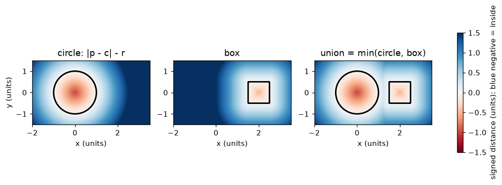
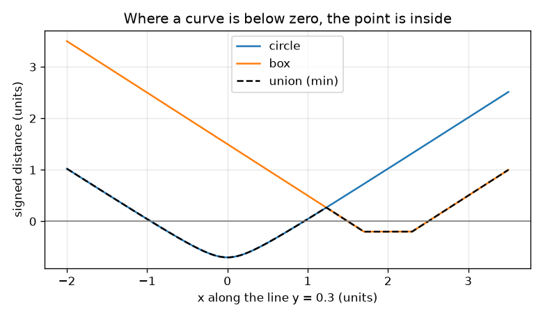

# సెషన్ 1: ఆకారం ఒక ఫంక్షన్: సంతకం గల దూరం (signed distance)

[Session 1 — हिन्दी](README.hi.md) · [Session 1 — മലയാളം](README.ml.md) · [Session 1 — தமிழ்](README.ta.md) · [Session 1 — తెలుగు](README.te.md)

*స్థాయి 1 (భావనాత్మక ఇంటరాక్టివ్ మోడల్) · సుమారు 60 నిమిషాలు · opensculpt*

> ఇది సరళీకృత విద్యా నమూనా. ఇది ధృవీకరించబడిన (validated) డిజైన్ సాధనం కాదు; నిజమైన నిర్మాణాలు, విద్యుత్ వ్యవస్థలు, వాహనాలు, పారిశ్రామిక ప్రక్రియలు లేదా వైద్య నిర్ణయాల కోసం దీన్ని ఉపయోగించవద్దు.

**ముందస్తు అవసరాలు (Prerequisites)**

- రెండు బిందువుల మధ్య దూరం; వృత్తం అనే భావన (ఒక కేంద్రం నుండి ఒకే దూరంలో ఉన్న అన్ని బిందువులు).
- మీరు PRIMER.md చదివి `python start.py 1` ను ఒకసారి నడిపారు.

**అభ్యాస లక్ష్యాలు (Learning objectives).** ఈ సెషన్ తర్వాత మీరు వీటిని చేయగలరు:

- సంతకం గల దూరం అంటే ఏమిటో, రుణాత్మకం అంటే లోపల అని ఎందుకో వివరించడం.
- ఒక బిందువు నుండి వృత్తానికి మరియు పెట్టె (box) కి సంతకం గల దూరాన్ని లెక్కించడం.
- రెండు ఆకారాలను min తో కలిపి, ఫలితాన్ని చిత్రం నుండి మరియు గ్రాఫ్ నుండి చదవడం.
- లోపల ఉన్న గ్రిడ్ గడులను లెక్కించి వైశాల్యాన్ని అంచనా వేయడం.

## A. నిజ ప్రపంచ సమస్య
ఒక CAD ప్రోగ్రామ్ ఒక మగ్గును కలిగి ఉంటుంది, సెకనుకు మిలియన్ల సార్లు ఒక ప్రశ్నకు జవాబు ఇవ్వాలి: ఈ బిందువు మగ్గు లోపల ఉందా? ముఖాల జాబితాను నిల్వ చేయడానికి బదులు, మనం ఒక ఫంక్షన్‌ను నిల్వ చేయవచ్చు: ఏ బిందువు ఇచ్చినా అది ఒక సంఖ్యను తిరిగి ఇస్తుంది, సమీప ఉపరితలానికి దూరం, బిందువు లోపల ఉంటే రుణ గుర్తుతో. వృత్తాన్ని, పెట్టెను ఆ విధంగా వర్ణించడం, చిత్రాలుగా గీయడం, ఆ సంఖ్యలతో ఆకారాలను కలపడం మీరు చేయగలరా?

## B. భావన మరియు సిద్ధాంతం
ఒక బిందువు p = (x, y) తీసుకోండి. కేంద్రం c, వ్యాసార్థం r గల వృత్తానికి, సంతకం గల దూరం |p - c| - r: బయట ధనాత్మకం, అంచున సున్నా, లోపల రుణాత్మకం, కేంద్రంలో -r. కేంద్రం c, అర్ధ పరిమాణాలు (a, b) గల పెట్టెకు, ముందుగా x, y కు వేర్వేరుగా q = |p - c| - (a, b) లెక్కించండి. q యొక్క రెండు భాగాలూ రుణాత్మకమైతే బిందువు లోపల ఉంది, సమీప వైపుకు దూరం q యొక్క పెద్ద భాగం (సున్నాకు దగ్గరగా ఉన్నది). లేకపోతే దూరం q యొక్క ధనాత్మక భాగాలతో చేసిన సదిశ పొడవు. విలువ రుణాత్మకంగా ఉన్న బిందువుల సమితే ఆకారం; విలువ సున్నా అయ్యే చోటే దాని ఉపరితలం. రెండు ఆకారాల సమ్మేళనంలో (union) ఉన్న బిందువు వాటిలో కనీసం ఒకదాని లోపల ఉంది, కాబట్టి సమ్మేళనం విలువ min(d1, d2). నిజమైన సంతకం గల దూరం మీరు కదిలే దానికంటే వేగంగా మారలేదు: s పొడవు గల అడుగు దాన్ని గరిష్ఠంగా s మాత్రమే మారుస్తుంది.

| గుర్తు | అర్థం | యూనిట్ |
|---|---|---|
| p = (x, y) | తలంలో ఒక బిందువు | units (ఏదైనా పొడవు యూనిట్) |
| c | వృత్తం లేదా పెట్టె కేంద్రం | units |
| r | వృత్తం వ్యాసార్థం | units |
| (a, b) | పెట్టె అర్ధ వెడల్పు, అర్ధ ఎత్తు | units |
| d | సంతకం గల దూరం (లోపల రుణాత్మకం) | units |

**ఊహలు (Assumptions)**

- ఈ సెషన్‌లో అన్నీ చదునైనవి (2D).
- ఆకారాలు ఘనమైనవి: లోపల ఉన్నది ఆకారంలో భాగం.
- గ్రిడ్ గడులు వాటి కేంద్రంలోని విలువతో నిర్ణయించబడతాయి.

$$ d_{\text{circle}}(\mathbf p)=|\mathbf p-\mathbf c|-r $$

$$ \mathbf q=\big(|x-c_x|-a,\ |y-c_y|-b\big),\qquad d_{\text{box}}(\mathbf p)=\big|\max(\mathbf q,\mathbf 0)\big|+\min\big(\max(q_x,q_y),0\big) $$

$$ d_{\text{union}}=\min(d_1,\ d_2) $$

## C. దృశ్య వివరణ
మొదటి చిత్రం మూడు క్షేత్రాలను రంగులో గీస్తుంది: వృత్తం, పెట్టె మరియు వాటి సమ్మేళనం. నీలం అంటే రుణాత్మకం (లోపల), ఎరుపు అంటే ధనాత్మకం (బయట), నల్ల గీత విలువ సున్నా అయ్యే ఉపరితలం. రెండవ చిత్రం రెండు ఆకారాల గుండా వెళ్ళే సమాంతర రేఖ y = 0.3 ను అనుసరిస్తుంది: వృత్త వక్రం x -0.954 నుండి 0.954 వరకు సున్నా కంటే కిందికి వెళ్తుంది, పెట్టె వక్రం x 1.5 నుండి 2.5 వరకు, నల్ల సమ్మేళన వక్రం రెండింటిలో తక్కువది, కాబట్టి రెండు భాగాలలోనూ సమ్మేళనం లోపల ఉంది.

*వృత్తం, పెట్టె మరియు సమ్మేళనం రంగు క్షేత్రాలుగా; నల్ల గీత ఉపరితలం (విలువ 0).*

*రేఖ y = 0.3 వెంబడి విలువలు; సమ్మేళనం కింది వక్రం, అది సున్నా కంటే కింద ఉన్న చోట లోపల ఉంది.*

## D. ఇంటరాక్టివ్ అనుకరణ
పాఠాన్ని నడపండి (`python start.py 1`), తర్వాత లైవ్ యాప్‌ను తెరవండి: [సెషన్ 1: ఆకారం ఒక ఫంక్షన్](https://krunalpanchal1995.github.io/pan-iit-oss/opensculpt/session-01/) (లేదా ఈ ఫోల్డర్‌లోని `app.html`). క్వెరీ బిందువును, వ్యాసార్థాన్ని కదపండి. చిత్రంలో ఎరుపు బిందువు వద్ద రంగును, వ్యాసార్థం పరమ విలువకు సమానంగా ఉన్న చుక్కల వృత్తాన్ని గమనించండి; గ్రాఫ్ వీక్షణలో నల్ల సమ్మేళన వక్రం వృత్త, పెట్టె వక్రాలలో తక్కువదాన్ని అనుసరించడం చూడండి.

**సవాలు.** క్వెరీ బిందువును సమ్మేళనం లోపల ఉంచండి, అప్పుడు రీడ్‌అవుట్ INSIDE అని చెప్పాలి.

## E. ఉదాహరణ సమస్య మరియు ప్రయోగం
**సమస్య.** ఒక వృత్తం వ్యాసార్థం 1, కేంద్రం (0, 0). ఒక పెట్టె కేంద్రం (2, 0), అర్ధ పరిమాణాలు (0.5, 0.5). బిందువు (1.2, 0.3) యొక్క సంతకం గల దూరాన్ని ప్రతి ఆకారానికి మరియు వాటి సమ్మేళనానికి కనుగొనండి.

1. వృత్తం: |p - c| = sqrt(1.2^2 + 0.3^2) = sqrt(1.53) = 1.237, కాబట్టి d = 1.237 - 1 = 0.237.
2. పెట్టె: q = (|1.2 - 2| - 0.5, |0.3 - 0| - 0.5) = (0.3, -0.2).
3. q యొక్క ధనాత్మక భాగాలు (0.3, 0), పొడవు 0.3, max(qx, qy) = 0.3 రుణాత్మకం కాదు, కాబట్టి లోపలి పదం 0, d = 0.3.
4. సమ్మేళనం = min(0.237, 0.300) = 0.237. విలువ ధనాత్మకం, కాబట్టి బిందువు రెండు ఆకారాలకూ బయట ఉంది, వృత్తానికి దగ్గరగా.

**జవాబు.** వృత్తం 0.237, పెట్టె 0.300, సమ్మేళనం 0.237 (అన్నీ నిరూపకాల అదే యూనిట్‌లో): బిందువు బయట ఉంది.

**ప్రయోగం.** గడుల కాగితంపై వృత్తాన్ని, పెట్టెను గీయండి, బిందువు (1.2, 0.3) ను గుర్తించండి, స్కేలుతో వృత్తం అంచుకు (సుమారు 0.24) మరియు పెట్టె అంచుకు (సుమారు 0.3) తక్కువ దూరాన్ని కొలవండి. checkpoint.py తో పోల్చండి. చిన్న తేడాలు స్కేలు మరియు పెన్సిల్ మందం వల్ల: సూత్రం ఖచ్చితమైనది, గీత కాదు.

## F. మూల్యాంకనం మరియు డిజైన్ సవాలు
**ప్రశ్న రకం A: భావనాత్మక.** ఉపరితలానికి దూరం మాత్రమే వాడకుండా, ఆకారం లోపల ఉన్న బిందువులకు మనం రుణాత్మక విలువను ఎందుకు ఉపయోగిస్తాం?

సూచన

దూరం యొక్క పరిమాణాన్ని మాత్రమే ఉపయోగిస్తే, వృత్తం కేంద్రంలో ఉన్న బిందువు మరియు చాలా దూరంలో ఉన్న బిందువు ఎలా కనిపిస్తాయి?

దశలవారీ పరిష్కారం

గుర్తు లేని దూరం లోపల, బయట వేరు చేయలేదు: 1 యూనిట్ లోపల ఉన్న బిందువు, 1 యూనిట్ బయట ఉన్న బిందువు రెండూ 1 అని చదవబడతాయి. గుర్తు ఉపరితలాన్ని విలువ సున్నా అయ్యే చోట్లుగా నిర్వచిస్తుంది, గుర్తును చూసి లోపలా బయటా అని నిర్ణయించడానికి వీలు కల్పిస్తుంది. ఇది సమ్మేళనాన్ని కూడా సులభం చేస్తుంది: చిన్న సంఖ్యను తీసుకోండి.

**ప్రశ్న రకం B: సంఖ్యాత్మక.** వ్యాసార్థం 2 గల వృత్తం మూలబిందువు వద్ద కేంద్రీకృతమై ఉంది. బిందువు (3, 4) యొక్క సంతకం గల దూరం ఎంత? అది లోపల ఉందా?

సూచన

ముందు మూలబిందువు నుండి (3, 4) కి దూరం, తర్వాత వ్యాసార్థాన్ని తీసివేయండి.

దశలవారీ పరిష్కారం

|p - c| = sqrt(3^2 + 4^2) = 5, కాబట్టి d = 5 - 2 = 3 యూనిట్లు. ధనాత్మకం, కాబట్టి బిందువు బయట ఉంది. సహేతుకత తనిఖీ (sanity check): వృత్తంలోని సమీప బిందువు అదే రేఖపై కేంద్రం నుండి 2 యూనిట్ల దూరంలో ఉంది, మిగిలినది 3 యూనిట్లు.

**ప్రశ్న రకం C: గ్రాఫ్, అనుకరణ వివరణ.** y = 0.3 రేఖ వెంబడి ప్రొఫైల్ గ్రాఫ్‌లో, ఏ x విలువల మధ్య సమ్మేళనం లోపల ఉంది? రెండు వేర్వేరు భాగాలు ఎందుకు ఉన్నాయి?

సూచన

నల్ల వక్రం సున్నా రేఖ కంటే కింద ఉన్న చోటు కనుగొనండి.

దశలవారీ పరిష్కారం

సమ్మేళనం x -0.954 నుండి 0.954 వరకు (వృత్తం), x 1.5 నుండి 2.5 వరకు (పెట్టె) లోపల ఉంది. 0.954 మరియు 1.5 మధ్య రెండు ఆకార వక్రాలూ సున్నా కంటే పైన ఉన్నాయి, కాబట్టి రేఖ రెండు ఆకారాల మధ్య ఖాళీ స్థలం గుండా వెళ్తుంది.

**ప్రశ్న రకం D: డిజైన్, ఆప్టిమైజేషన్ సవాలు.** డిజైన్: పెట్టె కేంద్రం (2, 0), అర్ధ పరిమాణాలు (0.5, 0.5). మూలబిందువు వద్ద కేంద్రీకృతమైన వృత్తం వ్యాసార్థాన్ని, రెండు ఆకారాలు కేవలం తాకేలా, తర్వాత అతివ్యాప్తి చెందేలా ఎంచుకోండి. నిజమైన భాగానికి ఏది మంచిది, ఎందుకు?

సూచన

పెట్టె ఎడమ వైపు రేఖ x = 1.5. x అక్షం మీద వృత్తం ఎంత వరకు చేరుతుంది?

దశలవారీ పరిష్కారం

వృత్తం x అక్షం మీద x = r వరకు చేరుతుంది, కాబట్టి r = 1.5 రెండింటినీ (1.5, 0) వద్ద కేవలం తాకేలా చేస్తుంది: అక్కడ రెండు విలువలూ 0. r = 1.6 అయితే బిందువు (1.5, 0) కి వృత్తంలో విలువ -0.1, కాబట్టి ఆకారాలు 0.1 యూనిట్ అతివ్యాప్తి చెందుతాయి. నిజమైన భాగం అతివ్యాప్తి చెందాలి: తాకే బిందువు మాత్రమే ఉంటే జాయింట్ మందం సున్నా, భారం మోయలేదు, రౌండ్-ఆఫ్ లోపాలు ఆకారాలను వేరు చేయవచ్చు. రాజీ (trade-off): భాగం కొంచెం పెద్దదవుతుంది.

[RUBRIC.md](../../RUBRIC.md) తో స్వయంగా స్కోర్ చేసుకోండి. కాగితంపై చేయడానికి [కార్యాచరణ షీట్](activity_sheet.md) ప్రింట్ చేయండి.

## సాధారణ అపోహలు
| సాధారణ అపోహ | వాస్తవంగా సరైనది |
|---|---|
| క్షేత్రం విలువ కేంద్రానికి దూరంతో సమానం. | అది ఉపరితలంలోని సమీప బిందువుకు దూరం (వృత్త సూత్రం వ్యాసార్థాన్ని తీసివేయడానికి కారణం సరిగ్గా అదే). |
| విలువ 0 ఉన్న చోట్లే ఆకారం. | విలువ 0 ఉపరితలం మీద మాత్రమే; విలువ రుణాత్మకంగా ఉన్న చోటే ఆకారం (ఉపరితలం దాని సరిహద్దు). |
| రెండు ఆకారాల సమ్మేళనం వాటి సంఖ్యల మొత్తం. | సమ్మేళనం రెండు సంఖ్యలలో చిన్నది: ఏ ఆకారం లోపలైనా ఉంటే అది సమ్మేళనం లోపల ఉన్నట్టే. |
| గ్రిడ్‌లో ఎక్కువ గడులు ఎల్లప్పుడూ ఖచ్చితమైన నిజ వైశాల్యాన్ని ఇస్తాయి. | లెక్కింపు ఒక అంచనా; గడులు చిన్నవయ్యే కొద్దీ అది మెరుగవుతుంది, కానీ చాలా సన్నని భాగాలు ఇంకా తప్పిపోవచ్చు. |

## పదకోశం (Glossary)
- **సంతకం గల దూరం (signed distance)**: సమీప ఉపరితలానికి దూరం, లోపల రుణాత్మకం, ఉపరితలంపై సున్నా, బయట ధనాత్మకం
- **ఉపరితలం (surface)**: విలువ సున్నా అయ్యే చోట్లు
- **గ్రిడ్ గడి (grid cell)**: తలంలోని ఒక చిన్న చతురస్రం; దాని కేంద్రంలోని విలువతో లోపలా బయటా అని నిర్ణయించబడుతుంది
- **సమ్మేళనం (union)**: రెండు ఆకారాలలో కనీసం ఒకదాని లోపల ఉన్న ఆకారం; దాని విలువ కనిష్టం

## ముగించండి
1. [exercises.md](exercises.md) లోని మూడు కోడింగ్ పనులు చేయండి.
2. మీ మార్పుల తర్వాత `python start.py 1` ను మళ్ళీ నడపండి. అది చెక్‌పాయింట్‌తో ముగుస్తుంది; అది `PASS` ముద్రించినప్పుడు మీరు పూర్తి చేశారు. (చెక్‌పాయింట్ మాత్రమే: `python start.py check 1`.)

తదుపరి: [సెషన్ 2](../session-02/README.md)
