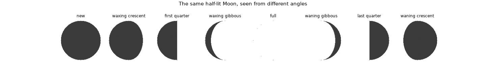
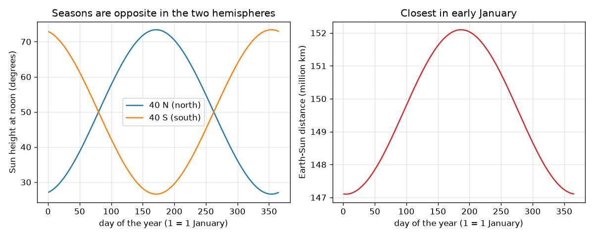

# सत्र 1: घूर्णन, झुकाव और प्रकाशित आधा भाग

*स्तर 1 (वैचारिक इंटरैक्टिव मॉडल) · लगभग 60 मिनट · openseasons*

> यह एक सरलीकृत शैक्षिक मॉडल है। यह कोई प्रमाणित डिज़ाइन उपकरण नहीं है और इसका उपयोग वास्तविक संरचनाओं, बिजली की स्थापनाओं, वाहनों, औद्योगिक प्रक्रियाओं या चिकित्सा निर्णयों के लिए नहीं किया जाना चाहिए।

**पूर्वापेक्षाएँ (Prerequisites)**

- स्कूल की त्रिकोणमिति: किसी कोण का sine और cosine।
- आपने PRIMER.md पढ़ लिया है और `python start.py 1` एक बार चला लिया है।

**सीखने के उद्देश्य।** इस सत्र के बाद आप:

- दिन और रात को ऐसे सूर्य के नीचे घूमती पृथ्वी के रूप में समझा सकेंगे जो एक आधे भाग को प्रकाशित करता है।
- 23.4 डिग्री के झुकाव (tilt) से ऋतुओं (seasons) को समझा सकेंगे, और बता सकेंगे कि दूरी इसका कारण क्यों नहीं है।
- किसी अक्षांश (latitude) और तिथि के लिए दोपहर में सूर्य की ऊँचाई की गणना कर सकेंगे।
- चंद्रमा की कलाओं (phases) को इस रूप में समझा सकेंगे कि हम चंद्रमा के प्रकाशित आधे भाग का कितना हिस्सा देखते हैं।

## A. वास्तविक दुनिया की समस्या
जनवरी की शुरुआत में पृथ्वी सूर्य के सबसे निकट होती है, फिर भी भारत, यूरोप और उत्तरी अमेरिका में सर्दी होती है और ऑस्ट्रेलिया तथा अर्जेंटीना में गर्मी। हमारे यहाँ दिन और रात क्यों होते हैं, आपके अक्षांश पर जून गर्म और दिसंबर ठंडा क्यों होता है, और चंद्रमा एक पतले हँसिए से बढ़कर पूरी चकती क्यों बन जाता है? तीन सरल ज्यामितीय विचार यह सब समझाते हैं, और आप हर एक को एक संख्या से जाँच सकते हैं।

## B. अवधारणा और सिद्धांत
कोई स्थान दिन के उजाले में होता है जब उसकी ऊपर की दिशा सूर्य की ओर इशारा करती है: ऊपर सदिश (up vector) और सूर्य दिशा का बिंदु गुणनफल (dot product) धनात्मक होता है। जैसे-जैसे पृथ्वी घूमती है (15 डिग्री प्रति घंटा), वह स्थान एक अक्षांश वृत्त पर घूमता है, शून्य झुकाव के लिए उसका आधा भाग प्रकाश में होता है, इसलिए हर दिन 12 घंटे का होता है। अक्ष (axis) कक्षा के लंबवत रेखा से 23.4 डिग्री झुका है और अंतरिक्ष में हमेशा एक ही ओर इशारा करता रहता है। इसलिए वह अक्षांश जहाँ सूर्य ठीक सिर के ऊपर होता है (क्रांति, declination, d) वर्ष भर में +23.4 और -23.4 डिग्री के बीच झूलता है। दोपहर में सूर्य की ऊँचाई 90 - |latitude - d| है। पृथ्वी-सूर्य दूरी केवल 147.1 से 152.1 मिलियन km तक बदलती है, लगभग 4 जनवरी को सबसे कम, और यह दोनों गोलार्धों के लिए समान है जबकि उनकी ऋतुएँ उलटी हैं। चंद्रमा का एक आधा भाग हमेशा सूर्य से प्रकाशित रहता है; दीर्घीकरण (elongation) D (कोण सूर्य-पृथ्वी-चंद्रमा) तय करता है कि उस आधे का कितना हिस्सा हमारी ओर है, k = (1 - cos D) / 2।

| प्रतीक | अर्थ | इकाई |
|---|---|---|
| tilt | कक्षा के अभिलंब से पृथ्वी के अक्ष का झुकाव (23.4) | डिग्री |
| lat | किसी स्थान का अक्षांश (उत्तर धनात्मक) | डिग्री |
| d | क्रांति: वह अक्षांश जहाँ सूर्य सिर के ऊपर है | डिग्री |
| n | वर्ष का दिन (1 जनवरी = 1) | दिन |
| r | पृथ्वी-सूर्य दूरी | मिलियन km |
| D | दीर्घीकरण सूर्य-पृथ्वी-चंद्रमा | डिग्री |
| k | चंद्रमा की चकती का चमकीला अंश | कोई इकाई नहीं |

**मान्यताएँ (Assumptions)**

- सूर्य इतना दूर है कि उसकी किरणें समानांतर हैं।
- कक्षा लगभग एक वृत्त है; दूरी का सूत्र प्रथम-कोटि का सन्निकटन (approximation) है।
- सूर्य एक बिंदु है और वायु उसके प्रकाश को नहीं मोड़ती (ज्यामितीय दिन)।
- चंद्रमा की कला 29.53 दिनों में 360 डिग्री की स्थिर चाल उपयोग करती है।

$$ \hat n\cdot\hat s>0\ \Longleftrightarrow\ \text{daylight} $$

$$ \sin d=\sin(\text{tilt})\,\sin\!\left(\frac{2\pi(n-80)}{365.25}\right) $$

$$ \text{noon height}=90^\circ-|\text{lat}-d| $$

$$ r=149.6\left(1-0.0167\cos\frac{2\pi(n-4)}{365.25}\right)\ \text{million km} $$

$$ k=\frac{1-\cos D}{2} $$

## C. दृश्य व्याख्या
बायाँ चित्र वर्ष भर में 40 N और 40 S पर दोपहर में सूर्य की ऊँचाई दिखाता है: दोनों वक्र एक-दूसरे के दर्पण प्रतिबिंब हैं, उत्तर में जून में ऊँचे और दक्षिण में दिसंबर में। दायाँ चित्र दूरी दिखाता है: यह जनवरी की शुरुआत में सबसे कम है, ठीक तब जब उत्तरी वक्र अपने सबसे निचले बिंदु पर है। दूसरा चित्र आठ दीर्घीकरणों पर वही आधा-प्रकाशित चंद्रमा दिखाता है; चमकीला आकार केवल इसलिए बदलता है क्योंकि हमारा देखने का कोण बदलता है।

*आठ दीर्घीकरणों पर वही आधा-प्रकाशित चंद्रमा, बिंदु गुणनफल से परिकलित।*

*40 N और 40 S पर दोपहर में सूर्य की ऊँचाई (दर्पण प्रतिबिंब) और पृथ्वी-सूर्य दूरी (जनवरी की शुरुआत में सबसे कम)।*

## D. इंटरैक्टिव सिमुलेशन
पाठ चलाइए (`python start.py 1`), फिर लाइव ऐप खोलिए: [सत्र 1: झुकाव, ऋतुएँ और दूरी](https://krunalpanchal1995.github.io/pan-iit-oss/openseasons/session-01/) (या इसी फ़ोल्डर में `app.html`)। दिन स्लाइडर खींचिए और पृथ्वी को अपने अक्ष को एक ही ओर रखते हुए घूमते देखिए; दोपहर-ऊँचाई दृश्य खोलिए और दोनों गोलार्धों की तुलना कीजिए; फिर झुकाव को 0 कीजिए और ऋतुओं को ग़ायब होते देखिए।

**चुनौती।** दिन 172 को दोपहर में सूर्य को ठीक सिर के ऊपर लाइए (ऊँचाई कम से कम 89 डिग्री)।

## E. हल किया गया उदाहरण और प्रयोग
**समस्या।** 23.4 डिग्री झुकाव का उपयोग करते हुए 21 जून और 21 दिसंबर को अक्षांश 40 N पर दोपहर में सूर्य की ऊँचाई ज्ञात कीजिए।

1. 21 जून को सूर्य क्रांति d = +23.4 डिग्री पर सिर के ऊपर है।
2. ऊँचाई = 90 - |40 - 23.4| = 90 - 16.6 = 73.4 डिग्री।
3. 21 दिसंबर को d = -23.4 डिग्री, इसलिए ऊँचाई = 90 - |40 + 23.4| = 90 - 63.4 = 26.6 डिग्री।
4. मॉडल कोड वही दोनों संख्याएँ देता है, और साथ ही दिन की लंबाई जून में 14.84 h और दिसंबर में 9.16 h।

**उत्तर।** जून में 73.4 डिग्री और दिसंबर में 26.6 डिग्री: 46.8 डिग्री का झूला, जो झुकाव का दोगुना है।

**प्रयोग।** दोनों अयनांतों (solstices) पर (या महीनों के अंतर वाली किन्हीं दो तिथियों पर) स्थानीय दोपहर में समतल ज़मीन पर 1 m की एक छड़ी सीधी खड़ी कीजिए और छाया की लंबाई मापिए। ऊँचाई = arctan(1 / shadow)। ऐप से तुलना कीजिए। अंतर इसलिए आते हैं कि छड़ी पूरी तरह ऊर्ध्वाधर नहीं होती, घड़ी के अनुसार दोपहर ठीक दोपहर नहीं होती, और मॉडल का सूर्य बिंदु जैसा है; मॉडल ज्यामिति देता है, मापन नहीं।

## F. मूल्यांकन और डिज़ाइन चुनौती
**प्रश्न प्रकार A: वैचारिक।** एक मित्र कहता है कि गर्मी तब होती है जब पृथ्वी सूर्य के सबसे निकट होती है। दो प्रमाण दीजिए कि यह ग़लत है।

संकेत

सबसे कम दूरी की तिथि की तुलना उत्तरी ऋतु से कीजिए, और उसी दिन दक्षिणी गोलार्ध के बारे में सोचिए।

चरण-दर-चरण हल

सबसे कम दूरी (147.1 मिलियन km) लगभग 4 जनवरी को है, उत्तरी सर्दी में, और सबसे अधिक (152.1) जुलाई की शुरुआत में, उत्तरी गर्मी में। साथ ही एक तिथि पर पूरी पृथ्वी एक ही दूरी पर होती है, पर दोनों गोलार्धों की ऋतुएँ उलटी होती हैं; 4 जनवरी को 40 N पर दोपहर का सूर्य केवल 27.5 डिग्री ऊँचा है पर 40 S पर 72.5 डिग्री। जो कारण दोनों के लिए समान है, वह उन्हें अलग नहीं बना सकता।

**प्रश्न प्रकार B: संख्यात्मक।** 23.4 डिग्री झुकाव के साथ 21 जून और 21 दिसंबर को 60 N पर दोपहर में सूर्य की ऊँचाई ज्ञात कीजिए।

संकेत

ऊँचाई = 90 - |lat - d|, जहाँ d = +23.4 और -23.4।

चरण-दर-चरण हल

जून: 90 - (60 - 23.4) = 53.4 डिग्री। दिसंबर: 90 - (60 + 23.4) = 6.6 डिग्री। समझदारी जाँच: दोनों ऋतुओं में ऊँचे अक्षांश पर सूर्य नीचा है, और जून का मान दिसंबर से ऊँचा है।

**प्रश्न प्रकार C: ग्राफ़ और सिमुलेशन की व्याख्या।** 40 N और 40 S के दोपहर-ऊँचाई ग्राफ़ में दोनों वक्र लगभग किन दिनों पर एक-दूसरे को काटते हैं, और वहाँ ऊँचाई क्या है?

संकेत

वे तब काटते हैं जब दोनों गोलार्धों को एक जैसा सूर्य मिलता है, अर्थात् सूर्य भूमध्य रेखा के ऊपर है।

चरण-दर-चरण हल

वे विषुवों (equinoxes) पर काटते हैं, लगभग दिन 80 (20 मार्च) और दिन 263 (23 सितंबर) पर, जहाँ d लगभग 0 है और दोनों ऊँचाइयाँ 90 - 40 = 50 डिग्री हैं।

**प्रश्न प्रकार D: डिज़ाइन और अनुकूलन (optimisation) चुनौती।** डिज़ाइन: आप ऐसा स्थान चाहते हैं जहाँ वर्ष के किसी भी समय दोपहर का सूर्य 45 डिग्री से कभी नीचे न हो। 23.4 डिग्री झुकाव के साथ, सबसे बड़ा अक्षांश (उत्तर या दक्षिण) क्या है?

संकेत

सबसे नीचा दोपहर का सूर्य उस गोलार्ध की सर्दी में होता है, 90 - lat - 23.4।

चरण-दर-चरण हल

हमें 90 - lat - 23.4 >= 45 चाहिए, इसलिए lat <= 21.6 डिग्री। भूमध्य रेखा के 21.6 डिग्री के भीतर दोपहर का सूर्य हमेशा कम से कम 45 डिग्री ऊँचा होता है। समझौता (trade-off): ऐसे स्थानों पर दिन की लंबाई में भी लगभग कोई बदलाव नहीं होता, इसलिए उनमें ऋतुओं का अंतर कम होता है; मॉडल बादलों और वायुमंडल को अनदेखा करता है।

[RUBRIC.md](../../RUBRIC.md) से स्वयं को अंक दीजिए। काग़ज़ पर काम करने के लिए [गतिविधि पत्रक](activity_sheet.md) प्रिंट कीजिए।

## सामान्य भ्रांतियाँ
| सामान्य भ्रांति | वास्तव में क्या सच है |
|---|---|
| गर्मी इसलिए होती है क्योंकि पृथ्वी सूर्य के अधिक निकट होती है। | पृथ्वी जनवरी की शुरुआत में सबसे निकट होती है। ऋतुएँ झुकाव से आती हैं, जो दोपहर में सूर्य की ऊँचाई और दिन की लंबाई बदलता है। |
| पृथ्वी का अक्ष वर्ष भर आगे-पीछे झुकता रहता है। | अक्ष अंतरिक्ष में हमेशा एक ही ओर इशारा करता है; कक्षा पर पृथ्वी की स्थिति बदलती है कि कौन-सा ध्रुव सूर्य की ओर झुका है। |
| उष्णकटिबंध (tropics) में हर जगह हर दिन दोपहर में सूर्य सिर के ऊपर होता है। | वह केवल अक्षांश d पर सिर के ऊपर होता है, जो वर्ष भर में 23.4 N और 23.4 S के बीच खिसकता है। |
| चंद्रमा की कलाएँ बादलों से या पृथ्वी की छाया से आती हैं। | चंद्रमा हमेशा आधा प्रकाशित रहता है; कला यह है कि उस आधे का कितना भाग हमारी ओर है। |

## शब्दावली
- **अक्षीय झुकाव (axis tilt)**: पृथ्वी के घूर्णन अक्ष और उसकी कक्षा के लंबवत रेखा के बीच का कोण, 23.4 डिग्री
- **क्रांति (declination)**: वह अक्षांश जहाँ दोपहर में सूर्य सिर के ऊपर होता है
- **होरा कोण (hour angle)**: स्थानीय दोपहर से पृथ्वी जितना घूम चुकी है वह कोण, 15 डिग्री प्रति घंटा
- **दीर्घीकरण (elongation)**: कोण सूर्य-पृथ्वी-चंद्रमा, अमावस्या पर 0 और पूर्णिमा पर 180
- **सीमारेखा (terminator)**: पृथ्वी पर दिन और रात के बीच की, या चंद्रमा के चमकीले और अँधेरे भागों के बीच की रेखा

## समापन
1. [exercises.md](exercises.md) में दिए तीन कोडिंग कार्य कीजिए।
2. अपने बदलावों के बाद `python start.py 1` फिर से चलाइए। यह चेकपॉइंट (checkpoint) पर समाप्त होता है; जब यह `PASS` छापे, तो आपका काम पूरा है। (केवल चेकपॉइंट: `python start.py check 1`।)

अगला: [सत्र 2](../session-02/README.md)
