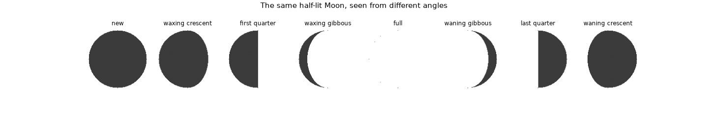
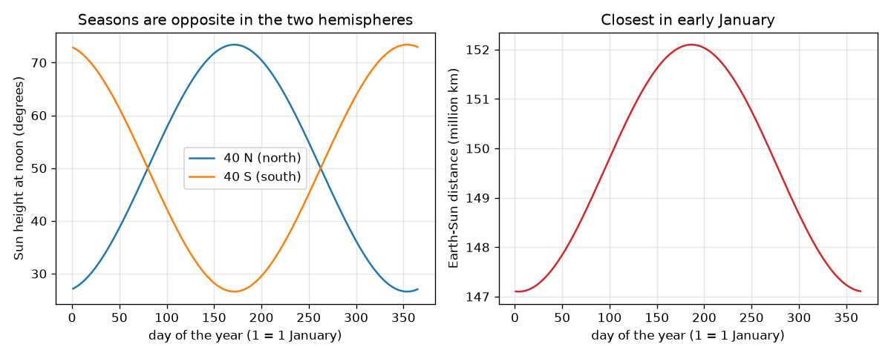

# സെഷൻ 1: ഭ്രമണം, ചരിവ്, പ്രകാശിത പകുതി

[Session 1 — हिन्दी](README.hi.md)

*ലെവൽ 1 (ആശയപരമായ ഇന്ററാക്ടീവ് മോഡൽ) · ഏകദേശം 60 മിനിറ്റ് · openseasons*

> ഇത് ലളിതമാക്കിയ ഒരു വിദ്യാഭ്യാസ മോഡൽ ആണ്. ഇത് സാധൂകരിച്ച (validated) ഡിസൈൻ ഉപകരണമല്ല; യഥാർത്ഥ നിർമിതികൾ, വൈദ്യുത ഇൻസ്റ്റലേഷനുകൾ, വാഹനങ്ങൾ, വ്യാവസായിക പ്രക്രിയകൾ അല്ലെങ്കിൽ വൈദ്യശാസ്ത്ര തീരുമാനങ്ങൾ എന്നിവയ്ക്ക് ഇത് ഉപയോഗിക്കരുത്.

**മുൻകൂട്ടി അറിയേണ്ടവ (Prerequisites)**

- സ്കൂൾ ത്രികോണമിതി: ഒരു കോണിന്റെ സൈനും കോസൈനും.
- നിങ്ങൾ PRIMER.md വായിച്ചിട്ടുണ്ട്, `python start.py 1` ഒരിക്കൽ റൺ ചെയ്തിട്ടുണ്ട്.

**പഠന ലക്ഷ്യങ്ങൾ (Learning objectives).** ഈ സെഷനു ശേഷം നിങ്ങൾക്ക്:

- ഒരു പകുതിയെ പ്രകാശിപ്പിക്കുന്ന സൂര്യന് കീഴിൽ ഭൂമി കറങ്ങുന്നതായി രാവും പകലും വിശദീകരിക്കാം.
- 23.4 ഡിഗ്രി ചരിവ് (tilt) കൊണ്ട് ഋതുക്കളെ വിശദീകരിക്കാം, ദൂരമല്ല കാരണമെന്ന് പറയാം.
- ഒരു അക്ഷാംശത്തിനും തീയതിക്കും ഉച്ചയ്ക്കുള്ള സൂര്യന്റെ ഉയരം കണക്കാക്കാം.
- ചന്ദ്രന്റെ പ്രകാശിത പകുതിയിൽ എത്ര ഭാഗം നാം കാണുന്നു എന്ന നിലയിൽ ചന്ദ്രക്കലകൾ (Moon phases) വിശദീകരിക്കാം.

## A. യഥാർത്ഥ ലോക പ്രശ്നം
ജനുവരി തുടക്കത്തിൽ ഭൂമി സൂര്യന് ഏറ്റവും അടുത്താണ്, എന്നിട്ടും ഇന്ത്യയിലും യൂറോപ്പിലും വടക്കേ അമേരിക്കയിലും ശൈത്യകാലവും ഓസ്ട്രേലിയയിലും അർജന്റീനയിലും വേനൽക്കാലവുമാണ്. നമുക്ക് രാവും പകലും ഉണ്ടാകുന്നത് എന്തുകൊണ്ട്, നിങ്ങളുടെ അക്ഷാംശത്തിൽ ജൂൺ ചൂടും ഡിസംബർ തണുപ്പും ആകുന്നത് എന്തുകൊണ്ട്, ചന്ദ്രൻ നേർത്ത ചന്ദ്രക്കലയിൽ നിന്ന് പൂർണ്ണ ബിംബമായി വളരുന്നത് എന്തുകൊണ്ട്? മൂന്ന് ലളിതമായ ജ്യാമിതീയ ആശയങ്ങൾ എല്ലാം വിശദീകരിക്കുന്നു, ഓരോന്നും ഒരു സംഖ്യ കൊണ്ട് നിങ്ങൾക്ക് പരീക്ഷിക്കാം.

## B. ആശയവും സിദ്ധാന്തവും
ഒരു സ്ഥലത്തിന്റെ മുകളിലേക്കുള്ള ദിശ സൂര്യനു നേരെ ചൂണ്ടുമ്പോൾ അത് പകൽ വെളിച്ചത്തിലാണ്: മുകളിലേക്കുള്ള വെക്ടറിന്റെയും സൂര്യ ദിശയുടെയും ഡോട്ട് ഗുണനഫലം പോസിറ്റീവ് ആണ്. ഭൂമി കറങ്ങുമ്പോൾ (മണിക്കൂറിൽ 15 ഡിഗ്രി) സ്ഥലം ഒരു അക്ഷാംശ വൃത്തത്തിലൂടെ ചുറ്റുന്നു, ചരിവ് പൂജ്യമാകുമ്പോൾ അതിൽ പകുതി വെളിച്ചത്തിലാണ്, അതിനാൽ എല്ലാ ദിവസവും 12 മണിക്കൂർ. അക്ഷം ഭ്രമണപഥത്തിന് ലംബമായ രേഖയിൽ നിന്ന് 23.4 ഡിഗ്രി ചരിഞ്ഞിരിക്കുന്നു, ബഹിരാകാശത്ത് അതേ ദിശയിൽ തന്നെ ചൂണ്ടി നിൽക്കുന്നു. അതിനാൽ സൂര്യൻ നേരെ മുകളിൽ വരുന്ന അക്ഷാംശം (ഡിക്ലിനേഷൻ, declination, d) ഒരു വർഷത്തിൽ +23.4 നും -23.4 ഡിഗ്രിക്കും ഇടയിൽ ആടുന്നു. ഉച്ചയ്ക്ക് സൂര്യന്റെ ഉയരം 90 - |latitude - d| ആണ്. ഭൂമി-സൂര്യ ദൂരം 147.1 മുതൽ 152.1 ദശലക്ഷം km വരെ മാത്രമേ മാറുന്നുള്ളൂ, ഏകദേശം ജനുവരി 4-ന് ഏറ്റവും കുറവ്, അത് രണ്ട് അർദ്ധഗോളങ്ങൾക്കും ഒന്നുതന്നെയാണ്, എന്നാൽ അവയുടെ ഋതുക്കൾ വിപരീതമാണ്. ചന്ദ്രൻ എപ്പോഴും ഒരു പകുതി സൂര്യനാൽ പ്രകാശിതമാണ്; എലോംഗേഷൻ (elongation) D (കോൺ സൂര്യൻ-ഭൂമി-ചന്ദ്രൻ) ആ പകുതിയുടെ എത്ര ഭാഗം നമുക്ക് നേരെ തിരിഞ്ഞിരിക്കുന്നു എന്ന് തീരുമാനിക്കുന്നു, k = (1 - cos D) / 2.

| ചിഹ്നം | അർത്ഥം | യൂണിറ്റ് |
|---|---|---|
| tilt | ഭ്രമണപഥത്തിന്റെ ലംബത്തിൽ നിന്നുള്ള ഭൂമിയുടെ അക്ഷത്തിന്റെ ചരിവ് (23.4) | ഡിഗ്രി |
| lat | ഒരു സ്ഥലത്തിന്റെ അക്ഷാംശം (വടക്ക് പോസിറ്റീവ്) | ഡിഗ്രി |
| d | ഡിക്ലിനേഷൻ: സൂര്യൻ നേരെ മുകളിൽ വരുന്ന അക്ഷാംശം | ഡിഗ്രി |
| n | വർഷത്തിലെ ദിവസം (ജനുവരി 1 = 1) | ദിവസങ്ങൾ |
| r | ഭൂമി-സൂര്യ ദൂരം | ദശലക്ഷം km |
| D | എലോംഗേഷൻ സൂര്യൻ-ഭൂമി-ചന്ദ്രൻ | ഡിഗ്രി |
| k | ചന്ദ്രബിംബത്തിന്റെ തിളക്കമുള്ള അംശം | യൂണിറ്റില്ല |

**അനുമാനങ്ങൾ (Assumptions)**

- സൂര്യൻ വളരെ അകലെയായതിനാൽ അതിന്റെ കിരണങ്ങൾ സമാന്തരമാണ്.
- ഭ്രമണപഥം ഏതാണ്ട് വൃത്താകാരമാണ്; ദൂര ഫോർമുല ഒരു ഒന്നാം-ക്രമ ഏകദേശമാണ്.
- സൂര്യൻ ഒരു ബിന്ദുവാണ്, വായു അതിന്റെ പ്രകാശത്തെ വളയ്ക്കുന്നില്ല (ജ്യാമിതീയ പകൽ).
- ചന്ദ്രന്റെ കല 29.53 ദിവസത്തിൽ 360 ഡിഗ്രി എന്ന സ്ഥിര വേഗം ഉപയോഗിക്കുന്നു.

$$ \hat n\cdot\hat s>0\ \Longleftrightarrow\ \text{daylight} $$

$$ \sin d=\sin(\text{tilt})\,\sin\!\left(\frac{2\pi(n-80)}{365.25}\right) $$

$$ \text{noon height}=90^\circ-|\text{lat}-d| $$

$$ r=149.6\left(1-0.0167\cos\frac{2\pi(n-4)}{365.25}\right)\ \text{million km} $$

$$ k=\frac{1-\cos D}{2} $$

## C. ദൃശ്യ വിശദീകരണം
ഇടത് ചിത്രം 40 N, 40 S എന്നിവിടങ്ങളിൽ വർഷം മുഴുവൻ ഉച്ചയ്ക്കുള്ള സൂര്യന്റെ ഉയരം വരയ്ക്കുന്നു: രണ്ട് വക്രങ്ങളും പ്രതിബിംബങ്ങളാണ്, വടക്ക് ജൂണിലും തെക്ക് ഡിസംബറിലും ഉയർന്നത്. വലത് ചിത്രം ദൂരം വരയ്ക്കുന്നു: ജനുവരി തുടക്കത്തിൽ അത് ഏറ്റവും കുറവാണ്, വടക്കൻ വക്രം ഏറ്റവും താഴ്ന്നിരിക്കുമ്പോൾ തന്നെ. രണ്ടാമത്തെ ചിത്രം എട്ട് എലോംഗേഷനുകളിൽ ഒരേ പകുതി-പ്രകാശിത ചന്ദ്രനെ കാണിക്കുന്നു; നമ്മുടെ കാഴ്ചക്കോൺ മാറുന്നതുകൊണ്ട് മാത്രമാണ് തിളക്കമുള്ള ആകൃതി മാറുന്നത്.

*ഒരു ഡോട്ട് ഗുണനഫലത്തിൽ നിന്ന് കണക്കാക്കിയ, എട്ട് എലോംഗേഷനുകളിലെ ഒരേ പകുതി-പ്രകാശിത ചന്ദ്രൻ.*

*40 N, 40 S എന്നിവിടങ്ങളിലെ ഉച്ചയ്ക്കുള്ള സൂര്യന്റെ ഉയരം (പ്രതിബിംബങ്ങൾ), ഭൂമി-സൂര്യ ദൂരം (ജനുവരി തുടക്കത്തിൽ ഏറ്റവും കുറവ്).*

## D. ഇന്ററാക്ടീവ് സിമുലേഷൻ
പാഠം റൺ ചെയ്യുക (`python start.py 1`), തുടർന്ന് ലൈവ് ആപ്പ് തുറക്കുക: [സെഷൻ 1: ചരിവ്, ഋതുക്കൾ, ദൂരം](https://krunalpanchal1995.github.io/pan-iit-oss/openseasons/session-01/) (അല്ലെങ്കിൽ ഈ ഫോൾഡറിലെ `app.html`). ദിവസ സ്ലൈഡർ വലിച്ച് അക്ഷം അതേ ദിശയിൽ ചൂണ്ടി നിൽക്കെ ഭൂമി ചുറ്റുന്നത് നിരീക്ഷിക്കുക; ഉച്ച-ഉയരം കാഴ്ച തുറന്ന് രണ്ട് അർദ്ധഗോളങ്ങളെ താരതമ്യം ചെയ്യുക; തുടർന്ന് ചരിവ് 0 ആക്കി ഋതുക്കൾ അപ്രത്യക്ഷമാകുന്നത് കാണുക.

**വെല്ലുവിളി.** 172-ാം ദിവസം ഉച്ചയ്ക്ക് സൂര്യനെ കൃത്യമായി നേരെ മുകളിൽ ആക്കുക (ഉയരം കുറഞ്ഞത് 89 ഡിഗ്രി).

## E. ഉദാഹരണവും പരീക്ഷണവും
**പ്രശ്നം.** 23.4 ഡിഗ്രി ചരിവ് ഉപയോഗിച്ച്, ജൂൺ 21-നും ഡിസംബർ 21-നും അക്ഷാംശം 40 N-ൽ ഉച്ചയ്ക്കുള്ള സൂര്യന്റെ ഉയരം കണ്ടെത്തുക.

1. ജൂൺ 21-ന് ഡിക്ലിനേഷൻ d = +23.4 ഡിഗ്രിയിൽ സൂര്യൻ നേരെ മുകളിലാണ്.
2. ഉയരം = 90 - |40 - 23.4| = 90 - 16.6 = 73.4 ഡിഗ്രി.
3. ഡിസംബർ 21-ന് d = -23.4 ഡിഗ്രി, അതിനാൽ ഉയരം = 90 - |40 + 23.4| = 90 - 63.4 = 26.6 ഡിഗ്രി.
4. മോഡൽ കോഡും ഇതേ രണ്ട് സംഖ്യകളും, കൂടാതെ പകലിന്റെ ദൈർഘ്യം ജൂണിൽ 14.84 h, ഡിസംബറിൽ 9.16 h എന്നിവയും നൽകുന്നു.

**ഉത്തരം.** ജൂണിൽ 73.4 ഡിഗ്രി, ഡിസംബറിൽ 26.6 ഡിഗ്രി: 46.8 ഡിഗ്രിയുടെ വ്യത്യാസം, അത് ചരിവിന്റെ ഇരട്ടിയാണ്.

**പരീക്ഷണം.** നിരപ്പായ നിലത്ത് 1 m ഉയരമുള്ള ഒരു വടി നേരെ നിർത്തി, രണ്ട് അയനാന്തദിനങ്ങളിലും (solstices) (അല്ലെങ്കിൽ മാസങ്ങൾ അകലെയുള്ള ഏതെങ്കിലും രണ്ട് തീയതികളിൽ) പ്രാദേശിക ഉച്ചയ്ക്ക് നിഴലിന്റെ നീളം അളക്കുക. ഉയരം = arctan(1 / നിഴൽ). ആപ്പുമായി താരതമ്യം ചെയ്യുക. വ്യത്യാസങ്ങൾ വരുന്നത് വടി ലംബമല്ലാത്തതിൽ നിന്നും, ഉച്ച ക്ലോക്ക് പ്രകാരം കൃത്യമായ ഉച്ചയല്ലാത്തതിൽ നിന്നും, മോഡലിലെ ബിന്ദുരൂപ സൂര്യനിൽ നിന്നുമാണ്; മോഡൽ ജ്യാമിതിയാണ് നൽകുന്നത്, ഒരു അളവല്ല.

## F. വിലയിരുത്തലും ഡിസൈൻ വെല്ലുവിളിയും
**ചോദ്യ തരം A: ആശയപരം.** ഭൂമി സൂര്യന് ഏറ്റവും അടുത്തിരിക്കുമ്പോഴാണ് വേനൽക്കാലം എന്ന് ഒരു സുഹൃത്ത് പറയുന്നു. ഇത് തെറ്റാണെന്നതിന് രണ്ട് തെളിവുകൾ നൽകുക.

സൂചന

ഏറ്റവും കുറഞ്ഞ ദൂരത്തിന്റെ തീയതിയെ വടക്കൻ ഋതുവുമായി താരതമ്യം ചെയ്യുക, അതേ ദിവസത്തെ തെക്കൻ അർദ്ധഗോളത്തെക്കുറിച്ച് ചിന്തിക്കുക.

ഘട്ടം ഘട്ടമായുള്ള പരിഹാരം

ഏറ്റവും കുറഞ്ഞ ദൂരം (147.1 ദശലക്ഷം km) ഏകദേശം ജനുവരി 4-ന്, വടക്കൻ ശൈത്യകാലത്താണ്, ഏറ്റവും കൂടിയത് (152.1) ജൂലൈ തുടക്കത്തിൽ, വടക്കൻ വേനൽക്കാലത്താണ്. കൂടാതെ ഒരു തീയതിയിൽ ഭൂമി മുഴുവൻ ഒരേ ദൂരത്തിലാണ്, പക്ഷേ രണ്ട് അർദ്ധഗോളങ്ങൾക്കും വിപരീത ഋതുക്കളാണ്; ജനുവരി 4-ന് 40 N-ൽ ഉച്ചസൂര്യൻ 27.5 ഡിഗ്രി മാത്രം ഉയരത്തിലും 40 S-ൽ 72.5 ഡിഗ്രി ഉയരത്തിലുമാണ്. രണ്ടിനും ഒരുപോലെയുള്ള ഒരു കാരണത്തിന് അവയെ വ്യത്യസ്തമാക്കാൻ കഴിയില്ല.

**ചോദ്യ തരം B: സംഖ്യാപരം.** 23.4 ഡിഗ്രി ചരിവോടെ ജൂൺ 21-നും ഡിസംബർ 21-നും 60 N-ൽ ഉച്ചയ്ക്കുള്ള സൂര്യന്റെ ഉയരം കണ്ടെത്തുക.

സൂചന

ഉയരം = 90 - |lat - d|, d = +23.4, -23.4 ഉപയോഗിച്ച്.

ഘട്ടം ഘട്ടമായുള്ള പരിഹാരം

ജൂൺ: 90 - (60 - 23.4) = 53.4 ഡിഗ്രി. ഡിസംബർ: 90 - (60 + 23.4) = 6.6 ഡിഗ്രി. പരിശോധന: ഉയർന്ന അക്ഷാംശത്തിൽ രണ്ട് ഋതുക്കളിലും സൂര്യൻ താഴെയാണ്, ജൂൺ മൂല്യം ഡിസംബറിനേക്കാൾ കൂടുതലാണ്.

**ചോദ്യ തരം C: ഗ്രാഫും സിമുലേഷനും വ്യാഖ്യാനിക്കൽ.** 40 N, 40 S എന്നിവയ്ക്കുള്ള ഉച്ച-ഉയരം ഗ്രാഫിൽ, രണ്ട് വക്രങ്ങളും ഏകദേശം ഏത് ദിവസങ്ങളിൽ കൂടിമുട്ടുന്നു, അവിടത്തെ ഉയരം എത്രയാണ്?

സൂചന

രണ്ട് അർദ്ധഗോളങ്ങൾക്കും ഒരേ സൂര്യൻ ലഭിക്കുമ്പോൾ അവ കൂടിമുട്ടുന്നു, അതായത് സൂര്യൻ ഭൂമധ്യരേഖയ്ക്ക് മുകളിലാണ്.

ഘട്ടം ഘട്ടമായുള്ള പരിഹാരം

അവ വിഷുവങ്ങളിൽ (equinoxes) കൂടിമുട്ടുന്നു, ഏകദേശം 80-ാം ദിവസം (മാർച്ച് 20), 263-ാം ദിവസം (സെപ്റ്റംബർ 23), അവിടെ d 0-ന് അടുത്താണ്, രണ്ട് ഉയരങ്ങളും 90 - 40 = 50 ഡിഗ്രി ആണ്.

**ചോദ്യ തരം D: ഡിസൈനും ഒപ്റ്റിമൈസേഷനും വെല്ലുവിളി.** ഡിസൈൻ: വർഷത്തിൽ ഒരിക്കലും ഉച്ചസൂര്യൻ 45 ഡിഗ്രിയിൽ താഴെയാകാത്ത ഒരു സ്ഥലം നിങ്ങൾക്ക് വേണം. 23.4 ഡിഗ്രി ചരിവോടെ, ഏറ്റവും വലിയ അക്ഷാംശം (വടക്കോ തെക്കോ) എത്രയാണ്?

സൂചന

ഏറ്റവും താഴ്ന്ന ഉച്ചസൂര്യൻ ആ അർദ്ധഗോളത്തിന്റെ ശൈത്യകാലത്താണ്, 90 - lat - 23.4.

ഘട്ടം ഘട്ടമായുള്ള പരിഹാരം

നമുക്ക് 90 - lat - 23.4 >= 45 വേണം, അതിനാൽ lat <= 21.6 ഡിഗ്രി. ഭൂമധ്യരേഖയുടെ 21.6 ഡിഗ്രിക്കുള്ളിൽ ഉച്ചസൂര്യൻ എപ്പോഴും കുറഞ്ഞത് 45 ഡിഗ്രി ഉയരത്തിലാണ്. വിട്ടുവീഴ്ച (trade-off): അത്തരം സ്ഥലങ്ങളിൽ പകലിന്റെ ദൈർഘ്യത്തിലും മാറ്റം ഏതാണ്ടില്ല, അതിനാൽ ഋതുക്കളിലെ വ്യത്യാസം കുറവാണ്; മോഡൽ മേഘങ്ങളെയും അന്തരീക്ഷത്തെയും അവഗണിക്കുന്നു.

[RUBRIC.md](../../RUBRIC.md) ഉപയോഗിച്ച് സ്വയം സ്കോർ ചെയ്യുക. പേപ്പറിൽ ചെയ്യാൻ [ആക്ടിവിറ്റി ഷീറ്റ്](activity_sheet.md) പ്രിന്റ് ചെയ്യുക.

## സാധാരണ തെറ്റിദ്ധാരണകൾ
| സാധാരണ തെറ്റിദ്ധാരണ | യഥാർത്ഥത്തിൽ ശരിയായത് |
|---|---|
| ഭൂമി സൂര്യനോട് അടുത്തിരിക്കുമ്പോഴാണ് വേനൽക്കാലം ഉണ്ടാകുന്നത്. | ഭൂമി ജനുവരി തുടക്കത്തിലാണ് ഏറ്റവും അടുത്തത്. ഋതുക്കൾ ചരിവിൽ നിന്നാണ് വരുന്നത്, അത് സൂര്യന്റെ ഉച്ച-ഉയരവും പകലിന്റെ ദൈർഘ്യവും മാറ്റുന്നു. |
| ഭൂമിയുടെ അക്ഷം വർഷത്തിൽ മുന്നോട്ടും പിന്നോട്ടും ചരിയുന്നു. | അക്ഷം ബഹിരാകാശത്ത് അതേ ദിശയിൽ തന്നെ ചൂണ്ടി നിൽക്കുന്നു; ഭ്രമണപഥത്തിൽ ഭൂമിയുടെ സ്ഥാനം മാറുന്നതാണ് ഏത് ധ്രുവം സൂര്യനു നേരെ ചായുന്നു എന്ന് മാറ്റുന്നത്. |
| ഉഷ്ണമേഖലയിൽ എല്ലായിടത്തും എല്ലാ ദിവസവും ഉച്ചയ്ക്ക് സൂര്യൻ നേരെ മുകളിലാണ്. | അത് അക്ഷാംശം d-ൽ മാത്രമേ നേരെ മുകളിൽ വരൂ, അത് വർഷത്തിൽ 23.4 N-നും 23.4 S-നും ഇടയിൽ നീങ്ങുന്നു. |
| ചന്ദ്രക്കലകൾ മേഘങ്ങളിൽ നിന്നോ ഭൂമിയുടെ നിഴലിൽ നിന്നോ ആണ് വരുന്നത്. | ചന്ദ്രൻ എപ്പോഴും പകുതി പ്രകാശിതമാണ്; ആ പകുതിയിൽ എത്ര ഭാഗം നമുക്ക് നേരെ തിരിഞ്ഞിരിക്കുന്നു എന്നതാണ് കല. |

## പദാവലി (Glossary)
- **അക്ഷ ചരിവ് (axis tilt)**: ഭൂമിയുടെ ഭ്രമണ അക്ഷത്തിനും അതിന്റെ ഭ്രമണപഥത്തിന് ലംബമായ രേഖയ്ക്കും ഇടയിലെ കോൺ, 23.4 ഡിഗ്രി
- **ഡിക്ലിനേഷൻ (declination)**: ഉച്ചയ്ക്ക് സൂര്യൻ നേരെ മുകളിൽ വരുന്ന അക്ഷാംശം
- **മണിക്കൂർ കോൺ (hour angle)**: പ്രാദേശിക ഉച്ച മുതൽ ഭൂമി തിരിഞ്ഞ കോൺ, മണിക്കൂറിൽ 15 ഡിഗ്രി
- **എലോംഗേഷൻ (elongation)**: കോൺ സൂര്യൻ-ഭൂമി-ചന്ദ്രൻ, അമാവാസിയിൽ 0, പൗർണ്ണമിയിൽ 180
- **ടെർമിനേറ്റർ (terminator)**: ഭൂമിയിലെ പകലിനും രാത്രിക്കും ഇടയിലെ അല്ലെങ്കിൽ ചന്ദ്രന്റെ തിളക്കമുള്ളതും ഇരുണ്ടതുമായ ഭാഗങ്ങൾക്ക് ഇടയിലെ രേഖ

## പൂർത്തിയാക്കുക
1. [exercises.md](exercises.md)-ലെ മൂന്ന് കോഡിംഗ് ടാസ്കുകൾ ചെയ്യുക.
2. നിങ്ങളുടെ മാറ്റങ്ങൾക്ക് ശേഷം `python start.py 1` വീണ്ടും റൺ ചെയ്യുക. അത് ചെക്ക്‌പോയിന്റോടെ അവസാനിക്കുന്നു; അത് `PASS` പ്രിന്റ് ചെയ്യുമ്പോൾ നിങ്ങൾ പൂർത്തിയാക്കി. (ചെക്ക്‌പോയിന്റ് മാത്രം: `python start.py check 1`.)

അടുത്തത്: [സെഷൻ 2](../session-02/README.md)
