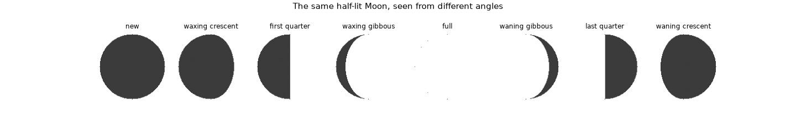
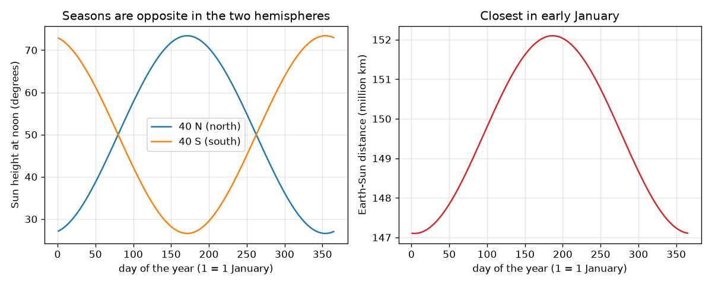

# அமர்வு 1: சுழற்சி, சாய்வு, ஒளிரும் பாதி

[Session 1 — हिन्दी](README.hi.md)

*நிலை 1 (கருத்தியல் ஊடாடும் மாதிரி) · சுமார் 60 நிமிடங்கள் · openseasons*

> இது எளிமைப்படுத்தப்பட்ட ஒரு கல்வி மாதிரி. இது சரிபார்க்கப்பட்ட (validated) வடிவமைப்புக் கருவி அல்ல; உண்மையான கட்டமைப்புகள், மின் நிறுவல்கள், வாகனங்கள், தொழிற்சாலை செயல்முறைகள் அல்லது மருத்துவ முடிவுகளுக்கு இதைப் பயன்படுத்தக் கூடாது.

**முன்தேவைகள் (Prerequisites)**

- பள்ளி முக்கோணவியல்: ஒரு கோணத்தின் சைன் மற்றும் கொசைன்.
- நீங்கள் PRIMER.md படித்து, `python start.py 1` ஒருமுறை இயக்கியுள்ளீர்கள்.

**கற்றல் நோக்கங்கள் (Learning objectives).** இந்த அமர்வுக்குப் பிறகு நீங்கள்:

- ஒரு பாதியை ஒளிரச் செய்யும் சூரியனுக்குக் கீழே பூமி சுழல்வதாக இரவு பகலை விளக்கலாம்.
- 23.4 டிகிரி சாய்வால் (tilt) பருவங்களை விளக்கலாம், தூரம் காரணம் அல்ல என்று கூறலாம்.
- ஒரு அட்சரேகைக்கும் தேதிக்கும் நண்பகல் சூரிய உயரத்தைக் கணக்கிடலாம்.
- நிலவின் ஒளிரும் பாதியில் எவ்வளவை நாம் பார்க்கிறோம் என்பதாக நிலவின் கலைகளை (Moon phases) விளக்கலாம்.

## A. நிஜ உலகப் பிரச்சினை
ஜனவரி தொடக்கத்தில் பூமி சூரியனுக்கு மிக அருகில் இருக்கிறது, ஆனாலும் இந்தியா, ஐரோப்பா, வட அமெரிக்காவில் குளிர்காலமும் ஆஸ்திரேலியா, அர்ஜென்டினாவில் கோடைகாலமும் நிலவுகிறது. இரவு பகல் ஏன் உண்டாகிறது, உங்கள் அட்சரேகையில் ஜூன் வெப்பமாகவும் டிசம்பர் குளிராகவும் இருப்பது ஏன், நிலவு மெல்லிய பிறையிலிருந்து முழு வட்டாக வளர்வது ஏன்? மூன்று எளிய வடிவியல் கருத்துகள் எல்லாவற்றையும் விளக்குகின்றன, ஒவ்வொன்றையும் ஒரு எண்ணால் சோதிக்கலாம்.

## B. கருத்தும் கோட்பாடும்
ஒரு இடத்தின் மேல்நோக்கிய திசை சூரியனை நோக்கும்போது அது பகல் வெளிச்சத்தில் உள்ளது: மேல் திசையன் மற்றும் சூரிய திசையின் புள்ளிப் பெருக்கல் நேர்மறை. பூமி சுழலும்போது (மணிக்கு 15 டிகிரி) இடம் ஒரு அட்சரேகை வட்டத்தில் சுற்றுகிறது, சாய்வு பூஜ்ஜியமாக இருந்தால் அதில் பாதி ஒளியில் இருக்கும், எனவே ஒவ்வொரு நாளும் 12 மணி நேரம். அச்சு சுற்றுப்பாதைக்குச் செங்குத்தான கோட்டிலிருந்து 23.4 டிகிரி சாய்ந்துள்ளது, விண்வெளியில் அதே திசையிலேயே நிற்கிறது. எனவே சூரியன் நேர் மேலே இருக்கும் அட்சரேகை (சரிவு, declination, d) ஓராண்டில் +23.4 முதல் -23.4 டிகிரி வரை ஊசலாடுகிறது. நண்பகலில் சூரிய உயரம் 90 - |latitude - d|. பூமி-சூரிய தூரம் 147.1 முதல் 152.1 மில்லியன் km வரை மட்டுமே மாறுகிறது, சுமார் ஜனவரி 4 இல் மிகக் குறைவு, அது இரு அரைக்கோளங்களுக்கும் ஒன்றே, ஆனால் அவற்றின் பருவங்கள் எதிர்மாறானவை. நிலவு எப்போதும் ஒரு பாதி சூரியனால் ஒளிர்கிறது; நீட்சிக் கோணம் (elongation) D (கோணம் சூரியன்-பூமி-நிலவு) அந்தப் பாதியில் எவ்வளவு நம்மை நோக்கியுள்ளது என்பதை முடிவு செய்கிறது, k = (1 - cos D) / 2.

| குறியீடு | பொருள் | அலகு |
|---|---|---|
| tilt | சுற்றுப்பாதைச் செங்குத்திலிருந்து பூமியின் அச்சுச் சாய்வு (23.4) | டிகிரி |
| lat | ஓர் இடத்தின் அட்சரேகை (வடக்கு நேர்மறை) | டிகிரி |
| d | சரிவு: சூரியன் நேர் மேலே இருக்கும் அட்சரேகை | டிகிரி |
| n | ஆண்டின் நாள் (ஜனவரி 1 = 1) | நாட்கள் |
| r | பூமி-சூரிய தூரம் | மில்லியன் km |
| D | நீட்சிக் கோணம் சூரியன்-பூமி-நிலவு | டிகிரி |
| k | நிலவு வட்டின் பிரகாசமான பங்கு | அலகு இல்லை |

**அனுமானங்கள் (Assumptions)**

- சூரியன் மிகத் தொலைவில் இருப்பதால் அதன் கதிர்கள் இணையானவை.
- சுற்றுப்பாதை கிட்டத்தட்ட வட்டம்; தூரச் சூத்திரம் முதல்-வரிசை தோராயம்.
- சூரியன் ஒரு புள்ளி, காற்று அதன் ஒளியை வளைப்பதில்லை (வடிவியல் பகல்).
- நிலவின் கலை 29.53 நாட்களில் 360 டிகிரி என்ற மாறா வேகத்தைப் பயன்படுத்துகிறது.

$$ \hat n\cdot\hat s>0\ \Longleftrightarrow\ \text{daylight} $$

$$ \sin d=\sin(\text{tilt})\,\sin\!\left(\frac{2\pi(n-80)}{365.25}\right) $$

$$ \text{noon height}=90^\circ-|\text{lat}-d| $$

$$ r=149.6\left(1-0.0167\cos\frac{2\pi(n-4)}{365.25}\right)\ \text{million km} $$

$$ k=\frac{1-\cos D}{2} $$

## C. காட்சி விளக்கம்
இடப்பக்கப் படம் 40 N மற்றும் 40 S இல் ஆண்டு முழுவதும் நண்பகல் சூரிய உயரத்தை வரைகிறது: இரு வளைவுகளும் கண்ணாடிப் பிம்பங்கள், வடக்கில் ஜூனிலும் தெற்கில் டிசம்பரிலும் உயரம். வலப்பக்கப் படம் தூரத்தை வரைகிறது: ஜனவரி தொடக்கத்தில் அது மிகக் குறைவு, வடக்கு வளைவு மிகத் தாழ்வாக இருக்கும் அதே நேரத்தில். இரண்டாவது படம் எட்டு நீட்சிக் கோணங்களில் அதே பாதி-ஒளிரும் நிலவைக் காட்டுகிறது; நம் பார்வைக் கோணம் மாறுவதால் மட்டுமே பிரகாசமான வடிவம் மாறுகிறது.

*ஒரு புள்ளிப் பெருக்கலிலிருந்து கணக்கிடப்பட்ட, எட்டு நீட்சிக் கோணங்களில் அதே பாதி-ஒளிரும் நிலவு.*

*40 N மற்றும் 40 S இல் நண்பகல் சூரிய உயரம் (கண்ணாடிப் பிம்பங்கள்) மற்றும் பூமி-சூரிய தூரம் (ஜனவரி தொடக்கத்தில் மிகக் குறைவு).*

## D. ஊடாடும் உருவகப்படுத்தல் (Interactive simulation)
பாடத்தை இயக்கவும் (`python start.py 1`), பின்னர் நேரடிச் செயலியைத் திறக்கவும்: [அமர்வு 1: சாய்வு, பருவங்கள், தூரம்](https://krunalpanchal1995.github.io/pan-iit-oss/openseasons/session-01/) (அல்லது இந்தக் கோப்புறையிலுள்ள `app.html`). நாள் நழுவியை இழுத்து, அச்சு அதே திசையில் நிற்க பூமி சுற்றுவதைப் பாருங்கள்; நண்பகல்-உயரக் காட்சியைத் திறந்து இரு அரைக்கோளங்களையும் ஒப்பிடுங்கள்; பின்னர் சாய்வை 0 ஆக்கிப் பருவங்கள் மறைவதைப் பாருங்கள்.

**சவால்.** 172 ஆம் நாளில் நண்பகலில் சூரியனைச் சரியாக நேர் மேலே கொண்டுவாருங்கள் (உயரம் குறைந்தது 89 டிகிரி).

## E. தீர்க்கப்பட்ட எடுத்துக்காட்டும் சோதனையும்
**பிரச்சினை.** 23.4 டிகிரி சாய்வைப் பயன்படுத்தி, ஜூன் 21 மற்றும் டிசம்பர் 21 அன்று அட்சரேகை 40 N இல் நண்பகல் சூரிய உயரத்தைக் காண்க.

1. ஜூன் 21 அன்று சரிவு d = +23.4 டிகிரியில் சூரியன் நேர் மேலே உள்ளது.
2. உயரம் = 90 - |40 - 23.4| = 90 - 16.6 = 73.4 டிகிரி.
3. டிசம்பர் 21 அன்று d = -23.4 டிகிரி, எனவே உயரம் = 90 - |40 + 23.4| = 90 - 63.4 = 26.6 டிகிரி.
4. மாதிரி நிரல் அதே இரண்டு எண்களையும், மேலும் பகல் நீளம் ஜூனில் 14.84 h, டிசம்பரில் 9.16 h என்பதையும் தருகிறது.

**விடை.** ஜூனில் 73.4 டிகிரி, டிசம்பரில் 26.6 டிகிரி: 46.8 டிகிரி ஊசலாட்டம், அது சாய்வைப் போல இரு மடங்கு.

**சோதனை.** சமதளத்தில் 1 m குச்சியை நேராக நிறுத்தி, இரண்டு கதிர்த்திருப்ப நாட்களில் (solstices) (அல்லது மாதங்கள் இடைவெளியில் உள்ள ஏதேனும் இரண்டு தேதிகளில்) உள்ளூர் நண்பகலில் நிழல் நீளத்தை அளவிடுங்கள். உயரம் = arctan(1 / நிழல்). செயலியுடன் ஒப்பிடுங்கள். வேறுபாடுகள் குச்சி செங்குத்தாக இல்லாததிலிருந்தும், கடிகாரப்படி நண்பகல் சரியான நண்பகலாக இல்லாததிலிருந்தும், மாதிரியின் புள்ளி வடிவ சூரியனிலிருந்தும் வருகின்றன; மாதிரி வடிவியலைத் தருகிறது, அளவீட்டை அல்ல.

## F. மதிப்பீடும் வடிவமைப்புச் சவாலும்
**கேள்வி வகை A: கருத்தியல்.** பூமி சூரியனுக்கு மிக அருகில் இருக்கும்போதுதான் கோடைகாலம் என்று ஒரு நண்பர் கூறுகிறார். இது தவறு என்பதற்கு இரண்டு சான்றுகளைத் தருக.

குறிப்பு

மிகக் குறைந்த தூரத்தின் தேதியை வடக்குப் பருவத்துடன் ஒப்பிட்டு, அதே நாளில் தெற்கு அரைக்கோளத்தைப் பற்றி யோசியுங்கள்.

படிப்படியான தீர்வு

மிகக் குறைந்த தூரம் (147.1 மில்லியன் km) சுமார் ஜனவரி 4 இல், வடக்குக் குளிர்காலத்தில் உள்ளது, மிக அதிகம் (152.1) ஜூலை தொடக்கத்தில், வடக்குக் கோடைகாலத்தில். மேலும் ஒரு தேதியில் முழுப் பூமியும் ஒரே தூரத்தில் உள்ளது, ஆனால் இரு அரைக்கோளங்களுக்கும் எதிர்ப் பருவங்கள்; ஜனவரி 4 அன்று 40 N இல் நண்பகல் சூரியன் 27.5 டிகிரி உயரம் மட்டுமே, 40 S இல் 72.5 டிகிரி உயரம். இரண்டுக்கும் ஒரே மாதிரியான காரணம் அவற்றை வேறுபடுத்த முடியாது.

**கேள்வி வகை B: எண்ணியல்.** 23.4 டிகிரி சாய்வுடன் ஜூன் 21 மற்றும் டிசம்பர் 21 அன்று 60 N இல் நண்பகல் சூரிய உயரத்தைக் காண்க.

குறிப்பு

உயரம் = 90 - |lat - d|, d = +23.4 மற்றும் -23.4 உடன்.

படிப்படியான தீர்வு

ஜூன்: 90 - (60 - 23.4) = 53.4 டிகிரி. டிசம்பர்: 90 - (60 + 23.4) = 6.6 டிகிரி. சரிபார்ப்பு: உயர் அட்சரேகையில் இரு பருவங்களிலும் சூரியன் தாழ்வாக உள்ளது, ஜூன் மதிப்பு டிசம்பரை விட அதிகம்.

**கேள்வி வகை C: வரைபடம் மற்றும் உருவகப்படுத்தல் விளக்கம்.** 40 N மற்றும் 40 S க்கான நண்பகல்-உயர வரைபடத்தில், இரு வளைவுகளும் ஏறத்தாழ எந்த நாட்களில் சந்திக்கின்றன, அங்கு உயரம் என்ன?

குறிப்பு

இரு அரைக்கோளங்களும் ஒரே சூரியனைப் பெறும்போது அவை சந்திக்கின்றன, அதாவது சூரியன் நிலநடுக்கோட்டுக்கு மேலே உள்ளது.

படிப்படியான தீர்வு

அவை சம இரவு நாட்களில் (equinoxes) சந்திக்கின்றன, ஏறத்தாழ 80 ஆம் நாள் (மார்ச் 20) மற்றும் 263 ஆம் நாள் (செப்டம்பர் 23), அங்கு d 0 க்கு அருகில் உள்ளது, இரு உயரங்களும் 90 - 40 = 50 டிகிரி.

**கேள்வி வகை D: வடிவமைப்பு மற்றும் உகப்பாக்கச் (optimisation) சவால்.** வடிவமைப்பு: ஆண்டில் எப்போதும் நண்பகல் சூரியன் 45 டிகிரிக்குக் கீழே போகாத ஓர் இடம் உங்களுக்கு வேண்டும். 23.4 டிகிரி சாய்வுடன், மிகப் பெரிய அட்சரேகை (வடக்கு அல்லது தெற்கு) என்ன?

குறிப்பு

மிகத் தாழ்வான நண்பகல் சூரியன் அந்த அரைக்கோளத்தின் குளிர்காலத்தில் நிகழ்கிறது, 90 - lat - 23.4.

படிப்படியான தீர்வு

நமக்கு 90 - lat - 23.4 >= 45 வேண்டும், எனவே lat <= 21.6 டிகிரி. நிலநடுக்கோட்டிலிருந்து 21.6 டிகிரிக்குள் நண்பகல் சூரியன் எப்போதும் குறைந்தது 45 டிகிரி உயரத்தில் உள்ளது. சமரசம் (trade-off): அத்தகைய இடங்களில் பகல் நீளமும் கிட்டத்தட்ட மாறுவதில்லை, எனவே பருவ வேறுபாடு குறைவு; மாதிரி மேகங்களையும் வளிமண்டலத்தையும் புறக்கணிக்கிறது.

[RUBRIC.md](../../RUBRIC.md) மூலம் உங்களை நீங்களே மதிப்பிடுங்கள். தாளில் செய்ய [செயல்பாட்டுத் தாளை](activity_sheet.md) அச்சிடவும்.

## பொதுவான தவறான கருத்துகள்
| பொதுவான தவறான கருத்து | உண்மையில் சரியானது |
|---|---|
| பூமி சூரியனுக்கு அருகில் இருப்பதால் கோடை உண்டாகிறது. | பூமி ஜனவரி தொடக்கத்தில்தான் மிக அருகில் உள்ளது. பருவங்கள் சாய்விலிருந்து வருகின்றன, அது சூரியனின் நண்பகல் உயரத்தையும் பகல் நீளத்தையும் மாற்றுகிறது. |
| பூமியின் அச்சு ஆண்டு முழுவதும் முன்னும் பின்னும் சாய்கிறது. | அச்சு விண்வெளியில் அதே திசையிலேயே நிற்கிறது; சுற்றுப்பாதையில் பூமியின் இடம் மாறுவதே எந்த முனை சூரியனை நோக்கிச் சாய்கிறது என்பதை மாற்றுகிறது. |
| வெப்பமண்டலத்தில் எங்கும் ஒவ்வொரு நாளும் நண்பகலில் சூரியன் நேர் மேலே இருக்கும். | அது அட்சரேகை d இல் மட்டுமே நேர் மேலே இருக்கும், அது ஆண்டில் 23.4 N க்கும் 23.4 S க்கும் இடையே நகர்கிறது. |
| நிலவின் கலைகள் மேகங்களாலோ பூமியின் நிழலாலோ வருகின்றன. | நிலவு எப்போதும் பாதி ஒளிர்கிறது; அந்தப் பாதியில் எவ்வளவு நம்மை நோக்கியுள்ளது என்பதே கலை. |

## சொற்களஞ்சியம் (Glossary)
- **அச்சுச் சாய்வு (axis tilt)**: பூமியின் சுழற்சி அச்சுக்கும் அதன் சுற்றுப்பாதைக்குச் செங்குத்தான கோட்டுக்கும் இடையிலான கோணம், 23.4 டிகிரி
- **சரிவு (declination)**: நண்பகலில் சூரியன் நேர் மேலே இருக்கும் அட்சரேகை
- **மணிக் கோணம் (hour angle)**: உள்ளூர் நண்பகலிலிருந்து பூமி திரும்பிய கோணம், மணிக்கு 15 டிகிரி
- **நீட்சிக் கோணம் (elongation)**: கோணம் சூரியன்-பூமி-நிலவு, அமாவாசையில் 0, பௌர்ணமியில் 180
- **ஒளிவரம்பு (terminator)**: பூமியில் பகலுக்கும் இரவுக்கும் இடையிலான அல்லது நிலவின் பிரகாசமான மற்றும் இருண்ட பகுதிகளுக்கு இடையிலான கோடு

## நிறைவு
1. [exercises.md](exercises.md)-இல் உள்ள மூன்று நிரலாக்கப் பணிகளைச் செய்யவும்.
2. உங்கள் மாற்றங்களுக்குப் பிறகு `python start.py 1` மீண்டும் இயக்கவும். அது சோதனைச் சாவடியுடன் (checkpoint) முடிகிறது; அது `PASS` அச்சிடும்போது நீங்கள் முடித்துவிட்டீர்கள். (சோதனைச் சாவடி மட்டும்: `python start.py check 1`.)

அடுத்து: [அமர்வு 2](../session-02/README.md)
