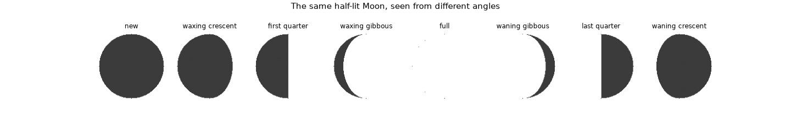
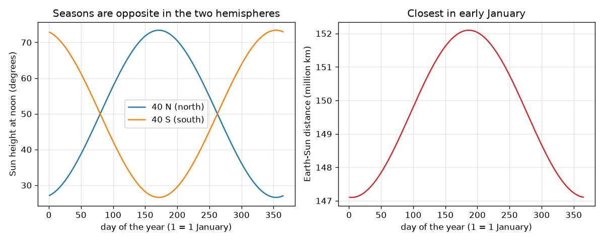

# సెషన్ 1: తిరుగుడు, వంపు, వెలుగుతున్న సగభాగం

[Session 1 — हिन्दी](README.hi.md)

*స్థాయి 1 (భావనాత్మక ఇంటరాక్టివ్ నమూనా) · సుమారు 60 నిమిషాలు · openseasons*

> ఇది సరళీకరించిన విద్యా నమూనా. ఇది ధృవీకరించబడిన (validated) డిజైన్ సాధనం కాదు; నిజమైన నిర్మాణాలు, విద్యుత్ ఇన్‌స్టలేషన్లు, వాహనాలు, పారిశ్రామిక ప్రక్రియలు లేదా వైద్య నిర్ణయాల కోసం దీనిని ఉపయోగించకూడదు.

**ముందస్తు అవసరాలు (Prerequisites)**

- పాఠశాల త్రికోణమితి: ఒక కోణం యొక్క సైన్ మరియు కొసైన్.
- మీరు PRIMER.md చదివి, `python start.py 1` ఒకసారి రన్ చేశారు.

**అభ్యసన లక్ష్యాలు (Learning objectives).** ఈ సెషన్ తర్వాత మీరు:

- ఒక సగభాగాన్ని వెలిగించే సూర్యుని కింద భూమి తిరుగుతున్నట్లుగా రాత్రి పగలును వివరించగలరు.
- 23.4 డిగ్రీల వంపు (tilt) తో రుతువులను వివరించగలరు, దూరం కారణం కాదని చెప్పగలరు.
- ఒక అక్షాంశానికి మరియు తేదీకి మధ్యాహ్న సూర్యుని ఎత్తును లెక్కించగలరు.
- చంద్రుని వెలుగుతున్న సగభాగంలో ఎంత మనం చూస్తామనే విధంగా చంద్ర కళలను (Moon phases) వివరించగలరు.

## A. వాస్తవ ప్రపంచ సమస్య
జనవరి ప్రారంభంలో భూమి సూర్యునికి అత్యంత దగ్గరగా ఉంటుంది, అయినా భారతదేశం, యూరప్, ఉత్తర అమెరికాలో శీతాకాలం, ఆస్ట్రేలియా, అర్జెంటీనాలో వేసవి. రాత్రి పగలు ఎందుకు ఉన్నాయి, మీ అక్షాంశం వద్ద జూన్ వేడిగా, డిసెంబర్ చల్లగా ఎందుకు ఉంటుంది, చంద్రుడు సన్నని వంకర నుండి పూర్తి బింబంగా ఎందుకు పెరుగుతాడు? మూడు సరళమైన జ్యామితీయ ఆలోచనలు అన్నిటినీ వివరిస్తాయి, ప్రతిదాన్నీ ఒక సంఖ్యతో మీరు పరీక్షించవచ్చు.

## B. భావన మరియు సిద్ధాంతం
ఒక ప్రదేశం యొక్క పైకి దిశ సూర్యుని వైపు ఉన్నప్పుడు అది పగటి వెలుగులో ఉంటుంది: పైకి సదిశ మరియు సూర్య దిశ యొక్క డాట్ లబ్ధం ధనాత్మకం. భూమి తిరిగేటప్పుడు (గంటకు 15 డిగ్రీలు) ప్రదేశం ఒక అక్షాంశ వృత్తంలో తిరుగుతుంది, వంపు సున్నా అయితే దానిలో సగం వెలుగులో ఉంటుంది, కాబట్టి ప్రతి రోజూ 12 గంటలు. అక్షం కక్ష్యకు లంబంగా ఉన్న రేఖ నుండి 23.4 డిగ్రీలు వంగి ఉంది, అంతరిక్షంలో అదే దిశలో చూపుతూ ఉంటుంది. కాబట్టి సూర్యుడు నడినెత్తిన ఉండే అక్షాంశం (క్షీణత, declination, d) ఒక సంవత్సరంలో +23.4 నుండి -23.4 డిగ్రీల మధ్య ఊగుతుంది. మధ్యాహ్నం సూర్యుని ఎత్తు 90 - |latitude - d|. భూమి-సూర్య దూరం 147.1 నుండి 152.1 మిలియన్ km వరకు మాత్రమే మారుతుంది, సుమారు జనవరి 4న అతి తక్కువ, అది రెండు అర్ధగోళాలకూ ఒకటే, కానీ వాటి రుతువులు వ్యతిరేకం. చంద్రుడు ఎల్లప్పుడూ ఒక సగభాగం సూర్యునిచే వెలుగుతుంది; పొడుగు కోణం (elongation) D (కోణం సూర్యుడు-భూమి-చంద్రుడు) ఆ సగభాగంలో ఎంత మన వైపు ఉందో నిర్ణయిస్తుంది, k = (1 - cos D) / 2.

| గుర్తు | అర్థం | ప్రమాణం |
|---|---|---|
| tilt | కక్ష్య లంబం నుండి భూమి అక్షం యొక్క వంపు (23.4) | డిగ్రీలు |
| lat | ఒక ప్రదేశం యొక్క అక్షాంశం (ఉత్తరం ధనాత్మకం) | డిగ్రీలు |
| d | క్షీణత: సూర్యుడు నడినెత్తిన ఉండే అక్షాంశం | డిగ్రీలు |
| n | సంవత్సరంలో రోజు (జనవరి 1 = 1) | రోజులు |
| r | భూమి-సూర్య దూరం | మిలియన్ km |
| D | పొడుగు కోణం సూర్యుడు-భూమి-చంద్రుడు | డిగ్రీలు |
| k | చంద్ర బింబం యొక్క ప్రకాశవంతమైన భాగం | ప్రమాణం లేదు |

**ఊహలు (Assumptions)**

- సూర్యుడు చాలా దూరంలో ఉన్నందున అతని కిరణాలు సమాంతరం.
- కక్ష్య దాదాపు వృత్తం; దూర సూత్రం ఒక మొదటి-క్రమ ఉజ్జాయింపు.
- సూర్యుడు ఒక బిందువు, గాలి అతని కాంతిని వంచదు (జ్యామితీయ పగలు).
- చంద్రుని కళ 29.53 రోజులలో 360 డిగ్రీల స్థిర వేగాన్ని ఉపయోగిస్తుంది.

$$ \hat n\cdot\hat s>0\ \Longleftrightarrow\ \text{daylight} $$

$$ \sin d=\sin(\text{tilt})\,\sin\!\left(\frac{2\pi(n-80)}{365.25}\right) $$

$$ \text{noon height}=90^\circ-|\text{lat}-d| $$

$$ r=149.6\left(1-0.0167\cos\frac{2\pi(n-4)}{365.25}\right)\ \text{million km} $$

$$ k=\frac{1-\cos D}{2} $$

## C. దృశ్య వివరణ
ఎడమ చిత్రం 40 N మరియు 40 S వద్ద సంవత్సరం పొడవునా మధ్యాహ్న సూర్యుని ఎత్తును గీస్తుంది: రెండు వక్రాలు ప్రతిబింబాలు, ఉత్తరంలో జూన్‌లో, దక్షిణంలో డిసెంబర్‌లో ఎత్తు. కుడి చిత్రం దూరాన్ని గీస్తుంది: జనవరి ప్రారంభంలో అది అతి తక్కువ, ఉత్తర వక్రం అత్యంత తక్కువగా ఉన్న సమయంలోనే. రెండవ చిత్రం ఎనిమిది పొడుగు కోణాల వద్ద అదే సగం-వెలుగుతున్న చంద్రుడిని చూపిస్తుంది; మన వీక్షణ కోణం మారడం వల్ల మాత్రమే ప్రకాశవంతమైన ఆకారం మారుతుంది.

*ఒక డాట్ లబ్ధం నుండి లెక్కించిన, ఎనిమిది పొడుగు కోణాల వద్ద అదే సగం-వెలుగుతున్న చంద్రుడు.*

*40 N మరియు 40 S వద్ద మధ్యాహ్న సూర్యుని ఎత్తు (ప్రతిబింబాలు) మరియు భూమి-సూర్య దూరం (జనవరి ప్రారంభంలో అతి తక్కువ).*

## D. ఇంటరాక్టివ్ సిమ్యులేషన్
పాఠాన్ని రన్ చేయండి (`python start.py 1`), తర్వాత లైవ్ యాప్‌ను తెరవండి: [సెషన్ 1: వంపు, రుతువులు, దూరం](https://krunalpanchal1995.github.io/pan-iit-oss/openseasons/session-01/) (లేదా ఈ ఫోల్డర్‌లోని `app.html`). రోజు స్లైడర్‌ను లాగి, అక్షం అదే దిశలో చూపుతుండగా భూమి తిరగడం గమనించండి; మధ్యాహ్న-ఎత్తు వీక్షణను తెరిచి రెండు అర్ధగోళాలను పోల్చండి; తర్వాత వంపును 0 కి సెట్ చేసి రుతువులు మాయమవడం చూడండి.

**సవాలు.** 172వ రోజు మధ్యాహ్నం సూర్యుడిని సరిగ్గా నడినెత్తిన ఉంచండి (ఎత్తు కనీసం 89 డిగ్రీలు).

## E. సాధించిన ఉదాహరణ మరియు ప్రయోగం
**సమస్య.** 23.4 డిగ్రీల వంపు ఉపయోగించి, జూన్ 21 మరియు డిసెంబర్ 21 న అక్షాంశం 40 N వద్ద మధ్యాహ్న సూర్యుని ఎత్తును కనుగొనండి.

1. జూన్ 21 న క్షీణత d = +23.4 డిగ్రీల వద్ద సూర్యుడు నడినెత్తిన ఉంటాడు.
2. ఎత్తు = 90 - |40 - 23.4| = 90 - 16.6 = 73.4 డిగ్రీలు.
3. డిసెంబర్ 21 న d = -23.4 డిగ్రీలు, కాబట్టి ఎత్తు = 90 - |40 + 23.4| = 90 - 63.4 = 26.6 డిగ్రీలు.
4. నమూనా కోడ్ అదే రెండు సంఖ్యలను, అలాగే పగటి నిడివి జూన్‌లో 14.84 h, డిసెంబర్‌లో 9.16 h ను ఇస్తుంది.

**సమాధానం.** జూన్‌లో 73.4 డిగ్రీలు, డిసెంబర్‌లో 26.6 డిగ్రీలు: 46.8 డిగ్రీల ఊగిసలాట, అది వంపుకు రెండు రెట్లు.

**ప్రయోగం.** సమతలమైన నేలపై 1 m కర్రను నిటారుగా నిలబెట్టి, రెండు అయనాంత దినాల్లో (solstices) (లేదా నెలల తేడాతో ఏవైనా రెండు తేదీల్లో) స్థానిక మధ్యాహ్నం నీడ పొడవును కొలవండి. ఎత్తు = arctan(1 / నీడ). యాప్‌తో పోల్చండి. తేడాలు కర్ర నిటారుగా లేకపోవడం, గడియారం ప్రకారం మధ్యాహ్నం సరిగ్గా మధ్యాహ్నం కాకపోవడం, నమూనా యొక్క బిందు రూప సూర్యుడి నుండి వస్తాయి; నమూనా జ్యామితిని ఇస్తుంది, కొలతను కాదు.

## F. మూల్యాంకనం మరియు డిజైన్ సవాలు
**ప్రశ్న రకం A: భావనాత్మక.** భూమి సూర్యునికి అత్యంత దగ్గరగా ఉన్నప్పుడే వేసవి అని ఒక స్నేహితుడు అంటున్నాడు. ఇది తప్పు అనడానికి రెండు ఆధారాలు ఇవ్వండి.

సూచన

అతి తక్కువ దూరం తేదీని ఉత్తర రుతువుతో పోల్చి, అదే రోజు దక్షిణ అర్ధగోళం గురించి ఆలోచించండి.

దశలవారీ పరిష్కారం

అతి తక్కువ దూరం (147.1 మిలియన్ km) సుమారు జనవరి 4న, ఉత్తర శీతాకాలంలో ఉంది, అతి ఎక్కువ (152.1) జూలై ప్రారంభంలో, ఉత్తర వేసవిలో. అలాగే ఒక తేదీన భూమి మొత్తం ఒకే దూరంలో ఉంటుంది, కానీ రెండు అర్ధగోళాలకూ వ్యతిరేక రుతువులు; జనవరి 4న 40 N వద్ద మధ్యాహ్న సూర్యుడు 27.5 డిగ్రీల ఎత్తు మాత్రమే, 40 S వద్ద 72.5 డిగ్రీల ఎత్తు. రెండింటికీ ఒకేలా ఉండే కారణం వాటిని భిన్నంగా చేయలేదు.

**ప్రశ్న రకం B: సంఖ్యాత్మక.** 23.4 డిగ్రీల వంపుతో జూన్ 21 మరియు డిసెంబర్ 21 న 60 N వద్ద మధ్యాహ్న సూర్యుని ఎత్తును కనుగొనండి.

సూచన

ఎత్తు = 90 - |lat - d|, d = +23.4 మరియు -23.4 తో.

దశలవారీ పరిష్కారం

జూన్: 90 - (60 - 23.4) = 53.4 డిగ్రీలు. డిసెంబర్: 90 - (60 + 23.4) = 6.6 డిగ్రీలు. తనిఖీ: ఎక్కువ అక్షాంశం వద్ద రెండు రుతువుల్లోనూ సూర్యుడు తక్కువగా ఉన్నాడు, జూన్ విలువ డిసెంబర్ కంటే ఎక్కువ.

**ప్రశ్న రకం C: గ్రాఫ్ మరియు సిమ్యులేషన్ వ్యాఖ్యానం.** 40 N మరియు 40 S కోసం మధ్యాహ్న-ఎత్తు గ్రాఫ్‌లో, రెండు వక్రాలు సుమారు ఏ రోజులలో కలుస్తాయి, అక్కడ ఎత్తు ఎంత?

సూచన

రెండు అర్ధగోళాలకూ ఒకే సూర్యుడు అందినప్పుడు అవి కలుస్తాయి, అంటే సూర్యుడు భూమధ్యరేఖపై ఉన్నాడు.

దశలవారీ పరిష్కారం

అవి విషువత్తులలో (equinoxes) కలుస్తాయి, సుమారు 80వ రోజు (మార్చి 20) మరియు 263వ రోజు (సెప్టెంబర్ 23), అక్కడ d 0 కి దగ్గరగా ఉంది, రెండు ఎత్తులూ 90 - 40 = 50 డిగ్రీలు.

**ప్రశ్న రకం D: డిజైన్ మరియు ఆప్టిమైజేషన్ (optimisation) సవాలు.** డిజైన్: సంవత్సరంలో ఎప్పుడూ మధ్యాహ్న సూర్యుడు 45 డిగ్రీల కంటే తక్కువ కాని ప్రదేశం మీకు కావాలి. 23.4 డిగ్రీల వంపుతో, అతి పెద్ద అక్షాంశం (ఉత్తరం లేదా దక్షిణం) ఎంత?

సూచన

అతి తక్కువ మధ్యాహ్న సూర్యుడు ఆ అర్ధగోళం యొక్క శీతాకాలంలో ఉంటాడు, 90 - lat - 23.4.

దశలవారీ పరిష్కారం

మనకు 90 - lat - 23.4 >= 45 కావాలి, కాబట్టి lat <= 21.6 డిగ్రీలు. భూమధ్యరేఖ నుండి 21.6 డిగ్రీల లోపల మధ్యాహ్న సూర్యుడు ఎల్లప్పుడూ కనీసం 45 డిగ్రీల ఎత్తులో ఉంటాడు. రాజీ (trade-off): అలాంటి ప్రదేశాల్లో పగటి నిడివి కూడా దాదాపు మారదు, కాబట్టి రుతు మార్పు తక్కువ; నమూనా మేఘాలను, వాతావరణాన్ని విస్మరిస్తుంది.

[RUBRIC.md](../../RUBRIC.md) తో మిమ్మల్ని మీరు స్కోర్ చేసుకోండి. కాగితంపై చేయడానికి [కార్యాచరణ పత్రాన్ని](activity_sheet.md) ప్రింట్ చేయండి.

## సాధారణ అపోహలు
| సాధారణ అపోహ | వాస్తవంగా నిజమైనది |
|---|---|
| భూమి సూర్యునికి దగ్గరగా ఉన్నందున వేసవి వస్తుంది. | భూమి జనవరి ప్రారంభంలో అత్యంత దగ్గరగా ఉంటుంది. రుతువులు వంపు నుండి వస్తాయి, అది సూర్యుని మధ్యాహ్న ఎత్తును మరియు పగటి నిడివిని మారుస్తుంది. |
| భూమి అక్షం సంవత్సరం పొడవునా ముందుకు వెనక్కి వంగుతుంది. | అక్షం అంతరిక్షంలో అదే దిశలో చూపుతూ ఉంటుంది; కక్ష్యలో భూమి స్థానం మారడమే ఏ ధ్రువం సూర్యుని వైపు వాలుతుందో మారుస్తుంది. |
| ఉష్ణమండలంలో ప్రతిచోటా ప్రతిరోజూ మధ్యాహ్నం సూర్యుడు నడినెత్తిన ఉంటాడు. | అతడు అక్షాంశం d వద్ద మాత్రమే నడినెత్తిన ఉంటాడు, అది సంవత్సరంలో 23.4 N మరియు 23.4 S మధ్య కదులుతుంది. |
| చంద్ర కళలు మేఘాల నుండి లేదా భూమి నీడ నుండి వస్తాయి. | చంద్రుడు ఎల్లప్పుడూ సగం వెలుగుతాడు; ఆ సగంలో ఎంత మన వైపు ఉందో అదే కళ. |

## పదకోశం (Glossary)
- **అక్ష వంపు (axis tilt)**: భూమి తిరుగుడు అక్షానికి మరియు దాని కక్ష్యకు లంబంగా ఉన్న రేఖకు మధ్య కోణం, 23.4 డిగ్రీలు
- **క్షీణత (declination)**: మధ్యాహ్నం సూర్యుడు నడినెత్తిన ఉండే అక్షాంశం
- **గంట కోణం (hour angle)**: స్థానిక మధ్యాహ్నం నుండి భూమి తిరిగిన కోణం, గంటకు 15 డిగ్రీలు
- **పొడుగు కోణం (elongation)**: కోణం సూర్యుడు-భూమి-చంద్రుడు, అమావాస్యలో 0, పౌర్ణమిలో 180
- **టెర్మినేటర్ (terminator)**: భూమిపై పగలు రాత్రి మధ్య లేదా చంద్రుని ప్రకాశవంతమైన మరియు చీకటి భాగాల మధ్య రేఖ

## ముగింపు
1. [exercises.md](exercises.md) లోని మూడు కోడింగ్ పనులను చేయండి.
2. మీ మార్పుల తర్వాత `python start.py 1` మళ్ళీ రన్ చేయండి. అది చెక్‌పాయింట్‌తో ముగుస్తుంది; అది `PASS` ప్రింట్ చేసినప్పుడు మీరు పూర్తి చేశారు. (చెక్‌పాయింట్ మాత్రమే: `python start.py check 1`.)

తర్వాత: [సెషన్ 2](../session-02/README.md)
