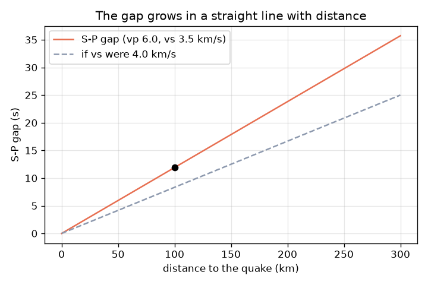
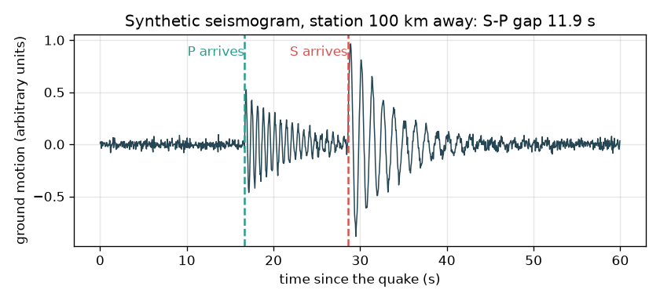

# सत्र 1: दो तरंगें, एक अंतराल: वह कितनी दूर था?

*स्तर 1 (अवधारणात्मक इंटरैक्टिव मॉडल) · लगभग 60 मिनट · openseismo*

> यह एक सरलीकृत शैक्षिक मॉडल है। यह कोई प्रमाणित डिज़ाइन उपकरण नहीं है और इसका उपयोग वास्तविक संरचनाओं, विद्युत संस्थापनों, वाहनों, औद्योगिक प्रक्रियाओं या चिकित्सा निर्णयों के लिए नहीं किया जाना चाहिए।

**पूर्वापेक्षाएँ (Prerequisites)**

- चाल = दूरी / समय (स्कूल गणित)।
- आपने PRIMER.md पढ़ लिया है और `python start.py 1` एक बार चला लिया है।

**सीखने के उद्देश्य (Learning objectives)।** इस सत्र के बाद आप:

- P तरंग (P wave) और S तरंग (S wave) के बीच अंतर समझा सकेंगे और बता सकेंगे कि P पहले क्यों पहुँचती है।
- t = d / v से यात्रा समय की गणना कर सकेंगे।
- नियम 1 सेकंड अंतराल = 8.4 km से S-P अंतराल को दूरी में बदल सकेंगे।
- दूरी के सापेक्ष S-P अंतराल का ग्राफ़ पढ़ सकेंगे।

## A. वास्तविक दुनिया की समस्या
तूफ़ान के दौरान आप बिजली चमकते देखते हैं और गड़गड़ाहट तक सेकंड गिनते हैं: जितनी लंबी प्रतीक्षा, बिजली उतनी दूर गिरी। भूकंप भी इसी तरह काम करता है, पर दोनों संकेत ज़मीन में तरंगें हैं। सबसे पहले P तरंग पहुँचती है (तेज़, यात्रा की दिशा के अनुदिश धक्का-खिंचाव वाला संपीडन); बाद में S तरंग आती है (धीमी, अगल-बगल का झटका)। एक भूकंपलेखी (seismograph) दोनों को दर्ज करता है। क्या उनके बीच की प्रतीक्षा बता सकती है कि भूकंप कितनी दूर था? यह रिपॉज़िटरी केवल सीखने के लिए है: यह किसी को चेतावनी नहीं दे सकती, और भूकंपों का पूर्वानुमान नहीं लगाया जा सकता।

## B. अवधारणा और सिद्धांत
चाल v से दूरी d तय करने वाली तरंग को समय t = d / v लगता है। सामान्य ऊपरी भूपर्पटी (crust) में हम P तरंगों के लिए vp = 6.0 km/s और S तरंगों के लिए vs = 3.5 km/s का उपयोग करते हैं (लगभग शिक्षण मान; वास्तविक चट्टान जगह-जगह बदलती है)। दोनों भूकंप पर साथ शुरू होती हैं, इसलिए S तरंग पीछे रह जाती है: दूरी d के बाद अंतराल gap = d / vs - d / vp है। इसे पलटने से d = gap x vp x vs / (vp - vs) मिलता है। हमारी चालों के साथ अंतराल का हर सेकंड 6.0 x 3.5 / 2.5 = 8.4 km के बराबर है। बिजली का नियम भी यही विचार है, जिसमें P की जगह प्रकाश (तुरंत) और S की जगह ध्वनि (लगभग 343 m/s, यानी प्रति किलोमीटर 2.9 s) है।

| प्रतीक | अर्थ | इकाई |
|---|---|---|
| d | भूकंप से स्टेशन तक की दूरी | km |
| vp | P तरंग चाल (लगभग सामान्य मान 6.0) | km/s |
| vs | S तरंग चाल (लगभग सामान्य मान 3.5) | km/s |
| tp, ts | P और S का आगमन समय, भूकंप की शुरुआत से मापा गया | s |
| gap | S-P अंतराल = ts - tp | s |

**मान्यताएँ (Assumptions)**

- स्थिर चाल पर सीधी रेखा में यात्रा (एक सरलीकरण; वास्तविक तरंगें मुड़ती हैं और गहराई के साथ चाल बदलती है)।
- भूकंप एक बिंदु है और एक ही क्षण में शुरू होता है।
- चालें लगभग सामान्य मान हैं, किसी वास्तविक स्थान के माप नहीं।
- केवल शैक्षिक मॉडल; चेतावनी या पूर्वानुमान के लिए नहीं।

$$ t=\frac{d}{v} $$

$$ \text{gap}=t_s-t_p=\frac{d}{v_s}-\frac{d}{v_p} $$

$$ d=\text{gap}\cdot\frac{v_p v_s}{v_p-v_s}\qquad \frac{v_p v_s}{v_p-v_s}=8.4\ \text{km/s} $$

## C. दृश्य व्याख्या
पहला चित्र 100 km दूर के स्टेशन के लिए एक काल्पनिक भूकंपलेख (seismogram) है: शांत, फिर 16.7 s पर P पहुँचने पर एक छोटी लहर, फिर 28.6 s पर S पहुँचने पर एक बड़ी लहर, 11.9 s का अंतराल। दूसरा चित्र दूरी के सापेक्ष S-P अंतराल दिखाता है: शून्य से होकर जाने वाली एक सीधी रेखा, जो 300 km पर 35.7 s तक पहुँचती है। एक डैश रेखा दिखाती है कि तेज़ S तरंग (4.0 km/s) छोटा अंतराल देगी।

*S-P अंतराल दूरी के साथ सीधी रेखा में बढ़ता है (300 km पर 35.7 s)।*

*भूकंप से 100 km पर एक काल्पनिक भूकंपलेख: 16.7 s पर P, 28.6 s पर S, अंतराल 11.9 s।*

## D. इंटरैक्टिव सिमुलेशन
पाठ चलाएँ (`python start.py 1`), फिर लाइव ऐप खोलें: [सत्र 1: P और S तरंगें, और अंतराल](https://krunalpanchal1995.github.io/pan-iit-oss/openseismo/session-01/) (या इस फ़ोल्डर में `app.html`)। दूरी खिसकाएँ और भूकंपलेख पर P और S आगमनों को अलग होते देखें। vs और vp बदलें और देखें कि 'अंतराल के प्रति सेकंड km' का नियम कैसे बदलता है।

**चुनौती।** S-P अंतराल 20 सेकंड (आधे सेकंड के भीतर) कीजिए।

## E. हल किया गया उदाहरण और प्रयोग
**समस्या।** एक स्टेशन भूकंप से 100 km दूर है। P और S के आगमन समय और अंतराल ज्ञात कीजिए, फिर अंतराल से दूरी वापस प्राप्त कीजिए।

1. P तरंग: tp = 100 / 6.0 = 16.7 s।
2. S तरंग: ts = 100 / 3.5 = 28.6 s।
3. अंतराल = 28.6 - 16.7 = 11.9 s (पूर्णांकन से पहले 11.905)।
4. नियम: 1 s अंतराल = 6.0 x 3.5 / (6.0 - 3.5) = 8.4 km।
5. दूरी = 11.905 x 8.4 = 100 km। आना-जाना मेल खाता है।

**उत्तर।** 16.7 s पर P, 28.6 s पर S, अंतराल 11.9 s, जो वापस 100 km देता है।

**प्रयोग।** अगले तूफ़ान में, चमक से धमाके तक सेकंड गिनें। ध्वनि को प्रति किलोमीटर लगभग 2.9 s लगते हैं (343 m/s), इसलिए 9 s की गिनती का अर्थ है मोटे तौर पर 3 km। हो सके तो मौसम ऐप से तुलना करें। मॉडल स्थिर चाल पर सीधे पथ के लिए सटीक है; वास्तविक वायु और वास्तविक चट्टान एकसमान नहीं हैं, इसलिए 10 प्रतिशत या अधिक त्रुटियों की अपेक्षा करें। भूकंपों के लिए, यही विचार किसी सार्वजनिक संस्था से डाउनलोड किए गए वास्तविक भूकंपलेखों के साथ काम करता है: P और S समय आँख से पढ़ें और नियम लागू करें।

## F. मूल्यांकन और डिज़ाइन चुनौती
**प्रश्न प्रकार A: अवधारणात्मक।** P तरंग हमेशा S तरंग से पहले क्यों पहुँचती है? यदि भूकंप स्टेशन के बहुत पास होता तो भूकंपलेख कैसा दिखता?

संकेत

किस तरंग की चाल अधिक है? दूरी घटने पर अंतराल का क्या होता है?

चरण-दर-चरण हल

P तेज़ है (हमारे मॉडल में 6.0 बनाम 3.5 km/s), इसलिए किसी भी दूरी पर उसे कम समय लगता है। अंतराल दूरी के समानुपाती है, इसलिए बहुत पास के भूकंप के लिए अंतराल बहुत छोटा होता है और P और S की लहरें आपस में मिल जाती हैं; दोनों आगमनों को आँख से अलग करना कठिन होता है।

**प्रश्न प्रकार B: संख्यात्मक।** एक स्टेशन 15 s का S-P अंतराल पढ़ता है। भूकंप कितनी दूर था? जाँचिए कि उत्तर तर्कसंगत है।

संकेत

1 s अंतराल = 8.4 km का उपयोग करें।

चरण-दर-चरण हल

दूरी = 15 x 8.4 = 126 km। जाँच: P को 126 / 6.0 = 21.0 s और S को 126 / 3.5 = 36.0 s लगते हैं, अंतराल 15.0 s। परिणाम किलोमीटर में है और एक तर्कसंगत क्षेत्रीय दूरी है।

**प्रश्न प्रकार C: ग्राफ़ और सिमुलेशन की व्याख्या।** अंतराल-बनाम-दूरी ग्राफ़ पर, 300 km पर अंतराल क्या है? रेखा के ढाल का क्या अर्थ है? यदि S चाल 4.0 km/s तक बढ़ जाए तो क्या बदलता है?

संकेत

ढाल = अंतराल / दूरी = 1/vs - 1/vp।

चरण-दर-चरण हल

300 km पर अंतराल 35.7 s है। ढाल, 1/3.5 - 1/6.0 = 0.119 s प्रति km, तय किए गए हर किलोमीटर पर S की अतिरिक्त देरी है (समान रूप से, प्रति 8.4 km पर 1 s)। तेज़ S तरंग रेखा को अधिक सपाट बनाती है: 100 km पर अंतराल 11.9 s के बजाय 8.33 s होगा, इसलिए उसी मापे गए अंतराल का अर्थ अधिक दूरी होगा।

**प्रश्न प्रकार D: डिज़ाइन और इष्टतमीकरण (optimisation) चुनौती।** डिज़ाइन: एक भूकंपलेखी की घड़ी आपके पढ़े गए S-P अंतराल में 0.5 s तक ग़लत हो सकती है। इससे कितनी दूरी त्रुटि होती है, और क्या यह उस क्षेत्रीय मानचित्र के लिए स्वीकार्य है जहाँ आप 10 km के भीतर रहना चाहते हैं?

संकेत

समय त्रुटि को अंतराल के प्रति सेकंड km से गुणा करें।

चरण-दर-चरण हल

0.5 s x 8.4 km/s = 4.2 km। यह 10 km की सीमा के भीतर है, पर एक अकेला स्टेशन फिर भी केवल दूरी (एक वृत्त) देता है, स्थिति नहीं, और चालें स्वयं कई प्रतिशत तक अनिश्चित हैं, इसलिए वास्तविक त्रुटि बड़ी है। समझौता (trade-off): तेज़ प्रतिचयन दर (sampling rate) और सावधानी से चुनना समय त्रुटि घटाते हैं; दिशा के लिए दूसरे और तीसरे स्टेशन की ज़रूरत है (सत्र 2)।

[RUBRIC.md](../../RUBRIC.md) से स्वयं को अंक दें। काग़ज़ पर काम करने के लिए [गतिविधि पत्रक](activity_sheet.md) प्रिंट करें।

## आम भ्रांतियाँ (Common misconceptions)
| आम भ्रांति | वास्तव में क्या सही है |
|---|---|
| S तरंग बड़ी है, इसलिए वह तेज़ होनी चाहिए। | S तरंगें आमतौर पर अधिक कंपन लाती हैं पर धीमी तरंग हैं: हमारे मॉडल में P के 6.0 km/s के मुक़ाबले लगभग 3.5 km/s। |
| अंतराल भूकंप की दिशा बताता है। | अंतराल केवल दूरी देता है। भूकंप स्टेशन के चारों ओर उस त्रिज्या के वृत्त पर कहीं भी हो सकता है। |
| P तरंग उसी समय पहुँचती है जब भूकंप शुरू होता है। | दोनों तरंगें स्रोत से एक ही क्षण निकलती हैं; हर एक को पहुँचने में d / v सेकंड लगते हैं। हम शायद ही कभी शुरुआत का समय जानते हैं, इसीलिए हम अंतराल का उपयोग करते हैं। |
| एक चेतावनी प्रणाली या यह रिपॉज़िटरी भूकंप का पूर्वानुमान लगा सकती है। | भूकंपों का पूर्वानुमान नहीं लगाया जा सकता। यह रिपॉज़िटरी दर्ज तरंगों का उपयोग करके भूकंप होने के बाद केवल उसका स्थान ज्ञात करती है। |

## शब्दावली (Glossary)
- **P तरंग (P wave)**: तेज़ तरंग, यात्रा की दिशा के अनुदिश धक्का-खिंचाव वाला संपीडन
- **S तरंग (S wave)**: धीमी तरंग, अगल-बगल का अपरूपण (shear) कंपन
- **भूकंपलेखी (seismograph)**: एक उपकरण जो समय के सापेक्ष ज़मीन की गति दर्ज करता है
- **अधिकेंद्र (epicentre)**: ज़मीन पर वह बिंदु जिसके नीचे भूकंप शुरू हुआ
- **S-P अंतराल (S-P gap)**: एक स्टेशन पर S आगमन और P आगमन के बीच का समय

## समापन
1. [exercises.md](exercises.md) में दिए तीन कोडिंग कार्य करें।
2. अपने बदलावों के बाद `python start.py 1` फिर से चलाएँ। यह चेकपॉइंट के साथ समाप्त होता है; जब यह `PASS` छापे, तो आपका काम पूरा है। (केवल चेकपॉइंट: `python start.py check 1`।)

आगे: [सत्र 2](../session-02/README.md)
