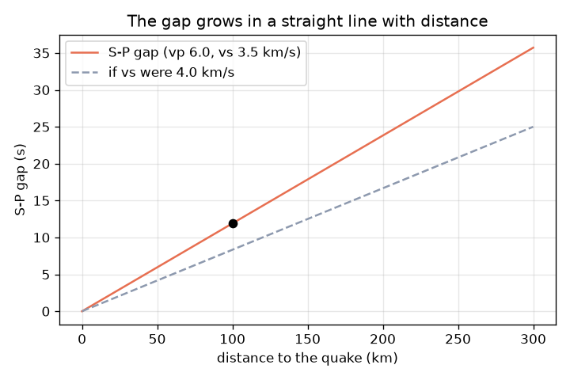
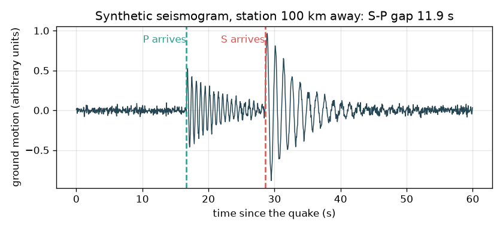

# സെഷൻ 1: രണ്ട് തരംഗങ്ങൾ, ഒരു ഇടവേള: അത് എത്ര ദൂരെയായിരുന്നു?

[Session 1 — हिन्दी](README.hi.md)

*ലെവൽ 1 (ആശയപരമായ ഇന്ററാക്ടീവ് മോഡൽ) · ഏകദേശം 60 മിനിറ്റ് · openseismo*

> ഇത് ഒരു ലളിതമാക്കിയ വിദ്യാഭ്യാസ മോഡൽ ആണ്. ഇത് സാധൂകരിക്കപ്പെട്ട ഒരു ഡിസൈൻ ഉപകരണമല്ല; യഥാർത്ഥ നിർമ്മിതികൾ, വൈദ്യുത ഇൻസ്റ്റലേഷനുകൾ, വാഹനങ്ങൾ, വ്യാവസായിക പ്രക്രിയകൾ അല്ലെങ്കിൽ വൈദ്യപരമായ തീരുമാനങ്ങൾ എന്നിവയ്ക്ക് ഇത് ഉപയോഗിക്കരുത്.

**മുൻ അറിവ് (Prerequisites)**

- വേഗത = ദൂരം / സമയം (സ്കൂൾ ഗണിതം).
- നിങ്ങൾ PRIMER.md വായിക്കുകയും `python start.py 1` ഒരു തവണ റൺ ചെയ്യുകയും ചെയ്തിട്ടുണ്ട്.

**പഠന ലക്ഷ്യങ്ങൾ (Learning objectives).** ഈ സെഷനു ശേഷം നിങ്ങൾക്ക് കഴിയും:

- P തരംഗവും (P wave) S തരംഗവും (S wave) തമ്മിലുള്ള വ്യത്യാസവും P ആദ്യം എത്തുന്നത് എന്തുകൊണ്ടെന്നും വിശദീകരിക്കാൻ.
- t = d / v ഉപയോഗിച്ച് യാത്രാ സമയം കണക്കാക്കാൻ.
- 1 സെക്കൻഡ് ഇടവേള = 8.4 km എന്ന നിയമം ഉപയോഗിച്ച് S-P ഇടവേളയെ ദൂരമാക്കി മാറ്റാൻ.
- ദൂരത്തിനെതിരായ S-P ഇടവേളയുടെ ഗ്രാഫ് വായിക്കാൻ.

## A. യഥാർത്ഥ ലോക പ്രശ്നം
കൊടുങ്കാറ്റിനിടയിൽ നിങ്ങൾ മിന്നൽ കാണുകയും ഇടിമുഴക്കം വരെയുള്ള സെക്കൻഡുകൾ എണ്ണുകയും ചെയ്യുന്നു: കാത്തിരിപ്പ് കൂടുന്തോറും മിന്നൽ കൂടുതൽ അകലെയാണ്. ഭൂകമ്പവും ഇതേ രീതിയിലാണ് പ്രവർത്തിക്കുന്നത്, പക്ഷേ രണ്ട് സിഗ്നലുകളും ഭൂമിയിലെ തരംഗങ്ങളാണ്. ആദ്യം എത്തുന്നത് P തരംഗം (വേഗതയേറിയത്, സഞ്ചാര ദിശയിൽ തള്ളുകയും വലിക്കുകയും ചെയ്യുന്ന ഞെരുക്കം); പിന്നീട് S തരംഗം (വേഗത കുറഞ്ഞത്, വശത്തേക്കുള്ള കുലുക്കം). ഒരു സീസ്മോഗ്രാഫ് (seismograph) രണ്ടും രേഖപ്പെടുത്തുന്നു. അവ തമ്മിലുള്ള കാത്തിരിപ്പ് ഭൂകമ്പം എത്ര ദൂരെയായിരുന്നു എന്ന് പറയുമോ? ഈ റിപ്പോസിറ്ററി പഠനത്തിന് മാത്രമുള്ളതാണ്: ഇതിന് ആരെയും മുന്നറിയിപ്പ് നൽകാൻ കഴിയില്ല, ഭൂകമ്പങ്ങൾ പ്രവചിക്കാനും കഴിയില്ല.

## B. ആശയവും സിദ്ധാന്തവും
v വേഗതയിൽ d ദൂരം പിന്നിടുന്ന ഒരു തരംഗത്തിന് t = d / v സമയം വേണം. സാധാരണ ഭൂവൽക്കത്തിന്റെ മുകൾഭാഗത്ത് P തരംഗങ്ങൾക്ക് vp = 6.0 km/s ഉം S തരംഗങ്ങൾക്ക് vs = 3.5 km/s ഉം ഉപയോഗിക്കുന്നു (ഏകദേശ അധ്യാപന മൂല്യങ്ങൾ; യഥാർത്ഥ പാറ സ്ഥലത്തിനനുസരിച്ച് മാറുന്നു). രണ്ടും ഭൂകമ്പത്തിൽ ഒരുമിച്ച് തുടങ്ങുന്നു, അതിനാൽ S തരംഗം പിന്നിലാകുന്നു: d ദൂരത്തിന് ശേഷം ഇടവേള gap = d / vs - d / vp ആണ്. ഇത് തിരിച്ചാക്കിയാൽ d = gap x vp x vs / (vp - vs) ലഭിക്കും. നമ്മുടെ വേഗതകൾ ഉപയോഗിച്ചാൽ ഓരോ സെക്കൻഡ് ഇടവേളയ്ക്കും 6.0 x 3.5 / 2.5 = 8.4 km മൂല്യമുണ്ട്. മിന്നൽ നിയമം ഇതേ ആശയമാണ്, P ന് പകരം പ്രകാശം (തൽക്ഷണം), S ന് പകരം ശബ്ദം (ഏകദേശം 343 m/s, അതായത് ഒരു കിലോമീറ്ററിന് 2.9 s).

| ചിഹ്നം | അർത്ഥം | യൂണിറ്റ് |
|---|---|---|
| d | ഭൂകമ്പത്തിൽ നിന്ന് സ്റ്റേഷനിലേക്കുള്ള ദൂരം | km |
| vp | P തരംഗ വേഗത (ഏകദേശ സാധാരണ മൂല്യം 6.0) | km/s |
| vs | S തരംഗ വേഗത (ഏകദേശ സാധാരണ മൂല്യം 3.5) | km/s |
| tp, ts | ഭൂകമ്പത്തിന്റെ തുടക്കം മുതൽ അളക്കുന്ന P, S എന്നിവയുടെ എത്തിച്ചേരൽ സമയം | s |
| gap | S-P ഇടവേള = ts - tp | s |

**അനുമാനങ്ങൾ (Assumptions)**

- സ്ഥിര വേഗതയിൽ നേർരേഖാ സഞ്ചാരം (ഒരു ലളിതവൽക്കരണം; യഥാർത്ഥ തരംഗങ്ങൾ വളയുകയും ആഴത്തിനനുസരിച്ച് വേഗത മാറുകയും ചെയ്യുന്നു).
- ഭൂകമ്പം ഒരു ബിന്ദുവാണ്, ഒരു നിമിഷത്തിൽ തുടങ്ങുന്നു.
- വേഗതകൾ ഏകദേശ സാധാരണ മൂല്യങ്ങളാണ്, ഏതെങ്കിലും യഥാർത്ഥ സ്ഥലത്തെ അളവുകളല്ല.
- വിദ്യാഭ്യാസ മോഡൽ മാത്രം; മുന്നറിയിപ്പിനോ പ്രവചനത്തിനോ ഉള്ളതല്ല.

$$ t=\frac{d}{v} $$

$$ \text{gap}=t_s-t_p=\frac{d}{v_s}-\frac{d}{v_p} $$

$$ d=\text{gap}\cdot\frac{v_p v_s}{v_p-v_s}\qquad \frac{v_p v_s}{v_p-v_s}=8.4\ \text{km/s} $$

## C. ദൃശ്യ വിശദീകരണം
ആദ്യ ചിത്രം 100 km അകലെയുള്ള ഒരു സ്റ്റേഷനു വേണ്ടി സങ്കൽപ്പിച്ചുണ്ടാക്കിയ സീസ്മോഗ്രാം ആണ്: ശാന്തം, പിന്നെ 16.7 s ൽ P എത്തുമ്പോൾ ഒരു ചെറിയ ചലനം, പിന്നെ 28.6 s ൽ S എത്തുമ്പോൾ വലിയ ചലനം, ഇടവേള 11.9 s. രണ്ടാമത്തെ ചിത്രം ദൂരത്തിനെതിരെ S-P ഇടവേള വരയ്ക്കുന്നു: പൂജ്യത്തിലൂടെ കടന്നുപോകുന്ന ഒരു നേർരേഖ, 300 km ൽ 35.7 s ൽ എത്തുന്നു. കൂടുതൽ വേഗതയുള്ള S തരംഗം (4.0 km/s) ചെറിയ ഇടവേള നൽകുമെന്ന് ഒരു മുറിഞ്ഞ വര കാണിക്കുന്നു.

*S-P ഇടവേള ദൂരത്തിനനുസരിച്ച് നേർരേഖയിൽ വളരുന്നു (300 km ൽ 35.7 s).*

*ഭൂകമ്പത്തിൽ നിന്ന് 100 km അകലെയുള്ള സങ്കൽപ്പിച്ചുണ്ടാക്കിയ സീസ്മോഗ്രാം: P 16.7 s ൽ, S 28.6 s ൽ, ഇടവേള 11.9 s.*

## D. ഇന്ററാക്ടീവ് സിമുലേഷൻ
പാഠം റൺ ചെയ്യുക (`python start.py 1`), തുടർന്ന് ലൈവ് ആപ്പ് തുറക്കുക: [സെഷൻ 1: P, S തരംഗങ്ങളും ഇടവേളയും](https://krunalpanchal1995.github.io/pan-iit-oss/openseismo/session-01/) (അല്ലെങ്കിൽ ഈ ഫോൾഡറിലെ `app.html`). ദൂരം സ്ലൈഡ് ചെയ്ത് സീസ്മോഗ്രാമിൽ P, S വരവുകൾ വേർപിരിയുന്നത് നോക്കുക. vs, vp എന്നിവ മാറ്റി "ഇടവേളയുടെ ഓരോ സെക്കൻഡിനും km" എന്ന നിയമം എങ്ങനെ മാറുന്നു എന്ന് കാണുക.

**വെല്ലുവിളി (Challenge).** S-P ഇടവേള 20 സെക്കൻഡ് ആക്കുക (അര സെക്കൻഡിനുള്ളിൽ).

## E. ഉദാഹരണ പ്രശ്നവും പരീക്ഷണവും
**പ്രശ്നം.** ഒരു സ്റ്റേഷൻ ഭൂകമ്പത്തിൽ നിന്ന് 100 km അകലെയാണ്. P, S എത്തിച്ചേരൽ സമയങ്ങളും ഇടവേളയും കണ്ടെത്തുക, തുടർന്ന് ഇടവേളയിൽ നിന്ന് ദൂരം തിരിച്ചെടുക്കുക.

1. P തരംഗം: tp = 100 / 6.0 = 16.7 s.
2. S തരംഗം: ts = 100 / 3.5 = 28.6 s.
3. ഇടവേള = 28.6 - 16.7 = 11.9 s (റൗണ്ട് ചെയ്യുന്നതിന് മുമ്പ് 11.905).
4. നിയമം: 1 s ഇടവേള = 6.0 x 3.5 / (6.0 - 3.5) = 8.4 km.
5. ദൂരം = 11.905 x 8.4 = 100 km. തിരിച്ചുള്ള കണക്കുകൂട്ടൽ യോജിക്കുന്നു.

**ഉത്തരം.** P 16.7 s ൽ, S 28.6 s ൽ, ഇടവേള 11.9 s, ഇത് 100 km തിരികെ നൽകുന്നു.

**പരീക്ഷണം.** അടുത്ത ഇടിമിന്നൽ സമയത്ത് മിന്നൽ മുതൽ ഇടി വരെയുള്ള സെക്കൻഡുകൾ എണ്ണുക. ശബ്ദത്തിന് ഒരു കിലോമീറ്ററിന് ഏകദേശം 2.9 s വേണം (343 m/s), അതിനാൽ 9 s എണ്ണിയാൽ ഏകദേശം 3 km. സാധ്യമെങ്കിൽ ഒരു കാലാവസ്ഥാ ആപ്പുമായി താരതമ്യം ചെയ്യുക. സ്ഥിര വേഗതയിലുള്ള നേർപാതയ്ക്ക് മോഡൽ കൃത്യമാണ്; യഥാർത്ഥ വായുവും പാറയും ഏകതാനമല്ല, അതിനാൽ 10 ശതമാനമോ അതിൽ കൂടുതലോ പിശക് പ്രതീക്ഷിക്കുക. ഭൂകമ്പങ്ങൾക്ക്, ഒരു പൊതു ഏജൻസിയിൽ നിന്ന് ഡൗൺലോഡ് ചെയ്ത യഥാർത്ഥ സീസ്മോഗ്രാമുകൾ ഉപയോഗിച്ച് ഇതേ ആശയം പ്രവർത്തിക്കും: P, S സമയങ്ങൾ കണ്ണുകൊണ്ട് വായിച്ച് നിയമം പ്രയോഗിക്കുക.

## F. വിലയിരുത്തലും ഡിസൈൻ വെല്ലുവിളിയും
**ചോദ്യ തരം A: ആശയപരം.** P തരംഗം എപ്പോഴും S തരംഗത്തിന് മുമ്പ് എത്തുന്നത് എന്തുകൊണ്ട്? ഭൂകമ്പം സ്റ്റേഷന് വളരെ അടുത്താണെങ്കിൽ സീസ്മോഗ്രാം എങ്ങനെ കാണപ്പെടും?

സൂചന

ഏത് തരംഗത്തിനാണ് ഉയർന്ന വേഗത? ദൂരം കുറയുമ്പോൾ ഇടവേളയ്ക്ക് എന്ത് സംഭവിക്കുന്നു?

ഘട്ടം ഘട്ടമായുള്ള പരിഹാരം

P ക്കാണ് വേഗത കൂടുതൽ (നമ്മുടെ മോഡലിൽ 6.0, S ന് 3.5 km/s), അതിനാൽ ഏത് ദൂരത്തിനും അതിന് കുറഞ്ഞ സമയം മതി. ഇടവേള ദൂരത്തിന് ആനുപാതികമാണ്, അതിനാൽ വളരെ അടുത്ത ഭൂകമ്പത്തിന് ഇടവേള വളരെ ചെറുതാണ്, P, S ചലനങ്ങൾ പരസ്പരം ഇടകലരുന്നു; രണ്ട് വരവുകളും കണ്ണുകൊണ്ട് വേർതിരിക്കാൻ പ്രയാസമാണ്.

**ചോദ്യ തരം B: സംഖ്യാപരം.** ഒരു സ്റ്റേഷൻ 15 s ന്റെ S-P ഇടവേള രേഖപ്പെടുത്തുന്നു. ഭൂകമ്പം എത്ര ദൂരെയായിരുന്നു? ഉത്തരം യുക്തിസഹമാണോ എന്ന് പരിശോധിക്കുക.

സൂചന

1 s ഇടവേള = 8.4 km ഉപയോഗിക്കുക.

ഘട്ടം ഘട്ടമായുള്ള പരിഹാരം

ദൂരം = 15 x 8.4 = 126 km. പരിശോധന: P ക്ക് 126 / 6.0 = 21.0 s ഉം S ന് 126 / 3.5 = 36.0 s ഉം വേണം, ഇടവേള 15.0 s. ഫലം കിലോമീറ്ററിലാണ്, യുക്തിസഹമായ ഒരു പ്രാദേശിക ദൂരവുമാണ്.

**ചോദ്യ തരം C: ഗ്രാഫ്, സിമുലേഷൻ വ്യാഖ്യാനം.** ഇടവേള-ദൂര ഗ്രാഫിൽ 300 km ലെ ഇടവേള എത്രയാണ്? രേഖയുടെ ചരിവിന്റെ അർത്ഥം എന്താണ്? S വേഗത 4.0 km/s ആയി ഉയർന്നാൽ എന്ത് മാറും?

സൂചന

ചരിവ് = ഇടവേള / ദൂരം = 1/vs - 1/vp.

ഘട്ടം ഘട്ടമായുള്ള പരിഹാരം

300 km ൽ ഇടവേള 35.7 s ആണ്. ചരിവ്, 1/3.5 - 1/6.0 = ഒരു km ന് 0.119 s, സഞ്ചരിക്കുന്ന ഓരോ കിലോമീറ്ററിനും S ന്റെ അധിക താമസമാണ് (അതായത് 8.4 km ന് 1 s). വേഗതയേറിയ S തരംഗം രേഖയെ പരത്തുന്നു: 100 km ൽ ഇടവേള 11.9 s ന് പകരം 8.33 s ആയിരിക്കും, അതിനാൽ അളന്ന അതേ ഇടവേള വലിയ ദൂരം അർത്ഥമാക്കും.

**ചോദ്യ തരം D: ഡിസൈൻ, ഒപ്റ്റിമൈസേഷൻ വെല്ലുവിളി.** ഡിസൈൻ: നിങ്ങൾ വായിക്കുന്ന S-P ഇടവേളയിൽ ഒരു സീസ്മോഗ്രാഫ് ക്ലോക്ക് 0.5 s വരെ തെറ്റാകാം. ഇത് എത്ര ദൂര പിശകിന് കാരണമാകുന്നു, 10 km നുള്ളിൽ വേണ്ട ഒരു പ്രാദേശിക ഭൂപടത്തിന് ഇത് സ്വീകാര്യമാണോ?

സൂചന

സമയ പിശകിനെ ഇടവേളയുടെ ഓരോ സെക്കൻഡിനുമുള്ള km കൊണ്ട് ഗുണിക്കുക.

ഘട്ടം ഘട്ടമായുള്ള പരിഹാരം

0.5 s x 8.4 km/s = 4.2 km. അത് 10 km ബജറ്റിനുള്ളിലാണ്, പക്ഷേ ഒരൊറ്റ സ്റ്റേഷൻ ഇപ്പോഴും ഒരു ദൂരം (ഒരു വൃത്തം) മാത്രമേ നൽകൂ, സ്ഥാനമല്ല, വേഗതകൾ തന്നെ ഏതാനും ശതമാനം അനിശ്ചിതമാണ്, അതിനാൽ യഥാർത്ഥ പിശക് വലുതാണ്. ട്രേഡ്-ഓഫ് (Trade-off): ഉയർന്ന സാമ്പിളിംഗ് നിരക്കും ശ്രദ്ധാപൂർവ്വമുള്ള തിരഞ്ഞെടുപ്പും സമയ പിശക് കുറയ്ക്കുന്നു; ദിശയ്ക്ക് രണ്ടാമത്തെയും മൂന്നാമത്തെയും സ്റ്റേഷൻ വേണം (സെഷൻ 2).

[RUBRIC.md](../../RUBRIC.md) ഉപയോഗിച്ച് സ്വയം സ്കോർ ചെയ്യുക. പേപ്പറിൽ ചെയ്യാൻ [ആക്ടിവിറ്റി ഷീറ്റ്](activity_sheet.md) പ്രിന്റ് ചെയ്യുക.

## സാധാരണ തെറ്റിദ്ധാരണകൾ
| സാധാരണ തെറ്റിദ്ധാരണ | യഥാർത്ഥത്തിൽ ശരിയായത് |
|---|---|
| S തരംഗം വലുതാണ്, അതിനാൽ അത് വേഗതയേറിയതായിരിക്കണം. | S തരംഗങ്ങൾ സാധാരണയായി വലിയ കുലുക്കം വഹിക്കുന്നു, പക്ഷേ വേഗത കുറഞ്ഞ തരംഗമാണ്: നമ്മുടെ മോഡലിൽ P ന് 6.0 km/s ന് എതിരെ ഏകദേശം 3.5 km/s. |
| ഇടവേള ഭൂകമ്പത്തിലേക്കുള്ള ദിശ പറയുന്നു. | ഇടവേള ഒരു ദൂരം മാത്രമേ നൽകൂ. ഭൂകമ്പം സ്റ്റേഷന് ചുറ്റും ആ ആരത്തിലുള്ള ഒരു വൃത്തത്തിൽ എവിടെയും ആകാം. |
| ഭൂകമ്പം തുടങ്ങുന്ന സമയത്താണ് P തരംഗം എത്തുന്നത്. | രണ്ട് തരംഗങ്ങളും ഒരേ നിമിഷത്തിൽ ഉറവിടം വിടുന്നു; ഓരോന്നിനും എത്താൻ d / v സെക്കൻഡ് വേണം. തുടക്ക സമയം നമുക്ക് അപൂർവ്വമായേ അറിയൂ, അതുകൊണ്ടാണ് ഇടവേള ഉപയോഗിക്കുന്നത്. |
| ഒരു മുന്നറിയിപ്പ് സംവിധാനത്തിനോ ഈ റിപ്പോസിറ്ററിക്കോ ഭൂകമ്പം പ്രവചിക്കാൻ കഴിയും. | ഭൂകമ്പങ്ങൾ പ്രവചിക്കാൻ കഴിയില്ല. ഈ റിപ്പോസിറ്ററി ഒരു ഭൂകമ്പം സംഭവിച്ചതിന് ശേഷം, രേഖപ്പെടുത്തിയ തരംഗങ്ങൾ ഉപയോഗിച്ച് അതിന്റെ സ്ഥാനം കണ്ടെത്തുക മാത്രം ചെയ്യുന്നു. |

## പദാവലി (Glossary)
- **P തരംഗം (P wave)**: വേഗതയേറിയ തരംഗം, സഞ്ചാര ദിശയിലെ തള്ളൽ-വലി സങ്കോചം
- **S തരംഗം (S wave)**: വേഗത കുറഞ്ഞ തരംഗം, വശത്തേക്കുള്ള അപരൂപണ കുലുക്കം
- **സീസ്മോഗ്രാഫ് (seismograph)**: സമയത്തിനെതിരെ ഭൂമിയുടെ ചലനം രേഖപ്പെടുത്തുന്ന ഉപകരണം
- **ഭൂകമ്പ കേന്ദ്രം (epicentre)**: ഭൂകമ്പം തുടങ്ങിയതിന് മുകളിൽ ഭൂമിയിലെ ബിന്ദു
- **S-P ഇടവേള (S-P gap)**: ഒരു സ്റ്റേഷനിൽ S വരവിനും P വരവിനും ഇടയിലുള്ള സമയം

## പൂർത്തിയാക്കുക
1. [exercises.md](exercises.md) ലെ മൂന്ന് കോഡിംഗ് ടാസ്കുകൾ ചെയ്യുക.
2. നിങ്ങളുടെ മാറ്റങ്ങൾക്കു ശേഷം `python start.py 1` വീണ്ടും റൺ ചെയ്യുക. ഇത് ചെക്ക്‌പോയിന്റോടെ അവസാനിക്കുന്നു; അത് `PASS` എന്ന് പ്രിന്റ് ചെയ്യുമ്പോൾ നിങ്ങൾ പൂർത്തിയാക്കി. (ചെക്ക്‌പോയിന്റ് മാത്രം: `python start.py check 1`.)

അടുത്തത്: [സെഷൻ 2](../session-02/README.md)
