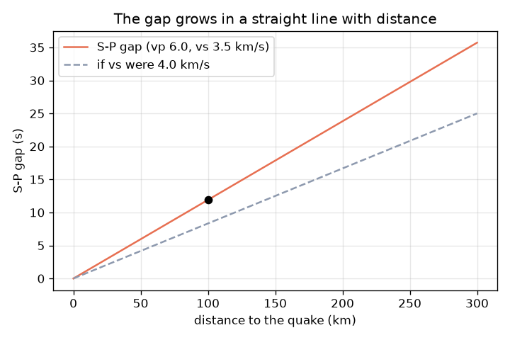
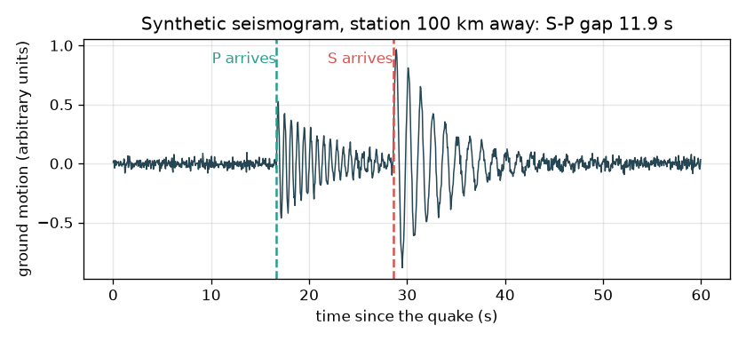

# அமர்வு 1: இரண்டு அலைகள், ஒரு இடைவெளி: அது எவ்வளவு தூரத்தில் இருந்தது?

[Session 1 — हिन्दी](README.hi.md) · [Session 1 — മലയാളം](README.ml.md)

*நிலை 1 (கருத்தியல் ஊடாடும் மாதிரி) · சுமார் 60 நிமிடங்கள் · openseismo*

> இது ஒரு எளிமைப்படுத்தப்பட்ட கல்வி மாதிரி. இது சரிபார்க்கப்பட்ட வடிவமைப்புக் கருவி அல்ல; உண்மையான கட்டமைப்புகள், மின் நிறுவல்கள், வாகனங்கள், தொழில்துறை செயல்முறைகள் அல்லது மருத்துவ முடிவுகளுக்கு இதைப் பயன்படுத்தக் கூடாது.

**முன்தேவைகள் (Prerequisites)**

- வேகம் = தூரம் / நேரம் (பள்ளிக் கணிதம்).
- நீங்கள் PRIMER.md ஐப் படித்து, `python start.py 1` ஐ ஒரு முறை இயக்கியிருக்கிறீர்கள்.

**கற்றல் நோக்கங்கள் (Learning objectives).** இந்த அமர்வுக்குப் பிறகு உங்களால் முடியும்:

- P அலைக்கும் (P wave) S அலைக்கும் (S wave) உள்ள வேறுபாட்டையும் P ஏன் முதலில் வருகிறது என்பதையும் விளக்க.
- t = d / v ஐப் பயன்படுத்திப் பயண நேரங்களைக் கணக்கிட.
- 1 வினாடி இடைவெளி = 8.4 km என்ற விதியால் S-P இடைவெளியைத் தூரமாக மாற்ற.
- தூரத்துக்கு எதிரான S-P இடைவெளியின் வரைபடத்தைப் படிக்க.

## A. நிஜ உலகப் பிரச்சினை
புயலின் போது நீங்கள் மின்னலைப் பார்த்து இடி வரை வினாடிகளை எண்ணுகிறீர்கள்: காத்திருப்பு நீண்டால் மின்னல் தொலைவில் உள்ளது. நிலநடுக்கமும் இதேபோலவே செயல்படுகிறது, ஆனால் இரண்டு சமிக்ஞைகளும் தரையில் செல்லும் அலைகள். முதலில் வருவது P அலை (வேகமானது, பயணத் திசையில் தள்ளி இழுக்கும் அழுத்தம்); பின்னர் S அலை (மெதுவானது, பக்கவாட்டு அதிர்வு). நில அதிர்வுமானி (seismograph) இரண்டையும் பதிவு செய்கிறது. அவற்றுக்கு இடையிலான காத்திருப்பு நிலநடுக்கம் எவ்வளவு தூரத்தில் இருந்தது என்று சொல்ல முடியுமா? இந்தக் களஞ்சியம் கற்றலுக்கு மட்டுமே: இது யாருக்கும் எச்சரிக்கை தர முடியாது, நிலநடுக்கங்களை முன்னறிவிக்கவும் முடியாது.

## B. கருத்தும் கோட்பாடும்
v வேகத்தில் d தூரத்தைக் கடக்கும் அலைக்கு t = d / v நேரம் தேவை. வழக்கமான மேல் புவியோட்டில் P அலைகளுக்கு vp = 6.0 km/s மற்றும் S அலைகளுக்கு vs = 3.5 km/s பயன்படுத்துகிறோம் (தோராயமான கற்பித்தல் மதிப்புகள்; உண்மையான பாறை இடத்துக்கு இடம் மாறுபடும்). இரண்டும் நிலநடுக்கத்தில் ஒன்றாகத் தொடங்குகின்றன, எனவே S அலை பின்தங்குகிறது: d தூரத்துக்குப் பிறகு இடைவெளி gap = d / vs - d / vp. இதைத் திருப்பினால் d = gap x vp x vs / (vp - vs) கிடைக்கிறது. நம் வேகங்களுடன் ஒவ்வொரு வினாடி இடைவெளிக்கும் 6.0 x 3.5 / 2.5 = 8.4 km மதிப்பு. மின்னல் விதியும் இதே கருத்துதான், P க்குப் பதிலாக ஒளி (உடனடி), S க்குப் பதிலாக ஒலி (சுமார் 343 m/s, அதாவது ஒரு கிலோமீட்டருக்கு 2.9 s).

| குறியீடு | பொருள் | அலகு |
|---|---|---|
| d | நிலநடுக்கத்திலிருந்து நிலையத்துக்கான தூரம் | km |
| vp | P அலை வேகம் (தோராயமான வழக்கமான மதிப்பு 6.0) | km/s |
| vs | S அலை வேகம் (தோராயமான வழக்கமான மதிப்பு 3.5) | km/s |
| tp, ts | நிலநடுக்கம் தொடங்கியதிலிருந்து அளக்கப்படும் P மற்றும் S வருகை நேரம் | s |
| gap | S-P இடைவெளி = ts - tp | s |

**அனுமானங்கள் (Assumptions)**

- மாறா வேகத்தில் நேர்கோட்டுப் பயணம் (எளிமைப்படுத்தல்; உண்மையான அலைகள் வளைகின்றன, ஆழத்துடன் வேகம் மாறுகிறது).
- நிலநடுக்கம் ஒரு புள்ளி, ஒரே கணத்தில் தொடங்குகிறது.
- வேகங்கள் தோராயமான வழக்கமான மதிப்புகள், எந்த உண்மையான இடத்தின் அளவீடுகளும் அல்ல.
- கல்வி மாதிரி மட்டுமே; எச்சரிக்கை அல்லது முன்னறிவிப்புக்கு அல்ல.

$$ t=\frac{d}{v} $$

$$ \text{gap}=t_s-t_p=\frac{d}{v_s}-\frac{d}{v_p} $$

$$ d=\text{gap}\cdot\frac{v_p v_s}{v_p-v_s}\qquad \frac{v_p v_s}{v_p-v_s}=8.4\ \text{km/s} $$

## C. காட்சி விளக்கம்
முதல் படம் 100 km தொலைவில் உள்ள நிலையத்துக்கான கற்பனை நில அதிர்வுப் பதிவு: அமைதி, பின்னர் 16.7 s இல் P வரும்போது சிறிய அசைவு, பின்னர் 28.6 s இல் S வரும்போது பெரிய அசைவு, இடைவெளி 11.9 s. இரண்டாவது படம் தூரத்துக்கு எதிராக S-P இடைவெளியை வரைகிறது: பூஜ்ஜியத்தின் வழியே செல்லும் நேர்கோடு, 300 km இல் 35.7 s ஐ அடைகிறது. வேகமான S அலை (4.0 km/s) சிறிய இடைவெளியைத் தரும் என்பதைப் புள்ளிக் கோடு காட்டுகிறது.

*S-P இடைவெளி தூரத்துடன் நேர்கோட்டில் வளர்கிறது (300 km இல் 35.7 s).*

*நிலநடுக்கத்திலிருந்து 100 km தொலைவில் ஒரு கற்பனை நில அதிர்வுப் பதிவு: P 16.7 s இல், S 28.6 s இல், இடைவெளி 11.9 s.*

## D. ஊடாடும் உருவகப்படுத்துதல்
பாடத்தை இயக்கவும் (`python start.py 1`), பின்னர் நேரடிச் செயலியைத் திறக்கவும்: [அமர்வு 1: P மற்றும் S அலைகளும் இடைவெளியும்](https://krunalpanchal1995.github.io/pan-iit-oss/openseismo/session-01/) (அல்லது இந்தக் கோப்புறையில் உள்ள `app.html`). தூரத்தை நழுவவிட்டு நில அதிர்வுப் பதிவில் P மற்றும் S வருகைகள் பிரிவதைப் பாருங்கள். vs மற்றும் vp ஐ மாற்றி "இடைவெளியின் ஒவ்வொரு வினாடிக்கும் km" விதி எவ்வாறு மாறுகிறது என்று பாருங்கள்.

**சவால் (Challenge).** S-P இடைவெளியை 20 வினாடிகள் ஆக்குங்கள் (அரை வினாடிக்குள்).

## E. தீர்க்கப்பட்ட எடுத்துக்காட்டும் சோதனையும்
**பிரச்சினை.** ஒரு நிலையம் நிலநடுக்கத்திலிருந்து 100 km தொலைவில் உள்ளது. P மற்றும் S வருகை நேரங்களையும் இடைவெளியையும் கண்டறிந்து, பின்னர் இடைவெளியிலிருந்து தூரத்தை மீட்டெடுக்கவும்.

1. P அலை: tp = 100 / 6.0 = 16.7 s.
2. S அலை: ts = 100 / 3.5 = 28.6 s.
3. இடைவெளி = 28.6 - 16.7 = 11.9 s (முழுமையாக்கும் முன் 11.905).
4. விதி: 1 s இடைவெளி = 6.0 x 3.5 / (6.0 - 3.5) = 8.4 km.
5. தூரம் = 11.905 x 8.4 = 100 km. சுற்றுக் கணக்கீடு ஒத்துப்போகிறது.

**விடை.** P 16.7 s இல், S 28.6 s இல், இடைவெளி 11.9 s, இது 100 km ஐ மீண்டும் தருகிறது.

**சோதனை.** அடுத்த இடிமழையின் போது மின்னலிலிருந்து இடி வரை வினாடிகளை எண்ணுங்கள். ஒலிக்கு ஒரு கிலோமீட்டருக்கு சுமார் 2.9 s தேவை (343 m/s), எனவே 9 s எண்ணினால் சுமார் 3 km. முடிந்தால் வானிலைச் செயலியுடன் ஒப்பிடுங்கள். மாறா வேகத்தில் நேர்ப்பாதைக்கு மாதிரி சரியானது; உண்மையான காற்றும் பாறையும் சீரானவை அல்ல, எனவே 10 சதவீதம் அல்லது அதற்கு மேல் பிழையை எதிர்பாருங்கள். நிலநடுக்கங்களுக்கு, பொது நிறுவனத்திலிருந்து பதிவிறக்கிய உண்மையான நில அதிர்வுப் பதிவுகளுடன் இதே கருத்து செயல்படுகிறது: P மற்றும் S நேரங்களைக் கண்ணால் படித்து விதியைப் பயன்படுத்துங்கள்.

## F. மதிப்பீடும் வடிவமைப்புச் சவாலும்
**கேள்வி வகை A: கருத்தியல்.** P அலை ஏன் எப்போதும் S அலைக்கு முன் வருகிறது? நிலநடுக்கம் நிலையத்துக்கு மிக அருகில் இருந்தால் நில அதிர்வுப் பதிவு எப்படி இருக்கும்?

குறிப்பு

எந்த அலைக்கு அதிக வேகம்? தூரம் குறையும்போது இடைவெளிக்கு என்ன ஆகிறது?

படிப்படியான தீர்வு

P வேகமானது (நம் மாதிரியில் 6.0, S க்கு 3.5 km/s), எனவே எந்தத் தூரத்துக்கும் அதற்குக் குறைவான நேரம் போதும். இடைவெளி தூரத்துக்கு விகிதசமம், எனவே மிக அருகிலுள்ள நிலநடுக்கத்துக்கு இடைவெளி மிகச் சிறியது, P மற்றும் S அசைவுகள் ஒன்றோடொன்று கலந்துவிடும்; இரண்டு வருகைகளையும் கண்ணால் பிரிப்பது கடினம்.

**கேள்வி வகை B: எண்ணியல்.** ஒரு நிலையம் 15 s S-P இடைவெளியைப் பதிவு செய்கிறது. நிலநடுக்கம் எவ்வளவு தொலைவில் இருந்தது? விடை பொருத்தமானதா என்று சரிபாருங்கள்.

குறிப்பு

1 s இடைவெளி = 8.4 km ஐப் பயன்படுத்துங்கள்.

படிப்படியான தீர்வு

தூரம் = 15 x 8.4 = 126 km. சரிபார்ப்பு: P க்கு 126 / 6.0 = 21.0 s, S க்கு 126 / 3.5 = 36.0 s தேவை, இடைவெளி 15.0 s. முடிவு கிலோமீட்டரில் உள்ளது, பொருத்தமான பிராந்தியத் தூரமும் கூட.

**கேள்வி வகை C: வரைபடம் மற்றும் உருவகப்படுத்துதல் விளக்கம்.** இடைவெளி-தூர வரைபடத்தில் 300 km இல் இடைவெளி என்ன? கோட்டின் சாய்வின் பொருள் என்ன? S வேகம் 4.0 km/s ஆக உயர்ந்தால் என்ன மாறும்?

குறிப்பு

சாய்வு = இடைவெளி / தூரம் = 1/vs - 1/vp.

படிப்படியான தீர்வு

300 km இல் இடைவெளி 35.7 s. சாய்வு, 1/3.5 - 1/6.0 = ஒரு km க்கு 0.119 s, பயணிக்கும் ஒவ்வொரு கிலோமீட்டருக்கும் S இன் கூடுதல் தாமதம் (அதாவது 8.4 km க்கு 1 s). வேகமான S அலை கோட்டைத் தட்டையாக்குகிறது: 100 km இல் இடைவெளி 11.9 s க்குப் பதிலாக 8.33 s ஆக இருக்கும், எனவே அளந்த அதே இடைவெளி பெரிய தூரத்தைக் குறிக்கும்.

**கேள்வி வகை D: வடிவமைப்பு மற்றும் உகப்பாக்கச் சவால்.** வடிவமைப்பு: நீங்கள் படிக்கும் S-P இடைவெளியில் நில அதிர்வுமானி கடிகாரம் 0.5 s வரை தவறாக இருக்கலாம். இது எவ்வளவு தூரப் பிழையை ஏற்படுத்துகிறது, 10 km க்குள் வேண்டிய பிராந்திய வரைபடத்துக்கு இது ஏற்கத்தக்கதா?

குறிப்பு

நேரப் பிழையை இடைவெளியின் ஒவ்வொரு வினாடிக்குமான km ஆல் பெருக்குங்கள்.

படிப்படியான தீர்வு

0.5 s x 8.4 km/s = 4.2 km. அது 10 km வரம்புக்குள் உள்ளது, ஆனால் ஒரே நிலையம் இன்னும் தூரத்தை (ஒரு வட்டத்தை) மட்டுமே தருகிறது, இடத்தை அல்ல, வேகங்களே சில சதவீதம் நிச்சயமற்றவை, எனவே உண்மையான பிழை பெரியது. பரிமாற்றம் (Trade-off): அதிக மாதிரி வீதமும் கவனமான தேர்வும் நேரப் பிழையைக் குறைக்கின்றன; திசைக்கு இரண்டாவது மற்றும் மூன்றாவது நிலையம் தேவை (அமர்வு 2).

[RUBRIC.md](../../RUBRIC.md) மூலம் உங்களை நீங்களே மதிப்பிடுங்கள். காகிதத்தில் செய்ய [செயல்பாட்டுத் தாளை](activity_sheet.md) அச்சிடுங்கள்.

## பொதுவான தவறான கருத்துகள்
| பொதுவான தவறான கருத்து | உண்மையில் சரியானது |
|---|---|
| S அலை பெரியது, எனவே அது வேகமாக இருக்க வேண்டும். | S அலைகள் பொதுவாக பெரிய அதிர்வைச் சுமக்கின்றன, ஆனால் மெதுவான அலை: நம் மாதிரியில் P க்கு 6.0 km/s க்கு எதிராக சுமார் 3.5 km/s. |
| இடைவெளி நிலநடுக்கத்தின் திசையைச் சொல்கிறது. | இடைவெளி தூரத்தை மட்டுமே தருகிறது. நிலநடுக்கம் நிலையத்தைச் சுற்றி அந்த ஆரத்தின் வட்டத்தில் எங்கும் இருக்கலாம். |
| நிலநடுக்கம் தொடங்கும் நேரத்திலேயே P அலை வருகிறது. | இரண்டு அலைகளும் ஒரே கணத்தில் மூலத்தை விட்டுப் புறப்படுகின்றன; ஒவ்வொன்றும் வர d / v வினாடிகள் தேவை. தொடக்க நேரம் நமக்கு அரிதாகவே தெரியும், அதனால்தான் இடைவெளியைப் பயன்படுத்துகிறோம். |
| எச்சரிக்கை அமைப்போ இந்தக் களஞ்சியமோ நிலநடுக்கத்தை முன்னறிவிக்க முடியும். | நிலநடுக்கங்களை முன்னறிவிக்க முடியாது. இந்தக் களஞ்சியம் நிலநடுக்கம் நடந்த பிறகு, பதிவான அலைகளைப் பயன்படுத்தி அதன் இடத்தைக் கண்டறிகிறது, அவ்வளவே. |

## சொற்களஞ்சியம் (Glossary)
- **P அலை (P wave)**: வேகமான அலை, பயணத் திசையில் தள்ளி இழுக்கும் அழுத்தம்
- **S அலை (S wave)**: மெதுவான அலை, பக்கவாட்டு வெட்டு அதிர்வு
- **நில அதிர்வுமானி (seismograph)**: நேரத்துக்கு எதிராகத் தரை இயக்கத்தைப் பதிவு செய்யும் கருவி
- **மேல்மையம் (epicentre)**: நிலநடுக்கம் தொடங்கிய இடத்துக்கு மேலே தரையில் உள்ள புள்ளி
- **S-P இடைவெளி (S-P gap)**: ஒரு நிலையத்தில் S வருகைக்கும் P வருகைக்கும் இடையிலான நேரம்

## முடிக்கவும்
1. [exercises.md](exercises.md) இல் உள்ள மூன்று நிரலாக்கப் பணிகளைச் செய்யுங்கள்.
2. உங்கள் மாற்றங்களுக்குப் பிறகு `python start.py 1` ஐ மீண்டும் இயக்குங்கள். இது சோதனைச்சாவடியுடன் (checkpoint) முடிகிறது; அது `PASS` என்று அச்சிடும்போது நீங்கள் முடித்துவிட்டீர்கள். (சோதனைச்சாவடி மட்டும்: `python start.py check 1`.)

அடுத்து: [அமர்வு 2](../session-02/README.md)
