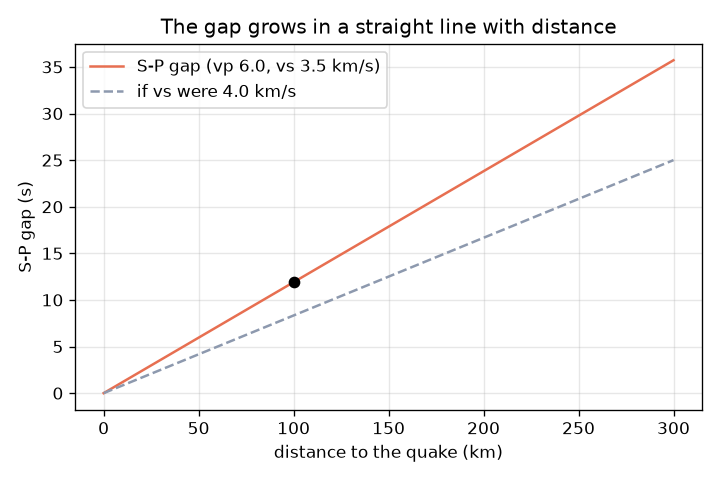
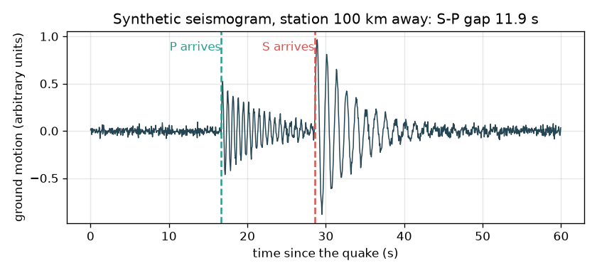

# సెషన్ 1: రెండు తరంగాలు, ఒక అంతరం: అది ఎంత దూరంలో ఉంది?

[Session 1 — हिन्दी](README.hi.md) · [Session 1 — മലയാളം](README.ml.md) · [Session 1 — தமிழ்](README.ta.md)

*స్థాయి 1 (భావనాత్మక ఇంటరాక్టివ్ నమూనా) · సుమారు 60 నిమిషాలు · openseismo*

> ఇది ఒక సరళీకృత విద్యా నమూనా. ఇది ధృవీకరించబడిన డిజైన్ సాధనం కాదు; నిజమైన నిర్మాణాలు, విద్యుత్ ఇన్‌స్టలేషన్లు, వాహనాలు, పారిశ్రామిక ప్రక్రియలు లేదా వైద్య నిర్ణయాల కోసం దీనిని ఉపయోగించకూడదు.

**ముందస్తు అవసరాలు (Prerequisites)**

- వేగం = దూరం / సమయం (పాఠశాల గణితం).
- మీరు PRIMER.md చదివి, `python start.py 1` ను ఒకసారి రన్ చేశారు.

**అభ్యసన లక్ష్యాలు (Learning objectives).** ఈ సెషన్ తర్వాత మీరు చేయగలరు:

- P తరంగం (P wave) మరియు S తరంగం (S wave) మధ్య తేడాను, P ఎందుకు ముందు వస్తుందో వివరించడం.
- t = d / v తో ప్రయాణ సమయాలను లెక్కించడం.
- 1 సెకను అంతరం = 8.4 km అనే నియమంతో S-P అంతరాన్ని దూరంగా మార్చడం.
- దూరానికి వ్యతిరేకంగా S-P అంతరం గ్రాఫ్‌ను చదవడం.

## A. వాస్తవ ప్రపంచ సమస్య
తుఫాను సమయంలో మీరు మెరుపు చూసి ఉరుము వరకు సెకన్లు లెక్కిస్తారు: ఎంత ఎక్కువ వేచి ఉంటే మెరుపు అంత దూరంలో ఉంది. భూకంపం కూడా ఇలాగే పనిచేస్తుంది, కానీ రెండు సంకేతాలు భూమిలోని తరంగాలు. మొదట వచ్చేది P తరంగం (వేగవంతమైనది, ప్రయాణ దిశలో నెట్టి లాగే సంపీడనం); తర్వాత S తరంగం (నెమ్మదిగా, పక్కకు ఊగే కంపనం). భూకంప లేఖిని (seismograph) రెండింటినీ నమోదు చేస్తుంది. వాటి మధ్య వేచి ఉండే సమయం భూకంపం ఎంత దూరంలో ఉందో చెప్పగలదా? ఈ రిపాజిటరీ నేర్చుకోవడానికి మాత్రమే: ఇది ఎవరినీ హెచ్చరించలేదు, భూకంపాలను అంచనా వేయడం సాధ్యం కాదు.

## B. భావన మరియు సిద్ధాంతం
v వేగంతో d దూరం ప్రయాణించే తరంగానికి t = d / v సమయం కావాలి. సాధారణ ఎగువ భూపటలంలో P తరంగాలకు vp = 6.0 km/s మరియు S తరంగాలకు vs = 3.5 km/s ఉపయోగిస్తాము (సుమారు బోధనా విలువలు; నిజమైన శిల చోటును బట్టి మారుతుంది). రెండూ భూకంపంలో ఒకేసారి మొదలవుతాయి, కాబట్టి S తరంగం వెనుకబడుతుంది: d దూరం తర్వాత అంతరం gap = d / vs - d / vp. దీన్ని తిప్పితే d = gap x vp x vs / (vp - vs) వస్తుంది. మన వేగాలతో ప్రతి సెకను అంతరానికి 6.0 x 3.5 / 2.5 = 8.4 km విలువ. మెరుపు నియమం కూడా ఇదే భావన, P స్థానంలో కాంతి (తక్షణం), S స్థానంలో ధ్వని (సుమారు 343 m/s, అంటే కిలోమీటరుకు 2.9 s).

| గుర్తు | అర్థం | యూనిట్ |
|---|---|---|
| d | భూకంపం నుండి స్టేషన్‌కు దూరం | km |
| vp | P తరంగ వేగం (సుమారు సాధారణ విలువ 6.0) | km/s |
| vs | S తరంగ వేగం (సుమారు సాధారణ విలువ 3.5) | km/s |
| tp, ts | భూకంపం ప్రారంభం నుండి కొలిచే P మరియు S చేరే సమయం | s |
| gap | S-P అంతరం = ts - tp | s |

**ఊహలు (Assumptions)**

- స్థిర వేగంతో సరళరేఖా ప్రయాణం (సరళీకరణ; నిజమైన తరంగాలు వంగుతాయి, లోతుతో వేగాలు మారతాయి).
- భూకంపం ఒక బిందువు, ఒకే క్షణంలో మొదలవుతుంది.
- వేగాలు సుమారు సాధారణ విలువలు, ఏ నిజమైన ప్రదేశపు కొలతలూ కావు.
- విద్యా నమూనా మాత్రమే; హెచ్చరికకు లేదా అంచనాకు కాదు.

$$ t=\frac{d}{v} $$

$$ \text{gap}=t_s-t_p=\frac{d}{v_s}-\frac{d}{v_p} $$

$$ d=\text{gap}\cdot\frac{v_p v_s}{v_p-v_s}\qquad \frac{v_p v_s}{v_p-v_s}=8.4\ \text{km/s} $$

## C. దృశ్య వివరణ
మొదటి చిత్రం 100 km దూరంలోని స్టేషన్ కోసం కల్పిత భూకంప రేఖాచిత్రం: నిశ్శబ్దం, తర్వాత 16.7 s వద్ద P వచ్చినప్పుడు చిన్న కదలిక, తర్వాత 28.6 s వద్ద S వచ్చినప్పుడు పెద్ద కదలిక, అంతరం 11.9 s. రెండవ చిత్రం దూరానికి వ్యతిరేకంగా S-P అంతరాన్ని గీస్తుంది: సున్నా గుండా వెళ్ళే సరళరేఖ, 300 km వద్ద 35.7 s చేరుతుంది. వేగవంతమైన S తరంగం (4.0 km/s) చిన్న అంతరం ఇస్తుందని చుక్కల రేఖ చూపిస్తుంది.

*S-P అంతరం దూరంతో సరళరేఖలో పెరుగుతుంది (300 km వద్ద 35.7 s).*

*భూకంపం నుండి 100 km దూరంలో కల్పిత భూకంప రేఖాచిత్రం: P 16.7 s వద్ద, S 28.6 s వద్ద, అంతరం 11.9 s.*

## D. ఇంటరాక్టివ్ సిమ్యులేషన్
పాఠాన్ని రన్ చేయండి (`python start.py 1`), తర్వాత లైవ్ యాప్‌ను తెరవండి: [సెషన్ 1: P మరియు S తరంగాలు, అంతరం](https://krunalpanchal1995.github.io/pan-iit-oss/openseismo/session-01/) (లేదా ఈ ఫోల్డర్‌లోని `app.html`). దూరాన్ని స్లైడ్ చేసి భూకంప రేఖాచిత్రంలో P మరియు S రాకలు వేరుపడటం చూడండి. vs మరియు vp ను మార్చి "అంతరం యొక్క ప్రతి సెకనుకు km" నియమం ఎలా మారుతుందో చూడండి.

**సవాలు (Challenge).** S-P అంతరాన్ని 20 సెకన్లు చేయండి (అర సెకనులోపు).

## E. సాధించిన ఉదాహరణ మరియు ప్రయోగం
**సమస్య.** ఒక స్టేషన్ భూకంపం నుండి 100 km దూరంలో ఉంది. P మరియు S చేరే సమయాలను, అంతరాన్ని కనుగొని, తర్వాత అంతరం నుండి దూరాన్ని తిరిగి రాబట్టండి.

1. P తరంగం: tp = 100 / 6.0 = 16.7 s.
2. S తరంగం: ts = 100 / 3.5 = 28.6 s.
3. అంతరం = 28.6 - 16.7 = 11.9 s (పూర్తి చేయడానికి ముందు 11.905).
4. నియమం: 1 s అంతరం = 6.0 x 3.5 / (6.0 - 3.5) = 8.4 km.
5. దూరం = 11.905 x 8.4 = 100 km. తిరుగు లెక్క సరిపోతుంది.

**సమాధానం.** P 16.7 s వద్ద, S 28.6 s వద్ద, అంతరం 11.9 s, ఇది 100 km ను తిరిగి ఇస్తుంది.

**ప్రయోగం.** తదుపరి ఉరుముల వానలో మెరుపు నుండి ఉరుము వరకు సెకన్లు లెక్కించండి. ధ్వనికి కిలోమీటరుకు సుమారు 2.9 s కావాలి (343 m/s), కాబట్టి 9 s లెక్కిస్తే సుమారు 3 km. వీలైతే వాతావరణ యాప్‌తో పోల్చండి. స్థిర వేగంతో సరళ మార్గానికి నమూనా ఖచ్చితమైనది; నిజమైన గాలి మరియు శిల ఏకరీతి కాదు, కాబట్టి 10 శాతం లేదా అంతకంటే ఎక్కువ లోపాన్ని ఆశించండి. భూకంపాల కోసం, ప్రజా సంస్థ నుండి డౌన్‌లోడ్ చేసిన నిజమైన భూకంప రేఖాచిత్రాలతో ఇదే భావన పనిచేస్తుంది: P మరియు S సమయాలను కంటితో చదివి నియమాన్ని వర్తింపజేయండి.

## F. మూల్యాంకనం మరియు డిజైన్ సవాలు
**ప్రశ్న రకం A: భావనాత్మక.** P తరంగం ఎల్లప్పుడూ S తరంగం కంటే ముందు ఎందుకు వస్తుంది? భూకంపం స్టేషన్‌కు చాలా దగ్గరగా ఉంటే భూకంప రేఖాచిత్రం ఎలా ఉంటుంది?

సూచన

ఏ తరంగానికి ఎక్కువ వేగం? దూరం తగ్గినప్పుడు అంతరానికి ఏమవుతుంది?

దశలవారీ పరిష్కారం

P వేగవంతమైనది (మన నమూనాలో 6.0, S కు 3.5 km/s), కాబట్టి ఏ దూరానికైనా దానికి తక్కువ సమయం చాలు. అంతరం దూరానికి అనులోమానుపాతం, కాబట్టి చాలా దగ్గరి భూకంపానికి అంతరం చాలా చిన్నది, P మరియు S కదలికలు ఒకదానిలో ఒకటి కలిసిపోతాయి; రెండు రాకలను కంటితో వేరు చేయడం కష్టం.

**ప్రశ్న రకం B: సంఖ్యాత్మక.** ఒక స్టేషన్ 15 s S-P అంతరాన్ని చూపిస్తుంది. భూకంపం ఎంత దూరంలో ఉంది? సమాధానం సహేతుకమేనా అని పరీక్షించండి.

సూచన

1 s అంతరం = 8.4 km ఉపయోగించండి.

దశలవారీ పరిష్కారం

దూరం = 15 x 8.4 = 126 km. పరీక్ష: P కు 126 / 6.0 = 21.0 s, S కు 126 / 3.5 = 36.0 s కావాలి, అంతరం 15.0 s. ఫలితం కిలోమీటర్లలో ఉంది, సహేతుకమైన ప్రాంతీయ దూరం కూడా.

**ప్రశ్న రకం C: గ్రాఫ్ మరియు సిమ్యులేషన్ వ్యాఖ్యానం.** అంతరం-దూరం గ్రాఫ్‌లో 300 km వద్ద అంతరం ఎంత? రేఖ వాలు అర్థం ఏమిటి? S వేగం 4.0 km/s కు పెరిగితే ఏమి మారుతుంది?

సూచన

వాలు = అంతరం / దూరం = 1/vs - 1/vp.

దశలవారీ పరిష్కారం

300 km వద్ద అంతరం 35.7 s. వాలు, 1/3.5 - 1/6.0 = కిలోమీటరుకు 0.119 s, ప్రయాణించిన ప్రతి కిలోమీటరుకు S అదనపు ఆలస్యం (అంటే 8.4 km కు 1 s). వేగవంతమైన S తరంగం రేఖను చదును చేస్తుంది: 100 km వద్ద అంతరం 11.9 s బదులు 8.33 s ఉంటుంది, కాబట్టి కొలిచిన అదే అంతరం పెద్ద దూరాన్ని సూచిస్తుంది.

**ప్రశ్న రకం D: డిజైన్ మరియు ఆప్టిమైజేషన్ సవాలు.** డిజైన్: మీరు చదివే S-P అంతరంలో భూకంప లేఖిని గడియారం 0.5 s వరకు తప్పు కావచ్చు. ఇది ఎంత దూర లోపానికి కారణమవుతుంది, 10 km లోపల కావాల్సిన ప్రాంతీయ పటానికి ఇది ఆమోదయోగ్యమా?

సూచన

సమయ లోపాన్ని అంతరం యొక్క ప్రతి సెకనుకు km తో గుణించండి.

దశలవారీ పరిష్కారం

0.5 s x 8.4 km/s = 4.2 km. అది 10 km పరిమితిలోపే, కానీ ఒకే స్టేషన్ ఇప్పటికీ దూరాన్ని (ఒక వృత్తాన్ని) మాత్రమే ఇస్తుంది, స్థానాన్ని కాదు, వేగాలే కొన్ని శాతం అనిశ్చితం, కాబట్టి నిజమైన లోపం పెద్దది. ట్రేడ్-ఆఫ్ (Trade-off): అధిక నమూనా రేటు మరియు జాగ్రత్తగా ఎంపిక సమయ లోపాన్ని తగ్గిస్తాయి; దిశ కోసం రెండవ మరియు మూడవ స్టేషన్ కావాలి (సెషన్ 2).

[RUBRIC.md](../../RUBRIC.md) తో మిమ్మల్ని మీరు స్కోర్ చేసుకోండి. కాగితంపై పని చేయడానికి [కార్యాచరణ పత్రాన్ని](activity_sheet.md) ప్రింట్ చేయండి.

## సాధారణ అపోహలు
| సాధారణ అపోహ | నిజానికి సరైనది |
|---|---|
| S తరంగం పెద్దది, కాబట్టి అది వేగవంతమైనది అయి ఉండాలి. | S తరంగాలు సాధారణంగా పెద్ద కంపనాన్ని మోస్తాయి, కానీ నెమ్మదైన తరంగం: మన నమూనాలో P కు 6.0 km/s కు వ్యతిరేకంగా సుమారు 3.5 km/s. |
| అంతరం భూకంపం దిశను చెబుతుంది. | అంతరం దూరాన్ని మాత్రమే ఇస్తుంది. భూకంపం స్టేషన్ చుట్టూ ఆ వ్యాసార్థం ఉన్న వృత్తంపై ఎక్కడైనా ఉండవచ్చు. |
| భూకంపం మొదలైన సమయానికే P తరంగం చేరుతుంది. | రెండు తరంగాలు ఒకే క్షణంలో మూలాన్ని వదులుతాయి; ప్రతిదానికి చేరడానికి d / v సెకన్లు కావాలి. ప్రారంభ సమయం మనకు అరుదుగా తెలుస్తుంది, అందుకే అంతరాన్ని ఉపయోగిస్తాం. |
| హెచ్చరిక వ్యవస్థ లేదా ఈ రిపాజిటరీ భూకంపాన్ని అంచనా వేయగలదు. | భూకంపాలను అంచనా వేయలేము. ఈ రిపాజిటరీ భూకంపం జరిగిన తర్వాత, నమోదైన తరంగాలను ఉపయోగించి దాని స్థానాన్ని కనుగొంటుంది, అంతే. |

## పదకోశం (Glossary)
- **P తరంగం (P wave)**: వేగవంతమైన తరంగం, ప్రయాణ దిశలో నెట్టి లాగే సంపీడనం
- **S తరంగం (S wave)**: నెమ్మదైన తరంగం, పక్కకు ఊగే కోత కంపనం
- **భూకంప లేఖిని (seismograph)**: సమయానికి వ్యతిరేకంగా భూమి కదలికను నమోదు చేసే పరికరం
- **అధికేంద్రం (epicentre)**: భూకంపం మొదలైన చోటుకు పైన భూమిపై ఉన్న బిందువు
- **S-P అంతరం (S-P gap)**: ఒక స్టేషన్‌లో S రాకకు మరియు P రాకకు మధ్య సమయం

## ముగించండి
1. [exercises.md](exercises.md) లోని మూడు కోడింగ్ పనులను చేయండి.
2. మీ మార్పుల తర్వాత `python start.py 1` ను మళ్ళీ రన్ చేయండి. ఇది చెక్‌పాయింట్‌తో ముగుస్తుంది; అది `PASS` అని ప్రింట్ చేసినప్పుడు మీరు పూర్తి చేశారు. (చెక్‌పాయింట్ మాత్రమే: `python start.py check 1`.)

తదుపరి: [సెషన్ 2](../session-02/README.md)
